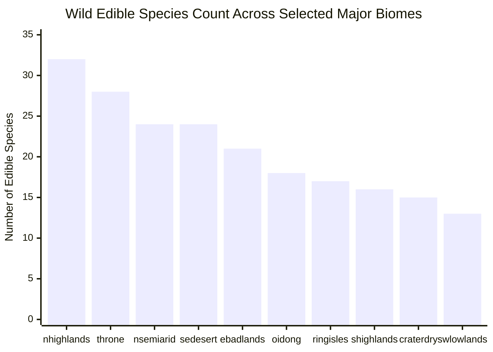

# Krator Master Botanical Survey & Ecological Architecture

This document synthesizes the comprehensive botanical surveys across all Krator biomes,
establishing the ecological, economic, alchemical, and craft baselines for the world.

### Catalogs in this Series:
- [BOTANY-MEDICINAL-REAGENT-FUEL.md](BOTANY-MEDICINAL-REAGENT-FUEL.md): Complete catalog of 374 medicinal, reagent, and fuel plants.
- [BOTANY-FOOD-CROPS.md](BOTANY-FOOD-CROPS.md): Complete catalog of 124 cultivated crops, 403 wild edibles, and 72 3D food pieces.
- [BOTANY-MISCELLANEOUS-PLANTS.md](BOTANY-MISCELLANEOUS-PLANTS.md): Complete catalog of 392 utilitarian craft plants across 11 domains.
- [botany_census.json](botany_census.json): Machine-readable authoritative census of all 861+ botanical species.
- Harvest audit tool: `tools/check_botany.py` (enforces tag consistency and auto-updates census during biome builds).

---

# Krator Biome Plant Survey: Medicinal, Reagent & Fuel Catalog

> [!NOTE]
> This survey synthesizes the ecological harvest tags across all procedural worlds and biomes in Krator.
> Across **50 biomes** equipped with procedural flora systems, **46 biomes** yield **374 qualifying species**:
> - **Medicinal Plants:** 283 species
> - **Reagent & Alchemical Plants / Siloxanes:** 30 species
> - **Fuel Plants (Firewood, Charcoal, Tinder, Torch Resins, Wicks):** 156 species
> *(Note: 87 keystone species fulfill dual or triple utility roles).*
>
> The exhaustive 374-entry species database is available in the companion master catalog:
> [krator_biome_plants_catalog.md](file:///home/antigravity/.gemini/jetski/brain/v1/default/jetski_remote_agents_3p/4876b10e-352a-437d-8aa3-ab5f80871e5a/krator_biome_plants_catalog.md)

---

## 1. Tag Architecture & Methodology

In Krator's biome core (`core/biome/`), plant harvests and ecological traits are declared through the `HV(...)` helper, typically shaped as:
```javascript
HV(wood, edible, medicinal, notes, fruit)
```
- **`wood` / `use`**: Declares timber grade, fiber properties, or combustion utility (`'fuel'`, `'firewood'`, `'fuel (charcoal)'`, `'tinder'`, `'torch resin'`).
- **`edible` / `food`**: Arrays of edible parts (`['fruit']`, `['roasted seed']`, `['sap']`, `[]`).
- **`medicinal`**: Boolean flag (`true` / `false`) signifying proven pharmacological, antiseptic, febrifugal, or wound-dressing value.
- **`notes`**: Detailed preparation methods (decoctions, salves, poultices, fever teas, tonics, arrow poisons, drying/roasting rules).
- **`reagent` / `gather` / `fruit`**: Fifth parameter or property indicating alchemical reagents (`'reagent'`), monastic ritual items, or specific harvestables.
- **Crops Kit Integration (`kits/crops/`)**: Utility crops (`reagent`, `fuel`, `medicine`, `dye`) are plain records (`[G data]`) mapped to their native home biomes (`home`, `src`).

---

## 2. Master Biome Survey Census

| Biome | Total Catalogued | Medicinal | Reagent | Fuel | Key Flora Highlights |
| :--- | :---: | :---: | :---: | :---: | :--- |
| **`abyssal-savannah`** | **7** | 7 | 1 | 2 | Shelf umbrella-tree (F/M), Rain rose (M/R - arrow poison), Umbrella thorn (F/M) |
| **`arch`** | **8** | 3 | 2 | 3 | Verdigris cap (R - nickel bio-ore), Sève bleue (R - 25% Ni latex), Maquis she-oak (F) |
| **`catch`** | **6** | 3 | 0 | 5 | Euphrates poplar (F/M), Salt cedar (F/M), Sand juzgun (F), Turpentine bush (F) |
| **`clivobredos`** | **2** | 1 | 0 | 1 | Throat comb (combos) (M - spore poison/remedy), Husk (huscos) (F - tinder) |
| **`copperglacier`** | **1** | 0 | 0 | 1 | Verdigris cushion (F - dried copper-rich fuel) |
| **`crater-drylands`** | **9** | 7 | 0 | 4 | Prism mallee (F/M - lignotuber charcoal & salve), Frill-tree (F), Ghost gum (M) |
| **`cut`** | **1** | 1 | 0 | 0 | Circle lichen (M - antiseptic wash & dye) |
| **`eastabyss`** | **4** | 3 | 0 | 3 | Bell-bark (M - fever tonic), Shelf umbrella-tree (F/M), Sanfordacaulis (F) |
| **`ebadlands`** | **15** | 15 | 0 | 5 | Pinyon pine (F/M), Utah juniper (F/M), Mormon tea (M), Creosote bush (M) |
| **`ehighlands`** | **15** | 13 | 0 | 8 | Poured cushion (F/M - resin & salve), Tola scrub (F), Ragbark (F/M) |
| **`farside`** | **2** | 0 | 2 | 0 | Land kelp (R - potash/soda/iodine), Oarweed (R - kelp ash) |
| **`firebliss`** | **2** | 1 | 0 | 1 | Fireweed (M - post-burn shoot tea), Ash tussock (F - quick fuel) |
| **`galvanic`** | **1** | 1 | 0 | 0 | Sulfur runner (M - steam poultice) |
| **`geyser`** | **4** | 2 | 0 | 3 | Thermal kanuka (F/M - firewood & tea), Nodding clubmoss (M), Warm reed (F) |
| **`gills`** | **2** | 1 | 0 | 1 | Lime collar (M - lung salt), Limewood (F - crusted mineral fuel) |
| **`greenstep`** | **2** | 1 | 0 | 1 | Hanging moss (F - tinder), Escargot begonia (M - leaf poultice) |
| **`guilin`** | **5** | 3 | 0 | 2 | Camphor (M), Sweet osmanthus (M), Ring-cupped oak (F), Masson pine (F) |
| **`highrift`** | **2** | 1 | 1 | 1 | Verdigris wort (M/R - copper green pigment), Steam heath (F) |
| **`hyperjungle`** | **12** | 10 | 0 | 5 | Pitch vine (F/M - torch resin & wound salve), Ghostwood (M), Prism gum (F/M) |
| **`k-guilin`** | **5** | 3 | 0 | 2 | Camphor laurel (M), Sweet osmanthus (M), Ring-cupped oak (F) |
| **`korona`** | **7** | 6 | 2 | 1 | Rainbow fan (M/R - summit apothecary reagent), Lace fan tree (M/R), Coin tree (F) |
| **`necanyons`** | **5** | 2 | 0 | 3 | Stilt lily (F - wet torches), Rock bottle (M - arrow/fish poison), Flametip (F) |
| **`neouterwall`** | **1** | 0 | 0 | 1 | Steam tree fern (F - trunk fuel) |
| **`nhighlands`** | **34** | 27 | 0 | 17 | Great spruce (M - scurvy tea/salve), Cathedral cedar (M), Gnarled oak (F/M) |
| **`nsemiarid`** | **17** | 15 | 0 | 10 | Wild pistachio (F/M - resin & firewood), Crescent saxaul (F/M - dense charcoal) |
| **`nwbay`** | **11** | 11 | 0 | 2 | Prism gum (M), Ironbark (M), Red mangrove (F - charcoal) |
| **`nwlowlands`** | **8** | 7 | 0 | 4 | Ghost gum (F/M), Ribbon blue gum (F/M - cough oil & fuel), She-oak (F) |
| **`nwouterwall`** | **5** | 4 | 0 | 2 | Silverthorn (F/M), Creeping stone pine (F), Ivan-chai (M), Larch beard (M) |
| **`oidong`** | **25** | 24 | 6 | 4 | Peyote (R - seeing reagent), Sky poppy (M/R), Bell-pod willow (M/R), Camphor (M/R) |
| **`opalvalley`** | **1** | 1 | 0 | 0 | Prism fern (M - wash for cuts) |
| **`paintedhighlands`** | **1** | 1 | 0 | 1 | Plateau sage (F/M - smudges & tonic) |
| **`rheolith`** | **9** | 0 | 9 | 0 | Choke-Coral (R - gag cake), Star-Egg (R - vitriol bath), Flux-Creeper (R - flux salt) |
| **`rift`** | **14** | 9 | 0 | 9 | Lobe tree (F), Candle stalk (F - resin torch), Curl succulent (M), Thorn column (M) |
| **`riftrim`** | **5** | 2 | 0 | 3 | Frost frill (F), Rimroot (M - alpine tonic), Veil thread (F), Shroud cedar (F) |
| **`ringisles`** | **13** | 10 | 0 | 5 | Corkwood (M - commiphora resin), Salt cedar (F/M), Beach morning glory (M) |
| **`scablands`** | **1** | 1 | 0 | 0 | Spray fern (M - burn poultice) |
| **`sedesert`** | **21** | 15 | 2 | 12 | Desert rose (M/R - arrow poison & heart drug), Mesquite (F/M), Candelabra (R) |
| **`shighlands`** | **12** | 9 | 0 | 4 | Coilbark (F - splits & firewood), Crozier tree fern (M), Ruffle-crown (F) |
| **`siphon-pits`** | **2** | 2 | 0 | 0 | Orange rock lichen (M - antiseptic), Dwarf blue willow (M - salicin bark) |
| **`slabfields`** | **1** | 1 | 0 | 0 | Block lichen (M - wound dressing) |
| **`swbay`** | **7** | 7 | 0 | 3 | Dragon tree (M - cinnabar resin), Gate baobab (M), Prism gum (F/M) |
| **`swhighlands`** | **2** | 1 | 0 | 1 | Bottle brush (F - dry spur firewood), Bulb heath (M - light-sensitive bulbs) |
| **`swlowlands`** | **20** | 16 | 0 | 12 | Sprawl oak (F/M), Ribbon gum (M), Melaleuca (F/M - cajuput oil & fuel) |
| **`throne`** | **24** | 18 | 4 | 6 | Snare plants (R - arrow poison), Sulphur rosette (R), Bone bell (M), Ranj tree (M) |
| **`tiers`** | **5** | 2 | 1 | 2 | Step moss (R - calcium carbonate rimstone precipitator), Ledge heath (M) |
| **`xanadu`** | **18** | 16 | 0 | 6 | Cloud pine (F/M - incense & salve), Ginkgo (M), Silver scrub (F/M - wormwood) |
| **TOTAL** | **374** | **283** | **30** | **156** | *(Across 46 biomes)* |

---

## 3. The Alchemical & Reagent Registry

Reagents include natural chemical precipitants, weapon poisons, ritual narcotics, and bio-metallurgical ores:

| Biome | Species | Key | Alchemical / Chemical Role |
| :--- | :--- | :--- | :--- |
| **`abyssal-savannah`** | **Rain rose** | `rainrose` | Milky sap boiled down as a potent arrow poison (*Adenium obesum* kin). |
| **`arch`** | **Sève bleue** | `pycnandra` | Hyperaccumulator tree whose blue-green latex is 25% metallic nickel (bio-mining). |
| **`arch`** | **Verdigris cap** | `verdigris` | Hyperaccumulator fungoid; crust is pure nickel; ash yields 10–20% Ni bio-ore. |
| **`farside`** | **Land kelp** | `landkelp` | Burned in strand kilns to produce potash and soda for soap/glass, and raw iodine. |
| **`farside`** | **Oarweed** | `oarweed` | Stipes and blades processed in kilns for industrial kelp ash. |
| **`highrift`** | **Verdigris wort** | `verdwort` | Copper-rich plant; burned ash yields vibrant copper-green pigment and flux reagent. |
| **`korona`** | **Rainbow fan** | `rainbowfan` | **The Reagent**: summit pavement rosettes; dried blades yield coveted apothecary dyes and reagents. |
| **`korona`** | **Lace fan tree** | `lacefan` | Translucent gorge fungus; dried fan is a stimulant and energetic tonic reagent. |
| **`oidong`** | **Peyote buttons** | `peyote` | Gravel flat cactus; dried buttons are the monks' primary visionary seeing reagent. |
| **`oidong`** | **Sky poppy** | `poppy` | Powder-blue poppy; seeds are a sleeping draught and stillness rite reagent; leaves dye Order's blue. |
| **`oidong`** | **Bell-pod willow** | `bellpod` | Coral bell pods dried into a potent sedative draught: *"one is sleep, two is a day lost"*. |
| **`oidong`** | **Camphor laurel** | `camphor` | Wood steamed for pure camphor crystals; head-clearing liniment and alchemical reagent. |
| **`oidong`** | **Iridescent water lily** | `lily` | Shifting violet-gold lily; roots steeped into an oneiric dream reagent. |
| **`oidong`** | **Valley ginseng** | `ginseng` | Man-shaped tonic root harvested after 7 years; monastic vigor reagent. |
| **`rheolith`** | **Choke-Coral** | `chokecoral` | Mineral-siloxane throat sinter; holds volatile throat vapors; reacts with Brimstone-Iron Gag-Cake. |
| **`rheolith`** | **Flux-Creeper** | `fluxcreeper` | Silicate grazer; displays feeding frenzy when introduced to Alkali-Fluorite Salt. |
| **`rheolith`** | **Star-Egg** | `staregg` | Dormant siloxane propagule; activates exclusively in a 260°C Hot Vitriol Bath. |
| **`rheolith`** | **Wire-Vein** | `wirevein` | Surface needles conducting Seebeck thermocurrent; reacts to Gag-Cake. |
| **`rheolith`** | **Foam-Reef** | `foamreef` | Lightweight porous Comb-Plates shed onto benches; reacts to flux salts. |
| **`rheolith`** | **Throat-Collar** | `throatcollar` | Zeolite sinter used as vapor-retaining Ranj mulch. |
| **`rheolith`** | **Glassy Scar-Plug** | `scarplug` | Seals borehole casings; turns brittle when treated with Heavy Dross. |
| **`rheolith`** | **Ringing Lava Blister** | `bellblister` | Acoustic crust resonance (~160 Hz) indicating molten flux stability. |
| **`rheolith`** | **Etch-Halo & Rime** | `etchhalo` | Selenium rime indicating subsurface Flux-Creeper blowout risk. |
| **`sedesert`** | **Desert rose** | `rose` | Toxic latex used as cardiac arrow poison; diluted in micro-doses as heart medicine. |
| **`sedesert`** | **Giant candelabra** | `candelabra` | Caustic milky sap blinding to eyes; used as a fish stunner and barrier toxin. |
| **`throne`** | **Snare flowers** | `snare` | Carnivorous trap secretions harvested for compounding caldera arrow poison. |
| **`throne`** | **Snare plants** | `snareplant` | Pitcher digestive acids compounded into toxic arrow coatings. |
| **`throne`** | **Snare raft** | `snareraft` | Aquatic carnivorous discs yielding venom base. |
| **`throne`** | **Sulphur rosette** | `sulphurrosette` | Acid-water rosette; primary base ingredient for Throne arrow poisons. |
| **`tiers`** | **Step moss** | `stepmoss` | Calcifying bryophyte actively precipitating limestone rimstone dams. |

---

## 4. Multi-Role Keystone Species

These keystone plants provide vital overlapping functions across survival and settlement economies:

1. **Pitch Vine (`hyperjungle` - `pitchvine`)**:
   - *Roles*: `Fuel`, `Medicinal`, `Dye`
   - *Profile*: Woody canopy liana bleeding sticky pitch. Dried stems provide wind- and rain-proof torches and kindling; raw resin dresses cuts and insect stings; collected soot yields deep black ink.
2. **Prism Mallee (`crater-drylands` - `prismmallee`)**:
   - *Roles*: `Fuel`, `Medicinal`
   - *Profile*: Resprouting central crater tree. The dense underground lignotuber burns slow and hot (prime charcoal); volatile leaf oils distilled into a restorative wound salve.
3. **Thermal Kanuka (`geyser` - `kanuka`)**:
   - *Roles*: `Fuel`, `Medicinal`
   - *Profile*: Sinuous geothermal tree. Hard aromatic firewood; aromatic leaves brewed into an antiseptic fever and digestive tea.
4. **Cloud Pine (`xanadu` - `cloudpine`)**:
   - *Roles*: `Fuel`, `Medicinal`
   - *Profile*: High montane conifer. Yields excellent hearth fuel and temple carving timber; fragrant resin harvested for wound salves and ceremonial incense.
5. **Mahogany (`hyperjungle` - `mahogany`)**:
   - *Roles*: `Fuel`, `Medicinal` (plus Edible seeds and master timber)
   - *Profile*: Giant rainforest timber tree. Bark boiled into a bitter febrifuge; woody spent seed capsules are rock-hard, dry, and burn long as natural furnace charcoal.
6. **Wild Pistachio (`nsemiarid` - `wildpistachio`)**:
   - *Roles*: `Fuel`, `Medicinal` (plus Edible nuts)
   - *Profile*: Semiarid resin tree. Hard, slow-burning firewood; mastic tears chewed for toothache and stomach ailments.
7. **Desert Rose (`sedesert` - `rose`)**:
   - *Roles*: `Medicinal`, `Reagent`
   - *Profile*: Pachycaul succulent. Sap yields high-potency cardiac glycoside arrow poison; carefully titred in micro-doses as a cardiac stimulant.

---

## 5. Crops Kit Native Cross-Reference (`kits/crops/`)

From `kits/crops/src/22-crop-material.js`, 27 utility crops have been formalized into Krator's regional agricultural simulation, each rooted in its native biome origin:

- **Reagents:**
  - `bearroot` (`nwouterwall`): Poisonous root (*Hedysarum mackenzii* - beer-isiit).
  - `umbrella-gum` (`abyssal-savannah`): Tree gum used as paint binder and adhesive.
  - `glow-mushroom` (`throne`): Subterranean bioluminescent alchemist culture and heat source.
  - `rock-bottle` (`necanyons`): Cardiotoxic milky sap used for arrow poisoning and fish stunning.
  - `kelp-ash` & `coral-lime` (`farside`): Industrial soda, potash, iodine, and mortar whitewash.
  - `bell-pod`, `peyote`, `sky-poppy`, `valley-ginseng`, `moon-cap`, `camphor` (`oidong`): Monastic ritual pharmacopeia.
- **Fuels:**
  - `saxaul` (`sedesert`): Ultra-dense desert firewood and metalworking charcoal.
  - `pitch-vine`, `kapok-floss`, `mahogany-capsule`, `prism-resin` (`hyperjungle`): Torches, tinder, capsule charcoal, and wicks.
  - `stilt-lily` (`necanyons`): Resinous trunk fibers burned as water-resistant flares.
  - `coilbark-split` (`shighlands`): Offcuts of turned lathe wood utilized for stove fuel.
  - `dried-reed` (`geyser`): Geothermal marsh reeds dried for furnace kindling.
  - `monks-sage` & `cedar-incense` (`oidong`): Aromatic incense fuels.
  - `cottongrass` & `birch-tar` (`nwouterwall`): Lamp wicks and dry-distilled pitch fuel.

---

> [!TIP]
> To inspect specific species implementations or integrate them into settlement simulation scripts (`SIM.goods`), consult the source fragments referenced in [krator_biome_plants_catalog.md](file:///home/antigravity/.gemini/jetski/brain/v1/default/jetski_remote_agents_3p/4876b10e-352a-437d-8aa3-ab5f80871e5a/krator_biome_plants_catalog.md).


---


# Krator Food Crops & Edible Flora: Comprehensive Survey Report

> [!NOTE]
> This survey synthesizes the food crops, agricultural simulation models, and wild edible flora across Krator's procedural universe.
> 
> Krator's nutritional economy operates across three integrated layers:
> 1. **The Agricultural Simulation Kit (`kits/crops/`)**: **124 cultivated food crops** categorized across **17 functional food buckets** and **5 major food groups**, defined as deterministic pure data (`[G data]`) running across three ecological axes (Warmth, Atmospheric Pressure, Aridity).
> 2. **Procedural 3D Biome Food Models (`FRUIT.md` / `kits/catalog/`)**: **72 unique 3D models** (`generic_fruit_*`) procedurally instantiated on plants in the wild and rendered as shelf/table goods in settlement interiors.
> 3. **Wild Edible Biome Flora (`biomes/*/src/`)**: **403 wild food-bearing species** distributed across **41 procedural biomes** providing forageable fruits, emergency starches, tree masts, edible saps, fiddleheads, and seeds.
>
> The complete 124-crop agronomic database and 403-species wild forage matrix are compiled in the companion catalog:
> [krator_food_crops_catalog.md](file:///home/antigravity/.gemini/jetski/brain/v1/default/jetski_remote_agents_3p/4876b10e-352a-437d-8aa3-ab5f80871e5a/krator_food_crops_catalog.md)

---

## 1. The Agricultural Simulation Framework (`kits/crops/`)

The Crops kit (`kits/crops/src/`) models regional agriculture and trade without three.js or DOM dependencies (`[G data]`), allowing it to drive Godot simulation logic, city lot farms, and caravan demand.

### The Five Functional Food Groups

```mermaid
flowchart TD
    Food["Krator Food Crops (124 Varieties)"]
    Food --> Staples["Staples (31)<br/>Calories & Carbohydrates"]
    Food --> Proteins["Protein & Fat (16)<br/>Lipids & Structural Protein"]
    Food --> Produce["Produce (53)<br/>Vitamins, Micronutrients & Freshness"]
    Food --> Flavour["Flavor & Sweetener (17)<br/>Spices, Herbs & Sugars"]
    Food --> Drink["Beverages (7)<br/>Steeped Teas, Brews & Juices"]

    Staples --> Grains["Grains (11)"]
    Staples --> Pulses["Pulses (4)"]
    Staples --> Tubers["Tubers & Roots (13)"]
    Staples --> StarchFruit["Starch-Fruits (3)"]

    Proteins --> Nuts["Tree Nuts & Seeds (10)"]
    Proteins --> Oils["Oilseeds (3)"]
    Proteins --> Algae["Pressed Algae & Kelp (3)"]

    Produce --> TreeFruit["Tree & Vine Fruits (23)"]
    Produce --> Berries["Soft Berries (10)"]
    Produce --> DriedFruit["Dried Fruits (6)"]
    Produce --> Veg["Vegetables & Shoots (7)"]
    Produce --> Greens["Greens & Fronds (5)"]
    Produce --> Mushrooms["Cultivated Mushrooms (2)"]

    Flavour --> Spices["Spices (5)"]
    Flavour --> Herbs["Culinary Herbs (9)"]
    Flavour --> Sweet["Sweeteners (3)"]
```



### The Tri-Axial Ecological Range

Crops are parameterized across three environmental axes:
- **Warmth (6 bands)**: `polar`, `cool`, `temperate`, `subtropic`, `tropic`, `hot`.
- **Atmospheric Pressure (3 bands)**: `thin` (< 0.8 atm), `standard` (0.8–1.3 atm), `dense` (1.3–2.0 atm).
  - *Dense-air rule*: Plants in dense air lose half the water of Earth equivalents, shifting moisture bands one step drier (e.g. bananas grow rain-fed in dense air where standard air requires irrigation).
- **Aridity (5 bands)**: `arid`, `semiarid`, `subhumid`, `humid`, `wet` (aquatic/standing water).
- **Specialized Microclimate Modifiers**:
  - `wet: true`: Paddys, canals, and river margins (e.g. *Rice*, *Taro*, *Giant Lotus*).
  - `heated: true`: Volcanic warm ground and thermal crusts (e.g. *Steambed Yam*, *Maar Yam*).
  - `salt: true`: Coastal or playa halophytes (e.g. *Tidewort*, *Kelp*, *Lakecake*).
  - `works`: Subterranean farming requiring specialized civil infrastructure (e.g. *Alecap* in `'dark-beds'`, *Mat Fungus* in `'sealed-beds'`).

---

## 2. Cultivated Food Crops Breakdown (124 Varieties)

### 1. Staple Crops (31 Varieties)
The caloric backbone of Krator's cities, nomadic caravans, and mountain clans:

| Category | Count | Key Crop Varieties & Ecological Niches |
| :--- | :---: | :--- |
| **Grains** | 11 | **Ashmillet** (central crater post-burn ash), **Bamboo rice** (rare hyperbamboo mast), **Dustmillet** (loess terrace staple), **Frostoat** (highland cold grain), **Redstem buckwheat** (high terrace frost grain), **Plain emmer** (lowland bread wheat), **Rice** (subtropical paddies), **Sandpan fonio** (canyon sand quick-grain), **Shore wild-rice**, **Snow bistort** (alpine bulbil grain). |
| **Pulses** | 4 | **Bambara groundnut** (savanna pod), **Helix bean** (highland pole bean), **Tepary bean** (desert floodwater legume), **Terrace lentil** (loess silt rotation crop). |
| **Tubers & Roots** | 13 | **Sweetroot / Isiit** (subarctic taproot staple), **Snow potato** (permafrost pocket potato), **Frostroot** (freeze-dried chuno), **Maar yam** (geothermal deep-crust yam), **Steambed yam** (hot-spring yam), **Giant lotus root** (monastic aquatic starch), **Taro** (island flooded bed), **Sweet potato**, **Shade manioc**, **Murnong** (yam-daisy), **Painted camas** (melt-flat roasted bulb), **Stub cone** (lycopsid starch), **Ashroot** (volcanic konjac corm). |
| **Starch-Fruits** | 3 | **Breadfruit** (island carb tree), **Banana** (dense-air staple), **Violet plantain** (sultanate cooking plantain). |

---

### 2. Protein & Lipid Crops (16 Varieties)

| Category | Count | Key Crop Varieties & Ecological Niches |
| :--- | :---: | :--- |
| **Tree Nuts & Masts** | 10 | **Pine nuts / Stone pine** (Siberian stone pine subarctic lipid), **Pinyon nuts** (badland pinyon roasting cone), **Parasol pine nuts** (crater umbrella pine), **Fern-egg** (Medullosa seed roasted like chestnut), **Frill-tree fireseed** (pyrophyte roasted seed meal), **Mahogany nut**, **Acorn mast** (oak leached meal), **Almonds**, **Walnuts**, **Pistachios**. |
| **Oilseeds** | 3 | **Flaxseed / Linseed** (temperate press oil), **Sesame** (warm dryland press oil), **Sunflower** (all-climate oilseed). |
| **Edible Algae & Kelp** | 3 | **Land kelp / Kombu** (rockshelf staple blade), **Wine weed / Nori** (sheet nori & agar), **Lakecake** (rift lake skimmed cyanobacterial cake). |

---

### 3. Fresh Produce: Vegetables, Fruits & Fungi (53 Varieties)

| Category | Count | Key Crop Varieties & Ecological Niches |
| :--- | :---: | :--- |
| **Vegetables & Shoots** | 7 | **Bench garlic** (hardneck winter garlic), **Bamboo shoots** (giant withy shoots), **Water chestnut** (paddy corms), **Bitter melon**, **Winter radish**, **Wax gourd**, **Tower marrow**. |
| **Greens & Fronds** | 5 | **Rock cabbage** (cliff halophyte), **Tidewort** (salt-marsh succulent green), **Water spinach** (canal greens), **Glasswort**, **Stinging nettle** (spring pot-herb). |
| **Cultivated Fungi** | 2 | **Alecap** (subterranean dark-bed mushroom brewed into small beer), **Shiitake** (hardwood log culture). |
| **Tree & Vine Fruits** | 23 | **Pomegranate**, **Date palm**, **Wadi date**, **Fig / Bodhi fig**, **Sweet orange**, **Pomelo**, **Apricot**, **Peach**, **Wild apple**, **Wild pear**, **Cherry**, **Dragonfruit / Pitaya**, **Mulberry**, **Quince**, **Persimmon**, **Medlar**, **Loquat**, **Mango**, **Guava**, **Soursop**, **Lychee**, **Rambutan**, **Avocado**. |
| **Soft Berries** | 10 | **Bilberry / Huckleberry**, **Alpine mossberry / Cranberry**, **Lingonberry**, **Cloudberry**, **Blackberry**, **Raspberry**, **Gooseberry**, **Sea buckthorn**, **Rowan / Ashberry**, **Redcurrant**. |
| **Dried Fruits** | 6 | **Raisin grape / Canyon grape**, **Smyrna fig**, **Prune plum**, **Dried apricot**, **Dried persimmon**, **Jujube / Red date**. |

---

### 4. Flavor, Spices, Sweeteners & Drinks (24 Varieties)

| Category | Count | Key Varieties & Ecological Niches |
| :--- | :---: | :--- |
| **Spices** | 5 | **Black pepper** (rainforest vine drupes), **Coriander**, **Cumin**, **Fennel seed**, **Ginger / Heliconia rhizome**. |
| **Culinary Herbs** | 9 | **Monk's sage** (bitter wormwood), **Basil**, **Mint**, **Rosemary**, **Thyme**, **Oregano**, **Cilantro**, **Dill**, **Chives**. |
| **Sweeteners** | 3 | **Sugar cane** (tropical wetland stalks), **Sugar beet** (temperate taproot syrup), **Sweet sorghum** (dryland sweet cane). |
| **Beverages** | 7 | **Tea** (*Camellia sinensis* mountain terraced bush), **Coffee** (highland shade bush), **Cacao** (understorey pods), **Yerba mate**, **Barley malt**, **Hops** (twining cone vine for brewing), **Chicory root** (roasted brew). |

---

## 3. Biome Wild Food & Catalogued Fruit Matrix

While cultivated crops populate civil fields, Krator's wild landscapes provide critical foraging:
- **Total Biomes with Edible Flora**: **41 biomes**
- **Total Wild Food-Bearing Species**: **403 species**
- **Procedural 3D Fruit & Food Pieces in Catalog**: **72 unique models** (`generic_fruit_*`)



### Signature Procedural 3D Fruit & Forage Highlights

1. **Frill-Tree Fireseed (`generic_fruit_fireseed`)** – *Crater Drylands*: Dark seed pods burst open during brushfires; gathered from hot ash, roasted, and ground into caloric pyrophyte flour.
2. **Scalefruit (`generic_fruit_scalefruit`)** – *Eastern Abyss*: Cauliflory trunk pods with thick overlapping red scales; firm, pink, salty-sweet flesh sliced into fresh wedges.
3. **Fern-Egg (`generic_fruit_fern_egg`)** – *Eastern Abyss*: Giant Medullosa seed-fern pods size of ostrich eggs; roasted over hearth coals to yield dense mealy chestnut-like starch.
4. **Tideheart (`generic_fruit_tideheart`)** – *Eastern Abyss*: Floating mangrove-palm head of woody carpels, each holding translucent electrolyte-rich jelly cubes.
5. **Pandan Keys (`generic_fruit_pandan_keys`)** – *Hyperjungle & Ring Isles*: Screwpine composite fruit head; fibrous orange keys chewed raw or boiled down to a rich orange vitamin paste.
6. **Lantern Pod (`generic_fruit_lantern_pod`)** – *Northern Highlands*: Violet epiphytic tree pod that glows faintly at night; sliced thin with the flavor of star anise and black pepper.
7. **Gatepod (`generic_fruit_gatepod`)** – *Hyperjungle & Savannas*: Giant baobab velvet fruit sawn into rounds; dry chalky pulp stores for over a year without spoiling.
8. **Ballmelon (`generic_fruit_ballmelon`)** – *Rift Savanna*: Armored water-storing melons cracked open for sweet hydration during cross-rift treks.
9. **Lotus Seed Head (`generic_fruit_lotus_seed`)** – *Oidong & Xanadu*: Perforated seed pods dried for sweet, nutty beads eaten fresh or ground into pastry meal.
10. **Stilt Pod (`generic_fruit_stiltpod`)** – *Eastern Badlands*: Scaled custard pod hanging from stilt roots; halved to reveal rich sweet custard pulp eaten with spoons.

---

## 4. Regional Foodways & Civilization Food Security

Krator's distinct polities and settlements rely on specialized ecological combinations of crops and wild forage:

- **Ring Sea Islanders & Coastal Towns (Isle Demo, Hook)**:
  - *Caloric core*: Flooded taro terraces, paddy rice, breadfruit groves, sweet potato mounds.
  - *Lipid & protein*: Fresh coconut cream, sun-dried land kelp (kombu), nori sheets, lagoon shellfish.
  - *Fresh forage*: Pandan keys, sea grapes, fresh bananas, wild tamarind.
- **The Northern Highlands & Roketstad**:
  - *Caloric core*: Terraced frostoats, cold rye, parsnips, turnip roots, mountain lentils.
  - *Lipid & protein*: Acorn mast meal (extensively leached in flumes), hazelnut orchards, elderberry jams.
  - *Fresh forage*: Bilberries, cloudberries, fiddlehead ferns, spruce tip teas.
- **The Central Crater & Scyvoi Clans**:
  - *Caloric core*: Fire-sown ashmillet, pit-roasted chaparral yucca stalks and Joshua buds.
  - *Lipid & protein*: Ash-gathered frill-tree fireseed, roasted parasol pine nuts.
  - *Fresh forage*: Prickly pear tunas, ember jade sour water-leaves, dawn pincushion nectar.
- **Oidong Monasteries**:
  - *Caloric core*: Mountain terrace rice, giant lotus root, sweet bell-pod beads.
  - *Lipid & protein*: Walnut groves, roasted lotus nuts, pressed mustard oil.
  - *Fresh forage*: Wild apricots, Bodhi figs, mountain ginseng broth, high-grown green tea.
- **High Outer Walls & The Yeti (NW / W Outer Wall)**:
  - *Caloric core*: Sweetroot taproots (*isiit*), snow potatoes grown in stone heat-pockets, Tartary buckwheat.
  - *Lipid & protein*: Creeping stone pine nuts (*Pinus sibirica* fats), cached bistort bulbils (*mouse nuts*).
  - *Fresh forage*: Arctic mossberries, stone lichen broths, vitamin-C rich Ivan-chai shoots.

---

> [!TIP]
> For the complete 124-crop data table (with specific warmth/aridity indices, atmospheric limits, and storage formats) and the 403-species wild forage matrix, refer directly to [krator_food_crops_catalog.md](file:///home/antigravity/.gemini/jetski/brain/v1/default/jetski_remote_agents_3p/4876b10e-352a-437d-8aa3-ab5f80871e5a/krator_food_crops_catalog.md).


---


# Krator Miscellaneous Botanical Utility Survey

> [!NOTE]
> Beyond nutritional food crops, fuel sources, and medical pharmacopeia, Krator's botanical ecosystem supports deep material craft, metallurgy, architecture, lighting, and cultural technology.
> 
> Across Krator's procedural biomes and agricultural simulation kits, **392 botanical species** provide specialized utilitarian goods spanning **11 functional domains**:
> 1. **Textiles, Cordage & Bast** (65 species)
> 2. **Weaving, Thatch, Matting & Papermaking** (128 species)
> 3. **Dyes, Inks & Natural Pigments** (49 species)
> 4. **Adhesives, Gums, Sealants & Boat Caulking** (31 species)
> 5. **Tannins & Leatherworking** (18 species)
> 6. **Specialty Woodcraft, Weapons & Musical Instruments** (100 species)
> 7. **Bioluminescent Living Lighting** (28 species)
> 8. **Prospecting Indicators & Metallophytes (Bio-Mining)** (4 species)
> 9. **Hygiene, Insect Repellents, Sunscreens & Sponges** (36 species)
> 10. **Natural Water Reservoirs & Living Canteens** (5 species)
> 11. **Botanical Chronometers, Cultural Markers & Omens** (8 species)
>
> The complete 392-species master index is available in the companion catalog:
> [krator_miscellaneous_plants_catalog.md](file:///home/antigravity/.gemini/jetski/brain/v1/default/jetski_remote_agents_3p/4876b10e-352a-437d-8aa3-ab5f80871e5a/krator_miscellaneous_plants_catalog.md)

---

## 1. Domain Survey & Botanical Technology

### 1. Textiles, Cordage & Spinning (65 Species)
Fibers extracted from barks, leaf veins, stems, and seed pods for cordage, heavy rigging, clothing, and thermal padding:
- **Lotus Silk (`oidong` - `giantlotus`)**: Delicate fibers drawn by hand from the stems of the giant lotus and spun into the sacred, shimmering robes of the mountain monks.
- **Cliff Lung Rope (`clivobredos` - `lung`)**: The sloughed, fibrous skin (*Scinropos*) of the massive lung-colonies is harvested and braided into rot-proof ropes impervious to the saline humidity of the Ring Sea.
- **Cathedral Cedar Inner Bark (`nhighlands` - `cathedralcedar`)**: Stripped and beaten into soft, flexible, weather-resistant bast cloth, rain hats, and marine cord.
- **Yucca & Joshua Tree Fibers (`crater-drylands`, `ebadlands` - `yucca`, `joshua`)**: Coarse, ultra-tough leaf bast plaited into pack ropes, burden baskets, and desert sandals.
- **Wallhemp (`wouterwall` - `wallhemp`)**: Lower-terrace hemp retted in spring meltwater brooks to yield heavy rope, coarse sacking, and canvas.
- **Seed Flosses (`hyperjungle`, `nsemiarid` - `kapok`, `balloonpod`)**: Silky fibers bursting from pods, used for stuffing cold-weather bedding, pillows, and lightweight insulation.

---

### 2. Weaving, Thatch, Matting & Papermaking (128 Species)
Structural reeds, canes, withies, and fibrous pulp supporting regional architecture:
- **Chalice-Rim Grass (`oidong` - `chalice-grass`)**: Pale grass growing exclusively along the moist lips of giant chalice trees, harvested and pulped into the empire's finest archival calligraphy paper.
- **Jade Bamboo (`oidong` - `bamboo`)**: Multi-utility giant bamboo; split for irrigation aqueducts, smoking pipes, and pens, or beaten into tough paper sheets.
- **The Mat (`throne` - `mat`)**: Subterranean dark-farmed slime mould colony harvested in large sheets, dried, and pressed into a flexible, leather-like architectural membrane.
- **Strand Eelgrass (`farside` - `eelgrass`)**: Dried marine wrack raked from tidal windrows; naturally rot- and pest-proof, serving as maritime roof thatch and mattress filler.
- **Century Puya Rafters (`wouterwall` - `puya`)**: Massive 8–12 meter dry flower stalks harvested by the Hayrant as lightweight structural roof beams, while spiny leaf skirts form terrace cave thatch.
- **Willow Withies (`nwouterwall`, `swlowlands`, `xanadu` - `woolly-willow`)**: Pliant shoots woven into river fish weirs, pack panniers, and wattle hurdle fences.

---

### 3. Dyes, Inks & Natural Pigments (49 Species)
Colorants for heraldry, trade goods, monastic vats, and ceremonial body art:
- **Screamer Bloodwood Sap (`hyperjungle` - `bloodwood`)**: Tapped exclusively in the northern hyperjungle; an indelible crimson-red resin exported as Screamer Country's sole monopoly trade good for ritual dot paints.
- **Sky Poppy Blue (`oidong` - `poppy`)**: Leaves of the alpine sky poppy fermented in outdoor vats to produce the signature powder-blue dye of the Order of Monks.
- **Hayrant Cave Madder (`wouterwall` - `cave-madder`)**: *Rubia cordifolia* roots dug in their third autumn; combined with larch bark and birch tar to weave the Hayrant mountain plaids.
- **Aril Blue (`nwbay` - `aril-blue`)**: Bright sky-blue pigment extracted from traveller's palm seed arils; mixed with ironbark tannin to yield a slate-blue textile dye.
- **Slickrock Orchil (`necanyons` - `slickrock-orchil`)**: Orange crust lichens scraped from desert mesa caps and steeped in stale urine to produce luxury royal purple cloth.
- **Circle Lichen (`cut`, `siphon-pits` - `circlelichen`)**: Concentric orange discs scraped from sheared rock faces; boiled to dye wool vibrant golden-yellow.
- **Sunseed Annatto (`hyperjungle` - `annatto`)**: Brilliant orange-yellow seed paste used for coloring trade cottons and cooking oils.
- **Burn-Black Ink (`crater-drylands` - `burn-black`)**: Pure lampblack gathered from recent burn scars, tempered with frill-tree tannin galls to create waterproof black ink.

---

### 4. Adhesives, Resins, Gums & Boat Caulking (31 Species)
Natural polymers, tree resins, and marine gums for construction and sealing:
- **Birch Tar (`nwouterwall`, `wouterwall` - `birch-tar`)**: Dry-distilled in earthen mounds from snow birch bark; yields thick black pitch used for hafting stone/iron weapons, waterproofing footwear, and fletching arrows.
- **Prism-Gum Hull Resin (`hyperjungle`, `nwbay`, `swbay` - `prismgum`)**: Iridescent resin bleeding from wound cracks; boiled down into a flexible marine sealant that protects wooden boat hulls from saltwater shipworms.
- **Umbrella Gum Arabic (`abyssal-savannah` - `umbrella-gum`)**: Pure water-soluble gum harvested from shelf umbrella-trees; acts as an artist's paint binder and parchment adhesive.
- **Wine Weed Agar (`farside` - `wineweed`)**: Boiled red coastal algae yielding rich agar jelly; used for fabric stiffening, sizing calligraphy paper, and glues.
- **Blister Balsam (`nhighlands` - `greatspruce`, `silverfir`)**: Clear aromatic pitch tapped from trunk blisters; melted with tallow for seam caulking.

---

### 5. Tannins & Leatherworking (18 Species)
Astringent polyphenols for preserving skins, hardening hides, and treating fishing gear:
- **Gnarled Oak Galls & Bark (`nhighlands` - `gnarloak`)**: High-tannin gallic acid source used for boiling permanent iron gall ink and tanning heavy bull hides into armor leather.
- **Red Mangrove Tannin (`arch`, `swlowlands` - `mangrove`)**: Heavy bark tannin steeped into vats to tan fishing nets and sails, preventing bacterial rot in warm tropical waters.
- **Flametip Tanbark (`necanyons` - `flametip-tanbark`)**: Canyon scrub bark crushed to cure antelope hides into soft, russet-colored saddle leathers.
- **Fur-Larch Tannin (`nwouterwall` - `furlarch`)**: Cold-climate bark tannin yielding supple red-brown caribou leather.

---

### 6. Specialty Woodcraft, Weapons & Musical Instruments (100 Species)
Species selected for unique physical acoustics, elasticity, or resistance to decay:
- **Norway Spruce Tonewood (`nhighlands` - `normanspruce`)**: Uniform, slow-grown resonant conifer wood harvested specifically by highland luthiers for instrument soundboards and violins.
- **Elder Yew Warbows (`nhighlands` - `elderyew`)**: Toxic conifer whose dense, springy heartwood and elastic sapwood are carved into master hunting and war bows.
- **Cathedral Cedar Dugouts (`nhighlands` - `cathedralcedar`)**: Massive rot-proof boles hollowed with adze and fire into ocean-going war canoes and clan totem poles.
- **Mountain River Cane (`nhighlands` - `mountaincane`)**: Perfectly straight, hollow river canes harvested for fletched arrow shafts, flutes, and pack frames.
- **Turned Coilbark (`shighlands` - `coilbark`)**: Timber with an innate spiral grain that splits predictably along its twist, reserved exclusively for turned latheware, spindles, and wooden bowls.
- **Fireproof Pyre Pillar Bark (`crater-drylands` - `pillar`)**: Thick, mineral-banded bark that will not ignite; Scyvoi smiths strip it to line forge hearths and fabricate fireproof quivers.
- **Camphor & Temple Cedar (`oidong`, `guilin` - `camphor`, `templecedar`)**: Aromatic timbers whose volatile oils prevent insect infestation; carved into dowry chests, sacred shrine pillars, and library scroll boxes.

---

### 7. Bioluminescent Living Lighting (28 Species)
Autotrophic organisms cultivated or preserved as cold light sources in the dark:
- **Spore Lamp Moss (`nhighlands` - `spore-lamp-moss`)**: Alien bryophyte whose bulbous sporophytes glow with sustained green bioluminescence; transplanted into cavern settlements and cave steps to light path steps without fire.
- **Lace Fan Tree (`korona` - `lacefan`)**: Gorge fungus shelves that cast a soft, ambient peach-colored luminescence through twilight mist.
- **Lantern Pod Epiphyte (`nhighlands` - `lanternpod`)**: Violet canopy pods that glow in the canopy at night and remain luminescent for a full day after being plucked.
- **Glow Mushroom Cultures (`throne` - `glow-mushroom`)**: Cultivated in subterranean ceramic jars by Zeijani alchemists to light and warm windowless volcanic caverns.
- **Thermal Gills Blue Lamp (`gills` - `lamp`)**: Geothermal organism that pulses with cool blue light timed precisely to inhalation breath cycles.

---

### 8. Prospecting Indicators & Metallophytes (4 Species)
Plants adapted to extreme heavy metal concentrations, utilized by prospectors to map underground mineral wealth (Agromining):
- **Copper Flower (`copperglacier` - `copperflower`)**: True metallophyte blooming with mauve-violet spikes exclusively over copper moraines; miners follow its blooms to locate subsurface chalcopyrite ore bodies.
- **Sève Bleue (*Pycnandra*) (`arch` - `pycnandra`)**: Shrub whose sap contains 25% metallic nickel by dry weight; tapped and burned to smelt ultra-pure bio-nickel without mining shafts.
- **Verdigris Cap (`arch` - `verdigris`)**: Fungoid cap crusted with green nickel minerals; dried and burned as a direct bio-ore yielding 10–20% smeltable nickel.
- **Maquis She-Oak (*Gymnostoma*) (`arch` - `gymnostoma`)**: Nitrogen-fixing pioneer tree whose actinorhizal root nodules rehabilitate scorched ultramafic laterite soils.

---

### 9. Hygiene, Repellents, Sunscreens & Sponges (36 Species)
Domestic care, natural personal hygiene, and agricultural soil amendments:
- **Ghost Gum Sunscreen Powder (`crater-drylands`, `nwlowlands` - `ghostgum`)**: White, chalky zinc-like powder sloughed from trunk bark, gathered by desert riders and applied to skin and mounts' noses to prevent severe sunburn.
- **Camphor Laurel (`oidong`, `guilin` - `camphor`)**: Steamed wood crystals acting as natural vaporous repellents against moths, beetles, and silverfish in linen stores and libraries.
- **Fog Sponge (`farside` - `fogsponge`)**: Fibrous epiphytic marine sponge cut from coastal trees, dried, and used for washing and bath scrubbing.
- **Storm Wrack Manure (`farside` - `stormwrack`)**: Heavy brown seaweeds raked from storm beaches and trenched into cliff terraces as vital potassium-rich fertilizer.
- **Alas Sphagnum Moss (`nwouterwall` - `sphagnum`)**: Highly absorbent bog moss used as antiseptic wound dressing, infant swaddling, and freeze-bound into *moss pykrete* (reinforced ice walls).

---

### 10. Natural Water Reservoirs & Living Canteens (5 Species)
Living plant structures storing accessible potable water in drought-prone environments:
- **Great Trumpet Trees (`nhighlands` - `greattrumpet`)**: Huge fluted wooden canopy funnels collecting 10–50 liters of clean, cold rainwater; low cups serve as reliable trail canteens for travelers throughout summer.
- **Giant Bromeliad Tanks (`hyperjungle` - `bromeliad`)**: Epiphytic rosette reservoirs holding pristine rainwater and tree frogs in the rainforest canopy.
- **Bottle Brush Trunk Water (`swhighlands` - `bottlebrush`)**: Swollen pachycaul tree trunk tapped by high-ridge travelers for sweet potable reservoir water on dry sunny spurs.

---

### 11. Botanical Chronometers, Cultural Markers & Omens (8 Species)
Flora tied to regional rituals, fire chronology, and deep cultural taboos:
- **Sword Spire Fire Chronometer (`crater-drylands` - `swordspire`)**: Monocarpic silver spike that flowers once immediately following a brushfire, then dies; Scyvoi hunters count the standing dead stalks to measure the exact years elapsed since the last burn.
- **Sacred Dust Tower Spire (`wouterwall` - `dusttower`)**: Biogenic cemented dust columns rising 5–30 m; cultural laws strictly forbid felling them, regarding a fractured dust tower as a catastrophic regional omen.
- **Peyote Buttons & Sky Poppy (`oidong` - `peyote`, `poppy`)**: Sacred entheogens regulating dawn contemplative stillness rites and meditative monastic calendars.

---

> [!TIP]
> For the complete 392-species master inventory with specific source file fragments, wood yields, and raw botanical notes, consult [krator_miscellaneous_plants_catalog.md](file:///home/antigravity/.gemini/jetski/brain/v1/default/jetski_remote_agents_3p/4876b10e-352a-437d-8aa3-ab5f80871e5a/krator_miscellaneous_plants_catalog.md).


---

