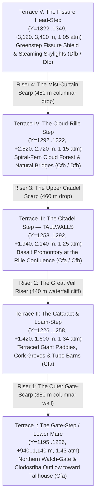
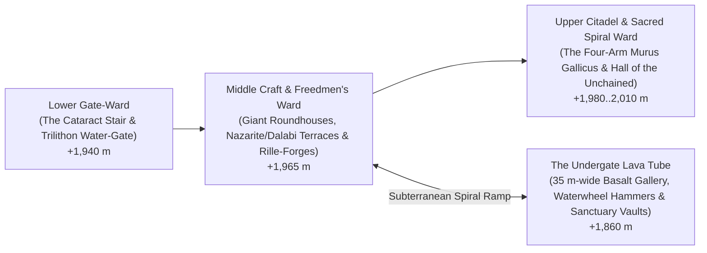

# greenstep: the plan (draft, 2026-11-06)

**Greenstep** (`regions` doc `rmw5n1w1rx0u2`, renamed from `"Green Valley"`): the windward, rain-drenched five-terrace flood-basalt valley on the north-western flank of the Outer Wall / Godthrone volcanic complex (`X = 578..692, Y = 1195..1349` on Scale Model `5.1`, `8,545 px` = `34,180 km²`), opening northward onto the **SW Lowlands** (`Lake of Shim`) at the southern heart of **Vrivolci** (`rmw5sayxeskra`), directly south of the **Realm of Dalab** (`rmw5ruqmv60t3`), the **Vothic Kingdom** (`rmw5rzefnfapk`), and **Shumar** (`rmw5s3ktxgv0d`). Geologically the wet, lush sister of leeward **Godstep Valley** (`rmvkbfspgsmr3`), Greenstep is the greatest refuge of the **Free Giants (the Vrivolci)** and of **escaped slaves of every people fleeing Voth and Dalab**, and home to their greatest haven, the megalithic lava-terrace fortress of **Tallwalls** (*Talodunon* / *Da-Talwal*).

**Owner's brief (2026-11-06):**
> *"with the polygon 'green valley' - i feel like it could capture a collosal amount of rain and be quite lush if the slope was a bit more gradual instead of an escarpment"*
> *"give me a plan for Green Valley (renamed Greenstep) to be a rainer, lusher version of the Godstep, with multiple levels of lava terraces. it is the greatest refuge of the free Giants, home to their greatest haven, the fortress of Tallwalls"*
> *"tallwalls is not just a home to free giants but other escaped slaves from Voth and Dalab as well"*

**Status: plan, awaiting the owner.**

---

## 0. What the kit is (`GREENSTEP` on `BIOME-API.md`)

| | |
|---|---|
| **Folder** | `biomes/greenstep/` (standard kit layout with `src/`, `tex/`, and `stations/`) |
| **Polygon** | `Greenstep` (`rmw5n1w1rx0u2`, renamed from `"Green Valley"`; `8,545 px` = `34,180 km²` on the `1821×1723` `5.1` canvas; `X = 578..692, Y = 1195..1349`) |
| **Settlement Added** | **Tallwalls** (`id: "stallwalls01"`, `type: "city"`, `px: 650, py: 1268`, `+1,980 m`, `Cfa`/`Cfb`): the greatest haven and cyclopean basalt-terrace fortress of the Free Giants (*Vrivolci*), commanding Terrace III above the confluence of the two lava-tube rilles, `170 km` SSW of the outer watch-post **Tallhouse** (`smqy5z5eek` at `px 683, 1184`) |
| **Pages** | Six stations (Section 6): the Lower Mare Gate-Step & Watch-Rille (`gatestep`), the Hanging Cataracts & Giant Terrace Farms (`loamstep`), the Fortress of Tallwalls on the Citadel Step (`tallwalls`, default page), the Collapsed Lava-Tube Rille & Four-Arm Smithies (`rilleforge`), the Spiral-Fern Cloud Bench (`cloudstep`), and the Greenstep Fissure Shield & Headwall Falls (`headvent`) |
| **Core** | `core/host`, `core/rand`, `core/mask`, `core/tags`, `core/terrain` (`KSTRATA`'s `basalt` hexagonal entablature/colonnade recipe across five lobate mare steps, plus sinuous collapsed lava-tube rilles and skylight arches), `core/water` (multi-tier curtain waterfalls plunging over columnar basalt scarps, plunge pools, and subterranean rille streams), `core/atmos`, `core/haz`, `core/charactermodels` (four-armed and two-armed green-skinned Vrivolci Giants in oversized Talovolci checked wool and bronze torcs) |
| **Read in place** | `biomes/swlowlands` (sprawl oak, tier cedar, veil willow, cork grove, red bay, giant fern, spanish moss) and `biomes/shighlands` (right-handed coilbark, spiral trumpet, volute tree, spiral frill tree, crozier tree fern, screw palm, ruffle-crown, escargot begonia); nothing copied |
| **Object** | `GREENSTEP` on the `BIOME-API.md` contract |

---

## 1. Executive vision: why Greenstep is the rainier, lusher sister of Godstep

### 1.1 The twin flood-basalt staircases of the Godthrone
On opposite flanks of the Godthrone / Southern Wall volcanic province sit two sibling valleys formed by the same late-stage **titanium-basalt flood-lava eruptions** ponding in giant stepped benches (*mare terraces*) and draining through sinuous **collapsed lava-tube rilles**:

| Feature | **Godstep Valley (`rmvkbfspgsmr3`)** | **Greenstep (`rmw5n1w1rx0u2`)** |
|---|---|---|
| **Position & Aspect** | **ENE / NE leeward flank** of the Godthrone (`X = 875..1035, Y = 1045..1170` on `5.1`), facing into the dry interior rain shadow | **NNW / NW windward flank** of the Outer Wall / Godthrone (`X = 578..692, Y = 1195..1349` on `5.1`), opening directly toward the Farside Ocean & SW Lowlands lakes |
| **Lava Terrace Architecture** | **4 ponded titanium-basalt mare steps** (`+2,700 m → +2,000 m → +1,300 m → +600 m`) + **2 dry collapsed lava-tube rilles** from `vent[77]` | **5 ponded titanium-basalt mare steps** (`+3,180 m → +2,560 m → +1,980 m → +1,460 m → +960 m`) + **2 water-filled & moss-hung collapsed lava-tube rilles** from the Greenstep Fissure Shield (`668, 1344`) |
| **Physical Rainfall (`C.reclimate`)** | **`80–180 mm/yr`** (rain-shadowed by the Inner Wall and Godthrone) | **`1,050–1,760 mm/yr`** (`median 1,449 mm/yr`, peaking at **`2,400–2,989 mm/yr`** on the windward columnar-basalt risers) |
| **Köppen Climate** | **`BSk` / `BWk`** cold semi-arid & desert steppe | **`Cfa` (59%) / `Csa` & `Cfb` (18%) / `Dfb` & `Dfc` (15%)** humid subtropical rainforest, montane cloud forest, and subalpine fern-bog |
| **Cultural Fate** | The **Talovolci** (two-armed Cloud Giants, `2.3–2.6 m`) abandoned their old seat here because of the parched steppe and moved **Daridel / Spirladunon** (`px 800, 1017`) into the wet cloud belt (`LORE.md §6.21`) | The **Free Giants / Vrivolci** (`3.2–3.8 m` four- and two-armed green-skinned Giants who escaped Dalab) claimed this wet, cliff-guarded volcanic staircase as their impregnable homeland and built **Tallwalls** (`px 650, 1268`) on Terrace III |

### 1.2 Physical climate verification (`C.lapse` + `C.reclimate`)
Before reshaping, `80.5%` of the polygon was a `4,500–10,600 m` cliff face (`median 6,658 m`) sitting above the atmospheric moisture scale height (`1,850 m`), so it trapped almost no rain inside the polygon (`median 78 mm/yr`).

When reshaped into a gradual, five-level stepped volcanic amphitheater (`+940 m` at `Y = 1195` rising to `+3,420 m` at `Y = 1348`) and evaluated directly through the scale model's physical climate engine ([`C.lapse`](../../tools/scale-model/smodel/climate.py) + [`C.reclimate`](../../tools/scale-model/smodel/climate.py)):
1. **Windward Orographic Lift (`(gx + gy) / √2 > 0`):** Because Greenstep's five lobate lava risers face **NNW/NW** directly into the prevailing NW wind vector while sitting `1,000–2,800 m` above sea level (within the dense lower atmosphere `1.05–1.43 atm`), each basalt step-riser triggers a distinct band of orographic condensation (`orog > 0`).
2. **Upwind Lake & Ocean Moisture Fetch:** Moist air off the Farside Ocean and the great lowland lakes of the SW Lowlands (`Lake of Shim` at `651, 1118` and the `17.4 m` Ancient's Valley lake) funnels straight into the `220 km`-wide northern mouth of Greenstep.
3. **Resulting Physically Computed Climate:**
   - **Rainfall across the `8,545` cells of Greenstep:** `p25 = 1,054 mm/yr`, **`median = 1,449 mm/yr`**, `p75 = 1,759 mm/yr`, **`max = 2,989 mm/yr`** along the windward terrace scarps.
   - **Temperature:** Warmest month `tw = +16 °C` (Terrace V) to `+27 °C` (Terrace I); coldest month `tc = -2 °C` (Terrace V) to `+13 °C` (Terrace I).
   - **Köppen Classes:** `Cfa` humid subtropical broadleaf & giant-fern forest across Terraces I–III (`~59%`), `Cfb` / `Csa` / `Dfb` spiral-tree-fern cloud forest across Terrace IV (`~26%`), and `Dfc` / `ET` subalpine moss-and-rosette paramo on Terrace V and the bounding ridge crests (`~15%`).

---

## 2. Geological architecture: five levels of lava terraces & twin collapsed rilles

Just as `smodel/volcanoes.py` sculpts Godstep Valley (`lines 509–566`) with lobate flow-front steps (`sstep` risers modulated by transverse cosine lobes) and sinuous collapsed lava-tube rilles, **Greenstep** is sculpted as a **five-level flood-basalt staircase** erupting NNW from the **Greenstep Fissure Shield** (`px 668, 1344`, `+3,420 m` rim / `+3,280 m` fissure floor) down to the Giant Country piedmont (`+940 m` at `Y = 1195`):

### 2.1 The five ponded flood-basalt lava terraces (*Mare Benches*)

| Terrace Level | `5.1` Coordinates (`X, Y`) | Bench Elevation & Pressure | Columnar-Basalt Riser Below It | Hydrological & Structural Signature |
|---|---|---|---|---|
| **Terrace I — The Gate-Step (*Da-Geytstep*)** | `X = 580..666, Y = 1195..1226` | **`+940..+1,140 m`** (`1.43 atm`, mean `+20 °C`, `Cfa`) | Opens onto Giant Country piedmont (`+780..+920 m`) via a `180 m` lobate basalt toe-scarp | Broad, gently dished lower flood-basalt plain where the **Western Rille** (`X ~ 592..615`) and **Main Clodosriba Gorge** (`X ~ 634..648`) emerge from basalt canyons; guarded by Giant watch-towers signaling to **Tallhouse** (`683, 1184`) |
| **Terrace II — The Cataract & Loam-Step (*Da-Gardinstep*)** | `X = 594..670, Y = 1226..1258` | **`+1,420..+1,600 m`** (`1.34 atm`, mean `+17 °C`, `Cfa`) | **Riser 1 (`+1,100 → +1,450 m`):** `350 m` hexagonal basalt colonnade breached by the Lower Clodosriba gorge | Deep, mineral-rich black andisol soil weathered from vesicular basalt; sculpted by the Free Giants into giant-scale terraced wet paddies, gourd/yam gardens, and sprawl-oak orchards fed by waterfall spray |
| **Terrace III — The Citadel Step (*Talodunon / Tallwalls*)** | `X = 618..678, Y = 1258..1292` | **`+1,940..+2,140 m`** (`1.25 atm`, mean `+14 °C`, `Cfa` / `Cfb`) | **Riser 2 (*The Great Veil*, `+1,520 → +1,980 m`):** `460 m` sheer double-tier columnar titanium-basalt cliff | **The strategic heart of Greenstep.** The Western Rille and Main Clodosriba Rille converge at `(646, 1264)` around a steep-sided, flat-topped basalt Kipuka promontory (`px 650, 1268`, `+1,980 m`), where **Tallwalls** stands above a `460 m` curtain of waterfalls |
| **Terrace IV — The Cloud-Rille Step (*Da-Klaudstep*)** | `X = 633..688, Y = 1292..1322` | **`+2,520..+2,720 m`** (`1.15 atm`, mean `+10 °C`, `Cfb` / `Dfb`) | **Riser 3 (`+2,080 → +2,540 m`):** `460 m` moss-draped entablature cliff with hanging plunge pools | Persistent orographic cloud deck (`1,500–2,400 mm/yr` rain + horizontal fog drip). The main lava tube is only **partially unroofed** here, leaving three cyclopean **natural basalt roof-bridges** (`40–80 m` wide) spanning a steaming, fern-choked chasm |
| **Terrace V — The Fissure Head-Step (*Da-Fayerhed*)** | `X = 648..686, Y = 1322..1349` | **`+3,120..+3,420 m`** (`1.05 atm`, mean `+6 °C`, `Dfb` / `Dfc`) | **Riser 4 (`+2,680 → +3,140 m`):** `460 m` stepped pillow-and-columnar basalt scarp | Contains the **Greenstep Fissure Shield** at `(668, 1344)` (`+3,420 m` WSW spatter rim, `+3,280 m` warm crater-bog floor), an extinct-to-fumarolic sibling of Godstep's `vent[77]` (`620.8, 815.2` unshifted) that poured out the five terrace flows |

### 2.2 The twin sinuous collapsed lava-tube rilles (*The Clodosriba Rilles*)
In dry Godstep Valley, the two sinuous collapsed lava-tube rilles are dusty, boulder-strewn trenches (`230 m` and `165 m` deep). In rain-soaked **Greenstep**, the equivalent twin rilles are **lush, vertical-walled slot gorges and subterranean gallery networks**:
1. **The Main Eastern Rille (*Clodosriba Gorge*, carrying river `r030`):**
   - Originates at the warm crater-tarn of the **Greenstep Fissure Shield** (`668, 1342`, `+3,280 m`) and winds NNW (`668, 1342 → 662, 1304 → 650, 1268 → 644, 1240 → 638, 1212 → 632, 1195`), incised `160–240 m` into the basalt benches.
   - At each of the four terrace risers, the river leaps over the hexagonal basalt columns in thundering **curtain waterfalls (`350–460 m` high)** into deep turquoise-black basalt plunge basins (`6–14 m` deep), sending up perpetual rainbow mist plumes that irrigate the terrace ledges for kilometres around.
   - Swollen by `1,450 mm/yr` of basin-wide rain (`~480 m³/s` discharge at the northern mouth), *Clodosriba* (`"River of the Ditch/Rille"` in Talovolci-Vrivolci speech) flows north past **Tallhouse** (`683, 1184`) into the **Lake of Shim** (`651, 1118`).
2. **The Western Skylight Rille (*Da-Holwey* / *The Hollow Way*):**
   - Branches WNW from the Citadel Step (`648, 1272 → 622, 1254 → 602, 1230 → 586, 1198`), draining the western amphitheater of Greenstep.
   - Unlike the Eastern Rille, **almost half of the Western Rille retains its intact `18–30 m`-thick basalt roof**, punctuated every `2–4 km` by circular **collapse skylights (`40–120 m` across)** where shafts of sunlight and warm rain pour down onto subterranean gardens of glow-moss, tree ferns, and Free Giant smithies and storehouses completely hidden from the surface.

---

## 3. Ecology & flora: where SW Lowlands giants meet Southern Highlands spirals

Because Greenstep bridges the warm, dense **SW Lowlands** (`1.43 atm`, `+940 m` at the mouth) and the cloud-wrapped **Southern Highlands** (`1.05 atm`, `+3,420 m` at the headwall), and because its weathered titanium-basalt andisol soils are extraordinarily rich in iron, phosphorus, and magnesium, its vegetation is a **hypertrophied volcanic rainforest and cloud-forest mosaic**:

| Altitudinal Belt | Terraces | Dominant Canopy & Understorey (`Read in Place`) | Ecological Character |
|---|---|---|---|
| **1. Lower Basalt Rainforest & Giant Agro-Forest** | **Terraces I & II** (`+940..+1,600 m`, `Cfa`, `1,350–1,950 mm/yr`) | `biomes/swlowlands`: **Sprawl oaks** (`80 m`-wide crowns draped in **Spanish moss**), **tier cedars**, **veil willows** along the plunge pools, **red bay**, and cultivated **cork groves** stripped red by Giant bark-harvesters, over **giant ferns** (`4–7 m` fronds) and **giant lotus** / **tuber-gourd** terrace paddies | Dense, steaming, cathedral-like canopy on the flat lava benches; every columnar-basalt riser cliff is a vertical hanging garden of mosses, epiphytic ferns, and cascades |
| **2. Middle Transition & The Sacred Spiral Belt** | **Terrace III & Rille Gorges** (`+1,850..+2,250 m`, `Cfa` / `Cfb`, `1,500–2,400 mm/yr`) | Mixture of `biomes/swlowlands` **tier cedars** and `biomes/shighlands` **right-handed spiral flora**: **coilbarks** wrung like braided rope, **spiral trumpets** (`20–35 m` corkscrew funnels catching rainwater), **volute trees**, and **crozier tree ferns** | The Free Giants have deliberately planted groves of right-handed **spiral trumpets** and **coilbarks** around **Tallwalls** in proud imitation of the Talovolci's sacred *nemeton* groves (`LORE.md §6.21`) |
| **3. Upper Mist-Rille Cloud Forest** | **Terrace IV** (`+2,500..+2,750 m`, `Cfb` / `Dfb`, `1,300–2,100 mm/yr`) | Pure `biomes/shighlands` cloud-forest assemblage: **spiral frill trees**, **screw palms**, **crozier tree ferns**, **escargot begonias**, and **corkscrew bells** clustering thickest around the warm fumarolic skylights of the upper lava tubes | Perpetual mist sea lapping against the dark blue-black titanium-basalt colonnades; giant mosses pad the natural lava-tube bridges half a metre deep |
| **4. Fissure-Shield Paramo & Rosette Bog** | **Terrace V & Rim Shoulders** (`+3,100..+4,200 m`, `Dfc` / `ET`, `950–1,350 mm/yr`) | `biomes/shighlands` paramo: **ruffle-crowns** (great coral-edged rosettes on stout trunks), **giant groundsels**, **spiral lobelias**, and **spiral aloes** ringing the warm, iron-red sphagnum bog inside the **Greenstep Fissure Shield** | High, wind-brushed volcanic bench under the snow-streaked Outer Wall peaks, kept frost-buffered along the rille lips by warm volcanic ground-breath |

---

## 4. The Free Giants (*Vrivolci*), the Runaways of Voth & Dalab, & the Fortress of Tallwalls (*Talodunon*)

### 4.1 Who holds Greenstep: the Vrivolci ("Free Folk") and the Runaways of Two Empires
As established in `LORE.md §6.1, §6.12, §6.17, §6.21, §6.22` and the owner's 2026-11-06 political map:
- **The Free Giants (*Vrivolci*):** The `3.2–3.8 m`-tall, green-skinned Giants—many with **four arms**, all carrying Dalab's chloroplast photosynthesis modification, enhanced muscle density, and lowland-to-montane pressure tolerance—engineered by **Dalab's genepriests** from bloodlines kidnapped by skinchangers from the two-armed **Talovolci** (`2.3–2.6 m` Cloud Giants of the Southern Highlands). Generations ago, cohorts of four-armed temple-guard and quarry Giants at **Dalab** (`px 464, 1112` on `5.1`) and its breeding center **Daranch** (`px 527, 1149`) rose up, broke their overseers' staves, and carved out the independent polity of **Vrivolci** (`rmw5sayxeskra`, `X = 578..695, Y = 1184..1344`), coterminous with **Greenstep** and its northern watch-gate.
- **A Sanctuary for Escaped Slaves from Both Voth and Dalab:**
  - Directly northwest of **Vrivolci** (`rmw5sayxeskra`) lies the expanded **Realm of Dalab** (`rmw5ruqmv60t3`, pressing right against the western gate at `X = 589..630, Y = 1141..1213`); directly north lies the **Vothic Kingdom** (`rmw5rzefnfapk`, whose southern frontier around **Shim** `px 654, 1118` and the **Lake of Shim** touches Vrivolci's northern border at `X = 633..673, Y = 1177..1196`); and directly northeast lies **Shumar** (`rmw5s3ktxgv0d`, holding **Tallhouse** at `px 683, 1184`).
  - Because **Vrivolci / Greenstep** stands at the exact triple-junction where Dalab's breeding plantations and Voth's blood-reed (*Blïtrit*) and sugar slave-estates around Shim meet the Outer Wall, **Tallwalls is not only a home to the Free Giants—it is the great sanctuary for escaped slaves fleeing both the Vothic Kingdom and the Realm of Dalab:**
    1. **From the Vothic Kingdom (`rmw5rzefnfapk`):** Runaway **Nazarite**, **Wingman**, and **Agropolitan** plantation slaves (`LORE.md §6.12`) fleeing the blood-reed marshes of **Shim** (`150 km` north) or the winter-solstice sacrifice altars of the Old Temple, along with captive **Scyvoi** and **Chichani** debtors.
    2. **From the Realm of Dalab (`rmw5ruqmv60t3`):** Runaway four-armed and two-armed **Giants**, escaped **green-skinned Dalabi peasant serfs** and "failed" or rebellious **Halls of Reformation test subjects** (`LORE.md §6.1`), abducted **Tungang** tunnel-crews, and **Frogman** auxiliaries (`LORE.md §6.22`).
- **Why Open Lowlands Were Not Enough & Why Greenstep Is Impregnable:**
  1. **A Megalithic Staircase Scaled for Giants:** Each of Greenstep's five lava terraces is fronted by a `350–480 m` vertical wall of hexagonal columnar basalt. Only two narrow notches—the **Clodosriba Waterfall Stair** and the underground **Hollow Way Lava Tube**—lead up from one terrace to the next, allowing a dozen four-armed Giant boulder-hurlers and human/Nazarite crossbowmen on a riser crest to stop a Vothic Ordinator column or Dalabi hunter-pack cold.
  2. **Bomb-Proof & Sight-Proof Lava Tubes:** The miles of intact `20–35 m`-high lava-tube galleries beneath Terraces II, III, and IV shelter thousands of Free Giants and human/Dalabi/Nazarite/Wingman freedmen, their smithies, granaries, and families completely unseen from the air or the crater rim.
  3. **Photosynthetic & Agricultural Abundance:** With `1,450 mm/yr` of warm rain, fertile volcanic soil, and filtered subtropical sun (`Cfa`/`Cfb`), green-skinned Giants and Dalabi runaways carrying the chloroplast mod need only half a normal ration, while former Shim plantation hands cultivate terraced wet paddies of giant lotus, tuber-gourds, and cane without an overseer's whip.
  4. **Emotional & Cultural Resonance:** The Vrivolci know that their ancestral kin, the Talovolci, once dwelt in **Godstep Valley** before drought drove them out. Holding **Greenstep**—a lusher, rainier, unfallen Godstep—and keeping its gates open to every soul who breaks Voth's or Dalab's chains is the cornerstone of Vrivolci law: *"No collar crosses the Gate-Step uncut."*
  5. **The Eastern Saddle to Shumar & the Ordeal (`LORE.md §6.23`):** Across the smoothed NE highland saddle (`+2,150..+2,850 m`) lies the continental-to-subarctic plateau of **Shumar** (`rmw5s3ktxgv0d`), ruled by the Mamluk-like **Sword-Caste** (*Šubaru-šu*) of the **Shumari**. While most escaped Giants and lowland runaways make their home in **Tallwalls** and the five lush lava terraces of Greenstep, many escaped **Nazari** slaves (near-cousins of the Shumari) and not a few martial **Free Giants** (*Gēdu-šu* in Shumari) cross the saddle into Shumar to submit to **the Ordeal** (*Urudīru*) and win their place among the Shumari ruling caste.

### 4.2 The Fortress of Tallwalls (*Talodunon* / *Da-Talwal*, `px 650, 1268`, `+1,980 m`)

**Tallwalls** (`id: "stallwalls01"`, `px 650, py 1268` on Scale Model `5.1`, `+1,980 m`) crowns the triangular `6 km × 4 km` basalt promontory on **Terrace III** where the **Western Skylight Rille** joins the **Main Clodosriba Gorge** directly at the brink of the `460 m` **Great Veil Riser**:

1. **The Architecture of Tallwalls — Four-Arm *Murus Gallicus*, Reclaimed Dalabi Megaliths, & Two-Scale Wards:**
   - **Cyclopean Columnar-Basalt *Murus Gallicus*:** Imitating the Talovolci's Celtic timber-laced stone ramparts (`LORE.md §6.21`) at `3.8 m` Giant scale, the Vrivolci built triple concentric ramparts (`16–22 m` high, `10 m` thick) from whole **hexagonal titanium-basalt columns** (`1.5 m` diameter, `8–12 tonnes` each) pried from the cliff face and cribbed with cross-beams of rot-proof **tier cedar** (`biomes/swlowlands`) pinned with massive hand-forged iron spikes. Only four-armed crews working two lever-poles and two guide-ropes per Giant could lay courses of such stone without cranes.
   - **Remembered Dalabi Trilithons & Broken Vothic Diamonds:** Because the first generation of rebels were quarrymen from Dalab (`LORE.md §6.1`) joined by runaway masons from Voth's Shim plantations (`LORE.md §6.12`), the three main gates of Tallwalls are built as **battered monolithic Tiwanaku-style trilithons** (`9 m` clear height for `3.8 m` Giants and draught millipedes, with human-scale postern passages cut beside each jamb). On every gate lintel, the smooth circular boss where Dalab's priests would have carved **The God's One Eye** and the Vothic **Sun-Diamond** have both been purposefully split with a chisel and recarved with a **right-handed Talovolci spiral sun-wheel** (`LORE.md §6.21`) framed by **four upraised Giant arms and two human hands snapping a shackle**.
   - **Two-Scale Habitation — Giant Roundhouses & Freedmen's Terrace Courts:** Within the wards stand scores of circular basalt-plinth **Giant roundhouses (`24–45 m` across)** crowned by steep conical thatch roofs of giant fern-fronds and river reed, hung with woven **weld-yellow, woad-blue, and madder-red checked wool** (`LORE.md §6.21`). Interwoven around and between them are **human-scale stone-and-timber courtyard houses, workshops, and lofts** built by escaped **Nazarites, Wingmen, Dalabites, and Chichani dissidents**—so every stair in Tallwalls is carved as a **double-tread stair** (one broad `65 cm` Giant riser flanked by three `22 cm` human steps), and every feast hall has both `3.8 m` ground-hearths and raised human-height galleries at shoulder level so Giants and human-sized freedmen look one another in the eye at council.
   - **The Rille-Forges & Waterwheel Galleries (`+1,860 m`):** A `35 m`-wide uncollapsed section of the **Clodosriba Lava Tube** runs directly underneath the citadel rock. Diverted streams from the upper cataract turn four `14 m` timber-and-bronze undershot waterwheels inside the lava tube, driving trip-hammers and bellows in the **Four-Arm Smithies**—where four-armed Giant strikers and nimble Wingman/Nazarite fine-smiths forge weapons, armor, and tools together while venting the smoke straight into the waterfall spray curtain so neither Dalabi skinchangers nor Vothic Ordinators can spot a plume.
   - **The Hall of the Unchained (*Da-Frimenhaus* / *Vrinemeton*):** At the apex of the promontory (`+2,005 m`), enclosed by a ring of monoliths and living **right-handed spiral trumpets** (`biomes/shighlands`), stands the great assembly round-hall where the **Council of Torcs** (composed of both Vrivolci Giant chieftains and elected tribunes of the Vothic and Dalabi runaways) meets. Inside its sanctuary surgery, rogue Dalabi chirurgeons excise subdermal tracking markers from newly arrived Dalab escapees, while stripped Vothic slave-collars and Ordinator spears are melted down in the hearth to cast the **Freedman's Torc** given to every runaway who reaches Terrace III.

---

## 5. Scale Model `5.1` terrain & climate implementation

To realize this plan cleanly and honestly in [`build_425_master.py`](../../tools/scale-model/build_425_master.py) and [`smodel/nw_expansion.py`](../../tools/scale-model/smodel/nw_expansion.py):

1. **Rename Region `rmw5n1w1rx0u2` to `"Greenstep"`:**
   - Update `name: "Greenstep"` in `smodel/nw_expansion.py`, `openworld/little-demo/source/regions.json`, and `tools/scale-model/model/src/51-region-store.js`, with notes describing the five ponded flood-basalt lava terraces, the twin collapsed lava-tube rilles, and the Free Giant fortress of **Tallwalls**.
2. **Sculpt the Five Ponded Flood-Basalt Mare Terraces & Twin Lava-Tube Rilles (`Step 5B` in `build_425_master.py`):**
   - Mirroring the mathematical form of **Godstep Valley** in [`smodel/volcanoes.py`](../../tools/scale-model/smodel/volcanoes.py) (`lines 509–566`), define the NNW flood-basalt flow axis `(s_gs, p_gs)` from the **Greenstep Fissure Shield** at `(668.0, 1344.0)` (`+3,420 m` rim / `+3,280 m` floor) down to the northern mouth `(632.0, 1195.0)`:
     - **5 Lobate Mare Benches:**
       - **Terrace V (`s = 0..24 px`):** `+3,180 m` bench
       - **Terrace IV (`s = 24..54 px`):** `+2,560 m` bench (`620 m` lobate `G.sstep` riser)
       - **Terrace III (`s = 54..88 px`):** `+1,980 m` bench (`580 m` lobate `G.sstep` riser; **Tallwalls** promontory pinned on dry flat basalt at `650, 1268` at `+1,980.0 m`)
       - **Terrace II (`s = 88..120 px`):** `+1,460 m` bench (`520 m` lobate `G.sstep` riser)
       - **Terrace I (`s = 120..155 px`):** `+960 m` bench (`500 m` lobate `G.sstep` riser)
     - **2 Sinuous Collapsed Lava-Tube Rilles:**
       - **Main Eastern Rille (*Clodosriba*, `r030`):** Incised `150–210 m` below the benches along `(668, 1342) → (662, 1304) → (646, 1268) → (644, 1240) → (638, 1212) → (632, 1195)`, monotonically descending so river `r030` has zero uphill climb across all five steps.
       - **Western Skylight Rille (*Da-Holwey*):** Branching along `(646, 1272) → (620, 1252) → (600, 1228) → (586, 1198)`, incised `130–175 m` below the western terrace benches.
3. **Compute Rainfall & Climate Physically via `C.lapse` + `C.reclimate` (No Manual Rainfall Fudge):**
   - In `Step 5C`, instead of a synthetic formula, un-freeze any formerly `Class O` cells in the reshaped Greenstep envelope whose new elevation is `< 8,800 m` and evaluate [`C.lapse`](../../tools/scale-model/smodel/climate.py) and [`C.reclimate`](../../tools/scale-model/smodel/climate.py) directly on `En_exp`, then blend the physically computed `tw`, `tc`, `tm`, `rain`, and `cls` across `w_gval_clim`.
4. **Add the Settlement of `Tallwalls` (`id: "stallwalls01"`):**
   - Add `{"id": "stallwalls01", "name": "Tallwalls", "type": "city", "px": 650, "py": 1268, "notes": "The greatest haven and fortress of the Free Giants (the Vrivolci, LORE.md 6.17, 6.21), built of cyclopean columnar basalt and tier-cedar murus gallicus on the middle flood-basalt lava terrace of Greenstep (+1,980 m, Cfa/Cfb) above the confluence of the Clodosriba lava-tube rilles. Called Talodunon in their borrowed Talovolci Gaulish and Da-Talwal in Vrivolci creole. biomes/greenstep/PLAN.md.", "createdAt": "2026-11-06T20:00:00.000Z"}` to `setts_exp` / `settlements.json` / `60-settlements.js`.

---

## 6. The six showcase stations (`biomes/greenstep/stations/`)

| # | Station ID | Name & Role | `5.1` Pixel `(X, Y)` | Elevation & Climate | Key Landforms, Flora & Vrivolci Architecture |
|---|---|---|---|---|---|
| **1** | `gatestep` | **The Lower Mare Gate-Step & Watch-Rille** (*Da-Geytstep*) | `(638, 1212)` | **`+1,020 m`** (`1.43 atm`, `Cfa`, `~1,480 mm/yr`) | Lobate columnar-basalt toe-scarp (`Riser 1`) where the **Clodosriba** bursts out of its lower lava-tube canyon onto Terrace I; two Vrivolci timber-and-basalt watch-towers with signal braziers sighted toward **Tallhouse** (`683, 1184`); towering **sprawl oaks** and **veil willows** (`biomes/swlowlands`) |
| **2** | `loamstep` | **The Hanging Cataracts & Giant Terrace Farms** (*Da-Gardinstep*) | `(644, 1242)` | **`+1,480 m`** (`1.34 atm`, `Cfa`, `~1,620 mm/yr`) | Broad black-earth basalt bench of **Terrace II** directly below the `460 m` twin waterfalls of **The Great Veil** (`Riser 2`); cyclopean basalt-walled wet paddies growing **giant lotuses** and `2 m` **tuber-gourds**, stripped-red **cork groves**, and a sunken lava-tube barn where draught millipedes are stabled |
| **3** | `tallwalls` *(Default)* | **The Fortress of Tallwalls (*Talodunon* / *Da-Talwal*)** | `(650, 1268)` | **`+1,980 m`** (`1.25 atm`, `Cfa` / `Cfb`, `~1,720 mm/yr`) | **The Citadel Step (`Terrace III`)**: triple concentric *murus gallicus* ramparts of hexagonal titanium-basalt columns and tier-cedar beams crowning the `460 m` cliff; battered trilithon gates recarved with the Talovolci right-handed spiral and broken chains; `40 m` thatched round-halls dressed in weld-yellow, woad-blue, and madder-red wool; the **Hall of the Unchained** in its grove of living **spiral trumpets** |
| **4** | `rilleforge` | **The Hollow Way Skylight & Four-Arm Rille-Forges** (*Da-Holwey*) | `(636, 1274)` | **`+1,860 m`** (`1.27 atm`, `Cfb`, `~1,680 mm/yr`) | Inside the `35 m`-wide collapsed/uncollapsed transition of the **Western & Central Lava Tubes** beneath Tallwalls: a `90 m` circular roof skylight pouring rain and sunbeams onto tree ferns, underscored by four `14 m` subterranean waterfall waterwheels driving the trip-hammers of the four-armed Giant smiths |
| **5** | `cloudstep` | **The Spiral-Fern Cloud Bench & Basalt Bridges** (*Da-Klaudstep*) | `(662, 1304)` | **`+2,580 m`** (`1.15 atm`, `Cfb` / `Dfb`, `~1,540 mm/yr`) | **Terrace IV**: mist-drenched montane cloud forest of right-handed **coilbarks**, **spiral frill trees**, **crozier tree ferns**, and **screw palms** (`biomes/shighlands`) arching over three natural columnar-basalt roof bridges spanning the steaming upper Clodosriba rille |
| **6** | `headvent` | **The Greenstep Fissure Shield & Mist-Wall Amphitheater** (*Da-Fayerhed*) | `(668, 1338)` | **`+3,280 m`** (`1.05 atm`, `Dfc`, `~1,220 mm/yr`) | **Terrace V**: the low basaltic spatter-and-fissure shield (`+3,420 m` rim around the `+3,280 m` warm crater-bog source of the *Clodosriba*) where the five flood-basalt flows erupted, ringed by **ruffle-crowns**, **giant groundsels**, and steaming fumarolic moss mounds under the Outer Wall headscarp |

## Fauna (proposed 2026-11-11, awaiting the owner)

Drawn by `kits/fauna` and tagged by biome (`biomes/README.md`, "A fauna kit"); placed by `FAUNALANDS` (`kits/fauna/fauna-lands.js`).
The brief (`kits/fauna/BIOME-FAUNA-PLAN.md`): two grazers, a predator, a flyer and a water creature, with **at least one animal
found nowhere else**. **New** = to be built in the kit; *shared* = an existing key that also gets this biome's tag, because its
range plausibly runs across the border. Nothing here is built.

| Role | Animal | Status | Where | Why it is here |
|---|---|---|---|---|
| flyer | **veil swift** | **new, unique** | behind the curtain waterfalls of the four risers; over the terraces | a swift that nests on the wet basalt **behind** the 350-460 m curtains, flying through the falling water to reach its nest, as Earth's black swifts do. Thousands at each riser; at dusk they pour out of the mist plumes. Built on `faHiBird` |
| grazer | **mosshorn** | **new, unique** | Terrace IV's cloud forest and the moss-padded basalt bridges | a slow, heavy six-limbed browser (`faWdHex`, `amb`, `stock`) with a shaggy, moss-holding coat and a low swept horn it uses to rake the half-metre moss off the bridges and colonnades. Its coat grows moss of its own in the fog, so a standing mosshorn is hard to tell from a boulder. The Free Giants keep some half-tame |
| grazer | *duckbill-browser*, *cypress-glider* | shared (swlowlands) | Terraces I-II, the lower rainforest | the lower belts are the SW lowlands' flora, and the valley opens onto them |
| grazer | *argali*, *chamois* | shared (shighlands) | the paramo on Terrace V and the rim shoulders | the upper belts are the southern highlands' |
| predator | *ridge-raptor* | shared (swlowlands) | Terraces I-II | |
| predator | *mountain-lion* | shared (shighlands) | Terraces III-V | |
| flyer | *sail-wing* | shared (swlowlands) | over the risers' updrafts | |
| water | *giant-hellbender* | shared (shighlands) | the plunge basins and the rille streams | the highlands' giant salamander in clean, cold, fast water |
| water | *long-snout-gharial*, *sail-skimmer* | shared (swlowlands) | the Clodosriba's lower course toward the Lake of Shim | |
| domestic | *goat*, *sheep*, *burden-beast* | shared | the Giants' terrace farms and Tallwalls | runaways bring the stock of every people; the burden beast for the Giants' loads |
