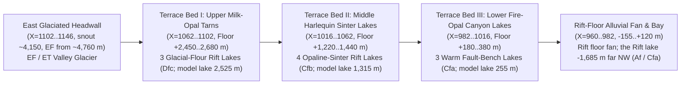

# opalvalley: the plan (draft 2026-11-06; checked and approved 2026-11-11)

**Opal Valley** (`regions` doc `rmw52q8d7prwz`, `"opal valley"`): the glaciated, three-terraced rift-relay valley on the south-eastern margin of the Great Rift, wedged between the eastern arm of the Rift / Vale of Xanadu basin on the west-northwest (`X = 960..1020, Y = 1622..1665`), Oidong Valley on the north (`X = 997..1146, Y = 1588..1646`), and the southern high cordillera on the south and east (`X = 1100..1146, Y = 1664..1698`).

**Owner's brief (2026-11-06):**
> *"glaciated at the east end, the meltwater rolls down a slope that reaches the rift floor through three terraced beds of small rift lakes. the foliage, related to Xanadu's, and the rocks alike both have an iridescent hue, and the opals mined here fetch a pretty penny in Xanadu and even more in the lands to the north"*

**Status: approved by the owner (2026-11-11: "build the Opal Valley biome kit"); the numbers checked against scale model 5.1 on 2026-11-11 (section 1.0, which lists every correction), the core adoption written before the first fragment (section 8), the defaults taken where the plan left a question (section 9), the order of work (section 10). First pass of all five stations built on `claude/opalvalley-biome`.**

---

## 0. What the kit is (`OPAL` on `BIOME-API.md`)

| | |
|---|---|
| **Folder** | `biomes/opalvalley/` (standard kit layout with `src/`, `tex/`, and `stations/`) |
| **Polygon** | `opal valley` (`rmw52q8d7prwz`, ~~`6,146 px` = `24,584 km²`~~ **`6,208 px` = `24,832 km²`** on the `1821×1723` `5.1` canvas; `X = 960..1146, Y = 1622..1698`) |
| **Pages** | Five stations (Section 6): the Glaciated Opal Headwall (`glacier`), the Upper Milk-Opal Tarn Terrace (`upperbed`), the Middle Harlequin Sinter & Mine Terrace (`middlebed`), the Lower Fire-Opal Canyon Terrace (`lowerbed`), and the Rift-Floor Cataract & Xanadu Threshold (`riftmouth`) |
| **Core** | section 8 (corrected 2026-11-11: the draft's `core/haz` is `core/hazard`; `KSTRATA` has no `canyon` recipe for opal, so the kit hands it an `opal` recipe as data; the glacier is `KGLACIER`, the frost `KFROST`) |
| **Read in place** | `biomes/xanadu` (seven species grown by Xanadu's own builders as kin: `BIO.kin('xanadu.<key>', delta)`, section 3.2), `biomes/oidong` (`OIDONG.buildHigh`: the cushions, snow lotus and sky poppies on the cold ground of stations 1 and 2), `biomes/rift` (the trumpet tree and bell palm at the mouth); the iridescence is the biome core's own (`BIO.iridBarkMat`, the leaf hook's `irid`), with this kit's tints; nothing copied |
| **Object** | `OPAL` on the `BIOME-API.md` contract |

---

## 1. The ground on Scale Model `5.1` (surveyed 2026-11-06, checked 2026-11-11) & the reshape (applied on the model)

### 1.0 Checked against scale model 5.1 (2026-11-11): what was corrected

Surveyed from `tools/scale-model/model/data` through `smodel/page.py` (the method of `biomes/highrift/PLAN.md` section 1), the
polygon from `smodel/nw_expansion.py` (11 points). Pressure is 1.6 atm x e^(-h/8 km), as every plan. **The model already carries
the reshape of sections 1.2 and 7** (`tools/scale-model/build_425_master.py`, step 5, `oval_thalweg_ctrl`): every station's height
is the plan's to the metre (4,150 / 2,540 / 1,340 / 275 / 60 m), so section 1.1's "uncarved" table described a model that no
longer exists. What disagreed, and what the plan now says:

| Item | The draft said | Scale model 5.1 says | Now |
|---|---|---|---|
| Section 1.1 | the uncarved block (68% `Class O`, medians to 12,280 m) | carved: no `O` left in the polygon; H p5/med/p95 **332 / 3,106 / 5,405 m**, min -67, max 7,766 | 1.1 rewritten on the carved model |
| Polygon | 6,146 px, 24,584 km² | 6,208 px, **24,832 km²** (148 px water) | the model's |
| **The Rift lake** | the Opal River plunges "into the SE bay of the Rift lake (-460 m)" | the Rift lake stands at **-1,685 m**; `r682` reaches it at px **955,1606**, ~70 km north-west of the mouth station; the polygon's lowest ground is -67 m | the cataract lands on **the Rift floor's fan** (a plunge pool at ~0 m); the river runs on north-west down the Rift's inner scarp (-155 m at px 964,1629, -857 at 958,1621) to the lake. Station 5's lake is far field |
| The cataract | 260 m | `r682`'s bed **265 m** on Terrace III's tread to **-14 m** at px 969,1634: **~280 m** over ~13 km | two drops on the page, ~115 and ~105 m into the plunge pool (45 m), the rest down the gorge cut back into the old fan (section 6) |
| The ten lakes | ten lakes, three terraces | **one lake a terrace** on the 2 km grid: Terrace I **2,525 m** (184 km², px 1068-1079), II **1,315 m** (260 km², px 1020-1034), III **255 m** (148 km², px 984-994) | the ten lakes kept as the page-scale chain, each terrace's levels bracketing its model lake (I 2,620/2,540/2,470; II 1,390/1,340/1,290/1,245; III 340/275/210). Two lake points sat on risers and are moved onto the treads (section 7) |
| Lake points on risers | II-east at px 1053,1666 (1,390 m); III-east at px 1007,1649 (340 m) | the ground there is **1,638 m** and **575 m**: the risers | II-east to **px 1048,1664** (floor 1,384 m); III-east to **px 1004,1648** (349 m) |
| The glacier's snout | +3,650 m | the valley floor at 3,650 m is `Dsc`/`Dfc` (px 1104-1116); **`EF` (perennial ice) from ~4,760 m** (p5 of the polygon's `EF`), the firn basin to 5,685 m at px 1138 (`EF`, -12 °C) | the tongue from the `EF` cirque down to its snout at **~4,150 m** (the station, `ET`, -2 °C): ~600 m below the ice line, as a valley glacier's tongue runs |
| The walls | "+3,800 to +5,800 m" canyon walls | the ridges either side of the thalweg: north **4.4-10.2 km** (the Oidong divide, highest over Terrace I), south **4.5-8.5 km** | the far field draws the model's walls |
| Pressures | lower bed 1.53, middle 1.34, mouth 1.62 (zone 5 "1.62-1.72") | 1.55 (275 m), 1.35 (1,340 m), **1.59** (60 m); the mouth's ground -155..+120 m is 1.58-1.63 | the model's |
| Temperatures (mean, warm/cold month) | glacier -3 (+8/-14), I +5 (+16/-5), II +13 (+22/+4), III +20 (+28/+12), mouth +24 | glacier **-2 (+6/-10)**, I **+8 (+15/0)**, II **+14 (+21/+7)**, III **+21 (+27/+14)**, mouth **+22 (+29/+15)** | the model's (section 6) |
| Rain | 580 / 640 / 780 / 920 / 1,150 mm | **565 / 800 / 941 / 1,082 / 1,114 mm** | the model's |
| Classes | glacier ET/EF, I Dfc/Dsc, II Cfb/Csb, III Cfa/Csa, mouth Cfa/Af | ET, **Dfc**, **Cfb**, **Cfa**, **Af** at the five stations; no `Csb`/`Csa` anywhere in the polygon (its classes: ET 5,788, Dfc 5,716, Cfb 4,340, Dsc 3,308, EF 2,632, Cfa 2,312, WH 592, Af 144 km²) | the model's; the dry-summer variants dropped |
| The river's discharge | ~85 m³/s at the cataract | `r682` **91 m³/s** at px 975,1637.5 (18 at the snout, 115 at the mouth) | the model's |
| Strongbow | "just south-east of Strongbow (px 1026,1594)" | Strongbow is 1,535 m, Cfb, **34 km north** of the middle terrace, across the Oidong divide | the factors cross the divide; the toll-quay at the mouth stands |

**Left for the next scale model update** (not done here; the kit carves its own ground, and `LORE.md` is untouched): `r682`'s `to`
still names the old perched lake (`lake_m 2520, at_px [976.9, 1651.9]`), cleared by the carve; the river should end in the Rift lake
(-1,685 m). The carve's comment and section 7 still say "-460 m" for the mouth (`(964.0, 1631.0, -380.0, 15.0)` is the shore ramp; the
water there is the river, not a bay). The ten lakes are three on the 2 km grid: fine, unless the owner wants each lake on the model.

### 1.1 The carved state on `5.1` (surveyed 2026-11-11)

On the current `5.1` heightfield (`1821×1723`, `2 km/px`), `opal valley` (`rmw52q8d7prwz`) is the carved trough: its floor steps
down WNW from the glacier's tongue to the Rift floor, a lake on each of three treads. By the plan's zones (inside the polygon):

| Zone (`5.1` px) | km² | `H` min / median / max | Classes | Rain (median) |
|---|---|---|---|---|
| **Head and glacier** (`X = 1102..1146`) | 2,900 | `2,973 / 4,425 / 6,104 m` | `ET` 50%, `EF` 33%, `Dsc` 11%, `Dfc` 6% | 518 mm |
| **Terrace I** (`X = 1062..1102`) | 5,468 | `2,223 / 3,366 / 6,842 m` | `Dfc` 44%, `ET` 22%, `EF` 17%, `Dsc` 13%, `WH` 3% | 659 mm |
| **Terrace II** (`X = 1016..1062`) | 8,848 | `1,147 / 3,308 / 7,766 m` | `ET` 29%, `Cfb` 27%, `Dfc` 19%, `Dsc` 13%, `EF` 8% | 675 mm |
| **Terrace III** (`X = 982..1016`) | 5,996 | `162 / 1,979 / 4,966 m` | `Cfb` 25%, `Cfa` 23%, `Dfc` 22%, `Dsc` 17%, `ET` 9% | 863 mm |
| **The mouth** (`X = 960..982`) | 1,616 | `-67 / 533 / 2,920 m` | `Cfa` 56%, `Cfb` 26%, `Dfc` 9%, `Af` 9% | 1,051 mm |

The medians are the walls (most of every zone is wall); the floor, along the thalweg (`r682`'s bed): the snout 3,978 m (px 1121) ->
3,953 (1110) -> **the upper riser** 2,668 (1095) -> **Terrace I** 2,556-2,541 (1082-1065) -> **the middle riser** 2,086 (1059.5) and
1,466 (1050) -> **Terrace II** 1,350-1,313 (1039-1018) -> **the lower riser** 937 (1012) -> **Terrace III** 366-265 (1000-981.5) ->
**the cataract** 120 (975) and -14 (969) -> the Rift floor -155 (964) -> the Rift's inner scarp -857 (958), -1,337 (960, 1613) ->
**the Rift lake** -1,685 (955, 1606).

### 1.2 The terrain reshape (`5.1` implementation blueprint; **applied**: the model carries it, section 1.0)

*Corrected 2026-11-11 (section 1.0): the walls, the snout, the pressures, the climates and the mouth below are the model's; the draft's figures are struck where they differed.*
Before the carve `68.1%` of the polygon sat in airless `Class O` (`>9 km`) with no valley trough, no terraced lake beds, and no glacial meltwater river connecting the eastern ice to the Rift floor. Reshaping `opal valley` (`rmw52q8d7prwz`) carves a **370 km-long WNW-descending normal-faulted rift-relay valley** bounded by iridescent rhyolite-and-ignimbrite canyon walls (~~`+3,800 to +5,800 m`~~ on the model **4.4-10.2 km** north, the Oidong divide, and **4.5-8.5 km** south) (separating it from Oidong Valley on the north at `Y ~ 1625..1665` and the high southern ice rim along `Y ~ 1685..1698`), stepping down from a **glaciated eastern cirque (`EF` from ~4,760 m, firn to 5,685 m; the tongue's snout ~4,150 m)** to the **Rift floor (`-155 to +120 m` at the mouth; the Rift lake at `-1,685 m` ~70 km north-west)** across **three terraced beds of small rift lakes**:

| Zone | `X` Range (`5.1` px) | Target Valley Floor / Lake Level | Bounding Rim Walls | Target Climate | Key Hydrologic Features |
|---|---|---|---|---|---|
| **1. Eastern Glaciated Headwall (*Jabal al-Qaوس* / The Prism Glacier)** | `X = 1102..1146, Y = 1662..1691` | ~~`+3,650 m`~~ **`~4,150 m`** snout to `+5,350..5,685 m` firn basin | `+6,200..10,000 m` (`0.46–0.74 atm`) | `EF` (the cirque and walls, from ~4,760 m) & `ET` (the tongue and its moraines), `~380–570 mm` | Branched valley glacier grinding silica-rich rhyolitic tuff & opaline fault breccia into colloidal rock-flour meltwater |
| **2. Terrace Bed I — Upper Glacial Milk-Opal Tarns** | `X = 1062..1102, Y = 1654..1696` | Bench floor `+2,450..2,680 m` (`1.15 atm`, mean ~~`+5 °C`~~ **`+8 °C`**) | ~~`+3,900..4,750 m`~~ **`+5,000..10,200 m`** | `Dfc` (~~`~620 mm`~~ **`~800 mm`**) | **3 small rift lakes (`WH`)** at `+2,620 m`, `+2,540 m`, and `+2,470 m` (`24–48 km²` each), milky turquoise with suspended silica nanospheres |
| **3. Terrace Bed II — Middle Harlequin Sinter & Placer Lakes** | `X = 1016..1062, Y = 1640..1695` | Bench floor `+1,220..1,440 m` (`1.34-1.37 atm`, mean ~~`+13 °C`~~ **`+14 °C`**) | ~~`+2,900..3,750 m`~~ **`+4,500..10,400 m`** | `Cfb` (~~`~780 mm`~~ **`~940 mm`**) | **4 small rift lakes (`WH`)** at `+1,390 m` (moved onto the tread, section 7), `+1,340 m`, `+1,290 m`, and `+1,245 m` dammed behind opaline-silica sinter travertine rims; main mining terrace |
| **4. Terrace Bed III — Lower Fire-Opal Canyon Lakes** | `X = 982..1016, Y = 1626..1680` | Bench floor `+180..380 m` (~~`1.53`~~ **`1.53-1.56 atm`**, mean ~~`+20 °C`~~ **`+21 °C`**) | ~~`+1,800..2,650 m`~~ **`+2,400..5,400 m`** north, `8,700..12,300 m` south | `Cfa` (~~`~920 mm`~~ **`~1,080 mm`**) | **3 small rift lakes (`WH`)** at `+340 m`, `+275 m`, and `+210 m` in a warm, mist-filled canyon bench overlooking the Rift trough |
| **5. Rift-Floor Cataract & Xanadu Shore Fan** | `X = 960..982, Y = 1622..1655` | ~~`-460 m` (Rift lake bay)~~ **`-155 m`** (the shore ramp; the Rift lake is `-1,685 m`, ~70 km NW) to `+120 m` fan apex (~~`1.62–1.72`~~ **`1.58–1.63 atm`**, mean ~~`+24 °C`~~ **`+22 °C`**) | `+180..700 m` north, `11..12.7 km` south | `Cfa` / `Af` (`~1,110 mm`) | The **Opal River** (*Nahr al-Yāqūt* / extended `r682` *Gūlī Qubbah*, ~~`~85`~~ **`~91 m³/s`**) plunges ~~`260 m`~~ **~270 m** over an iridescent sinter cataract ~~into the SE cove of the eastern Rift lake~~ **onto the Rift floor's fan, and runs on down the Rift's inner scarp to the lake** |

---

## 2. Geology & mineralogy: why the rocks and lakes shimmer

Opal Valley occupies a **stepped extensional transfer zone (relay ramp)** where the south-eastern boundary fault of the Great Rift steps eastward toward Oidong Valley and the High Rift (`rmvhighrift100`). Three geological processes converge here to turn the entire valley into Krator's premier deposit of precious opal ($\text{SiO}_2 \cdot n\text{H}_2\text{O}$):

1. **Rhyolitic Ignimbrite & Volcanic Glass Host Rock:** The valley walls expose thick, fault-sliced beds of porous felsic volcanic ash, welded rhyolitic tuff, and perlitic glass laid down during the early rifting of the southern trough, interbedded with dark iron- and titanium-rich basaltic sills from the nearby Twins volcanic center.
2. **Silica-Saturated Epithermal & Glacial-Periglacial Leaching:** Warm alkaline geothermal fluids rising along the three listric normal fault scarps—mixed with cold, oxygenated glacial meltwater from the eastern headwall—leach amorphous silica from the rhyolitic glass. As these fluids cool, evaporate, and experience sharp pH drops across the **three terraced lake beds**, dissolved orthosilicic acid ($\text{H}_4\text{SiO}_4$) polymerizes into uniform `150–300 nm` colloidal silica spheres that settle into fault cavities, sinter aprons, desiccated lake-margin clays, and fossilized wood.
3. **Four Distinct Varieties of Opal Valley Gem & Host Rock:**
   - **Rift Black Opal (*Al-Bāzalt al-Qawsī*):** Found along the contact where silica-bearing fault veins cut dark titanium-basalt dikes on the **Middle Terrace (`+1,220–1,440 m`)**. Its dark charcoal-to-indigo potch backing throws off electric flashes of crimson, emerald, peacock-blue, and violet—the single most valuable gemstone per carat in southern and northern Krator.
   - **Harlequin Sinter & Matrix Opal:** Banded opaline silica (`KSTRATA` canyon recipe) cementing the step-riser cliffs and natural lake-outlet dams. Even the unmined cliff faces carry a wet-looking **opaline rock glaze (desert/canyon silica varnish)** that shifts from copper-rose to teal as the sun moves (`RIFT.IRIDBARK` / Fresnel thin-film shader hook on rock faces).
   - **Fire & Amber Opal (*Yāqūt al-Shams*):** Transparent orange, cherry-red, and gold-flashing hydrous opal mined from the warm volcanic-tuff benches of the **Lower Terrace (`+180–380 m`)**.
   - **Glacial Milk & Crystal Opal:** Pale, translucent blue-white and mint-green opal nodules tumbled out of frost-shattered moraines into the gravel bars of the **Upper Terrace Tarns (`+2,450–2,680 m`)**, where suspended silica nanospheres turn the lake water itself into a pearlescent, opalescent peacock-blue mirror.
   - **Opalized Wood & Lotus Casts:** Fallen trunks of Xanadu-kin agate trees and giant lotus seed-pods buried in the terraced lake silts and replaced cell-for-cell by shimmering precious opal.

---

## 3. The iridescent flora: Xanadu's silica-armored cousins

As requested by the owner, **the foliage is closely related to Xanadu's (`biomes/xanadu`) and shares an unmistakable iridescent hue with the rocks**.

### 3.1 The biological mechanism: biogenic opal phytoliths & photonic cuticles
Because the soils, streams, and lake beds of Opal Valley are supersaturated with dissolved monosilicic acid ($\text{H}_4\text{SiO}_4$), Xanadu's and Oidong's colonizing flora evolved a striking physiological adaptation here: they **hyper-accumulate amorphous hydrated silica (`5–18%` dry leaf weight)** and deposit it in ordered multilayer nanosphere arrays inside their leaf cuticles, bark scales, and flower bracts.
- **Why the plants do it:** On the high upper and middle terraces (`1.2–2.7 km`), the thin-film silica cuticle acts as **structural UV armor**, **frost-crystallization baffling**, and **herbivore-proof glass-tooth defense**; in the dim spray-gorges, the multilayer silica grating acts as a photonic crystal that focuses photosynthetic wavelengths into the chlorenchyma while reflecting grazing-angle light in shimmering peacock, violet, copper, and emerald hues.
- **In the engine (`BIOME-API.md`):** Every species in `biomes/opalvalley/` drives the core's view-dependent second-color iridescence hook (`extra.c2`, `RIFT.IRIDBARK`, and `PAL.psyPair`) at full strength (`0.65–0.90` Fresnel shift), so a hillside of trees changes hue from jade-teal to violet-rose and fire-gold as the player walks past or as the wind turns the leaves.

### 3.2 Species roster across the three terraces

| Species | Kinship / Builder Source | Habit & Iridescent Signature | Terrace Zone |
|---|---|---|---|
| **1. Opal-Bark Tree** (*living opalized wood*) | Evolved from Xanadu's **Agate tree** (`biomes/xanadu`) | Fluted column whose peeling bark plates are encrusted with real biogenic potch-and-fire opal bands (black, violet, teal, and fiery orange shimmer via `RIFT.IRIDBARK`); canopy of glossy jade-to-magenta leaves | Middle & Lower Terraces (`+180–1,600 m`) |
| **2. Peacock Dawn Redwood** | Xanadu's **Dawn redwood** (`shared:'xanadu'`) | Buttressed shore-and-shallow-water conifer whose feathery sprays shift from burnished copper-orange in direct sun to deep peacock-teal and cobalt in shade (`c2` iridescence) | Standing in the shallows of all 10 terraced rift lakes |
| **3. Prism Cloud Pine** | Xanadu's **Cloud pine** & Oidong's **Cloud-pad tree** | Wind-sculpted S-trunk bonsai on the sinter ledges and glacial moraines; flat needle pads coated in frost-white silica wax that flashes ice-blue and violet at grazing angles | Upper & Middle Terraces (`+1,200–3,400 m`) |
| **4. Fire-Opal Breaker Crown** | Xanadu's **Breaker crown** | Leaning dark-boled crag tree with a breaking wave of long silica-stiffened blades that shift from deep garnet-black on the shadow side to blazing harlequin orange-gold and electric green in the spray | Cataract rims & fault-step risers |
| **5. Nacre Lotus Trumpet & Opal Water-Lotus** | Xanadu's **Lotus trumpet** & Oidong's **Giant lotus** | Branching fluted trunks holding wide cup-trumpets fringed with mother-of-pearl lotus blooms; on the terraced lake surfaces, floating lotus pads with upturned opalescent teal-and-coral rims | Lower & Middle Terrace lake margins |
| **6. Glass-Plume Frost Willow** | Xanadu's **Frost willow** | Weeping lakeside curtains of translucent, fiber-optic silica-spicule twigs that chime faintly in the katabatic breeze and shift from silver-mint to amethyst | Upper & Middle Terrace lake shores (`+1,200–2,700 m`) |
| **7. Harlequin Frill & Sinter Chalice** | Rift's **Carrot frill** / Oidong's **Chalice tree** | Ribbed columns and saucer-capped water-catchers growing in the waterfall mist between terraces, their fins and caps banded like matrix opal | Step-riser cascades & Rift-mouth gorge |
| **8. Floor & Rock Cover: Opaline Lichen (`irislichen`), Prism Ferns, Swirl Lilies, & Silica-Cushion Rosettes** | `biomes/xanadu` + `biomes/rift` + `biomes/oidong` | Crustose iridescent rock-lichens painting the dark basalt/rhyolite talus in oil-slick peacock greens and violets; understorey drifts of two-tone painted orchids, hive lilies, and frost-hardy silica-spined cushion rosettes near the eastern glacier | Valley-wide, zoned by elevation |

---

## 4. The opal mining & trade economy: Xanadu and the northern markets

### 4.1 How the opals are mined
Mining in Opal Valley is deliberately small-scale, artisanal, and water-dependent—never industrial strip-mining—giving the landscape a picturesque frontier character of hand-cut adits, bamboo-and-cedar sluice boxes, and lantern-lit prospectors' ledges:
1. **Terrace Placer Sluicing ("Milk-and-Fire Panning"):** On the gravel fans and seasonal strandlines of **Terrace Bed I (`+2,470–2,620 m`)** and **Terrace Bed II (`+1,245–1,390 m`)**, prospectors wash glacial outwash and sinter-breccia gravels through stepped wooden riffle-boxes fed by the meltwater cascades, recovering water-worn nodules of crystal, milk, and fire opal.
2. **Fault-Scarp Hard-Rock Adits ("Potch-Tracing"):** Along the two great normal-fault risers (between Terrace I & II at `X ~ 1060`, and between Terrace II & III at `X ~ 1015`), miners follow pale "potch lines" (barren common opal veins) horizontally into the dark basalt-rhyolite contact with hand-picks and UV/oil lamps until the vein hits an ironstone-basalt pocket and bursts into **Rift Black Opal**.
3. **Lake-Bed Dredging & Diving:** In the shallow, crystal-clear sinter lagoons of the **Middle and Lower Terraces**, breath-hold divers harvest opalized heartwood logs and nacre-encrusted lotus concretions from the colloidal silica muds.

### 4.2 The value chain: why opals fetch a pretty penny in Xanadu—and a fortune in the North
- **In Xanadu (`1×–2×` base price — "a pretty penny"):**
  - The western mouth of Opal Valley (`X = 960..1020`) lies directly inside the eastern marches of the **Xanadu Sultanate (`rmufcgvtxatfx`)**, just southeast of **Strongbow (`px 1026, 1594`)** and across the eastern lake arm from **Erewhon / the Vale of Xanadu**.
  - Xanadui court jewelers, pleasure-dome architects, and merchant-factors at Strongbow buy raw and cabochon opals eagerly for architectural inlays, iridescent mosaics, and courtly dress. The Sultanate's factors maintain a seasonal assay pavilion at the **Middle Terrace (`Station 3`)** and a toll-quay at the **Rift Mouth (`Station 5`)**.
- **In the Lands to the North (`4×–8×` base price — "even more in the lands to the north"):**
  - Why do Opal Valley's stones multiply in value once carried north across the Twins, the Catch, and the Godsgate into the main crater?
    1. **Extreme Scarcity & Peril of the Crossing:** To reach the northern crater markets, a pouch of opals must survive the **Twins** (either through the dark lava tubes or the geothermal oasis dash under paid Xanadui guides), cross the **Catch** (braving alkali *karaburan* storms and the robotic **Stalkers** of Hub 01), and climb the **Godsgate** (`+3,620 m`) into the Bowl! Opals are the ultimate **high-value, near-weightless cargo**: a merchant can hide a king's ransom in a belt-pouch where bulky goods would never pay for the water of the beasts that carry them.
    2. **Luxury & Courtly Mania in the Crater Kingdoms:** In the **Empire of Iziz**, the **Vothic Kingdom**, the **League of Amphitriton**, and the **Yuni Emirate**, "Southern Fire" (*Nār al-Janūb*, Rift Black and Harlequin Opal) is the supreme badge of imperial rank—prized precisely because no northern mine produces play-of-color precious opal.
    3. **Techno-Arcane & Optical Demand:** Northern **Geomancers** (in Yuni and Locus) and the **Yusar** cyberneticists of the Eternal State pay astronomical sums for defect-free **photonic crystal opal and biogenic silica-spicule glass** from Opal Valley, which they use as optical wave-guides, laser-resonator lenses, and calibration prisms for salvaged Ancient energy cells and survey instruments.

---

### 4.3 What the kit draws of it (2026-11-11)

The mining is **places on the ground, as records**: each station's diggings (`OPAL.diggings(site)`, `[G data]`): placer pits and
riffle sluices on the gravel bars (Terraces I and II), hard-rock adits on the risers' basalt contact (Terrace II's potch lines, Terrace
III's fire-opal tuff), the divers' landing on the lagoons (II, III), each with its spoil fan downhill and a grade
(`low`/`medium`/`high`, the shape of `kits/resources`' grade contract); the Sultanate's assay pavilion (station 3) and toll-house
(station 5) as sites. The economy (the Sultan's Fifth, the prices, the caravans north) is `core/simulation`'s, a next step: nothing
here edits it.

## 5. Who holds it & local hazards

- **Xanadu Sultanate borderlands (the lower & middle valley):** Strongbow's factors license the lower and middle terrace claims, collect the Sultan's Fifth in cut stones, and hire out guards.
- **Independent Prospectors, Oidong Pilgrims & Fellgang/Tungang Miners (the upper valley):** Above the Middle Riser (`>1,800 m`), the Sultanate's writ thins out. Independent prospectors, exiled miners, and peaceful herbalist-monks descending from neighbouring **Oidong Valley** (just across the northern ridge at `Y ~ 1615..1635`, where opal dust is ground into manuscript pigments and seeing-mirrors) work the upper tarns alongside furtive **Tungang** tunnel-delvers who know the fault fissures better than any surface surveyor.
- **Environmental Hazards (`core/haz`):**
  1. **Silicosis / "Prism-Lung" (`dust` hazard in dry adits and sinter flats):** Fine airborne colloidal silica dust around dry fault-scarp dumps and wind-raked sinter beaches.
  2. **Thin-Crust Opaline Sinter (`hot_ground` / `break_crust`):** Around the warm silica seeps of the Middle Terrace, freshly precipitated opaline gel forms paper-thin, iridescent crusts over scalding (`65–82 °C`) alkaline mud pots.
  3. **Glacial Outburst & Katabatic Whiteout (East Headwall):** Afternoon foehn/katabatic gusts off the eastern glacier and sudden subglacial meltwater surges down the slot chutes between lake beds.

---

## 6. Five showcase stations (`biomes/opalvalley/stations/`)

*Numbers corrected 2026-11-11 against scale model 5.1 (section 1.0). The default page (`dist/opalvalley.html`) is station 3, `middlebed`; the other four are `python3 build.py --station <name>` (`dist/opalvalley-<name>.html`). Each page is a 5.2 km ideal type of its zone (R 2,600 m), as High Rift's and Oidong's: it takes the model's numbers, not its pixels.*

| # | Station ID (`--station`) | `5.1` px (`1821×1723`) | Target Elevation & Pressure | Climate Class | Visual Set-Piece & Gameplay Role |
|---|---|---|---|---|---|
| **1** | `glacier` (*The Prism Glacier & Ice-Caves*) | `(1124, 1676)` | `+4,150 m` (`0.95 atm`), mean `-2 °C` (`+6 / -10 °C`), `~565 mm` | `ET` (the tongue; `EF` above ~4,760 m) | The glaciated eastern headwall: a crevassed blue-and-opalescent valley glacier's tongue ending on the page in its snout and terminal moraine, banded rhyolite-opal cliffs either side, subglacial meltwater ice-caves at the snout glowing peacock-blue, frost-hardy silica-rosettes, and the first milky meltwater cascade |
| **2** | `upperbed` (*Terrace Bed I: The Milk-Opal Tarns*) | `(1082, 1672)` | `+2,540 m` (`1.16 atm`), mean `+8 °C` (`+15 / 0 °C`), `~800 mm` | `Dfc` (`WH` lakes) | **First terraced lake bed**: a chain of three subalpine rift tarns (`+2,620 m`, `+2,540 m`, `+2,470 m`) whose colloidal silica rock-flour water shines opaque milky-turquoise; prism cloud pines, glass-plume frost willows, and high-country placer sluices |
| **3** | `middlebed` (*Terrace Bed II: Harlequin Sinter & The Opal Mines*) **— Default Showcase Page** | `(1038, 1662)` | `+1,340 m` (`1.35 atm`), mean `+14 °C` (`+21 / +7 °C`), `~940 mm` | `Cfb` (`WH` lakes) | **Second terraced lake bed (heart of the biome)**: four stepped lakes (`+1,390 m` to `+1,245 m`) rimmed by iridescent opaline-sinter dams, dark basalt-contact adits where miners extract **Rift Black Opal**, the Xanadui Factors' Assay Pavilion, and groves of shimmering Opal-Bark Trees and Peacock Dawn Redwoods |
| **4** | `lowerbed` (*Terrace Bed III: The Fire-Opal Canyon Pools*) | `(998, 1646)` | `+275 m` (`1.55 atm`), mean `+21 °C` (`+27 / +14 °C`), `~1,080 mm` | `Cfa` (`WH` lakes) | **Third terraced lake bed**: three warm, mist-veiled canyon-bench lakes (`+340 m`, `+275 m`, `+210 m`) carved into cherry-orange fire-opal tuff; nacre lotus trumpets, floating opal lotuses, and lantern-lit cliffside mine galleries |
| **5** | `riftmouth` (*The Opal Cataract & Xanadu Threshold*) | `(972, 1636)` | `+60 m` bench (`1.59 atm`), the plunge pool ~0 m, mean `+22 °C` (`+29 / +15 °C`), `~1,110 mm` | `Af` / `Cfa` | Where the **Opal River** (*Nahr al-Yāqūt*, `~91 m³/s`) falls from Terrace III's lip (`~265 m`) in two drops over an iridescent sinter cataract (~115 m to a ledge pool at 150 m, ~105 m into the plunge pool at 45 m), then runs on through the 40-60 m gorge it has cut back into the old fan (the station's 60 m bench), the rest of the model's ~280 m (to -14 m) in the gorge's rapids,, and runs on north-west down the Rift's inner scarp toward the Rift lake (`-1,685 m`, ~70 km: far field, haze), beside a fortified Xanadui caravan landing and toll-house bound for Strongbow and the northern trails (the barges load at the lake, owed with the open world) |

---

## 7. Scale Model `5.1` terrain & hydrology implementation spec

*Applied on the model (section 1.0): what is left of it is the to-do there, for the next scale model update. Out of scope for the kit (2026-11-11).*

When the owner approves reshaping the terrain for `opal valley` (`rmw52q8d7prwz`), `tools/scale-model/build_425_master.py` will apply the following deterministic, guard-verified operations:

1. **Glaciated Eastern Cirque & Valley Trough (`X = 960..1146, Y = 1622..1698`):**
   - Lower the uncarved `9–15 km` `Class O` block inside `rmw52q8d7prwz` into a WNW-sloping rift-relay trough whose axial floor descends from `+4,150 m` at the eastern glacier (`(1124, 1676)`) to ~~`-460 m` at the Rift lake mouth~~ **`-155 m` on the Rift floor** (`(964, 1629)`; the Rift lake is `-1,685 m` at `(955, 1606)`), framed by `+3,200 to +5,600 m` ridge shoulders that preserve the divide with Oidong Valley on the north.
2. **Three Flat-Tread Terraced Lake Beds (`10 Small Rift Lakes` in `whas_exp` / `wlev_exp`):**
   - **Terrace I (`X = 1062..1102`):** Flatten three stepped graben treads and carve 3 small rift lakes (`WH`) at `+2,620 m` (`(1094, 1675)`), `+2,540 m` (`(1079, 1672)`, with `upperbed` station on dry shore at `(1082, 1672)`), and `+2,470 m` (`(1066, 1668)`).
   - **Terrace II (`X = 1016..1062`):** Flatten four stepped sinter-dammed treads and carve 4 small rift lakes (`WH`) at `+1,390 m` (~~`(1053, 1666)`~~ on the riser at 1,638 m: **`(1048, 1664)`**, 1,384 m), `+1,340 m` (`(1035, 1662)`, with `middlebed` station on dry shore at `(1038, 1662)`), `+1,290 m` (`(1025, 1657)`), and `+1,245 m` (`(1017, 1653)`).
   - **Terrace III (`X = 982..1016`):** Flatten three warm canyon-bench treads and carve 3 small rift lakes (`WH`) at `+340 m` (~~`(1007, 1649)`~~ on the riser at 575 m: **`(1004, 1648)`**, 349 m), `+275 m` (`(995, 1645)`, with `lowerbed` station on dry shore at `(998, 1646)`), and `+210 m` (`(985, 1641)`).
3. **Monotonic Meltwater River (`r682` *Gūlī Qubbah* / *Nahr al-Yāqūt*):**
   - Extend and route `r682` continuously from the eastern glacier snout (`(1124, 1676)`, `+4,150 m`) through all 10 terraced rift lakes and over the three fault-step cataracts onto the Rift floor and down its inner scarp into the Rift lake (`(955, 1606)`, `-1,685 m`; section 1.0), strictly satisfying the Step 7I monotonic river-descent and lake-spill guards.
4. **Climate & Satellite (`st`) Opaline-Iridescent Palette:**
   - Reclassify the valley floor from `Class O` into a realistic elevation-graduated sequence (`EF` glacier head -> `ET` periglacial -> `Dfc`/`Dsc` Upper Terrace -> `Cfb`/`Csb` Middle Terrace -> `Cfa`/`Csa` Lower Terrace -> `Af`/`Cfa` Rift mouth, with `WH` on the 10 lakes).
   - Paint the satellite (`st`) map with the eastern blue-white glacier tongue, pearlescent turquoise-opal lake waters, iridescent teal-and-violet Xanadu-kin forest slopes, and warm copper-rose opaline sinter scarps.

---

## 8. Core adoption (written before the first fragment, 2026-11-11)

Started from **`biomes/highrift`** (the nearest finished kit on the full universal set: the same neighbourhood, sinter, terraces
and cataracts on core/water, KTHERM, five stations as ideal types with `kin` and `base`), with **`biomes/copperglacier`**'s glacier
on `KGLACIER` for station 1, and the `build.py` pattern of `biomes/oidong` (it calls `tools/build_sources.py`'s `report()`;
highrift's does not). Every module the stations take, and for each one it does not, why:

| Need | Module (real name) | For |
|---|---|---|
| randomness | `core/rand` (`KRAND`: `hash`, `cell`, `child`, `fbm`) | every placement cell seeded from (world, cell, index, salt); the diggings and spoil records |
| the ground | `core/terrain`: **`35` `KSTRATA`** + its shade (the banded rhyolite-ignimbrite column with potch and precious-opal seams, a recipe the kit hands to `KSTRATA.add` as data: section 2), **`43` `KGROUND`** (the library layers), **`44` `KFAR`** + draw (the walls to 14 km), **`45` `KHORIZON`** + shade, **`47` `KTHERM`** (the Middle Terrace's warm silica seeps under the thin crust) | the stage carves each station's ground from its site record, as High Rift's does: the terraces, risers and lake benches are the stage's land function, not a module (see "Not taken") |
| the glacier | `core/terrain` **`44g` `KGLACIER`** + **`host/44h`** (its drawer: seracs, crevasses, the ice caves at the snout), station 1 only | the tongue, its trough, lateral and terminal moraines, the proglacial pool |
| the frost | `core/terrain` **`42` `KFROST`** (sorted polygons and solifluction lobes on the moraines), stations 1 and 2 | the periglacial ground |
| water | `core/water`: `20`, `21`, `22`, `50`, `51`; ext **`53`/`53b` (`WATER.terraces`: the lake chain on each tread and the spills between)**, `56`, `57` (audit), **`58` (`WATER.mirrorSwitch`, off at load)**, `60` (fields) (**not `61`** `tintFlow`: the lakes are `WATER.terraces`' pools, which take a gradient, not a moving tint; the milky rock flour is the gradient's, `KNOWN_ISSUES.md`); `geyser/52`/`52b` (`WATER.spring`: the Middle Terrace's warm seeps) | every lake (`WATER.open`, `surf:false, breakers:false`: still water), the spill streams (`WATER.flow`), the falls between benches and the cataract (`WATER.fall`) |
| the air | `core/atmos` (the core, presets, particles, export, waves, skylight, `bindHost`, the shared sky `skyBiome`, `bindWeather`, height fog, rain cover, lightning, snow cover, smoke groups) | the sky, the light, the spray, the snow that lies on the glacier station |
| placement masks | `core/mask` is **not** needed: nothing reads canvas pixels; placement reads the stage's fields and `KRAND`, as High Rift's does. `core/space` (`KSPACE`) is taken through the biome core | |
| hazards | **`core/hazard`** (`KHAZ` 20, 21 flow) | section 5 and section 9 below: `heat` (thin sinter over scalding mud), `sink` (the crust), `fall` (crevasses, the risers' lips, the adit mouths), `drown` (the outburst chutes), `cold` (katabatic), `gas` (silica dust in the dry adits: core/hazard has no `dust` kind; `gas` is the airborne kind nearest it) |
| flora | `core/biome` (10, 20, 30, 31b, 31j, 32 `BIO.kin`, 33 `BIO.fung`, 34 impostors, 35 wind, 37 clock, 39 lean, 40, 41, 42/43, 44) | the Xanadu kin species grown by Xanadu's own builders (`BIO.kin('xanadu.<key>', delta)`), Oidong's high country (`OIDONG.buildHigh`), the Rift's trumpet tree at the mouth, and the kit's own small plants |
| iridescence | `core/biome` 30: **`BIO.iridBarkMat`** (the one `irid` bark kind, with this kit's own tints: the opal-phytolith boles and the sinter chalices) and **the leaf hook's `irid` option** (per-instance `c2`: the photonic cuticles) | no second iridescent material kind; the ground's opal sheen is the kit's ground shader (as High Rift's fault mirror), on its own channel |
| tags, records | `core/tags` (50, 52, 53) | every plant, the lakes, the diggings and spoil, the hazards |
| host | `core/host` (`FULL` + polytool) | the page shell, camera, inspector, probe, polygon tool |
| textures | `core/materials` (`record`, the pack: `materials.json`, `tools/textures/pack.py biomes/opalvalley`) | the library sets of section 11; the owed ones in `PROMPTS-NEEDED.md` section 46 |
| shadows | `core/shadow` (`KSHADOW`, attached, off at load: `?shadow=1`) | as every kit since 2026-11-03 |
| export | `core/export` (07, 09) | the krator-world container |

**Not taken, and why:** `KFIELD` (the stage's land is a pure function of the site record, as High Rift's; the baked field is the
open world's step, when the region is cut from the model); **`KBASIN`** (it marks the *old* water of a drained lake by height:
strandlines, bathtub rings. Opal Valley's lakes are full; the terrace lakes are drawn on `WATER.terraces` and the treads by the
stage. Taken later if the owner wants the old high stands of the terrace lakes marked on the benches); `KCAVERN`/`KSPELEO` (the
adits are drawn as mouths with their spoil, the ice caves by `KGLACIER`'s drawer; a walk-in adit with an opal vug is owed, section
10, step O7); `KGEODE` (no basalt geodes here: the opal is in veins and nodules, drawn as the diggings' records); `KRELIEF`,
`KSTACKS`, `KLAVA`, `KSCOUR`, `KKARST` (no scarps by recipe, pillars, flows, megaflood channels or karst on these pages);
`core/city`, `core/hamlet`, `core/camp`, `core/simulation`, `core/furnish` (no settlement is placed: the diggings and the Sultanate's
assay pavilion and toll-house are **sites as records** for the settlement and economy work, section 4.3); `kits/resources`
(an `opal` node kind reaches 5 builds and 39 pages, the isle demo and its open world among them: owed, section 10, step O8);
`core/audio` (does not exist).

`tools/check_core_use.py` runs on every station before it is called done; `tools/check_port.py` before every build.

## 9. Defaults taken where the plan left a question (2026-11-11, owner to confirm)

Each is the conservative choice; each is "default taken 2026-11-11, owner to confirm".

1. **The mouth's water.** The draft put the cataract into a Rift lake bay at -460 m; the model's lake is at -1,685 m, 70 km away.
   **Default:** the cataract lands in a plunge pool on the Rift floor's fan; the lake is far field. *Default taken 2026-11-11,
   owner to confirm.*
2. **Ten lakes on three treads.** The model has one lake a tread. **Default:** the pages draw the plan's chain (3, 4, 3), each tread's
   levels bracketing the model's lake. *Default taken 2026-11-11, owner to confirm.*
3. **How strong the iridescence is.** The plan asks for "full strength (0.65-0.90 Fresnel shift)" on every species. **Default:**
   strong on the boles and the cuticle cards at grazing angles, kept a hue shift (no glow, no added light), and the ground's opal
   sheen only on the sinter, the opal seams and the wet glaze of the risers, never the whole valley: so the opal stays the rare
   thing it is priced as. Judged in the screenshots. *Default taken 2026-11-11, owner to confirm.*
4. **Who draws the trade.** **Default:** the opal economy (section 4) is `core/simulation`'s; this kit publishes the diggings, the
   spoil, the assay pavilion and the toll-house as sites with their grade, nothing more. *Default taken 2026-11-11, owner to
   confirm.*
5. **The opal resource node.** **Default:** not added to `kits/resources` in this pass (its reach is 39 pages); the diggings carry
   `{kind:'opal', grade:'low'|'medium'|'high'}` in that kit's shape so the node can take them. *Default taken 2026-11-11, owner to
   confirm.*
6. **Proposed names.** *Jabal al-Qaوس*, *Nahr al-Yāqūt*, *Al-Bāzalt al-Qawsī*, *Yāqūt al-Shams*, *Nār al-Janūb* stay **proposed**
   and are not written into `LORE.md` or the model's river names (`r682` is still *Gūlī Qubbah*). *Default taken 2026-11-11, owner
   to confirm.*
7. **The Rift's species at the mouth.** **Default:** the Rift's trumpet tree and bell palm read in place on the mouth's fan only
   (the edge toward the Rift floor); the Rift's lake-shore and abyssal flora belong 1,700 m lower. *Default taken 2026-11-11,
   owner to confirm.*
8. **Fauna.** None drawn: it is `kits/fauna`'s. *Default taken 2026-11-11, owner to confirm.*

## 10. Order of work (2026-11-11)

- **O0.** Done: the numbers checked against scale model 5.1 (section 1.0), the core adoption (section 8), the defaults (section 9).
  Left: the model's to-dos (section 1.0, "Left for the next scale model update"), owed to the next scale model update; the proposed
  names, owed to the owner.
- **O1.** The data: `OPAL.SITES` (the five stations' records: heights, pressures, climates, the treads and their lake levels, the
  risers, the glacier's shape, the diggings) and the opal strata recipe as `[G data]`; the diggings and spoil as a pure function of a
  site's record (`OPAL.diggings`), node-tested: deterministic, every digging on dry ground on its terrace, its grade one of the
  resources kit's three.
- **O2.** The ground: each station's land from its site record (the treads, the risers with their sinter dams, the glacier's trough
  and moraines on `KGLACIER`, the fan), the climate fields, `KGROUND` layers, `KSTRATA` on the risers, the opal sheen, the far field
  and horizon. Station 3 first (the default page), then 1, 2, 4, 5.
- **O3.** The water: each tread's lakes on `WATER.terraces` stepping down, the spills and falls between benches, the milky rock flour
  (`tintFlow`), the cataract at the mouth, the warm seeps on the Middle Terrace.
- **O4.** The flora: the Xanadu kin (`BIO.kin`: the opal-bark tree from the agate tree, the peacock dawn redwood, the prism cloud
  pine, the glass-plume frost willow, the fire-opal breaker crown, the nacre lotus trumpet, the harlequin frill from the chasm frill),
  Oidong's high country on stations 1 and 2, the Rift's at station 5, the kit's own (silica cushion, prism fern, opal lotus pad,
  sinter chalice), zoned by terrace and by the fields; nothing on the ice.
- **O5.** The diggings drawn (pits, adit mouths, sluices, spoil fans) from their records; the hazards registered.
- **O6.** `verify.py --assert`: each station's pressure and temperature equal the corrected plan's; the lakes step down tread by tread
  (each level below the one upstream, every spill falling); nothing roots on the glacier's ice; every digging on dry ground; each
  with a negative. `PORT.md`, `INDEX.md`, `BIOME-API.md`, `KNOWN_ISSUES.md`, `tools/check_core_use.py`, `tools/test_all.py`.
- **O7.** Owed after the first pass: a walk-in adit on `KCAVERN` with an opal vug (`KSPELEO.VUG` lined with opal: a `KGEODE.MINERALS`
  row for precious opal), the owed textures (section 11), the GPU look pass.
- **O8.** For other work: the `opal` node in `kits/resources` (its grade contract; section 9, item 5), the opal trade in
  `core/simulation` (section 4), the open world's cut of the region, the model's to-dos (section 1.0).

## 11. Textures (the library sets each surface takes)

| Surface | Library set | Note |
|---|---|---|
| the sinter dams, aprons and crusts | `ground.sinter`, `stone.geyserite` (the beaded rims), `ground.travertine.white` (old terraces) | **owed: `ground.sinter.opaline`** (sinter with play-of-colour flecks): `ground.sinter` with the kit's sheen until it comes |
| the risers' banded rock | `rock.tuff` (the ignimbrite), `rock.basalt.titanium` (the dark sills, Rift Black Opal's host) | **owed: `rock.opal.matrix`** (boulder opal: ironstone and rhyolite with precious-opal veins): the strata's seams and the sheen until it comes |
| the glacier | `ice.glacier`, `ice.debris` (the moraine-covered ice), `ice.clear` | |
| the moraines, the gravel bars | `ground.gravel042`, `ground.tundra` | |
| the rock lichen | `rock.lichen.iris` | the "opaline lichen" of section 3.2, on the rock layer |
| the warm mats | `ground.mat.thermal` | the seeps' run-off |
| the cards | `card.irisfern` (prism fern), `card.lily.iridescent` (swirl lily), `card.giantpad` (opal lotus pads), `card.ichu` (tussock) | **owed: `card.leaf.photonic`** (a photonic-cuticle leaf spray: the opal-bark tree's own leaves); the Xanadu kin keep Xanadu's cards |
