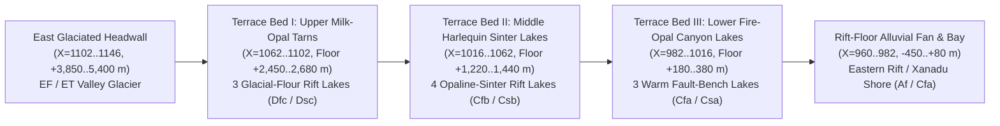

# opalvalley: the plan (draft, 2026-11-06)

**Opal Valley** (`regions` doc `rmw52q8d7prwz`, `"opal valley"`): the glaciated, three-terraced rift-relay valley on the south-eastern margin of the Great Rift, wedged between the eastern arm of the Rift / Vale of Xanadu basin on the west-northwest (`X = 960..1020, Y = 1622..1665`), Oidong Valley on the north (`X = 997..1146, Y = 1588..1646`), and the southern high cordillera on the south and east (`X = 1100..1146, Y = 1664..1698`).

**Owner's brief (2026-11-06):**
> *"glaciated at the east end, the meltwater rolls down a slope that reaches the rift floor through three terraced beds of small rift lakes. the foliage, related to Xanadu's, and the rocks alike both have an iridescent hue, and the opals mined here fetch a pretty penny in Xanadu and even more in the lands to the north"*

**Status: plan, awaiting the owner.**

---

## 0. What the kit is (`OPAL` on `BIOME-API.md`)

| | |
|---|---|
| **Folder** | `biomes/opalvalley/` (standard kit layout with `src/`, `tex/`, and `stations/`) |
| **Polygon** | `opal valley` (`rmw52q8d7prwz`, `6,146 px` = `24,584 km²` on the `1821×1723` `5.1` canvas; `X = 960..1146, Y = 1622..1698`) |
| **Pages** | Five stations (Section 6): the Glaciated Opal Headwall (`glacier`), the Upper Milk-Opal Tarn Terrace (`upperbed`), the Middle Harlequin Sinter & Mine Terrace (`middlebed`), the Lower Fire-Opal Canyon Terrace (`lowerbed`), and the Rift-Floor Cataract & Xanadu Threshold (`riftmouth`) |
| **Core** | `core/host`, `core/rand`, `core/mask`, `core/tags`, `core/terrain` (three stepped normal-fault lake benches, glacial cirque headwall, and `KSTRATA`'s `canyon` recipe with iridescent potch-and-precious-opal seam bands), `core/water` (glacier ice snout, rock-flour colloidal lakes, stepped travertine/sinter cascades), `core/atmos`, `core/haz` |
| **Read in place** | `biomes/xanadu` (the dawn redwood, agate tree, lotus trumpet, cloud pine, haze blossom, frost willow, breaker crown, braided cloud tree, and `PAL.psyPair` iridescence hooks), `biomes/oidong` (the marble birch, chalice tree, iridescent lily, stone-blooms), and `biomes/rift` (`RIFT.IRIDBARK` and `RIFT.leanN` view-angle iridescence shaders); nothing copied |
| **Object** | `OPAL` on the `BIOME-API.md` contract |

---

## 1. The ground on Scale Model `5.1` (surveyed 2026-11-06) & proposed reshape

### 1.1 Current uncarved state on `5.1`
On the current `5.1` heightfield (`1821×1723`, `2 km/px`), `opal valley` (`rmw52q8d7prwz`) spans `372 km` WNW–ESE (`X = 960..1146`) by `152 km` NNE–SSW (`Y = 1622..1698`, `24,584 km²` total):

| West-to-East Slice (`5.1` px) | Pixels (`km²`) | Current `H` (min / med / max) | Current Climate Classes | Notes on Current Model |
|---|---|---|---|---|
| **WNW Rift Mouth** (`X = 960..990`) | `690 px` (`2,760 km²`) | `-578 / +3,120 / +7,257 m` | `Cfb` 26%, `Dfc` 23%, `ET` 19%, `Cfa` 13%, `Af` 7% | Opens directly onto the SE bay of the eastern Rift lake (`-578 m` water/shore); short stream `r682` (*Gūlī Qubbah*, `[984.9, 1651.9] -> [978.9, 1651.9]`) |
| **Lower Fault Ramp** (`X = 990..1020`) | `1,374 px` (`5,496 km²`) | `+3,216 / +7,140 / +14,998 m` | `EF` 40%, `O` 23%, `ET` 20%, `HF` 16% | Steeply uncarved southern Rift wall climbing into airless `Class O` |
| **Middle Valley Trunk** (`X = 1020..1095`) | `3,156 px` (`12,624 km²`) | `+6,824 / +12,280 / +15,091 m` | `O` 95%, `HF` 4%, `EF` 1% | Currently an uncarved `10–15 km` airless `Class O` block south of Oidong Valley |
| **Eastern Glaciated Head** (`X = 1095..1146`) | `926 px` (`3,704 km²`) | `+8,639 / +10,120 / +11,492 m` | `O` 94%, `HF` 6% | High eastern apex wedged between Oidong's headwall and the southern rim |

### 1.2 Proposed terrain reshape (`5.1` implementation blueprint)
Right now `68.1%` of the polygon sits in airless `Class O` (`>9 km`) with no valley trough, no terraced lake beds, and no glacial meltwater river connecting the eastern ice to the Rift floor. Reshaping `opal valley` (`rmw52q8d7prwz`) carves a **370 km-long WNW-descending normal-faulted rift-relay valley** bounded by `+3,800 to +5,800 m` iridescent rhyolite-and-ignimbrite canyon walls (separating it from Oidong Valley on the north at `Y ~ 1625..1665` and the high southern ice rim along `Y ~ 1685..1698`), stepping down from a **glaciated eastern cirque (`+3,900 to +5,400 m`)** to the **Rift floor (`-450 to -150 m`)** across **three terraced beds of small rift lakes**:

| Zone | `X` Range (`5.1` px) | Target Valley Floor / Lake Level | Bounding Rim Walls | Target Climate | Key Hydrologic Features |
|---|---|---|---|---|---|
| **1. Eastern Glaciated Headwall (*Jabal al-Qaوس* / The Prism Glacier)** | `X = 1102..1146, Y = 1662..1691` | `+3,650 m` snout to `+5,350 m` cirque crest | `+5,200..6,100 m` (`0.74–0.83 atm`) | `EF` (glacier tongue) & `ET` (periglacial moraines), `~450–680 mm` snow | Branched valley glacier grinding silica-rich rhyolitic tuff & opaline fault breccia into colloidal rock-flour meltwater |
| **2. Terrace Bed I — Upper Glacial Milk-Opal Tarns** | `X = 1062..1102, Y = 1654..1696` | Bench floor `+2,450..2,680 m` (`1.15 atm`, mean `+5 °C`) | `+3,900..4,750 m` | `Dfc` / `Dsc` (`~620 mm`) | **3 small rift lakes (`WH`)** at `+2,620 m`, `+2,540 m`, and `+2,470 m` (`24–48 km²` each), milky turquoise with suspended silica nanospheres |
| **3. Terrace Bed II — Middle Harlequin Sinter & Placer Lakes** | `X = 1016..1062, Y = 1640..1695` | Bench floor `+1,220..1,440 m` (`1.34 atm`, mean `+13 °C`) | `+2,900..3,750 m` | `Cfb` / `Csb` (`~780 mm`) | **4 small rift lakes (`WH`)** at `+1,390 m`, `+1,340 m`, `+1,290 m`, and `+1,245 m` dammed behind opaline-silica sinter travertine rims; main mining terrace |
| **4. Terrace Bed III — Lower Fire-Opal Canyon Lakes** | `X = 982..1016, Y = 1626..1680` | Bench floor `+180..380 m` (`1.53 atm`, mean `+20 °C`) | `+1,800..2,650 m` | `Cfa` / `Csa` (`~920 mm`) | **3 small rift lakes (`WH`)** at `+340 m`, `+275 m`, and `+210 m` in a warm, mist-filled canyon bench overlooking the Rift trough |
| **5. Rift-Floor Cataract & Xanadu Shore Fan** | `X = 960..982, Y = 1622..1655` | `-460 m` (Rift lake bay) to `+120 m` fan apex (`1.62–1.72 atm`, mean `+24 °C`) | `+900..1,600 m` | `Cfa` / `Af` / `Cwa` (`~1,150 mm`) | The **Opal River** (*Nahr al-Yāqūt* / extended `r682` *Gūlī Qubbah*, `~85 m³/s`) plunges over a `260 m` iridescent sinter cataract into the SE cove of the eastern Rift lake |

---

## 2. Geology & mineralogy: why the rocks and lakes shimmer

Opal Valley occupies a **stepped extensional transfer zone (relay ramp)** where the south-eastern boundary fault of the Great Rift steps eastward toward Oidong Valley and the High Rift (`rmvhighrift100`). Three geological processes converge here to turn the entire valley into Krator's premier deposit of precious opal ($\text{SiO}_2 \cdot n\text{H}_2\text{O}$):

1. **Rhyolitic Ignimbrite & Volcanic Glass Host Rock:** The valley walls expose thick, fault-sliced beds of porous felsic volcanic ash, welded rhyolitic tuff, and perlitic glass laid down during the early rifting of the southern trough, interbedded with dark iron- and titanium-rich basaltic sills from the nearby Twins volcanic center.
2. **Silica-Saturated Epithermal & Glacial-Periglacial Leaching:** Warm alkaline geothermal fluids rising along the three listric normal fault scarps—mixed with cold, oxygenated glacial meltwater from the eastern headwall—leach amorphous silica from the rhyolitic glass. As these fluids cool, evaporate, and experience sharp pH drops across the **three terraced lake beds**, dissolved orthosilicic acid ($\text{H}_4\text{SiO}_4$) polymerizes into uniform `150–300 nm` colloidal silica spheres that settle into fault cavities, sinter aprons, desiccated lake-margin clays, and fossilized wood.
3. **Four Distinct Varieties of Opal Valley Gem & Host Rock:**
   - **Rift Black Opal (*Al-Bāzalt al-Qawsī*):** Found along the contact where silica-bearing fault veins cut dark titanium-basalt dikes on the **Middle Terrace (`+1,220–1,440 m`)**. Its dark charcoal-to-indigo potch backing throws off electric flashes of crimson, emerald, peacock-blue, and violet—the single most valuable gemstone per carat in southern and northern Krator.
   - **Harlequin Sinter & Matrix Opal:** Banded opaline silica (`KSTRATA` canyon recipe) cementing the step-riser cliffs and natural lake-outlet dams. Even the unmined cliff faces carry a wet-looking **opaline rock glaze (desert/canyon silica varnish)** that shifts from copper-rose to teal as the sun moves (`RIFT.IRIDBARK` / Fresnel thin-film shader hook on rock faces).
   - **Fire & Amber Opal (*Yāqūt al-Shams*):** Transparent orange, cherry-red, and gold-flashing hydrous opal mined from the warm volcanic-tuff benches of the **Lower Terrace (`+180–380 m`)**.
   - **Glacial Milk & Crystal Opal:** Pale, translucent blue-white and mint-green opal nodules tumbled out of frost-shattered moraines into the gravel bars of the **Upper Terrace Tarns (`+2,450–2,680 m`)**, where suspended silica nanospheres turn the lake water itself into a pearlescent, opalescent peacock-blue mirror.
   - **Opalized Wood & Lotus Casts:** Fallen trunks of Xanadu-kin agate trees and giant lotus seed-pods buried in the terraced lake silts and replaced cell-for-cell by shimmering precious opal.

---

## 3. The iridescent flora: Xanadu's silica-armored cousins

As requested by the owner, **the foliage is closely related to Xanadu's (`biomes/xanadu`) and shares an unmistakable iridescent hue with the rocks**.

### 3.1 The biological mechanism: biogenic opal phytoliths & photonic cuticles
Because the soils, streams, and lake beds of Opal Valley are supersaturated with dissolved monosilicic acid ($\text{H}_4\text{SiO}_4$), Xanadu's and Oidong's colonizing flora evolved a striking physiological adaptation here: they **hyper-accumulate amorphous hydrated silica (`5–18%` dry leaf weight)** and deposit it in ordered multilayer nanosphere arrays inside their leaf cuticles, bark scales, and flower bracts.
- **Why the plants do it:** On the high upper and middle terraces (`1.2–2.7 km`), the thin-film silica cuticle acts as **structural UV armor**, **frost-crystallization baffling**, and **herbivore-proof glass-tooth defense**; in the dim spray-gorges, the multilayer silica grating acts as a photonic crystal that focuses photosynthetic wavelengths into the chlorenchyma while reflecting grazing-angle light in shimmering peacock, violet, copper, and emerald hues.
- **In the engine (`BIOME-API.md`):** Every species in `biomes/opalvalley/` drives the core's view-dependent second-color iridescence hook (`extra.c2`, `RIFT.IRIDBARK`, and `PAL.psyPair`) at full strength (`0.65–0.90` Fresnel shift), so a hillside of trees changes hue from jade-teal to violet-rose and fire-gold as the player walks past or as the wind turns the leaves.

### 3.2 Species roster across the three terraces

| Species | Kinship / Builder Source | Habit & Iridescent Signature | Terrace Zone |
|---|---|---|---|
| **1. Opal-Bark Tree** (*living opalized wood*) | Evolved from Xanadu's **Agate tree** (`biomes/xanadu`) | Fluted column whose peeling bark plates are encrusted with real biogenic potch-and-fire opal bands (black, violet, teal, and fiery orange shimmer via `RIFT.IRIDBARK`); canopy of glossy jade-to-magenta leaves | Middle & Lower Terraces (`+180–1,600 m`) |
| **2. Peacock Dawn Redwood** | Xanadu's **Dawn redwood** (`shared:'xanadu'`) | Buttressed shore-and-shallow-water conifer whose feathery sprays shift from burnished copper-orange in direct sun to deep peacock-teal and cobalt in shade (`c2` iridescence) | Standing in the shallows of all 10 terraced rift lakes |
| **3. Prism Cloud Pine** | Xanadu's **Cloud pine** & Oidong's **Cloud-pad tree** | Wind-sculpted S-trunk bonsai on the sinter ledges and glacial moraines; flat needle pads coated in frost-white silica wax that flashes ice-blue and violet at grazing angles | Upper & Middle Terraces (`+1,200–3,400 m`) |
| **4. Fire-Opal Breaker Crown** | Xanadu's **Breaker crown** | Leaning dark-boled crag tree with a breaking wave of long silica-stiffened blades that shift from deep garnet-black on the shadow side to blazing harlequin orange-gold and electric green in the spray | Cataract rims & fault-step risers |
| **5. Nacre Lotus Trumpet & Opal Water-Lotus** | Xanadu's **Lotus trumpet** & Oidong's **Giant lotus** | Branching fluted trunks holding wide cup-trumpets fringed with mother-of-pearl lotus blooms; on the terraced lake surfaces, floating lotus pads with upturned opalescent teal-and-coral rims | Lower & Middle Terrace lake margins |
| **6. Glass-Plume Frost Willow** | Xanadu's **Frost willow** | Weeping lakeside curtains of translucent, fiber-optic silica-spicule twigs that chime faintly in the katabatic breeze and shift from silver-mint to amethyst | Upper & Middle Terrace lake shores (`+1,200–2,700 m`) |
| **7. Harlequin Frill & Sinter Chalice** | Rift's **Carrot frill** / Oidong's **Chalice tree** | Ribbed columns and saucer-capped water-catchers growing in the waterfall mist between terraces, their fins and caps banded like matrix opal | Step-riser cascades & Rift-mouth gorge |
| **8. Floor & Rock Cover: Opaline Lichen (`irislichen`), Prism Ferns, Swirl Lilies, & Silica-Cushion Rosettes** | `biomes/xanadu` + `biomes/rift` + `biomes/oidong` | Crustose iridescent rock-lichens painting the dark basalt/rhyolite talus in oil-slick peacock greens and violets; understorey drifts of two-tone painted orchids, hive lilies, and frost-hardy silica-spined cushion rosettes near the eastern glacier | Valley-wide, zoned by elevation |

---

## 4. The opal mining & trade economy: Xanadu and the northern markets

### 4.1 How the opals are mined
Mining in Opal Valley is deliberately small-scale, artisanal, and water-dependent—never industrial strip-mining—giving the landscape a picturesque frontier character of hand-cut adits, bamboo-and-cedar sluice boxes, and lantern-lit prospectors' ledges:
1. **Terrace Placer Sluicing ("Milk-and-Fire Panning"):** On the gravel fans and seasonal strandlines of **Terrace Bed I (`+2,470–2,620 m`)** and **Terrace Bed II (`+1,245–1,390 m`)**, prospectors wash glacial outwash and sinter-breccia gravels through stepped wooden riffle-boxes fed by the meltwater cascades, recovering water-worn nodules of crystal, milk, and fire opal.
2. **Fault-Scarp Hard-Rock Adits ("Potch-Tracing"):** Along the two great normal-fault risers (between Terrace I & II at `X ~ 1060`, and between Terrace II & III at `X ~ 1015`), miners follow pale "potch lines" (barren common opal veins) horizontally into the dark basalt-rhyolite contact with hand-picks and UV/oil lamps until the vein hits an ironstone-basalt pocket and bursts into **Rift Black Opal**.
3. **Lake-Bed Dredging & Diving:** In the shallow, crystal-clear sinter lagoons of the **Middle and Lower Terraces**, breath-hold divers harvest opalized heartwood logs and nacre-encrusted lotus concretions from the colloidal silica muds.

### 4.2 The value chain: why opals fetch a pretty penny in Xanadu—and a fortune in the North
- **In Xanadu (`1×–2×` base price — "a pretty penny"):**
  - The western mouth of Opal Valley (`X = 960..1020`) lies directly inside the eastern marches of the **Xanadu Sultanate (`rmufcgvtxatfx`)**, just southeast of **Strongbow (`px 1026, 1594`)** and across the eastern lake arm from **Erewhon / the Vale of Xanadu**.
  - Xanadui court jewelers, pleasure-dome architects, and merchant-factors at Strongbow buy raw and cabochon opals eagerly for architectural inlays, iridescent mosaics, and courtly dress. The Sultanate's factors maintain a seasonal assay pavilion at the **Middle Terrace (`Station 3`)** and a toll-quay at the **Rift Mouth (`Station 5`)**.
- **In the Lands to the North (`4×–8×` base price — "even more in the lands to the north"):**
  - Why do Opal Valley's stones multiply in value once carried north across the Twins, the Catch, and the Godsgate into the main crater?
    1. **Extreme Scarcity & Peril of the Crossing:** To reach the northern crater markets, a pouch of opals must survive the **Twins** (either through the dark lava tubes or the geothermal oasis dash under paid Xanadui guides), cross the **Catch** (braving alkali *karaburan* storms and the robotic **Stalkers** of Hub 01), and climb the **Godsgate** (`+3,620 m`) into the Bowl! Opals are the ultimate **high-value, near-weightless cargo**: a merchant can hide a king's ransom in a belt-pouch where bulky goods would never pay for the water of the beasts that carry them.
    2. **Luxury & Courtly Mania in the Crater Kingdoms:** In the **Empire of Iziz**, the **Vothic Kingdom**, the **League of Amphitriton**, and the **Yuni Emirate**, "Southern Fire" (*Nār al-Janūb*, Rift Black and Harlequin Opal) is the supreme badge of imperial rank—prized precisely because no northern mine produces play-of-color precious opal.
    3. **Techno-Arcane & Optical Demand:** Northern **Geomancers** (in Yuni and Locus) and the **Yusar** cyberneticists of the Eternal State pay astronomical sums for defect-free **photonic crystal opal and biogenic silica-spicule glass** from Opal Valley, which they use as optical wave-guides, laser-resonator lenses, and calibration prisms for salvaged Ancient energy cells and survey instruments.

---

## 5. Who holds it & local hazards

- **Xanadu Sultanate borderlands (the lower & middle valley):** Strongbow's factors license the lower and middle terrace claims, collect the Sultan's Fifth in cut stones, and hire out guards.
- **Independent Prospectors, Oidong Pilgrims & Fellgang/Tungang Miners (the upper valley):** Above the Middle Riser (`>1,800 m`), the Sultanate's writ thins out. Independent prospectors, exiled miners, and peaceful herbalist-monks descending from neighbouring **Oidong Valley** (just across the northern ridge at `Y ~ 1615..1635`, where opal dust is ground into manuscript pigments and seeing-mirrors) work the upper tarns alongside furtive **Tungang** tunnel-delvers who know the fault fissures better than any surface surveyor.
- **Environmental Hazards (`core/haz`):**
  1. **Silicosis / "Prism-Lung" (`dust` hazard in dry adits and sinter flats):** Fine airborne colloidal silica dust around dry fault-scarp dumps and wind-raked sinter beaches.
  2. **Thin-Crust Opaline Sinter (`hot_ground` / `break_crust`):** Around the warm silica seeps of the Middle Terrace, freshly precipitated opaline gel forms paper-thin, iridescent crusts over scalding (`65–82 °C`) alkaline mud pots.
  3. **Glacial Outburst & Katabatic Whiteout (East Headwall):** Afternoon foehn/katabatic gusts off the eastern glacier and sudden subglacial meltwater surges down the slot chutes between lake beds.

---

## 6. Five showcase stations (`biomes/opalvalley/stations/`)

| # | Station ID (`--station`) | `5.1` px (`1821×1723`) | Target Elevation & Pressure | Climate Class | Visual Set-Piece & Gameplay Role |
|---|---|---|---|---|---|
| **1** | `glacier` (*The Prism Glacier & Ice-Caves*) | `(1124, 1676)` | `+4,150 m` (`0.95 atm`), mean `-3 °C` (`+8 / -14 °C`), `~580 mm` | `ET` / `EF` | The glaciated eastern headwall: a crevassed blue-and-opalescent valley glacier grinding over banded rhyolite-opal cliffs, subglacial meltwater ice-caves glowing peacock-blue, frost-hardy silica-rosettes, and the first milky meltwater cascade |
| **2** | `upperbed` (*Terrace Bed I: The Milk-Opal Tarns*) | `(1082, 1672)` | `+2,540 m` (`1.16 atm`), mean `+5 °C` (`+16 / -5 °C`), `~640 mm` | `Dfc` / `Dsc` (`WH` lakes) | **First terraced lake bed**: a chain of three subalpine rift tarns (`+2,620 m`, `+2,540 m`, `+2,470 m`) whose colloidal silica rock-flour water shines opaque milky-turquoise; prism cloud pines, glass-plume frost willows, and high-country placer sluices |
| **3** | `middlebed` (*Terrace Bed II: Harlequin Sinter & The Opal Mines*) **— Default Showcase Page** | `(1038, 1662)` | `+1,340 m` (`1.34 atm`), mean `+13 °C` (`+22 / +4 °C`), `~780 mm` | `Cfb` / `Csb` (`WH` lakes) | **Second terraced lake bed (heart of the biome)**: four stepped lakes (`+1,390 m` to `+1,245 m`) rimmed by iridescent opaline-sinter dams, dark basalt-contact adits where miners extract **Rift Black Opal**, the Xanadui Factors' Assay Pavilion, and groves of shimmering Opal-Bark Trees and Peacock Dawn Redwoods |
| **4** | `lowerbed` (*Terrace Bed III: The Fire-Opal Canyon Pools*) | `(998, 1646)` | `+275 m` (`1.53 atm`), mean `+20 °C` (`+28 / +12 °C`), `~920 mm` | `Cfa` / `Csa` (`WH` lakes) | **Third terraced lake bed**: three warm, mist-veiled canyon-bench lakes (`+340 m`, `+275 m`, `+210 m`) carved into cherry-orange fire-opal tuff; nacre lotus trumpets, floating opal lotuses, and lantern-lit cliffside mine galleries |
| **5** | `riftmouth` (*The Opal Cataract & Xanadu Threshold*) | `(972, 1636)` | `-180 m` shore / `+60 m` bench (`1.62 atm`), mean `+24 °C`, `~1,150 mm` | `Cfa` / `Af` | Where the **Opal River** (*Nahr al-Yāqūt*, `~85 m³/s`) plunges `260 m` over an iridescent sinter cataract into the south-eastern bay of the Rift lake (`-460 m`), beside a fortified Xanadui caravan & barge landing bound for Strongbow and the northern trails |

---

## 7. Scale Model `5.1` terrain & hydrology implementation spec

When the owner approves reshaping the terrain for `opal valley` (`rmw52q8d7prwz`), `tools/scale-model/build_425_master.py` will apply the following deterministic, guard-verified operations:

1. **Glaciated Eastern Cirque & Valley Trough (`X = 960..1146, Y = 1622..1698`):**
   - Lower the uncarved `9–15 km` `Class O` block inside `rmw52q8d7prwz` into a WNW-sloping rift-relay trough whose axial floor descends from `+4,150 m` at the eastern glacier (`(1124, 1676)`) to `-460 m` at the Rift lake mouth (`(964, 1634)`), framed by `+3,200 to +5,600 m` ridge shoulders that preserve the divide with Oidong Valley on the north.
2. **Three Flat-Tread Terraced Lake Beds (`10 Small Rift Lakes` in `whas_exp` / `wlev_exp`):**
   - **Terrace I (`X = 1062..1102`):** Flatten three stepped graben treads and carve 3 small rift lakes (`WH`) at `+2,620 m` (`(1094, 1675)`), `+2,540 m` (`(1079, 1672)`, with `upperbed` station on dry shore at `(1082, 1672)`), and `+2,470 m` (`(1066, 1668)`).
   - **Terrace II (`X = 1016..1062`):** Flatten four stepped sinter-dammed treads and carve 4 small rift lakes (`WH`) at `+1,390 m` (`(1053, 1666)`), `+1,340 m` (`(1035, 1662)`, with `middlebed` station on dry shore at `(1038, 1662)`), `+1,290 m` (`(1025, 1657)`), and `+1,245 m` (`(1017, 1653)`).
   - **Terrace III (`X = 982..1016`):** Flatten three warm canyon-bench treads and carve 3 small rift lakes (`WH`) at `+340 m` (`(1007, 1649)`), `+275 m` (`(995, 1645)`, with `lowerbed` station on dry shore at `(998, 1646)`), and `+210 m` (`(985, 1641)`).
3. **Monotonic Meltwater River (`r682` *Gūlī Qubbah* / *Nahr al-Yāqūt*):**
   - Extend and route `r682` continuously from the eastern glacier snout (`(1124, 1676)`, `+4,150 m`) through all 10 terraced rift lakes and over the three fault-step cataracts into the SE bay of the Rift lake (`(964, 1634)`, `-460 m`), strictly satisfying the Step 7I monotonic river-descent and lake-spill guards.
4. **Climate & Satellite (`st`) Opaline-Iridescent Palette:**
   - Reclassify the valley floor from `Class O` into a realistic elevation-graduated sequence (`EF` glacier head -> `ET` periglacial -> `Dfc`/`Dsc` Upper Terrace -> `Cfb`/`Csb` Middle Terrace -> `Cfa`/`Csa` Lower Terrace -> `Af`/`Cfa` Rift mouth, with `WH` on the 10 lakes).
   - Paint the satellite (`st`) map with the eastern blue-white glacier tongue, pearlescent turquoise-opal lake waters, iridescent teal-and-violet Xanadu-kin forest slopes, and warm copper-rose opaline sinter scarps.
