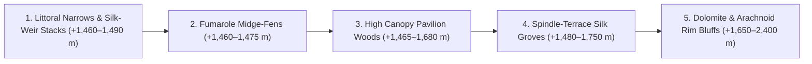

# Spider Lake Biome Kit — Plan

This document specifies `biomes/spiderlake/` — the highland-lacustrine, eusocial-arachnid silk-forest kit for **Spider Lake** (`id: "rmvyj4v2ozgb1"`, **72,928 km²** on the `1821×1723` `2 km/px` master grid). It follows the same architectural contract as `biomes/abyssal-savannah/PLAN.md` and `biomes/nwouterwall/PLAN.md`, grounding the region's terrain, hydrology, atmospheric physics, trophic ecology, and silk-harvesting economy in the planetary constants of `biomes/WORLD.md`.

---

## 0. What the Kit Is

`biomes/spiderlake/` is a self-contained browser biome kit exposing `window.SPIDERLAKE` (`id: 'spiderlake'`), designed to plug into the unified engine (`biomes/engine/`) and the scale-model biome-kit registry.

### Kit Contract
- **`SPIDERLAKE.id`**: `'spiderlake'`
- **`SPIDERLAKE.regionId`**: `'rmvyj4v2ozgb1'` (`spider lake`)
- **`SPIDERLAKE.world`**:
  - `g`: `9.8 m/s²`
  - `surfacePressureAtm`: `1.20` (at the `+1,460.0 m` lake surface; `1.35 atm` at sea level, `H ≈ 12.6 km`)
  - `partialPressureO2Atm`: `0.26` (`~21.5% O₂` at `1.20 atm` — **+24% above Earth sea-level oxygen partial pressure**)
  - `airDensityKgM3`: `1.47` (dense, buoyant air that effortlessly lofts ballooning spiderlings, gossamer suspension cables, and dense emergent aquatic insect clouds)
- **Stations (`SPIDERLAKE.stations`)**:
  1. `Golden Narrows Bridge-Curtain` (*drowned basalt/dolomite stacks spanned by 180-meter golden dragline suspension sheets over the lake narrows*)
  2. `High Canopy Pavilion Grove` (*lakeside spindle-willow and amber-mulberry forest draped in 4-meter communal silk brood-domes*)
  3. `Fumarole Midge-Fen` (*steaming sublacustrine hydrothermal littoral marsh where "lake-smoke" chironomid clouds boil off the water at dusk*)
  4. `Ria Headwater Silk-Weirs` (*terraced timber-and-porphyry reeling frames and degumming vats along the western outflow gorge*)
  5. `Dolomite Rim Overlook` (*northwestern bluff transition where Neo-Ozarks cherty dolomite and red porphyry dikes plunge into the lake*)

---

## 1. Where It Is on the Model

| Parameter | Value |
| :--- | :--- |
| **Region Name & ID** | `spider lake` (`id: "rmvyj4v2ozgb1"`) |
| **Canvas Bounds (`1821×1723`)** | `X = 1225..1417`, `Y = 154..291` (`18,232 cells` = **72,928 km²**) |
| **Lake Surface Elevation** | **`+1,460.0 m`** (`WH` Highland Lake, `2,179 lake cells` = **8,716 km²** water surface, plus 5 emergent rocky silk-weir island stacks at `+1,465..+1,488 m`) |
| **Basin Rim & Shore Elevation** | `+850 m` (western outflow gorge) to `+1,460..+1,850 m` (terraced lake benches & spindle-groves), rising to `+2,600..+3,450 m` along the eastern Outland Gate divide |
| **Köppen Climate** | **89.0% `Cfa` / `Cfb`** (humid warm-to-cool temperate lacustrine basin, buffered by thermal mass and hydrothermal seeps) with `Dfb`/`Dfc` on the upper eastern ridges |
| **Thermal Regime (Lake Shore)** | Warmest month `tw ≈ +21.5 °C`, coldest month `tc ≈ +4.5 °C` (`ΔT ≈ 17 °C`); the lake never freezes over |
| **Precipitation & Humidity** | `1,150 – 1,650 mm/yr` rainfall + persistent morning radiation fog (`RH 80–95%` at dawn) off the warm lake waters |
| **Hydrological Connections** | **Inflow:** Fed from the east by the *Outland Gate River* (`id: 9106`) descending from the Outland pass (`+1,480 m`). **Bifurcated Outflow:** Drains west via the *Ria Trunk River* (`id: 9101`) into the Ria estuary, and southwest via the *Web-Cleaver Gorge River* (`id: 9102`) through the Arachnoids (`rmuqm9fa9dfa7`) to the Double Delta |
| **Neighboring Biomes** | **NW:** `neo-ozarks` (`rmvyiyw8ucd1y`, dissected dolomite/limestone plateau & porphyry veins); **SW:** `Arachnoids` (`rmuqm9fa9dfa7`, concentric volcanic-tectonic ring-fault hills); **E:** `Outland` (`rmuqmb59f1f14`) via the Outland Gate |

---

## 2. Air, Trophic Engine, and Why Eusocial Spiders Dominate Here

On Earth, social spiders (such as *Anelosimus eximius* in Neotropical cloud forests, *Stegodyphus dumicola* in southern Africa, and colonial *Tetragnatha* sheet-weavers along nutrient-rich lakes) only achieve large communal colonies when three conditions coincide: **uninterrupted year-round insect megabiomass**, **high structural attachment density**, and **protection from winter freeze**. Any shortfall in prey density forces spiders back into cannibalistic solitary territoriality.

At **Spider Lake**, planetary physics and local geology lock all three drivers into permanent overdrive:

1. **Hyperoxic, High-Density Atmosphere (`1.20 atm`, `0.26 atm O₂`):**
   - Spider respiratory organs (book lungs and sieve tracheae) rely on passive gaseous diffusion. At `0.26 atm O₂` (`+24%` above Earth sea level), metabolic ceiling and silk-gland protein synthesis rates scale up dramatically, supporting **robust body sizes (`3.5 – 6.5 cm` legspan in workers, `9 cm` in matriarchs)** and continuous year-round silk extrusion without respiratory exhaustion.
   - At `ρ ≈ 1.47 kg/m³`, aerodynamic drag on silk threads is 22% higher than on Earth, allowing colonial spiders to cast **150–250 m wind-borne bridge-lines** across water channels and island stacks.
2. **The Hydrothermal "Lake-Smoke" Trophic Engine:**
   - Spider Lake occupies a structural pull-apart sag where the **Arachnoid volcanic ring-faults** intersect the **Neo-Ozarks carbonate shelf** and the **Outland Gate fault**. Warm, silica- and calcium-rich sublacustrine hydrothermal seeps (`+28 to +42 °C`) vent along the lake floor.
   - These warm mineral upwellings drive explosive year-round benthic diatom and cyanobacterial blooms, which feed astronomical populations of **non-biting lake midges (Chironomidae), giant burrowing mayflies, and caddisflies**.
   - Every dawn and dusk, emerging winged adults rise from the `+1,460 m` lake surface in brown-gold pillars 300 meters high—locally called **"lake-smoke"**—yielding **`15–40 g/m²/day` of aerial insect biomass** blown directly into the shoreline trees and island stacks.
3. **Eusocial Division of Labor (*Arachneapolita sericifera*, the Krator Silk-Weaver):**
   - Unlike solitary spiders that waste energy rebuilding webs after every storm, *A. sericifera* lives in permanent, female-biased eusocial colonies of **20,000 to 250,000 individuals** sharing a single multi-tiered architectural complex:
     - **Castes / Ontogenetic Roles:**
       - *Foundresses & Matriarchs* (large, deep-amber abdomen, remain inside the insulated central brood-pavilion laying egg-sacs year-round).
       - *Riggers & Span-Workers* (long-legged outer-sheet spiders that spin high-tensile structural draglines and adhesive capture curtains, repairing wind and bird damage within minutes).
       - *Packers & Nurses* (smaller, agile workers that swarm prey in coordinated groups of 30–100, immobilize giant lake-flies or small vertebrates with communal silk throws, and feed regurgitated trophallactic fluid to spiderlings).

---

## 3. Biome Zones (`SPIDERLAKE.zones`)

The kit divides the `72,928 km²` region into **5 distinct ecological and terrain zones**:

### 3.1 `narrows` — Littoral Narrows & Silk-Weir Island Stacks (`+1,460 – +1,490 m`)
- **Landform:** Five emergent rocky islands and dozens of basalt/dolomite sea-stacks rising `5–28 m` above the `+1,460 m` lake surface, especially around the central narrows and the dual western outlets (`id: 9101` Ria headwater and `id: 9102` Web-Cleaver Gorge headwater).
- **Silk Architecture:** Multi-colony **Bridge-Curtains**—shimmering golden-white aerial nets `15–40 m` tall and up to `180 m` wide suspended between island stacks and shoreline cliffs, intercepting wind-driven midge clouds skimming the water. Boatmen pass beneath the high-arch cables through maintained navigation gaps.

### 3.2 `fumarole_fen` — Hydrothermal Midge-Fens & Degumming Springs (`+1,460 – +1,475 m`)
- **Landform:** Shallow, steaming backwater coves, travertine-rimmed warm springs (`+32–45 °C`), and sedge-choked delta flats where the Outland Gate River (`id: 9106`) and Neo-Ozark karst springs enter the lake.
- **Ecology & Human Use:** The nursery of the lake's chironomid midge clouds. Locals use the naturally alkaline, carbonate-rich warm spring basins as **natural sericin-degumming baths** to wash raw harvested silk without boiling fuelwood.

### 3.3 `pavilion_wood` — High Canopy Pavilion Woods (`+1,465 – +1,680 m`)
- **Landform:** Humid temperate (`Cfa`/`Cfb`) bench forests ringing the lake, swathed in morning mist.
- **Silk Architecture:** The signature landscape of Spider Lake. Entire groves of *Spindle-Willow* and *Crown-Cypress* are linked canopy-to-canopy by **Communal Brood-Pavilions**—rainproof, thermally insulated golden-ivory silk domes (`2–6 m` across) suspended in the forks of branches, connected by three-dimensional highways of guy-ropes and vertical funnel-sheets that glow like spun brass in low sun.

### 3.4 `spindle_terrace` — Managed Arachniculture Groves & Reeling Frames (`+1,480 – +1,750 m`)
- **Landform:** Gently sloping, human-sculpted stone-wall terraces above the north and west shores, constructed from Neo-Ozark cherty dolomite and purple-red porphyry blocks.
- **Human-Spider Symbiosis:** Instead of killing the colony (as in Earth silkworm boiling), Spider Lake silk-wrights practice **live rotational arachniculture**:
  - Parallel rows of pruned *Amber-Mulberry* and *Spindle-Willow* pollards are alternatingly linked by **removable cedar-and-porphyry reeling frames** (`Silk-Weirs`).
  - Every 6 days, after the outer capture and structural sheets have been thickened by nightly midge-runs, harvesters waft mild **calming smudge-smoke** (*bog-myrtle and dried fern-spore*) that cues the workers to retreat peacefully into their central brood-pavilions.
  - The outer frame sheets are then wound onto water-powered reeling bobbins along the Ria and Web-Cleaver outflow streams, leaving the brood-dome and food stores completely unharmed.

### 3.5 `upland_bluff` — Dolomite & Basalt Rim Bluffs (`+1,650 – +2,400 m`)
- **Landform:** The drier, windier upper basin walls transitioning northwest into the `neo-ozarks` (`rmvyiyw8ucd1y`) dolomite/porphyry escarpments and southwest into the `Arachnoids` (`rmuqm9fa9dfa7`) ring-ridges.
- **Ecology:** Solitary trapdoor spiders, funnel-web crevices in porphyry talus, and dry *Dwarf-Chinkapin* / *Porphyry-Pine* woodland where caravan trails climb toward the Ria valley and the Outland Gate.

---

## 4. Species & Silk Grades (`SPECIES` & `EXPORT_GRADES`)

### 4.1 Key Flora (`6 Core Plant Guilds`)
1. **Spindle-Willow (`Salix arachnophila`):** Fast-growing, supple-branched lakeshore tree (`12–18 m`) whose smooth, resin-free bark and horizontal whorl-branches evolved to bear heavy wet-silk loads without snapping; co-dispersed by spiders that incorporate its winged seeds into guy-anchors.
2. **Crown-Cypress (`Taxodium coronatum`):** Buttressed emergent conifer (`28–38 m`) standing in shallow littoral water (`0–3 m` depth); its fluted knees and flat crown-platforms anchor the highest wind-catching bridge-curtains.
3. **Amber-Mulberry (`Morus chrysophaea`):** Broadleaf under-canopy tree cultivated on the spindle-terraces; exudes sugary extrafloral nectar droplets along its leaf veins that worker spiders drink during dry spells for quick carbohydrate energy.
4. **Lake-Smoke Sedge (`Carex nebulosa`):** Dense tussock sedge forming floating littoral mats around hydrothermal seeps; its submerged root-curtains house the larvae of trillions of chironomid midges.
5. **Silk-Fen Pitcher (`Sarracenia sericea`):** Carnivorous bog-pitcher in the fumarole fens that coexists with juvenile spiders (which spin miniature snare-sheets across the pitcher mouths).
6. **Porphyry Cliff-Fern (`Polypodium porphyriticum`):** Leathery spore-fern growing on exposed Neo-Ozark porphyry and dolomite ledges; its dried golden sporangia are burned in silk-wright smudge-pots to calm colonies during harvest.

### 4.2 The Three Export Grades of Spider Lake Silk
Spider Lake's famous export is graded by the specific silk-gland blend harvested from different zones of the communal architecture:

| Export Name | Biological Source | Mechanical & Visual Properties | Primary Uses Across the Crater |
| :--- | :--- | :--- | :--- |
| **1. Golden Cable (`Major-Ampullate Dragline`)** | Harvested from the high-tension island-stack bridge-cables (`narrows`) | Deep burnished gold; tensile strength **`~1.3 GPa`** with `30%` elongation-to-break; thicker than steel wire of equal weight; immune to salt-rot | Maritime rigging on the Crater Sea, airship/glider suspension lines on the Outer Wall, bowstrings, and laminated lamellar armor backing |
| **2. Cloud-Fleece (`Tubuliform & Aciniform Pavilion Felt`)** | Sheared seasonally from abandoned outer weather-shells of the `pavilion_wood` brood-domes | Warm ivory-cream, ultralight hydro-repellent nonwoven felt; traps dead-air pockets while shedding torrential rain | High-altitude thermal parkas for `Yeti Kingdom` / `NW Outer Wall` expeditions, waterproof tent canopies, and surgical dressings |
| **3. Lake-Sheen Gossamer (`Minor-Ampullate & Flagelliform Spindle-Thread`)** | Reeled every 6 days from the `spindle_terrace` cedar frames after alkaline warm-spring degumming | Iridescent pearl-gold continuous filament; softer than cashmere yet virtually untearable; shimmers with a two-tone interference sheen | Luxury trade textiles, court garments of the Ria and Arch ports, and fine parchment-stitching thread |

---

## 5. Planned File Layout for `biomes/spiderlake/`

When the interactive 3D/2.5D biome viewer kit is instantiated in `biomes/spiderlake/`, it will follow the standard 7-file modular layout:
- `biomes/spiderlake/PLAN.md` — This specification document.
- `biomes/spiderlake/config.js` — `SPIDERLAKE` kit header, atmospheric constants (`1.20 atm`), 5 zones, and 5 camera stations.
- `biomes/spiderlake/terrain.js` — Procedural heightfield & bathymetry for the `+1,460 m` lake narrows, emergent dolomite/porphyry stacks, and terraced shoreline groves.
- `biomes/spiderlake/silk-architecture.js` — Catmull-Rom / catenary suspension solver for multi-tier bridge-curtains, branch-fork brood-pavilions, and timber silk-weir reeling frames.
- `biomes/spiderlake/foliage.js` — Spindle-willow, buttressed crown-cypress, amber-mulberry, and hydrothermal sedge placement.
- `biomes/spiderlake/atmosphere.js` — Morning lake-fog, warm hydrothermal steam plumes, and dusk "lake-smoke" chironomid swarm particle systems.
- `biomes/spiderlake/index.html` — Standalone station preview harness loading `biomes/engine/`.
