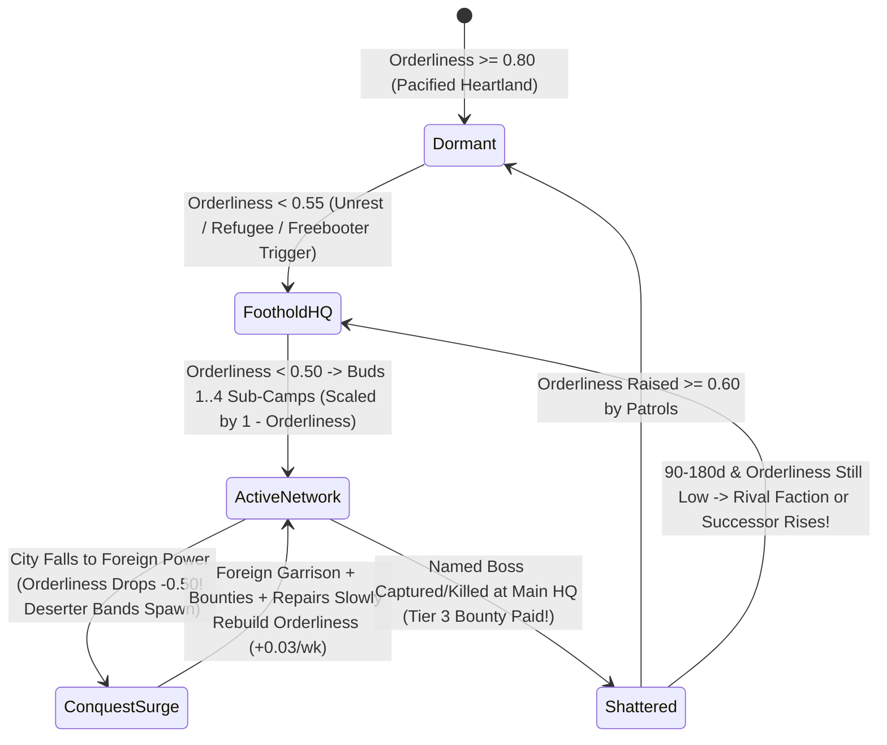

# Frontier Bandit Factions, Pirate Captain Coves & Continental Bounty-Hunting Scope (`2026-11-22`)

> [!NOTE]
> **Status: `[APPROVED — RULINGS #90–94]` — Companion Scope to [CONTINENTAL-SCOPE.md](file:///home/antigravity/traviso761-debug/krator-master/core/region/CONTINENTAL-SCOPE.md) and [MERCENARIES-SCOPE.md](file:///home/antigravity/traviso761-debug/krator-master/core/region/MERCENARIES-SCOPE.md).**
> Built directly on `core/camp/50-camp-outlaw.js` (`KCAMP.outlawCamp` hidden ravines + ray-marched `KCAMP.lookout` sentries), `core/simulation/77-sim-6-crime.js` (`SIM.crime`), `core/region/47c-region-crime.js`, `47u-region-unrest.js`, `47r-region-refugees.js`, `47f-region-found.js` (`SIM.found`), `49-region-govern.js`, and `core/coast` (`KCOAST`), anchored in [LORE.md](file:///home/antigravity/traviso761-debug/krator-master/LORE.md) (`Boatmurder` l.880, `Hook` occupation l.325, `Noah's Regret` / *Bloody Ruephus*, `Boiling Bay`, *Pirate Emperors* / *Hooked Sun* l.323, `Wildcat` in `WEST-RIFT-SCOPE.md`, and `Mid Basin` outlaws).

---

## 1. Procedural Rise, Budding, `Orderliness` & Post-Conquest Surge Engine (`[G data]`, `KRAND` Deterministic)

To make frontier banditry and piracy **come and go procedurally** without turning gangs into faceless generic spawns, the simulation separates **Persistent Cultural Personality Templates** from **Dynamic On-Map Lifecycles**:

1. **HQ + Satellite Sub-Camp Topology (Kenshi-Style Regional Presence):**
   - Every active Bandit Faction (`BF-01..10`) holds **1 Fortified Main HQ Camp** (`60–150` outlaws: Named Boss, `ol_cache` loot vault, prisoner cages, black-market fence, field forge) plus **`1–4` Hidden Satellite Sub-Camps** (`12–30` raiders each, pitched via `KCAMP.outlawCamp` out of line-of-sight of a `SIM.trade` highway/pass with `2–3` ray-marched `KCAMP.lookout` sentries!).
   - Every active Pirate Captain (`PF-01..08`) commands a **`1–3` Hull Flotilla** (`kits/ringsea` `lanong`, `xebec`, `dhoni`, or rogue `penteconter`) anchored at **1 Hidden Captain's Cove** (`25–60` crew, careening beach, sailcloth shanties from `62-nr-pirates.js`, mast-lookout) plus `1–2` strait skiff-ambush posts — distinct from the two permanent pirate capitals (**`Noah's Regret` `896, 866`** and **`Boiling Bay` `866, 723`**).
2. **Deterministic 5-Stage Procedural Lifecycle (`SIM.outlaws`):**
   - **1. Emergence (`dormant -> foothold`):** Triggered deterministically (`KRAND.hash(seed, week, zoneId)`) when regional `orderliness` drops below threshold (`< 0.55`) — fed by real `47u-region-unrest.js` tax/famine flight, displaced `47r-region-refugees.js` tent households, runaway `Shell` debt-peons, or unpaid **`MERCENARIES-SCOPE.md` `freebooter` mutinies**!
   - **2. Budding (`foothold -> established` + `sub_camp`s):** Whenever an HQ's stolen `ol_cache` surplus exceeds `cap`, it buds a new **Sub-Camp** (or **Skiff-Cove**) on the highest-value unpatrolled trade leg within `180 km` (capped by `1 - orderliness`, up to `max 4` sub-camps per HQ).
   - **3. Pruning (`sub_camp` cleared):** Wiping out a Sub-Camp makes that road/strait safe for **`30–60` sim days**; if the **Main HQ** still stands and `orderliness` remains low, the Boss eventually dispatches a new lieutenant to pitch at a *different* hidden ravine/cove (`visit++`).
   - **4. Decapitation (`hq_shattered` via Boss Bounty / Patrol Sweep):** Killing or capturing the **Named Boss** at the Main HQ (or sinking/capturing a Pirate Captain's flagship + burning their Cove) **shatters the faction**: surviving sub-camps scatter, turn refugee, or splinter into lone `10`-man stragglers.
   - **5. Succession & Migration (`90–180` Days Later):** After a cooldown, if regional `orderliness` has not been raised above `0.60`, either a **vengeful Lieutenant Successor** (inheriting a scar/grudge against whoever felled the old Boss!) or a **new procedural Splinter Gang / Rival Captain** claims a fresh HQ site in the region.
3. **Regional `orderliness` (`0.00..1.00`) & Post-Conquest Bandit Surge (`Ruling #94` — `[LOCKED]`):**
   - **Continuous Waxing & Waning:** Every province/frontier tracks `region.orderliness` (`0.00` total breakdown .. `1.00` pacified heartland, e.g. `Eternal State` interior `~0.92`, `Iziz`/`Roketstad` core `~0.82`, `Dilihan`/`Shell` marches `~0.55`, unpoliced `Bowl`/`Korona`/`Dam Basins`/`Mid Basin` `~0.25–0.35`), driven weekly by garrison patrol `standing`, `1 - unrest` (`47u-region-unrest.js`), food stability, and road distance from a walled seat:
     - **`orderliness >= 0.80`:** `0` bandit HQs; stray sub-camps swept weekly (`dormant`).
     - **`0.50 <= orderliness < 0.80`:** At most `1` remote pass foothold/sub-camp; slow `180`-day succession cooldown.
     - **`0.25 <= orderliness < 0.50`:** Full HQ + `2–3` active sub-camps; `90`-day succession cooldown.
     - **`orderliness < 0.25` *(Breakdown / Conquest Surge)*:** Max `4` sub-camps per HQ **plus temporary Deserter / Looter Splinter Bands & Privateer Coves** erupting along every unescorted road and shore!
   - **City Fall / Foreign Conquest Shock (`onCityConquered` — Live Game-Start Case: `Hook` `809, 923`, `LORE.md:325`):**
     - When a city falls to another power (`ownerPolity` changes), regional **`orderliness` plunges immediately by `-0.45` to `-0.60`** (floored at `0.10`): shattered garrison stragglers and unpaid auxiliaries scatter into the surrounding hills/coves as well-armed **Deserter Bands** (such as ex-Vothic holdouts & *Hooked-Sun* privateers around newly occupied `Hook`), watchhouse informant networks go blind, and war-displaced households flood `47r-region-refugees.js` camps.
     - **Gradual Foreign Pacification (`+0.02..+0.04`/week):** The conquering power **cannot restore `orderliness` by fiat** — banditry stays surged for months until the occupier physically **(a)** stations & feeds an occupation garrison (or hires `MC-01`/`MC-02` Chartered Mercenary `anti_raid_sweep` companies), **(b)** repairs breached walls/watchhouses (`47b-region-build.js`), **(c)** funds **Tier 2–3 Pacification Bounties** on post-conquest deserter/bandit bosses (`SIM.bounty`), and **(d)** brings curfew `unrest` & food shortages down (if the occupier starves or over-taxes the conquered city, `orderliness` stalls `< 0.35`, locking the province in chronic guerrilla/bandit insurgency!).

---

## 2. Ten Regional Bandit Factions with Distinct Personalities (`BF-01` – `BF-10`)

Each faction has its own ideology, silhouette (`core/charactermodels` gear & tint), road-stop dialogue, and **non-combat player interaction** (bribery, fencing, dueling, or ideological alliance):

| ID | Frontier Zone | Bandit Faction & Named Boss Title | Typical HQ Pocket & Sub-Camp Roads `(px, py)` | Distinct Personality, Ethos & Combat Gimmick | Player Interaction *(Beyond Fighting)* |
|---|---|---|---|---|---|
| **`BF-01`** | **N Semiarid Dam Basins** | ***The Hull-Breakers of Boatmurder*** *(Boss: "Lord-Admiral of the Dry Fleet", `LORE.md:880`)* | HQ: **`Boatmurder` `(766, 404)`** grounded ship-pile; Subs: `Farside`–`Jimjam` & `Palewharf`–`Serai` dry breaches | Rust-plated desert brigands who dress in rotten naval coats and use shipboard ranks on a bone-dry lakebed; smuggle `spirits` toward dry `Yeti` borders. | Pay **"Dry-Dock Tonnage Dues"** for a brass pass-token; fence Ancient hull-scrap; challenge a "Deck-Captain" to 1v1 honour combat! |
| **`BF-02`** | **N Semiarid / `Cut`–`Jimjam` Seam** | ***The Broken-Count (`Eighty-One` Fire-Brands)*** *(Boss: "The Uncounted", `LORE.md:681`)* | HQ: Badland cleft between `Jimjam` `(745,546)` & `Serai` `(826,478)`; Subs: `Cut` rim & `Skywatch` pass | Millenarian Jamṭōkku calendar-heretics & tax-fleeing peasants convinced the *Wanderer* star voids all royal debts; burn tax-ledgers & smash guild crates! | Rob nobles, tax-carts & `Roketstad`/`Skywatch` instruments, **but** share food with starving travellers & shelter anti-Censorate fugitives. |
| **`BF-03`** | **`Korona` & `Shell`–`Silkhead` Trough** | ***The Chain-Snappers (Maroon Brotherhood)*** *(Boss: "Iron-Collar", `Rulings #56, #78`)* | HQ: Karst crag above `Port Koron` `(912, 532)` / `K9`; Subs: `Shell <-> Port Koron` switchbacks & `Soda Lake` narrows | Runaway **`Shell` debt-peons** wearing filed iron neck-rings; wage guerrilla war on `Shell` planters, peon-catchers & Imperial barges while sparing Korona locals! | **Hostile** to `Shell`/Imperial charter-holders; **allied/friendly** to abolitionist players (`Republic`/`Vrivolci`), who can arm them or recruit them as free settlers for `WC-*` towns! |
| **`BF-04`** | **`Silk Trail` (`Korona` East, `Silkhead` & `FC4` Spurs)** | ***The Red-Chalk / Broken-Kin Reivers (`Brøkn-Čin`)*** *(Boss: "The Turned-Disc" / "Skein-Cutter", `LORE.md:376`)* | HQ: NE Korona / East-Rim gorge `(1035, 390)` or `FC4` spur; Subs: `Silkhead <-> Ham-Tsek` `(1055,219)`, `Serai <-> Silkhead` & `K10` Silk-Trail legs | Unpaid or hard-times **`Ardent` Free-Clan `MC-06` mercenaries** who invert their clan bronze medallions ("turning the disc" so their home clan at the Thing keeps deniability) and rob the very `spider-silk`, `lodestone` & `Torgo` brocade trains they guarded last season; strict reiver code spares anyone who yields "one skein & one blade". | Extort a predictable `10%` "arrears toll", duel their captain to first blood for free passage, or **buy the whole band back onto legal `MC-06` escort duty** at `Silkhead`/`Ardent`! |
| **`BF-05`** | **Imperial Bowl (`VIIIb`)** | ***The Salt-Thirsters (`Dust-Cloaks`)*** *(Boss: "Dry-Tongue")* | HQ: Collapsed Ancient culvert E of `Mantis` `(1113, 1164)`; Subs: `Talia <-> Mantis <-> Verge` & `Solta` `(1169,1150)` | Sun-crazed ruined caravaneers & salt-pan debtors (classic desperate scrub bandits); **demand `water`, `grain` & `salt` before silver**! | Drop food/water barrels to make a sub-camp break off pursuit immediately — or hire starving bands for pennies as expendable `WC-01` `Solta` rig diggers. |
| **`BF-06`** | **Eastern Deserts & `Mid Basin` Badlands** | ***The Glass-Eaters (`Naphtha-Breathers`)*** *(Boss: "The Cracked Retort", `50-camp-outlaw.js`)* | HQ: `Mid Basin` / `Loom Chasms` slot-canyon `(1385, 1110)`; Subs: `Yuni <-> Stalker Gate` & `Jabal` desert tracks | Rogue Yuni alchemist-apprentices & desert outlaws fighting with `naphtha` fire-pots and sulfur-smoke; hijack Geomancer `kerosene`, `fireclay` & `sulfur` trains! | Only black-market source of **unlicensed Geomancer `fireclay` retorts & cheap bootleg `naphtha`** outside cartel embargoes (`Ruling #70`)! |
| **`BF-07`** | **`SE Basin` & `The Catch` Rim** | ***The Tin-Skulls (Stalker-Mimics)*** *(Boss: "Unit Zero-Nine")* | HQ: Buried fuselage near `Stair` `(1106, 1442)`; Subs: `Godsgate` `(1028,1246)`, `Lasso` & `Qiblai -> Locus` road | High-altitude scavengers who rivet `Stalker` scrap-plates to their helmets & smear themselves in `machine-wax` believing `Hub 01` mechs see them as fellow machines! | Delusional dialogue ("DECLARE CARGO SERIAL NUMBER"); players wearing Ancient/cybernetic gear can bluff them as "Senior Units", though real Stalkers attack both! |
| **`BF-08`** | **`West Rift` High Rim** | ***Wildcat's Pack*** *(Boss: "The Wildcat", `WEST-RIFT-SCOPE.md`)* | HQ: High fell fastness W of `Blakhed` `(441, 1400)`; Subs: `Ice-cutters` sledge-road, `Chimes` stair & `Nulab` rim | Canonical `Fellgang` outlaws (`WEST-RIFT-SCOPE.md`); rowdy highland highwaymen who raid ice-sledges & fat Great Caravan merchants under a strict "never cut a gorge-rope" code. | Drink & wrestle at their hidden fell-fire, ransom captured merchants in `salt`/`grain`, or pay "Wildcat's Feather" safe-conduct across the rim. |
| **`BF-09`** | **`West Rift` Hot Floor (`Cthonos` Foot)** | ***The Scalded Brotherhood (`Ash-Lungs`)*** *(Boss: "Half-Lung")* | HQ: Fumarole lava-tube below ruined `Cthonos` `(526, 1503)`; Subs: `WC-09` seep trails & lower gorge-stairs | Grim respirator-masked penal fugitives & `inferior-biogel` addicts surviving `2.0+ atm` sulfurous heat; prey on deep-Rift salvage & wildcat oil crews. | Trade rare deep-Rift salvage (`Cthonos` scrap, `rare-earth`s) exclusively for **`ancient-`/`inferior-biogel`, `ice`, and `lung-salt`**. |
| **`BF-10`** | **`SW Basin` (`Nazar`–`Drum`–`Shumar` Scrub)** | ***The Inverted (`Upside-Down Masks`)*** *(Boss: "The Unsacrificed")* | HQ: Scrubland sinkhole E of `Nazar` `(582, 1079)`; Subs: `Drum <-> Voth` & `Driyan <-> Shumar` roads | Escaped Vothic sacrifice-captives & Ordinator deserters wearing inverted purple Vothic masks; ambush Ordinator patrols & smuggle taboo `Nazar` relics! | Natural underground allies for **`HM-19` History Monk operatives** (`quest:voth_lost_radio`) and players smuggling contraband into/out of `Voth`! |

---

## 3. Pirate Flotillas & Procedural Captain Coves (`PF-01` – `PF-06`)

Alongside the two permanent pirate ports (**`Noah's Regret` `896, 866`** under *Bloody Ruephus* and **`Boiling Bay` `866, 723`**), `4–8` individual **Pirate Captains** roam maritime lanes and **found temporary Hidden Coves (`KCAMP.pirateCove`)** on uninhabited leeward cays, drowned ruins, and mangrove creeks:

| Archetype | Example Captain & Flag | Hulls (`kits/ringsea`) | Preferred Cove Grounds & Hunting Lanes | Distinct Pirate Personality & Diplomacy |
|---|---|---|---|---|
| **`PF-01` *Hooked-Sun Legitimists*** | *"Tax-Admiral" Vasko Marxal* (Gold-on-Black Hooked Sun, `LORE.md:323`) | Armed `xebec` + `2` gun-`dhoni`s | Coves on `I-02` / `Temora` cays; hunts `Hook`–`Porta Marr` & `Voth` shipping | Claims to be the rightful **Imperial Customs Service of the Pirate Emperors** — politely issues stamped "Imperial Tax Receipts" after seizing `20%` of cargo! |
| **`PF-02` *Kautoan / Rumah Sea-Rovers*** | *Kapitan Manu'a* (White-Moon & Red Tail) | Fast outrigger `lanong`s & `karakoa` (`LORE.md:1162`) | Mangrove coves off `R1` / `isle-demo` outer reefs | Takes `spice`, `cloth` & `iron-tools` while sparing poor Islander fishing canoes; sells charts of shoals & drowned `Tier 2` wrecks. |
| **`PF-03` *Gill-born Night-Boarders*** | *Trierarch Nerissa* (Barnacle-Green Jack) | Low-freeboard Hykkousoi `penteconter` | Half-submerged sea-caves near `Trigon` / `Port Visas` (`WC-03`) | Disgraced Hykkousoi exiles who **swim under hulls at night using rib-gills** to foul rudders or demand ransom without firing a shot! |
| **`PF-04` *Boiling-Bay Fumarole Wreckers*** | *"Brimstone" Goro* (Soot-Black Skull) | Iron-sheathed salvage `lighter` + `dhoni`s | Steam-shrouded coves between `Boiling Bay` `(866,723)` & `Port Goto` `(920,703)` | Uses false beacon lanterns in sulfur fog to ground `Shell` timber/oil coasters (`WC-04`); brokers the silent `Boiling Bay` Screamer swap (`<= 5 t/yr`). |
| **`PF-05` *Chain-Breaker Privateers*** | *Captain Sava* (Broken-Shackle Red Pennant) | Fast Republican/Hook-built `brigantine` | Hidden coves near `Zeijani` / `Nereus` | Attacks **only Vothic slave-transports, `Zeijani` slavers & `Shell` peon-ships**, fencing prizes at `Port Mira` or `Ys` under tacit League sympathy. |
| **`PF-06` *Exterior Tsunami-Coast Reavers*** | *The Salt-Wolf* | Heavy northern `knarr` / `junk-rig` coaster | Foggy coves between `Farport` `(294,588)` & `Double Delta` `(534,220)` | Preys on `Farport` quarantine traders and northern `Double Delta` (`WC-11`) wildcat supply ships. |

- **How Captain Coves Work (`KCAMP.pirateCove`):**
  - Each Captain selects a deterministic leeward coastal cell (`KCOAST` shelter score, `0` town within `25 km`) to build `3–6` driftwood/sailcloth shanties (`62-nr-pirates.js`), a careening beach, a cliff mast-lookout, and a buried/cave `prize_cache`.
  - Players who discover a Cove (by trailing a damaged prize-sloop, buying tavern rumors at `Port Mira`/`Noah's Regret`, or coastal scouting) can **storm and loot the Cove**, **trade black-market goods**, **buy a Privateer Pass**, or **accept a Letter of Marque** from `Iziz`, `Voth`, or `Ys` to turn rival shipping into legal prizes!

---

## 4. Continental Bounty-Hunting Mechanics (`SIM.bounty`)

Unifies urban crime (`77-sim-6-crime.js`), regional bandit HQs/sub-camps, pirate coves, and mercenary boards ([MERCENARIES-SCOPE.md](file:///home/antigravity/traviso761-debug/krator-master/core/region/MERCENARIES-SCOPE.md)) under a single **strictly conserved `[G data]` warrant ledger (`77-sim-6-money.js`)**:

1. **Four Warrant Tiers & Conserved Funding:**
   - **Tier 1 — Town Fugitives (`20–80 Talents`):** Repeat `SIM.crime` offenders (`escaped >= 3`) who bolt from town into the nearest `BF-*` sub-camp; funded by town `treasury:<town>`.
   - **Tier 2 — Highway Lieutenants & Cove Quartermasters (`100–350 Talents`):** Automatically posted by merchant houses (`Goldanda`, `Getmastarz`, `Farguogar`, `De Xedaz`) and portwardens after `>= 2` raided shipments on a route.
   - **Tier 3 — Named Bandit Bosses, Freebooter Mercenaries & Pirate Captains (`500–2,000 Talents`):** Posted on **Bounty Boards** at *The Watch* (`Iziz`/`Dilihan`), *Mercenary Kontor* (`Roketstad`), Admiralty Houses (`Hook`, `Ys`, `Porta Marr`), `Talia`, `Verge`, `Strongbow`, `Drum`, `Blakhed`, and `Silkhead`. Turning in a Tier 3 warrant **shatters that HQ or Pirate Cove**.
   - **Tier 4 — Conflicting Political & Ideological Warrants (`1,500–5,000 Talents`):**
     - **Jurisdictional Relativity:** Bounties are **per-polity**, never global! Having a `2,000-Talent` Vothic Ordinator bounty for aiding `HM-19` History Monks makes you hunted in `Voth`/`Drum` while earning **hero's sanctuary** in `Keepwell`/`Longsong`; holding a `Shell` Planter warrant for freeing debt-peons makes you welcomed in `Roketstad`, `Ardent`, and `Mav's Refuge`!
2. **Live Capture (`100%`) vs. Proof-of-Death (`55%`) & Road Rescue Ambush:**
   - **Live Delivery (`1.0×` Payout):** Requires marching the bound target back to the issuer's Jail / Watchhouse (`SIM.command(..., by: 'bounty_escort')` or `KCAMP` `cage_cart` / ship brig). While a Named Boss is being marched to jail, **any surviving Sub-Camps of their faction attempt `1` deterministic road rescue ambush** to free their chief!
   - **Proof-of-Death (`0.55×` Payout; `1.0×` on monsters/feral raiders):** Weightless token (`warrant_signet` / captain's jack) verified at the Watchhouse desk when hauling a live prisoner across `300 km` of desert is impractical.
   - **What Happens to Captured Bosses in Jail:** Held in the issuer's fortress (`30–90` days, or penal servitude in `Dalab`/`Voth`/`Shell`) — creating an emergent **Prison Break** possibility (either by the player freeing an allied outlaw like *Iron-Collar* `BF-03`, or a rival gang breaking out their Boss if garrison `standing` drops!).
3. **Roaming NPC Bounty-Hunter Posses (`Manhunters`):**
   - Small `4–12` veteran `KCAMP` **Thief-Taker / Manhunter** bands patrol frontier roads between Watchhouses — actively hunting Tier 1–3 warrants, assisting besieged caravans against bandits, and **challenging the Player** if the player carries an active local bounty!

---

## 5. Player Outlaw Diplomacy, Letters of Marque & Player-Founded Hideouts / Coves (`Rulings #91 & #93`)

1. **Full Outlaw Faction Stance & Safe-Conduct Spectrum (`SIM.stance`):**
   - Every `BF-01..10` Brotherhood and `PF-01..06` Flotilla tracks an independent `SIM.stance` toward the player (`hostile` -> `wary` -> `pass_holder` -> `associate` -> `sworn_ally`):
     - **Safe-Conduct Tokens & Tolls (`pass_holder`):** Paying *Boatmurder*'s "Dry-Dock Tonnage Dues" (`BF-01`), *Wildcat*'s "Feather" (`BF-08`), or a Pirate Captain's Pass exempts the player's own caravans/sloops from that faction's sub-camp ambushes!
     - **Black-Market Fencing (`associate`):** Unlocks HQ/Cove fences who buy stolen `SIM.crime` / raided cargo at `75%` value (no provenance checks) and sell embargoed goods (`Glass-Eaters` `BF-06` bootleg `naphtha`/`fireclay`; `Broken-Count` `BF-02` & `Inverted` `BF-10` contraband).
     - **Ideological & Rebel Alliances (`sworn_ally`):** Befriending sympathetic outlaws — such as arming **`Shell`'s *Chain-Snapper* maroons (`BF-03`)**, aiding **`Nazar`'s *Inverted* (`BF-10`)** alongside `HM-19` History Monks, or sailing with ***Chain-Breaker* Privateers (`PF-05`)** — lets the player call their sub-camps into joint raids or resettle freed maroons into player-chartered settlements, while **accruing real Tier 3–4 bounties from the targeted polity (`Shell`, `Voth`, etc.)**!
2. **Letters of Marque (`privateer_charter`):**
   - Wartime or rival admiralties (`Iziz` at `Hook`/`Porta Marr`, `Voth`, `League of Ys`) issue **Letters of Marque** to both NPC Pirate Captains (`PF-01..06`) and the Player — legalizing prize-seizures against enemy-flag `SIM.trade` shipping in the issuer's prize courts (`80%` crew/player share, `20%` Crown fifth) while doubling the privateer's pirate bounty in enemy ports.
3. **Player-Founded Outlaw Hideouts & Pirate Coves (`KCAMP.outlawCamp` + `KCAMP.pirateCove`):**
   - Mirroring the Mercenary Company path ([MERCENARIES-SCOPE.md](file:///home/antigravity/traviso761-debug/krator-master/core/region/MERCENARIES-SCOPE.md)), a player who chooses the outlaw or corsair life can use `KCAMP.outlawCamp` (in any frontier ravine out of sight of a highway, posting ray-marched `KCAMP.lookout` sentries!) or `KCAMP.pirateCove` (on any uninhabited leeward `KCOAST` bay/cay) to **found a hidden Player Outlaw HQ or Pirate Cove** (`prize_cache`, careening slip, smuggler fence, brig cages) — drawing NPC `Manhunter` posses and naval sweeps as the player's regional `bounty` climbs!

