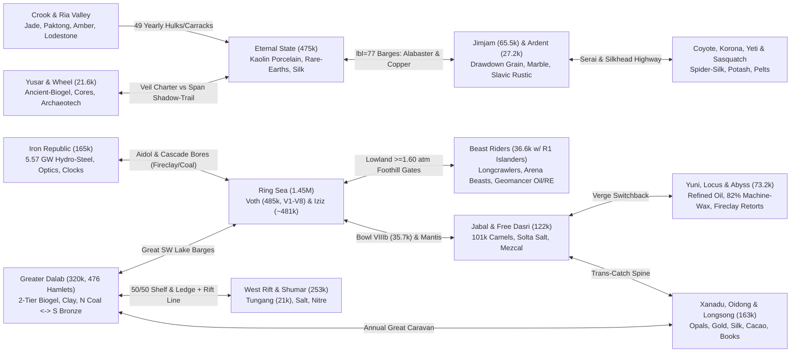

# Krator Unified Continental Scope, Universal Workshop Model & Decision Matrix (Updated 2026-11-19)

> [!NOTE]
> **Baseline & Synced Regional Scopes (`2026-11-19`):** Branch `claude/openworld-sites-24defd` from merge commit **`7dcfa8a5`** (`test-res.js` 55/55, `test-crops.js` 213 crops, `test-sim.js` PASS; zero HTML/kit rebuilds executed, `kits/marr/` preserved untouched).
> - **Companion Regional Scopes:** [RING-SEA-SCOPE.md](file:///home/antigravity/traviso761-debug/krator-master/core/region/RING-SEA-SCOPE.md) (`28` rulings locked, **`0` open questions remaining**), [DALAB-SCOPE.md](file:///home/antigravity/traviso761-debug/krator-master/core/region/DALAB-SCOPE.md) (`320,000` census, 2-tier biogel, `clay`, 50/50 `Shelf` & `Ledge`), and [WEST-RIFT-SCOPE.md](file:///home/antigravity/traviso761-debug/krator-master/core/region/WEST-RIFT-SCOPE.md).
> - **Applied Scale Model 5.1 Edit (`5.1e20`):** [edit_520_republic_alps.py](file:///home/antigravity/traviso761-debug/krator-master/tools/scale-model/edit_520_republic_alps.py) + [60-settlements.js](file:///home/antigravity/traviso761-debug/krator-master/tools/scale-model/model/src/60-settlements.js) (`0` pixels changed outside `pure_ir`).
> - **Synced Settlement Blueprints:** [dalab/PLAN.md](file:///home/antigravity/traviso761-debug/krator-master/settlements/dalab/PLAN.md), [dalab/BUILD-OUT.md](file:///home/antigravity/traviso761-debug/krator-master/settlements/dalab/BUILD-OUT.md), [ledge/PLAN.md](file:///home/antigravity/traviso761-debug/krator-master/settlements/ledge/PLAN.md), [eternian-canal/PLAN.md](file:///home/antigravity/traviso761-debug/krator-master/settlements/eternian-canal/PLAN.md) (*Shuāng-Zhá* `451,782`), [jimjam/PLAN.md](file:///home/antigravity/traviso761-debug/krator-master/settlements/jimjam/PLAN.md) (`745,546`), [dilihan/PLAN.md](file:///home/antigravity/traviso761-debug/krator-master/settlements/dilihan/PLAN.md) (`744,663`), and [skywatch/PLAN.md](file:///home/antigravity/traviso761-debug/krator-master/settlements/skywatch/PLAN.md) (`776,470`).

---

## 0. `[G data]` Architecture & Complete Ledger of `35` Locked Owner Rulings (`2026-11-16` – `2026-11-19`)

### 0.1 `[G data]` Simulation & Accounting Contract

Every continental sphere compiles to plain, engine-neutral `[G data]` records (zero `THREE`, zero DOM, deterministic `KRAND` cell hashes, numeric defaults strictly `x == null ? d : x`) running on [50-region-valley.js](file:///home/antigravity/traviso761-debug/krator-master/core/region/50-region-valley.js) at the macro/regional level and [SCHEMA.md](file:///home/antigravity/traviso761-debug/krator-master/core/simulation/SCHEMA.md) (`77-sim-*.js`, [43-region-items.js](file:///home/antigravity/traviso761-debug/krator-master/core/region/43-region-items.js), [44-region-economy.js](file:///home/antigravity/traviso761-debug/krator-master/core/region/44-region-economy.js)) inside presented cities and `KHAMLET` villages:

- **Conservation Law (`77-sim-7-ledger.js`):** Per settlement and per good, `opening + made + imported - consumed - spoiled - exported = closing`, and across every road/sea leg `shipped = landed + Δin_transit`.
- **Actor Scaling (`scale`):** Bulk provincial countrysides run at `scale: 200`; cities, poleis, and dual-culture arcologies at `scale: 50`; drawn `KHAMLET` villages (`<= 500`), bore portals, Geomancer enclaves, oasis halts, and `KCAMP` mobile bands/expeditions at `scale: 10` (`1` when presented).
- **Universal Input-Output Closure (§2):** Every raw material, intermediate reagent (`clay`, `fireclay`, `kaolin`, `lime`, `alkali`, `tanbark`, `salt`, `sulfur`, `charcoal`, `coal`, `ancient-biogel`, `inferior-biogel`), local intra-town upkeep/food output (`bread`, `beer`, `brick`, `mortar`, `coarse-pottery`, `candles`, `soap`, `boots`, `repairs`), and tradable surplus is explicitly typed and balanced.

### 0.2 Complete Ledger of `35` Locked Owner Rulings (`[LOCKED]`)

#### A. Continental Economic, Material, Biogel, Hydropower & Architectural Kit Laws (`Rulings 1–7`)
1. **Universal Workshop & Trade Input-Output Accounting Law (`2026-11-19`):** **Every single good that any workshop or trade accepts or produces MUST be accounted for in the continental economic/trade model, even when `100%` of the final product is consumed locally inside town and never enters inter-city trade** (§2.1). Intra-town closed loops (`flour`, `bread`, `common-ale`, `fresh-meat`, `common-brick`, `lime-mortar`, `coarse-pottery`, `candles`, `soap`, `boots`, `tool/building-upkeep`) still drive inter-settlement and rural-to-urban trade through their **upstream raw/intermediate inputs** whenever a settlement lacks `grain`, `salt`, `fuel`, `clay`, `limestone`, `tallow/oil`, `potash/alkali`, `tanbark/alum`, `iron-bar`, or `timber`.
2. **`clay` as Explicit Production Input & Continental Trade Good (`2026-11-19`):** Accounts for **`clay`** across three industrial grades — **common brick/potter's clay**, **white granitic `kaolin` porcelain clay**, and **refractory `fireclay`** (`brickworks`/`tile-kiln`, `potter` amphorae/jars/cooking-pots, `porcelain-kiln`, and `crucible-works` making metallurgical crucibles, tuyeres, furnace linings, glass pots, and Geomancer chemical retorts) — routing surpluses from `geology.json` clay basins to `clay = 0` / clay-poor polities or enforcing stone/barrel/gourd/metal substitutions (§2.2).
3. **Two-Tier Dalabi Genecraft Biogel Chain (`ancient-biogel` vs `inferior-biogel` / `vat-biogel`) (`2026-11-19`):**
   - **`ancient-biogel` (Relic Salvaged Pre-Cataclysm Biogel):** Scarce, non-renewable input recovered from deep pre-Cataclysm cryo-vaults (`Dalab`/`Nulab`/`Chimes` deep spire sub-levels, `Nazar` Ordinator/illicit salvage, `Ancient's Valley`/`Yusar` via `Wheel`/`Ardent`/`Span`/`Blade`, `Tethis` flooded gene-lab `733,775`, `Noah's Regret` medical holds via `Port Mira`). **Mandatory input for top-tier Dalabi genecraft**: `4A` Temple Giants (`2.3×` pure shock caste), Reformation Lab masterwork chimeras/war-grafts, and elite Archon/foreign-noble longevity & organ-regeneration treatments.
   - **`inferior-biogel` (`vat-biogel` — Domestic Crop-Conversion Vats):** Manufactured domestically in glazed-clay fermentation vats accepting bulk `food` crops (`rice`, `taro`, `shade-manioc`, `sugar-cane`, `basin-amaranth` + catalytic `salt`/`sulfur`/`lime`), powering **routine Dalabi genecraft** (`1B` Graft-Servitors, `1A`/`2A` Vat-Brutes, amphibi-gill & alpine-cold splices, agricultural pest-resistant seed/lizard mods, everyday clinic grafts) and absorbing **`~15–20%` of Greater Dalab's bumper harvest domestically** (§2.3).
4. **`Shelf` (`ND3`, `461, 1161`; legacy 4.2x `356, 987`) & `Ledge` (`SD1`, `437, 1330`; legacy 4.2x `566, 1143`) as `50/50` Dual-Culture Dalab–Tungang Arcologies (`2026-11-19`):** Both **`Shelf` (`7,000` = `3,500` Dalab `ND3` + `3,500` Tungang `TU1` `Loj Tuu`)** and **`Ledge` (`10,000` = `5,000` Dalab `SD1` + `5,000` Tungang `TU2` `Loj Fower`)** are **50/50 half-Dalab / half-Tungang arcologies**: **Tungangs (`kits/tungang`)** inhabit the **arcology interior and adjoining Rift-Line mountain tunnels** (water/ventilation conduits, mushroom/blind-fish galleries, ore/rail adits, cliff-lifts, shoring), while **Dalabites (`dalab_kit.py` + servitors)** inhabit a **surrounding surface terraced settlement PLUS the 1–2 arcology levels closest to the main entrances** (`vat-biogel` vats, hanging gardens, customs, and mixed Dalab–Tungang entrance bazaars).
5. **Iron Republic Swiss-Alpine Terrain & Cities (`5.1e20` Applied, `2026-11-18`):** Executed [edit_520_republic_alps.py](file:///home/antigravity/traviso761-debug/krator-master/tools/scale-model/edit_520_republic_alps.py) carving `7` glaciated massifs (`M1–M7`, `+4,558–6,021 m`), `6` passes (`P1–P6`), and `7` stepped glacial lakes (`L1–L7`, `6,288 km²`, `5,574 MW` gross head), moving `Glaive` (`599, 721`) & `Stahlborn` (`618, 859`) and adding *Urverkstad* (`591, 801`), *Slussport* (`576, 693`), and *Korshamn* (`627, 740`) in [60-settlements.js](file:///home/antigravity/traviso761-debug/krator-master/tools/scale-model/model/src/60-settlements.js).
6. **Iron Republic Hydropower Focus to Alleviate Coal/Charcoal Shortages (`2026-11-19`):** Water-powered industrial cascades along the Republic's high-gradient alpine streams (`Roketstad` and cantonal gorges, `5,574 MW` gross cataract head) are **locked as the Republic's core structural answer to `0 km²` domestic good coal** — driving `hydro-forge` trip-hammers & *trompe* water-bellows, `hydro-stampmill` ore crushers, `hydro-sawmill`s, `hydro-wire-mill`s, and `hydro-gristmill`/`fulling-mill` wheels that cut thermal `coal`/`charcoal` consumption per ton of metal by **`~50–65%`** (§2.1B, §2.4, §3.3).
7. **Slavic Highlands (`kits/highlands`) vs Standalone Tlingit `kits/painted-men/` Split (`2026-11-19`):** Tlingit ornamentation is stripped out of [kits/highlands](file:///home/antigravity/traviso761-debug/krator-master/kits/highlands/README.md) (`republic` + `rustic`) and replaced with **Slavic / Carpathian / Novgorodian carved wood & painted ornamentation** (solar rosettes, *nalichniki* window fretwork, *okhlupen'* horse/firebird ridge finials, braided *pletenka* friezes), while the **`Kwéent'x̱`-speaking Painted Men** are split into their own standalone **`kits/painted-men/`** kit retaining **Tlingit / Pacific-NW black-red-teal formline crest ornamentation**, totems, and cliff/bamboo halls.

#### B. Greater Dalab, Ring Sea & Cross-Frontier Rulings (`Rulings 8–35`)
8. **Greater Dalab Decentralized `320,000` Census (`2026-11-18` / `2026-11-19`):** **`320,000` headcount (`310,351` `cal-eq`)** across North Dalab (`230,000` incl. `Blade` `900`) and South Dalab (`90,000`), keeping capital `Dalab` moderate (`24,500` = `7.66%`), `29` market towns (`75,200`), and **`476` `KHAMLET`s (`187,775` rural souls = `58.68%`)** ([DALAB-SCOPE.md](file:///home/antigravity/traviso761-debug/krator-master/core/region/DALAB-SCOPE.md)).
9. **`Shell -> Silkhead` Tentative Imperial Highway (`2026-11-18`):** Poorly maintained `541–582 km` frontier trace from `Shell` (`902, 659`) via `Nortolda` (`903, 606`) and western Korona (`K9` `907,586` -> `K10` `912,556` -> `K2` `909,499`) to `Silkhead` (`932, 425`).
10. **Screamers Deep-Vault Swarm (`~18,000`) + Autarchic Out-Villages (`2026-11-18` / `19`):** `~18,000` across 4 Broods at `Hexahedron` (`817, 670`), 4 autarchic out-villages (`Fort Kalor`, `Howl-Gate`, `Red-Pan`, `Mirage-Boma`), and coastal `(838, 720)`.
11. **Screamers' Coastal Raider-Barge Village (`(838, 720)`) + `Boiling Bay` (`866, 723`) Silent Swap (`2026-11-19`):** Hostile `raider-barge` interdiction out of `(838, 720)` PLUS a **tiny (`<= 5 t/yr`) wordless fumarole-beach swap near pirate `Boiling Bay` (`866, 723`)** (scrap blades for `bloodwood-red` & `ghostpipe` sedative).
12. **Trigon Navigable Karst Sound (`2026-11-18`):** Seagoing `hyk-galley` access confirmed into `Trigon` (`722, 740`) behind `(706, 736)`.
13. **Hykkousoi Iron & Coal — `Sideros` (`744, 784`) & `Skopelos Isle` (`724, 847`) (`2026-11-19`):** Adds **mainland mining deme *Sideros* at `(744, 784)`** (`28 km` SE of `Tethis`, `Fe=180, Coal=132, Clay=255`, `~3,000` pop) **AND** a **colliery/iron site on `Skopelos Isle` (`724, 847`, `Fe=180, Coal=134`)** under `Pontus` (`H4`), plus optional minor Ysian coaling station at `(834, 744)` (`Coal=198`).
14. **Voth Domestic Gold Toned Down Significantly (`2026-11-18`):** Homeland Voth (`V1–V6, V8`) is silver-monometallic domestically and earns gold via `Zey'danin` spice/coffee re-exports, `Drum` salvage brokerage, and foreign trade.
15. **Agropolitans (`Agropolis` `717, 917`) (`2026-11-18`):** **`4,000`-soul free, semi-nomadic ruin-tribe** (`Torus`-style Vothic client state in `V4`) operating mobile `KCAMP` scrap-merchant caravans.
16. **`Shim`, `Sethas`, `Azoth` & `Driyan` Architectural Sets (`2026-11-18`):** `Shim` (`654, 1118`) & `Sethas` (`688, 1141`) = **100% `"Shim"` / old Chichani**; `Azoth` (`651, 1160`) & `Driyan` (`705, 1129`) = **large `Shumari` fraction + partial `"Shim"` / old Chichani** + Vothic garrison works.
17. **`Azoth` (`651, 1160`) Split as Voth's 8th Southern March (`V8`) (`2026-11-19`):** Split out of `V2 Sim-Tzan` as *Mark of Azoth* (`V8`, facing Free Giant `Tallwalls`, Shumari `S2/S4`, and Dalab `Dayshun`/`Istgeit`).
18. **`Shim` Dual Plantation Crops (`2026-11-19`):** `Shim`'s `Blïtrit` purple estates paired with **BOTH Sunboll `cotton` AND `rattlepod` ("Rattle coffee")**.
19. **`Nazar`/`Wing` Quarantine + Licensed Voth Geomancer Oil Derricks (`726, 1003`) (`2026-11-19`):** `Nazar` & `Wing` stay Ordinator-quarantined crown salvage zones, **AND Yuni Geomancer oil derricks ARE permitted in Voth** at licensed enclave **`(726, 1003)` (`oil = 130`)**.
20. **`Port Mira` / `Hookfleet` (`865, 895` + `I-26`) (`2026-11-18`):** **`~6,000`** pop, **part `kits/marr`-style (`mar_*`), part ship-salvage port**, enforcing the 50-km truce zone, distilling `ranjrum`, and fencing `Noah's Regret` prizes into `Porta Marr`.
21. **Free West Rumah (*Hikau*) South-Throne Entrepôt at `(848, 897)` (`2026-11-19`):** **`~4,500`-soul Free West Rumah (*Hikau*) major Throne council entrepôt (*Tauranga-Hikau*)** (`iw-*` horned saddle-roofs on volcanic basalt piers).
22. **Andarū Oases & Indigenous W-Throne (`Vai Pou`) Islander `KHAMLET`s (`2026-11-19`):** `Ṣunu-Ašru` (`892, 852`, `2,200`) & `Šadū-Qarnu` (`895, 825`, `800`) permanent lava-tube cistern markets (`6,500` mobile ash-nomads); indigenous W-Throne river-coast (`Vai Pou`) `KHAMLET`s built in **basalt-and-pile Islander huts (`kits/islanders`)**.
23. **`Seto` & `I-02` W/E Split (`2026-11-19`):** Western **`I-02` (`865, 950`, `165` coal byte)** = Imperial Iziz / `Porta Marr` coaling & careening station (`~3,200` pop, `VI`); eastern **`Seto` (`I-05`, `930, 922`)** = Kautoan tributary port (`~5,500` pop, `P4`) with a `kits/marr` customs/merchant quarter.
24. **Western Rumah Isles (`P6` & `P7`) Two Loose Confederacies (`2026-11-19`):** `P6` Northern *Hikau* around `Taikoro` (`780, 787`, aligned with exiled Hetānini at `Ys`) and `P7` Southern *Hikau* around `Kautono` (`749, 894`, balancing Voth & Iziz).
25. **`Kautoa` Peninsula (`964, 725`) Intact + Tributary Islander `KHAMLET`s on `Region 87` Coast (`2026-11-19`):** Peninsula neck kept intact (paved highways downgraded to jungle pack trails), plus **`1,450` tributary Islanders (`4` `kits/islanders` fishing/boatbuilding `KHAMLET`s)** along the `Region 87` `R1` littoral paying fish/salt/boat tribute to Beast Riders.
26. **`Mav's Refuge` Deep Jungle Province (`R2`) Raised to `15,000` + Flyer Elevator-Trees (`2026-11-19`):** `5,200` `Mav's Refuge` + `6,800` across `10` single-megatree Flyer crown-villages + `3,000` clearings, bringing `Region 87` to **`36,600`** (`35,150` Beast Riders + `1,450` tributary Islanders).
27. **Distinct Visual Trademarks per Beast Rider Tribe (`2026-11-19`):** All 13 Beast Rider tribes carry unmistakable village & `KCAMP` visual trademarks ([RING-SEA-SCOPE.md](file:///home/antigravity/traviso761-debug/krator-master/core/region/RING-SEA-SCOPE.md) §2.6 B).
28. **Millipede (`Longcrawler`) Caravan Guild + Annual Heartland Moot (`2026-11-19`):** `38` roving lowland caravan-clans (`~2,600` souls) converging yearly at `(1053, 836)` (*Nąą-K'etsaal*).
29. **Beast Rider Mount Trade & High-Pressure Biophysical Barrier (`>= ~1.60–1.65 atm`) (`2026-11-19`):** Flyers never sold; flyers and **giant arthropods (`Longcrawler`, `Dragonfly`, `Spider`, `Staghorn`, `Land-Crab`) cannot travel outside high-pressure lowland zones** (`Longcrawler` caravans barred from highlands — freight hands off at dense-air foothill gates `Girder`, `Talon` lower gate, `Shade` floor, `Nusidi`/`Vaklu`); `Longcrawler` mounts widely sold across dense-air lowlands; occasional tamed `Threehorn`/`Hardshell`/`Mammoth` draft & `Tiger`/`Raptor` arena sales + trapped feral beasts sold to `Drum`, `Porta Marr` & `Voth` (§2.4).
30. **Yuni Geomancer Enclaves in `Region 87` — Oil + Rare Earths; Zero `Girder` Oil (`2026-11-19`):** Walled `kits/locus` compounds `1–3 km` outside `Pinnacle Rock` (`oil=119`) & `Mav's Refuge` (`oil=136`); **Geomancers also exploit `Region 87` `rare-earth` lodes** (`10,656 km²` `good >= 80`, `byte 160` near `Fort Kreia` `(1045,745)`, `Pinnacle Rock` `(1021,685)`, and `R1` coast `(963,656)`); **zero exploitation of `Girder` (`1039,869` / `1053,879`) oil**.
31. **Loyalist `Land-Crab` Tribe Near `Nusidi` (`996, 870`) (`2026-11-19`):** `~3,200` souls anchored near contested `Nusidi` (`996, 870` / `(972, 900)`) on the Imperial mangrove littoral under `Marka de Fridon i Vaklu`.
32. **Painted Men Severed from Highlanders (`Kwéent'x̱`) (`2026-11-19`):** Independent English-descended tonal/Tlingit-cluster language (`Kwéent'x̱`, [tongues-of-krator.html](file:///home/antigravity/traviso761-debug/krator-master/lore/tongues-of-krator.html) `#painted`).
33. **`Tiguantin` Quechua Toponymy & History Monk Digs (`2026-11-19`):** `Guari`, `Kallpamarca`, `Umapampa`, `Chakipunku`, and `Tiguantin Viejo` (`1138, 858` Longsong History Monk digs) confirmed.
34. **Tiguantin Northern `ehighlands` Expeditions (`2026-11-19`):** Seasonal `KCAMP` harvesting expeditions across `38,064 km²` (`Y = 691..802`) for `wormwick`, `saltpeter` (`200`), `cushion-wool`, `ragbark` charcoal, and `iron` (`180`).
35. **`Daridel` (`937, 1068`) Confirmed as `Talovolci C5` Cloud-Giant Muster Town + Ring Sea Pin/Polygon Batch (`2026-11-19`):** `Daridel` (`12,000` Cloud Giants + Izani paymaster fort) and all Ring Sea pin snaps/polygon trims locked.

---

## 1. Unified Single-Counted Continental Census Across All `26+1` Spheres (`ΔPop = 0`)

Every settlement pin, rural `KHAMLET` (`<= 500`), dual-culture arcology half, and mobile `KCAMP` band is counted **strictly once** across 26 disjoint inner-crater / near-rim geographic spheres (**`3,162,072` physical inhabitants = `3,235,376` `1.0×` Human-Caloric Equivalents**), plus exterior `The Crook` & `Ria Valley`:

| # | Proposal / Scope | Geographic Sphere (Disjoint Footprint) | Sub-Units | Draft (`Gemini`) | **Single-Counted Headcount** | **`1.0×` Cal-Eq** | Key Urban Seats & Seam-Lock Rule |
|---:|---|---|---:|---:|---:|---:|---|
| 1 | [RING-SEA-SCOPE.md](file:///home/antigravity/traviso761-debug/krator-master/core/region/RING-SEA-SCOPE.md) | **Mainland Empire of Iziz** (`I`–`V`, `VII` + **Loyalist `Land-Crabs`**) | `7` | `~1,250,000` | **`383,200`** | **`383,200`** | `Iziz` (`~50k`), `Pylon` (`28.8k`), `Porta Marr` (`~20k`), `Port Tobin` (`14k`), `Talia` (`12k`), `Hook` (`6k`), **`3.2k` `Land-Crabs` near `Nusidi`** (`996,870`); `I-02` (`3.2k`) in #7 |
| 2 | [PROPOSAL-JABAL-EAST-NOMADS.md](file:///home/antigravity/traviso761-debug/krator-master/core/simulation/PROPOSAL-JABAL-EAST-NOMADS.md) | **Imperial Bowl Corridor (`VIIIb`)** | `2` (`VIIIb-N/S`) | `~140,000` | **`35,653`** | **`35,653`** | `Arcbeam` (`6.5k`), `Upper Verge` (`5.2k`), `Mantis` (`4.8k`), `W4–W8`, `Parabola` (`1.1k`) |
| 3 | [PROPOSAL-IZIZ-EXCLAVES.md](file:///home/antigravity/traviso761-debug/krator-master/core/simulation/PROPOSAL-IZIZ-EXCLAVES.md) | **Iziz Northern Exclaves (`Dilihan` `X` + `Shell` `IX`)** | `7` (`D1–D4, S1–S3`) | `484,000` | **`56,000`** | **`56,000`** | `Dilihan` (`32k`, incl. `Port Visas` `1k`) + `Shell` (`24k`, incl. `Port Goto` `2.2k` & `Silkhead` highway head) |
| 4 | [PROPOSAL-VOTH.md](file:///home/antigravity/traviso761-debug/krator-master/core/simulation/PROPOSAL-VOTH.md) | **Kingdom of Voth Mainland** (`V1–V6`, **`V8` `Azoth`**) + **`Agropolitans`** | `7` *(+`V7` overseas)* | `1,320,000` | **`435,000`** | **`435,000`** | `Voth` (`54k`), `Shim` (`22k`, `cotton`+`rattlepod`+`Blïtrit`), `Almua` (`15k`), `Driyan` (`14k`), `Torus` (`14k`), `Drum` (`13.5k`), **`V8` `Azoth` (`8.5k` city)**, `Agropolitans` (`4k`), `(726,1003)` Geomancer derricks |
| 5 | [PROPOSAL-HYKKOUSOI.md](file:///home/antigravity/traviso761-debug/krator-master/core/simulation/PROPOSAL-HYKKOUSOI.md) | **League of Amphitriton Mainland** (`H1–H4` + **`Sideros`** & **`Skopelos`**) | `5` | `454,478` | **`85,000`** | **`85,000`** | `Ys` (`32k` + `(834,744)` coaling), `Tethis` (`19.5k`), `Trigon` (`19k`), `Pontus` (`11.5k` w/ **`Skopelos Isle`** `724,847`), ***Sideros* (`3k` at `744,784`)** |
| 6 | [PROPOSAL-THRONE.md](file:///home/antigravity/traviso761-debug/krator-master/core/simulation/PROPOSAL-THRONE.md) | **The Throne Island-Continent** | `8` (`S1–S8`) | `138,900` | **`106,500`** | **`106,500`** | `Zeijani` (`38k`), Voth `S2` (`24.5k`), `Vai Pou` (`10.5k`, `kits/islanders` huts), `Andarū` (`9.5k`), `Nereus` (`7k`), **`Port Mira` (`6k`)**, **Free Rumah *Tauranga-Hikau* (`4.5k` at `848,897`)**, `Ybera` (`4.5k`), `Noah` (`2k`) |
| 7 | [PROPOSAL-RING-ISLES.md](file:///home/antigravity/traviso761-debug/krator-master/core/simulation/PROPOSAL-RING-ISLES.md) | **The Ring Isles** (`Kautoa`, `Rumah` `P6/P7`, **`Seto`/`I-02`**, Cleruchies) | `8` (`P1–P8`) | `~218,000` | **`66,300`** | **`66,300`** | `Kautoa` (`27.8k`, neck intact), **`I-02` (`3.2k` Iziz `VI`) + `Seto` (`5.5k` Kautoa `P4` w/ `marr` quarter)**, `Rumah` (`15.3k`, 2 confederacies), `Nephtos+Kierson` (`6.5k`), `Tzinguard` (`4.2k`), `P8` (`3.8k`) |
| 8 | [PROPOSAL-BEAST-RIDERS.md](file:///home/antigravity/traviso761-debug/krator-master/core/simulation/PROPOSAL-BEAST-RIDERS.md) | **Free Beast Rider Confederacy (`Region 87`)** | `6` (`R1–R6`) | `71,435` | **`36,600`** | **`36,600`** | **`35,150` Beast Riders** (`R2=15k` w/ `10` flyer elevator-trees) + **`1,450` tributary `R1` coastal Islanders** (`4` `KHAMLET`s) + walled Geomancer oil & `rare-earth` enclaves |
| 9 | [PROPOSAL-RAIDING-FACTIONS.md](file:///home/antigravity/traviso761-debug/krator-master/core/simulation/PROPOSAL-RAIDING-FACTIONS.md) | **Northern & Western Raiders** (`Scyvoi`, `Screamers`, `Painted Men`) | `13` (`4+5+4`) | `~82,000` | **`38,000`** | **`38,000`** | `Scyvoi` (`14.8k`), **`Screamers` (`18k`, `(838,720)` barges + `Boiling Bay` swap)**, **`Painted Men` (`5.2k`, standalone `kits/painted-men/`)** |
| 10 | [PROPOSAL-GUARI-TALOVOLCI.md](file:///home/antigravity/traviso761-debug/krator-master/core/simulation/PROPOSAL-GUARI-TALOVOLCI.md) | **Principality of `Tiguantin` (`Guari`)** | `4` (`T1–T4`) | `~35,000` | **`54,000`** | **`54,000`** | Quechua-inflected `Guari` (`8.4k`), `Kallpamarca`, `Umapampa`, `Chakipunku`, `Tiguantin Viejo` (`1138,858` digs) + N `ehighlands` expeditions |
| 11 | [PROPOSAL-GUARI-TALOVOLCI.md](file:///home/antigravity/traviso761-debug/krator-master/core/simulation/PROPOSAL-GUARI-TALOVOLCI.md) | **Talovolci Cloud-Giant Confederacy** | `5` (`C1–C5`) | `~40,375` | **`84,000`** | **`155,400`** | **`84,000` `1.42×` Cloud Giants (`1.85×` cal-eq):** `Spirladunon`, `Brantomagos`, `Godstep` (`15k` `C4`), **`Daridel` (`12k` `C5` muster town)** |
| 12 | [PROPOSAL-ETERNIANS.md](file:///home/antigravity/traviso761-debug/krator-master/core/simulation/PROPOSAL-ETERNIANS.md) | **Eternal State (`NW Lowlands`)** | `7` (`E1–E7`) | `~1,150,000` | **`475,000`** | **`475,000`** | `Fulcrum` (`85k` = `~120k` wealth-eq), `Corpus` (`20k`), `Lux` (`18k`), `Farport` (`14k`), `Tone` (`5.2k`), `Palewharf` (`3.2k`), `Mirabilis` (`2.6k`), `Veil` (`2.4k`), `Sheritu` (`2.2k`), `Bastion` (`0.8k`); `1,250` True Heirs |
| 13 | [PROPOSAL-YUSAR-ANCIENTS-VALLEY.md](file:///home/antigravity/traviso761-debug/krator-master/core/simulation/PROPOSAL-YUSAR-ANCIENTS-VALLEY.md) | **`Yusar` Enclaves & `Ancient's Valley`** | `3` (`Y1, Y2, AV`) | `~95,000` | **`21,620`** | **`21,518`** | `Carcosa` (`13.2k`), `Henge` (`8.3k`), **`0` Valley farmers**, `Wheel` (`120` *Unleft* cyberliches @ `0.15×`); deep vaults export `ancient-biogel` & `archaeotech` |
| 14 | [PROPOSAL-IRON-REPUBLIC.md](file:///home/antigravity/traviso761-debug/krator-master/core/simulation/PROPOSAL-IRON-REPUBLIC.md) | **Iron Republic (Swiss-Alpine Cantons)** | `6` (`R1–R6`) | `~310,000` | **`165,000`** | **`165,000`** | **`[5.1e20 + HYDROPOWER LOCKED]`** Slavic-carved `kits/highlands`: `Roketstad` (`32k`), `Cascade` (`12k`), `Lipp` (`10k`), `Glaive` (`9k`), *Urverkstad* (`8.5k`), `Stahlborn` (`7.5k`), *Slussport* (`3.2k`), *Korshamn* (`2.6k`) |
| 15 | [PROPOSAL-ARDENT-JIMJAM.md](file:///home/antigravity/traviso761-debug/krator-master/core/simulation/PROPOSAL-ARDENT-JIMJAM.md) | **Free Clans of Ardent** | `4` (`FC1–FC4`) | `63,200` | **`27,200`** | **`27,200`** | `Ardent` (`8k`, Slavic-carved `rustic` `kits/highlands`, `clay:0` good cells) + `8` Hajlandsk clan-seats (`5,650`) + `13,550` rural |
| 16 | [PROPOSAL-ARDENT-JIMJAM.md](file:///home/antigravity/traviso761-debug/krator-master/core/simulation/PROPOSAL-ARDENT-JIMJAM.md) | **Kingdom of Jimjam** | `4` (`JJ1–JJ4`) | `246,000` | **`65,500`** | **`65,500`** | `Jimjam` (`22k`), `Skywatch` (`1.6k`), `9` shore/terrace towns (`8,150`), `33,750` drawdown-paddy villagers; #1 `alabaster`/`marble` shipper to Eternia |
| 17 | [PROPOSAL-YETI-SASQUATCH-NE.md](file:///home/antigravity/traviso761-debug/krator-master/core/simulation/PROPOSAL-YETI-SASQUATCH-NE.md) | **Yeti, Sasquatch, `Yith` & N/NE Semiarid / Bandits** | `18` (`Y, SQ, NS`) | `~145,000` | **`42,200`** | **`48,150`** | `Khaayken` Yeti (`9.8k` @ `1.35×`: `Qoold Lheek`, `Leng`), `Sasquatch` (`3.6k` @ `1.70×`), `Yith` (`2.8k`), `Serai` (`3.5k`), `Boatmurder` (`1,950`), `Veladiga`/`Tilted Tower`/Dam Khans (`16,350`), `NE Outer Wall` (`4.2k`) |
| 18 | [PROPOSAL-COYOTE-OUTLANDS.md](file:///home/antigravity/traviso761-debug/krator-master/core/simulation/PROPOSAL-COYOTE-OUTLANDS.md) | **Coyote Men, Korona, Toad Men & Spider Lake** | `8` (`CK1–SL8`) | `~168,000` | **`38,600`** | **`38,600`** | `Coyote Kingdom` (`17.4k`, incl. `450` at `The Sill`), `Silkhead` & W Korona (`8.6k`), `Toad Men`/Interior Korona (`9.4k`), `Spider Lake`/`Ham-Tsek` (`3.2k`) |
| 19 | [PROPOSAL-JABAL-EAST-NOMADS.md](file:///home/antigravity/traviso761-debug/krator-master/core/simulation/PROPOSAL-JABAL-EAST-NOMADS.md) | **`Jabal Shiekdom` + Free `Dasri Confederacy`** | `7` (`J1–J3, N1–N4`) | `~290,000` | **`122,145`** | **`122,145`** | `Jabal` (`43,397`: `Jabal` `16.5k`, `Solta` `2.8k`, Train of Jabal) + Free Dasri (`78,748`: `Shade` `2.4k`, `Furrow` `2.2k`, `940` `KCAMP` bands; `100.7k` camels) |
| 20 | [PROPOSAL-EAST-ABYSS-YUNI.md](file:///home/antigravity/traviso761-debug/krator-master/core/simulation/PROPOSAL-EAST-ABYSS-YUNI.md) | **Yuni Emirate, `Locus` Geomancers & N/C East Abyss** | `9` (`Y1–Y6, A1–A3`) | `~360,000` | **`73,200`** | **`73,200`** | `Yuni Emirate` (`50.8k`: `Yuni` `20k`, `Locus` & `Lower Verge`, `Ranger HQ`, `Loom Chasms`, `Slabfields`, `Pit-Head 04`) + Autonomous Abyss (`22.4k`: `Sfenops`, `Reed`, `Liikofi`, `Mungo`) |
| 21 | [DALAB-SCOPE.md](file:///home/antigravity/traviso761-debug/krator-master/core/region/DALAB-SCOPE.md) | **North Dalab (incl. `Blade` & `Shelf` Dalab Half) + `Frogmen`** | `9` (`ND1–5, FM1–4`) | `~420,000` | **`241,500`** | **`235,415`** | **`North Dalab` (`230,000`:** `Dalab` `24.5k`, `Dayshun` `8.5k`, **`Shelf` Dalab surface/entrance half `3.5k`**, `21` towns `54.7k`, `5` posts `5.4k`, `314` `KHAMLET`s `123.5k`) + `Frogmen` (`11.5k` @ `0.95×`) |
| 22 | [PROPOSAL-WEST-RIFT.md](file:///home/antigravity/traviso761-debug/krator-master/core/simulation/PROPOSAL-WEST-RIFT.md) | **Unified West Rift & `Shumar`** *(incl. S Dalab & Tungang Halves)* | `18` (`S, SD, TU, FG, KM, VR`) | `~490,000` | **`252,630`** | **`254,771`** | `Shumar` (`109,630`), **`South Dalab` (`90,000`:** **`Ledge` Dalab half `5k`**, `Nulab` `10k`, `4` towns `10.6k`, `162` `KHAMLET`s `64,275`, posts `125`), **`Tungang` (`21,000`: `3.5k` `Shelf` `Loj Tuu` + `5k` `Ledge` `Loj Fower` + `2k` `Twenny` + `2k` `Hearth` + `7.5k` lojes + `1k` `Loj Nahn`)**, `Fellgangs` (`12,250`), `Kimr` (`12k`), `Vrivolci` (`7,750`) |
| 23 | [PROPOSAL-SOUTH-INTEGRATION.md](file:///home/antigravity/traviso761-debug/krator-master/core/simulation/PROPOSAL-SOUTH-INTEGRATION.md) | **Xanadu Sultanate + `Opal Valley`** | `8` (`XAN + OV`) | `~350,000` | **`152,000`** | **`152,000`** | `Erehwon` (`841,1517`), `Theodiga`, `Qiblai`, `Kirstabal`, `Strongbow`, `Strongwall`, `Thalaba` (`2.4k`), `Lāiṭwāl` (`5k`) |
| 24 | [PROPOSAL-SOUTH-INTEGRATION.md](file:///home/antigravity/traviso761-debug/krator-master/core/simulation/PROPOSAL-SOUTH-INTEGRATION.md) | **`Oidong` Sanctuary Stages + `Longsong` & `High Rift`** | `2` (`Oidong + LS`) | `~18,000` | **`10,674`** | **`10,674`** | `4,450` across `9` Oidong sanctuary stages (`1001..1220`) + `6,224` `Longsong` Motherhouse (`1.5k`), `15` hamlets & `8` High Rift camps (`Singing Gjár`) |
| 25 | [PROPOSAL-CATCH.md](file:///home/antigravity/traviso761-debug/krator-master/core/simulation/PROPOSAL-CATCH.md) | **The Catch + The Twins** | `7` (`C0–C5 + Twins`) | `~8,500` | **`2,050`** | **`2,050`** | `Stair` (`750`), `Bab al-Hawa` (`320`), oases (`280`), `Ṣalṭ al-Bān` (`200`), `Twins` (`~275`), `White Gills` (`25` at `1015,1430`) |
| 26 | [PROPOSAL-LIZARDMEN.md](file:///home/antigravity/traviso761-debug/krator-master/core/simulation/PROPOSAL-LIZARDMEN.md) | **Lizardmen (`Central-West Rift Floor`)** | `5` hubs + `54` clutches | `232,560` | **`92,500`** | **`92,500`** | `Sauropolis`, `Komodo`, `Tuatara`, `Gila`, `Basilisk` (`0` external trade; golden calamine zinc-brass metallurgy) |
| — | **Crater & Near-Rim Total** | **All 26 Single-Counted Inner/Rim Spheres** | **`177` units** | **`~8.40M`** | **`3,162,072`** | **`3,235,376`** | **Three Peer Superpowers:** **Voth (`485k`)**, **Greater Iziz (`~481.4k` `I–X`, `~517k` w/ `VIIIb`)**, **Eternal State (`475k`)**; **4th Major Realm: Greater Dalab (`320k`)** |
| *27* | [PROPOSAL-CROOK-RIA-BRAINSTORM.md](file:///home/antigravity/traviso761-debug/krator-master/core/simulation/PROPOSAL-CROOK-RIA-BRAINSTORM.md) | ***Exterior Coast:* `The Crook` + `Ria Valley`** *(Option C rec.)* | *Decentralized* | *`597,500`* | *`+161k–213k`* | *`+161k–213k`* | *Rec. Option C:* `~36k–48k` `The Crook` + `~125k–165k` decentralized `Ria Valley` (`27` Ria Carracks + `22` Crook Hulks calling yearly at `Farport`) |

### 1.2 Multi-Species Biological & `SIM.PEOPLE_RATES` Summary

| Lineage (`peoples.json` ID) | Scale / Build | Food Mult | Salt (`halite`) | Cloth / Dress | Special Environmental / Labor Rule |
|---|---:|---:|---:|---:|---|
| **Standard Humans** *(Izani, Vothic, Eternian, Dasri, etc.)* | `1.00×` (`1.78 m`) | `1.00×` | `1.00×` | `1.00×` | Beast Riders use `0.67×` low-g human baseline + explicit mount feed; arthropods/flyers barred `< 1.60 atm` |
| **Green `dalabites`** *(chloroplast epidermis)* | `1.00×` | **`0.92×`** *(`0.97×` `Dfb`)* | `1.00×` | `0.85×` | Solar glucose offset (`315,050` Dalabites + `4,950` Giants = **`320,000`** Greater Dalab, `58.7%` in `476` `KHAMLET`s) |
| **`tungang`** *(nocturnal tunnel-crews)* | `0.94×` | **`0.88×`** | `1.00×` | `0.85×` | Subterranean adaptation (`20,000` connected Union incl. `3.5k` `Shelf` `Loj Tuu` & `5k` `Ledge` `Loj Fower` + `1k` `Loj Nahn`) |
| **`frogmen`** *(missing in `peoples.json` — add)* | `0.95×` | **`0.95×`** *(annualized)* | **`1.35×`** | `0.45×` + `brush-oil` | `0.45×` winter karst-spring torpor; mandatory skin `brush-oil` outside fens (`11,500` in `FM1–FM4`) |
| **`khaayken` (Yeti)** | `1.15×` (`2.05 m` pelt) | **`1.35×`** | **`1.35×`** | `0.85×` | Hypoxia floor **`0.67 atm` (`+6,800 m`)** (`9,800` in `Y1–Y4`) |
| **`sasquatch`** *(missing in `peoples.json` — add)* | `1.35×` (`2.36 m` pelt) | **`1.70×`** | **`1.70×`** | `0.50×` | Hypoxia floor **`0.65 atm` (`+7,000 m`)** (`3,600` in `SQ1–SQ4`) |
| **`talovolci` Cloud Giants** *(2-armed, add)* | `1.42×` (`2.50 m`) | **`1.85×`** | **`1.85×`** | `1.90×` (`plaid`) | `84,000` in `C1–C5` (incl. `12,000` at `Daridel` `C5`) + `~5,000` Legion auxiliaries abroad |
| **Dalab / Vrivolci / `Gēdu-šu` Giants (`mpfb_giant`)** | `2.00×` (`3.56 m`) | **`4.10×`** *(2A)* / **`4.35×`** *(4A)* | `4.00×` | `3.80×` / `4.30×` | `3.20–3.80×` quarry/haul, `5.2×` melee (`4A` requires `ancient-biogel`; `4,950` Dalab, `3,100` Vrivolci, `2,400` Shumar) |
| **`unleft` (`Cyberliches` at `Wheel` `405,886`)** | `1.00×` *(metal body)* | **`0.15×`** | `0.00×` | `0.00×` (`machine-wax`) | `0.35×` radiation/anomaly attrition in `Ancient's Valley` (`120` souls) |

---

## 2. Universal Workshop & Trade Input-Output Model (`[G data]` Contract)

Per **Owner Ruling #1 (`[LOCKED]`)**, **every good accepted or produced by any workshop, farm, mine, or service building is explicitly modeled**, separated cleanly into:
- **(i) Intra-Settlement Closed Loops (`[LOCAL]`):** Perishable meals, daily bread, common weak beer, fresh butchered meat, common structural brick, slaked lime-mortar, coarse unglazed kitchenware, tallow candles, lye soap, cobbler boots, carpenter/smith tool & building upkeep (`77-sim-6-build.js` `upkeep`). Even when `0` units of the finished item leave town, **every upstream raw or intermediate input** (`grain`, `salt`, `fuel`, `clay`, `fireclay`, `limestone`, `tallow/oil`, `potash/alkali`, `tanbark/alum`, `iron-bar`, `timber`) **is drawn from town warehouses and triggers rural-to-urban or inter-city `SIM.trade` imports whenever missing locally!**
- **(ii) Inter-Settlement Tradable Surpluses (`[TRADED]`):** Non-perishable staples, preserved foods, textiles, metals, ceramics/amphorae/porcelain, refractory fireclay crucibles, chemicals, fuels, mounts, biogels, and high-craft manufactures shipped on `SIM.trade` roads and sea lanes.

### 2.1A Complete Ledger of All `44` Census Trades ([`tools/trades_census.json`](file:///home/antigravity/traviso761-debug/krator-master/tools/trades_census.json))

| # | Census Trade (`trades_census.json`) | Canonical Workplace | Inputs Accepted (`Goods + Tools/Fuel/Clay`) | Outputs Produced (`+ Byproducts`) | Market Scope | Missing-Input Import / Substitution Rule |
|---:|---|---|---|---|---|---|
| 1 | `bakers` | `bakery` | `flour` (or `taro`/`manioc`/`amaranth` meal) + `fuel` (`wood`/`coal`/`peat`) + `salt` + `brick`/`clay` oven upkeep | `bread`, `hardtack` (`[TRADED]` ship/caravan biscuit) | `[LOCAL]` bread; `[TRADED]` biscuit | Imports `grain`/`flour` & `fuel`; fuel-poor zones bake flat-cakes on dung/peat griddles |
| 2 | `butchers` | `butcher` | Live `livestock` (`swine`, `cattle`, `fowl`, `beetle`, `lizard`) + `salt` + `iron-tools` (cleavers) | `fresh-meat` (`[LOCAL]`), `salted-meat`/`pemmican` (`[TRADED]`) + **`hides`**, **`tallow`**, **`bone`/`horn`** | `[LOCAL]` fresh; `[TRADED]` salted & byproducts | Without `salt`, cannot cure `salted-meat` (spoils locally); `hides` -> `tanners`, `tallow` -> `candles`/`soap` |
| 3 | `weavers and dyers` | `weaver`, `dyeworks` | Raw fibre (`cotton`, `flax`, `wool`, `ramie`, `silk`, `lotus-silk`, `spider-silk`, `beadcone-silk`) + `dye` (`indigo`, `woad`, `madder`, `Blïtrit`, `saffron`, `bloodwood-red`) + mordant (`alum`/`potash`/`urine`/`lime`) + `fuel` + `clay`/`copper` vats | `cloth`, `garments`, `plaid`, `brocade`, `sailcloth`, `mats` | `[LOCAL]` everyday wear (`43-region-items.js`); `[TRADED]` surplus bolts & fine cloth | Missing fibre stops `cloth` (falls back to `pandan`/`reed` `mats`, as at `Kautoa`); missing mordant/dye restricts output to undyed `unbleached-cloth` |
| 4 | `brewers` | `brewery` | `grain` (`barley`, `rice`, `corn`, `emmer`) or `kava`/`agave`/`madrone`/`honey` + `hops`/`herbs` + `water` + `fuel` + **`pottery` tuns (`clay`)** or **`barrels` (`timber`+`iron`)** | `common-ale`/`rice-beer`/`kava` (`[LOCAL]`), `wine`/`champagne`/`tequila`/`ranjrum`/`mezcal` (`[TRADED]`) + **`spent-mash` (`fodder`)**, **`yeast`** | `[LOCAL]` weak beer; `[TRADED]` spirits & aged wine | `clay = 0` towns must use coopered wooden `barrels` or stone cisterns; `timber`-poor towns ferment in glazed `clay` *qvevri*/amphorae |
| 5 | `tanners` | `tannery` | Raw `hides`/`pelts` (from `butchers`/`ranchers`/`hunters`) + **`tanbark`** (`ironbark`/`mangrove`/`sumac`) or **`alum`** + **`lime`** (`limestone`) + `water` + `salt` | `leather`, `rawhide`, `parchment`/`vellum`, `boots`/`sandals`, `cuirass`, `harness` + `glue-stock` | `[LOCAL]` footwear/harness; `[TRADED]` cured `leather` & `cuirass` | `limestone = 0` zones substitute wood-ash `alkali` for dehairing; tundra/steppe (`Kimr`/`Scyvoi`/`Dasri`) brain-tan or alum-taw hides |
| 6 | `shipwrights and boatbuilders` | `shipwright`, `boatyard` | Seasoned `timber` + `plank` + `iron-fastenings` (or `bronze`/`peg-joinery`) + `sailcloth` + `cordage` (`hemp`/`rope-banana`) + **`pitch`/`bitumen`/`tar`** | Hulls (`lakatoi`, `carrack`, `galleon`, `xebec`, `trireme`, `lake-barge`, `punt`, `canoe`) + `hull-upkeep` | `[LOCAL]` skiffs & upkeep; `[TRADED]` commissioned ships & `R1` Islander tribute boats | `iron`-free `Compass Hills` (`Ria R2`) & Islanders use pegged/lashed joinery; `bitumen`-short yards boil pine `tar` or `tung`/`whorl` oil |
| 7 | `innkeepers and grooms` | `caravanserai` | `fodder`/`hay`/`leaf-litter` + `water` + `grain`/`meal` + `bedding` (`cloth`) + `fuel` + `iron` horseshoes/tack | `caravan-provision` (`50-region-valley.js` `provision`), `lodging`, **`manure` (`saltpeter`/farm input)** | `[LOCAL]` service enabling `[TRADED]` caravan legs | Fodder/water shortfall triggers `SIM.trade` `provision` beast mortality (`C1–C5` rule) |
| 8 | `town guard` | `watchhouse`, `jail` | `arms` (`iron`/`bronze`), `cuirass` (`leather`/`plate`), `lantern-oil`/`torches`, `meal` (`mess`) | `public-order`, `arrests` (`77-sim-6-crime.js`), `unrest` damping | `[LOCAL]` civic closed loop | Unarmed/unpaid watch lowers arrest rate and raises theft/unrest |
| 9 | `coast guard` | `coastguard_berth` | `patrol-cutter` (`boatyard`), `arms`, `powder`/`shot`, `cordage`, `lantern-oil`, `mess` rations | `sea-lane-escort`, anti-piracy / smuggling interdiction | `[LOCAL]` maritime security | Cuts pirate/Screamer `losses` on coastal `SIM.trade` legs |
| 10 | `temple priests and servants` | `temple` | `incense`/`camphor`/`wax-candles`, `sacramental-oil`/`wine`, `vestments` (`brocade`/`cloth`), `ancient-biogel`/`vat-biogel` (in `Dalab`) | `liturgy` (`SPIRIT` need), `legitimacy`, `genecraft` sacraments (in `Dalab`) | `[LOCAL]` civic/spiritual (`[TRADED]` pilgrimages/charters) | Drives long-distance luxury imports of `incense`, `beeswax`, `saffron`, `gold-leaf`, and `alabaster` |
| 11 | `shrine keepers` | `shrine` | `lamp-oil`/`tallow-candles`, `offerings` (`grain`/`fruit`/`flowers`), `clay`/`stone` upkeep | Neighborhood/hamlet `SPIRIT` & morale | `[LOCAL]` closed loop | Uses local `brush-oil`, `hearth-wax`, `whorl-olive`, or `kerosene` |
| 12 | `shopkeepers and assistants` | `shop_trader` | Town warehouse `goods` + `paper`/`clay-tablets` + `packaging` (`pottery` jars, `baskets`, `cloth` sacks) | Household retail distribution (`43-region-items.js` `SIM.shop`) | `[LOCAL]` retail clearing | Draws `pottery`/`baskets` packaging overhead from town stores |
| 13 | `smiths and craftsmen` | `smithy`, `workshop` | `iron-bar` / `steel` / `bronze` / `brass` + `fuel` (`charcoal`/`coal`) + **`fireclay` tuyeres/`crucibles`** + `grindstone` | `iron-tools`, `arms`, `nails`/`hinges`, `cookpots` (metal), `ploughshares`, `vehicle-parts` + `slag` | `[LOCAL]` tool replacement (`77-sim-6-items.js`) & upkeep; `[TRADED]` surplus `tools`/`arms` | Without `iron-bar`/`bronze`, town falls back to `stone-tools` (`0.5×` efficiency penalty); without `fireclay`, cannot cast crucible steel/brass |
| 14 | `innkeepers and servers` | `tavern`, `teahouse` | `food` (`2` kinds) + `ale`/`wine`/`tea`/`coffee`/`kava`/`cacao` + `salt` + `fuel` + **`pottery`/`porcelain`/`glass` tableware** | Cooked `meal` (`eatOut`), `SOCIALIZE`/`REST` | `[LOCAL]` closed loop | Draws imported beverages (`tea`, `rattlepod` coffee, `cacao`, `wine`, `kava`) & `tableware` wear |
| 15 | `porters and warehousemen` | `warehouse` | `sacks` (`cloth`/`jute`), **`amphorae`/`storage-jars` (`pottery`)** or **`barrels` (`timber`)**, `cordage`, `hand-carts` | `storage` capacity, `cart` intra-town haulage, reduced `spoilage` | `[LOCAL]` logistics | Missing `pottery` jars / `barrels` raises liquid & grain `spoilage` rate! |
| 16 | `industrial workers` | `industrial_lot` (`kiln`, `refinery`, `biogel-vat`, `smelter`, `glassworks`) | Bulk mineral/crop feedstocks (`clay`, `limestone`, `silica`, `crude-oil`, `ore`, `food` mash) + `fuel` + `reagents` | Bulk industrial intermediates (detailed in **§2.1B** below!) | `[LOCAL]` & `[TRADED]` | Governed by exact batch recipes in §2.1B |
| 17 | `power-house stokers and engineers` | `generator`, `hydro-plant`, `hot-door-plant` | `coal` / `fuel-oil` / geothermal steam / alpine `hydro-head` + **`machine-wax` lubricant** + **`copper` wire** + **`rare-earth` magnets** + **`porcelain`/`amber` insulators** | `power` (grid electricity), `energy-cells` (recharged), shaft-hoist/rail traction | `[LOCAL]` grid; `[TRADED]` `energy-cells` | Explains why electrified `Fulcrum`, `Voth`, `Iziz`, `Locus`, and `Tungang` compete continent-wide for `machine-wax`, `copper`, `rare-earth`s, and `porcelain`/`amber` insulators! |
| 18 | `household service` | `manor`, `rich_house`, `clan_compound` | `soap` (`tallow`+`alkali`), `candles`/`kerosene`, `firewood`/`coal`, `fine-food`, `linen`, `porcelain`/`pottery` | Elite household upkeep & `wealth` satisfaction | `[LOCAL]` closed loop | Major urban consumer of `soap`, `kerosene`/`wax`, `charcoal`, `spices`, and `porcelain` |
| 19 | `soldiers` | `barracks`, `fort` | `arms`, `armour`/`plate`, `gunpowder` (`saltpeter`+`sulfur`+`charcoal`), `lead`/`iron` shot, `mess` rations, `mounts` | Garrison defense, border patrol, `KCAMP` raid/escort projection | `[LOCAL]` garrison | `gunpowder` & `arms` shortfalls cap `KCAMP` raid/escort strength |
| 20 | `teachers and scholars` | `school`, `academy` | `paper`/`parchment` + `ink` (`gall`/`soot`+`gum`) + `books` + `lenses`/`glassware` + `candles`/`lamp-oil` | `literacy`, clerk/engineer skill pool, scientific/medical treatises (`[TRADED]` `books`) | `[LOCAL]` education; `[TRADED]` `books` | Drives demand for `Longsong`/`Eternia`/`Xanadu` `paper`, `books`, and `Iron Republic`/`Lāiṭwāl` `lenses` |
| 21 | `guild officers and clerks` | `guild_hall` | `paper` / **`clay-tablets`** (in `Shumar`/`Zeijani`/`Andarū`) + `ink`/`sealing-wax` + `coin` scales (`brass`) | `M1/M2` price clearing, `SIM.ledger` accounting, quality hallmarks | `[LOCAL]` governance | `paper`-short `Shumar`/`Throne` scribes bake `clay-tablets` (`clay` input!) |
| 22 | `customs officers and clerks` | `customs_house` | `paper`/`seals` (`lead`/`wax`), `weights` (`bronze`), guard detachment | Tariff/tithe `cut` collection (`50-region-valley.js` `cut`), quarantine enforcement (`Farport`, `Blade`, `Nazawach`) | `[LOCAL]` state revenue | Funds municipal/imperial `treasury` accounts (`77-sim-6-money.js`) |
| 23 | `healers and nurses` | `house_of_healing`, `reformation_clinic` | Medicinal `herbs` (`camphor`, `valley-ginseng`, `opium`/`sky-poppy`, `ghostpipe`, `monks-sage`) + `clean-linen` + `alcohol`/`vinegar` + **`glassware`/`pottery` phials** + (`inferior-biogel` / `ancient-biogel` in `Dalab`) | `poultice`/`medicine` (`77-sim-6-items.js` `hurt` recovery), `genecraft` (in `Dalab`) | `[LOCAL]` healing; `[TRADED]` `poultices` & `genecraft` | Missing `poultice` leaves injured workers at `0.7×` efficiency for `heal` days |
| 24 | `priests and undertakers` | `funerary_temple`, `ossuary` | `shroud-cloth`, `incense`/`camphor`/`natron`/`lime`, `stone` stelae or **`clay` funerary urns**, `fuel` (cremation) | Sanitation, disease prevention, ancestral `SPIRIT` (`biocompost` in `Dalab` *Court of Return*) | `[LOCAL]` closed loop | Consumes `cloth`, `lime`/`natron`, `incense`, and `stone` or `clay` urns |
| 25 | `lighthouse keepers` | `lighthouse` | Bulk `whale-oil` / `kerosene` / `coal` / `pitch-wood` + polished `bronze`/`glass` Fresnel reflectors | Night/fog port entry safety (reduces shipwreck `losses`) | `[LOCAL]` port infrastructure | Links `Crook` whale-oil, `Locus` `kerosene`, and `Iron Republic`/`Lāiṭwāl` `lenses` to coastal ports |
| 26 | `dockers and stevedores` | `harbour_pier` | `cordage` (`ropes`/`nets`), `timber` pilings, `pitch`, `iron` crane-chains (`Giant` capstans in `Dalab`) | Maritime cargo `SIM.economyStop` loading/unloading throughput | `[LOCAL]` port throughput | Rope & piling `upkeep` (`timber` + `cordage` + `pitch`) |
| 27 | `river bargemen and quay hands` | `river_quay`, `canal_lock` | `lake-barge`/`canal-barge` (`boatyard`), `poles`/`tow-ropes`, `pitch`/`bitumen` caulking | Inland river/lake/canal `SIM.trade` carriage (`Eternia`, `Dalab`, `Jimjam`, `Voth`, `Ria`) | `[TRADED]` transport service | Requires `boatyard` hull & `cordage`/`bitumen` maintenance |
| 28 | `fishers` | `fishing_dock` | `boats`/`canoes` + `nets`/`lines` (`hemp`/`ramie`/`flax`) + `hooks`/`harpoons` (`iron`/`bronze`/`bone`) + **`salt`** & `fuelwood` (for curing/smoking) | `fresh-fish` (`[LOCAL]`), `dried-salted-fish`, `whale-oil`, `pearls`, `frost-coral`, `sea-byssus` (`[TRADED]`) + `fish-offal` (`fertilizer`) | `[LOCAL]` fresh; `[TRADED]` salted/smoked & marine luxuries | Without `salt` or `fuelwood`, catch cannot be exported inland (stays `[LOCAL]` fresh only) |
| 29 | `market traders` | `market_stall` | Canvas `awning` (`cloth`), `baskets`/`crates`/`pottery`, town `goods` | Open-air retail food & craft sales (`BUY` & `meal` stalls) | `[LOCAL]` retail loop | Distributes rural hamlet produce to urban households |
| 30 | `farmhands and ploughmen` | `fields` | Seed `grain`/`crop` + **`plough`/`hoe` (`iron-tools` or `stone-tools`)** + draft beast (`ox`/`mule`/`Threehorn`/`Longcrawler`/`pack-lizard`) + `manure`/`potash`/`lime` | Staples (`wheat`, `rice`, `barley`, `emmer`, `corn`, `taro`, `manioc`, `sweet-potato`, `pulses`) & industrial crops (`cotton`, `flax`, `ramie`, `sugar-cane`, `rattlepod`, `indigo`, `tobacco`) + **`straw`/`fodder`** | `[LOCAL]` subsistence + `[TRADED]` bulk harvest + Dalab `vat-biogel` crop feed | `iron-tools` wear by worked hour (`77-sim-6-items.js`); missing iron drops farm efficiency to `0.5×` (`stone-tools`) |
| 31 | `chinampa growers` | `chinampa_bed` | Willow/cypress stakes (`timber`) + canal `silt`/`compost` + `punt` + hand `tools` | 3–4×/yr high-yield `rice`, `taro`, `amaranth`, `peppers`, `vegetables`, `indigo`, `ramie` (`Voth`, `Dalab`, `Nulab`) | `[LOCAL]` urban food + `[TRADED]` dyes/fibres + `Dalab` `vat-biogel` mash | Requires perennial calm fresh water & `timber` stake renewal |
| 32 | `orchardmen` | `orchards`, `groves`, `vineyards` | Pruning `tools` (`iron`), `baskets`/`amphorae`, irrigation `water`, `sulfur`/`lime` wash | `fruit` (`olive`, `banana`, `plantain`, `breadfruit`, `madrone`, `ember-plum`, `persimmon`), `wine-grape`, `cacao`, `tea`, `coffee`, `mulberry` leaf, `lacquer`/`umbrella-gum` + `prunings` (`fuelwood`) | `[LOCAL]` fresh fruit; `[TRADED]` dried fruit, `olive-oil`, `wine`, `cacao`, `tea`, `silk` leaf | Liquid/fragile outputs require `pottery` amphorae, `barrels`, or woven `baskets` |
| 33 | `miners` | `mine`, `minehead`, `drift`, `placer` | **`iron`/`steel` picks & drills** + **pit-props (`timber`)** + `lamp-oil`/`candles`/`hearth-wax` + (`gunpowder` blasting where used) | Raw `iron-ore`, `copper-ore`, `tin-ore`, `zinc-ore`, `lead-silver`, `gold-ore`, `coal`, `rock-salt`, `sulfur`, `opal`, `jade`, `rare-earth-ore` | `[TRADED]` raw ore/coal or fed straight to local `smelter` | Treeless high/subterranean mines (`Tungang` `Loj Twenny`, `Aianwal`, `Xanadu Gold`) **must import pit-prop `timber`** (`220 t/yr` at `Loj Twenny`!) |
| 34 | `quarrymen and masons` | `quarry`, `mason_yard` | `iron`/`steel` wedges & chisels + `sledges`/`cordage` (`Giant` haul in `Dalab`) + **`lime-mortar` (`limestone`+`fuel`+`sand`)** | Dressed `stone`/`ashlar`, `limestone`, `marble`, `alabaster`, `impactite`, `millstones` + `gravel`/`grog` | `[LOCAL]` `77-sim-6-build.js` stone projects; `[TRADED]` `alabaster`, `marble`, `millstones` | Primary building substitute in `clay = 0` & `timber = 0` regions (`Tethis`, `Ys`, `Rokwal`, `Shumar`, `Tiguantin`) |
| 35 | `granary keepers and millers` | `granary`, `watermill`, `windmill` | Raw `grain` / `sugar-cane` / `oilseed` + **`millstones` (`stone`/`quartzite`)** + `sacks`/`pottery` jars + wind/water/animal power | `flour`/`meal` (`[LOCAL]`), `bran` (`fodder`), `raw-sugar`, `pressed-oil`, preserved `grain` reserve | `[LOCAL]` `flour` -> `bakers`; `[TRADED]` `grain` & `sugar` | Unmilled whole grain cooks at lower `quality` than milled `flour` -> `bread` |
| 36 | `beetle herders` *(and culture ranch equivalents)* | `beetle_ranch`, `lizard_ranch`, `camel_camp`, `byre` | Pasture/`fodder`/`leaf-litter` + **`salt` lick (`halite`)** + `water` + timber/stone `corral` | `eggs`/`meat`, `chitin`/`hides`, live `mounts`/`draft-beasts` (`elephant-bug`, `Longcrawler`, `pack-lizard`, `camel`, `Threehorn`) + `dung` (`fuel`/`manure`) | `[LOCAL]` `eggs`/`meat`; `[TRADED]` live `mounts` & `salted-meat` | `Longcrawler` & `elephant-bug` arthropod ranches strictly restricted to `>= 1.60 atm` dense air (§2.4) |
| 37 | `dairymen` | `dairy` | Cattle/water-buffalo/yak/goat herd + `pasture`/`fodder` + **`salt`** + `rennet` + **`pottery` crocks / wooden churns** | `fresh-milk` (`[LOCAL]`, `export: false`), **`cheese` & `clarified-butter`/`ghee` (`[TRADED]`, high `quality`)** + `whey` (`swine` feed) | `[LOCAL]` milk; `[TRADED]` aged `cheese` & `ghee` (`Iron Republic`, `Oidong`, `Voth`, `Dalab`) | Without `salt`, `cheese` cannot be aged for export (spoils as fresh curd) |
| 38 | `swineherds and duck keepers` | `sty`, `coop`, `livestock_yard` | Kitchen/chinampa scraps, `acorns`, **brewery & `vat-biogel` `spent-mash`**, `whey`, `grain` | `pork`, `fowl`, `eggs`, **`lard`/`tallow`**, **`feathers`/`down`** | `[LOCAL]` meat/eggs (`46-vc-sim-economy.js`); `[TRADED]` smoked ham, `lard`, `down` | Converts otherwise-wasted brewery, dairy, and `dalab_biogel_vat` byproducts into high-calorie protein & `lard`! |
| 39 | `mushroom growers` | `mushroom_farm`, `dark_beds` | Subterranean/vault darkness + `compost`/`rotten-wood`/`peat` + `water` | `mushrooms` (`alecap`, `pale-fungi`, `glow-mushroom`, `the-mat`, Tungang `mash`) | `[LOCAL]` staple in `Tungang`/`Screamers`/`Shumar`; `[TRADED]` `glow-mushroom` lanterns & `the-mat` | Climate-independent `works` (`CROPS`), vital where sunlight = `0` (`Tungang`, `Zeijani` caves, `Shelf` winter) |
| 40 | `envoys and embassy staff` | `embassy` | `paper`, `sealing-wax`, `fine-clothes`, `banquet-food`/`wine`, `coin` stipends | Diplomatic `relations` maintenance, treaty `presence`, trade-charter brokerage (`Dalab`, `Voth`, `Iziz`, `Farport`) | `[LOCAL]` diplomatic consumption of `[TRADED]` luxuries | Sustains cross-polity `SIM.trades(a, b)` open status |
| 41 | `ferrymen` | `ferry_stop` | `ferry-scow` (`boatyard`), `cordage` cable/oars, `pitch`/`tar` | Intra-city & river-crossing `water` nav-layer transport (`Voth`, `Dalab` `Dafiri`, `Eternia`) | `[LOCAL]` transit loop | Consumes `boatyard` hull & `cordage` upkeep |
| 42 | `elephant bug handlers and station hands` *(and transit crews)* | `bug_station`, `lift_head`, `train_halt` | `fodder`/`leaf-litter` + `harness` (`leather`) — or `power` + `machine-wax` + `steel-cable` at `Tungang` lifts/trains | Urban/regional `strider`, `cliff-lift` (`Ledge` `Loj Fower`), and `Rift Line` passenger/cargo transit | `[LOCAL]` & `[TRADED]` transit | `Tungang` lift/rail `strike` halts `Ledge` vertical transit (`closed: 'strike'`) |
| 43 | `monks and lay brothers` | `monastery`, `scriptorium` | `grain`/`vegetables`, `paper`/`parchment`, `ink`, `beeswax`/`lamp-oil`, `tin-type` & `lenses` (`Longsong`) | **`books`**, **`paper`**, **`maps`/`chronicles`**, `honey`/`herb-cordials`, archival preservation (`12`-node History Monk network) | `[LOCAL]` subsistence; `[TRADED]` `books` & `paper` (`EAST_RIFT` `E.order`) | Primary continental producer of printed/illuminated `books` (`Longsong`, `Qiblai`, `Ear at Yuni`, `Tiguantin Viejo`) |
| 44 | `palace and canton staffs` | `palace`, `cantons`, `citadel` | `fine-food`, `spices`, `wine`/`champagne`/`cacao`, `silk`/`brocade`, `porcelain`, `goldwork`, `opal`/`jade`, `genecraft`, `kerosene`/`power` | Sovereign `govern` administration, `treasury` tax/ration redistribution (`77-sim-6-money.js`), court demand sink | `[LOCAL]` apex sink driving `[TRADED]` continental luxury spines | Clears high-value low-bulk continental luxuries (`genecraft`, `porcelain`, `opals`, `spices`, `silk`, `champagne`, `goldwork`) |

---

### 2.1B Specialized Industrial & Regional `works` Recipes (`Batch Input -> Output + Byproduct`)

Beyond the 44 urban census trades, `50-region-valley.js` and city `industrial_lot`s instantiate these **24 explicit industrial/extractive `works`** so no intermediate good appears out of thin air:

| Industrial `works` Kind | Batch Inputs (`in`) | Outputs (`out` + `by`) | Power / Fuel / Clay Rule | Primary Continental Centers |
|---|---|---|---|---|
| `charcoal-clamp` / `coking-oven` | `3 timber` -> `1 charcoal` (`by: wood-ash`); or `2 coal` (in `brick`/`clay` beehive oven) -> `2 coke` + `coal-tar` | `charcoal`, `coke`, `wood-ash` (`alkali`), `coal-tar` | Self-fueled; coking ovens require `brick`/`fireclay` | `Mistibruk`, `Ragbark` puna, `Konbruk`, `I-02`, `Locus`, `Eternia` |
| `lime-kiln` & `mortar-works` | `2 limestone` (or `shell` on coral coasts) + `1 fuel` | `quicklime` -> `lime-mortar` (`[LOCAL]` building), chemical `lime` (`tannery`, `sugar`, `vat-biogel`, `glass`) | Calcining kiln (`stone`/`brick`) | `Waitbruk`, `Koleben`, `Tethis`/`Trigon`, `Voth`, `Frogmen` edge |
| `brickworks` & `tile-kiln` | **`2 common-clay` + `1 fuel` (`coal`/`wood`/`peat`) + `sand`** | `bricks` (`[LOCAL]` construction / `[TRADED]` ballast), `roof-tile` | Requires `clay >= 80` locally or imported `clay` | `Iziz`, `Voth`, `Riidom`/`Dalab`, `Lux`/`Palewharf`, `Jimjam` |
| `potter` (`earthenware` / `stoneware`) | **`2 clay` + `1 fuel` + `salt`/`ash`/`lead` glaze** | `coarse-pottery`/`cookpots` (`[LOCAL]`), **`amphorae`/`storage-jars` (`[TRADED]`)**, **`glazed-biogel-tuns`** | Stoneware (`1,200 °C`) needs higher `fuel` than earthenware | `Kleibruk` (`254`), `Voth`, `Sideros` (`255`), `Kautoa`/`Rumah`, `Crook` `C1` |
| `porcelain-kiln` | **`2 kaolin-clay` (`granite`-weathered) + `1 feldspar`/`silica` + `2 coal`/`charcoal` + `fireclay` saggars** | **`fine-porcelain`** (`[TRADED]` tableware & **high-voltage electrical insulators**) | `1,350 °C` dragon/bottle kiln; **requires `fireclay` saggars** | **`Eternal State` (`99.5%` share: `Fulcrum`, `Lux`, `Mirabilis`)**, minor `Xanadu` celadon |
| `crucible-works` *(Refractory)* | **`2 fireclay` + `1 grog`/`graphite`/`silica` + `1 coal`/`charcoal`** | **`crucibles`**, `tuyeres`, `furnace-linings`, `chemical-retorts` (`[TRADED]` industrial consumable!) | `1,500+ °C` thermal-shock resistance; wears out per N melts! | `Kleibruk`/`Nulab`, `Locus`, `Fulcrum`, `Iziz`, `Voth` -> exported to `Iron Republic`, `Ledge`, `Tungang` |
| `glassworks` & `moonglass-furnace` | `2 silica` (`quartz` sand) + **`1 alkali`/`potash`** (`kelp-ash` or `soda`) + `1 lime` + `2 fuel` + **`fireclay` glass-pots** (+ `opal` potch/borax at `Lāiṭwāl`) | `glassware`/`phials`/`window-glass`, **`lenses`** (ground in `Iron Republic`/`Longsong`), **`moonglass`** (`Lāiṭwāl`) | **Cannot melt glass without `fireclay` pots & `alkali`!** | `Dalab` (`silica:150`), `Lāiṭwāl` (`moonglass`), `Urverkstad` (`optics`), `Farport` (`kelp-ash` glass) |
| `bloomery` / `blast-furnace` | `2 iron-ore` (or **`1 scrap`** per `PROPOSAL-LONGSONG-PINNACLE` §7!) + `2 charcoal`/`coke` + `limestone` flux + `fireclay` lining | `pig-iron` / `iron-bar` (`[TRADED]`) + `slag` | Thermal fuel-intensive (`2` fuel per `1` `iron-bar` without hydro) | `Sideros`, `Skopelos`, `Nereus`, `Voth` mine, `Waitbruk`, `Coyote`, `Tungang` `TU1` |
| **`hydro-forge` / `hydro-finery`** *(`[LOCKED]`)* | `2 iron-ore` (or `pig-iron`/`scrap`) + **`0.8 charcoal`/`coal`** + **`hydro-head`** (*trompe* air-blast + waterwheel trip-hammer) + **`fireclay` `crucibles`** | `wrought-iron`, **`spring-steel`**, `plate` (**`50–65%` thermal fuel reduction!**) | Requires high-gradient perennial cataract (`Q * Δh`) | **`Iron Republic` (`Roketstad`, `Cascade`, `Stahlborn`, `Glaive` — `5,574 MW` alpine head!)** |
| `hydro-sawmill` / `hydro-stampmill` | Raw `timber` logs or `vein-ore` + **`hydro-head`** + `steel` sawblades/stamps | `planks`/`baulks`, crushed `concentrate` (`0` thermal fuel!) | Mechanical waterwheel/turbine shaft power | **`Iron Republic`**, `Neo-Ozarks` (`Ria R3`), `Mistibruk`, `Talia` gorges |
| `nonferrous-foundry` (`bronze` / `brass` / `paktong`) | `2 copper` + `1 tin` (`bronze`) **OR** `1 zinc` (`calamine` `brass`) **OR** `1 nickel`+`1 zinc` (`paktong`) + `1 fuel` + **`fireclay` `crucibles`** | `bronze`, `brass` (`Lizardmen` `caste-metal`, `Xanadu`, `Republic`), `paktong` (`Crook` `C2`) | Mandatory `fireclay` `crucibles` & clay/sand casting moulds | **`Ledge` (`#1` `bronze` `27 t`)**, `Nulab`, `Kopafol`, `Lizardmen` (`brass`), `Crook` (`paktong`), `Ardent` |
| `clockwork-and-optics-bench` | `spring-steel` + `brass` + optical `glass`/`quartz` + `ruby`/`jade` bearings + `machine-wax` | `precision-tools`, `clocks`, `theodolites`, `lenses`, `firearms-locks` (`[TRADED]`) | High-skill guild craft; low bulk, extreme value | **`Iron Republic` (*Urverkstad*, `Roketstad`)**, `Fulcrum`, `Pylon` |
| `nitre-works` & `gunpowder-mill` | `nitre-earth`/`guano`/`manure` + `wood-ash` (`potash`) + `water` -> `saltpeter`; `3 saltpeter` + `1 sulfur` + `1 charcoal` (water-mill corned) -> `gunpowder` | `saltpeter`, **`gunpowder`** (`[TRADED]`) | Explosion-isolated watermill stamps | `Tallwalls` (`38%` surplus), `Shumar` `S6`, `Tungang` `492,1255`, `Salpita`, `Tiguantin` N expeditions -> `Talia`, `Voth`, `Xanadu` |
| `oil-derrick` & `geomancer-refinery` | `crude-oil` (`pumpjack` site) + `coal`/`gas` heat + **`fireclay`/copper fractional retorts** + `sulfuric-acid` (`sulfur`) | **`kerosene`** (lamp/stove fuel), **`naphtha`** (crawler/engine fuel), **`machine-wax`** (lubricant, `82%` Yuni share), `bitumen`/`asphalt` | Exclusive **Yuni Geomancer** guild tech (`kits/locus`) | **`Locus`** (`1267,1043`), `Yuni North`, `Mungo` (tar), **licensed enclaves in `Region 87` (`Pinnacle`, `Mav's`) & `Voth` (`726,1003`)** |
| `rare-earth-separator` | `rare-earth-ore` + `sulfur`/`acid` + `alkali` + **`fireclay`/stoneware leaching carboys** | Refined **`rare-earth`s** (permanent magnets, generator windings, glazes, electronics) | Worked **only** by `Eternians`, `Tungangs` (`5 km` bore rule), and **`Yuni Geomancers` (incl. `Region 87` enclaves!)** | `Eternal State` (`38.2%`), `Tungang` (`TU1/TU2` `byte 190`), `Yuni`/`Locus` + **`Region 87` (`Fort Kreia`, `Pinnacle`, `R1` `byte 160`)** |
| `soap-and-chandlery` | `tallow`/`whorl-olive`/`palm-oil` + `alkali`/`potash` + `salt` -> `soap`; `tallow`/`beeswax`/`hearth-wax`/`paraffin` + `cotton` wick -> `candles` | `soap` (`[LOCAL]` hygiene), `candles` (`[LOCAL]`/`[TRADED]` lighting) | Cast iron or glazed `clay` boiling cauldrons | Every city (`[LOCAL]` closed loop pulling `alkali`/`potash` & `tallow`/`oil` imports!) |
| `sugar-mill` & `spirit-still` | `sugar-cane` / `blue-agave` / `ranj` + `lime` (clarifier) + `fuel` + copper alembic & `pottery`/`barrel` casks | `sugar`, `molasses`, `ranjrum` (`Port Mira`), `tequila` (`Dalab` `ND1/ND2`), `mezcal` (`Jabal`/`Dasri`) + `bagasse` (`fuel`) | Bagasse-fueled rollers & copper stills | `Porta Marr`, `Isle Demo`, `Midmar`, `Asfol`/`Nufelds`, `Port Mira`, `Jabal` |
| `paper-mill` | `mulberry` bark / `linen-rags` / `hemp` / `bamboo` + **`lime`/`alkali`** retting + clean `water` + felts | `paper` (`[TRADED]` to scholars, clerks, bookbinders) | Waterwheel stampers (`Longsong`, `Eternia`, `Xanadu`) | `Longsong`/`Oidong`, `Fulcrum`/`Lux`, `Qiblai`/`Erehwon`, `Voth` |
| **`dalab-biogel-vat`** *(`[LOCKED]`)* | **`8` starch/sugar `food` crops (`rice`, `taro`, `manioc`, `sugar-cane`, `amaranth`) + `1 salt` + `1 sulfur`/`lime` + `1 fuel` + `glazed-clay-tuns`** | **`inferior-biogel` (`vat-biogel`)** (`by: spent-mash` -> swine/ducks) | Absorbs **`15–20%` of Dalab's harvest**; requires `clay` tuns! | `Dalab`, `Nulab`, `Dayshun`, `Shelf` & `Ledge` Dalab entrance levels, `Nufelds`, `Daranch` |
| **`reformation-sanctum`** *(`[LOCKED]`)* | **`1 ancient-biogel` (non-renewable vault salvage)** + `glassware` bioreactors + `camphor`/`sky-poppy`/`ginseng` + `DPAL.god` lab power | **`genecraft`** (masterwork longevity/organ-grafts, chimeras, **`4A` Temple Giant** elevation) | **Strictly blocked if `ancient-biogel === 0`** (`vat-biogel` cannot substitute!) | `Dalab` (*The God* & Halls of Reformation), `Nulab`, `Ledge` Gene Bank |
| `breakers-floor` *(Ruin Salvage)* | Ruin `site` (`0x80` `ruin` bit) + `iron-tools` + hazard attrition | `scrap` (smelts `1:1` to `iron`!), `glass-cullet`, **`ancient-biogel`** (cryo-labs), `archaeotech`/`microchips` | Non-regenerating `veins` (`amount` depletes) | `Carcosa`/`Henge`/`Wheel`, `Drum`, `Agropolitans`, `Span`/`Nazawach`/`Blade`, `Port Mira`, `Veladiga` |
| `building-upkeep` (`77-sim-6-build.js`) | Standing urban/village buildings draw fractional `bricks`/`stone`, `roof-tile`/`thatch`, `timber`, `lime-mortar`, `iron` nails, `glass` hourly over `life` | Maintained housing & workplaces (`owed` neglect shows visually via `SIM.buildWorn`) | Pure `[LOCAL]` sink that continuously consumes construction materials! | **Every inhabited settlement on Krator** |

---

### 2.2 Continental `clay` Ledger & Ceramic / Refractory Supply Chains (`[LOCKED]`)

Notice in [ledger.json](file:///home/antigravity/traviso761-debug/krator-master/kits/resources/data/ledger.json) that `clay` was previously omitted from the 19 tracked node families even though [geology.json](file:///home/antigravity/traviso761-debug/krator-master/kits/resources/data/geology.json) bakes `clay` (`0–255` per `4 km` cell) across the entire `1821 × 1723` world! Running `RES_GEO` across every political and geographic polygon reveals a dramatic continental divide across **three distinct `clay` roles**:
1. **Common Brick, Roof-Tile & Earthenware Clay (`sedimentary` / alluvial / lacustrine `clay >= 80`):** Feeds `brickworks`, `tile-kiln`s, `potter`s (`cookpots`, `amphorae`, `storage-jars`, `clay-tablets`), and `Dalab`'s glazed `vat-biogel` fermentation tuns.
2. **White Granitic `Kaolin` Porcelain Clay (`clay >= 180` adjacent to weathered `granite`/`crystalline` + `silica`):** Feeds `porcelain-kiln`s (`fine-porcelain` tableware and **high-voltage electrical grid insulators**).
3. **Refractory `Fireclay` (`coal`-measure underclays & high-alumina `granite`/`silica` contact clays):** Feeds `crucible-works` (`crucibles`, `tuyeres`, blast-furnace linings, `glass-pots`, and Geomancer distillation `retorts`) — **without which steelmaking, bronze/brass/paktong casting, glassblowing, and petroleum refining grind to a halt!**

#### Verified `geology.json` `clay` Balance Across Continental Polities & Regions

| Tier & Polity / Region | Dry `km²` | `clay >= 80` (`km²`) | Max / Mean Byte | Key `clay` Geology (`sed / carb / volc / gran` cells) | Ceramic / Refractory Role & Trade Routing |
|---|---:|---:|---:|---|---|
| **SURPLUS TIER A — Continental Ceramic, Amphora & Refractory Exporters** | | | | | |
| **Ring Isles (`East` + `West`)** | `58,976` | **`23,248`** | `255` / `112.0` | Weathered tropical-volcanic & alluvial clays (`Taikoro` `20` cells, `Kautono` `19`, `Kierson` `13`, `Seto` `11`, `Kautoa` `9`) | Exports earthenware `cookpots`, water-jars & roof-tiles to `clay = 0` coral/basalt cays (`P8`), `Lesser Throne`, & `Port Mira` |
| **Empire of Iziz (`Mainland`)** | `327,072` | **`19,088`** | `255` / `24.4` | `15,118` `sed` + `2,020` `gran` (`Iziz` `23` good cells, `Fridon` `14`, `Port Tobin` `13`, `Porta Marr` `12`, `Hook` `12`) | Fires Imperial orange roof-tiles, bulk brick, wine/oil/sugar `amphorae`, & `fireclay` crucibles; supplies low-clay upland **`Pylon` (`max 30`)** & **`Talia` (`max 48`)** |
| **Korona / NE Basin** *(mostly wild)* | `396,256` | **`19,120`** | `230` / `11.1` | `Silkhead` (`23` good cells) & `Toad Men` inner-ring lake muds (`K4`/`K5`), **while 5 upland Korona rim villages have `clay = 0`!** | Lowland `Silkhead` & `Toad Men` lake-reed/adobe towns trade pots up to `clay = 0` Hoar-Table rim villages |
| **Kingdom of Voth** | `131,168` | **`15,600`** | `255` / `49.3` | `6,611` `sed` + `1,138` `gran` (`Shim` `16`, `Azoth` `16`, `Torus` `14`, `Voth` `12`, `Almua` `12`, `Sethas` `11`) | #1 Ring Sea **`amphorae`** & ballast-brick exporter (packaging `wine`, `olive-oil`, `Blïtrit`, pickled fish) + `fireclay` crucibles for `Drum` salvage smelters |
| **Eternal State (`NW Lowlands`)** | `209,344` | **`12,064`** | `255` / `27.4` | `9,314` `sed` + **`2,569` `gran` (kaolin!)** (`Palewharf` `16`, `Lux` `14`, `Farport` `11`, `Tone` `11`) — *but `Sheritu` (`0`), `Mirabilis` (`1`), `Veil` (`19`) are clay-poor!* | **99.5% world `fine-porcelain` monopoly** (`kaolin` tableware + **high-voltage insulators**) + canal brick barges supplying `Sheritu`/`Mirabilis`/`Veil` |
| **Nomad Country & Bowl** | `309,408` | **`11,136`** | `255` / `9.8` | Wadi/playa marl-clays at `Mantis` (`14`), `Jabal` (`11`), `Baelu` (`11`); dry steppe camps have `clay = 0` | Oasis rammed-earth towers, unglazed evaporative water-cooling *zeer* jars, & salt-glazed jugs; mobile `Dasri` use leather waterskins & copper pots |
| **Yuni Emirate & East Abyss** | `401,056` | **`10,704`** | `255` / `6.9` | `Liikofi` (`25`), `Reed` (`15`), `Mungo` (`14`), `Yuni` (`10`), **`Locus` (`10` + `6,296` `gran` + `coal` fireclay!)**; *`Pit-Head 04` has `clay = 0`* | **`Locus` & `Yuni` manufacture acid-proof stoneware carboys & refractory `fireclay` retorts/condensers** for Geomancer oil/rare-earth enclaves continent-wide! |
| **Realm of Dalab** | `240,992` | **`10,336`** | `255` / `17.9` | Lacustrine & coal-measure clays (`Nufelds` `19`, `Dapor` `15`, `Dalab` `12`, `Riidom` `255`, `Kleibruk` `254`, `Dayshun` `12`, `Nulab` `12` `230`) | Rammed-earth mounds, slipware, **glazed `vat-biogel` conversion tuns**, & **`fireclay` crucibles** shipped to `clay = 0` **`Shelf` (`max 8`)**, **`Rokwal` (`0`)**, **`Ledge` cliff**, & **`Tungang`** |
| **Exterior `Ria Valley` & `The Crook`** | `632,208` | **`19,008`** | `255` / `28.5` | `Ria` golden loess (`9,760 km²` — *yaodong* vaults & painted Cucuteni ware) + `Crook` (`9,248 km²` — `Hayrant` Jōmon cord-impressed stoneware) | Self-sufficient stoneware & refractory hubs (`Compass Hills` brass/dynamo crucibles; `Crook` `paktong` crucibles) |
| **`Region 87` (Beast Riders)** | `87,712` | **`8,640`** | `255` / `55.5` | Tropical river-levee clays (`Mav's` `12`, `Girder` `11`, `Talon` `10`, `Pinnacle` `8`); **`Fort Kreia` (`1049,736`) has `clay = 0`** | Low-fired levee earthenware, `Hardshell` mud-scute domes, & glazed stoneware lined inside Geomancer `rare-earth` leaching vats |
| **INTERMEDIATE / LOCALIZED POCKET TIER B — Urban Importers & Partial Substituters** | | | | | |
| **League of Amphitriton** *(karst)* | `31,568` *(mainland)* | `6,800` *(pockets)* | `255` / `61.0` | **Karst `carbonate` (`1,132` cells, `limestone: 230–255`):** `Tethis` pin has `clay = 19`, `Trigon` `60`, `Ys` rock-isle `0`, while coastal **`Sideros` (`744,784`)**, `Pontus` & `Nereus` have `clay = 255`! | Builds walls/halls in **dressed karst `limestone` ashlar**; **must barge potter's `clay` & `amphorae` from `Sideros`, `Nereus`, `Pontus`, and `Voth`!** |
| **Xanadu Sultanate & `Opal Valley`** | `156,560` | `4,640` | `253` / `7.1` | Lake marls at `Theodiga`/`Kirstabal` (`230`) & `Lāiṭwāl` (`253` **`fireclay` `moonglass` pots!**), **but capital `Erehwon` (`805,1516`), `Strongwall`, & `Gold Mines` have `clay = 0` within `20 km`!** | `Erehwon` builds in battered stone/timber & imports bricks, roof-tile, celadon, and `fireclay` crucibles across Lake Xanadu from `Theodiga`, `Kirstabal` & `Lāiṭwāl` |
| **Kingdom of Jimjam** | `53,664` | `3,712` | `255` / `25.8` | Drawdown lake-silt clays at `Jimjam` (`230`), while alpine **`Skywatch` (`776,470`) has `max 10`** | Fires paddy-silt brick & unglazed water-jars in the basin; `Skywatch` builds in dressed mountain stone & Slavic-adjacent highland timber |
| **Shumar & Jabal** | `65,456` | `4,448` | `241` / `16.1` | Valley-floor marls (`Driyan`, `Jabal` `231`), surrounded by dry rocky scarps | Bakes **cuneiform/script `clay-tablets`**, mudbrick vaults, and *qanat* ceramic drainpipes |
| **Iron Republic** | `129,360` | **`1,984`** *(`1.5%`!)* | `255` / `11.9` | Glacial lake varve-clay pockets at `Cascade` (`8` cells) & `Roketstad` (`6`), **while `Stahlborn` (`0`), `Lipp` (`5`), & `Glaive` (`18`) are severely clay-deficient!** | Builds in granite/limestone + Slavic-carved timber (`kits/highlands`); **critically depends on `Cascade` varves + imported `Voth`/`Dalab`/`Eternia` `fireclay` `crucibles` for its hydro-forged steel & optical glass!** |
| **SEVERE DEFICIT TIER C (`clay = 0` or `< 1%` Good Clay) — Mandatory Import or Material Substitution** | | | | | |
| **`Lesser Throne` & `godthrone`** | `326,992` | **`0`** (`0.0%`) | `0` / `0.0` | Pure young volcanic basalt/tuff & high shield (`0` clay cells!) | Substitutes **cut basalt**, coopered wooden casks, gourds, & woven pandan baskets; imports `Ring Isles` (`Tauranga-Hikau`) earthenware `cookpots` |
| **`Free Clans of Ardent`** | `41,184` | **`0`** (`0.0%`) | `60` / `2.4` | Rocky scarp (`Ardent` `830,553` `max 60`, `0` good cells) | Builds in dry-stone & Slavic-carved `rustic` timber (`kits/highlands`); uses cast-bronze/iron cauldrons & wooden trenchers; imports `Jimjam` pottery & `crucibles` |
| **`Principality of Tiguantin`** | `26,272` | **`0`** (`0.0%`) | `31` / `0.7` | High frost-puna & volcanic megabreccia (`0` good cells across entire polity!) | Polygonal dry-stone ashlar + ichu-thatch roofs, gourd/basket/llama-skin containers; **imports `clay` `cookpots` & `crucibles` up from `Talia` & `Shade`!** |
| **`Sasquatch Tribes`** | `131,296` | **`64`** (`0.05%`) | `230` / `0.4` | Glaciated shield (`Hoar-Wind` `0`, `Frost-Jaw` `28`) | Zero pottery: birchbark/hide vessels, soapstone lamps, & hot-stone boiling pits; barters pelts at `Leng`/`Jimjam` for iron kettles |
| **`Painted Men` (`Kwéent'x̱`)** | `54,640` | **`176`** (`0.32%`) | `230` / `0.7` | Sandstone canyons (`Painted Canyon` `1055,622` has `clay = 0` within `20 km`!) | Authentic Pacific-NW/Tlingit substitution (`kits/painted-men/`): **kerfed bentwood cedar/bamboo boxes** (steamed with hot river cobbles!), woven spruce-root baskets, & raided iron pots |
| **`Andarū` & Interior `Zeijani`** | `7,104`+ | **`240`** | `230` / `7.8` | Volcanic ash (`Šadū-Qarnu`, `Qarnu-Tūbu`, `Nūru-Šaplu` all `clay = 0` within `20 km`!) | Basalt cisterns, goat-skin bags, copper coffee-pots; imports `amphorae` & `clay-tablets` from coastal `Zeijani` (`clay = 230`), `Voth S2`, & *Tauranga-Hikau* |
| **`Frogmen` (`FM1–FM4`)** | `35,152` | **`272`** (`0.77%`) | `255` / `6.4` | `99%` pure karst `limestone` (`34,816 km²`!) | Waterproof pitch-sealed reed baskets, hollowed karst bowls, & turtle/clam shells; **imports glazed `Dalab` `pottery` & `brush-oil` jars via `Span`!** |
| **`Tungang Union` (`TU1–TU3`)** | `67,440` | `1,088` *(surface)* | `245` / `4.0` | **`Loj Twenny` (`457,1269`) & `492,1255` have `clay = 0`** in deep granite/breccia bores | Uses riveted scrap-steel tanks & cut rock cisterns; **imports `Nulab`/`Kleibruk` `fireclay` `crucibles` & ceramic insulators via `Ledge` & `Shelf` entrance bazaars!** |
| **`The Catch` & `The Twins`** | `157,792` | `3,168` *(edges)* | `230` / `4.6` | **`Bab al-Hawa`, `Arfwai`, `Bitta`, `White Gills`, & `The Twins` all have `clay = 0`!** | Dry-stone wind-walls, camel-hide *girba* waterskins, & tinned-copper caravan flasks carried from `Jabal`, `Yuni`, & `Xanadu` |

---

### 2.3 Dalabi Two-Tier Biogel & Genecraft Chain (`ancient-biogel` vs `inferior-biogel`) (`[LOCKED]`)

To reconcile Greater Dalab's `84,494 km²` `farm-eq` subtropical fertility (`320,000` headcount, `0.92×` chloroplast food need) with the scarcity of high-tier Ancient biomedicine, Dalab's bio-economy is governed by a **strict two-tier biogel law**:

1. **`ancient-biogel` (Non-Renewable Salvaged Relic Biogel — Continental High-Value Trade Good):**
   - **Sources:** Recovered in small, hazardous quantities from pre-Cataclysm cryo-vaults and sealed biomedical sub-levels:
     - *Domestic Dalab Spires:* Deep sub-vaults beneath *The God* at **`Dalab` (`477, 1108`)**, **`Nulab` (`443, 1359`)**, ruined **`Chimes` (`468, 1392`)**, and Tungang-worked interior vaults inside **`Shelf`** & **`Ledge`**.
     - *External Salvage Funnels:* **`Nazar` (`582, 1079`)** via `Nazawach` customs, Vothic Ordinator-crown sales & free `Agropolitan` brokers; **`Ancient's Valley` / `Yusar`** (`Carcosa`, `Henge`, *Unleft* `Wheel` `405, 886`, `Ardent` factors) entering Dalab via **`Span`'s `"priests' cut"`** and **`Blade` (`451, 1022`)**; **`Tethis`'s flooded gene-lab (`733, 775`)** in the League of Amphitriton; and **`Noah's Regret` (`I-26`)** medical holds fenced through **`Port Mira` (`865, 895`)**.
   - **Mandatory Exclusive Uses:** **Only `ancient-biogel` can sustain top-tier Dalabi genecraft**: elevating **`4A` Four-Armed Temple Giants (`2.3×` pure caste, `840` across Greater Dalab)**, sculpting Reformation Lab masterwork chimeras/war-grafts, and performing elite Archon & foreign-oligarch organ regeneration and longevity charters (`genecraft` export). `inferior-biogel` **cannot** substitute!
2. **`inferior-biogel` (`vat-biogel` — Domestic Crop-Conversion Vats):**
   - **Feedstock & Process (`dalab_biogel_vat`):** Dalab manufactures its own everyday biogel in sunken, fire-heated fermentation courts (`8` glazed `clay: 255` starch-hydrolysis & catalytic tuns per court) that consume **bulk `food` crops** (`rice`, `taro`, `shade-manioc`, `sugar-cane`, `basin-amaranth`) dosed with **`salt`**, **`sulfur`** (shipped north from `SD2` `Kopafol`), and **`lime`** (`Waitbruk`/`Koleben` kilns), yielding `inferior-biogel` plus `spent-mash` (`swine`/`duck` feed).
   - **Routine Applications:** Powers **`1B` Graft-Servitors**, **`1A`/`2A` Vat-Brutes & Patrol Giants** maintenance, amphibi-gill & high-altitude cold (`Dsb`) splices, pest-resistant crop seed & `Daranch` pack-lizard stock treatments, and everyday *Da-Hundad* mound-clinic healing.
   - **Macroeconomic Sink (`~15–20%` of Harvest):** Converting **`~12,000–16,000 t/yr` of grain-equivalent crops** into `vat-biogel` absorbs Dalab's domestic agricultural surplus internally — explaining why fertile Dalab exports curated `hashish`, `tequila`, `linen-ramie`, and high-margin `genecraft` rather than flooding the Rift or Voth with cheap bulk grain!

---

### 2.4 Biophysical Pressure, Alpine Hydropower & Continental Transport Envelope (`[LOCKED]`)

| Elevation Band (`ASL`) | Barometric Pressure (`atm`) | Representative Spheres & Sites | Biophysical Mount, Species & Transport Law (`[LOCKED]`) |
|---|---|---|---|
| **`-2,333` to `-1,350 m`** *(Deep Basins & Ring Sea)* | **`1.99 – 1.89 atm`** *(Hyper-dense)* | `Ring Sea` (`-1,514 m = 1.93 atm`), `East Abyss` (`Reed`, `Sfenops`, `Liikofi`, `Mungo`), `Gila` (`-1,723 m`) | Peak tracheal oxygen diffusion: **giant arthropods (`Longcrawler` millipedes, `Land-Crabs`, `Dragonflies`, `Spiders`, `Staghorns`, `elephant-bugs`) & giant `Quetzal`/`Wingclaw` flyers operate at 100% capacity.** `CROPS.ATM` `'thick'` aliases to `'dense'` (`2`). |
| **`-450` to `+550 m`** *(Dense Lowland Shelves)* | **`1.69 – 1.50 atm`** *(Dense Ceiling)* | `Dalab` (`+8 m = 1.60 atm`), `Nulab` (`+344 m = 1.53 atm`), `Mav's Refuge` (`+380 m`), `Girder`, `Iziz`, `Voth`, `Fulcrum`, `Jimjam`, `Shade` floor | **Upper ceiling (`~1.60–1.65 atm`) for giant arthropod caravans & flyer mounts!** `Longcrawler` mounts are **widely sold and worked across these dense lowlands**, and **all `Longcrawler` caravan trails terminate at foothill transfer gates along this contour** (`Girder`, `Talon` lower gate, `Nusidi`/`Vaklu`, `Shade` floor). |
| **`+600` to `+2,600 m`** *(Temperate Rims & Valleys)* | **`1.48 – 1.15 atm`** *(Standard Rim)* | `Talia` (`+1,520 m = 1.32 atm`), `Ledge` (`+1,563 m = 1.32 atm`), `Yuni`/`Locus`, `Jabal`, `Span` (`+2,545 m`), `Iron Republic` lakes (`+2,220–2,880 m`), `Erehwon`, `Longsong` | **BARRED to `Longcrawler` millipedes & flyers!** Freight switches at foothill gates to mammalian/reptilian lung-breathers: `Threehorn`s, `Hardshell`s, `Mammoth`s, mules, oxen, camels (`Dasri`), cold-modded `Dalab` pack-lizards, `kits/motor-vehicles` crawlers, lake barges, & **Iron Republic `5,574 MW` hydropower cascades**. |
| **`+2,700` to `+5,950 m`** *(High Puna, Fells & Salt Pans)* | **`1.14 – 0.76 atm`** *(Thin Alpine)* | `Tiguantin` (`Guari`, N `ehighlands`), `Painted Men`, `Talovolci` (`Daridel`), `Shelf` (`+3,760 m = 1.00 atm`), `Blakhed`, `Drovers` salt pans (`+5,900 m = 0.77 atm`), `The Twins` | Ponies, yaks, `Talovolci` Giants, cold-modded `Dalabites`/`Fellgangs`, and `Dasri`/`Xanadu` seasonal summer caravans (`closed` in winter blizzards). Unmodded lowland beasts suffer steep `provision` attrition. |
| **`+6,000` to `+11,385 m`** *(Hypoxic / Airless Crest)* | **`0.75 – 0.39 atm`** *(`ET` / `EF` / `O`)* | `Khaayken` (`Leng`, `Qoold Lheek`), `Sasquatch`, Outer-Wall divide (`Seam B` `9.5–11.4 km`) | Surface passable only to **`Khaayken` (`>= 0.67 atm`)** & **`Sasquatch` (`>= 0.65 atm`)**; **airless `O` (`< 0.60 atm`) is impassable on the surface**, forcing all North–South Dalab traffic underground through the **`439 km` `Rift Line` rail bore** and **`54 km` Crest Road Tunnel (`+5,580 m`)**! |

- **Modal Transport Specs (`SIM.trade` & `KTRANSIT`):**
  - **Maritime (`kits/ringsea` & Ocean):** Coastal `rumah-prahu` / `canoe` (`4–8 t`), `marr-xebec` (`25 t`, fast contraband/mail), `hyk-galley` / `trireme` (`30–45 t`, sound-navigable into `Trigon`), `lakatoi` (`40 t`), `voth-carrack` / `iziz-galleon` (`90–140 t`), exterior `Crook Hulk` & `Ria Carrack` (`120–180 t`, quarantined at `Farport` Factory Quarter).
  - **Inland Canals & Great Lakes:** Eternian stepped-lock canal barges (`22 × 4.8 m`, `45 t`, clearing *Shuāng-Zhá*'s `16.0 m` 4-pound flight), Great SW Lake / `Jimjam` `lbl=77` / `Ria` scows (`16–28 m`, `35–60 t`), Iron Republic landlocked `Nauen` ore/charcoal barges (`40 t` across `L1–L7` via *Kors-Slussen*).
  - **Subterranean Rail (`Rift Line`):** `37 m` 4-track gallery (`439 km` `Dalab <-> Shelf <-> Loj Twenny <-> Ledge`, `15 m/s` electric traction from the geothermal Hot-Door plant rewound with `TU1/TU2` `rare-earth`s, broken by `3` hand-portered collapse gaps `G1–G3`, `2-day` end-to-end transit).

---

## 3. Sphere-by-Sphere Regional Synthesis, Inter-Sphere Trade Spines & Hygiene Queue

### 3.1 The Ring Sea Superpower Basin (`Spheres 1–11`, `1,454,230` Headcount — `0` Open Questions)
Fully locked in [RING-SEA-SCOPE.md](file:///home/antigravity/traviso761-debug/krator-master/core/region/RING-SEA-SCOPE.md):
- **Peer Maritime Empires:** Silver-monometallic **Kingdom of Voth (`485k` political across `V1–V8`, `435k` mainland)** — with **`Azoth` (`651, 1160`) split out as 8th southern march (`V8`)**, `Shim` growing `Blïtrit` + `cotton` + `rattlepod`, `Nazar`/`Wing` under Ordinator salvage quarantine, and **licensed Yuni Geomancer oil derricks at `(726, 1003)`** — balances **Greater Iziz (`~481.4k` across `I–X`, `~517k` w/ `VIIIb`)**, anchored by `Iziz`, `Pylon`, `Porta Marr`, `Talia`, `Hook`, **`I-02` (`865, 950`, `3.2k` #1 Ring Sea bunker-coal station)**, **`3,200` Loyalist `Land-Crab` *auxilia* near contested `Nusidi` (`996, 870`)**, and northern exclaves `Dilihan` (`32k`) & `Shell` (`24k`).
- **Thalassocracies & Island Confederacies:** Karst **League of Amphitriton (`85k` mainland + `Nereus`/`Ybera`)** secures domestic bloomery iron, coal, and potter's `clay` (`255`) from **mainland deme *Sideros* (`744, 784`, `3k`)** and **`Skopelos Isle` (`724, 847`)** (plus `(834, 744)` coaling). On **The Throne (`106.5k`)**, **Free West Rumah (*Hikau*)** hold sovereign entrepôt ***Tauranga-Hikau* (`848, 897`, `4.5k`)** beside truce-port **`Port Mira` (`6k`)**, `Zeijani` (`38k`), `Andarū` (`9.5k` around `Ṣunu-Ašru` & `Šadū-Qarnu`), and `Vai Pou` (`kits/islanders` basalt-pile villages), while **`Seto` (`930, 922`, `5.5k`)** runs as a Kautoan port with a `kits/marr` quarter and **`P6`/`P7` Rumah** form two loose confederacies.
- **Dense-Air Jungle vs Rim:** **`Region 87` (`36,600` = `35,150` Beast Riders w/ `R2=15k` single-tree flyer elevators + `1,450` tributary `R1` coastal Islanders)** enforces the **`>= 1.60–1.65 atm` arthropod/flyer pressure barrier**, handing off lowland `Longcrawler` freight at foothill gates, hosting **walled Geomancer oil (`Pinnacle`, `Mav's`) + `rare-earth` (`Fort Kreia` `1045,745`, `Pinnacle` `1021,685`, `R1` `963,656`) enclaves** (`0` `Girder` oil), and facing **Screamers (`18k` w/ `(838,720)` barges + `<= 5 t/yr` `Boiling Bay` swap)**, **Painted Men (`5.2k`, standalone `kits/painted-men/`)**, Quechua **`Tiguantin` (`54k`)**, and **`Talovolci` Cloud Giants (`84k`, incl. `12k` at `Daridel` `C5`)**.

### 3.2 Greater Dalab, `Frogmen` & the West Rift (`Spheres 21–22`, `494,130` Headcount)
Synced in [DALAB-SCOPE.md](file:///home/antigravity/traviso761-debug/krator-master/core/region/DALAB-SCOPE.md) and [WEST-RIFT-SCOPE.md](file:///home/antigravity/traviso761-debug/krator-master/core/region/WEST-RIFT-SCOPE.md):
- **Decentralized `320,000` Greater Dalab + Two-Tier Biogel:** `24,500` at sacred capital `Dalab` (`477, 1108`), `29` shire/bench towns (`75,200`), and **`476` `KHAMLET`s (`187,775` = `58.7%`)**. Domestic `dalab_biogel_vat` courts convert `15–20%` of Dalab's harvest in `clay: 255` tuns into `inferior-biogel` for servitors and clinics, while scarce vault-salvaged `ancient-biogel` (`Dalab`, `Nulab`, `Nazar`, `Span`/`Blade`) gates `4A` Temple Giants and masterwork `genecraft`.
- **50/50 Dual-Culture `Shelf` & `Ledge` Arcologies:** Both northern **`Shelf` (`461, 1161`, `7,000` = `3.5k` `ND3` + `3.5k` `TU1` `Loj Tuu`)** and southern **`Ledge` (`437, 1330`, `10,000` = `5k` `SD1` + `5k` `TU2` `Loj Fower`)** pair a surface terraced Dalab settlement + 1–2 entrance levels (`vat-biogel` courts, `#1` bronze foundry importing `Nulab` `clay: 230` fireclay crucibles, entrance bazaars) with a subterranean **Tungang (`20k` connected Union + `1k` `Loj Nahn`)** interior & tunnel network controlling the `439 km` `Rift Line` and `1,265 m` cliff-lifts. `Fellgang` `Drovers` supply `~850 t/yr` Changthang slab-salt (`+5,900 m`), `Shumar` (`109,630`) & `Vrivolci` (`7,750`) anchor the three-way `saltpeter` triangle, and `Kimr` (`12,000`) & `Frogmen` (`11,500`) close the western and northern marsh borders.

### 3.3 Iron Republic (`5.1e20` + Hydropower Locked) & Slavic `kits/highlands` (`Spheres 14–16`, `257,700` Headcount)
- **Hydropowered Swiss-Alpine Cantons (`165,000` across `R1–R6`):** With `0 km²` of domestic good `coal` and only `1,984 km²` (`1.5%`) of glacial varve `clay`, the Republic harnesses **`5,573.9 MW` of cataract hydro-head** across `7` stepped glacial lakes (`L1–L7`) and `16` gorges (`Roketstad` `32k`, `Cascade` `12k`, `Lipp` `10k`, `Glaive` `9k`, *Urverkstad* `8.5k`, `Stahlborn` `7.5k`, *Slussport* `3.2k`, *Korshamn* `2.6k`). Mechanical `hydro-forge` trip-hammers, *trompe* air-blasts, `hydro-stampmill`s, and `hydro-sawmill`s cut thermal `coal`/`charcoal` demand by **`50–65%`**, while `Cascade <-> Drum` and `Slussport <-> Eternia` import coking `coal`, `sulfur`, and **`fireclay` `crucibles`** in exchange for `spring-steel`, `precision-tools`, `clocks`, `lenses`, and `saltpeter`.
- **Slavic Architectural Dress (`[LOCKED]`):** Both Republican burghs (`republic`) and neighboring **Free Clans of Ardent (`27,200`, `rustic`)** replace legacy Tlingit motifs with **Slavic / Carpathian / Novgorodian carved wood & painted fretwork** (*nalichniki*, solar rosettes, *okhlupen'* finials). Eastward, **Kingdom of Jimjam (`65,500`)** works seasonal drawdown paddies and quarries the northwest quadrant's **only `alabaster` & `marble`** (`lbl=77` barges to Eternia's `Palewharf`).

### 3.4 Eternal State, `Yusar` Enclaves & `Ancient's Valley` (`Spheres 12–13`, `496,620` Headcount)
- **Eternal State (`475,000` across `E1–E7`, incl. `1,250` `True Heirs`):** Commands `99.5%` of continental **`kaolin` `porcelain`** (tableware + high-voltage insulators), `92.9%` of `champagne`, `38.2%` of `rare-earth`s, `silk`, and `books` across stepped-lock canals (*Shuāng-Zhá* `451, 782` testbed), **while suffering 5 hard geological deficits**: `0 km²` `alabaster`/`marble` (imported from `Jimjam`), `0 km²` `copper`/`zinc` (`62.6%` of world copper imports!), `0 km²` mineral `alkali`/`potash` (driving Farside `kelp-ash` kilns for glass/soap), and near-zero `oil` (`GoodY = 13.0`, driving multi-hop `Locus` petroleum imports to `Fulcrum`).
- **Autonomous `Yusar` Salvage Guild-Cities (`21,500` at `Carcosa` & `Henge`) + `Wheel` (`120` *Unleft*):** Extract `processor-cores`, `ancient-sensors`, `cybernetics`, `scrap`, and deep cryo-vault **`ancient-biogel`** from uninhabited `Ancient's Valley` (`0` farmers), exporting legally via Eternian `Veil`/`Tone` charters and illicitly down the Eastern Rim Shadow-Trail to `Dalab`'s `Span` (`"priests' cut"`).

### 3.5 Northern Outlands: Coyote, Korona, Toad Men, Yeti & Sasquatch (`Spheres 17–18`, `80,800` Headcount)
- **Coyote Men & Korona (`38,600`):** `Coyote Kingdom` (`17.4k`, rich `iron` `3,553` yield & `silica` `13,776 km²`), `Silkhead` (`KH6` `8.6k`, northern terminus of the `Shell` Imperial Highway & `lbl=54` soda/potash barges), dense-air inner-lake `Toad Men` & upland `Korona` (`9.4k`), and `Spider Lake` (`Ham-Tsek` `3.2k`, `spider-silk` weavers).
- **High-Altitude Hominids & Dam Bandits (`42,200` / `48,150` `cal-eq`):** Cold-adapted `Khaayken` Yeti (`9,800` @ `1.35×`, hypoxia floor `0.67 atm` at `Qoold Lheek` & `Leng`), `Sasquatch` (`3,600` @ `1.70×`, `0.65 atm`, `clay: 64 km²` soapstone/birchbark culture), `Yith` (`2,800` Farside coast), treaty-caravanserai `Serai` (`3,500`), highwayman `Boatmurder` (`1,950`), and *Matok*-speaking `Veladiga` / `Tilted Tower` / Dam Khans (`16,350`).

### 3.6 Eastern Spine: `Jabal`, `Dasri`, `Yuni`, `Locus` Geomancers & East Abyss (`Spheres 19–20`, `195,345` Headcount)
- **`Jabal Shiekdom` (`43,397`) & Free `Dasri Confederacy` (`78,748`, `100.7k` camels):** The **Train of Jabal** works both **`Solta` (`1169, 1150`, Bowl rock `salt` `234` & `gypsum` `253`)** and Catch **`Ṣalṭ al-Bān` (`1080, 1428`)**, running mega-caravans across `Imperial Bowl VIIIb` (`Mantis`, `Arcbeam`, `Upper Verge`) and south through `The Catch`, while northern `Dasri` trade at `Shade` (`1085, 683`) and `Furrow` (`1276, 639`).
- **Yuni Emirate, `Locus` Geomancers & Continental Oil + Rare-Earth Monopoly (`73,200`):** From `Yuni` (`20k`) and `Locus` (`1267, 1043`, stamping `lode:locus-oil` `peak=200`), the **Geomancers** supply **`82%` of continental `machine-wax`**, `kerosene`, `naphtha`, and **`fireclay`/stoneware chemical retorts**, operating **licensed extraterritorial derrick & separation enclaves in `Region 87` (`Pinnacle Rock` & `Mav's Refuge` oil + `Fort Kreia`/`Pinnacle`/`R1` `rare-earth`s)** and **`Kingdom of Voth` (`726, 1003` oil derricks)**! Below the `856 m` `Verge` scarp, autonomous dense-air Abyss towns (`Sfenops`, `Reed`, `Liikofi`, tri-ward `Mungo` `1322, 828`) harvest fish, rice, coal-tar, and reeds.

### 3.7 The South: `Xanadu`, `Oidong`, `Longsong`, `The Catch` & `Lizardmen` (`Spheres 23–26`, `257,224` Headcount)
- **Sultanate of the Two Horns & `Opal Valley` (`152,000`):** Gold-standard (`qud`) superpower exporting **`gold`** (`lode:xanadu-gold` `peak 225`), **Rift Black `opal`s** & **`moonglass`** (`Lāiṭwāl` `1028, 1653`, using `clay = 253` `fireclay` pots + imported `alkali`), **`cacao`**, `saffron`, `opium`, `tea`, `silk`/`brocade`, and `brass` (`zinc` `3,200` goodY) north through **`The Catch` (`2,050` across `Stair`, `Bab al-Hawa`, `Twins`, `White Gills`)** and west via the **Annual Great Caravan** (`Erehwon` [`clay = 0` locally, served by `Theodiga`/`Kirstabal` lake brick-barges] -> `Blakhed` -> `Nulab` -> `Ledge` -> `Shelf` -> `Dalab`).
- **`Oidong` Sanctuary (`4,450`) & `Longsong` Motherhouse (`6,224`):** Non-killing (`aggression: 0`) Order/Sultanate valley exporting `books`, `paper`, and `lenses` across the **12-node History Monk network** (linking `Longsong` & `Singing Gjár` to `Qiblai`, `Ear at Yuni`, `White Gills`, `Dalab`, and `Tiguantin Viejo` `1138, 858`).
- **`Lizardmen` (`92,500` across `Sauropolis` `15k`, `Komodo`, `Tuatara`, `Gila`, `Basilisk` `3k`, `The Tubes` `1k` & warrens):** Strictly `0` external trade, bisecting the East and West Rift and smelting **`caste-metal` as corrosion-proof golden calamine zinc-brass (`Cu+Zn`) + Ancient cupronickel salvage** (`tin goodY = 0.0`).

### 3.8 Exterior Coast: `The Crook` & `Ria Valley` (`Sphere 27`, Recommended `~161k–213k`)
- Connected by coastal island-hopping into Eternian **`Farport` (`294, 588` Factory Quarter quarantine)** without crossing open ocean (`LORE.md` §6.19): **`The Crook` (`~36k–48k`)** pairs `Hayrant` Jōmon–Ainu nephrite-`jade` (`200`) & wave-splitter whalers (`C1`), floating tsunami-arks & `Arch` `nickel`-phytomining `paktong` (`Cu-Ni-Zn`) syndicates (`C2`), `Silent Vales` sign-and-bell bronze founders (`C3`), and subsea `Brine-Lung` vent-divers (`C4`); **`Ria Valley` (`~125k–165k` decentralized, split by haunted `Weeping Valley`)** pairs sunken-loess *yaodong* & Cucuteni palace-barges (`R1`), Baltic/Hanseatic *Veche* amber kremlins & peg-joined `Compass Hills` `lodestone` (`220`) compass/dynamo guilds (`R2` — leaning Baltic/amber peg-timber so Slavic *nalichniki*/*okhlupen'* remain exclusive to `kits/highlands`!), `Neo-Ozarks` cavern waterwheels (`R3`), `Sea-Byssus` free-ports (`R4`), and `Weeping Valley` resin-cicada canopy-tappers (`R5`).

### 3.9 Consolidated Pre-Build Data, Pin, Polygon & Schema Hygiene Queue
Held unapplied per the clean-tree rule until the build/data pass is triggered:
1. **`kits/resources` (`lodes.json`, `geology.py`, `46r-res-ledger.js`):** Stamp `lode:locus-oil` at `(1267, 1043, r=14 km, peak=200)` + optional `Yuni North` `(1266, 992, peak=145)`; add `"ancient's valley"` to `RUIN_REGIONS` (`0.10×` hazard discount); filter `stage === 'ruin'` pins out of `46r-res-ledger.js`; **and add `clay` (`common-clay` + `fireclay` check) to `46r-res-ledger.js` / `ledger.json` `basics` per Ruling #2!**
2. **Wet / Misplaced Pin Snaps (`60-settlements.js`):** Ring Sea approved 6-pin batch (`Pontus -> 701,838`, `Bipo -> 994,827`, `Taikoro -> 780,787`, `Port Goto -> 920,703`, `Driyan -> 705,1129`, `PM3 -> 1057,621`, `Port Tobin` dedup) + `Lux` (`495,645 -> 498,644`), `Jrrmiah` (`557,959 -> 555,957`), `Silkhead` (`932,425 -> 934,424`), `White Gills` (`1035,1535 -> 1015,1430`), `Bab al-Hawa` dedup, `Pit-Head 04` (`1687,1555`), `Dorado` `drowned: true`, plus new pins `*Sideros*` (`744,784`) & `*Tauranga-Hikau*` (`848,897`).
3. **Polygon Carve-Outs (`51-region-store.js`):** Approved 5 Ring Sea trims + carve `Yusar` enclaves (`Carcosa`, `Henge`) out of `Eternal State`, enclose `Bastion` (`536,627`) in `Eternal State`, enclose `Skywatch` (`776,470`) in `Jimjam`, enclose `Leng` (`490,554`) in `Yeti Kingdom`, trim `Jimjam`/`dam 2` off `Ardent` scarp, and trim `Nomad Country` at `E = -700 m` above East Abyss.
4. **`kits/crops`, `peoples.json` & Kit Split:** Alias `'thick' -> 2` in `CROPS.ATM`; register `11` missing `CROPS.BIOMES` keys + `tea`/`mulberry`/`wine-grape`/`lacquer-tree` in `nwlowlands`; add `"frogmen"`, `"sasquatch"`, `"talovolci"`, `"tiguantin"`, `"unleft"` to [peoples.json](file:///home/antigravity/traviso761-debug/krator-master/core/charactermodels/data/peoples.json); fix `qud` strings in `xan-tune.js`; execute **Slavic woodcarving update on `kits/highlands` (`republic` + `rustic`)** and extract standalone **`kits/painted-men/`**.

---

## 4. Exhaustive Consolidated Continental Open Questions (`Non-Ring-Sea Spheres`)

*(All `28` Ring Sea questions, Iron Republic alpine terrain & hydropower, Slavic `kits/highlands` vs `kits/painted-men/`, `clay` & universal workshop accounting, 2-tier Dalab biogel, and 50/50 `Shelf`+`Ledge` arcologies are **`[LOCKED]`** above. Every remaining non-Ring-Sea decision is numbered **`1–35`** below for rapid owner rulings.)*

### A. Greater Dalab, `Frogmen` & the West Rift (`Questions 1–7`)
1. **Four-Armed Temple Giant Reproduction vs Vat Elevation ([PROPOSAL-NORTH-DALAB-FROGMEN.md](file:///home/antigravity/traviso761-debug/krator-master/core/simulation/PROPOSAL-NORTH-DALAB-FROGMEN.md)):** Since `4A` Temple Giants (`840` across Dalab) require scarce **`ancient-biogel`**, confirm **(a) Recommended:** `4A` Giants are a surgical/cryo-vat elevation of selected Giants performed in `Dalab`/`Nulab`/`Daranch` Reformation vats using `ancient-biogel`, while `2A` Giants (`4,110` in Dalab, `3,100` `Vrivolci`, `2,400` `Shumar`) breed true as families (adding a female `mpfb_giant` morph for `Daranch` & `Tallwalls`); **or (b)** `4A` Giants also form a separate true-breeding caste?
2. **`Frogmen` (`11,500`) Independence, `Span` Thunderdome & Flooded Inner-Wall Tunnel (`Grrmp-Sump` `554, 955`):** Confirm **(a) Recommended:** keep `FM1–FM4` politically independent chorus-fens (`Jrrmiah` `2.1k`, `Krrmt` `1.5k`) whose young braves fight voluntarily for salt/iron prizes in `Span`'s Thunderdome **and** dive the flooded western portal of the `Drum–Babel` Inner-Wall bore (`554, 955`) to salvage waterlogged `ancient-biogel` & `archaeotech`; **or (b)** keep the flooded bore completely sealed?
3. **`Daranch` (`527, 1149`, `4,600` Pop) & `5` Open-World Dalab Cuts ([dalab/BUILD-OUT.md](file:///home/antigravity/traviso761-debug/krator-master/settlements/dalab/BUILD-OUT.md)):** Confirm **(a) Recommended:** build `Daranch` via the unique `breeding-ranch` preset in `settlements/dalab-town?town=daranch` and keep the `5` `500 m/cell` (`upsample 4`) `openworld/dalab-*` cuts (`dadem-ring`, `west-benches`, `east-lowlands`, `north-march`, `rift-line`); **or (b)** give `Daranch` a standalone folder and/or add a `1 km/cell` merged `dalab-lake-basin` cut?
4. **`Xanadu` Embassy Style at Capital `Dalab` ([dalab/PLAN.md](file:///home/antigravity/traviso761-debug/krator-master/settlements/dalab/PLAN.md)):** Confirm **(a) Recommended:** Dalab cyclopean earthen plinth topped by a `kits/xanadu` (`XAK`) whitewashed-and-gilt pavilion + `12`-stall Great Caravan lizard quarantine court; **or (b)** pure Two Horns battered stone compound from ground level?
5. **Great Caravan Path Across the Rift & Tungang `10%` Share ([WEST-RIFT-SCOPE.md](file:///home/antigravity/traviso761-debug/krator-master/core/region/WEST-RIFT-SCOPE.md)):** Confirm **(a) Recommended:** the Annual Great Caravan skirts the high S-rim footwall ramps above Lizardman territory (`Erehwon` -> `Thalaba` -> S-rim high ledges above `Cthonos` -> `Blakhed`/`Blaktol` -> `Nulab` -> `Ledge` -> `Shelf` -> `Dalab`), with `Dalab` `46%`, `Xanadu` `40%`, `Tungang Union` `10%`, and `Golden Tears` `4%` escort cut; **or (b)** takes a northern lake/pass detour avoiding the southern Rift rim altogether?
6. **`Vrivolci` Free Giants (`7,750` Pop at `Tallwalls` `650, 1268` & `Greenstep`) Trade Outlets:** Escaped Giants/slaves of Dalab & Voth hold `#1` map `saltpeter` (`38%` surplus), `salt` (`500 t`), and `tin` (`13 t`). Confirm **(a) Recommended:** they boycott `Dalab` & royal `Voth`, selling `saltpeter`/`salt`/`tin` overland south-east to **`Shumar` (`S2/S4`, `200 t` salt + nitre)** and covertly via smugglers/licensed factors on the `Clodosriba` into `Shim`/`Iron Republic`; **or (b)** hold a formal cold-truce market with `V8` `Azoth`?
7. **`Fellgang` `Ice-Cutters` (`470, 1521`) & `Tungang` `Saltpeter Works` (`492, 1255`):** Confirm **(a) Recommended:** keep `Cthonos` (`526, 1503`) `0`-pop ruined so `Ice-cutters` deliver winter lake-ice commercially to **`Blakhed` ice-houses, `The Hearth Hold` (`525, 1400`), and `Nulab`**, and tag `492, 1255` (`+9,585 m` surface) as **`layer: 'subterranean'`** hypogene nitre caverns reached from `Loj Twenny`; **or (b)** place a small surface rim buyer below `Ice-cutters`?

### B. East Abyss, `Yuni` Emirate & Continental Geomancer Network (`Questions 8–12`)
8. **East Abyss `+900 m` Floor Lift ([PROPOSAL-EAST-ABYSS-YUNI.md](file:///home/antigravity/traviso761-debug/krator-master/core/simulation/PROPOSAL-EAST-ABYSS-YUNI.md)):** Approve baking the queued `+900 m` floor lift on the northern East Abyss sumps (`Reed` `-2,333 -> -1,750 m`, `Sfenops` `-1,370 m`, `Liikofi` `-1,358 m`) so wet-bulb temperatures drop from lethal `49 °C` into livable `1.90–1.99 atm` dense tropical range, and target those post-lift climate values immediately in the East Abyss tune?
9. **Geomancer Oil Derricks Inside `Empire of Iziz` (`Fridon` / `Atton`):** You locked Geomancer oil enclaves in `Region 87` (`Pinnacle`, `Mav's`, `0` at `Girder`) and `Kingdom of Voth` (`726, 1003`). Inside **`Empire of Iziz`**, should Iziz **(a) Recommended:** likewise license walled Yuni Geomancer deep-derrick enclaves on its domestic oil fields (`Fridon` / `Atton`, paying `10%` Imperial royalty + `20%` price discount to Imperial walkers/vehicles) alongside `Verge` imports from `Locus`, **or (b)** drill its own shallow oil via Imperial Forgemasters, **or (c)** rely strictly on `Locus` + `Region 87` imports?
10. **`Verge` `856 m` Cliff Hoist Mechanics ([settlements/verge](file:///home/antigravity/traviso761-debug/krator-master/settlements/verge/README.md)):** Keep **(a) Recommended:** pure cut-stone switchback porters & pack-mules up the `856 m` scarp (high bulk friction that caps cheap grain while letting high-value `kerosene`, `machine-wax`, `rare-earth`s, and `scrap` clear), **or (b)** add a small Geomancer `naphtha`-winched drum cableway exclusively for sealed oil barrels?
11. **`Mungo` (`1322, 828`) Tri-Ward Treaty Status & New Pins (`Yuni North` `1268, 994` & `Middle Tabisti` `1311, 761`):** Confirm **(a) Recommended:** `Mungo` as an autonomous `A3` tri-ward treaty port (`Reed` `mudhif` fishers + `Tabisti` market + licensed `Locus` Geomancer coal-tar/kerosene chapterhouse), and pin both `Yuni North Oil Patch` (`1268, 994`) and `Middle Tabisti Town` (`1311, 761`) in `60-settlements.js`?
12. **`Yuni Merchants' Guild` Governance ([PROPOSAL-CATCH.md](file:///home/antigravity/traviso761-debug/krator-master/core/simulation/PROPOSAL-CATCH.md)):** You ruled the Yuni Merchants' Guild is independent of the Geomancers. Should it be **(a) Recommended:** the commercial council of Yuni's **old oasis patrician families (the *Aʿyān* who elect the Emir)**, balancing the technocratic Geomancers; **or (b)** an open-charter caravan brotherhood?

### C. Eternal State & Stepped-Lock Canal Network (`Questions 13–17`)
13. **Eternian Canal Testbed ([eternian-canal/PLAN.md](file:///home/antigravity/traviso761-debug/krator-master/settlements/eternian-canal/PLAN.md)) & Secondary Canal Burghs:** Approve **(a) Recommended:** building ***Shuāng-Zhá* / *Chī-Mā* (`451, 782`, `6,800` pop on *Jìng-Hǎi* `+45.87 m`)** to test the 4-pound `16.0 m` stepped lock flight + 3-arch `Lōk-Mā` aqueduct, and promoting the `4` key canal/colliery logistics stops (*Ling-Mouth* `445,645`, *Shuāng-Zhá* `451,782`, *Hōng-Mā Wharf* `500,688`, *Black-Seam Colliery* `416,782`); **or (b)** test on *Līng-Kǒu* (`445, 645`) and keep secondary stops inside `KHAMLET`?
14. **SE Valley-Rim Quarantine Gate (*Saltwhite Gate* `486, 837`) & `Bastion` (`536, 627`):** Confirm **(a) Recommended:** adding *Saltwhite Gate* (`1,800` pop) on the `120 km` NE gap above `Babel` and assigning `Bastion` (`536, 627`) cleanly to `Eternal State` (`E4`, leaving `Cascade` `568, 841` `100%` to `Iron Republic`); **or (b)** routing all SE Eternian quarantine solely through `Veil` & `Corpus`?
15. **Eternian Electrification & Petroleum Imports (`oil` Deficit):** Confirm **(a) Recommended:** `Fulcrum`'s electrified grid supplements Ancient hydro-geothermal power with **`~650 t/yr` of multi-hop refined `Locus`/Geomancer petroleum** (`Ring Sea` -> `The Cut` / `Jimjam's Lake` -> `Palewharf`) + `~80 t/yr` from `Black-Seam` seep; **or (b)** `~85%` Ancient hydro-geothermal share needing `< 150 t/yr` imported `machine-wax`/lubricants only?
16. **Farside Northern Border with `Yith` (`346, 418`):** Confirm **(a) Recommended:** fixing Eternia's Farside kelp-ash monopoly border at **`Y = 515`** (north of `Tōng-Sēk-Mā`, keeping `Yith` independent in `Sphere 17` with licensed coaster barter at `Farport`); **or (b)** extending Eternian Farside patrols north to `Y = 470`?
17. **Eternian Demand for `Yusar` `cybernetics` (Public Ban vs Elite Hypocrisy):** Confirm **(a) Recommended — Hypocrisy Valve:** Sanctum law bars `True Heirs` (`1,250`) and commoners from flesh-cutting implants, **but non-Heir Eternian oligarchs & maimed officers quietly buy `~14 u/yr` via `Lux`/`Fulcrum`**; **or (b) Total Hard Embargo (`0` units)** forcing 100% of `Yusar` `cybernetics` out via `Cascade` and `Span`?

### D. `Yusar`, `Ancient's Valley`, `Ardent` & `Jimjam` (`Questions 18–22`)
18. **Autonomous `Yusar` Enclaves (`Carcosa` `395, 812` & `Henge` `457, 735`) + *The Unleft* at `Wheel` (`405, 886`):** Confirm **(a) Recommended:** carving `Carcosa` (`13.2k`) & `Henge` (`8.3k`) out as autonomous treaty guild-enclaves, adding **`Wheel` (`405, 886`, `120` *Unleft* cyberliches @ `0.15×` cal-eq)** + **`Thera` (`526, 955`)** as pins (`Dorado` `drowned: true`), and canonizing the **`X = 532..544` Eastern Rim Shadow-Trail** down to `Span`'s `"priests' cut"` (including `ancient-biogel` canisters!); **or (b)** keeping `Wheel` unpinned / routing contraband west via `Tone`?
19. **`Ardent` (`27,200`) & `Jimjam` (`65,500`) Grounded 1:1 Scale vs `1.8×` Envelope:** Confirm **(a) Recommended:** locking `27,200` (`Free Clans`) and `65,500` (`Jimjam`) grounded 1:1 headcounts; **or (b)** raising rural paddy/terrace density ~1.8× (`45k` / `115k`)?
20. **`Lake lbl=77` Barge Regime (`Jimjam` <-> Eternian `Palewharf` `565, 604`):** Confirm **(a) Recommended:** bi-national open-lake navigation compact (`Jimjam` marble/alabaster/grain lighters and Eternian canal barges both sail `lbl=77` freely, transshipping at `Palewharf`); **or (b)** closed staple-port break-of-bulk monopoly at `Palewharf` & `Barada-Quay`?
21. **`Dilihan` (`744, 663`) `Cut Salt Lake` Hydrology ([dilihan/PLAN.md](file:///home/antigravity/traviso761-debug/krator-master/settlements/dilihan/PLAN.md)):** Confirm **(a) Recommended:** keeping Scale Model 5.1's endorheic `3,152 km²` `Cut Salt Lake` (`8 km` N of `Dilihan`, preserving `D2` `potash`/`halite`) + carving a local West-Wall contact-marble spring stream along the lower-town road; **or (b)** cutting a Scale Model 5.2 gorge south through the `+45 m` divide sill into the Ring Sea?
22. **`Shell -> Silkhead` Highway Maintenance Regime:** Confirm **(a) Recommended:** split maintenance (`Shell` keeps `Shell -> Bitir Fort`; `Bitir -> K9` is pack-only broken scarp `sl=0.403`; `K9 -> K10 -> K2 -> Silkhead` runs via `Korona` village toll-compacts + `Ardent`/`Serai` wagon spurs); **or (b)** Imperial silver subsidies keeping `Bitir -> K9` wagon-passable?

### E. Iron Republic, Coyote Outlands, Korona & `Toad Men` (`Questions 23–25`)
23. **Iron Republic `Cascade <-> Drum` (`89 km`) Bore & Landlocked Lake Fleet ([PROPOSAL-IRON-REPUBLIC.md](file:///home/antigravity/traviso761-debug/krator-master/core/simulation/PROPOSAL-IRON-REPUBLIC.md)):** *(Terrain `5.1e20` & Hydropower Focus are `[LOCKED]`.)* Confirm **(a) Recommended:** `165,000` citizen headcount, an **active tolled `Cascade <-> Drum` karst tunnel** (trading Republican `saltpeter` + hydro-forged `precision-tools` for Vothic `sulfur`, `Drum` `coal`, & `Voth` `fireclay` `crucibles`), and **`96` landlocked `Nauen` lake barges/cutters** across `L1–L7` joined by the 3-chamber *Kors-Slussen* lock (`L2 <-> L3`); **or (b)** start `Cascade <-> Drum` partially collapsed as a reopening venture?
24. **Western Korona Highway League & `Toad Men` Placement ([PROPOSAL-COYOTE-OUTLANDS.md](file:///home/antigravity/traviso761-debug/krator-master/core/simulation/PROPOSAL-COYOTE-OUTLANDS.md)):** Confirm **(a) Recommended:** `K9`, `K10`, `K2` (`"Sing-Ham Crest"`) form the **Silkhead Highway Safe-Conduct League** (`KH6`, `8.6k`), while the therian **`Toad Men`** inhabit the hot dense-air (`1.60+ atm`) inner-ring lakes **`K4` (`978, 540`) & `K5` (`964, 462`)** with seasonal river-pilot lodges on `Ham-Tsek` (`1055, 219`, `spider-silk` route); **or (b)** place `Toad Men` in the cold northern marshes?
25. **Northern `Dasri` Market Closer to `Pinnacle Rock` ([PROPOSAL-LONGSONG-PINNACLE.md](file:///home/antigravity/traviso761-debug/krator-master/core/simulation/PROPOSAL-LONGSONG-PINNACLE.md) §6):** Confirm treating **`Furrow` (`1276, 639`)** and/or **`Shade` (`1085, 683` / `1229, 885` reconciliation — see hygiene note)** as the `Pinnacle Rock` bands' northern Dasri trade fair, or propose one additional hospitable northern oasis village on `propose_site.py`?

### F. `Jabal`, Free `Dasri` & NE Yeti / Sasquatch (`Questions 26–29`)
26. **`Jabal` & `Solta` Architectural Kit Path ([PROPOSAL-JABAL-EAST-NOMADS.md](file:///home/antigravity/traviso761-debug/krator-master/core/simulation/PROPOSAL-JABAL-EAST-NOMADS.md)):** Prefer **(a) Recommended:** a compact dedicated **`kits/jabal`** (`core/engine`: Mamluk–Yemeni rammed-earth towers, *malqaf* wind-catchers, Bowl-alabaster *mashrabiya*, vaulted *wakāla* salt/mezcal serais) + `KHAMLET.CULTURES.dasri`; **or (b)** `kits/yuni` courtyard alt-takes (`31-alt-takes.js`) + `kits/desert-nomads`?
27. **Bowl & Steppe Toponymy (`W1–W8`) & `Mantis` (`1113, 1164`) Hybrid Kit:** Confirm **(a) Recommended:** Arabic-inflected Dasri names (`Qaṣr al-Kawkab`, `Bi'r al-Ṣafā`, `Bi'r al-Malāḥa`) in Free `Nomad Country`, bilingual `Izani–Dasri` stage names (`W4–W8`) in `Imperial Bowl VIIIb`, and building `Mantis` with `Getmastarz` & `Goldanda` Izani guild-houses over a `Yuni`/`Jabal` oasis substrate?
28. **Sasquatch Stature (`1.35×` / `1.70×` `cal-eq`) & *Matok* Khanates (`Veladiga` `685, 479` & `Tilted Tower` `614, 490`):** Confirm **(a) Recommended:** `Sasquatch` (`3,600` souls) at `2.36 m` (`1.70×` kcal, between `1.35×` `Khaayken` Yeti and `1.85×` `Talovolci` Cloud Giants), and modeling `Veladiga` / `Tilted Tower` (`10,000` pop) as **independent *Matok*-speaking salvage Khanates** (with `<= 12%` `Boatmurder` route-loss cap on `Serai <-> Jimjam`); **or (b)** loose `Jimjam` tributaries?
29. **`Serai` (`826, 478`) Autonomy & Shore Canal:** Confirm **(a) Recommended:** keeping `Serai` at `(826, 478)` as an autonomous *Matok*/Jamṭōkku treaty caravanserai connected by shallow `Pepa Rivar` flatboats (`28 km`) to Soda Lake `lbl=54`; **or (b)** nudging `Serai` `14 px` east onto the open `lbl=54` shore under formal `Jimjam` garrison rule?

### G. The South: `Xanadu`, `Oidong`, `The Catch` & `Lizardmen` (`Questions 30–32`)
30. **`Cacao` Exclusivity (`Xanadu` vs `Porta Marr` `80-marr-sim.js`):** Confirm **(a) Recommended:** strict **`100%` Xanadu raw `cacao` cultivation monopoly** (swapping Marr `Stara` & `Isla #21` to `coffee`/`indigo`/`vanilla`/`tobacco`, while `Porta Marr` guild chocolatiers mill **chocolate** from imported Xanadu nibs + domestic `sugar`); **or (b)** allow `De Xedaz` a tiny smuggled `<= 18 t/yr` `cacao` grove on `Isla #21` (`Puerto Sombra`) only?
31. **`Oidong Valley` `9` Sanctuary Stages (`4,450` Pop) Tax Recipient:** Confirm adding the `9` intermediate Oidong sanctuary stages (`bringing Oidong + Longsong + High Rift to 10,674` under `aggression: 0`), with western gate-stages (`Chorten-Gate` `1026, 1602` & `Potch-Pass Ferry` `1052, 1626`) remitting tolls to **(a) `Longsong` (`Order of Historians`)** or **(b) `Strongbow`/`Lāiṭwāl` (`Xanadu Sultanate`)**?
32. **Lizardmen `92,500` Census vs `45k–65k` Band & Golden Zinc-Brass `caste-metal`:** Confirm **(a) Recommended:** re-specifying Lizardman `caste-metal` as **corrosion-proof golden calamine zinc-brass (`Cu+Zn`) + Ancient cupronickel salvage** (`tin goodY = 0.0`), and confirm whether total Lizardman population locks at **`92,500`** ([PROPOSAL-SOUTH-INTEGRATION.md](file:///home/antigravity/traviso761-debug/krator-master/core/simulation/PROPOSAL-SOUTH-INTEGRATION.md)) or **`55,000–65,000`** (`25k` across `Sauropolis` `15k` + `Komodo`/`Tuatara`/`Gila`/`Basilisk` `3k` each + `Tubes` `1k`, plus `30k–40k` warrens per [PROPOSAL-LIZARDMEN.md](file:///home/antigravity/traviso761-debug/krator-master/core/simulation/PROPOSAL-LIZARDMEN.md) §6)?

### H. Exterior Coast: `The Crook` & `Ria Valley` (`Questions 33–34`)
33. **`The Crook` Cultural Anchor & Ballast Cargo ([PROPOSAL-CROOK-RIA-BRAINSTORM.md](file:///home/antigravity/traviso761-debug/krator-master/core/simulation/PROPOSAL-CROOK-RIA-BRAINSTORM.md)):** Confirm **(a) Recommended (`Option C`, `~36k–48k`):** **`C1` Free `Hayrant` Jōmon–Ainu Nephrite-Saw & Basalt Wave-Splitter Whalers** + **`C2` Floating Tsunami-Arks & `Arch` Nickel-`Paktong` Mariners** + **`C3` `Silent Vales` Sign-and-Bell Founders** + **`C4` `Brine-Lung` Vent-Divers** (explaining `Farport`'s biological quarantine), shipping `frost-coral`, raw `jade` (`200`), `paktong`, and **`50–80 t/yr` `copper` ballast** into `Farport` (with `ext.southwest` highway tunnels sealed west of `Farport`)?
34. **`Ria Valley` Cultural Synthesis & Population Scale:** Confirm **(a) Recommended (`Option C`, `~125k–165k` decentralized, split by haunted `Weeping Valley`):** **`R1` Cyclical Sunken-Loess *Yaodong* & Cucuteni Palace-Barges** + **`R2` Baltic–Hanseatic Amber-Dredge Kremlins & Peg-Joined `Compass Hills` `Lodestone` (`220`) Guilds** *(kept distinct from Slavic `kits/highlands`!)* + **`R3` `Neo-Ozarks` Bluff-Alcove Cavern Waterwheels & *Talpathere* Herders** + **`R4` Galician *Hórreo* `Sea-Byssus` & Defector Free-Ports** + **`R5` `Weeping Valley` Resin-Cicada Canopy-Tappers**; **or (b)** lighter `Option B` (`55k–85k`); **or (c)** `Option A` (`357.5k`)?

### I. Mainland `Marr` Orthography & Pre-Build Hygiene Sign-Off (`Question 35`)
35. **Izani Orthography on `kits/marr` & §3.9 Pre-Build Hygiene Batch:** Confirm **(a)** converting modern Spanish strings in `80-marr-sim.js` (`San Telmo de la Garita`, `Reales Atarazanas`) to phonological **Izani (`tools/names/izani.py`)** when `kits/marr` is next opened for edits, and **(b)** approving the **§3.9 Pre-Build Hygiene Batch** (`lode:locus-oil`, `clay` in `46r-res-ledger.js`, wet-pin snaps, polygon carve-outs, `CROPS.ATM` `'thick'`, `CROPS.BIOMES` keys, `peoples.json` additions, and the Slavic `kits/highlands` / standalone `kits/painted-men/` kit split) for execution in Wave 0?
