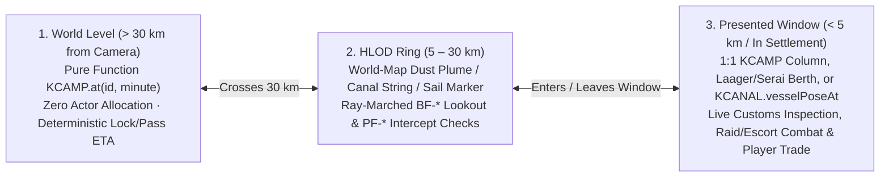

# Physical Caravan, Canal-Barge & Maritime Convoy Simulation Scope (`2026-11-24`)

> [!NOTE]
> **Status: `[LOCKED — RULINGS #105–107]` — Scope `#7`, Companion to [CONTINENTAL-SCOPE.md](file:///home/antigravity/traviso761-debug/krator-master/core/region/CONTINENTAL-SCOPE.md), [CONTRABAND-LAW-PENAL-SCOPE.md](file:///home/antigravity/traviso761-debug/krator-master/core/region/CONTRABAND-LAW-PENAL-SCOPE.md) (`#3`), and [ESPIONAGE-DIPLOMACY-SCOPE.md](file:///home/antigravity/traviso761-debug/krator-master/core/region/ESPIONAGE-DIPLOMACY-SCOPE.md) (`#2`).**
> Translates the solved `27`-sphere, `118`-good, `205`-settlement multimodal flows of [TRADE-GEMINI.md](file:///home/antigravity/traviso761-debug/krator-master/openworld/TRADE-GEMINI.md), [trade-gemini.json](file:///home/antigravity/traviso761-debug/krator-master/openworld/trade-gemini.json), [roads-supplement-gemini.json](file:///home/antigravity/traviso761-debug/krator-master/openworld/roads-supplement-gemini.json) (`124` roads), and [canals.json](file:///home/antigravity/traviso761-debug/krator-master/tools/scale-model/model/data/canals.json) (`22` canals, `3,178.2 km`, `203` locks/lifts) into **discrete, physical, raidable, inspectable, and escortable `SIM.convoy` carriers** running on `core/simulation` (`77-sim-6-trade.js`, `77-sim-7-ledger.js`), `core/camp` (`KCAMP` moving bands & `laager`/`court` halts), `kits/transit` (`KCANAL` lock flights & `TR_VESSEL`), `kits/ringsea`, and `core/sched` (`KSCHED`).
> Pure `[G data]` contract: zero `THREE`, zero DOM, deterministic `KRAND.hash` scheduling (`0` `Math.random()`), numeric defaults strictly `x == null ? d : x`, and append-only `convoyEdits` deltas keyed by stable `id`.

---

## 1. Discretizing Annual Edge Flows into Physical Convoys (`Ruling #105`)

### 1.1 Corridor-Consolidated Multi-Good Manifests (`SIM.convoy`)
In [trade-gemini.json](file:///home/antigravity/traviso761-debug/krator-master/openworld/trade-gemini.json), `118` goods generate `50,000+` annual settlement-pair flows ranging from `0.04 t/yr` of `tin` (`Port Mira -> Ys`) to `1,730 t/yr` of `food` (`Eternal State` exports) and `9,540.8 t-eq/yr` through `Port Tobin`. Spawning one group per raw commodity flow would flood highways with thousands of `1`-mule micro-trains. Instead, `KREGION` consolidates flows **by Corridor Leg and Carrier `org`** into discrete physical `SIM.convoy` dispatches:

1. **Corridor Trunk Aggregation:**
   - Every active directed corridor `c` (`originHub -> [stops...] -> destHub` along `Layer 0` Highway/Trail, `Layer 1` Sea/Lake, or `Layer 2` River/`KCANAL`) sums annual solved tonnage $\sum_g F_{c,g}$ (`t-eq/yr`, converting `kg` bullion/gems/pearls at `0.001 t` plus high-value security weight and `unit`/`head` by cargo bulk class: `bulk = 1.0 t`, `medium = 0.5 t`, `compact = 0.2 t`, `mounts = 0.8 t-eq`).
   - Departures are scheduled deterministically over the `365`-day `KCLOCK` year (`openDays` after subtracting seasonal pass/monsoon closures in §3.2):
     $$N_{\text{departures}}(c) = \max\!\left(1,\; \left\lceil \frac{\sum_g F_{c,g}}{C_{\text{target}}(\text{mode}, \text{org})} \right\rceil\right), \qquad \Delta t_c = \frac{\text{openDays}(c)}{N_{\text{departures}}(c)}$$
   - Departure phase offsets are spread collision-free via `KSCHED.slots(N, period, minGap)` seeded by `KRAND.hash(worldSeed, corridorId, year, 0x434f4e56)`, with `Jimjam` departures snapped to auspicious *Long-Count* calendar days (`core/camp/PLAN.md` §6.2).
2. **Four Physical Convoy Classes (`mode` & `KCAMP` / `KCANAL` / `kits/ringsea` Mapping):**

| Convoy Class (`convoy.mode`) | Carrier Hulls / Draft Column | Typical Payload (`C_target`) | Speed & Daily Rhythm |Representative Continental Carrier `org`s |
|---|---|---:|---|---|
| **1. Overland Pack & Wagon Train** (`'caravan'`) | `8–30` pack beasts or `4–14` wagons/crawlers (`KCAMP` `band.kind = 'caravan'`, `50-camp-tents.js`) | **`15 – 60 t`**<br>*(`0.25–0.4 t` per mule/camel; `1.8–3.5 t` per ox-wagon/bug; `6 t` per crawler)* | `22–38 km/day` (`06:00–18:00` march; night `laager`/`line` camp or `caravanserai` `court` berth) | **Izani Five Houses** (`Goldanda`, `Saltroda`, `Istberar`, `Farguogar`, `Getmastarz`), **`Train of Jabal`**, **`Yuni` *Aʿyān* Guild**, **`Geomancer` Tank-Trains**, **Beast-Rider `Longcrawler` Clans (`Ruling #28`)**, **Chichani `elephant-bug` Trains**, **Republic Salvagers' Crawlers** |
| **2. River, Lake & Canal Barge String** (`'barge_string'`) | `1–4` coupled `TR_VESSEL` hulls (`et_canal_barge`, `et_tow_scow`, `Nauen`, Ria/Voth/Iziz lighters) on `KCANAL` / `Layer 2` | **`35 – 180 t`**<br>*(`30–60 t` per hull × `1–3` towed scows)* | `35–65 km/day` downstream / towed (`15–35 min` dwell per `KCANAL` lock riser; night tie-up at lock-basins) | **Eternian Canal Intendancy** (`8` canals), **Ria Dynastic & *Amber-Seal* River Guilds** (`Mā-Rīa` & `7` canals, `85.9%` of Ria inland ton-km!), **Republic `Slussport` `Nauen` Syndicate** (`96` hulls on `L1–L7`), **Jimjam `lbl=77` Scow Guild**, **Voth `Grüt-Gracht` & `Shim` Bargemen**, **Iziz `Fosa Imperial` Lighters** |
| **3. Coastal, Ring-Sea & Exterior Coaster** (`'maritime_convoy'`) | `1–3` `kits/ringsea` hulls (`rumah-prahu`, `marr-xebec`, `hyk-galley`, `lakatoi`, `voth-carrack`, `iziz-galleon`, `Ria Carrack`, `Crook Hulk`) | **`25 – 240 t`**<br>*(`4–8 t` prahu; `25 t` fast xebec; `40 t` lakatoi/galley; `90–180 t` carrack/galleon)* | `90–180 km/day` continuous sea watch (`SIM.economyStop` port loading dwell `6–18 hr`) | **League of `Ys` / `Tethis` / `Pontus` Naukraroi**, **Free Rumah *Tauranga-Hikau* Fleets**, **`Port Mira` Neutral-Flag Brokers**, **Imperial `Porta Marr` & `Port Tobin` Houses**, **Vothic Cantonal Carracks**, **`Battered Isle` & *Amber-Seal* Bonded Coasters**, **`cFlīt-qBōn` Pelagic Arks** |
| **4. Seasonal & Subterranean Mega-Columns** (`'grand_convoy'` / `'rail_bore'`) | `40–120` beasts/wagons + `MC-01..09` escort company **OR** `Rift Line` electric/haulage rakes | **`120 – 450 t`** | Scheduled seasonal window (`1–4×/yr`) or timetable bore shuttle (`15 m/s` on intact `Rift Line` sections, portaged across `G1–G3`) | **Annual Great Caravan** (`Erehwon -> P8 The Marches -> Blakhed -> Nulab -> Dalab`, `Ruling #40`), **Trans-Catch Convoy** (`Parabola <-> Strongbow`), **Tungang `Rift Line` Union**, **State Walker-Escorted Expeditions** (`iz_castra` Supply Strider, `core/camp/PLAN.md` §6.3) |

### 1.2 Three-Tier Simulation Execution & Strict Ledger Conservation (`77-sim-7-ledger.js`)
Every convoy obeys `core/camp/PLAN.md` §7 and `core/simulation/SCHEMA.md` across all three simulation levels without ever teleporting goods or drifting the books:



- **Accounting Identity (`shipped = landed + spoiled_in_transit + raided_in_transit + seized_customs + Δin_transit`):**
  - On departure from settlement $A$, `SIM.convoyDepart` draws the manifest from $A$'s warehouses (booked `exported` on $A$, moved into `convoy.cargo` with state `transit`) and transfers freight advance / *bottomry* premium via `SIM.pay` (`77-sim-6-money.js`).
  - While on the road, canal, or sea, cargo sits **exclusively in `convoy.cargo`** (never double-counted in $A$ or $B$; visible in `SIM.tradeOutbound` / `SIM.tradeInbound`).
  - Any en-route spoilage (§3.3), bandit/pirate seizure (`raided` column), or border customs confiscation (`#3` `seized_customs` into `treasury:<gatePolity>`) transfers exact integer/fixed-point lots from `convoy.cargo` into the taker's `stock` or `spoiled` counter so continental conservation holds to `0.000` error at every minute.

---

## 2. Atmospheric, Ecological & Magneto-Physical Draft Regimes (`Ruling #106`)

Extending [CONTINENTAL-SCOPE.md](file:///home/antigravity/traviso761-debug/krator-master/core/region/CONTINENTAL-SCOPE.md) §2.4 (`p = 1.6 \cdot \exp(-E / 8000)\text{ atm}`) and `Ruling #29`, every overland and inland-water convoy checks cell pressure `atm`, mean temperature `T`, and `geology.json` magnetic anomalies along its route:

### 2.1 Five Biophysical & Magnetic Draft Regimes (`HARD` Gates vs. `SOFT` Attrition Curves)

| Regime & Pressure / Field Envelope | Elevation Band (`ASL`) | Native / Optimal Draft & Propulsion | Enforcement Rule (`[LOCKED — Ruling #106]`) | Mitigation & Transshipment Law |
|---|---|---|---|---|
| **1. Hyper-Dense & Lowland Arthropod Zone**<br>**`2.18 – 1.60 atm`** | `-2,484 m` to **`+550 m`**<br>*(Ring Sea, East Abyss, Locus, Iziz, Voth, Dalab, Fulcrum, Shade `-406 m`)* | **`Longcrawler` millipedes (`3.2 t`)**, **`elephant-bugs` (`4.0 t`)**, `staghorn` beetles, `Land-Crabs`, giant `Quetzal`/`Wingclaw`/`Nightwing` flyers (`>= 1.35 atm`) | **`HARD GATE` at `< 1.60 atm` (`< 1.35 atm` flyers):** Tracheal oxygen diffusion fails above `+550 m`; route planner & player UI **refuse** arthropod entry onto `< 1.60 atm` edges.<br>**`SOFT HEAT PENALTY` at `> 1.95 atm` & `T > 31 °C`:** Furry alpine beasts (yaks, *Matok* horses, `Talovolci` Giants per `MERCENARIES-SCOPE` `MC-04`) suffer `-30%` speed & `1.5×` water/fatigue draw in deep sumps (`Locus` `2.16 atm`, `Qiblai` `2.02 atm`, `Cut` `2.03 atm`, `East Abyss` `1.99 atm`). | **Arthropods MUST transship at foothill gates (§2.2).**<br>Heat-sensitive lung-breathers in `> 1.95 atm` sumps mitigate `80%` of heat attrition by switching schedule to **Night-March (`20:00–06:00`)** or consuming `1` `mountain-ice` / `2` extra `water` lots per day. |
| **2. Standard Rim & Temperate Shelf**<br>**`1.59 – 1.15 atm`** | `+550 m` to **`+2,650 m`**<br>*(Talia, Yuni, Jabal, Span, Erehwon, Longsong, Nulab, Ledge, Iron Republic valleys)* | Ox-wagons, horses, mules, `Dasri` camels, `Threehorn`/`Hardshell`, `Daranch` pack-lizards (`Ruling #38`), `kits/motor-vehicles` crawlers (`naphtha` + `machine-wax`) | **`1.00×` Baseline Efficiency** for all mammalian, reptilian, and mechanical traction; arthropods barred (`0%`). | Standard `caravanserai` fodder/water replenishment (`grain`/`hay` + `iron` tack upkeep; `naphtha` + `machine-wax` at Geomancer/Republic depots). |
| **3. Thin Alpine & High-Pass Zone**<br>**`1.14 – 0.76 atm`** | `+2,700 m` to **`+5,950 m`**<br>*(`Godsgate` `3,661–4,072 m`, `The Twins` `4,449 m`, `Skywatch` `3,746 m`, `Blakhed` `3,653 m`, `Shelf` `3,760 m`, `Roketstad` `2,950 m`, `Oidong` `4,333 m`, `Tiguantin`)* | Mountain yaks, highland mules, *Matok* steppe ponies (`MC-09`), llama/alpaca strings (`Tiguantin`), cold-spliced `Dalab` pack-lizards (`inferior-biogel`), `Talovolci` Giant porters | **`SOFT HYPOXIA & COLD ATTRITION CURVE`** on unacclimated lowland beasts (oxen, lowland horses, unmodded lizards):<br>• `speed *= 0.62`, `fodder *= 1.65`<br>• Deterministic daily beast-collapse check (`1.5%–4.0%/day` below `1.00 atm`)!<br>• Internal-combustion `naphtha` crawlers lose `-25%` manifold power (`cap *= 0.75`) unless fitted with supercharger/Pioneer electric drive. | **3 Player/AI Mitigations:**<br>1. **Swap beasts** at foothill/pass staging caravanserais (§2.2);<br>2. Dose lowland teams/crews with **`lung-salt`** (`1` lot per `20` beasts/week cuts hypoxia penalty by **`-75%`**!);<br>3. Use Pioneer electric cliff-hoists / `Rift Line` bores where built. |
| **4. Hypoxic & Airless Outer-Wall Crest**<br>**`0.75 – 0.39 atm`** | **`+6,000 m` to `+11,385 m`**<br>*(`Qoold Lheek` `5,702–6,030 m`, `Leng`, `Sasquatch`, `Pluton` `9,650 m`, `Seam B`)* | **`Khaayken` Yeti (`>= 0.67 atm`)** yak/dog sledges & **`Sasquatch` (`>= 0.65 atm`)** porters; **subterranean `Rift Line` / `Crest Tunnel`** below `< 0.60 atm` | **`HARD HYPOXIA WALL` at `< 0.60 atm` (`O` airless zone):** `0` surface transit for any unsealed living creature.<br>Between `0.75–0.65 atm`, non-Yeti/non-Sasquatch expeditions suffer lethal hypoxia without continuous `lung-salt` + cold-weather `qiviut` gear. | North–South Dalab freight routes **`100%` underground** via the `439 km` `Rift Line` bore & `54 km` Crest Road Tunnel (`+5,580 m`); Yeti trade hands off at `Leng` / `Skywatch` / `Serai` edges. |
| **5. `85 mT` Remanent Magnetic Anomaly**<br>**`Compass Hills` (`Lodestone` `1058, 224`)** | `+72 m` (`Līwa-Kōmpa` summit) to `+1,850 m` across `46,216 km²` | **Pegged-wood sledges, pack-mules with rawhide/bronze shoes, & non-ferrous bronze-fastened `Līwa-Kōmpa` summit-pound scows** | **`HARD ZERO-IRON GATE` (`Rulings #102 & #106`):** `85 mT` toroidal fields wrench iron wheel-rims, iron horseshoes, steel weapons, and ferrous lock-chains sideways (`0` iron-tired wagons, `0` motor-crawlers, `0` iron-hulled `Nauen` allowed inside `r <= 60 km` of `Lodestone`!). | Mandatory transshipment at **`Hām-Tsēk` `(1055, 219)`** and **`Līwa-Kōmpa` Lower Bronze Lock**: cargo transfers onto wooden peg-carts and `tin-bronze` / `nephrite-jade`-fitted barges; guards carry `bronze` / `paktong` arms. |

### 2.2 Canonical `16` Break-of-Bulk & Draft-Regime Transshipment Hubs
Where transport modes (`Ship <-> Barge <-> Pack/Wagon <-> Bore/Cableway`) or atmospheric draft regimes (`>= 1.60 atm <-> Standard <-> Thin Alpine <-> 85 mT`) meet, physical **Transshipment Caravanserais & Crane Basins** (`SIM.place` kind `transshipment_yard`) execute `break_of_bulk` (`4–12` world hours handling dwell, `dockers` / `porters` + `crane` throughput, warehouse buffer):

| # | Hub & Coords `(px, py)` | Elev & `atm` | Incoming Mode / Draft | Outgoing Mode / Draft | Physical Infrastructure & Chokepoint Rule |
|---:|---|---:|---|---|---|
| 1 | **`Talia`** `(1073, 939)` | `+250 m` (`1.55 atm`) | Lowland `Longcrawler` trains (up to lower `1.60 atm` gate) & `Iziz` ox-wagons | Highland mule/horse/camel trains (`Goldanda`, `Istberar`, `Getmastarz`) over eastern passes & up to `Tiguantin` (`0.90 atm`) | Foothill Arthropod-to-Mule Transfer Corral + `AS-06` Bonded Caravanserai |
| 2 | **`Girder`** `(1039, 869)` | `-1,386 m` (`1.90 atm`) | `Region 87` `Longcrawler` millipede clans & `Vai Moana` river rafts | Imperial treaty-road ox/mule trains climbing toward `Talia` (`0` Geomancer oil rigs per `Ruling #30`!) | Dense-Air Millipede Transfer Gate & Quetzal Inspection Post |
| 3 | **`Shade`** `(1085, 683)` & **`Wāḥat al-Shamal`** `(1165, 652)` | `-406 m` (`1.68`) / `+41 m` (`1.59`) | `Pinnacle Rock` `Longcrawler` & `Threehorn` jungle caravans | `Dasri` `camel` strings (`100.7k` herd) crossing waterless `Nomad Country` | Rock-Cut Oasis Khan & Arthropod Ceiling Corral (`Ruling #59`) |
| 4 | **`Verge` (Lower & Upper)** `(1268, 949)` | `-1,685 m` (`1.98`) -> `-1,094 m` (`1.83`) | `Locus`/`Yuni North` oil tank-wagons & `Mungo` abyssal barges | **Geomancer `856 m` `naphtha`-winched drum cableway** (oil barrels ONLY, `Ruling #45`) + cut-stone switchback mule trains into `Bowl VIIIb` | Dual-Level Scarp Hoist House & Switchback Caravanserai (`1,891 t-eq/yr`) |
| 5 | **`Port Tobin`** `(956, 944)` | `-1,490 m` (`1.93 atm`) | Ring Sea `iziz-galleon`s, `lakatoi`s & `Port Mira` prize coasters (`#1` continental entrepôt: `9,541 t-eq/yr`!) | **`Fosa Imperial de Iziz`** (`60 t` canal lighters, `8` locks -> `Iziz` outer moat) | Imperial Sea-to-Canal Crane Basin & Bonded Arsenal Quays |
| 6 | **`Palewharf`** `(565, 604)` | `+607 m` (`1.48 atm`) | `Jimjam` wide-beam `Lake lbl=77` stone/grain scows (`8–9 m` beam, `50–60 t`) | Eternian **`5.2 m` narrow miter-lock canal barges** (`et_canal_barge` `45 t` -> `Corpus`/`Mirror Sea`) | **Bonded Split-Jetty Crane Basin & Sanctum Quarantine Lock (`Ruling #66`)**; low-water drawdown shifts turnaround to `Barada-Quay` `(620,604)` |
| 7 | **`Farport`** `(248, 585)` | `+212 m` bluff / `0 m` quay (`1.56 atm`) | Exterior `Crook Hulk`s, `Ria Carrack`s (`120–180 t`) & `cFlīt-qBōn` dive-arks | **`90-s` Pioneer eddy-braked cliff hoists** + **`Lower Līng-Mā` (`45 t`) & `Farside` (`35 t`) canals** | Tsunami-Safe Dejima `et_factory_quarter` + *Santa Cristina* Float-Chime Evacuation Quay |
| 8 | **`Ria Sound`** `(626, 140)` & **`Mā-Kōu` ("Iron Gates")** `(702, 164)` | `+78 m` bluff / `+84 m` gap | NW Ocean coasters (`1,473 t-eq` sea) -> `+78 m` bluff hoists -> `Tōng-Qū` & `Mā-Rīa` river barges | **`Mā-Kōu` `10`-lock `paktong` gorge canal (`60 t`)** uniting Western & Eastern Ria Dynasties (`85.9%` river modal share) | `AS-01`/`AS-02` *Amber-Seal* Bullion Vault & Neutral River-Peace Lock-Keep |
| 9 | **`Silkhead`** `(934, 424)` & **`Port Koron`** `(912, 532)` | `+12 m` (`1.60`) / `-42 m` (`1.61`) | `Shell` overland switchback rigs -> `Port Koron` `Soda Lake lbl=54` flatwater barges (`220 km`) | Northern *Matok* cold-steppe horse/yak trains (`MC-09`) to `Ria Valley`, `Spider Lake` & `Hām-Tsēk` zero-iron transfer | `sl_caravanserai_silkhead` + `AS-03`/`AS-04` Lake-to-Steppe Bonded Bourses |
| 10 | **`Slussport`** `(576, 693)` & **`Roketstad`** `(632, 716)` | `+2,220..+2,950 m` (`1.21–1.11 atm`) | Eternian `Corpus`/`Bastion` highway wagons (`6,318 t-eq/yr` — `#2` continental entrepôt!) | **`96` landlocked `Nauen` alpine lake barges (`40 t`)** across `L1–L7` (*Kors-Slussen*) + high-pass mountain mules | `AS-10` Lock-Toll & Bore-Bond Syndicate + Alpine Hydro-Crane Wharves |
| 11 | **`Cascade`** `(568, 841)` & **`Drum`** `(671, 930)` | `+2,450 m` (`1.18`) <-> `-1,109 m` (`1.84`) | Republican `Nauen` barges / alpine crawlers | **Partially collapsed `89 km` `Cascade <-> Drum` karst bore** (throttled `0.25×` portage pack-mules until re-excavated -> `2.5×` year-round heavy rail/wagon tunnel, `Ruling #57`) -> Vothic `elephant-bug` & river trains | Twin Bore-Portal Syndicate Yards & Salvage Transshipment Depots |
| 12 | **`Skywatch`** `(776, 470)` | `+3,746 m` (`1.00 atm`) | `Jimjam` / `Dilihan` lowland mule & ox carts | Thin-air yak/*Matok* pony strings (`lung-salt` station) + NE Escarpment Sasquatch Silent-Barter Moot | High-Pass Barometric & Customs Gatehouse (`PN-09` telegraph) |
| 13 | **`Bab al-Hawa` (`Godsgate`)** `(1028, 1246)` & **`The Twins`** `(1042, 1525)` | `+3,661 m` (`1.01`) / `+4,449 m` (`0.92`) | `Bowl VIIIb` / `Parabola` ox-trains (`2,143 t-eq/yr`) | High-endurance `Dasri` Catch camel strings & `Getmastarz` `lung-salt`-dosed mule relays down to `Strongbow` (`1,829 t-eq/yr`) | Fortified High-Saddle Cisterns & Pass Wardenries (`0` flyer crossings!) |
| 14 | **`Strongbow`** `(1001, 1596)` & **`Kirstabal`** `(989, 1600)` | `+1,400 m` (`1.34`) -> `-1,661 m` (`1.97`) | `Catch` camel trains & `Oidong` `9`-stage yak/mule sanctuary caravans (`1.23–0.93 atm`) | **Great Counterweight Scarp Lift** -> `Kirstabal` Lower Xanadu Lake `50 t` scows -> `The Landing` `28 km` Alph portage -> `Erehwon` | Counterweight Lift-Head Customshouse & Barge-Staging Serai |
| 15 | **`Blakhed`** `(441, 1400)` & **`Nulab`** `(443, 1359)` | `+3,653 m` (`1.01`) -> `+344 m` (`1.53`) | **Annual Great Caravan** (`Two Horns` high-rim yak/mule/camel column) + `Ice-cutters` glacial sledges | `Chimes` gorge-stair ropeway / switchbacks -> `Nulab` pure-`XAK` Embassy yard -> `Dalab` `Daranch` pack-lizards & Great Lake barges | Rim Cold-Chain Ice-Houses (`Ruling #75`) + `AS-12` Caravan Underwriting Yard |
| 16 | **`Ledge` (`Loj Fower`)** `(437, 1330)` & **`Shelf` (`Loj Tuu`)** `(461, 1161)` | `+1,563 m` (`1.32`) <-> `+3,760 m` (`1.00`) | `Nulab` lake barges & surface Dalab lizard-trains | **`Loj Fower` `1,265 m` vertical electric cliff-lifts** + **`439 km` subterranean `Rift Line` rail bore** (portaged by `Tungang` tunnel-crews across collapse gaps `G1–G3`) -> North `Dalab` | 50/50 Dalab–Tungang Entrance Bazaars (`closed: 'strike'` if Tungang Union strikes!) |

---

## 3. Choke Points, Lock Queues, Seasonality, Spoilage & Ambush Hooks

### 3.1 Physical Canal Lock, Lift & Pass Queuing (`KCANAL` + `KSCHED`)
Unlike instant graph edges, physical chokepoints have finite hourly capacity (`slotsPerHour`), creating visible vessel/wagon queues (`SIM.transport` `exclusive: true`, `queueGap` metres) that **spike transit times during seasonal harvest rushes, military mobilizations, or covert lock sabotage (`#2` `Ruling #113`)**:

1. **Stepped Miter-Lock & Boat-Lift Kinematics (`kits/transit` `41-tr-locks.js` & `42-tr-transit.js`):**
   - Each lock flight (`Shuāng-Zhá` `4` risers, `Līng-Kǒu` `6`, `Palewharf` `6`, `Fosa Imperial` `8`, `Mā-Kōu` `"Iron Gates"` `10`, `Sikwīngi` `11` karst boat-lifts, `Wū-Xī` & `Lux` `12`, `Grüt-Gracht` & `Līwa-Kōmpa` `14`, `Tōng-Qū` `18`) requires `chamberCycleMin` (`12–22` world minutes per riser; `0.5×` wait on twin-lane flights like `Shuāng-Zhá` and `Fosa Imperial`) and enforces `KCANAL.miterLawOk` (`0` gate opening against unequal head).
   - **Toll Collection (`SIM.pay`):** Passing a sovereign or *Amber-Seal*-farmed lock/pass deducts exact tonnage dues (`tollRate * cargoTons`) split `(1 - lienShare)` to `treasury:<polity>` and `lienShare` (`10–25%`, `Ruling #103`) to `acct:amber_seal:<hub>`.
2. **Twelve Major Continental Tolling & Queue Chokepoints:**
   - **Canal & Lake Locks:** `(1)` *Shuāng-Zhá* (`450.5, 782`), `(2)` *Līng-Kǒu* (`445, 645` — `712k ton-km`), `(3)` *Palewharf* Split-Jetty (`565, 604` — `5.2 m` gauge beam-check + Sanctum quarantine), `(4)` *Slussport* & *Kors-Slussen* (`576, 693` — `6,318 t-eq`), `(5)` *Mā-Kōu ("Iron Gates")* (`702, 164` — `60 t` paktong locks + Pioneer eddy-capstans), `(6)` *Port Koron* (`912, 532` — `lbl=54` south lock-head), `(7)` *Almua–Kowld* Canton Locks (`723, 885` — `2` tidal/flushing locks + Vothic Admiralty chain), `(8)` *Fosa Imperial* (`Port Tobin <-> Iziz`, `641k ton-km`) & *Grüt-Gracht* (`Voth <-> Torus`, `14` locks).
   - **Mountain Passes & Vertical Hoists:** `(9)` *Lipp <-> Aidol ("Quiet-Copy" Gate)* (`691, 619 <-> 712, 628`), `(10)` *Dilihan Lower Town & Port Visas Tunnel* (`744, 663`), `(11)` *Skywatch Saddle* (`776, 470`), and `(12)` *Verge `856 m` Cableway*, *Ledge `Loj Fower` Cliff-Lifts*, & *Strongbow Lift*.

### 3.2 Seasonal Closures, Monsoon Reversals & Tsunami Alarms (`Ruling #74` + `CROOK-RIA-SCOPE` §2)
Evaluated deterministically via `KCLOCK.dayOfYear(day)` (`0..364`):
- **High-Alpine Winter Snow Closures (`days 305..059`, `closed: 'snow'`):** Closes surface passes over `+3,200 m` in `Dfb`/`Dsb`/`ET` zones (`Republic` passes `P1–P5`, `Skywatch` N trail, `Oidong` high stages above `Chorten-Gate`, `Blakhed` rim road — forcing the Annual Great Caravan into its spring–autumn window! — while subterranean `Rift Line` and re-excavated `Cascade–Drum` bore remain open `365` days/yr).
- **Ring Sea & Exterior Monsoon Windows:** Wet-season squalls (`days 150..225`) raise un-almanacked sea shipwreck `losses` (`×1.8`, cut `-25%` by Order `almanacs` `MONASTERY-NETWORK-SCOPE` §4.2 and `-60%` within `400 km` of an `RC-5` `telemetry` lighthouse!) and reverse Beast Rider `KCAMP` ground bands to town seasonal homes (`core/camp/PLAN.md` §5).
- **`Lake lbl=77` Paddy-Irrigation Drawdown (`days 090..150`, `Ruling #66`):** Lowered lake sill blocks deep-draft barges from `Jimjam` quays, automatically shifting Eternian `et_canal_barge` turnarounds to deep-water **`Barada-Quay` `(620, 604)`**.
- **`The Catch` Dust-Storm Season (`days 180..240`):** Halves visibility along `Godsgate <-> Twins`, doubling `BF-07` *Tin-Skulls* ambush odds and `water` consumption.
- **Ghost-Tsunami *Santa Cristina* Float-Chime Protocol (`Farport` & `Ria Sound`):** When deterministic far-field mega-shield waves trigger the `25-min` aquifer-drawdown nephrite float-chimes, lower quays immediately halt loading, latch cargo onto **`90-second` Pioneer eddy-braked counterweight cliff hoists**, and seal *Prou-Torre* inundation hatches; uninsured vessels caught unmoored suffer `losses` (covered `100%` if holding an *Amber-Seal* tsunami *bottomry* tally!).

### 3.3 Perishable Spoilage, Packaging & Cold-Chain Law (`Ruling #75`)
Every `SIM.convoy` ticks hourly cargo condition `spoilRate(good, tempC, packaging, coldChain)`:
- **Unpreserved Perishables (`fresh-meat`, `fresh-fish`, `fresh-milk`, `eggs`, `fruit`):** Spoil at `8%–25%/day` above `15 °C` (`export: false` beyond `1`-day hamlet-to-city cart range unless cured into `salted-meat`, `dried-salted-fish`, `cheese`/`ghee`, or `dried-fruit`).
- **Container & Bulk Moisture Protection:** `grain`/`flour`/`sugar`/`salt`/`gunpowder` shipped without `amphorae`, coopered `barrels`, or tarred canvas (`pitch`/`bitumen`) suffer `+3%/day` rain/bilge spoilage (`CONTINENTAL-SCOPE` §2.1A row 15).
- **Mandatory `ancient-biogel` Cryo Cold-Chain (`Rulings #3 & #75`):** `ancient-biogel` degrades into `inferior-biogel` (`-90%` value, unusable in `reformation-sanctum`!) at `5%/day` above `10 °C` unless packed in **glazed stoneware/cryo-canisters cooled by `mountain-ice` (`1` `ice` lot consumed per `5` transit days from `Blakhed`/`Ice-cutters`, `Roketstad`, or `Qoold Lheek` ice-houses)** or powered `energy-cell` cryo-cradles (`RC-4`).

### 3.4 Mercenary Escorts (`SIM.contract`) vs. Bandit & Pirate Interception
- **Hiring Escorts ([MERCENARIES-SCOPE.md](file:///home/antigravity/traviso761-debug/krator-master/core/region/MERCENARIES-SCOPE.md)):** Any NPC merchant house or the player can attach `1–2` `MC-01..10` bands (`caravan_escort` on land, `convoy_marine` at sea) at any of the `10` Hiring Bourses. Escorts march physically in formation (`KSCHED.formation` vanguard + outriders), drawing daily rations/munitions from the convoy's supply wagon.
- **Ray-Marched Highway & Strait Ambushes ([BANDITS-PIRATES-BOUNTIES-SCOPE.md](file:///home/antigravity/traviso761-debug/krator-master/core/region/BANDITS-PIRATES-BOUNTIES-SCOPE.md)):**
  - When a convoy passes within line-of-sight of an active `BF-01..10` `KCAMP.lookout` sentry or `PF-01..06` strait skiff-post (where `region.orderliness < 0.80`), the outlaw band evaluates `convoyDefense` (`teamsterGuards + mercEscort + walkerEscort`) vs. `raiderStrength`:
    - **Safe-Conduct Pass (`SIM.stance >= 'pass_holder'`):** Convoy flashes its brass *Boatmurder* tonnage token (`BF-01`), *Wildcat's Feather* (`BF-08`), or Pirate Pass — `0` fight!
    - **Cargo Tithe / Drop (`BF-04` `10%` skein-tithe, `BF-05` *Salt-Thirsters* water/grain drop, `PF-01` `20%` *"Imperial Tax Receipt"*):** Unescorted small traders pay predictable extortion rather than losing the train.
    - **Full Ambush / Boarding:** Resolved via `KCAMP` §6.1 at `world`/`abstract` level or live 3D combat when `presented`; captured goods ride physically back to the outlaw `ol_cache` / `prize_cache` (where they can be recovered by bounty hunters or fenced into `Port Mira` / `Drum` / *Black-Tally* cellars!).

---

## 4. Three-Tier Player Convoy, Fleet & Merchant-House Gameplay (`Ruling #107`)

Players engage the continental logistics network across three progressive, strictly conserved gameplay tiers:

| Tier | Player Role & Entry Cost | Core Gameplay Loop & Arbitrage Levers | Anti-Snowball & Physical Constraints (`[G data]`) |
|---|---|---|---|
| **Tier 1: Freight Charterer & Courier Arbitrageur** | **`10 – 150 Talents`**<br>*(No beasts or ships owned)* | Book `1–15 t` of bonded cargo space on scheduled NPC `Goldanda`, `Farguogar`, `Slussport`, or `Ys` convoys (`freightFee` per `t·km`). Ride along as a paid guard (`SIM.contract`) or race ahead of `Ruling #81` courier price-waves to buy shortage goods (`salt` in `Xanadu`, `fireclay` in `Roketstad`, `grain` in besieged/post-conquest `Hook`, `lung-salt` at `Godsgate`) and sell into `1.5×–3.0×` scarcity peaks! | Capped by spare berth capacity on departing NPC carriers; subject to host customs inspections (`#3`) unless smuggled. |
| **Tier 2: Caravan-Master, Barge-Skipper & Coaster Captain** | **`200 – 1,800 Talents`**<br>*(Own `KCAMP` beasts/wagons, `TR_VESSEL` barges, or `kits/ringsea` hull)* | Assemble a custom multi-environment train (e.g. `Longcrawlers` in `Region 87` handing off to player-owned mules at `Talia`, or a fast `25 t` `marr-xebec` running blockade/monsoon arbitrage, or a `2`-barge `et_canal_barge` coal/porcelain string). Choose routes, night `laager` sites, `lung-salt`/`ice` cold-chains, false-bottom smuggling compartments (`#3`), or **ambush rival enemy-flag convoys under a Letter of Marque (`#2`)**! | Direct physical upkeep (`fodder`, `water`, `iron` shoes/axles, `pitch`/`cordage`, crew wages), lock/pass queues, and draft-regime rules (§2.1). |
| **Tier 3: Chartered Merchant & Transport House** | **`2,500+ Talents`**<br>*(Purchase House Charter + Warehouse Berth at a Bourse/Port)* | Register a named **Player Merchant House** (`org.kind = 'merchant_house'`), buy or build additional pack-trains, canal barge-strings, and coasters, **hire salaried NPC Caravan-Masters & Ship Captains** (`roles.json`), attach standing **`MC-01..10` mercenary escort contracts**, and underwrite high-risk voyages with **Court of the Amber Seal (`AS-01..12`) *bottomry* & tsunami insurance**! | **Zero Passive Infinite-Money:** Bounded by `(a)` physical warehouse `cap` (`SIM.store`) per city, `(b)` real beast/shipwright hull availability, `(c)` `M2` local price equilibration (flooding a town depresses its price toward `lo`!), `(d)` `SIM.contract` escort & crew payrolls, and `(e)` rival guild tariffs/embargoes (`#2`). |

---

## 5. `[G data]` Record Schema & `SCHEMA.md` Integration

```js
/* Registered on first use in core/simulation (zero delta on pages without convoys) */
convoy: {
  id: 'convoy:getmastarz:talia-strongbow:04',
  org: 'house:getmastarz',          // NPC house, state fleet, smuggler ring, or player house id
  faction: 'iziz',
  mode: 'caravan',                  // 'caravan' | 'barge_string' | 'maritime_convoy' | 'grand_convoy' | 'rail_bore'
  corridor: 'cor:talia-catch-strongbow',
  stops: ['talia', 'parabola', 'godsgate', 'kolli', 'stair', 'twins', 'strongbow'],
  legIdx: 2,                        // currently marching godsgate -> kolli
  t0: 518400, t1: 527040,           // departure & deterministic ETA (world minutes, adjusted by lock/pass queue)
  state: 'marching',                // 'loading' | 'marching' | 'lock_queue' | 'halted_laager' | 'in_serai' | 'customs_hold' | 'ambushed' | 'unloading'
  draft: { kind: 'camel_dasri', count: 28, lungSaltLots: 2, iceLots: 0, zeroIronOk: false },
  hulls: [],                        // e.g. [{ key: 'et_canal_barge', v: 1, capT: 45 }, { key: 'et_tow_scow', v: 0, capT: 30 }]
  cargo: { saltpeter: 12, fireclay: 8, cloth: 6, spirits_hidden: 4 },  // conserved transit stock
  concealed: { spirits_hidden: { method: 'false_bottom', seal: null } }, // hooks directly into Scope #3!
  diplomaticPouch: null,            // hooks directly into Scope #2 (Ruling #111)
  escortContract: 'contract:mc03:19', // hooks into MERCENARIES-SCOPE SIM.contract
  insurance: { issuer: 'amber_seal:as06', coverageTalents: 600, rate: 0.045 },
  leaderActor: 'actor:gm_master_04' // NPC caravan-master/skipper OR 'actor:player'
}
```
