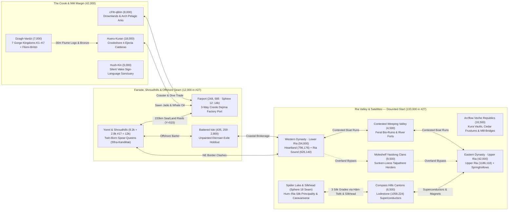

# Exterior Coast & Northern Margin Scope: `The Crook`, `Shroudhills` & `Ria Valley` (`Sphere 27`)

> [!NOTE]
> **Status (`2026-11-22`):** **`[LOCKED]`** — Integrated from the dedicated `Crook & Ria Valley` session (`SESSION-FINDINGS-FOR-CONTINENTAL-SCOPE.md` & `CROOK-RIA-DECISIONS.md`) into [CONTINENTAL-SCOPE.md](file:///home/antigravity/traviso761-debug/krator-master/core/region/CONTINENTAL-SCOPE.md) (`Sphere 27`, **`187,000` single-counted headcount / `187,460` `1.0×` `cal-eq`**, `ΔPop = 0` across `Spheres 12, 17, 18, 27`).

---

## 1. Geopolitical & Single-Counted Census Architecture (`Sphere 27` = `187,000`)

### 1.1 Single-Counting Seam Rules (`ΔPop = 0` Across `Spheres 12, 17, 18, 27`)
1. **`Farport` (`sakq13nyhr`, `Sphere 12` — `14,000` Kept in `#12`):** Relocated on `edit_521_farside.py` from `(294, 588)` onto the **`+212.0 m` tsunami-safe headland plateau at `(248, 585)`** overlooking `Līng-Mā`'s drowned lower harbour at `(243, 586)` (`0.0 m`) after `Farside`'s `55–96 km` seaward extension (`136 km` fortified `Y = 515` river frontier *ɗStara cBruk* + `220+ km` indented coast exposed to Spear-Queen galley raids). Speaks the **3-parent `Farport` Creole** (`Eternian` + `Hueru-Kuran` + `cFlīt-qBōn` clicks).
2. **`Yith` → `Yonni` (`svd298453u`, `346, 418`) & `Shroudhills` (`rmwetizlzivnz`):** Canonically renamed **`Yonni`**, citadel of the **Twin-Born Spear-Queens (*Sfīra-Kandētæ*)** ruling `Shroudhills` (*ex-`Scoured hills`*, `53,852 km²`) down to Eternia's `Y = 515` border (`Ruling #51`). To keep `Spheres 1–26` totals invariant (`3,162,072`), `svd298453u`'s `2,800` citadel headcount stays counted in `Sphere 17` while the remaining **`9,200` `Shroudhills` watch-towns, granite-tor keeps, and raid-coves** (`12,000` total Spear-Queen polity; `@ 1.05×` `cal-eq`) are counted in `Sphere 27`.
3. **`Spider Lake` (`1288, 220`, `3,200`) & `Silkhead` (`934, 424`, `8,600` — Kept in `Sphere 18`):** Headcounts remain in `Sphere 18` (`ΔPop = 0`). `Spider Lake` is a **literate *Hum* Silk-Principality refined under Ria Civilizational hegemony** (`kits/spider-lake/` `SL1–SL4`, `ATMOS` wind-billowing silk), and `Silkhead`'s civic/trade centerpiece is **`sl_caravanserai_silkhead`** (Great Central Silk Caravanserai).
4. **`Double Delta` (`rmvdoubledelta`, `34,292 km²` — `0` Permanent Residents) & `Battered Isle` (`435, 259`, `2,800`):** Unshadowed `287°–294°` WNW **Ghost Tsunamis** (`12–22 m` every `20–35 yr` with zero local earthquake) keep `Double Delta` uninhabited (`0` permanent pop). All delta-mouth port life clusters above `+65 m` at **`Ria Sound` (`626, 140`)**, while **`Battered Isle` (`435, 259`, `+115 m`, `2,800` souls)** hosts a Koxinga-style maritime holdout of unpainted Eternian exiles brokering `Farport <-> Ria Sound` trade.

### 1.2 Sub-Regional Breakdown of `Sphere 27` (`187,000` Headcount / `187,460` `Cal-Eq`)

| Sub-Sphere / Polity | Kit / Vessel Set | Single-Counted Pop | `1.0×` Cal-Eq | Key Seats & Territorial Rule |
|---|---|---:|---:|---|
| **`Hueru-Kuran`** (*Crookshore* Whale-Clans) | `kits/hueru-kuran/`, `hkWhaleCat` | `18,000` | `18,000` | `4` drowned ejecta calderas (`The Eye` `104,562`, `Kopa-North` `89,604`, `Kopa-South` `81,677`, `Cascade-Caldera` `123,659`); rim seats `Kōpa-Hueru` `(75,679)` & `Kāskēdi-Kuran` `(128,660)` (`>= +65 m`) |
| **`cFlīt-qBōn`** (*Drownlands* & *Arch* Arks) | `kits/ringsea/` (`89c–89g`) | `8,000` | `8,000` | `100%` pelagic Ark-Wards (`0` shore buildings in `Drownlands`); `25-min` free-dive click-speakers; summer `Copper Tarn` `(148,1142)` dumb-barter fair |
| **`Dzagh-Vardzi`** (*Vardzieti / Crookwash*) | `kits/dzagh-vardzi/` (`DV2–DV4`) | `7,000` | `7,000` | `7` archaic valley-kingdoms (`K1–K7`) + neutral `Flūmi-Brīdzi` `(94,966)`; slate/tuff/verdigris *koshki* & *gumbat* spires, **Hero-Troubadours**, century-buried ***Mep'e-Qvevri* elixirs**, & **chasm-wind pipe-organs** (`LORE.md` §6.26) |
| **`Hush-Kin`** (*Silent Vales* Sanctuary) | `kits/hush-kin/` | `9,000` | `9,000` | Twin ribbon lakes `(196,928)` & `(186,1020)` under **"The Great Hush"**; **stepped snow-white quartz heliograph & `440/660 Hz` harmonic spires**, *Handspeak* sightline sanctuaries & *bianzhong*/nephrite chimes (`aggression: 0`, `LORE.md` §6.26) |
| **`Yonni & Shroudhills`** *(Hinterland)* | `kits/yonni/` (`YC1–YC3`) | `9,200` *(+`2.8k` `#17`)* | `9,660` | Granite-tor round rain-canopy keeps & coastal raid coves down to `Y = 515` (`12,000` total with `Yonni` `(346,418)`); guarded by cat-sized **Shroud-Ants (*Khrōma-Mīra*)** |
| **`Battered Isle`** *(Eternian Exiles)* | Unpainted `eternian` + maritime | `2,800` | `2,800` | Offshore holdout at `(435, 259)` (`+115 m`, `coal: 201`, `nickel: 180`, `wood: 255`); brokers `Farport <-> Ria Sound` |
| **Western Dynasty (`Lower Ria`)** | `LR1–LR5` + `riaWestPalaceBarge` | `54,000` | `54,000` | `Heartland` capital arcology `(796, 176)` + **`Ria Sound` `(626, 140)`** (`+65 m+` bluff port above `0`-pop `Double Delta`); glazed-brick water-gates, *malqaf* mansions, 5-headed *Uktena* Palace-Barges |
| **Eastern Dynasty (`Upper Ria`)** | `UR1–UR5` + `riaEastPalaceBarge` | `42,000` | `42,000` | `Upper Ria` capital arcology `(1186, 118)` + `Springhollows` `(1135, 153)`; porphyry/dolomite colonnades, lodestone obelisks, shut-in boat-lifts, silver-swan Palace-Barges |
| **Contested `Weeping Valley`** | Fortified ruin-outposts | `4,500` | `4,500` | Shoreline river-forts around `(996, 156)` contested between Western & Eastern Dynasties amid feral sap-groves & rogue defoliant machines |
| **`Arcflow` *Veche* Republics** | `AF1 + AF3 + AF4` | `16,500` | `16,500` | Independent popular bell-assembly smith republics on `Pāk-Mā` & `Tōng-Mā`: *Kura* fire-vaults, Arch-nickel-hooped cedar frustums, Dong bell-pagodas & covered mill-bridges |
| **`Moleshelf` *Yaodong* Clans** | Sunken-loess `dikengyuan` | `9,500` | `9,500` | Open-sky square sunken loess courtyards (`BSk` rain-shadow behind `x ≈ 680–720` hogback sill); herd burrowing *Talpatheres* & run the N caravan bypass around `Weeping Valley` |
| **`Compass Hills` Delver Cantons** | Bronze/jade delve cantons | `6,500` | `6,500` | Autonomous non-ferrous cantons around **`Lodestone` `(1058, 224)`** (`lodestone: 220`), delving planetary **`superconductors`** with `0` iron tools |
| **Total `Sphere 27` (Single-Counted)** | — | **`187,000`** | **`187,460`** | Brings **27-Sphere Continental + Exterior Total** to **`3,349,072` headcount / `3,422,836` `cal-eq`** |

---

## 2. Two-Source Planetary Tsunami Regime & Littoral Engineering

1. **Near-Field Source — `Steaming Seamounts` (`176, 322` & `166, 338`, `560–840 km`, `54–81 min` travel):** Preceded `25–50 min` earlier by felt earthquakes and ash-booms (`Crookshore` & `Farport` exposed; `Double Delta` shadowed `229°–279°` by `The Arch`).
2. **Far-Field Abyssal Source — NW Ocean `15 km` Heat-Pipe Mega-Shields (`gallery/krator-globe`, `2,050–4,100 km`, `3.3–6.5 hr` travel):** Stationary stagnant-lid shields (`Farside Tsunami Shield S` & `Equatorial Shield N`) shed Hilina-scale flank collapses at **`287°–294°` (WNW)** — **bypassing `5.1`'s `Arch` straight into `Double Delta`** as **silent "Orphan / Ghost Tsunamis"** with **zero local ground shaking** (`3–10 m` every `3–7 yr`; `12–30 m` every `20–35 yr`; `35–55 m` every `150–300 yr`).
3. **Mandatory Littoral Settlement Rules:**
   - All permanent housing, granaries, and civic halls at `Kōpa-Hueru` `(75,679)`, `Kāskēdi-Kuran` `(128,660)`, `Farport` `(248,585)`, and `Ria Sound` `(626,140)` stand above **`+65..+212 m`**.
   - Lower expendable slipways/factory quays connect via **`5–8 min` rock-cut via ferratas**, **`90-second` gravity water-counterweight cliff hoists**, ***Santa Cristina* aquifer-drawdown nephrite float-chime wells** (`25-min` Ghost-Tsunami warning), and knife-prowed ***Prou-Torre* inundation refuge keeps** (`+22 m` dogged hatches).

---

## 3. Biological Lineages, Goods, Workshop Chains & Hazards

### 3.1 Biological Lineages (`peoples.json` Queue for All-Builds Rebuild)
- **`cflit_qbon` (*cFlīt-qBōn*, "Fleet-Born"):** Engineered cetacean/pinniped dive lineage (`1.00×` frame, valved nostrils, collapsible rib cartilages, plum-indigo myoglobin lips/sclerae, clear nictitating inner eyelids, **`25-min` free-dive to `100+ m`**, underwater-propagating **Click Language** resolving `LORE.md` §6.19).
- **`yonni` (*Sfīra-Kandētæ*, Spear-Queens):** Engineered **reverse sexual dimorphism** (women `~1.10×` taller/heavier-boned martial caste; men `~0.92×` build) + **`90%` monozygotic identical-twin births** (Dyad two-sister lances, Dual-Throne *Fīlda-Kandē* & *Khārdha-Kandē*, mystic `10%` *Lōni-Bōrna*; `~1.05×` blended `cal-eq`).
- **`hush_kin` (*Handspeak* Sanctuary Tribes):** Standard human frame (`1.00×`), `100%` fluent in grammatical **Two-Handed Sign Language (*Handspeak*)** + sinusoidal *bianzhong* bronze bells & nephrite lithophones inside `Silent Vales`' broadband-damping acoustic field (`aggression: 0`).

### 3.2 New Continental Workshop Chains & Regional Hazards
1. **`superconductor-delve` (`Lodestone` `1058, 224` — Planetary `superconductors` Source):** Delving `Lodestone`'s flux-quenched toroidal sub-tunnels (`85 mT` remanent fields across `46,216 km²`, `lodestone = 220`) **strictly consumes non-ferrous `tin-bronze` and sawn `nephrite-jade` tools (`0` `iron-bar` tools allowed!)**, yielding `superconductors` and `lodestone` magnets shipped to `Upper/Lower Ria`, `Silkhead -> Shell -> Iziz`, and `Ria Sound -> Farport -> Fulcrum / Yusar`.
2. **`paktong` (`Cu-Ni-Zn` Marine White-Copper):** `cFlīt-qBōn` burn `Arch`/`Drownlands` nickel-hyperaccumulating shrubs (`18–25% Ni` ash), barter at summer **`Copper Tarn` (`148, 1142`)** for `Copper Glacier` `copper` (`240`) + `zinc` (`220`), and smelt corrosion-proof `paktong` on `arkSmelter` hulls.
3. **Three-Grade `spider-silk` (`Spider Lake` -> `Silkhead` `sl_caravanserai_silkhead`):** Live 6-day rotational harvest calmed with *bog-myrtle* smudge-smoke + fuel-free `+38–44 °C` alkaline spring sericin-degumming -> `Golden Cable`, `Cloud-Fleece`, and `Lake-Sheen Gossamer`.
4. **Water-Powered `nephrite-wire-saw` & `30 m` Flume Ship-Logs:** `Hueru-Kuran` quartz-sand pendulum wire-saws at `Cascade-Caldera` `(123, 659)` slice `4-ton` nephrite boulders into lintels, tsunami float-chimes, and `Dzagh-Vardzi` weregild plaques, while `Dzagh-Vardzi` gorge-flumes shoot `30 m` red-cypress mast/hull logs into coastal lagoons.
5. **`Shroudhills` Cat-Sized Shroud-Ants (*Khrōma-Mīra*, `saltpeter = 200` Hazard):** `28–42 cm` (`2–4 kg`) eusocial canopy ants in `1.3–2.8 m` woody Drum-Galls precipitate `saltpeter = 200` refuse crusts; peaceful toward *smudge-myrtle*-anointed `Yonni` scouts, but answer axe-blows, fire, or unanointed invading columns with a `6 Hz` mandible warning-rattle and an implacable territorial phalanx.

### 3.3 Ria-Based Trans-National Organizations Pushing South (`Rulings #102–104`, [NORTHERN-CARTELS-SCOPE.md](file:///home/antigravity/traviso761-debug/krator-master/core/region/NORTHERN-CARTELS-SCOPE.md))
1. ***The Pioneers / The Technicians* (*Society of the Needle* / *Flux-Line Collegium*, `PN-01..PN-15`):** Strictly neutral above both Ria Dynasties (HQ at `Springhollows` `(1135,153)` & `"Iron Gates"` `(702,164)`), serving as the **Northlands' artifact-engineering & electromagnetic counterpart to the southern Geomancers**. Monopolizing `Lodestone` `superconductors`, `85 mT` flux-compasses, `Spider Lake` dielectric silk-wrapped telegraph wire, and clean **hydro-dynamos**, they push south down twin pincers (`Silkhead -> Port Koron/Shell -> Dilihan/Skywatch -> Talia -> Iziz/Hook` and `Ria Sound -> Battered Isle -> Farport/Palewharf -> Roketstad/Slussport -> Ys/Port Mira`) while secretly compiling a continental geodetic, pass-gradient & `RC` Relic flux-anomaly ledger.
2. ***The Court of the Amber Seal* ("The Seal-Bank" / *Kūri-Āmpala*, `AS-01..AS-12`):** Krator's true **trans-national merchant bank, sovereign war/infrastructure bond house, Ghost-Tsunami & maritime *bottomry* insurer, and extraterritorial customs/lock-farming cartel** (HQ at `Ria Sound` `(626,140)` & `"Iron Gates"` `(702,164)`). Advances `silver`/`gold`/`nephrite-jade` to cash-strapped southern polities against liens on customs gates, canal locks, and port tolls — routinely stipulating **Pioneer** engineers on Seal-Bank-financed works.
3. **`Weeping Valley` *Sap-Breakers* Boundary (`Ruling #104`):** `Weeping Fort` `(996,156)` hosts the Pioneers' hazardous **Sap-Breakers** corps (dismantling rogue defoliant machines & harvesting dielectric coil-varnish), keeping zero overlap with **`Torus`'s Rinkvolk *Tenders*** (`777,1003`), who retain `100%` of Krator's living arcology-forest & botanical stewardship niche.

---

## 4. Locked Linguistic Table (Legible English Roots)

| Speech / Script | Polities | Confirmed Shift Rule | Examples |
|---|---|---|---|
| **`cFlīt-qBōn`** | Pelagic Ark-Fleet | Cetacean-coda click prefixes (`c / q / x / ɓ / ɗ`) on clipped English roots | `cFlīt-qBōn` (*Fleet-Born*), `qDīp-cWād` (*Deep-Ward*) |
| **`Farport` Creole** | `Farport` `(248,585)` & `Farside` | 3-parent maritime creole (`Eternian` + `Hueru-Kuran` + `cFlīt-qBōn` clicks) | `Tōng-Sēk-Mā`, `ɗStara cBruk`, `xBrod qRiba` |
| **`Utari-Kuran` (`Hueru-Kuran` / `Timpar-Kuran` / `Hayrant`)** | `Crookshore` Whale-Clans, **Veiled Mountains** Timber-Clans (`Kanopi`), & `E6` Outer Wall | Mutually intelligible 3-branch Ainu-shifted chain (`wh → hu`, `l → r`, `cl → kur`; `LORE.md` §6.25) | `Hueru-Kuran` (*Whale-Clans*), `Timpar-Kuran` (*Timber-Clans*), `Kanopi` (*Canopy*) |
| **`Dzagh-Vardzi`** | `Vardzieti` (`K1–K7`) | Kartvelian / Svan / Vainakh ejectives, `-eti` land, `-i` nom. | `Khāi-Gēti` (*High-Gate*), `Tīn-Flītsi` (*Tin-Fleece*) |
| ***Handspeak*** | `Silent Vales` (`Hush-Kin`) | Grammatical two-handed Sign Language + *bianzhong* bells | *Sutiru-Kuran* (exonym) |
| **Low-Ria (`Rīwa-Tōka`)** | Western Dynasty (`Lower Ria`) | **Mississippian / Muskogean** (`th → ł`, open vowels, `-ą/-į` nasals; keeps `p, b, m, f`; 64-sign Amber-Seal Syllabary) | `kulūną` (*crown*), `āmpala` (*amber*), `pālasi-bāča` |
| **High-Ria (`Līwa-Tōga`)** | Eastern Dynasty (`Upper Ria`) | **Cherokee / Iroquoian** (**labial loss `p, b → kw / gw`, `mb/mp → kw`, `f/v → hw/w`, `r → l`**; same 64-sign script) | `kwalūna` (*crown*), `ākwala` (*amber*), `Sikwīngi-Khālōyi` |
| **`Mōlu-Dungu`** | `Moleshelf` Herders | **Mapuche (*Mapudungun*)** (`tr`, `ü`, `ll/ch/ñ`, `-we` yard, `-che` folk, `-mapu` land) | `dīpü-yāduwe` (*deep-yard*), `Mōlü-che` (*mole-folk*) |
| **`Yonni-Zāg`** | `Yonni` & `Shroudhills` | **Mixed Kushitic + Sarmatian** (`nn/dd`, `Kandē`, `sp/p → sf/f`, `w → v`, `h → kh`, pl. `-tæ`) | `Sfīra-Kandētæ` (*Spear-Queens*), `Shrūda-Khīltæ`, `Khrōma-Mīra` |

---

## 5. Scale-Model `5.1` Branch Merge Checklist & Queued Ria Edits

1. **Disjoint Raster & Edit-Tag Merge (`edit_520` / `edit_521` / `edit_522`):**
   - On the `Crook/Ria` workspace, `edit_520_crook.py` (`4` calderas, `+23` rivers `9111–9133`, `K1–K7` + `Flūmi-Brīdzi` + `Kōpa-Hueru` + `Kāskēdi-Kuran`, `Yith -> Yonni`), `edit_521_farside.py` (`55–96 km` `Farside` seaward extension, **`Farport` `(294,588) -> (248,585)` `+212 m`** above `(243,586)` lower harbour, `136 km` `Y = 515` river frontier), and `5.1e22` (`Scoured hills -> Shroudhills`) sit **`>350 px` (`>700 km`) disjoint** from this branch's `edit_520_republic_alps.py` (`pure_ir`) and `edit_521_wave0_hygiene.py`.
   - **Merge Rule:** Re-key the Crook/Farside `SETT_ADDED`/`SETT_MOVED` version tags to `'5.1e20_crook'`, `'5.1e21_farside'`, and `'5.1e22_shroudhills'` so both branches' rasters, rivers, polygons, and settlement pins compose cleanly with zero overwrites.
2. **Queued `Ria Valley` Scale-Model Edits (Next Map Pass):**
   - Rename `rmweu2qb4nyia` (`red river`) → **`Upper Ria`** (*Ākwala-Līwayi*) and `rmvyiyw8ucd1y` (`neo-ozarks`) → **`Springhollows`** (*Sikwīngi-Khālōyi*).
   - Carve the **`x ≈ 680–720` transverse hogback/cuesta sill (`+1,600–2,200 m`)** incised by an **"Iron Gates" navigable water-gap** on `9101` `Mā-Rīa` (shifting `Heartland` & `Moleshelf` foot into rain-shadowed `BSk`/`Csa` so sunken loess *yaodongs* are geotechnically sound).
   - Add settlement/ruin pins: **`Ria Sound` `(626, 140)`**, **`Battered Isle` `(435, 259)`**, and **`8` Frontier Boomtown Arcologies** (`Lodestone` `1058,224`, `The Scaffold` `1246,18`, `The Skeleton` `1036,106`/`726,123`, `Weeping Valley` bio-ruin `996,156`, Lower Ria seat `796,176`, Upper Ria seat `1186,118`, `Springhollows` karst-spring arcology `1135,153`, step ruin `1305,100`).
