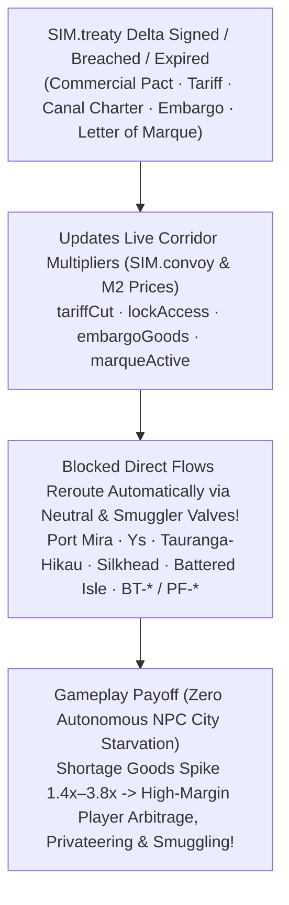

# Espionage, Foreign Legations, Dynamic Treaties & Covert Operations Scope (`2026-11-24`)

> [!NOTE]
> **Status: `[LOCKED — RULINGS #111–114]` — Scope `#2`, Companion to [CONTINENTAL-SCOPE.md](file:///home/antigravity/traviso761-debug/krator-master/core/region/CONTINENTAL-SCOPE.md), [CONVOY-LOGISTICS-SCOPE.md](file:///home/antigravity/traviso761-debug/krator-master/core/region/CONVOY-LOGISTICS-SCOPE.md) (`#7`), [CONTRABAND-LAW-PENAL-SCOPE.md](file:///home/antigravity/traviso761-debug/krator-master/core/region/CONTRABAND-LAW-PENAL-SCOPE.md) (`#3`), [MULTI-KIT-SCOPE.md](file:///home/antigravity/traviso761-debug/krator-master/core/region/MULTI-KIT-SCOPE.md) (`Rulings #99–101`), [BANDITS-PIRATES-BOUNTIES-SCOPE.md](file:///home/antigravity/traviso761-debug/krator-master/core/region/BANDITS-PIRATES-BOUNTIES-SCOPE.md) (`Ruling #94`), [MONASTERY-NETWORK-SCOPE.md](file:///home/antigravity/traviso761-debug/krator-master/core/region/MONASTERY-NETWORK-SCOPE.md) (`Ruling #89`), [RELICS-SCOPE.md](file:///home/antigravity/traviso761-debug/krator-master/core/region/RELICS-SCOPE.md), and [NORTHERN-CARTELS-SCOPE.md](file:///home/antigravity/traviso761-debug/krator-master/core/region/NORTHERN-CARTELS-SCOPE.md).**
> Completes the closed continental simulation loop (**`Convoys` `#7` carry legal & concealed cargo $\rightarrow$ `Customs/Courts/Penal` `#3` inspect, tax, seize, or sentence $\rightarrow$ `Legations/Treaties/Espionage` `#2` manipulate tariffs, diplomatic immunity, multi-kit blueprints, canal locks, and regional `orderliness`**) in pure `[G data]` records (`0` `THREE`, `0` DOM, deterministic `KRAND.hash` rolls, `x == null ? d : x`, append-only `diploEdits` / `spyEdits` delta logs).

---

## 1. Physical Foreign Legations, Closed-Interior *Fondacos* & Diplomatic Pouches (`Ruling #111`)

### 1.1 Three-Tier Continental Diplomatic Presence Architecture
Extending Voth's Foreign Canton (`settlements/voth`), Dalab's Embassy Row (`settlements/dalab/PLAN.md` §2.3), Ys's Foreign Quarter (`port_voth_embassy`), Dilihan's Lower-Town Legation (`dl_hykkousoi_legation`), and Ardent's `Posolsky dvor` (`hl_rus_envoy_lodge`), foreign missions across all `27` spheres obey a strict **3-Tier Sovereignty Map**:

| Diplomatic Tier | Architectural Form (`KRATOR_KITS` / `SIM.place`) | Sovereign Jurisdiction & Entry Law | Canonical Continental Seats & Hosted Foreign Missions |
|---|---|---|---|
| **Tier A: Extraterritorial Embassies & Consular Legations** *(Open Capitals & Ports)* | Walled compound built in the **sending culture's kit** (`port_voth_embassy`, `dalab_embassy_*`, `dl_hykkousoi_legation`, `hl_rus_envoy_lodge`, or `KCITY` `embassy` lot via `KRATOR_KITS`) | **`access: 'org'` Extraterritoriality:** Host `town guard` cannot enter to arrest `SIM.crime` / political fugitives without a formal **Sovereign Expulsion Decree**; accredits `diplomatic_pouch` couriers (§1.2). | • **`Iziz` `(963,985)` Imperial Embassy Quarter:** `League of Ys`, `Iron Republic`, `Dalab`, `Yuni`, `Xanadu`, `Jimjam`, `Kautoa`, `Talovolci` pay-legation + **shuttered `Voth` Embassy under `Ys` caretaker** • **`Voth` `(742,1018)` Foreign Canton:** `Hykkousoi` (`Ys`), `Iron Republic`, `Jimjam`, `Dalab`, `Yuni` + **shuttered `Iziz` Embassy under *Amber-Seal* caretaker** (*`0` Order — purged `HM-19`!*) • **`Dalab` `(477,1108)` Embassy Row:** `Iziz`, `Voth`, `Iron Republic`, `Yuni` + `HM-17` Order (*`0` `Xanadu` at capital `Dalab` per `Ruling #39`!*) • **`Roketstad` `(632,716)` Cantonal Diplomatic Row:** `Ys`, `Dalab`, `Iziz`, `Jimjam`, `Ardent` (`hl_rus_envoy_lodge`), `Vrivolci` Oath-Envoy • **`Ys` `(788,741)` Foreign Quarter:** `Voth` (`port_voth_embassy`), `Iziz`, `Iron Republic`, `Dilihan`, `Kautoa`, exiled `Hetānini` Rumah • **`Erehwon` `(841,1517)` Caldera Envoys' Terrace:** `Iziz`, `Yuni`, `Order` (`Longsong`), `Dalab` *(reciprocal attaché)* • **`Yuni` `(1263,1089)` *Aʿyān* Diwan Quarter:** `Iziz`, `Xanadu`, `Jabal`, `Dasri` sheikhs, `Voth` oil-royalty envoy • **Regional & Consular Seats:** `Dilihan` (`dl_hykkousoi_legation`, `Jimjam`, `Ardent`), `Jimjam` (`Iron Republic` legation), `Ardent` (`Dilihan` envoy lodge), `Talia` (`Beast Rider` treaty envoy, `Tiguantin` factor), `Kautoa` (`Iziz` & `Beast Rider` envoys), `Thalaba` (`Dalab` bio-mission), `Port Mira` (all-flag truce consulates), `Silkhead` (`Ria` Dynastic, `Jimjam` & `Korona` factors inside `sl_caravanserai_silkhead`), `Mā-Kōu` `"Iron Gates"` (West & East Ria River-Peace missions under *Amber-Seal* chair) |
| **Tier B: Border Quarantine Treaty-Port *Fondacos* ONLY** *(Closed Interiors)* | Segregated walled treaty-factory (`et_factory_quarter`, pure-`XAK` `Nulab` compound, or external `1–3 km` concession) | **Zero Interior Travel:** Envoys & foreign merchants are legally barred from the interior capital; all treaties, bullion clearing, and `diplomatic_pouch` handoffs terminate at the border gateway! | • **`Eternal State` (`0` foreign embassies in `Fulcrum`!):** Foreign missions restricted strictly to **`Farport` `(248,585)` Dejima Factory Quarter** (`Lower/Upper Ria`, `Hueru-Kuran`, `Battered Isle`, `AS-09` *Amber-Seal*), **`Palewharf` `(565,604)` Split-Jetty *Fondaco*** (`Jimjam`, `Ys`, `AS-09b`, `LC-07` Geomancer factor), and **`Bastion` `(536,627)` Land Quarantine Compound** (`Iron Republic` & `Iziz` `Farguogar` factors) — *while `Order of Historians` holds its single Censorate-watched house at `Lux` `HM-16` (`Ruling #83`)* • **`Xanadu`-in-`Dalab` (`Ruling #39` `[LOCKED]`):** Permanent pure-`kits/xanadu` (`XAK`) **Two Horns Embassy Compound at southern gateway `Nulab` `(443,1359)`** (`0` mission in `Dalab` city) • **`Beast Riders` (`Region 87`):** External treaty posts at `Girder` & `1–3 km` outside `Mav's`/`Pinnacle` (`LC-01/02`) |
| **Tier C: Wartime Protecting-Power Caretaker Compounds** | Shuttered belligerent embassy flying neutral **Protecting-Power** pennant alongside sealed crest | **`status: 'CARETAKER'`:** Active diplomats withdrawn, but neutral `League of Ys` or *Court of the Amber Seal* (`AS-*`) custodians maintain diplomatic archive immunity, prisoner-of-war / ransom rosters, and back-channel peace feelers — **doubling as prime covert dead-drops!** | • **Game-Start `Iziz <-> Voth` War (`Ruling #69`):** `Voth`'s compound in `Iziz` (held by `Ys`) & `Iziz`'s compound in `Voth` Foreign Canton (held by *Amber-Seal*) • **Disunited `Lower <-> Upper Ria`:** Dynastic missions bridged through neutral `Mā-Kōu` `"Iron Gates"` (`AS-02` / `PN-02`) |

> [!IMPORTANT]
> **Polities With Zero Diplomatic Legations (`[LOCKED]`):** `Lizardmen` (`92,500`, `Ruling #65`), `Sasquatch` (`3,600`, `Ruling #61` — silent equinox barter at `Skywatch` only), `Screamers` (`18,000`, `Ruling #11` — wordless `Boiling Bay` beach swap only), `Hub 01` Stalkers, and `Wheel` `Cyberliches` (`120`).

### 1.2 Diplomatic Pouches & Sovereign Seizure Crises (`diplomatic_pouch`, `Ruling #111`)
Bridges `#2` (Intelligence Couriers), `#7` (`SIM.convoy` / Fast Packet Hulls), and `#3` (Customs Smuggling):
1. **Routine Customs Immunity (`M_conceal = 1.00` in `#3` §3.1):** Any accredited Tier A/B legation (or a Player carrying an Envoy/Attaché commission!) may seal up to `0.5 t` (`2` compact lots: cipher dispatches, bullion, `books`, **stolen `KRATOR_KITS` blueprints**, `RC-4` `ancient-biogel` phials, or `RC-5` oscillator crystals!) inside a lead-stamped **`diplomatic_pouch`**. Ordinary gate, canal-lock, and harbour clerks **cannot open or tax it**.
2. **Counter-Intelligence `suspicion` Meter & Sovereign Pouch Seizure:**
   - Host counter-intelligence (§3.1) tracks `legation.suspicion` (`0..100`), rising when legation staff meet known `BT-*` / `BF-*` fences, when `Veil`/`Lux` RF arches detect anomalous emissions, or when a cut-out courier is arrested.
   - Once `suspicion >= 75`, the host tribunal may execute a **Sovereign Pouch Seizure** at the border gate/lock:
     - **Caught Red-Handed (Contraband / Stolen Blueprint / Spy Roster Inside):** Courier arrested for **Tier 3–4 Espionage (`#3` §4)**, culpable envoy declared ***Persona Non Grata*** (legation downgraded to `CARETAKER` for `90` days), and host imposes an automatic **`+15%` Punitive Tariff** on the offending polity!
     - **Clean Pouch (False Alarm / Counter-Espionage Sting!):** Host suffers a **`-2` Diplomatic Scandal** (`-stance` across peer courts, `-1` `witnessedBy: 'order'` & *Amber-Seal* credit rating, and reciprocal tariff retaliation) — allowing clever spymasters to **bait paranoid censors with decoy pouches**!

---

## 2. Dynamic Treaty & Trade-Graph Levers Over the 27-Sphere Network (`Ruling #112`)

Rather than recomputing offline Dijkstra rasters at runtime, `SIM.treaty` applies **live, auditable `[G data]` delta records** over [trade-gemini.json](file:///home/antigravity/traviso761-debug/krator-master/openworld/trade-gemini.json) / `SIM.convoy` corridors while preserving continental survival homeostasis:

### 2.1 Six `[G data]` Diplomatic & Economic Treaty Instruments (`SIM.treaty`)

| Treaty Kind (`treaty.kind`) | Graph & `SIM` Effect (`#7` Convoys + `#3` Customs) | Concrete Continental Baselines & Live Flashpoints |
|---|---|---|
| **1. Commercial & Consular Compact** (`'commercial_pact'`) | Sets bilateral `tariffCut = 2%–5%`, opens `bonded_warehouse` berths, and grants `TRADING`/`RESIDENT` `SIM.presence`. | `Iron Republic <-> League of Ys` (`Slussport`–`Trigon`/`Tethis`); `Xanadu <-> Dalab` via `Nulab` Great Caravan Charter (`Ruling #40`). |
| **2. Punitive Tariff & *"Quiet-Copy"* Duty** (`'punitive_tariff'`) | Raises `tariffCut` to **`15%–35%`** on targeted origin/goods + `+0.25` customs search $B_{\text{gate}}$. | `Dilihan`/`Aidol` vs Republican `precision-tools`; `Eternal State` `Farport` `82%` state cut on exterior `ria-amber` & `frost-coral`. |
| **3. Canal, Lake & Bore Transit Charter** (`'transit_rights'`) | Controls `lockAccess` (`'open'`, `'tolled'`, `'bonded_only'`, `'closed'`) across the `22` `canals.json` trunks, `Lake lbl=77`, `Mā-Kōu`, & `Cascade–Drum` bore. | **Bi-National `Lake lbl=77` Compact (`Ruling #66`)**; **`Mā-Kōu` `"Iron Gates"` River-Peace Charter (`Ruling #102/103`)**; `Dioryx of Ys–Visas` safe-passage. |
| **4. Strategic & Cartel Embargo** (`'embargo'`) | Reclassifies listed goods (`gunpowder`, `saltpeter`, `oil`, `ship-timber`, `superconductors`, `books`) to `PROHIBITED_CONTRABAND` toward target polity (`SIM.trades` shut for listed goods). | **`Vrivolci` absolute boycott of `Dalab` & `Voth` (`Ruling #41`)**; **`Order` `books` embargo vs `Voth`**; **Geomancer / Order / *Amber-Seal* Cartel Deterrence (`Rulings #70 & #103`)**. |
| **5. Wartime Blockade & Letters of Marque** (`'war_blockade'`) | Bars direct belligerent `SIM.convoy` hulls (`Iziz <-> Voth`, `Ruling #69`) and activates **`privateer_charter` Letters of Marque** (`80%` privateer / `20%` Crown Prize Court split on enemy-flag cargo!). | **Live Game-Start `Iziz` vs `Voth` Ring Sea War** (`Hook`, `Porta Marr`, `Almua`, `Port Mira` neutral `50-km` truce ring, `PF-01` & `PF-05`). |
| **6. Witnessed Truce & Bonded Lien Treaty** (`'witnessed_truce'`) | Backed by **`witnessedBy: 'order'` (`Ruling #89` — breach triggers overnight radio-synced continental Order embargo!)** or **`escrowBy: 'amber_seal'` (`Ruling #103` — forfeited bullion bond + `lienShare` lock seizure)**. | `Hook` post-reconquest dock-rebuild bond (`AS-07b`); `Port Mira` `50-km` truce compact; `Korona` `K9–K10–K2` Safe-Conduct League (`Ruling #58`). |

### 2.2 Neutral Entrepôt & Smuggler Rerouting Homeostasis Law (`[LOCKED — Ruling #112]`)
In accordance with `core/camp/PLAN.md` §6.1 (*without direct siege/player action, macro-events never ghost-town prebuilt cities*), whenever an `embargo`, `war_blockade`, or canal closure severs a direct corridor $A \leftrightarrow B$:
- **Neutral-Flag Arbitrage Rerouting:** `60–80%` of essential civilian trade automatically re-paths (`+hop` transshipment markup) through neutral brokers — **`Port Mira` (`865,895`)**, **`Ys` / `Nephtos` (`League`)**, ***Tauranga-Hikau* (`848,897`)**, **`Silkhead` (`934,424`)**, **`Battered Isle` (`435,259`)**, and **`Span` (`554,1010`)** (`Ruling #69`).
- **Smuggler Valve Activation:** Remaining unmet high-margin demand activates `BT-01..12` *Black-Tally* runners, `PF-01..06` night-cove sloops, and player smuggling contracts (`#3` §3.3 `2.1×–3.8×` price multipliers), ensuring embargoes create **lucrative gameplay bottlenecks and military-input shortages** (`gunpowder`/`oil`/`ship-timber` `stockpile` drops) while `14`-day staple food floors hold.

---

## 3. Spycraft, Secret Police, Multi-Kit Blueprint Theft & Covert Sabotage (`Rulings #113 & #114`)

### 3.1 Six Asymmetric Intelligence & Counter-Intelligence Apparatuses

| Service & Parent Polity / Network | Primary HQ & Field Stations | Signature Tradecraft, Sensors & Blind Spots |
|---|---|---|
| **1. *Sanctum Censorate & Veil Wardens*** (`Eternal State`) | `Fulcrum` `et_censorate`, `Veil` `(448,838)`, *Saltwhite Gate*, `Lux`, `Farport`, `Palewharf` | Pneumatic-tube paper dossiers, household tallies, & **residual RF/radiation arches** (`1.45×` scan!). *Blind spot:* `True Heirs` secretly smuggling `Yusar` master-techs via `Tone` (`BT-08`) to stave off implant madness (`Ruling #52`). |
| **2. *Royal Ordinator Inquisition*** (`Kingdom of Voth`) | `Voth` Sun-Precinct, `Nazawach`, `Drum`, `Almua`, `Shim`, `Zey'danin` | Masked ideological censors hunting `HM-19` History Monks & `BF-10` *The Inverted*; guards **Tzintzun's captured `Voth` Chapter Radio reverse-engineering vault (`Ruling #89`)**. *Blind spot:* corruptible port/canal clerks & captive unrest. |
| **3. *Imperial Watch Intelligence & "Quiet-Copy" Bureau*** (`Empire of Iziz`) | `Iziz` *The Watch*, `Talia`, occupied `Hook`, `Dilihan` / `Aidol` `(712,628)` | Military scouts, `Hook` pacification informers, and **`Aidol`/`Dilihan` *"Quiet-Copy"* customs workshops** systematically disassembling seized Republican `precision-tools` & optics! |
| **4. *Keepwell Field Operatives*** (`Order of Historians`) | **`Keepwell` at `Talia` `(1073,939)` (`HM-10`)** + `18` Chapter Whisper Cells | **Continent's fastest strategic loop (`<= 12 hr` nightly hidden Ancient radio sync, `Ruling #89`!)**, strictly non-lethal (`aggression: 0`): pre-positions hired mercenaries, swaps/slags `RC-6` cores, and runs **`quest:voth_lost_radio`**. |
| **5. *Pioneer Geodetic Surveyors (`PN-*`) vs. Black-Tally Fixers (`BT-*`)*** (`Sphere 27`) | `Springhollows` `(1135,153)` (`PN-01`) vs. `Weeping Blinds` / `Battered Isle` (`BT-01/07`) | **Pioneers** openly install dynamos/compasses while logging sub-arcsecond pass, shoal & `RC` flux maps in `64-sign` cipher (`NORTHERN-CARTELS-SCOPE` §3.3); ***Black-Tally* fixers** sell `forged_tally` passes, `weeping-sap` sabotage phials & safe-house beds to any bidder. |
| **6. *Cantonal Kontor Marshals & Yuni Hawāla / Technate Wardens*** | `Roketstad` / `Urverkstad` (`Republic`) · `Yuni` / `Locus` / `Shell` (`Geomancers`) | Republic Marshals enforce the **Ting Embargo Statute** against tool-thieves; Geomancer Wardens guard `Starfish` carbide bit vaults & clash covertly with Pioneer dynamo engineers at `Shell` & `Port Koron`! |

### 3.2 Multi-Kit Blueprint Theft & Master Artisan Extraction (`Ruling #113` $\rightarrow$ `47s-region-styles.js`)
Plugs directly into [MULTI-KIT-SCOPE.md](file:///home/antigravity/traviso761-debug/krator-master/core/region/MULTI-KIT-SCOPE.md) (`Rulings #99–101`) and [`core/region/47s-region-styles.js`](file:///home/antigravity/traviso761-debug/krator-master/core/region/47s-region-styles.js) so players and rival states can unlock restricted architectural & industrial kits **without** friendly guild standing or `500–2,000 Talent` folio fees:

1. **Covert Path A — Blueprint Burglary & *"Quiet-Copy"* Customs Seizure (Bypasses `Ruling #100` Purchase Gate):**
   - **Guildhall / Kiln / Vault Heist:** Infiltrate a restricted Engineering Hall, Dragon-Kiln Registry, or Artificer Archive at night (`Roketstad`/`Urverkstad` `highlands-republican` hydro-mills, `Fulcrum`/`Lux` `eternian` canal locks & porcelain kilns, `Locus`/`Shell` `locus` cracking stills, `Pylon` ferrocrete, `Voth` stepped canal masonry, `Erehwon`/`Nulab` `xanadu` domes), crack the master safe (or bribe an indebted clerk via `SIM.pay`), and smuggle the physical `schematic:<kitId>:<pack>` folio out past `#3` customs (or inside a `diplomatic_pouch`!).
   - **Border *"Quiet-Copy"* Reverse-Engineering:** Border rulers (modeled on `Aidol`/`Dilihan`'s canon `Quiet-Copy` workshops) who confiscate `>= 3` lots of embargoed foreign `precision-tools` / `porcelain` saggars / `fireclay` retorts at customs can task local `smiths`/`scholars` over `30` days to draft a reverse-engineered blueprint!
   - **`[G data]` Hook:** Delivering the stolen folio calls `RH.grantSchematic(targetSettlement, { kit: kitId, tier: 1..3 | keys: [...], source: 'espionage', stolenFrom: victimPolity })` — **permanently codifying the style in `S.styles[targetSettlement]`**, while if witnessed or traced (`suspicion` check), the victim polity posts a **Tier 3–4 Counter-Espionage Bounty (`SIM.bounty`)** and `1`-year guild embargo!
2. **Covert Path B — Master Artisan Defection & Penal / Peon Extraction (Bypasses `Ruling #99` Migration Gate):**
   - Instead of stealing paper, an agent or player can **(i)** secretly pay off a disgruntled foreign Master Mason, Shipwright, Hydro-Wright, or Glassblower (`homeKit = targetKit`) and escort them across the border, **OR (ii)** break a skilled captive artisan out of **`Shell` debt-peonage (`BF-03`)**, **`Voth` crown quarries (`BF-10`)**, or **Eternian canal corvée** (`#3` §4.2) and grant them **`Free-Soil` Sanctuary (`Ruling #98`)** in a player or rival settlement!
   - **`[G data]` Hook:** Once settled, `RH.syncStyleTradesmen(s)` immediately counts the extracted master (`1–2` masters $\rightarrow$ **Tier 1–2** unlocked; `3+` $\rightarrow$ **Tier 3** unlocked), and after **`14` active `SIM.BUILD` co-working days** (`RH.styleDay`), local builders earn permanent `learnedKits[kitId]` certification!

### 3.3 Repairable Industrial, Canal-Lock & Relic Sabotage (`KCONS` Integration, `Ruling #113`)
Covert sabotage never permanently breaks map geometry or bricks a settlement's simulation; every sabotaged target transitions cleanly into an auditable **`KCONS` (`kits/construction`) + `77-sim-6-build.js` repair project**:

| Sabotage Target (`place.kind`) | Required Sabotage Reagent (`#3`) | Immediate Simulation & Trade Shock (`7 – 30` Sim Days) | Conserved `KCONS` Repair Bill |
|---|---|---|---|
| **`KCANAL` Miter-Lock / Cliff-Hoist / Cableway** *(`Shuāng-Zhá`, `Palewharf`, `Slussport`, `Mā-Kōu`, `Verge` `856 m` hoist, `Loj Fower`)* | `2 gunpowder` petard **OR** jammed gate-pin (`iron-tools`) | Flips lock/hoist to `closed: 'sabotage'` (`14–21` days): **halts barge strings in physical `lock_queue` (`#7` §3.1)**, forces expensive overland portage, and spikes downstream fuel/grain prices! | `8 timber` + `6 stone` + `4 iron-tools` (+ `bronze`/`paktong` at `Lodestone`/`Mā-Kōu`) |
| **`dalab-biogel-vat` / Granary / Water Cistern** | **`1 weeping-sap` (`BT-01` poison!)** | Spoils active batch (`SIM.recipeHold(place, 'contaminated', until)` for `14` days), spiking local `inferior-biogel` / `medicine` demand and `-happiness` (`unrest`). | `6 clay` (new glazed tuns) + `4 lime` + `2 spirits` (antiseptic scrub) |
| **Pioneer Hydro-Dynamo / Pass Telegraph (`PN-*`) or Geomancer Derrick (`GH-*`/`LC-*`)** | `gunpowder` charge **OR** abrasive quartz/acid fouling | Cuts clean `electrics` / `3×` telegraph speed or triggers well `seal-rot` (`-50%` output for `20` days) — **prime shadow-war mission between Geomancers & Pioneers at `Shell`/`Port Koron`/`Roketstad`!** | `2 fireclay` / `1 copper` + `1 machine-wax` + `2 iron-tools` |
| **Installed `RC-1..5` Ancient Relic (`sabotage_core`)** | High-grade `gunpowder` / thermite charge (`Keepwell` or rival contract) | Executes `RELICS-SCOPE.md` §4.2 `sabotage_core` (converts core to `scrap` + `glass-cullet`, strips hegemon buff & `-relicThreat` — including **slagging or crystal-swapping *Tzintzun*'s lost `Voth` Chapter Radio, `Ruling #89`**!). | Irreplaceable Relic core (unless a doctored `Longsong` crystal was swapped in!) |

### 3.4 Covert `Orderliness` Manipulation & Supply-Backed Insurgency Law (`Ruling #114`)
Connects `#2` directly to `BANDITS-PIRATES-BOUNTIES-SCOPE.md` §1 (`Ruling #94` `region.orderliness` `0.00..1.00`) and `77-sim-6-unrest.js`:
1. **Hard Talk-Only Cap (`±0.06` Max Drift from Propaganda/Bribes Alone):**
   - Planting tavern agitators, printing forged tax-edicts, or bribing watch-captains can shift `region.orderliness` by **at most `-0.06`** (and counter-intelligence sweeps / ration distributions boost it by `+0.04..+0.06`).
   - **Why This Cap Matters:** A pacified heartland (`Eternal State` `0.92`, `Iziz`/`Roketstad` `0.82`) **cannot** be talked into bandit collapse (`< 0.55`), **whereas** a fragile border march (`Dilihan`/`Shell` at `0.55`) or post-conquest zone (`Hook` at `0.32`) *can* be tipped across the `< 0.55` / `< 0.50` threshold to trigger `BF-*` emergence and sub-camp budding!
2. **Supply-Backed Insurgency (`#7` Convoys + `#3` Smuggling $\rightarrow$ `-0.15..-0.30` `orderliness`):**
   - To destabilize a strong province or sustain a full guerrilla surge (e.g., arming **`BF-03` *Chain-Snappers*** against `Shell`, arming **`BF-10` *The Inverted*** inside `Voth`, or funding **`PF-01` *Hooked-Sun* Wreckers** off `Hook`), a rival intelligence bureau or the player must **physically smuggle `SIM.convoy` shipments of `arms`, `gunpowder`, `food`, and `silver` (`#7` + `#3`)** into the outlaw HQ (`ol_cache`) or striking guild ward (`77-sim-6-unrest.js` `strikes`)!
   - Intercepting those covert supply convoys at border passes/locks (`#3`) or hunting down the `BF-*` HQ Boss (`Tier 3` `SIM.bounty`) immediately severs the insurgency modifier and restores `orderliness` recovery (`+0.03/week`).

---

## 4. Closed-Loop Gameplay Summary (`#7` $\leftrightarrow$ `#3` $\leftrightarrow$ `#2`)

| Player Archetype | `#7` Convoy Action | `#3` Customs / Law / Penal Action | `#2` Legation / Spycraft Payoff |
|---|---|---|---|
| **Merchant Prince / Blockade-Runner** | Build a `marr-xebec` & `Longcrawler`-to-mule house (`Ruling #107`) | Evade `Iziz–Voth` wartime seizures via `Port Mira` neutral flags or false-bottom holds (`Ruling #109`) | Lobby legations for `commercial_pact` tariff cuts or exploit `SIM.treaty` embargo price spikes (`3.2×`!) |
| **Spymaster / Tech-Thief** | Ride an *Amber-Seal* bonded caravan or fast courier xebec | Carry a forged *Black-Tally* seal (`BT-02`) or accredited `diplomatic_pouch` (`Ruling #111`) | Steal `Roketstad`/`Locus`/`Eternian` blueprints (`RH.grantSchematic`) or extract `Voth`'s lost radio (`Ruling #89`)! |
| **Rebel / Abolitionist Liberator** | Smuggle `arms` & `gunpowder` pack-trains over `Korona` / `Shumar` trails | Stage a night **Prison Break** at `Shell` peon swamps or `Voth` crown quarries (`Ruling #110`) | Drop `Shell` `orderliness < 0.45` (`BF-03` surge) & escort freed master artisans to a **Player `Free-Soil` City (`Ruling #99`)**! |
| **Privateer / State Enforcer** | Hunt enemy-flag `SIM.convoy` carracks & *Black-Tally* smuggler sloops | Condemn prizes at `Hook` / `Almua` / `Ys` Admiralty Courts (`80/20` split) & march `Tier 3` bosses in `cage_cart`s | Execute Letters of Marque (`Ruling #112`) & foil covert lock/cableway sabotage (`Ruling #113`)! |
