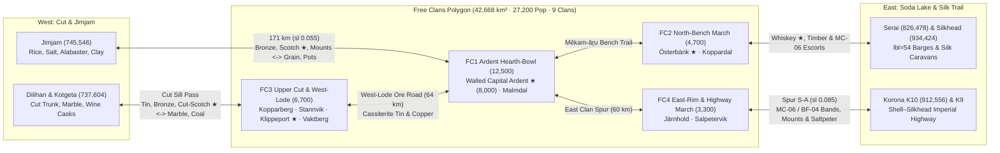

# Free Clans of Ardent — Full Polygon & Nine-Clan Regional Scope (`rmumc5ov15a8k`, `FC1`–`FC4`)

> [!NOTE]
> **Status (`2026-11-27`):** **`[LOCKED]`** — Complete polygon-wide scope for the **Free Clans of Ardent** (`rmumc5ov15a8k`, `41,844 km²` + `824 km²` Upper Cut Sill = **`42,668 km²`**, `100%` dry upland valleys & rim benches; **`27,200` single-counted headcount**, `ΔPop = 0` with [CONTINENTAL-SCOPE.md](file:///home/antigravity/traviso761-debug/krator-master/core/region/CONTINENTAL-SCOPE.md) & [PROPOSAL-ARDENT-JIMJAM.md](file:///home/antigravity/traviso761-debug/krator-master/core/simulation/PROPOSAL-ARDENT-JIMJAM.md)). Companion 3D capital build: [`settlements/ardent/`](file:///home/antigravity/traviso761-debug/krator-master/settlements/ardent/PLAN.md) (`kits/highlands/src/82-rus-baronial.js`).

---

## 1. Polygon Geometry, Relief & Geopolitical Position (`rmumc5ov15a8k`)

On Scale Model 5.1 (`1821 × 1723`, `2,000 m/px`, `4 km²/px`), `Free Clans` (`rmumc5ov15a8k`) is a compact, four-pronged highland confederacy (`10,461` raster cells = `41,844 km²`, bounding box `X = 745..897` [`304 km` E–W] × `Y = 474..643` [`338 km` N–S], plus `824 km²` of the contiguous northern `the cut` sill around `Klippeport` `744, 596` = **`42,668 km²`** total):

- **17 Polygon Vertices (`51-region-store.js`):** `[745, 586] -> [762, 610] -> [773, 643] -> [829, 621] -> [874, 620] -> [897, 593] -> [887, 566] -> [859, 557] -> [875, 482] -> [868, 474] -> [860, 487] -> [839, 546] -> [813, 565] -> [797, 553] -> [793, 526] -> [783, 551] -> [769, 579]`.
- **Hypsometry & Air Pressure:** `min +1,161 m` (`+818 m` at `Klippeport` Cut Sill), `p10 +2,524 m`, **`median +3,969 m` (`0.97 atm`)**, `p90 +5,195 m`, `max +6,525 m` (`0.71 atm`). Sheltered `Cfa` / `Dfb` river bowls (`+818..+3,088 m`, `1,800–2,400 mm/yr`) alternate with cool `BSk` / `Dsb` horse-pasture & saltpeter benches (`FC4`) and alpine `ET` beacon crests (`Vaktberg` `+4,250 m`).
- **Strategic Hinge:** With the deep hyperjungle south of the scarp locked down by **`Hexahedron`'s `14,000–28,750` Screamer swarm** (`817, 670`, `-1,243 m`, `1.87 atm`) and coastal `Port Visas` ruined, the Free Clans command the **upland land-bridge** linking `Dilihan` & `The Cut` in the west to `Jimjam`, `Serai` (`lbl=54` Soda-Lake barges), and the **`Shell -> Silkhead` Imperial Highway** (`Korona` `K9`/`K10`) in the east.

*(★ = Seats of the **Three Chartered Clan-Seat Great Whiskey & Single-Malt Scotch Distilleries**.)*

---

## 2. Four Valley Provinces (`FC1`–`FC4`) & Complete Nine-Clan Seat Ledger

The **Clanthing (*Klan-Tinget*)** at `Ardent` unites **nine Hajlandsk clans** — former highland reivers (*Rajvrar*) who swore the **Peace of the Nine Stones (*Najn-Stajn Fredet*)** around the Bronze Oath-Anvil, outlawing raids against hearth-neighbours and channeling their martial pride into **foreign mercenary free-companies (`MC-06`)**. Every youth must ride **two foreign seasons** before speaking at the Clanthing or raising a stone *koshki* peel-tower (*čip*).

### 2.1 Provincial Breakdown (`42,668 km²`, `27,200` Single-Counted Headcount)

| Province | Polygon Arm & Coordinates | Dry `km²` | `farm` / `past` / `timb` (`km²`) | Key Lodes (`GoodY` / `Max`) | Named Seats & Works | Rural Crofts | **Total Pop** |
|---|---|---:|---:|---|---:|---:|---:|
| **`FC1` Ardent Hearth-Bowl** | Central `Mēkam-āṟu` headwater bowl (`X=813..859, Y=546..580`, `+2,480..+3,903 m`, `Cfa` `2,055 mm`) | `6,380` | `1,825` / `2,715` / `1,235` | `copper` (`mx 120`), `tin` (`mx 200` 13 km W), `iron` (`196`), `saltpeter` (`90`), `emerald` (`mx 170`), `wood=255` | **`Ardent`** (`8,000`), **`Malmdal`** (`650`) | `3,850` (`~12` glens) | **`12,500`** |
| **`FC2` North-Bench & `Mēkam-āṟu` March** | Northern finger toward `Dam 2` / `Serai` (`X=839..875, Y=474..546`, `+1,804..+2,328 m`, `Cfa` `2,102 mm`) | `3,396` | `1,634` / `1,755` / `1,315` | `copper` (`mx 120` at `870,476`), `saltpeter` (`19`), `iron` (`aY 48`), `wood=255` | **`Österbänk`** (`850`), **`Koppardal`** (`600`) | `3,250` (`~10` benches) | **`4,700`** |
| **`FC3` Upper Cut, West-Lode & Screamer-Rim** | NW ore horn (`793,526`), SW Cut Sill (`744,596`, `+818 m`), & S alpine wall (`773,643..829,621`, `+4,250 m`) | `21,100` | `2,555` / `5,037` / `2,372` | **`iron` `1,000.5` (`mx 255`)**, **`tin` `39.5` (`mx 200`)**, **`saltpeter` `506`**, `nickel` `29.5`, `gold` `14`, `silver` `9.5`, `copper` (`mx 130`) | **`Kopparberg`** (`900`), **`Klippeport`** (`700`), **`Stannvik`** (`550`), **`Vaktberg`** (`350`) | `4,200` (`~14` steadings) | **`6,700`** |
| **`FC4` East-Rim Saltpeter & Silk-Trail March** | Eastern semi-arid spur to `(897,593)` beside `Korona` `K9`/`K10` (`+2,460..+3,636 m`, `BSk`/`Dfb`) | `11,792` | `825` / `2,580` / `39` | **`saltpeter` `363.5` (`mx 190`)**, **`iron` `308.5` (`mx 180`)**, `copper` `aY 31.5`, `gold` `aY 26.5`, `tin` `aY 21` | **`Järnhold`** (`600`), **`Salpetervik`** (`450`) | `2,250` (`~8` horse-glens) | **`3,300`** |
| **TOTAL — `Free Clans` (`9` Clans)** | `rmumc5ov15a8k` + Upper Cut Sill | **`42,668`** | `6,839` / `12,087` / `4,961` | Zero `coal` (`0`), zero `clay>=100` (`mx 60`), zero `marble` | **`8,000` + `5,650`** (`9` named sites) | **`13,550`** (`~44` hamlets) | **`27,200`** |

### 2.2 Complete Atlas of All Nine Clans & Every Named Site in the Polygon

While **Ardent** (`830, 553`) is a **compact, high-density walled mountain capital** (`500 × 500 m = 250,000 m²` granite curtain-wall circuit enclosing `8 × 8` `KCITY` wards of `3.0–5.8 m` narrow cobbled wynds, courtyard closes, 5 cobbled squares including the **Grand Capital Quadruple-Pagoda Scotch Distillery**, and the Upper Thing-Crag Citadel where all 9 Clans keep a *koshki* tower), the **eight secondary towns/works across `FC1–FC4`** are un-walled Baronial-Caucasus & Carpathian log clan-seats defended by standalone Svaneti-style *koshki* peel-towers (*čipar*):

| # | Clan (*Hajlandsk*) | Crest & Motto Role | Valley | Primary Seat / Works (`px, py`, Elev, Slope) | Seat Pop (Clan Total) | Architectural & Economic Role in Polygon |
|---:|---|---|---|---|---:|---|
| 1 | **Čin Bjelsmidt** (*Bell-Smith*) | Bronze Bell & Crossed Hammers | `FC1` | **Ardent North-Burn Foundry Ward** `(830, 553, +2,802 m)` | *(in Ardent `8,000`; `2,800` clan)* | Master bronze-founders: reverberatory charcoal/peat cupolas casting Clanthing bells, mountain field-guns, bucklers, and **copper/bronze pot-stills** for the Capital & Clan-Seat distilleries. |
| 2 | **Čin Hjartstajn** ★ (*Hearth-Stone*) | Crowned Fir & Crow-Stepped Gable | `FC1` | **Ardent Burgh & Hearth-Glen** `(830, 553, +2,802 m, sl=0.052)` | *(in Ardent `8,000`; `5,200` clan)* | Keepers of the Burgh Peace, Tolbooth Dueling Ring, juniper/sky-poppy apothecaries (`hl_rus_apothecary`), and **1st Chartered Clan-Seat Great Distillery (*Hjart-Bränneriet*: Ardent Hearth-Peat Single-Malt Scotch)**. |
| 3 | **Čin Torgo-Vulf** (*Market-Wolf*) | Leaping Wolf & Balance | `FC1` | **`Malmdal`** `(825, 561, +3,088 m, sl=0.040)` | `650` *(`4,500` clan)* | Sheltered `farm=0.88` upper hearth-glen `18 km` SW of Ardent; Silk-Trail brocade factors (`pc_torgo_couture`), bronze-hoop whisky cooperages (`hl_rus_cooperage`), clan tartan dyeworks (`hl_rus_plaid_dyer`), & pack-mule breeders. |
| 4 | **Čin Sjelk-Vač** ★ (*Silk-Watch*) | Spindle & Crossed Lances | `FC2` | **`Österbänk`** `(858, 497, +2,203 m, sl=0.002)` | `850` *(`2,750` clan)* | Warmest, flattest agricultural shelf in the polity (`farm=0.89`, `2,102 mm/yr`); Silk-Trail caravan outriders & **2nd Chartered Clan-Seat Great Distillery (*Öster-Bränneriet*: Caravan-Cask Gold Whiskey)**. |
| 5 | **Čin Kopardal** (*Copper-Dale*) | Boar's Head & Verdigris Shield | `FC2` | **`Koppardal`** `(870, 476, +1,804 m, sl=0.040)` | `600` *(`1,950` clan)* | Northern tip of the polygon (`copper:120`, `wood:255`) overlooking `Dam 2` and `Serai` (`826, 478`); mines malachite copper & rafts heavy fir/larch timber. |
| 6 | **Čin Klip-Čip** ★ (*Cliff-Keep*) | Peel-Tower & Pickaxe | `FC3` | **`Klippeport`** `(744, 596, +818 m, sl=0.041)` + **`Kopparberg`** `(798, 554, +2,705 m, 900)` + **`Stannvik`** `(804, 558, +2,677 m, 550)` | `700` + `1,450` works *(`4,400` clan)* | Holds the western mineral heartland (`Kopparberg` `copper:130 + tin:200 + iron:255`; `Stannvik` `tin:200 + gold/silver:110`) AND the warm `+818 m` North Cut Sill toll-town `Klippeport`, seat of the **3rd Chartered Clan-Seat Great Distillery (*Klippe-Bränneriet*: Cut-Glen Smoked-Oak Scotch)**. |
| 7 | **Čin Fajr-Vakt** (*Fire-Watch*) | Blazing Cresset & Stag Antlers | `FC3` | **`Vaktberg`** `(816, 616, +4,250 m, sl=0.011)` | `350` *(`2,300` clan)* | Alpine cliff-edge watch-fort & signal-cresset line along the `+3,900..+4,500 m` southern rim, barring `Hexahedron`'s `14,000–28,750` lowland Screamers from climbing into the glens. |
| 8 | **Čin Jern-Hors** (*Iron-Horse*) | Rearing Charger & Bronze Gun-Wheel | `FC4` | **`Järnhold`** `(860, 562, +2,989 m, sl=0.006)` | `600` *(`1,850` clan)* | Wide `BSk` upland steppe-bench (`2,580 km²` `past-eq`, `iron:180`) on **Spur S-A (`Ardent -> K10`)**; breeds hardy highland mounts (`#3` on map, `hl_rus_caravan_stables`) & pulls wheeled bronze mountain-gun limbers. |
| 9 | **Čin Rjet-Kling** (*Red-Blade*) | Curved *Čindžal* & Saltpeter Star | `FC4` | **`Salpetervik`** `(866, 526, +2,460 m, sl=0.034)` | `450` *(`1,450` clan)* | Leaches `saltpeter:190` crusts in non-sparking bronze-mortar powder mills (`#4` on map, `hl_rus_saltpeter_mill`); stages `MC-06` Silk-Trail escorts toward `Silkhead`/`Ham-Tsek` — and is first to "turn the bronze disc" into `BF-04` *Brøkn-Čin* highwaymen when retainers default. |

---

## 3. Capital Quadruple-Pagoda Distillery & Three Chartered Clan-Seat Great Distilleries (*Stør-Bränneriar*)

Alongside **cast tin-bronze** (`copper + tin`), **chartered Silk-Trail mercenary service (`MC-06`)**, **highland mounts (`#3` on map)**, **saltpeter (`#4`)**, and **juniper/sky-poppy botanicals (`#1`/`#4`)**, **Free Clans Single-Malt Scotch & Highland Whiskey (`~460 t/yr` export)** is one of the polity's signature exports across the northern continent (replacing Gemini's non-canonical `sugar`/`rum` on northern trunk roads; `PROPOSAL-ARDENT-JIMJAM.md` §5.2).

Why Free Clans spirits command a continental premium:
1. **Native Metallurgy Advantage:** Because `FC1–FC3` mine rich `copper` (`120–130`) and `cassiterite tin` (`200`) with **zero sulfurous mineral coal**, `Čin Bjelsmidt` coppersmiths hammer giant thin-walled **onion-bulb copper pot stills with cast-bronze swan-neck lyne arms and spirit safes**, stripping heavy fusel oils cleanly over sweet upland heather-peat and birch charcoal.
2. **Clay-Deficit Cask Culture (`CONTINENTAL-SCOPE.md` Tier C, `clay max = 60`):** Lacking ceramic amphorae, Free-Clan cooperages (`hl_rus_cooperage`) bend steamed highland oak/larch staves in cast-bronze hoops and char hogsheads over open fire, supplemented by **back-hauled foreign wine/mulberry casks** from `Dilihan`, `Eternal State`, and `Silkhead` inside vaulted Caucasus-style *marani* stone cellars.
3. **The Capital Quadruple-Pagoda Distillery + Three Clan-Seat Twin-Pagoda Charters:** Inside Ardent's western Maltings Garth stands the **Clanthing Capital Quadruple-Pagoda Scotch Distillery & Bonded Spirit Customs Vault** (`hl_rus_capital_distillery`, *Ardent Stør-Bränneriet*), where the Law-Speaker's gaugers blend and seal the **Nine-Stave Sovereign Reserve** (`~80 t/yr`) and stamp export hogsheads. Across the four provinces, **three Clan Seats** hold the Clanthing's **Twin-Pagoda Export Charter** (`hl_rus_great_distillery` — each represented both at its home valley seat AND by a monumental bonded twin-pagoda distillery-and-cellar compound beside its Clan *Koshki* Keep on Ardent's Thing-Crag Citadel):

| Chartered House | Owning Clan / Authority & Seat | Grain, Fuel & Springwater Terroir | Cask Maturation & Style | Primary Export Corridor (`~460 t/yr` Total) |
|---|---|---|---|---|
| **0. *Ardent Stør-Bränneriet*** (`ar.capital_distillery`) | **Clanthing Spirit Customs** (Walled Capital Maltings Garth, `830, 553`) | Quadruple-pagoda floor maltings (`frostoat` + 6-row highland barley over heather-peat & juniper smoke); 4-still copper hall + bonded excise vault | Married across all 9 Clans' charred oak/larch butts -> ***Nine-Stave Sovereign Single-Malt Scotch*** (`~80 t/yr` + customs stamp) | Diplomatic casks to **`Dilihan`**, **`Serai`**, **`Jimjam`**, & Silk-Trail Free-Company oath-chests |
| **1. *Hjart-Bränneriet*** (`ar.clan_distillery.1`) | **Čin Hjartstajn** (`FC1` `Ardent` Bowl, `830, 553`, `+2,802 m`) | Rain-fed `frostoat` & 6-row highland barley malted over **thick upland heather-peat** (`hTurfB`); soft granite snowmelt from `Ardent Burn` (`Mēkam-āṟu` headwater) | Charred highland larch/oak hogsheads -> ***Ardent Hearth-Peat Single-Malt Scotch*** (smoky, medicinal, amber-gold; traditional oath-dram at the Tolbooth) | **`Ardent -> Jimjam` (`171 km`)** & **`Ardent -> Roketstad / Iron Republic`** (traded for winter `rice`/`grain`, `salt`, & `Jimjam` pottery/glass) |
| **2. *Öster-Bränneriet*** (`ar.clan_distillery.3`) | **Čin Sjelk-Vač** (`FC2` `Österbänk`, `858, 497`, `+2,203 m`, `farm=0.89`) | Double-distilled `FC2` `frostoat`, `redstem` & mountain `rowan`/`apricot` mash over clean **sweet birch-heart wood**; snowmelt springs above the `Mēkam-āṟu` gorge | Finished in **back-hauled `Silkhead` mulberry & `Eternian` wine casks** brought home by `MC-06` caravan guards -> ***Österbänk Caravan-Cask Gold Whiskey*** | **`Österbänk -> Serai (`lbl=54` barge) -> Silkhead -> Korona / Spider Lake`** (traded for raw `silk`, `alkali`, & caravan silver) |
| **3. *Klippe-Bränneriet*** (`ar.clan_distillery.5`) | **Čin Klip-Čip** (`FC3` `Klippeport`, `744, 596`, `+818 m` North Cut Sill `Cfa`) | Triple-pot-distilled `FC3` gorge grain & `juniper` botanical cut, kilned over **alder & birch charcoal**; iron-free granite fissure spring at the Cut divide | Aged rapidly in warm `1.44 atm` Cut-gorge rock-cut *marani* vaults in **toasted `Dilihan` wine butts** -> ***Klippeport Smoked-Oak Highland Scotch*** | **`Klippeport -> Kotgeta -> Dilihan -> Tethis / Ys / Iziz`** down **The Cut** (traded for `Dilihan` `marble`, `D4` smithing `coal`, & Ring-Sea spices) |

---

## 4. Internal Road Network, External Corridors & `MC-06 <-> BF-04` Simulation Rules

| Route ID | Trace Across Polygon (`px, py`) | Dist / Max Slope | Role & Seasonal Hazards |
|---|---|---|---|
| **R1 — West-Lode & Cut Trunk** | `Ardent (830,553) -> Malmdal (825,561) -> Stannvik (804,558) -> Kopparberg (798,554) -> Klippeport (744,596) -> Kotgeta (737,604)` | `212 km` (`sl <= 0.068`) | Main mineral & southbound scotch/bronze artery; hauls `Kopparberg`/`Stannvik` `tin:200` + `copper:130` east to Ardent's foundries and `bronze` + *Klippeport* scotch south into `Dilihan`. |
| **R2 — Jimjam Scarp Road** | `Ardent (830,553) -> Kopparberg (798,554) -> Jimjam (745,546)` | `171 km` (`sl = 0.055`) | Primary bulk food-for-metals/scotch lifeline (`Jimjam` `rice`/`grain`, `salt`, `alabaster`, `brick`/`cookpots` <-> Free Clans `bronze`, *Hearth-Peat Scotch*, `mounts`, `wool`). |
| **R3 — North-Bench `Serai` Descent** | `Ardent (830,553) -> Österbänk (858,497) -> Koppardal (870,476) -> Serai (826,478)` | `158 km` (`sl = 0.068`) | Connects `FC1`/`FC2` timber, copper, *Österbänk Gold Whiskey*, and `MC-06` caravan escorts to `Serai`'s Soda-Lake (`lbl=54`) barge wharves for `Silkhead`. |
| **R4 — Spur S-A (`Silk-Trail` Bypass)** | `Ardent (830,553) -> Järnhold (860,562) -> Salpetervik (866,526) -> Korona K10 (912,556)` | `164 km` (`sl = 0.085`, `0` wet) | Smooth `FC4` upland wagon bypass around both `Hexahedron` Screamers and the broken `0.403` `Bitir -> K9` scarp onto the **`Shell -> Silkhead` Imperial Highway**. |
| **R5 — Southern Screamer-Watch Crest** | `Klippeport (744,596) -> Vaktberg (816,616, +4,250 m) -> Järnhold (860,562)` | `245 km` (`pack-only`) | High alpine patrol & peat-beacon trail manned by `Čin Fajr-Vakt`; zero merchant traffic south toward `Hexahedron` (`817, 670`). |

### Scale-Model Hygiene Rules Queued for the Next All-Builds / Scale-Model Pass
1. **Polygon Priority (`rmumc5ov15a8k` vs `Jimjam` / `dam 2`):** Above the `+1,500 m` highland scarp (`X=818..874, Y=474..564`), `Free Clans` (`rmumc5ov15a8k`) takes strict priority over overlapping `Jimjam` (`716 km²`) and `dam 2` (`376 km²`) vertices.
2. **Pin Reconciliation (`Ardent` `830, 553` vs `5.1e23` `819, 552`):** `settlements/ardent/` bakes `(830, 553, +2,801.9 m)` (`Mēkam-āṟu` headwater bowl), while `5.1e23` snapped the regional river-pin `22 km` WNW down-glen to `(819, 552)` on mainstem `r024` `Mēkam-āṟu` (`Q = 16.8 m³/s`); both lie inside `FC1` (`Ardent Hearth-Bowl`) with identical `Cfa` climate and `copper` + `tin` access.
