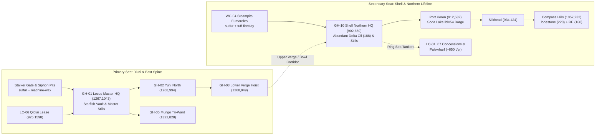

# Geomancer Technate: Continental Oil, Rare-Earth, Strategic Mineral & Deep-Bore Scope (`2026-11-22`)

> [!NOTE]
> **Status: `[APPROVED — RULINGS #19, #30, #44–47, #50, #70, #82]` — Companion Scope to [CONTINENTAL-SCOPE.md](file:///home/antigravity/traviso761-debug/krator-master/core/region/CONTINENTAL-SCOPE.md).**
> All coordinates `(px, py)`, elevations `E` (`m ASL`), atmospheric pressures `p = 1.6·exp(-E/8000) atm`, prospectivity bytes (`0–255`), and `RES_ORE` node grades are verified directly against Scale Model `5.1` (`1821 × 1723`, `2 km/px`), [geology.json](file:///home/antigravity/traviso761-debug/krator-master/kits/resources/data/geology.json) (`911 × 862`, `4 km/cell`), [lodes.json](file:///home/antigravity/traviso761-debug/krator-master/kits/resources/data/lodes.json), [geology.py](file:///home/antigravity/traviso761-debug/krator-master/tools/scale-model/geology.py), and [geomancer_sites_map.html](file:///home/antigravity/.gemini/jetski/brain/v1/default/jetski_remote_agents_3p/2cc633ac-367f-4e4f-810d-7efa147d63ef/geomancer_sites_map.html).

---

## 1. `[G data]` Dual-HQ Architecture, Geology & Cartel Deterrence Contract

### 1.1 Primary Seat (`Locus`) & Secondary Northern HQ (`Shell` — `Ruling #82`)
- **Primary Technate HQ — `Locus` Master Dome (`1267, 1043`, `Yuni Emirate`):** Houses the `Starfish` rotary carbide drill-string vault, master fractional cracking stills, and `fireclay` retort works (`lode:locus-oil`, `oil: 200`), linked via `Yuni North` (`1268, 994`, `oil: 145`) and the **`856 m` `Lower Verge` (`1268, 949`) `naphtha`-winched drum cableway** to eastern and southern continental markets.
- **Secondary Northern Technate HQ — `Shell` (`902, 659`, `Shell Province`, `Ruling #82`):**
  - **Abundant Coastal & Delta Petroleum (`lode:shell-oil` at `902, 665`, `r = 20 km`, `oil: 188` `high`):** Anchored on `Shell`'s prolific sedimentary delta and coastal plain (`coal: 183` + `clay: 255` -> domestic `fireclay` retorts, `RE: 160` `high`, plus nearby `Steampits` `VENT#04–09` `sulfur: 255` for `H2SO4` acid-washing). Because frontier `Shell Province` planters and debt-peonage oligarchs (`Ruling #78`) lack metropolitan Imperial Forgemaster guilds, `Shell` grants the Geomancers a fortified, semi-sovereign **Northern Seat (`~320` Technate engineers, drillers & guards)** with rotary bit-redressing shops, cracking stills, and coastal tank-wharves (`Port Goto` `920, 703`).
  - **The Northern Lifeline (`Shell` -> `Port Koron` -> `Silkhead` -> `Compass Hills`):** `Shell` gives the Technate a survivable **northern lifeline independent of `Yuni` and the `Ring Sea` core**: distillates and carbide rigs haul overland to **`Port Koron` (`912, 532`, `-42 m`)**, ship `220 km` flatwater up the dredged Soda Lake (`lbl=54`) trough to **`Silkhead` (`934, 424`, `+12 m`)**, and strike into the **`Compass Hills` (`c=1057, 232`, `lodestone: 220`, `RE: 160`, `oil: 38`)** for **`lodestone` (`magnetite` survey compasses & dynamo cores)**, northern `rare-earth`s, `spider-silk` (`Ham-Tsek` `1055, 219`), and northern exterior delta expeditions!

### 1.2 Resource Mechanics, Separation Monopolies & Cartel Deterrence
- **Drilling & Refining Chain (`kits/locus` + `kits/resources`):**
  - `oil` (`item: 'crude_oil'`, `works: 'derrick'`, `ind_pumpjack` from `kits/locus`): Fractional cracking in `fireclay`-lined retorts yields **`45%` `kerosene`**, **`25%` `naphtha`** (light engine/winch fuel & solvent), **`20%` `bitumen`** (hull caulking & road binder), and **`10%` mineral `lubricant`**.
  - **Shallow vs. Deep Drilling Split (`Ruling #44`):** **Imperial Forgemasters** (and Vothic/Eternian colliers) can sink shallow cable-tool wells (`<= 120 m`) into surface seeps, but **only the Geomancers (`Locus` & `Shell` HQs) possess pre-Cataclysm `Starfish` rotary carbide drill-strings, blowout preventers, and high-temperature `fireclay` cracking retorts** required for deep high-pressure reservoirs (`> 150 m`), river-delta turbidites, and sub-salt diapirs.
  - **`rare-earth` Acid Leaching (`H2SO4` + Stoneware Carboys):** `rare-earth` (`item: 'rare_earth_ore'`, `6 km` cell) peaks on `rift` (`190`), `granite` (`160`), `crystalline` (`100`), and `impact` (`60`). Only four factions possess separation chemistry: **(1) `Geomancers`** (`<= 200 km` of `Yuni` + `Shell` HQ + licensed `Region 87`), **(2) `Eternal State`** (`Fulcrum`), **(3) `Tungangs`** (`<= 5 km` of `Rift Line` bores), and **(4) `Order of Historians`** (optical/laboratory batches).
  - **`machine-wax` Monopoly (`82.1%` Continental Share):** Rendered from `woolly_siphon` harvests over geothermal sulfur steam vents at **`Siphon Pits` (`Pit-Head 04`, `1687, 1555`)**.
- **Trans-National Cartel Deterrence (`Ruling #70`):**
  - If a host polity seizes a licensed Geomancer compound or defaults on its charter (`Standard Charter: 10% Host Royalty, 20% Local Fuel Discount, 90% Net Export Remittance`), **both `Locus` and `Shell` HQs** trigger a **cartel-wide `kerosene`/`naphtha`/`fireclay-retort`/`machine-wax` embargo**; unserviced deep wells decay by **`-15%` output/month** (`blowout` / `seal-rot`) without `Starfish` replacement bits and stoneware seals.

---

## 2. Category A — Primary & Secondary HQs, Heartland & Treaty Wards (`GH-01` – `GH-10`)

| ID | Pocket / Site Name | `(px, py)` | Elev & `atm` | Region / Polity | Resource Bytes (`max <=30 km`) & Grade | Political & Industrial Role (`[G data]`) |
|---|---|---:|---|---|---|...|
| **GH-01** | **`Locus` Master Dome & `Starfish` Archive *(Primary HQ)*** | `(1267, 1043)` | `-1,549 m` bench (`1.94 atm`; `-2,403 m` foot) | `Yuni Emirate` (`Y2`) | **`oil: 200` (`high`, `lode:locus-oil`)**, `coal: 182` + `clay: 255` (`fireclay`), `RE: 160` (`high`), `nitre: 165` | **Primary Technate HQ (`2,650` pop):** Master `Starfish` carbide drill-string vault, fractional cracking stills, `crucible-works` (`fireclay` retorts); remits annual Emirate Tribute to `Yuni`, balanced politically by the *Aʿyān* `Yuni Merchants' Guild` (`Ruling #47`). |
| **GH-10** | **`Shell` Northern Technate HQ & Delta Refinery *(Secondary HQ)*** | `(902, 659)` & `(902, 665)` | `-1,240 m` (`1.87 atm`; delta `-1,460 m`) | `Shell Province` (`Iziz` Frontier Charter, **Ruling #82**) | **`oil: 188` (`high`, `lode:shell-oil`)**, `coal: 183` + `clay: 255` (`fireclay`), **`RE: 160` (`high`)**, `bitumen: 120` | **Secondary Technate HQ (`~320` in `Shell`, Ruling #82):** Walled northern refinery, bit-redressing depot & coastal tank farm (`Port Goto` `920,703`); anchors the **Northern Lifeline (`Port Koron` `912,532` -> `lbl=54` -> `Silkhead` `934,424` -> `Compass Hills` `lodestone: 220` / `RE: 160`)** and stages Ring Sea / northern delta rigs! |
| **GH-02** | **`Yuni North` (`Bruk Loña` Oil & Underclay Patch)** | `(1268, 994)` | `-1,887 m` (`2.03 atm`) | `Yuni Emirate` (`Y2`) | **`oil: 145` (`high`, `lode:yuni-north-oil`)**, `bitumen: 76`, `coal: 184`, `clay: 255` (`fireclay`), `silica: 150` | **Direct Geomancer Satellite (`350` crew, Ruling #46):** `49 km` N of `Locus`, `45 km` S of `Verge`; halves barrel haul to the `Verge` hoist and co-fires coking/retort ovens. |
| **GH-03** | **`Lower Verge` Hoist, Coal & `Rare-Earth` Bench** | `(1268, 949)` | `-1,685 m` (`1.98 atm`) | `Yuni Emirate` (`Y2`, below Iziz `Upper Verge`) | `coal: 199`, `clay: 255` (`fireclay`), **`RE: 160` (`high`)**, `nitre: 165`, `oil: 50` | **Emirate Terminus (`4,800` pop, Ruling #45):** Operates the **`856 m` `naphtha`-winched oil-barrel drum cableway** up to Imperial `Upper Verge` (`-1,094 m`). |
| **GH-04** | **`Yuni` (`Grand Vault` Geothermal & Granite `RE`)** | `(1263, 1089)` | `+636 m` (`1.48 atm`) | `Yuni Emirate` (`Y1`) | **Deep Geothermal (`Grand Vault`) + Artesian `qanat`s**, **`RE: 160` (`high`)**, `clay: 236` + `granite` (`fireclay`), `coal: 120` | **Dual-Order Capital (`20,000` valley / `11,500` city):** *Aʿyān* `Yuni Merchants' Guild` + Geomancer Cloisters; electrified by the faltering Ancient `Grand Vault` plant; makes acid-proof stoneware carboys & precision brass Burners. |
| **GH-05** | **`Mungo` Tri-Ward Tar-Shale Still & Fuel Depot** | `(1322, 828)` | `-1,433 m` post-lift (`1.91 atm`) | Autonomous `East Abyss` (`A3`) | `coal: 171`, `oil: 61` (tar-shale), `clay: 255` (`fireclay`), **`RE: 160`** (`92 km` E at `1368,824`) | **Autonomous Treaty Chapterhouse (`700` pop, Ruling #46):** Walled `kits/locus` ward (`~85` crew) strips local coal-tar/oil-shale and distributes `Lower Verge` `kerosene` & hull `bitumen` across `A1–A3` (`Liikofi`, `Reed`, `Sfenops`). |
| **GH-06** | **`Stalker Gate` (`Ranger HQ` Fumarole & `RE` Belt)** | `(1420, 1242)` | `+1,982 m` (`1.25 atm`) | `Yuni Emirate` (`Y3`) | **`sulfur: 255` (`high`, `512 km²`, `VENT#86`)**, **`RE: 160` (`high`, `5,680 km²`)**, `nitre: 186` | **Sulfuric-Acid (`H2SO4`) & Garrison Chokepoint (`550` fort):** Mines volcanic `sulfur` essential for `Locus` petroleum refining & `rare-earth` acid-leaching while containing `Hub 01` Stalkers. |
| **GH-07** | **`Loom Chasms` (`Spindle Fan` & `The Sill`)** | `(1561, 1140)` & `(1697, 1028)` | `+2,150 m` / `+243 m` | `Yuni Emirate` (`Y4`) | **`nitre: 177..200` (`high`)**, **`sulfur: 255` (`VENT#87`)**, `halite: 255`, `RE: 160`, `copper: 210` | **Eastern Nitre, Borax & Chasm-Cable Province (`3,800` pop):** Supplies `saltpeter`, borax flux, `copper`, and `spinner-cord` winch cables. |
| **GH-08** | **`Slabfields` (`Darling` & `Siphon-Breach` Maar)** | `(1582, 1341)` | `+2,026 m` (`1.24 atm`) | `Yuni Emirate` (`Y5`) | **`sulfur: 175..255` (`VENT#83/84`)**, `nitre: 133`, **Artesian CO2 Maar** | **Artesian Maar Relay (`3,400` pop):** Confined Stalker-Range basalt aquifer rising through `2,040 m` maar floor (`Ostrukh Riba` headwater). |
| **GH-09** | **`Siphon Pits` (`Pit-Head 04` Thermal Maar)** | `(1687, 1555)` | `+2,277 m` (`1.20 atm`) | `Yuni Emirate` (`Y6`) | **`sulfur: 175..255` (`high`, `VENT#79–82`)**, `nitre: 177`, **Geothermal Steam Cauldrons** | **Continental `machine-wax` Monopoly (`82.1%` share, `450` Siphon-Ropers):** Geothermal sulfur vents heat rendering cauldrons for `woolly_siphon` `machine-wax`. |

---

## 3. Category B — Licensed Foreign Concessions, Northern Lifeline & Advisories (`LC-01` – `LC-09`)

*(Crew headcounts below are counted inside their host spheres in [CONTINENTAL-SCOPE.md](file:///home/antigravity/traviso761-debug/krator-master/core/region/CONTINENTAL-SCOPE.md) §1 — zero census double-counting.)*

| ID | Host Polity & Concession Site | `(px, py)` | Elev & `atm` | Resource Bytes (`max <=30 km`) & Grade | Crew | Concession Terms & Logistics (`[LOCKED]`) |
|---|---|---:|---|---|---:|---|
| **LC-01** | **`Region 87` — `Mav's Refuge` Enclave** | `(1049, 841)` | `-1,463 m` floor / `+380 m` shelf (`1.92 atm`) | **`oil: 173` (`high`)**, `bitumen: 130`, `coal: 211` + `clay: 255` (`fireclay`) | `~95` | **Walled `kits/locus` Refinery `1–3 km` Outside Town (Ruling #30):** `0` electric lamps in Beast Rider canopy; `10%` royalty to Quetzal High Council; **zero rigs allowed on `Girder` (`1039, 869`, `oil=178`)** border zone. |
| **LC-02** | **`Region 87` — `Pinnacle Rock` Oil & E-Spur `RE`** | `(1007, 686)` & `(1021, 685)` | `-1,287 m` (`1.88 atm`) | **`oil: 128` (`med/high`)**, `bitumen: 96`, **`RE: 160` (`high` at `1021,685`)**, `fireclay` | `~70` | **Dual Oil + `Rare-Earth` Compound (Ruling #30):** Serviced directly from nearby **`Shell` HQ (`GH-10`)**; pays Wingclaw town in forged steel, salt & cloth; ships lamp-oil to `Wāḥat al-Shamal` (`1165, 652`). |
| **LC-03** | **`Region 87` — `Fort Kreia` & `R1` Littoral `RE`** | `(1045, 745)` & `(963, 656)` | `+1,059 m` / `-1,380 m` | **`RE: 160` (`high`, `5,376 + 1,968 km²` granite belts, `29` `high` nodes)** | `~65` | **Licensed `Rare-Earth` Leaching Yards (Ruling #30):** Lined with `R87` stoneware clay (`25 km` haul); coasters lift coastal `R1` concentrate to `Shell` HQ & `Lower Verge`. |
| **LC-04** | **`Kingdom of Voth` — Northwest Bay Derrick Enclave** | `(726, 1003)` | `-1,115 m` (`1.84 atm`) | **`oil: 130` (`med/high`, `2,864 km²`)**, `bitumen: 98`, `coal: 215` + `clay: 255` (`fireclay`) | `~85` | **Licensed Voth Enclave `28 km` NW of `Voth` (Ruling #19):** Permitted despite Ordinator ban on History Monks! Pays `10%` silver royalty to Royal Exchequer + `20%` discount for Vothic defenses & `Drum` crucible/smelter fuel. |
| **LC-05** | **`Empire of Iziz` — `Fridon`, `Atton` & `Vaklu` Deep Wells** | `(1027, 931)`, `(1008, 972)`, `(990, 908)` | `-1,196` to `-1,525 m` (`1.86–1.94 atm`) | **`oil: 168` (`Fridon`), `140` (`Atton`), `133` (`Vaklu`)** (`high`), `bitumen: 126`, `fireclay` | `~110` | **Two-Tier Imperial Split (Ruling #44):** **Imperial Forgemasters** pump shallow seeps at `Iziz` (`oil=182`), `Port Tobin` (`154`), `Porta Marr` (`120`) & `Talia` (`116`); **Geomancers** drill deep high-pressure wells at `Fridon`/`Atton`/`Vaklu`. |
| **LC-06** | **`Xanadu Sultanate` — `Qiblai` Basin Oil Lease** | `(925, 1598)` | `-1,860 m` (`2.02 atm`) | **`oil: 110` (`medium`)**, `bitumen: 82`, *(unworked `RE: 190`)*, `clay: 230` | `~100` | **Sultanate Charter (`xan-tune.js`):** `400 t/yr` pumped; `20%` Sultan + `10%` Prismatic Council (`1.25%` to History Monks' `qb.order`); `~300 t/yr` tank-wagoned across the Catch to `Locus`. |
| **LC-07** | **`Eternal State` — `Palewharf` Depot & `Black-Seam` Advisory** | `(565, 604)` & `(416, 782)` | `+607 m` / `+53 m` (`1.48 / 1.59 atm`) | `Black-Seam`: **`oil: 108` (`medium`)**, `bitumen: 81`, `coal: 168` + `clay: 255` (`fireclay`) | `~30` | **Electrification Supplement (Ruling #50):** Eternia's `Fulcrum` imports **`~650 t/yr` refined Geomancer distillates** (split between `Shell` HQ over `Jimjam` / `Lake lbl=77` to `Palewharf` and `Upper Verge` caravans) + pumps **`~80 t/yr`** at `Black-Seam Colliery`. |
| **LC-08** | **`The Catch` — `Lasso` & `Kolli` Deep Artesian Wells** | `(1083, 1474)` & `(1058, 1367)` | `+1,509 m` / `+1,446 m` (`1.32–1.34 atm`) | **Deep Confined Lava-Tube / Fault Aquifers (`cav_lasso_spring`)**, `nitre: 200..240`, `RE: 160` | `~25` | **Geomancer Carbide Water-Bores (`catch-tune.js`):** Rotary-drilled deep wells sustaining `caravan.geomancer` & `yuniguild` tank trains across the waterless Catch alongside `Ṣalṭ al-Bān` (`1080,1428`). |
| **LC-09** | **`Compass Hills` Magnetite & `RE` Factor (`Silkhead` Lifeline)** | `(934, 424)` -> `(1057, 232)` | `+12 m` -> `+1,850 m` (`1.59 -> 1.27 atm`) | `Korona` Safe-Conduct League / `Compass Hills` (**Ruling #82**) | **`lodestone: 220` (`high`)**, **`RE: 160` (`high`)**, `oil: 38` (seeps), `spider-silk` (`1055,219`) | **Northern Lifeline Depot (`Shell` `GH-10` -> `Port Koron` `912,532` -> `lbl=54` -> `Silkhead` `934,424`):** Trades `Shell` `kerosene` & steel bits for `Compass Hills` **`lodestone`** (surveyor compasses & generator magnets) and northern `rare-earth` concentrates. |

---

## 4. Category C — Wild-Cat Prospector Pockets & Delta Exploration Claims (`WC-01` – `WC-12`)

Modeled at game start as mobile `KCAMP` `geomancer_wildcat` survey/drilling rigs (`15–40` prospectors + mule/crawler rig) contesting river deltas, sub-salt diapirs, and frontier basins — **every one of which can be promoted into a permanent chartered settlement via Player Intervention (§5, `Ruling #82`)**:

| ID | Wild-Cat / Delta Claim | `(px, py)` | Elev & `atm` | Region / Staging HQ | Verified Geology (`geology.json` / `vents.json`) | Contestation, Geological Trap & Charter Quest Hook |
|---|---|---:|---|---|---|---|
| **WC-01** | **`Solta` Salt-Dome & `Shatt` Inland Delta** *(Delta Quest)* | `(1124, 1166)` & `(1147, 1141)` | `-841` to `-1,079 m` (`1.78–1.83 atm`) | `Unclaimed` Bowl / `Jabal` *(staged from `Lower Verge`)* | **`oil: 91` (`352 km²`)** + `3,129 km²` `basin:3` salt-dome (`halite: 234`, `clay: 255`, `coal: 141`) | **#1 Inland Delta & Salt-Dome Target:** Evaporite diapir trap under `Solta` margin; player brokers a tripartite charter between Geomancers, `Mantis` guilds (`Getmastarz`/`Goldanda`), and the `Train of Jabal`. |
| **WC-02** | **`Godsgate` (`Bab al-Hawa`) & `Parabola` Granite `RE` Saddle** | `(1028, 1246)` & `(1004, 1196)` | `+4,072 m` / `+3,670 m` (`0.96–1.01 atm`) | `Unclaimed` SE Outer Wall *(staged from `Locus`)* | **`RE: 160` (`high`, `19,440 km²` combined)**, `nitre: 177`, `tin: 200` | Lies `>200 km` outside Yuni's legal `RE` radius; wildcatters disguised as Catch well-crews leach monazite/xenotime beside Imperial `Parabola` (`970,1186`). |
| **WC-03** | **`Cut` / `Visas` River-Delta Shelf** *(Delta Quest)* | `(816, 706)` & `(800, 712)` | `-1,413` to `-1,358 m` (`1.90–1.91 atm`) | `Screamer` / `Dilihan` seam *(staged from `Shell` HQ)* | **`oil: 148` (`high`, `7,632 km²`)**, `coal: 195`, `clay: 255` | **#2 Coastal River-Delta Target:** Jack-up delta barges `30 km` E of `Dilihan`'s `Port Visas` (`800,712`); clearing `Hexahedron` (`817,670`) Screamer raids unlocks a permanent fortified delta boomtown! |
| **WC-04** | **`Shell`–`Steampits` Fumarole Delta Littoral** *(Delta Quest)* | `(888, 694)` & `(874, 722)` | `-1,375` to `-1,422 m` (`1.90–1.91 atm`) | `Shell` / Pirate seam *(staged from `Shell` HQ `902,659`)* | **`oil: 133..188`** (`lode:shell-oil` fringe), **`sulfur: 255`** (`VENT#04–09`), **`tuff-fireclay: 230`** | **Immediate `Shell` HQ Expansion Hook:** Unpoliced fumarole delta west of `Port Goto` (`920,703`); securing it unites `Shell` crude with domestic volcanic `sulfur` (`H2SO4`) & `tuff-fireclay`! |
| **WC-05** | **`Cut Salt Lake` Endorheic Diapir (`Dilihan` `D2`)** | `(729, 632)` & `(749, 652)` | `-1,900` to `-1,809 m` (`2.01–2.03 atm`) | `Dilihan Province` *(staged from `Shell` HQ)* | `3,160 km²` hypersaline lake (`potash`/`halite: 255`); **diapir sub-salt oil trap** | `Dilihan` ("Iziz-by-Letter", Ruling #55) lacks Forgemaster deep rigs; player can broker an exclusive Governor's sub-salt rotary charter. |
| **WC-06** | **`Ring Sea` Contested Channels (`Temora`, `Nereus`, `Hook`, `I-02`)** | `(760, 870)`, `(756, 814)`, `(800, 942)`, `(860, 948)` | `-1,325` to `-169 m` (`1.63–1.89 atm`) | `Voth` / `League` / `Talovolci` / `Iziz` seams | **`oil: 130` (`Temora`)**, **`111` (`Hook`)**, **`109` (`I-02` W)**, **`99` (`Nereus`)**, `bitumen: 90` | Wartime Voth–Iziz blockade freezes `Temora` (`2,144 km²`, `oil=130`); `Port Mira` (`865,895`) neutral brokers & `Hikau` prahus court covert `Shell` HQ survey sloops. |
| **WC-07** | **`Nazar` Quarantine & `Drum` Basin Seeps** | `(568, 1076)` & `(682, 928)` | `+397 m` / `-724 m` (`1.52 / 1.75 atm`) | `Vothic Kingdom` *(staged from `LC-04` `726,1003`)* | **`oil: 99` (`7,728 km²` at `Drum`)**, **`oil: 83` + `coal-fireclay: 139` (`Nazar`)** | Locked inside Voth's Ordinator salvage cordon; `Drum` under-bourse fixers bootleg raw rock-oil (`naphtha`) or lobby to expand `LC-04`'s Royal Charter inland. |
| **WC-08** | **`Ledge`–`Nulab` Rift-Head Fault & `Tungang` Sub-Bore** | `(452, 1368)` & `(438, 1332)` | `+295 m` (`1.54 atm`; `492,1255` sub-bore) | `South Dalab` / `Tungang` *(via `Nulab` Xanadu Embassy)* | **`oil: 88` (`608 km²`)**, **`RE: 190` (`high`)**, `nitre: 200` (`492,1255`), `sulfur: 255` | Adjacent to **`Xanadu`'s pure-`XAK` embassy at `Nulab` (`443,1359`, Ruling #39)**: Geomancer attachés travel with the Great Caravan to charter Rift-head oil & Tungang `rare-earth`s. |
| **WC-09** | **`Cthonos` Footwall & West-Rift Bench Seeps** | `(498, 1514)` & `(570, 1474)` | `-1,444` to `-2,484 m` (`1.92–2.18 atm`) | `Unclaimed` Rift *(below `100%`-ruined `Cthonos`)* | **`oil: 110` (`medium`)**, **`RE: 190` (`high`)**, `VENT#11` (`532,1433`), `5,904 km²` lake trap | High-risk wildcat seep reachable from `Blakhed` (`441,1400`) trails below ruined `Cthonos` (`526,1503`, Ruling #42), west of Lizardman patrols. |
| **WC-10** | **`Yusar` Rim Margin (`Carcosa`–`Henge` Oil & Underclay)** | `(416, 792)` & `(452, 724)` | `+400` to `+451 m` (`1.51–1.52 atm`) | `Eternal State` / `Yusar` seam (`24 km` N of `Henge`) | **`oil: 108` (`3,120 km²`) & `100` (`4,528 km²`)**, `coal: 157`, `silica: 150`, `clay: 255` (`fireclay`) | Straddles autonomous `Yusar` enclave borders (`Ruling #53`); Yusar `Corsairs` partner with rogue `Shell` drillers to fuel 6-wheeled Valley crawlers outside Eternian Warden permits. |
| **WC-11** | **`Double Delta` Northern Tsunami-Coast Megafield** *(Delta Quest)* | `(534, 220)` & `(554, 124)` | `+195 m` / `+26 m` (`1.56–1.59 atm`) | `Unclaimed` N Exterior *(staged via `Farport` / `Silkhead`)* | **`oil: 158` (`high`, `24,496 km²`) & `150` (`2,080 km²`)**, **`coal-fireclay: 228`**, `lodestone: 150` | **#3 Continental Delta Megafield:** Largest untapped river-delta petroleum & `fireclay` basin on the `5.1` canvas; prime endgame expedition charter! |
| **WC-12** | **Northern `Ria`–`Compass` Exterior Delta Fringe** *(Delta Quest)* | `(922, 167)` & `(1010, 210)` | `+35` to `+310 m` (`1.54–1.59 atm`) | Northern Exterior *(staged from `Shell` -> `Silkhead` `LC-09`)* | **`oil: 157` (`high`)**, **`lodestone: 220`**, **`RE: 160`** | **#4 Northern Lifeline Delta Hook:** Reached down the `Shell` -> `Silkhead` -> `Compass Hills` corridor *(respecting `Ria Valley` session boundaries per Ruling #33 until merged)*. |

---

## 5. `[G data]` Player Quest Hook: Delta Exploration & Promoting Wildcat Claims into Settlements (`Ruling #82`)

Connects `KCAMP` (`geomancer_wildcat`), `core/region/47f-region-found.js` (`SIM.found`), and `kits/construction` (`KCONS`) into a repeatable, deterministic (`KRAND` + append-only `wildcatEdits.json`) settlement-founding loop:

1. **Stage 1 — Commission & Escort the Delta / Wildcat Survey Rig (`state: 'wildcat_survey'`):**
   - At **`Locus` (`GH-01`)** or **`Shell` (`GH-10`)**, the player signs a **Prospector's Drilling Venture** targeting any `WC-01..12` basin (especially the four river-delta turbidite & salt-dome traps: **`Shell`–`Steampits` `WC-04`**, **`Cut`–`Visas` `WC-03`**, **`Solta` `WC-01`**, and **`Double Delta` `WC-11`**).
   - A physical `KCAMP` `geomancer_wildcat` column (`24` crew + `Starfish` carbide rig, consuming `2 iron-tools`, `4 fireclay`, `2 sulfur`, `6 timber`) marches or barges to `(px, py)` and runs a `30`-day test bore while the player defends against local hazards (blowout pressure spikes, `Screamer` / `pirate` / `Jabal` raids, or `Ordinator` patrols).
2. **Stage 2 — Cap the Gusher & Secure the Political Charter (`state: 'producing_rig'`):**
   - Completing the test bore spawns a live `RES_ORE` `derrick` + field `retort` (`60–180 t/yr` `crude_oil` -> `kerosene`/`naphtha`/`bitumen`).
   - In claimed borderlands (`Dilihan` `WC-05`, `Voth` `WC-07`, `Dalab`/`Nulab` `WC-08`, `Yusar` `WC-10`), the player must broker a **Host Concession Charter** (`10%` royalty + `20%` local fuel discount, optionally `witnessedBy: 'order'` at the nearest History Monk chapterhouse!). In unclaimed frontier deltas (`Solta` `WC-01`, `Visas` shelf `WC-03`, `Steampits` `WC-04`, `Double Delta` `WC-11`), the player can instead establish an **Autonomous Technate Derrick-Town** (or claim a founder's `cut`!).
3. **Stage 3 — Promote to Permanent Walled `kits/locus` Settlement (`SIM.found` -> `state: 'chartered_town'`):**
   - Delivering the founding bill (`stone`/`brick`, `timber`, `iron-tools`, `fireclay`, `grain`) invokes `SIM.found` (`47f-region-found.js`) and `KCONS` (`kits/construction` scaffolding reveal), permanently converting the `KCAMP` wildcat site into a walled `kits/locus` oil & refinery town (`150–450` initial pop, growing to `800+` via migrant labor — including runaway `Shell` debt-peons if chartered outside Imperial peonage law!) and wiring new `SIM.trade` tanker/caravan routes into the continental economy.

> [!IMPORTANT]
> **Explicitly Non-Exploitable / Zeroed Pockets:**
> - **`Lizardmen` Interior (`850, 1554`, `148,720 km²`, `oil = 110`, `RE = 190`):** Strictly `0` external trade or concessions (`Ruling #65`).
> - **`Ancient's Valley` Interior (`468, 940`, `oil = 122`, `fireclay = 194`):** `pH 2.5` acid-rain / `KANOM` physics dead-zone (`0` permanent drilling crews).
> - **`Girder` Border Shelf (`1039, 869`, `oil = 178`):** Explicitly barred by Quetzal High Council treaty (`Ruling #30`).
