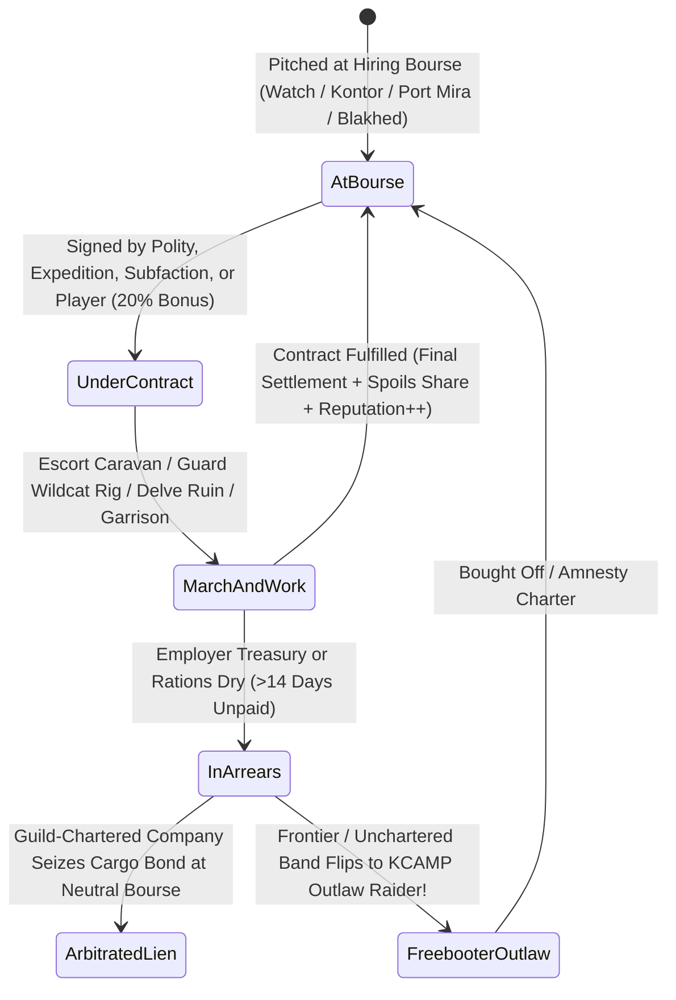

# Continental Mercenary Companies, Hiring Bourses & Contract Mechanics Scope (`2026-11-22`)

> [!NOTE]
> **Status: `[APPROVED — RULINGS #85–88]` — Companion Scope to [CONTINENTAL-SCOPE.md](file:///home/antigravity/traviso761-debug/krator-master/core/region/CONTINENTAL-SCOPE.md), [GEOMANCER-SCOPE.md](file:///home/antigravity/traviso761-debug/krator-master/core/region/GEOMANCER-SCOPE.md), [MONASTERY-NETWORK-SCOPE.md](file:///home/antigravity/traviso761-debug/krator-master/core/region/MONASTERY-NETWORK-SCOPE.md), and [RELICS-SCOPE.md](file:///home/antigravity/traviso761-debug/krator-master/core/region/RELICS-SCOPE.md).**
> Built directly on `core/camp` (`KCAMP` moving bands, `rows`/`laager` war-camps, `50-camp-outlaw.js`, `core/camp/PLAN.md` §2 & §6) and `core/simulation` (`SIM.settlement`, `SIM.trade`, `77-sim-6-money.js` `Talent` conservation, `SCHEMA.md`), grounded in [LORE.md](file:///home/antigravity/traviso761-debug/krator-master/LORE.md) (§1 l.13 player mercenary company, §6.2 Iziz's *"the Watch"*, §6.3 Iron Republic's *Mercenaries' Guild*, §6.13 Xanadu hiring northern musketeers at *Strongwall*, §6.21 Talovolci cohorts).

---

## 1. Core `[G data]` Architecture: Travelling Bands on `KCAMP` + `SIM.contract`

1. **One Unified Moving-Band Primitive (`band.kind = 'mercenary'`):**
   - Every mercenary company is a persistent `KCAMP` `band` (`24–120` fighters + smith, chirurgeon, quartermaster & pack-train, `id: 'merc:<slug>'`) that **physically exists and moves on the Scale Model `5.1` map at all times** — never spawned out of thin air when hired.
   - **Uncontracted (`state: 'at_bourse'` or `'marching_bourse'`):** Quarters outside a major **Hiring Bourse / Mercenary Hall** (pitching a `rows` or `laager` camp on the town's camp-ground or occupying guild barracks), buying local food/drink with saved company coin while waiting for offers.
   - **Contracted (`state: 'under_contract'`):** Marches with an expedition (`venture`), rides escort on a `SIM.trade` caravan/convoy, garrisons a frontier fort/wildcat oil rig (`WC-01..12`), or joins a polity's campaign column.
   - **Zero Census Double-Counting:** Every company draws its roster from its home culture's existing regional census (`CONTINENTAL-SCOPE.md` §1 — e.g. `Talovolci` auxiliary pool, `Iron Republic` cantons, `Iziz` veterans, `Dasri` clans) and eats real physical staples (`grain`/`meat`, `salt`, `spirits`/`tea`, `arms`, `gunpowder`/`kerosene`, `medicine`/`inferior-biogel`) from wherever it stands.

2. **Four Employer Tiers Sharing One `SIM.contract` Record:**

| Employer Tier | Who Pays (`payer` Account) | Primary Contract Types (`mission`) | Concrete Continental Examples |
|---|---|---|---|
| **1. Polities** | `treasury:<polity>` (`77-sim-6-money.js`) | `garrison`, `field_campaign`, `siege_assault`, `anti_raid_sweep` | **`Xanadu` Treasury** hiring northern `Izani`, `Yuni` & Crater free-company musketeers for **`Strongwall`** (`LORE.md:626`); **`Iziz` vs `Voth`** hiring `Talovolci` & `Corsair` cohorts around `Hook`; **`Jimjam`** hiring *Matok* riders along `Serai`. |
| **2. Expeditions** | Venture treasury (`Geomancers`, `Rare Devisers`, `Golden Tears`, `Order`) | `wildcat_rig_guard`, `ruin_delve_escort`, `relic_carrier_guard` | Guarding **Geomancer delta/wildcat bores (`WC-01..12`)** for `30` days until `SIM.found` town chartering; escorting **`Tier 2–3` Relic delves** & `escort_transit` Relic carriers; guarding `Silkhead -> Ria Valley` or `Blakhed -> Labyrinth` parties. |
| **3. Subfactions (`org`s)** | Guild / House books (`Goldanda`, `Getmastarz`, `Farguogar`, `De Xedaz`, `Yuni Guild`, `Shell` Planters) | `caravan_escort`, `convoy_marine`, `claim_enforcement`, `manhunt_or_rescue` | `Getmastarz` hiring `Yuni` riflemen over `Godsgate`; `Farguogar` hiring `Republican` pikemen/gunners past `Boatmurder`; `Shell` planters hiring debt-peon catchers vs **`Ardent`/`Vrivolci` abolitionist rescue contracts** (`Ruling #78`). |
| **4. The Player** | `actor:player` purse **OR** Player as Captain (`LORE.md:13`) | **Hire** (`1–3` bands) **OR** **Enlist Player's Own Company** at any Bourse! | Hire `Frogman` divers for `Tethis`, `Yusar` drone-riggers for `Ancient's Valley`, or `Watch` sappers to hold a new delta oil boomtown — **or register the player's own party as a chartered Mercenary Company** taking NPC retainers & bounties! |

---

## 2. Twelve Continental Mercenary Traditions & Archetypes (`MC-01` – `MC-12`)

Grounded in `LORE.md`, `peoples.json` biology/rigging, and physical Scale Model `5.1` atmosphere (`atm`) & climate constraints:

| Code | Mercenary Tradition & Lore Basis | Home Seats & Primary Bourses `(px, py)` | Unit Size & Loadout | Signature Edge (`KCAMP` / `SIM`) | Hard Cultural Taboos & Physical Limits (`taboos[]`) |
|---|---|---|---|---|---|
| **`MC-01`** | **`Iron Republic` Cantonal *Frikompanier*** (`LORE.md:349` Mercenaries' Guild; *jern'knekt* pike, rifled musket & spin-rocket batteries) | `Roketstad` `(632,716)` · `Glaive` · `Cascade` `(568,841)` | `60–120` heavy infantry + clockwork/rocket wain | **Highest disciplined firepower & siege morale;** Guild-bonded (`0%` betrayal if paid). | **Refuses slaver / `Shell` peon-catching contracts (`Ruling #78`);** banned from hiring to `Scyvoi` raiders. |
| **`MC-02`** | **Izani *"The Watch"* & Crater Free Companies** (`LORE.md:306, 626` Ancient Police Station HQ; ex-legionnaires & `Dilihan`/`Pylon` vets) | `Iziz` `(963,985)` · `Talia` `(1073,939)` · `Dilihan` `(744,663)` · `Strongbow` `(1001,1596)` | `40–100` musketeers, shield-bearers, sappers *(elite companies field `1` light Izani walker)* | **All-weather combined arms & fortification building;** historically hired by **`Xanadu`'s Treasury (`Strongwall`)**. | Imperial-chartered Watch chapters will not fight the Emperor directly; *unchartered* Crater Free Companies take any coin (including `Voth` or `Mantis` houses). |
| **`MC-03`** | **`Yuni` & Oasis *Rifle-Banners*** (`LORE.md:626, 970` hired Yuni riflemen; chasm & Catch marksmen) | `Yuni` `(1263,1089)` · `Verge` `(1268,949)` · `Mungo` `(1322,828)` · `Qiblai` `(922,1595)` | `30–70` long-rifle sharpshooters + camel/mule water train | **`-40%` desert/Catch water attrition & anti-Stalker / anti-Lizardman volley bonus;** #1 **Geomancer wildcat rig** guards. | Dry-law companies require `tea`/`coffee` instead of `spirits` (`Ruling #71`); honor `Order`/`Geomancer` safe-conducts. |
| **`MC-04`** | **`Talovolci` Cloud-Giant *Gaesatai*** (`1.42×` two-armed Giants, `LORE.md:337` & `Ruling #26`) | `Daridel` `(937,1068)` · `Spirladunon` `(800,1017)` · `Porta Marr` `(926,1017)` · `Torus` `(774,1007)` | `25–50` Giant shock-halberdiers & siege pioneers (`1.85×` food/salt) | **`2.4×` per-head melee & timber/earthwork pioneer speed;** remits silver, steel & lowland `rum`/`silk` to clan *duna*. | High ration draw (`1.85×`); heat-stressed in `> 1.95 atm` deep sumps unless rotated. |
| **`MC-05`** | **`Vrivolci` Free-Giant *Oath-Bands*** (`2.0×` four-armed Giants, `Rulings #40 & #78`) | `Tallwalls` · `Shumar` `(Urundashi)` · `Roketstad` · `Ys` | `15–30` four-armed heavy shock-breakers (`2.2×` rations) | **`5.2×` melee combat weight** — can grapple war-walkers & breach gates single-handed! | **Absolute boycott of `Dalab` & `Voth` (`Ruling #40`) and all slavers/peon-masters;** actively takes abolitionist rescue contracts! |
| **`MC-06`** | **`Ardent` Free-Clan *Bronze-Trains & Reivers*** (`LORE.md:374`, `rustic` Slavic highlanders) | `Ardent` `(830,553)` · `Jimjam` `(745,546)` · `Silkhead` `(934,424)` | `35–80` mounted scouts + mule-drawn cast-bronze field guns | **Fast highland mobility + mobile bronze artillery** at `70%` of Republican Guild rates. | Feuds with `Roketstad` artillery guilds; if left unpaid `>14` days, readily turns border reiver! |
| **`MC-07`** | **`Beast Rider` *Sky-Lances, Raptor Bands & Land-Crab Marines*** (`Girder` treaty road & `LORE.md:400`) | `Girder` `(1039,869)` · `Kautoa` `(964,725)` · `Pinnacle Rock` `(1007,686)` · `Port Tobin` *(Land-Crab)* | `20–45` beast-mounted scouts / flyer lances / amphibious crab-marines | **Unmatched recon radius & ambush immunity;** `Land-Crab` excels in coastal deltas (`WC-03`, `WC-04`); flyers bypass cliffs. | **Physics Gate:** Giant flyers require dense air (`flyPressure >= 1.35 atm` — **cannot fly over `Godsgate` `0.96 atm` or `Outer Wall`!**); Confederacy tribes refuse `Iziz` state contracts (loyalist `Land-Crab` only). |
| **`MC-08`** | **`Scyvoi` *Baelu* Outriders & `Dasri` *Camel-Lances*** (Seasonal Dry/Truce Hire) | `Shade` `(1085,683)` · `Wāḥat al-Shamal` `(1165,652)` · `Petraia` · `Mantis` `(1113,1164)` | `40–70` salamander- or camel-mounted raiders & guides | **Cheapest fast desert/savanna escort & flankers;** doubles as safe-conduct insurance against kin-clans. | **High turncoat/freebooter risk** if rations or silver slip; seasonal recall during `Baelu` / herd migrations. |
| **`MC-09`** | ***Matok* Khanate *Wreck-Riders*** (`Tilted Tower` `614,490` & `Veladiga` `685,479`, `Ruling #61`) | `Veladiga` `(685,479)` · `Tilted Tower` `(614,490)` · `Serai` `(826,478)` · `Silkhead` `(934,424)` | `35–65` hardy cold-steppe horse-archers & ruin-breakers | **Cold/thin-air (`0.85 atm`) acclimated** — prime escorts for northern `Silkhead -> Ria Valley` & `Double Delta` (`WC-11`) ventures. | Smuggles contraband `spirits` if routed near dry `Yeti` borders (`Ruling #71`). |
| **`MC-10`** | **`Zeijani` & `Port Mira` *Corsair Marines & Escort Hulls*** (`kits/ringsea` armed sloops/xebecs) | `Port Mira` `(865,895)` · `Zeijani` · `Ys` `(788,741)` · `Port Goto` `(920,703)` | `30–60` boarding marines + `1–3` fast armed hulls | **Only maritime mercenary tier:** escorts `SIM.trade` sea lanes, guards offshore/delta rigs (`WC-03`, `WC-06`), or sails under letter of marque. | Opportunistic; `Zeijani` hulls will flip prize-taker if employer loses port access. |
| **`MC-11`** | **`Fellgang` *Kradz* Shaft-Pioneers & `Frogman` *Sump-Divers*** (Terrain Specialists) | `Blakhed` `(441,1400)` *(Kradz)* · `Span` `(554,1010)` & `Jrrmiah` `(555,957)` *(Frogmen)* | `15–35` rope/bore sappers **OR** amphibious gill-divers | **Unlocks flooded (`Tethis`, `Grrmp-Sump`, `Noah's Regret`) & subterranean/chasm (`Labyrinth`, `Cthonos`, `Cascade–Drum` bore) delves!** | `Frogmen` serve strictly as free volunteers (`Ruling #37`, never coerced); `Kradz` charge hazard shares on shaft salvage. |
| **`MC-12`** | **`Yusar` *Corsair Hazard-Riggers*** (`Carcosa` `396,822` & `Henge` `460,736`, `Ruling #53`) | `Henge` `(460,736)` · `Carcosa` `(396,822)` · `Saltwhite Gate` `(486,837)` · `Span` `(554,1010)` | `10–24` cyber-modded riggers + `Tier 3` rad/acid drone-mules | **`0.35×` survival in `Tier 3` `Ancient's Valley` / `KANOM` / hard-rad ruins** (vs `0.10×` human! `RELICS-SCOPE.md` §2). | **Ultra-high retainer + `25%` Relic/biogel cut;** barred inside `Eternal State` interior unless hired covertly for `True Heir` implant crises (`Ruling #52`). |

> [!IMPORTANT]
> **Factions That NEVER Hire Out as Mercenaries (`[LOCKED]`):**
> - **`Lizardmen` (`92,500`):** `0` external trade or diplomacy (`Ruling #65`).
> - **`Sasquatch` (`3,600`):** Strictly isolationist (`Ruling #61`).
> - **`Screamers` (`Hexahedron`):** Hive-converted abductors, never coin-mercenaries.
> - **`Order of Historians` (`Longsong`/`Oidong`):** Non-killing monastic vow (`aggression: 0`, `Ruling #64` — though **`Longsong` / `Silkhead` / `Blakhed` / `Keepwell` *hire* mercenaries** to guard perilous expeditions!).
> - **`Wheel` `Cyberliches` (`120`) & `Eternal State` `True Heirs`:** Never sell their persons for foreign coin.

---

## 3. Continental Network of `10` Mercenary Hiring Bourses

Every Bourse is a concrete venue (`guild_hall`, `watch_station`, `caravanserai`, or `free_port`) where NPC polities, subfactions, expedition leaders, and the player bid on currently pitched `MC-01..12` bands:

1. **`Iziz` — *The Watch* (`963, 985`, Ancient Police Station, `LORE.md:306`):** Supreme Imperial charter bourse (`MC-02`, `MC-04`, loyalist `MC-07` `Land-Crab`).
2. **`Roketstad` — *Mercenary Kontor* (`632, 716`, `LORE.md:349`):** Bonded alpine & abolitionist bourse (`MC-01`, `MC-05`, `MC-11`).
3. **`Port Mira` — *Neutral Free-Port Exchange* (`865, 895`):** No-questions-asked maritime & covert bourse (`MC-10`, unchartered `MC-02`, `MC-07`, `MC-08`).
4. **`Talia` — *East-Gate Caravanserai Bourse* (`1073, 939`):** Primary caravan & Beast-Rider march hiring hall (`MC-02`, `MC-03`, `MC-07` via `Girder`, `MC-08`).
5. **`Verge` & `Mungo` — *Scarp & Abyss Hiring Yards* (`1268, 949` & `1322, 828`):** Geomancer wildcat-rig & Catch caravan bourse (`MC-03`, `MC-08`).
6. **`Strongbow` & `Qiblai` — *Two Horns Muster Courts* (`1001, 1596` & `922, 1595`):** Where `Xanadu`'s Treasury, `Golden Tears`, and `Rare Devisers` hire northern `MC-02`/`MC-03` musketeers for `Strongwall` & `Godshearth` (`LORE.md:626`).
7. **`Drum` — *Under-Drum Arena & Auxiliary Bourse* (`673, 932`):** Western salvage, Vothic auxiliary & `Span` frontier exchange (`MC-04`, `MC-08`, `MC-11` `Frogmen` at `Span`, `MC-12` `Yusar` brokers).
8. **`Blakhed` — *Travellers' Fair Rim-Bourse* (`441, 1400`):** Great Caravan, `West Rift`, `Labyrinth` & `Crook` expedition muster (`MC-11` `Kradz`, `MC-03`, `MC-05`).
9. **`Dilihan` & `Shell` — *Northern Basin Muster Halls* (`744, 663` & `902, 659`):** Delta oil exploration (`WC-03`, `WC-04`), Cut pass, and `Shell` coastal convoy hiring (`MC-02`, `MC-06`, `MC-10`).
10. **`Silkhead` — *Northern Outlands Safe-Conduct Hall* (`934, 424`):** Stages `Compass Hills` (`LC-09`), `Double Delta` (`WC-11`), and `Ria Valley` (`HM-14`) expedition escorts (`MC-09` *Matok*, `MC-06`, Korona guides).

---

## 4. `[G data]` Contract Economics, Anti-Snowball Caps & Mutiny Rules

1. **Strictly Conserved 3-Part Compensation (`77-sim-6-money.js`):**
   - **Signing Advance (`20%` upfront):** Transferred via `SIM.pay(employer, band.purse, advance)` at contract signature (`witnessedBy: 'watch' | 'kontor' | 'order' | null`).
   - **Weekly Field Retainer + Daily Rations/Munitions:** Paid every `7` sim days (`1.5–4.0×` standard soldier wage depending on tier `MC-01..12`), plus physical `food`, `salt`, and `gunpowder`/`arrows`/`kerosene` drawn from the employer's warehouse or caravan wagons.
   - **Hazard & Salvage Cut (`0–25%`):** Ruin/Relic expeditions (`MC-11`, `MC-12`) take a contracted share of `scrap`/`archaeotech` value (or a flat Relic-find bonus so non-divisible `RC-1..6` cores stay whole!).
2. **Macro Balance Law (Why Rich Superpowers Cannot Simply Buy Every Mercenary on Krator):**
   - **Finite Physical Pool (`~3,800–5,500` active roaming company fighters continent-wide, outside `Talovolci`'s fixed `4,500–6,000` legion/garrison auxiliary treaties):** Once hired, a band is physically off the market until its contract ends.
   - **Dynamic Scarcity Bidding:** As active regional contracts rise above `50%` of available bourse bands, remaining bands' retainers scale up (`1.0× -> 2.2×`), pricing out routine garrison spam.
   - **Treasury Drain & Mercenary Fatigue:** Keeping foreign mercenaries on permanent peacetime garrison drains scarce `Talents`/`quds` and triggers `-unrest` friction with domestic military guilds (`Iziz` Legionnaires, `Voth` Jaguar/Eagle orders, `Eternian` Wardens).
3. **Polity Jurisdictions & Closed-Interior Rules (`Ruling #86` — `[LOCKED]`):**
   - **`Eternal State` Interior Ban (`Frontier Quarantine Only`):** Eternia relies on its Citizen-Levies and Sanctum Wardens inside `E1–E6`, barring foreign mercenary bands from marching through its interior provinces; external companies may **only** be contracted at quarantine/border gateways (**`Farport` `294, 588`**, **`Bastion` `536, 627`**, and **`Palewharf` `565, 604`**) for exterior coast, `Footfall` border, or lake-convoy duty.
   - **`Realm of Dalab` & `Voth` Rules:** `Dalab` relies on Temple Giants and servitor levies at home, hiring human/`Fellgang` companies (`MC-11`, `MC-03`) **along the Rift rim (`Blakhed` `441, 1400`, `Nulab` `443, 1359`, Great Caravan legs)**; **`Vrivolci` Free Giants (`MC-05`) enforce an absolute boycott against both `Dalab` and `Voth` (`Ruling #40`)**.
4. **Heavy Equipment Ceiling & Specialist Gates (`Ruling #88` — `[LOCKED]`):**
   - **State Monopoly on Heavy Walkers & Siege Mechs:** Heavy war-walkers (`Castra`, heavy Izani/Stalker classes) cannot be bought or fielded by mercenary companies; at absolute ceiling, a top-reputation chartered company (`MC-01`, `MC-02`, `MC-06`) fields **at most `1` salvaged light scout-walker or a single cast-bronze / spin-rocket field battery**, while **`MC-07`, `MC-11`, and `MC-12` unlock specialist terrain & hazard delves** (`Yusar` rad/acid rigs, `Frogman` flooded ruins, `Fellgang` *Kradz* shafts, `Land-Crab` river deltas).
5. **Two-Tier Guild vs. Freebooter Default Rules (`Ruling #85` — `[LOCKED]`, `50-camp-outlaw.js`):**
   - If an employer defaults on pay or starves a company for **`> 14` sim days**:
     - **Guild-Chartered Companies (`MC-01` Republic Kontor, `MC-02` Watch, `MC-04`/`05` Giant Oaths):** Break contract honorably, seize pledged baggage up to arrears value, and file a **Guild Blacklist** (`+50%` risk premium against the defaulting employer for `1` year; `-1` trust if `witnessedBy: 'order'`).
     - **Unchartered / Frontier Companies (`MC-06` Reivers, `MC-08` Steppe/Desert, `MC-09` *Matok*, `MC-10` Corsairs, unchartered `MC-02`):** Work `25–35%` cheaper with no questions asked, but flip deterministically (`KRAND`) to **`state: 'freebooter'`** on `50-camp-outlaw.js` when unpaid — pitching an outlaw war-camp on the nearest trade road or seizing an unfortified wildcat rig until bought off or crushed!
6. **Symmetric Player-as-Employer & Player-as-Captain System (`Ruling #87` — `[LOCKED]`, `LORE.md:13`):**
   - **Player as Employer:** May hold up to **`1–3` concurrent `SIM.contract`s** (escorting caravans, guarding `WC-01..12` delta rigs during `SIM.found`, delving `Tier 2–3` Relic vaults, or bolstering a siege).
   - **Player as Mercenary Captain:** Once the player equips `>= 12` companions/hirelings with `KCAMP` tents & pack-beasts, purchasing a **Company Charter** at *The Watch* (`Iziz`/`Dilihan`), the *Mercenary Kontor* (`Roketstad`), or *Port Mira* unlocks the **Bourse Contract Board** (`caravan_escort` -> `wildcat_rig_guard` / `anti_raid_sweep` -> `ruin_delve_escort` -> `siege_assault` / `relic_carrier_guard`).
