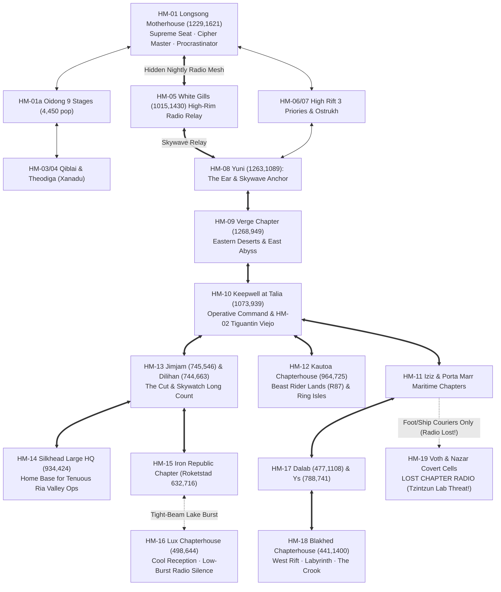

# Order of Historians (`History Monks`): Continental Monastery, HQ, Scriptorium & Sanctuary Scope (`2026-11-22`)

> [!NOTE]
> **Status: `[APPROVED — RULINGS #33, #64, #70, #71, #73, #79, #83, #89]` — Companion Scope to [CONTINENTAL-SCOPE.md](file:///home/antigravity/traviso761-debug/krator-master/core/region/CONTINENTAL-SCOPE.md).**
> Reconciles [LORE.md](file:///home/antigravity/traviso761-debug/krator-master/LORE.md) (§4, §6.1, §6.12, §6.15–6.19), `settlements/longsong/src/{15-ls-tune,40-ls-plan}.js`, `openworld/oidong-highrift/plan/sites.json`, `settlements/{dalab,iziz}/src/76-port-chapterhouse.js`, `core/region/data/{xan-tune,catch-tune,east-rift}.js`, and Scale Model `5.1` (`60-settlements.js`) into a single pin-exact **`19`-node `[G data]` specification** with **zero population double-counting**.

---

## 1. Organization, Sovereignty, Regional Jurisdictions & Zero-Double-Count Census

- **Sovereign / Sanctuary Heartland (`10,674` Single-Counted Souls in `Sphere 24`):**
  - **`Longsong` Motherhouse & Ring (`6,224` in `15-ls-tune.js`):** `1,500` at the Motherhouse & Deep Vault (`1,000` vowed monks/novices + `500` lay ward), `3,524` across `15` inner `XAK` ring hamlets, and `1,200` across the `3` High Rift priories (`Singing Gjár`, `Mirror Grange`, `Caldron House`) & `5` quartz/pasture support camps.
  - **`Oidong Valley` Sanctuary Corridor (`4,450` in `9` Stages, `Ruling #64`):** Non-killing (`aggression: 0`) monastic highway between `Strongbow` and `Longsong`; western toll-gates (`Chorten-Gate` `1026, 1602` & `Potch-Pass Ferry` `1052, 1626`) remit customs directly to `Longsong`.
- **Foreign-Hosted Regional HQs, Chapterhouses, Hermitages & Cells (`~1,460` Monks & Lay Brothers — `ΔPop = 0`):**
  - Counted inside their respective host city censuses (`Silkhead`, `Jimjam`/`Dilihan`, `Roketstad`, `Lux`, `Verge`, `Kautoa`, `Blakhed`, `Talia`/`Keepwell`, `Iziz`, `Porta Marr`, `Yuni`, `Qiblai`, `Theodiga`, `White Gills`, `Ostrukh`, `Dalab`, `Ys`, `Voth`).
- **Locked Regional Chapter Jurisdictions (`Ruling #83`):**
  1. **`Silkhead` Large Northern HQ (`934, 424`):** Major northern monastery & archive serving as **home base for tenuous field operations into the `Ria Valley` (`c=922, 167`)**, plus `Korona` (`lbl=54`), `Coyote`, and the `Compass Hills`.
  2. **`Jimjam` / `Dilihan` Chapter (`745, 546` & `744, 663`):** Paired chapterhouses covering `Jimjam` (and `Skywatch` `776, 470` *Long Count* astronomers), `Dilihan`, and `The Cut`.
  3. **`Iron Republic` Chapter (`Roketstad` `632, 716`):** Alpine burgh chapterhouse covering the `Iron Republic` cantons (`Cascade`, `Urverkstad`, `Lipp`) and `Footfall` relic preservation.
  4. **`Lux` Chapterhouse (`498, 644` in `Eternal State`):** Eternia gives the Order a **cool, Censorate-watched reception (`TOLERATED`)**, forbidding unsanctioned rural houses, **but tolerates a single official chapterhouse in `Lux`** maintaining all operations across the `Eternal State`.
  5. **`Verge` Chapter (`1268, 949`):** Straddles the `Verge` scarp as regional chapterhouse covering **both the Eastern Deserts (`Imperial Bowl`, `Jabal`, `Dasri`) and the `East Abyss` (`Mungo`, `Liikofi`, `Reed`, `Sfenops`)**.
  6. **`Kautoa` Chapterhouse (`964, 725`):** Island-court chapterhouse covering **both `Kautoa` / eastern `Ring Isles` and the `Beast Rider` lands (`Region 87` — `Mav's Refuge`, `Pinnacle Rock`, `Sleeping City`)**.
  7. **`Blakhed` Chapterhouse (`441, 1400`):** High rim-head chapterhouse overseeing Order operations across the **`West Rift` (`Nulab`, `Ledge`, ruined `Cthonos`), `The Labyrinth` (`c=259, 1510`), and up the western passes into `The Crook` (`c=120, 813`)**.
- **The Order's Strictly Hidden Strategic Edge — Ancient Chapterhouse Comms-Radios (`Ruling #89`):**
  - Every `ESTABLISHED` chapterhouse (`HM-01` through `HM-18`, with severe Censorate signal discipline at `Lux` `HM-16`) houses a **strictly secret pre-Cataclysm console transceiver** in a sealed inner cipher cell, linking the chapters across continental distances in nightly coded bursts while **remaining far too heavy and power-hungry (`energy-cells` + roof/spire aerials) for mobile `KCAMP` field operations** (§3).
- **Ascetic & Dry Discipline (`Ruling #71`):**
  - `Longsong` (`HM-01`) and `Oidong` (`HM-01a`) enforce non-killing dairy/carp/pulse diets and monastic sobriety (`alcohol: 'prohibited'`), sharing dry-corridor rules with `Yuni` Order wards, highland `Guari` (`Tiguantin`), and the `Yeti Kingdom`.

---

## 2. Complete `19`-Node Continental Monastery, HQ & Chapterhouse Network (`HM-01` – `HM-19`)

| Node # | House / HQ / Chapter & Pin ID | `(px, py)` & Elev (`atm`) | Host Polity & Reception (`presence`) | Order Pop *(Counted In)* | Kit / Building Key | Jurisdiction & Concrete `SIM` Role: Scriptorium, Secret Radio, Almanac & Ops |
|---:|---|---|---|---|---|---|
| **HM-01** | **`Longsong` Motherhouse & Vault** (`sq80bzd7ep`) *(+ `15` Inner Ring Hamlets `3,524`)* | `(1228.88, 1621.23)` `+2,089 m` (`1.23 atm`) | **Order / Xanadu Condominium** (`ESTABLISHED` sovereign seat) | **`1,500`** (`1,000` Order + `500` ward; Sphere 24) | `settlements/longsong` (`XAK` + Potala mass + `VAULT` / `PROCRASTINATOR`) | **Supreme Seat & Master Cipher Desk:** Movable tin-type press, `paper-mill`, `lens-house` (also grinds replacement **`quartz` radio oscillator crystals**!), `Procrastinator` (`slow: 1e-4`, `LS-001..007` + blank `LS-008`), `Unmaking Room`; issues seasonal **Epoch Cipher Codebooks** for the hidden radio net. |
| **HM-01a** | **Oidong Sanctuary Road-Stages (`9` Stages)** `Chorten-Gate` `(1026,1602)` .. `Sprin-Zam` `(1204,1620)` | `X = 1026..1204` `+1,960..+4,333 m` (`0.93–1.25 atm`) | **Order of Historians** (`aggression: 0`, **Ruling #64**) | **`4,450`** *(Sphere 24)* | `core/hamlet` `order` row (`XAK` + chortens) | **19-Day Strongbow–Longsong Sanctuary Spine:** Non-killing dairy/carp/pulse diet; produces `chalice-grass` paper pulp, `lotus-silk`, `saffron`, `valley-ginseng` physic, `turquoise`, and **tin-bronze movable type (`Sprin-Zam`)**. *(Foot/yak courier between stages.)* |
| **HM-02** | **`Tiguantin Viejo` — Entombed First Monastery** (`cav_monks_archive`) | `(1138, 858)` `+4,616 m` (`0.90 atm`) | `Principality of Tiguantin` (`LICENSED`, **Ruling #33**) | `15–30` seasonal *(in `Keepwell` / `Guari` `1,200`)* | `biomes/nhighlands` `--station tiguantin` (`KCAVERN` ignimbrite vault) | **Pre-Lesser-Throne Founding Archive (`LORE.md` §6.15):** Biennial summer `KCAMP` scroll-recovery staged from `Keepwell` (`1073,939`) *(no portable field radio — reports only upon return to `Keepwell`)*. |
| **HM-03** | **`Qiblai` Saffron Spoke Monastery** (`qb.order` in `skm4jjo2vl`) | `(922.1, 1594.9)` `-1,860 m` (`2.02 atm`) | `Xanadu Sultanate` (`ESTABLISHED` Council Seat) | **`300`** *(in `Qiblai`)* | `settlements/qiblai` Spoke 1 (`XAK` saffron banner) | **Seat on Qiblai's Prismatic Council (`share: 1/8`):** Hidden spire-finial transceiver relays southern Xanadu & Catch dispatches up to `White Gills` (`HM-05`) and `Longsong` (`HM-01`); hosts `Xanadu` pilgrim-circuit hospice. |
| **HM-04** | **`Theodiga` Living-Arcology Priory** (`theo.order` in `s4zvgepuru`) | `(908, 1535)` `-495 m` (`1.70 atm`) | `Xanadu Sultanate` (`ESTABLISHED`) | **`25`** *(in `theo:arc`)* | `settlements/theodiga` arcology gallery | Co-catalogues Ancient living-arcology inscriptions alongside the **Rare Devisers**; hosts `Xanadu` minor pilgrim circuit shrines (`Ruling #79`). |
| **HM-05** | **`White Gills` Hermitage & High-Rim Radio Relay** (`sttkxo9ndy`) | `(1015, 1430)` `+3,746 m` (`1.00 atm`) | `The Catch` / `Twins` (`ESTABLISHED` neutral hospice) | **`15–25`** *(Sphere 25 `catch-tune.js`)* | `biomes/gills` Longsong-style stone hospice | **Central High-Altitude Radio Relay & Catch Cistern (`+3,746 m`):** High-elevation ridge aerial bridges `Longsong`/`Qiblai` across the Outer Wall to `Keepwell` and `Yuni`; tends the sole potable cistern between `Bitta` and `Lasso`. |
| **HM-06** | **`High Rift` Houses (`3` Priories):** `Singing Gjár` `(1572,1643)` · `Mirror Grange` `(1430,1644)` · `Caldron House` `(1366,1668)` | `+2,618..+3,684 m` (`1.01–1.15 atm`) | **Order of Historians** (`ESTABLISHED`, `15-ls-tune.js`) | **`1,200`** total *(Sphere 24)* | `openworld/oidong-highrift` `order` row (`XAK`) | **Optical `quartz` (`420 kg/yr`), Piezo Crystals & Spacetime Watch:** Mines pure `quartz` for both `Longsong`'s `lens-house` and replacement **radio oscillator crystals**; `Singing Gjár` monitors Lizardman spacetime resonance. |
| **HM-07** | **`Ostrukh-on-Water` Backdoor Priory** (`sostrukhyuni01`) | `(1516, 1471)` `+1,988 m` (`1.25 atm`) | `Yuni Emirate` (`Y6`, `ESTABLISHED`) | **`18`** *(in `Ostrukh` `1,400`)* | `kits/yuni` / `XAK` terrace priory | **Summer Catch-Bypass Relay:** `7-day` physical mule trail (`Singing Gjár -> Ostrukh -> Darling -> Yuni`) for bulky codebooks, `energy-cells`, and `lenses` that cannot go by radio. |
| **HM-08** | **`Yuni` — *The Ear*, Civic Library & `Locus` Desk** (`ss0il0ejb7`) | `(1263, 1089)` `+636 m` (`1.48 atm`) | `Yuni Emirate` (`Y1`, `ESTABLISHED` co-custodian) | **`25` monks + `110` lay** *(in `Yuni`/`Locus`)* | `kits/yuni` Order library + Dish (`The Ear`) | **Sky-Listening Dish & Ionospheric Timing Anchor (`LORE.md` §4, §6.15):** Operates **`The Ear`** (sole pointable Ancient dish, monitoring upper-atmosphere scatter & anomalous RF beacons) + co-guards `Yuni`'s Six Sealed Doors. |
| **HM-09** | **`Verge` Chapterhouse *(Eastern Deserts & East Abyss)*** (`sduqx62i09`) | `(1268, 949)` `-1,685 m` / `-1,094 m` (`1.83–1.98 atm`) | `Yuni Emirate` / `Iziz` Scarp Seam (`ESTABLISHED`, **Ruling #83**) | **`65`** *(in `Verge`)* | `settlements/verge` / `port_order_chapterhouse` | **Eastern Deserts & East Abyss Seat (`Ruling #83`):** Upper-rim antenna relays across the Bowl & `East Abyss`; field chroniclers in `Dasri` oases and `Mungo`/`Reed` sumps report back physically by camel/boat. |
| **HM-10** | **`Keepwell` at `Talia` — Field Operative Command** (`sor1zqih8x`) | `(1073, 939)` `+250 m` (`1.55 atm`) | `Empire of Iziz` (`ESTABLISHED` operative HQ) | **`220`** *(in `Talia` `12,000`)* | `settlements/iziz` `port_order_chapterhouse` + fortress-scriptorium | **Northern Radio Switchboard & Operative Command (`LORE.md` §6.15):** Receives nightly radio alerts from all chapters to dispatch **Operatives** days ahead of secular armies — including **Priority One tasking on the lost `Voth` Chapter Radio** (§3.2)! |
| **HM-11** | **`Iziz` & `Porta Marr` Maritime Chapters** (`sxxrgmrk8c`, `sxmeztkqg7`) | `(963, 985)` `-1,428 m` `(926, 1017)` `-1,346 m` | `Empire of Iziz` (`ESTABLISHED`) | **`160`** *(in `Iziz` & `Marr`)* | `port_order_chapterhouse` (`76-port-chapterhouse.js`) | **Ring Sea Nautical Almanac & Treaty Desk:** Hidden radio weather reports from `Kautoa`, `Ys`, and `Dilihan` let `HM-11` publish uncannily accurate storm `almanacs` (`-25%` sea `losses`) attributed publicly to "barometers & almanac tables". |
| **HM-12** | **`Kautoa` Chapterhouse *(Beast Rider Lands & Ring Isles)*** (`sq9t00vg7w`) | `(964, 725)` `-1,191 m` (`1.86 atm`) | `Kingdom of Kautoa` (`ESTABLISHED` -> **`Region 87` `TOLERATED`**, **Ruling #83**) | **`55`** *(in `Kautoa`)* | `kits/islanders` Sumba spire-roofed scriptorium | **Beast Rider Lands & East Ring Sea Seat (`Ruling #83`):** Spire-mast aerial links `Kautoa` to `Keepwell`/`Iziz`; unarmed field chroniclers inside **`Region 87`** (`Mav's Refuge`, `Pinnacle Rock`, `Sleeping City`) travel radio-free to respect Beast Rider anti-electricity custom. |
| **HM-13** | **`Jimjam` & `Dilihan` Chapter *(The Cut & Long Count)*** (`st5e01l76v`, `solqo7hz7s`) | `Jimjam` `(745, 546)` `+486 m` `Dilihan` `(744, 663)` `-889 m` | `Kingdom of Jimjam` & `Dilihan Province` (`ESTABLISHED`, **Ruling #83**) | **`75`** *(`45` `Jimjam`/`Skywatch`, `30` `Dilihan`)* | `kits/dilihan` `dil_library_courtyard` & `jj_library` | **Cut & Northern Pass Relay (`Ruling #83`):** Bridges `Dilihan` through the eigenweapon-carved Cut bowl up to `Jimjam` / `Skywatch` (`776, 470`) and onward to `Silkhead` (`HM-14`) and `Lux` (`HM-16`). |
| **HM-14** | **`Silkhead` Large Northern HQ *(Ria Valley Staging Base)*** (`slm5ul15lp`) | `(934, 424)` `+12 m` (`1.60 atm`) | `Silkhead` / `Korona` Safe-Conduct League (`ESTABLISHED` **Large HQ**, **Ruling #83**) | **`140`** *(in `Silkhead` `8,600`)* | Fortified northern timber-and-stone scriptorium + printing press | **Large Northern Radio Terminus & `Ria Valley` Base (`Ruling #83`):** Northernmost fixed transceiver rack; **expeditions north into the `Ria Valley` (`c=922, 167`) go dark beyond `Silkhead`** because the Ancient racks are far too bulky for trail pack-trains! |
| **HM-15** | **`Iron Republic` Chapter (`Roketstad` & Cantonal Desks)** (`s28hf1s9ab`) | `(632, 716)` `+2,950 m` (`1.11 atm`) | `Iron Republic` (`ESTABLISHED`, **Ruling #83**) | **`50`** *(in `Roketstad` `32,000` & `Cascade` `12,000`)* | `kits/highlands` `republican` carved guild-scriptorium | **High-Alpine Radio Relay (`+2,950 m`, `Ruling #83`):** Mountain line-of-sight links `Jimjam` (`HM-13`) and `Dalab`/`Ys` (`HM-17`); discreetly sources `copper` wire and `energy-cell` electrolytes without revealing the cipher room. |
| **HM-16** | **`Lux` Chapterhouse *(Sole Eternal State Seat)*** (`s1ugpi6uas`) | `(498, 644)` `+164 m` (`1.57 atm`) | `Eternal State` (**`TOLERATED` — Cool Reception**, **Ruling #83**) | **`40`** *(in `Lux`)* | `et_historians_house` (walled Censorate-watched courtyard) | **High-Risk Whisper Node in the Eternal State (`Rulings #83 & #89`):** Because Eternian Sanctum Wardens possess residual RF detectors, `Lux` keeps its console bricked behind a false cellar wall, risking **only `10`-second weekly bursts across `Lake lbl=77` to `Jimjam`/`Roketstad`**. |
| **HM-17** | **`Dalab` & `Ys` Western Chapters** (`seed05`, `siauw28o8v`) | `Dalab` `(477, 1108)` `+7 m` `Ys` `(788, 741)` `-1,452 m` | `Realm of Dalab` & `League of Amphitriton` (`ESTABLISHED`) | **`140`** *(`~80` in `Dalab`, `~60` in `Ys`)* | `dalab_chapterhouse` & `Ys` reef-scriptorium | **`The God`, Reef-Lab & Voth Signal-Watch (`Ruling #89`):** `Ys` (`788,741`) and `Dalab` (`477,1108`) run nightly listening watches across the Ring Sea and SW Highlands for **rogue test-carrier pings from the lost `Voth` Chapter Radio**! |
| **HM-18** | **`Blakhed` Southwest Frontier Chapterhouse *(West Rift, Labyrinth & Crook)*** (`blakhed`) | `(441, 1400)` `+2,180 m` (`1.22 atm`) | `Fellgangs` / `Dalab` Toll-Rim (`ESTABLISHED`, **Ruling #83**) | **`45`** *(in `Blakhed` `5,000`)* | Stone-&-ice-house rim priory (`settlements/blakhed`) | **Southwest Rim Radio Terminus (`+2,180 m`, `Ruling #83`):** Relays Great Caravan & `West Rift` intelligence instantly to `Longsong` and `Dalab`; **field teams descending into `Cthonos`, `The Labyrinth`, or `The Crook` operate beyond radio portability**. |
| **HM-19** | **`Voth`, `Shim` & `Nazar` Clandestine Safe-Houses** | `Voth` `(742, 1018)` `Nazar` `(582, 1079)` | **`Kingdom of Voth`: `PERSECUTED` (`Ordinator` ban!)** | `~12` covert *(in `Voth`)* | Unmarked cellar safe-houses | **The Lost Voth Radio & *Tzintzun* Reverse-Engineering Crisis (`Ruling #89`):** Hunted on sight; operates strictly by smuggled foot/boat couriers (`0` radio), tasked by `Keepwell` with **locating the unconfirmed `Voth` Chapterhouse transceiver believed to be in *Tzintzun*'s royal artificer labs** (§3.2)! |

---

## 3. Secret Ancient Comms-Radio Network & The Lost `Voth` Radio Crisis (`Ruling #89`)

### 3.1 Physical & Secrecy Constraints (`SIM.historians.radioMesh`)
- **Fixed Console Scale (`mass: ~180 kg` + Concealed Spire Aerial + `energy-cells`):** Each chapterhouse unit is a pre-Cataclysm solid-state/crystal HF-VHF rack concealed inside a windowless inner **Whisper Cell** (`lightning-rod`, `chorten-finial`, or `copper-gutter` disguise). **Too bulky, fragile, and power-hungry for `KCAMP` field operations** (`Ria Valley` patrols from `Silkhead`, `Labyrinth`/`Crook` scouts from `Blakhed`, `Tiguantin Viejo` digs, or `Keepwell` field operatives must physically return to a chapterhouse to transmit).
- **Strict Secrecy Doctrine:** Secular monarchs, merchant guilds, and military staffs have **zero knowledge** that the Monks possess working long-range radios. Publicly, the Order credits its uncanny coordination to disciplined relay riders, carrier birds, optical telescopes (`lenses`), and mathematical meteorology. Exposing a live chapterhouse radio to a suspicious host (`Eternal State` at `Lux` `HM-16`, or `Iziz` Intelligence) triggers severe diplomatic seizure attempts.
- **Asymmetric Information Advantage (`Ruling #81` Integration):** While secular `SIM.trade` price shocks, fleet movements, treaty breaches, and `escort_transit` Relic sightings crawl across the map at physical ship/caravan speed (`5–35` sim days), **all radio-linked Order chapters (`HM-01..18`) synchronize nightly (`<= 6–12` hours)**, letting the Order enforce instant continental `witnessedBy: 'order'` embargoes (`Ruling #70`), issue synchronized storm `almanacs`, and pre-position `Keepwell` Operatives or hired mercenaries ([MERCENARIES-SCOPE.md](file:///home/antigravity/traviso761-debug/krator-master/core/region/MERCENARIES-SCOPE.md)).

### 3.2 The Lost `Voth` Chapter Radio & *Tzintzun*'s Reverse-Engineering Threat
- **What Happened During the Ordinator Purge:** When *Tzintzun*'s Ordinators stormed the `Voth` chapterhouse (`LORE.md` §6.2, §6.15), the vowed cipher-brother never transmitted the final thermite-slag confirmation signal. `Longsong` immediately rotated its continental **Epoch Cipher Keys** and blacklisted the `Voth` crystal slot, keeping live Order traffic unreadable — **but the fate of the physical `Voth` transceiver remains unknown**.
- **Why the Order Fears *Tzintzun* Has It (`Ys` & `Dalab` Ghost-Carrier Detections):**
  1. **Direction-Finding Exposure Risk:** Even without cracking `Longsong`'s rotating book-ciphers, a captured receiver tuned to the Order's Ancient frequency band allows *Tzintzun*'s royal artificers (working behind Ordinator cordons in `Voth`'s Sun Pyramid or `Nazar` `582, 1079`) to **detect and triangulate RF burst bearings** from `Ys`, `Dalab`, `Iziz`/`Hook`, and `Lux` — threatening to blow the Order's deepest secret wide open (or tip off Eternian Wardens against `Lux`!).
  2. **Vothic Military Replication (`RC-5` `telemetry` Crisis):** *Tzintzun*'s artificers are actively trying to reverse-engineer the unit's `quartz` piezo-oscillator and `rare-earth` amplifier stages (driving covert Vothic black-market bids for `quartz`, `rare-earth`s, and `energy-cells` at `Drum` and `Port Mira`). If Voth completes reverse-engineering — or captures a second `RC-5` `telemetry` Relic ([RELICS-SCOPE.md](file:///home/antigravity/traviso761-debug/krator-master/core/region/RELICS-SCOPE.md)) — Voth unlocks **Royal Ordinator Command-Radios** linking `Voth`, `Drum`, its `Ring Sea` war-fleets, and `Nazar` cordons (`+2` days armada/ambush lead & `3×` strategic reaction speed against `Iziz` and `Ys`!).
- **High-Stakes Player & `Keepwell` Quest Chain (`quest:voth_lost_radio`):**
  - **Order Path (`Keepwell` `HM-10` & `Voth` Cell `HM-19`):** Smuggle into `Voth` / `Nazar`, trace faint harmonic test-chirps to *Tzintzun*'s artificer vault, and **recover the `Voth` Chapter Radio, slag its core (`sabotage_core`), or swap in a doctored `Longsong` crystal** that feeds Vothic fleets false deception bearings!
  - **Rival / Defector Path:** A ruthless player could instead supply *Tzintzun*'s artificers with the missing precision `Longsong`/`High Rift` `quartz` crystal or an `RC-5` core (`sell_hegemon` to `Voth`, `+35` `relicThreat`), handing Voth the continent's first secular military radio network — at the cost of permanent `Order of Historians` excommunication and embargo!

---

## 4. `[G data]` Simulation Rules (`SIM.historians`)

1. **Dual-Speed Order Traffic (`radioMesh` vs. `org: 'order'` Physical Pouches):**
   - **Nightly Encrypted Radio Dispatches (`<= 12` hr continental sync):** Carries compact text intelligence (`price_alerts`, `storm_barometry`, `treaty_breach`, `relic_sighting`, `operative_orders`) across `HM-01..18` (`energy-cells` upkeep: `1` lot/yr per chapterhouse; `0` into `HM-19` `Voth`, `0` into mobile field camps).
   - **Gateway-Exempt Physical Pouches (`org: 'order'`):** Tangible `books`, `paper`, `lenses`, replacement `quartz` crystals, `energy-cells`, and printed `schematics` still travel physically hop-to-hop by courier/caravan/ship (exempt from wartime commercial embargoes, throttled into `PERSECUTED` `Voth` `HM-19`, Censorate-inspected at `Lux` `HM-16`, and high-attrition `KCAMP` legs into `Ria Valley` and `Labyrinth`/`Crook`).
2. **Quarterly Nautical & Pass `almanacs` (`-25%` Weather Attrition):** Powered secretly by synoptic barometric reports over the hidden radio mesh, any settlement hosting an `ESTABLISHED` or `TOLERATED` Order chapterhouse (`HM-01..18`) consumes `1` `books`/quarter to publish pass/monsoon `almanacs`, cutting weather/shoal `losses` on outbound `SIM.trade` routes by **`-25%`**.
3. **Neutral Treaty-Witnessing & Instant Radio Sanction (`witnessedBy: 'order'`):** Because breaches of a `witnessedBy: 'order'` truce or charter propagate across the **hidden radio mesh overnight**, violating a witnessed treaty within `365` days triggers an **immediate next-day continent-wide Order embargo** (`books`, `lenses`, `almanacs`, and `open_schematic` diffusion halted) plus `-1` diplomatic trust across all treaty powers (`Ruling #70`).
4. **Relic Diffusion (`open_schematic`) & Containment (`seal_procrastinator`):** Connects directly to [RELICS-SCOPE.md](file:///home/antigravity/traviso761-debug/krator-master/core/region/RELICS-SCOPE.md) — `Longsong` (`HM-01`), `Silkhead` (`HM-14`), and `Keepwell` (`HM-10`) coordinate non-apex Relic schematic diffusion (`+12%` efficiency across non-hostile polities, `-20` continental `relicThreat`), while `Longsong`'s blank **`LS-008` `Procrastinator` vault** (`slow: 1e-4`) or `Unmaking Room` neutralizes existential `RC-6` cores.

