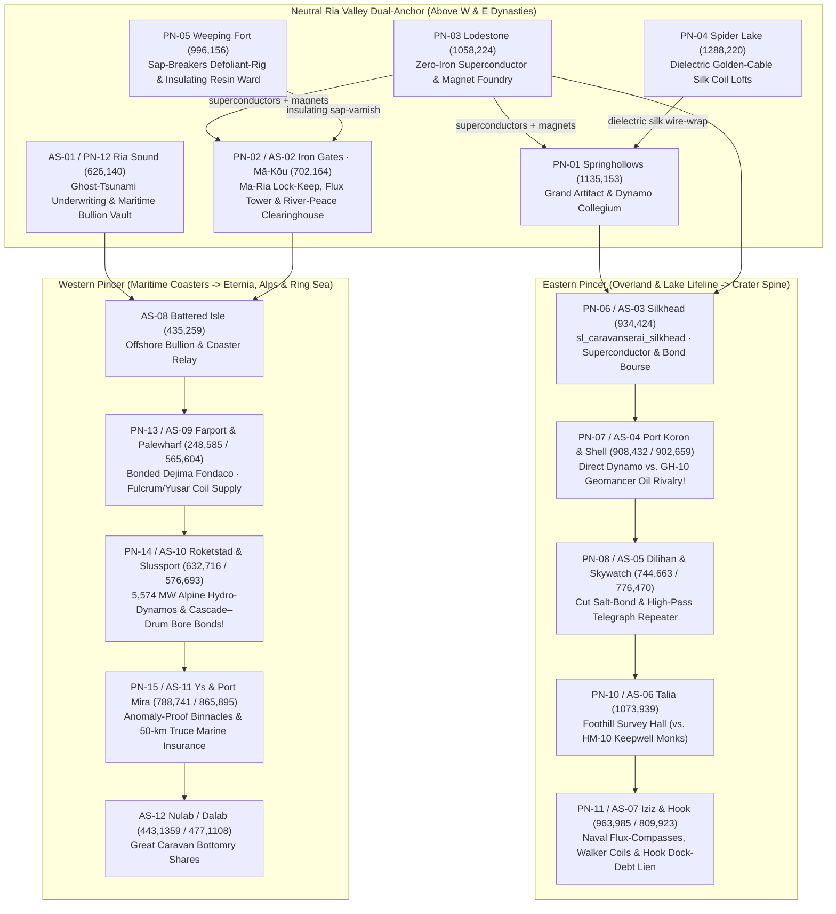

# Northern Trans-National Organizations Scope: *The Pioneers* ("The Technicians") & *The Court of the Amber Seal* ("The Seal-Bank")

> [!NOTE]
> **Status (`2026-11-22`):** **`[LOCKED]` (`Rulings #102–104`)** — Companion thematic scope to [CROOK-RIA-SCOPE.md](file:///home/antigravity/traviso761-debug/krator-master/core/region/CROOK-RIA-SCOPE.md), [GEOMANCER-SCOPE.md](file:///home/antigravity/traviso761-debug/krator-master/core/region/GEOMANCER-SCOPE.md), [MONASTERY-NETWORK-SCOPE.md](file:///home/antigravity/traviso761-debug/krator-master/core/region/MONASTERY-NETWORK-SCOPE.md), and [CONTINENTAL-SCOPE.md](file:///home/antigravity/traviso761-debug/krator-master/core/region/CONTINENTAL-SCOPE.md).
> **Directional Inversion:** Whereas the **Order of Historians** (`Longsong`, `Oidong`) and the **Yuni Geomancers** (`Locus` & `Shell`) push their networks **south-to-north**, these two Ria-Valley-born institutions stand strictly neutral above the divided Western and Eastern Ria Dynasties and push their technological, financial, and intelligence networks **north-to-south** into the Crater down twin continental pincers.

---

## 1. Comparative Niche Matrix: Zero Overlap With Existing Cartels

| Organization | Home Seat & Vector | Core Domain & Monopoly | Attitude Toward Ancient Tech & Relics |
|---|---|---|---|
| **1. *The Pioneers / The Technicians*** (*Society of the Needle* / *Flux-Line Collegium*) | **`Springhollows` `(1135,153)` & `"Iron Gates"` `(702,164)` -> SOUTH** | **Artifact-engineering**, `Lodestone` `superconductors`, `85 mT` flux-compasses, `Spider Lake` silk-insulated telegraphy, clean **hydro-dynamos**, eddy-current hoist/lock brakes & continental geodetic/magnetic surveying | **Pragmatic Re-Builders:** reverse-engineer, re-core with room-temp superconductors, and wire Ancient mechanisms into living infrastructure; view History Monks as timid hoarders |
| **2. *The Court of the Amber Seal*** ("The Seal-Bank" / *Kūri-Āmpala*) | **`Ria Sound` `(626,140)` & `"Iron Gates"` `(702,164)` -> SOUTH** | **Trans-national banking**, sovereign war/infrastructure bonds, maritime & Ghost-Tsunami cargo insurance (*bottomry*), treaty/ransom escrow, and **extraterritorial customs & canal-lock farming** | **Collateral & Cash-Flow Actuaries:** appraise ruins, bores, locks, and sovereign tolls as bondable revenue streams; stipulate Pioneer engineers on Seal-Bank-financed works |
| **Yuni Geomancers** | `Locus` `(1267,1043)` & `Shell` `(902,659)` -> Crater-wide | Subterranean **mining, petroleum drilling, naphtha refining, rare-earth acid-leaching** & chemical retorts | Burn fossil hydrocarbons & chemical reagents to power industry; bitter rivals to Pioneer clean hydro-dynamos in coal-poor states |
| **Order of Historians** | `Longsong` `(1229,1621)` -> North | Chronology, printing, `aggression: 0` sanctuary, **19 hidden piezo-radios** & containment of `RC-6` existential Relics (`Procrastinator`) | Dread a Second Cataclysm; publish safe mundane schematics (`+12%`) while sealing dangerous cores — alarmed by Pioneer artifact-rewiring |
| **Dalab Reformation** | `Dalab` `(477,1108)` -> West Rift | Somatic **genecraft**, `ancient-biogel` / `inferior-biogel` vats, servitor & `4A` Giant elevation | Biological/flesh transformation |
| **Yusar Master-Techs** | `Carcosa` `(395,812)` & `Henge` `(457,735)` | Neural **cybernetics**, live implant diagnostics & Valley salvage | Secretive clan-guild maintaining personal neural/servo implants |
| **Torus Rinkvolk *Tenders*** | `Torus` `(777,1003)` *(local sacred order)* | **Living arcology-forest & botanical stewardship** of the `Forest Ring`'s upper wild torus & terraced cultivars | *Protected boundary (`Ruling #104`):* Northern `Weeping Valley` (`996,156`) is handled by Pioneer **Sap-Breakers** (dismantling rogue defoliant machines & harvesting dielectric coil-varnish), leaving living forest/seed stewardship `100%` unique to Torus's Tenders |

---

## 2. Twin Southward Pincer Architecture

---

## 3. *The Pioneers / The Technicians* (`PN-01..PN-15`) — `[G data]` Specification

### 3.1 Origins & Neutrality Above the Ria Dynasties
- Both the Western Dynasty (`Lower Ria`, *Rīwa-Tōka*) and Eastern Dynasty (`Upper Ria`, *Līwa-Tōga*) depend on calibrated shut-in boat-lifts, `"Iron Gates"` lock-chains, *Santa Cristina* nephrite tsunami-warning float-telegraphs, and re-cored arcology water pumps (`Heartland` `796,176` & `Upper Ria` `1186,118`).
- Under the **Iron Gates Charter**, anyone wearing the **Paktong Caliper & Lodestone Needle** badge holds immunity from Dynastic conscription and river-blockades. Inside Ria they are called the *Society of the Needle* (*Kālō-Nīdala*); across the northern frontier boomtowns (`The Scaffold` `1246,18`, `The Skeleton` `1036,106`, `Lodestone` `1058,224`) and southern Crater cities they are universally known as **"The Pioneers"** or **"The Technicians"**.

### 3.2 Workshop Input-Output & Signature Technologies
- **Workshop Kind (`pioneer-atelier` / `dynamo-house`):**
  - **Inputs:** `superconductors` (`Compass Hills`), `magnets` (`lodestone`), `paktong` or `copper`/`bronze` non-magnetic housings, `silk` (`Spider Lake` `Golden Cable` dielectric wrap), `ria-amber` / `Weeping` sap-varnish insulation, plus salvaged `servomotors` / `ancient-sensors` / `scrap`.
  - **Outputs:**
    1. **Clean Hydro-Dynamos & Mill Electrification (`electrics`):** Bolt onto high-head waterwheels (`Roketstad` `Snou Bruk`, `Urverkstad`, `Dilihan` spring-drop, `Eternia` locks) to power arc-furnaces, Electrolytic refining, and mine hoists **without burning a single ton of Geomancer `oil` or imported `coal`**.
    2. **Anomaly-Compensated Flux-Compasses (`lenses` / `flux-binnacles`):** Essential on the Ring Sea and NW Ocean where buried crater-rim mascons and `Compass Hills` / `Cut` warp-anomalies deflect ordinary iron needles by `15°–60°`.
    3. **Silk-Wrapped Copper Telegraph Lines & Eddy-Current Cliff Brakes:** Short-haul wired semaphore/telegraph lines linking mountain passes (`Skywatch`, `Cascade`, `Talia`, `Silkhead`) and fail-safe magnetic eddy-current brakes on `90-second` tsunami cliff-hoists (`Farport`, `Ria Sound`) and scarp lifts.
    4. **Artifact Re-Coring:** Rebuilding dead pre-Cataclysm actuators, pumps, and walker relays using room-temperature `Lodestone` `superconductors` rather than irreplaceable `energy-cells`.

### 3.3 Covert Southward Agenda ("The Geodetic Ledger")
- Every hydro-dynamo governor, harbour compass-calibration pillar, and pass telegraph repeater installed south of `Silkhead` and `Farport` is surveyed to sub-arcsecond precision and logged in `64-sign` cipher back to `PN-01 Springhollows`.
- Over decades, the Pioneers are assembling the **only exact continental hydrological, pass-gradient, harbour-shoal, and `RC-1..RC-6` Relic flux-anomaly map of the Crater** — positioning northern industry (and whichever Ria Dynasty eventually reunifies the `Mā-Rīa`) to dominate southern infrastructure, while sparking quiet shadow-wars with **Geomancer** saboteurs (`Shell`, `Verge`, `Roketstad`) and **History Monk** *Keepwell* operatives (`Talia`, `Lux`, `Skywatch`).

---

## 4. *The Court of the Amber Seal* ("The Seal-Bank", `AS-01..AS-12`) — `[G data]` Specification

### 4.1 Why Krator Needed a True Bank Faction
- Prior to `Ruling #103`, commercial credit on Krator was fragmented among regional family trading houses (`Iziz`'s `Goldanda`/`Getmastarz`), oasis remittance brokers (`Yuni` *Aʿyān* `hawāla`), and domestic state mints (`Eternian` paper scrip, `Voth` silver exchequer, `Gihon` `qud` mint). None acted as an **autonomous, trans-national sovereign bond house, maritime/caravan insurance syndicate, and customs-farming bank**.
- Forged at **`AS-01 Ria Sound` `(626, 140)`** (where Ghost Tsunamis wiped out uninsured shore merchants every `20–35` years) and **`AS-02 Mā-Kōu / "Iron Gates"` `(702, 164)`** (where Western and Eastern Dynasty merchants needed neutral escrow to trade across a militarized river border), the **Court of the Amber Seal** stamps multi-party bonds into fossil `ria-amber` & sawn `nephrite-jade` tallies locked inside corrosion-proof `paktong` vaults.

### 4.2 Core Financial Mechanics (`SIM` & Regional Economy Hooks)
1. **Sovereign Toll & Customs Farming (`lienShare`):** Cash-strapped southern polities (`Iziz` financing the Voth war & `Hook` reconstruction; `Iron Republic` financing the `89 km` `Cascade–Drum` bore re-excavation & `L1–L7` locks; `Dilihan` capitalizing `Cut` potash/salt pans) take upfront `silver`/`gold` bullion advances from the local **Seal-Bank Countinghouse** in return for a `10–25%` bonded lien on port/lock/gate customs (`Hook`, `Port Koron`, `Slussport`, `Palewharf` Dejima pier, `Talia`).
2. **Pioneer Engineering Tie-In Clause:** Seal-Bank infrastructure bonds stipulate **Pioneer / Technician** oversight and equipment (`hydro-dynamos`, lock brakes, harbour flux-compasses), turning financial penetration directly into technological dependency!
3. **Maritime *Bottomry*, Tsunami & Truce-Zone Escrow:** At `Port Mira` (`50-km` truce zone), `Ys`, `Farport`, and `Silkhead`, Seal-Bank factors write neutral-flag cargo insurance (`Ruling #69` wartime arbitrage), hold pirate/privateer ransom escrow, and enforce continent-wide credit blacklists (`cartelDeterrence`, `Ruling #70`) against any ruler who defaults on or seizes an Amber-Seal vault.

---

## 5. Canonical `16`-Hub Placement Schedule (For `ALL-BUILDS-REBUILD-PLAN.md` & Region Bakes)

| Hub / Settlement | Coords `(px, py)` | Pioneer Facility (`PN-*`) | Seal-Bank Facility (`AS-*`) | Local Geopolitical Tension |
|---|---:|---|---|---|
| **`Springhollows`** | `(1135, 153)` | **`PN-01` Supreme Artifact & Dynamo Collegium** | Branch Bullion Assay | Neutral karst-spring enclave inside Upper Ria |
| **`Mā-Kōu` ("Iron Gates")** | `(702, 164)` | **`PN-02` Lock-Chain & Flux-Calibration Tower** | **`AS-02` Supreme River-Peace Clearinghouse** | Neutral hinge between Lower & Upper Ria Dynasties |
| **`Ria Sound`** | `(626, 140)` | `PN-12` Cliff-Hoist Brake & Binnacle Loft | **`AS-01` Supreme Maritime & Tsunami Vault** | `+78 m` tsunami-safe bluff above `0`-pop `Double Delta` |
| **`Lodestone`** | `(1058, 224)` | **`PN-03` Zero-Iron Superconductor Foundry** | Ore-Warrant Assay Desk | Strict `0` iron tool rule (`tin-bronze` + `nephrite-jade`) |
| **`Spider Lake`** | `(1288, 220)` | **`PN-04` Dielectric Silk Coil-Winding Loft** | Silk-Factor Advance Desk | *Hum*–Ria Silk Principality (`kits/spider-lake/`) |
| **`Weeping Fort`** | `(996, 156)` | **`PN-05` *Sap-Breakers* Containment Yard** | Hazard-Pay Disbursing Post | Dismantles defoliant rigs (`0` overlap w/ `Torus` Tenders!) |
| **`Silkhead`** | `(934, 424)` | **`PN-06` Eastern Pincer Gateway Workshop** | **`AS-03` Caravan Insurance & Bullion Bourse** | Inside `sl_caravanserai_silkhead` beside `HM-14` Monks |
| **`Port Koron` / `Shell`** | `(908,432)` / `(902,659)` | **`PN-07` Lake-Lock & Dynamo Depot** | **`AS-04` Planter Indenture-Paper Desk** | Head-to-head clash with `GH-10` Secondary Geomancer HQ! |
| **`Dilihan` & `Skywatch`** | `(744,663)` / `(776,470)` | **`PN-08/09` Pass Telegraph & Spring Dynamo** | **`AS-05` Cut Salt-Pan Bond Countinghouse** | Competes for `Cut` warp-field data with `HM-13`/`HM-15` |
| **`Talia`** | `(1073, 939)` | **`PN-10` Foothill Geodetic Survey Lodge** | **`AS-06` East-Gate Letter-of-Credit House** | Watched closely by `HM-10` *Keepwell* History Monks |
| **`Iziz` & `Hook`** | `(963,985)` / `(809,923)` | **`PN-11` Admiralty Flux-Binnacle & Servo Yard** | **`AS-07` Wartime Dock-Lien Countinghouse** | Finances `Hook` post-reconquest rebuild (`Ruling #94`) |
| **`Battered Isle`** | `(435, 259)` | Coaster Compass Station | **`AS-08` Offshore Bullion & Coaster Vault** | Neutral exile broker between `Ria Sound` & `Farport` |
| **`Farport` & `Palewharf`** | `(248,585)` / `(565,604)` | **`PN-13` Dejima Factory Dynamo & Hoist Yard** | **`AS-09` Bonded Treaty-Port *Fondaco*** | Supplies `superconductors` to `Fulcrum` & `Yusar` |
| **`Roketstad` & `Slussport`** | `(632,716)` / `(576,693)` | **`PN-14` Alpine `5,574 MW` Hydro-Dynamo Hall** | **`AS-10` `Cascade–Drum` Bore & Lock Syndicate** | Breaks `Iron Republic`'s coal/oil bottleneck (`Ruling #6`)! |
| **`Ys` & `Port Mira`** | `(788,741)` / `(865,895)` | **`PN-15` Ring-Sea Anomaly Compass Loft** | **`AS-11` `50-km` Truce Bottomry & Ransom Bank** | Neutral wartime shipping insurer (`Ruling #69`) |
| **`Nulab` / `Dalab`** | `(443,1359)` / `(477,1108)` | Cliff-Lift Brake Factor (`Ledge`/`Shelf`) | **`AS-12` Great Caravan Underwriting Desk** | Insures western leg of the Annual Great Caravan |
