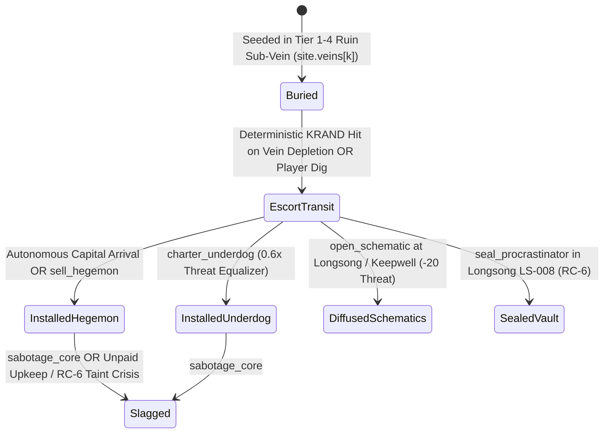

# Breakthrough Ancient Relics & Player Intervention Specification (`2026-11-22`)

> [!NOTE]
> **Status: `[APPROVED — BASELINE LOCKED, EXTENSIBLE (Rulings #52, #53, #57, #70, #73, #84)]` — Companion Scope to [CONTINENTAL-SCOPE.md](file:///home/antigravity/traviso761-debug/krator-master/core/region/CONTINENTAL-SCOPE.md).**
> Defines a pure `[G data]` simulation mechanic (zero `THREE`, zero DOM, `100%` deterministic `KRAND` milestones, append-only `relicEdits` delta log by stable `id`, and strict `77-sim-7-ledger.js` material/money conservation) on top of [50-region-valley.js](file:///home/antigravity/traviso761-debug/krator-master/core/region/50-region-valley.js) (`site.veins`) and [SCHEMA.md](file:///home/antigravity/traviso761-debug/krator-master/core/simulation/SCHEMA.md). The `RC-1..RC-6` class table below locks the continental baseline and remains open as an extensible registry (`SIM.relicKinds`) for culture- and region-specific Relics added in later settlement waves.

---

## 1. Design Goals & Core Loop

1. **Shallow Depletion -> Deep Breakthroughs:** Routine surface `scrap` scavenging (`site.veins[0]`) decays over `3–6` simulated years (`Ruling #73`), pushing `breakers-floor` works and chartered `KCAMP` salvage expeditions into sealed, higher-hazard sub-vaults (`veins[1..k]`) where **power-balance-changing pre-Cataclysm Relics** lie dormant.
2. **Physical On-Map Carrier Window (`14–45` Days):** Relics never teleport into a capital's buff slot. Whether unearthed by a polity's deep salvage crew or by the player, a Relic travels physically aboard a `KCAMP` / `SIM.trade` escort carrier (`state: 'escort_transit'`), generating courier rumors (`Ruling #81`) and an active interception/diplomacy window.
3. **Self-Balancing Geopolitics (Anti-Snowball Law):** Installing a major industrial or military Relic (`RC-1`..`RC-4`) drains scarce continental upkeep reagents (`energy-cells`, `machine-wax`, `fireclay`, `ancient-biogel` cold-chain) **and** raises `polity.relicThreat`. Crossing `relicThreat >= 45–60` automatically triggers rival superpower defensive coalitions, strategic input embargoes (`saltpeter`, `oil`, `copper`), and covert sabotage contracts.



---

## 2. Four Ruin Hazard & Salvage Depth Tiers (`Scale Model 5.1` Pins)

Builds directly on `50-region-valley.js` (`site.veins: [{amount, grade}, ...]`, advancing `Vw.at++` via `SIM.recipeSite`) and `geology.json` `RUIN_BIT` (`0x80`):

| Tier | Hazard & Salvage Regime | Crew Survival & Milestone Weight | Canonical Scale Model `5.1` Pins & Zones `(px, py)` | Vein Structure (`site.veins`) & Trigger Rule |
|---|---|---|---|---|
| **Tier 1: Domesticated / Surface Reoccupied** | Low hazard; surface picked clean over 1,000 yrs; only sealed sub-basements remain | `1.00×` survival;<br>`0.005` breakthrough weight | `Iziz` `(963,985)`, `Pylon` `(869,1002)`, `Hook` `(809,923)`, `Drum` `(673,932)`, `Torus` `(774,1007)`, `Ys` `(788,741)`, `Trigon` `(722,740)`, `Theodiga` `(908,1535)`, `Strongbow` `(1001,1596)`, `Arcbeam` `(1016,1058)`, `Parabola` `(970,1186)`, `Roketstad` Pad 5 `(632,716)`, `Cascade` `(568,841)` | `vein0..1`: bulk `scrap` / `glass-cullet`; `vein2` (sealed sub-vault, requires `gunpowder` / carbide drills): `1` latent relic check. |
| **Tier 2: Quarantined, Subterranean or Frontier Ruins** | Armed state cordons, hypoxia, flooded bores, or raider bands; rich mid-depth vaults | `0.55×` survival (`losses` on `KCAMP`);<br>`0.025` weight | `Ruins of Nazar` `(582,1079)` & `Wing` `(699,1042)` *(Voth Ordinators)*; `Cthonos` `(526,1503)` & `Chimes` `(468,1392)` *(West Rift)*; `Span` `(554,1010)` & `Grrmp-Sump` `(554,955)` *(Frogman flooded bore)*; `Tethis` `(733,775)` *(flooded gene-lab)*; `Noah's Regret` `(896,866)` *(via `Port Mira`)*; `Stair` `(1106,1442)`; `Quintagon` `(1358,945)`; `Corpus` `(520,693)` & `Footfall` `(560,767)`; `Veladiga` `(685,479)`, `Tilted Tower` `(614,490)` & `Boatmurder` `(766,404)`; `Leng` `(490,554)` *(Yeti)*; `Hall of Heroes` `(365,1474)` *(Kimr)*; `Sleeping City` `(1044,776)`, `Fort Kreia` `(1049,736)`, `Fort Ordo` `(1060,831)`, `Crescent` `(994,694)` & `Flooded Tower` `(1028,840)` *(`R87`)*; `Trickster's House` `(1512,660)` | `vein0`: surface rubble `scrap` (`3–6` sim yrs); `vein1..3`: deep cryo/armory vaults yielding `ancient-biogel`, `archaeotech`, and deterministic breakthrough checks on vein transitions. |
| **Tier 3: Eigenweapon, Drowned or Hostile-Swarm Megaruins** | `KANOM` physics wounds, `KHAZ.rad` radiation, `pH 2.5` rain, Lizardmen, or Screamers | **`0.10×` human** (`0.35×` Yusar drone / `Wheel` Cyberlich);<br>`0.08` weight | **`Ancient's Valley` (`rmvowuvfa6urs`):** `Babel` `(456,908)` (*The House*), `Necropolis` `(406,944)` (*Hard Rad*), `Dorado` `(483,964)` (*Drowned/Extraplanar*), `Blade` `(451,1022)` (*Mutagenic*), `Thera` `(526,955)` (*Temporal Stair*), & `basin1..7` melt-floors; **`The Pile / Cube`** `(720,1567)` *(deep in `92.5k` Lizardmen)*; **`Hexahedron`** `(817,670)` & `Fort Kalor` `(863,693)` *(Screamers)* | Requires specialized protection (`rubber`+`alkali` decon, `lung-salt`, diving gear, or `Yusar` drone-rigs); highest concentration of intact pre-Cataclysm industrial & military cores. |
| **Tier 4: Forbidden Apex AI, Vacuum & Stasis Cores** | Near-vacuum (`0.48 atm`), mad AI walker swarms, or active `The Call` psychic taint | `0.02×` autonomous (`player` or elite `Restorer`/`Keepwell` expedition only);<br>`0.25` weight | **`Hub 01`** `(1344,1409, +4,351 m)` *(mad Stalker AI — zero human survivors since Cataclysm)*; **`Pluton`** `(743,1328, +9,650 m, 0.48 atm)` *(Godthrone summit shaft)*; **`Wheel`** `(405,886)` *(`120` Cyberliches)*; **`Grand Vault` Six Sealed Doors** at `Yuni` `(1263,1089)`; **`The God` Sub-Core** at `Dalab` `(477,1108)`; **`Sanctum`** at `Fulcrum` `(409,621)` | Never strip-mined by routine town crews; unlocked only by deep multi-vein culmination or direct **Player Expedition**. |

---

## 3. Six Concrete Breakthrough Relic Classes (`RC-1` – `RC-6`)

Each Relic is a conserved, non-stackable `[G data]` record (`id: 'relic:<site>:<slot>'`) with bounded, auditable simulation hooks:

| Class ID | Relic Archetype & Lore Examples | Primary Ruin Sources | Economic / Infrastructure Effect (`SIM.recipe` / `SIM.economy`) | Military / Logistics Effect (`KCAMP` / `SIM.trade`) | Upkeep & Diplomatic Alarm (`threatDelta`) |
|---|---|---|---|---|---|
| **`RC-1` `fabricator`** | **Catalytic Fabricator & Sinter-Loom** *(e.g. `Starfish` Carbide Die-Press, Sinter-Metallurgy Matrix, Fractional Cracker Core)* | `Babel` Yards, `Quintagon`, `Drum`, `Veladiga`, `Footfall`, `Stair` | **`+35%` output `rate` & `-25%` `fuel`/`fireclay` input** on 1 target industrial `works` (`blast-furnace`, `hydro-forge`, `geomancer-refinery`, `porcelain-kiln`, `clockwork-bench`). | `+15%` `arms` / `iron-tools` warehouse cap & faster `building-upkeep` recovery. | `1 fireclay` + `1 machine-wax`/qtr;<br>**Moderate (`+18` Alarm):** Rival cartel drops `-1` stance if monopoly tech is duplicated. |
| **`RC-2` `aegis_siege`** | **War-Mech, Kinetic Shield & Eigen-Capacitor Core** *(e.g. Izani Barrier-Projector, Dormant `Castra` Siege-Walker Spine, Automatic Weapon Die)* | `Necropolis`, `Nazar`, `Wing`, `Hexahedron`, `Pylon`, `Hub 01`, `The Pile (Cube)` | Pulls **`2 energy-cells` + `1 machine-wax` / quarter** (`0` effect if unpowered! Drives `rare-earth`/`alkali`/`machine-wax` import demand). | **`+40%` garrison & `KCAMP` expedition combat cap**; cuts `losses` on escorted routes by **`-50%`**; breaks or restores Izani kinetic-shield parity (`LORE.md` §5.9). | **Severe (`+45` Alarm):** Neighbouring peer superpowers shift `-1` to `-2` stance & form defensive trade embargoes (`totalThreat >= 60`). |
| **`RC-3` `regulator`** | **Hydro, Geothermal & Tunnel-Bore Regulator** *(e.g. `Grand Vault` Steam-Turbine Core, Tungang Plasma-Header Shield, Desalination Condenser)* | `Dorado`, `Grrmp-Sump`, `Cthonos`, `Ledge`/`Loj Twenny`, `Pluton`, `Fulcrum`, `Theodiga` | Adds **`+250` clean `power` units/day** (`0` coal/oil burned!) **OR** clears collapsed subterranean bores (**`Cascade <-> Drum` `89 km` bore** Ruling #57, or **`Rift Line` gaps `G1–G3`**) in **`1/3` worker-hours**; `+40%` oasis `well` `regen`. | Unlocks year-round heavy freight (`cap × 2.5`, `closed: null`) through re-opened mountain tunnels! | `1 machine-wax` + `2 copper`/qtr;<br>**Low–Moderate (`+15` Alarm):** Reroutes continental `SIM.trade` flows overnight. |
| **`RC-4` `biomatrix`** | **Cryo-Vat & Neural-Diagnostic Matrix** *(e.g. Sealed Pre-Cataclysm `ancient-biogel` Cradle, `True Heir` Neural-Loom Stabilizer, Gene-Splicer)* | `Tethis` flooded lab, `Noah's Regret` medical holds, `Nazar`, `Wheel`, `Dalab` sub-core, `Blade` | Yields finite reserve of **`12–24` `ancient-biogel` lots** + **`+30%` `reformation-sanctum` / `cybernetics` yield**; in `Eternia`, cures `True Heir` implant madness without summoning `Yusar` techs (Ruling #52)! | Enables `Dalab` to elevate additional **`4A` Temple Giant** cohorts (`5.2×` melee, Ruling #36) or `-30%` plague/blight mortality (`Ruling #76`). | `ice`/`salt` cold-chain;<br>**Ideological (`+25` Alarm):** `Dalab` Genepriests, `Eternian` Wardens & `Voth` Ordinators demand custody. |
| **`RC-5` `telemetry`** | **Astronomical, Sonar & Beacon Array** *(e.g. Pointable Dish Feedhorn like `The Ear`, Sub-Sea Reef Transponder, Anker Ephemeris Core)* | `Parabola`, `Roketstad`, `Thera`, `Ys`, `Hook` Lighthouse, `Trickster's House`, `Leng` | **`2×` `almanacs` / `lenses` output**; cuts night/fog sea shipwreck `losses` by **`-60%`** within `400 km` radius. | `+2` days raid/armada warning lead & extends optical/radio courier speed **`3×` (`Ruling #81`)**. | `1 lenses` + `1 energy-cells`/qtr;<br>**Low (`+8` Alarm):** Courted peacefully by `Order of Historians`, `Jimjam` (`Skywatch`), and `League of Ys`. |
| **`RC-6` `apex_hazard`** | **Contaminated AI / Temporal / Extraplanar Core** *(e.g. `Hub 01` Sub-Mind, `Stilled Ground` Chronal Lens, `Dorado` Tear Anchor, *Tzintzun* Staff)* | `Hub 01`, `basin1..7` cores, `Wheel`, `The Pile`, `Hexahedron` brood-heart | Tempting **`+60%` power/research surge**, **BUT** accumulates deterministic `taint` (`+1/month`): past `taint >= 6`, triggers `unrest` (`treason`/madness), `KHAZ` contamination, or rogue mech spawns! | Devastating short-term siege/terror weapon with catastrophic backfire risk (`Hub 01` lesson). | **Existential (`+80` Alarm):** `Keepwell` Operatives, `Eternian` Wardens (`Veil`), and `Voth` Ordinators immediately dispatch strike/seizure teams! |

---

## 4. Deterministic Milestone Trigger & Five Player Intervention Verbs

### 4.1 Pure `KRAND` Vein-Exhaustion Milestone (`0` `Math.random()`)
Autonomous polities never roll per-frame RNG. A breakthrough check fires **only when a deep ruin vein `vein[k]` (`k >= 1`) depletes (`st.amount < 1` in `50-region-valley.js`) or a seasonal `KCAMP` deep-vault expedition finishes its dry-season leg**:
```js
/* [G data] Deterministic milestone check (core/simulation/SCHEMA.md) */
var h = KRAND.hash(V.seed, S.clock.day >> 3, siteIdHash, veinIdx, 0x52454c49);
var hit = KRAND.unit(h) < TIER_WEIGHT[site.hazardTier];
```

### 4.2 Five Append-Only Player Intervention Ops (`relicEdits.json`)
Player choices are stored as plain id-keyed deltas `{id: relicId, op: '...', targetPolity, witnessOrg, minute}` so Three.js and Godot replay identical world state:

| Player Verb (`op`) | Counterparty | Treasury / Reward (`77-sim-6-money.js`) | Power-Balance & Geopolitical Outcome |
|---|---|---|---|
| **1. `sell_hegemon`** *(Crown / Sanctum Auction)* | `Iziz`, `Voth`, `Eternal State`, `Xanadu`, or `Dalab` | Peak `SIM.pay` transfer (`500–2,500 Talents` / `quds` from buyer `treasury:<city>`, strictly conserved) + noble `station` / trade charter. | Buyer installs Relic at `1.0×` effect + **`100%` `threatDelta`**, sparking immediate rival coalition embargoes or border mobilization. |
| **2. `charter_underdog`** *(Asymmetric Equalizer)* | `Iron Republic`, `League of Ys`, `Beast Riders`, `Tiguantin`, `Ardent`, `Jimjam`, `Qoold Lheek`, `Vrivolci` | Moderate coin + permanent `allied` faction `stance`, custom mount/gear access, or workshop revenue `cut`. | **Rebalances regional power** at **`0.6×` `threatDelta`** (e.g. `RC-3` opens `Cascade <-> Drum` `89 km` bore for the Republic; `RC-2` shields `Ys` or `Tiguantin` against superpower invasion). |
| **3. `open_schematic`** *(History Monk Diffusion)* | **`Order of Historians`** (`Longsong` `HM-01` or `Keepwell` `HM-09`) | `esteem` stipend + `ESTABLISHED` sanctuary access (`The Ear`, `Sealed Library`) + `lenses`/`almanacs`. | Core is dismantled in Longsong's `Restoration Halls` into movable-type **`schematics` (`books`)** distributed across `HM-01..11` ([MONASTERY-NETWORK-SCOPE.md](file:///home/antigravity/traviso761-debug/krator-master/core/region/MONASTERY-NETWORK-SCOPE.md)): **`+12%` efficiency to ALL non-hostile polities** (`0` to `Voth` unless smuggled) and **`-20` continental `relicThreat`**! |
| **4. `seal_procrastinator`** *(Containment / Unmaking)* | **`Longsong` Deep Vault (`LS-008` Blank Seal or `Unmaking Room`)** | Highest `Order` & `Warden` (`Veil`) trust; averts `RC-6` catastrophe. | Clean resolution for **`RC-6` `apex_hazard`** cores — populates `40-ls-plan.js`'s intentionally blank **`LS-008` `(left blank)`** slot under `P.PROCRASTINATOR` (`slow: 1e-4`) or unmakes it permanently. |
| **5. `sabotage_core`** *(Covert Overload / Denial)* | Executed in situ or inside a rival's `generator` / `citadel` | Covert bounty from rival's enemy (`SIM.crime` / `Keepwell` operative contract). | Converts an active Relic to `state: 'slag'` (`scrap` + `glass-cullet` conserved in `SIM.ledger`), stripping the rival's buff and triggering a `30`-day power/unrest shock. |
