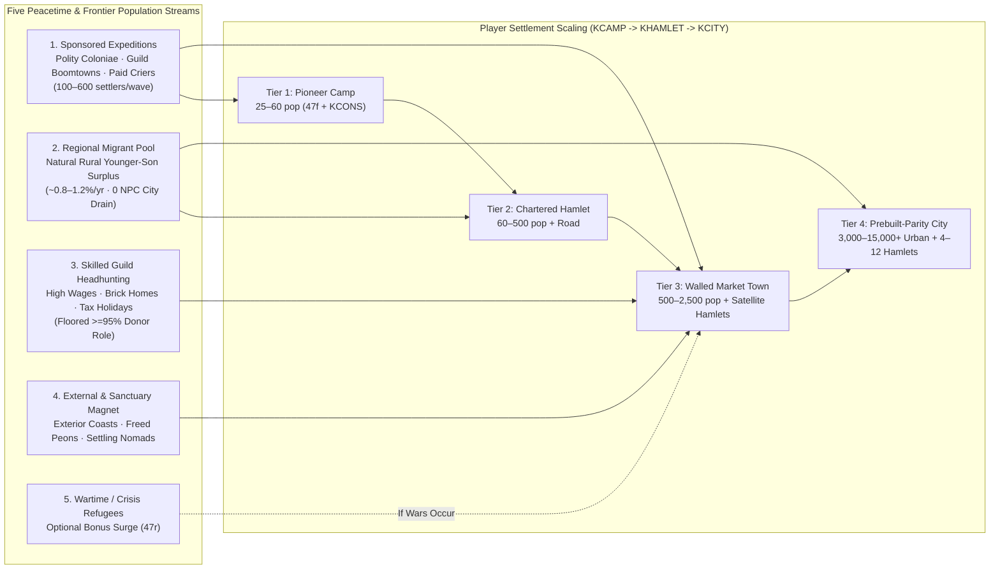

# Player Settlement Demography, Migration & Sponsored Colonization Scope (`2026-11-22`)

> [!NOTE]
> **Status: `[APPROVED — RULINGS #95–98]` — Companion Scope to [CONTINENTAL-SCOPE.md](file:///home/antigravity/traviso761-debug/krator-master/core/region/CONTINENTAL-SCOPE.md), [GEOMANCER-SCOPE.md](file:///home/antigravity/traviso761-debug/krator-master/core/region/GEOMANCER-SCOPE.md), and [BANDITS-PIRATES-BOUNTIES-SCOPE.md](file:///home/antigravity/traviso761-debug/krator-master/core/region/BANDITS-PIRATES-BOUNTIES-SCOPE.md).**
> Generalizes `core/region/47f-region-found.js` (`SIM.found`), `47r-region-refugees.js`, `47h-region-hamlets.js`, `core/city` (`KCITY` player settlement builder), and `core/simulation/77-sim-6-population.js` so **a player can grow a settlement from a `25`-person pioneer camp into a `5,000–15,000+` walled `KCITY` metropolis with its own satellite hamlet ring in complete peacetime** — without requiring massive wars, refugee catastrophes, or hollowing out prebuilt NPC cities.

---

## 1. Solving the Conservation Paradox: Where Do `5,000–15,000` Citizens Come From in Peacetime?

In `47f-region-found.js` (`isle-demo`), newly founded hamlets originally drew settlers *only* from `47r` refugee camps. On a continental scale (`~3.05M` souls across `27` spheres, `~65%` rural), relying on refugees alone would force massive wars just to populate one player city, while pulling raw actors 1-for-1 out of prebuilt towns would ghost-town `Talia` or `Dilihan`.

The `[G data]` solution combines **Natural Rural Cohort Surplus** with **Sponsored Colonization Expeditions** and **Bounded Internal/External Pull**:

1. **Continental Rural Cohort Surplus (`~0.8%–1.2% / yr` Net Landless Entrants):**
   - Across Krator's `~2,000,000` rural villagers (`KHAMLET`s in `Iziz`, `Eternal State`, `Jimjam`, `Dalab`'s lake basin, `Xanadu`, `Iron Republic`, `Ring Isles`), established villages sit at `100%` arable land (`inCropHa`) and `work` post capacity. Their natural demographic excess — **landless younger sons/daughters, Newly-wed cottagers, and apprentices (`~25,000–35,000/yr` continent-wide, or `~20–45` mobile households/week per major Sphere)** — enters a conserved regional **`migrantPool`** (`SIM.migration.pools[sphere]`).
   - **Zero Drain on Prebuilt Cities:** Drawing from `migrantPool` leaves every prebuilt city and village at **`100%` of its baseline population**! If no player or wildcat town claims a sphere's quarterly `migrantPool`, excess cohorts naturally age out / absorb into frontier camps or seasonal labor without runaway exponential population bloat.
2. **Bounded Urban Journeyman Mobility (`<= 5%` Cap per Donor Guild):**
   - High-skill specialists (`smiths`, `masons`, `glassblowers`, `physicians`, `machinists`, `scribes`) *can* be lured directly from existing cities (`Talia`, `Roketstad`, `Iziz`, `Yuni`, `Ys`), **strictly floored at `>= 95%` of each donor city's baseline role count** so NPC economies never stall, while natural apprentice promotion refills the donor slot over `60–90` sim days.

---

## 2. Sponsored Colonization Expeditions (`SIM.colonize` — Fast Critical Mass)

Just as `Dilihan`, `Shell`, and `Nusidi` were founded by **Imperial Veteran Charters** (`LORE.md:327`) and historical frontier cities grew by *Lokator* town charters, the player can launch or request **Sponsored Settler Expeditions (`100–600` people per wave)** across three political flavors:

| Sponsorship Path | Who Funds & Sends Settlers | Settler Composition (`100–250` per Convoy) | What the Sponsor Asks in Return | Lore & Gameplay Fit |
|---|---|---|---|---|
| **A. Polity Colonial / *Colonia* Charter** | **`Empire of Iziz`** *(Veterans' Bureau & `Hook` freedmen)*, **`Iron Republic`** *(Cantonal Assembly)*, **`League of Ys`** (*Apoikia* colony fleet), **`Jimjam`**, **`Xanadu`** *(Master of Mines)* | Balanced families: discharged soldiers/militia (`20%`), farmers/herders (`45%`), masons/carpenters/smiths (`25%`), scribes/priests (`10%`) + `60` days food, tools & livestock! | Nominal vassal/ally charter (`5–10%` customs share, trade access, or border-march defense — e.g. "Iziz-by-Letter" like `Dilihan`!). | Fastest path to a **`2,000–8,000` citizen culturally themed city** (`Iziz` vernacular, `Slavic` highland, `Ys` coastal, or `XAK` town). |
| **B. Guild, Syndicate & Order Boomtowns** | **`Geomancer Technate`** (`WC-01..12` delta/wildcat oil towns!), **Izani Merchant Houses** (`Goldanda`, `Saltroda`, `Farguogar`), **Salvagers' Guild** (`Pylon`/`Roketstad`), **`Order of Historians`** *(sanctuary hospice grant)* | Industry-heavy crew: drillers/miners, teamsters, warehouse clerks, `MC-01..03` guards + prefab `fireclay` / `iron-tools` / `timber` kits. | Dedicated concession compound (`10–15%` export cut on oil/ore/scrap or guaranteed caravanserai berths). | Turns **Geomancer delta wildcat claims (`Ruling #82`)**, ruin-edges, or highway gaps into bustling `1,000–5,000` industrial boomtowns! |
| **C. Independent *Lokator* / Free-Charter Drives** *(Sovereign Player!)* | **Player Purse (`Talents`)** via **Recruiting Criers & Passage Contracts** at Bourses (`Port Mira`, `Talia`, `Roketstad`, `Silkhead`, `Blakhed`, `Drum`) | Customizable mix! Player specifies target roles (`farmers`, `builders`, `miners`, `artisans`) and pays passage + `30`-day homestead advance (`15–40 Talents`/household). | **`0%` political strings!** Player remains **100% sovereign** over laws, taxes, and diplomacy. | Ensures an independent player never has to kneel to an Emperor just to populate a major city! |

---

## 3. Continuous Peacetime Migration: Internal Pull, External Arrivals & Sanctuary Law

Once a player settlement has a road (`ROADS.route` in `47f`) or harbour dock (`KCOAST`) connected to `SIM.trade`, weekly peacetime migration flows automatically via **`pullScore`**:

1. **The Weekly `pullScore` Formula (`[G data]`, Deterministic `KRAND`):**
   - Evaluated weekly (`48-region-week.js`) across every reachable Sphere within `SIM.trade` / passenger circuit range (`Ruling #79`, modulated by `Ruling #81` rumor propagation):
     - **Housing & Land (`openBeds`, `openParcels`):** Nobody migrates into homelessness unless fleeing a siege; building ahead of population (`KCONS` residential lots + `KHAMLET` satellite farm plots) is the #1 pull lever!
     - **Real Wages & Food Abundance (`realWage / regionalFoodPrice`):** Well-stocked granaries (`bread`, `fish`, `meat`, `beer`/`tea`) and active `works` payrolls pull `10–60` settlers/week along caravan & ship passenger berths.
     - **Charter Incentives (`taxHoliday`, `homesteadGrant`, `guildBounty`):** Player edicts (e.g. *"3-Year Tax-Free Burghers' Plot"* or *"50-Talent Master Smith Relocation Grant"*) multiply artisan and merchant arrival rates by **`2.5×–4.0×`**.
     - **Safety (`orderliness >= 0.65`, Walls & Garrison, `Ruling #94`):** Walled towns with cleared highway sub-camps attract families; bandit-choked roads throttle migrant caravans (`losses` / turn-backs).
2. **External, Maritime & Cross-Cultural In-Migration (`No Mainland Drain`):**
   - **Exterior Coast & Sea-Lane Voyagers:** Ships calling from `Farport` (`294, 588` exterior coastal traders), `Port Mira` (`865, 895`), `Ring Isles` outrigger fleets, and `Silkhead` (`934, 424`) bring **external settler households** from outside the inner-crater city ledgers.
   - **Free-Soil / Emancipation & Tolerance Magnet (`Rulings #71, #78, #93`):** Enacting **Free-Soil Law** draws steady covert arrivals of **`Shell` debt-peon escapees**, `Hook` container-tower freedmen, `Voth` quarry runaways, and pardoned frontier outlaws (`BF-03`, `BF-05`, `BF-10`), while **Cosmopolitan Quarters** let multi-cultural wards (`Izani`, `Highlander`, `Islander`, `Dasri`, `Talovolci`, `Frogman` dock-workers) form distinct architectural neighbourhoods!
   - **Nomad Sedentarization (`core/camp` -> `core/city`):** Reserving seasonal camp-grounds (`core/camp/PLAN.md` §5) for friendly `Dasri`, `Coyote`, `Fellgang`, or `Beast Rider` bands gradually spins off settled caravaneer, tanner, and stock-breeder households into permanent town lots.

---

## 4. Scaling to Prebuilt-City Parity: Satellite Hamlets & Multi-Level `SIM.level`

Prebuilt Krator cities (`Dilihan` `10k`, `Talia` `12k`, `Dalab` `24.5k`, `Roketstad` `32k`) never feed themselves from inside their city walls alone — `55–75%` of their regional census lives in surrounding `KHAMLET` villages (`CONTINENTAL-SCOPE.md` §1). Player settlements follow the exact same **4-Tier Urban + Hinterland Hierarchy**:

| Tier | Population Band | Urban Core (`KCITY` / `KCONS`) | Hinterland Ring (`KHAMLET` + `47h`) | `core/simulation` Performance Tier (`77-sim-7-lod.js`) |
|---|---|---|---|---|
| **Tier 1: Pioneer Camp** | `25 – 60` | `KCAMP` tents, store-shed, first derrick/mine/farm | `1` local field/stand | `presented` (`1:1` individual `SIM.actor`s) |
| **Tier 2: Chartered Village** | `60 – 500` | `KHAMLET` timber/brick houses, tavern, shrine, smithy + built `ROADS` spur | `2–4` farm/timber/fish parcels | `presented` (`1:1` individual `SIM.actor`s) |
| **Tier 3: Walled Market Town** | `500 – 2,500` urban *(`+ 600–2,000` rural)* | **`KCITY` Steps 6–12:** Walls & gates, central plaza, caravanserai, guild-works, watchhouse, chapterhouse/clinic | **`2–5` Satellite `KHAMLET`s** (`10–30 km` out) shipping `grain`, `timber`, `clay`, `stone`, `charcoal` into town warehouses | Active ward `presented` (`1:1`); outer wards & satellite hamlets `abstract` (`scale: 10` outside camera bubble) |
| **Tier 4: Major City / Metropolis** | **`3,000 – 15,000+` urban** *(`+ 4,000–20,000` rural)* | Multi-district walled `KCITY` (Old Quarter, Guild & Refinery Wards, Harbour/Hoist, Palace/Citadel, Mercenary Bourse, multi-cultural quarters) | **`6–15` Satellite `KHAMLET`s** + regional trade routes (`SIM.trade` fleets & caravan houses) | Seamless `SIM.level` streaming (`~300–600` live `1:1` actors around the player; full `15,000` conserved on `abstract` + `77-sim-7-ledger.js` books!) |

---

## 5. Locked Civic Laws, Multi-Kit Cultural Wards & Satellite Budding (`Rulings #95–98`)

1. **Physical Satellite `KHAMLET` Ring (`Ruling #97` — `[LOCKED]`):**
   - Once a player settlement exceeds `~500` urban residents, food/fuel/building-material demand triggers **Hinterland Hamlet Budding (`10–35 km` radius)** — either auto-sited (`KHAMLET.siteFor` on nearby arable `CROPS` soil, timber stands, clay banks, fishing coves, or ore nodes) or manually chartered by the player, wiring `2–15` real `KHAMLET` villages into the city's `ROADS` and `SIM.trade` cart network just like prebuilt `Dilihan`, `Dalab`, and `Roketstad`.
2. **Civic Charter Laws & Multi-Kit Ward Zoning (`Ruling #98` — `[LOCKED]`):**
   - **`Free-Soil` vs. `Comity` Edict:** Enacting **Free-Soil Sanctuary** boosts in-migration from **`Shell` debt-peon maroons (`BF-03`)**, `Hook` freedmen, and `Voth`/`Zeijani` escapees, at the cost of `-stance` / manhunter friction with slaver & peonage powers (`Ruling #78`).
   - **`Single-Culture` vs. `Cosmopolitan` Ward Zoning (`KCITY` District `kit` Key):**
     - A **Single-Culture Charter** builds every new block in the founder/sponsor's architectural kit (`kits/iziz-vernacular`, `kits/dilihan`, `kits/highlands` Slavic, `kits/islanders`, `kits/xanadu`, `kits/locus`, or `kits/yuni`).
     - A **Cosmopolitan Charter** lets distinct migrant communities petition for their own **Cultural Ward** (e.g. an Islander stilt-harbour ward, a Slavic highland carpenters' quarter, a Yuni/Geomancer retort compound, a permanent Nomad `KCAMP` ground outside the gate, a **Giant Quarter** enforcing `doorH >= 3.0–3.8 m` & `1.85–2.2×` ration stores for `Talovolci`/`Vrivolci` residents, or a **Canal/Basin Ward** for `Frogman` & `Hykkousoi` gill-folk)!

---

## 7. Multi-Kit Implementation Reference (`Rulings #99–101`)
- See [MULTI-KIT-SCOPE.md](file:///home/antigravity/traviso761-debug/krator-master/core/region/MULTI-KIT-SCOPE.md), [`core/kits/10-core-kits.js`](file:///home/antigravity/traviso761-debug/krator-master/core/kits/10-core-kits.js) (`KRATOR_KITS`), and [`tools/kit_pack.py`](file:///home/antigravity/traviso761-debug/krator-master/tools/kit_pack.py) for the sealed 28-kit architecture, living-tradition tradesman persistence (`Ruling #99`), permanent blueprint unlocks (`Ruling #100`), and ward + individual lot style policies (`Ruling #101`).
