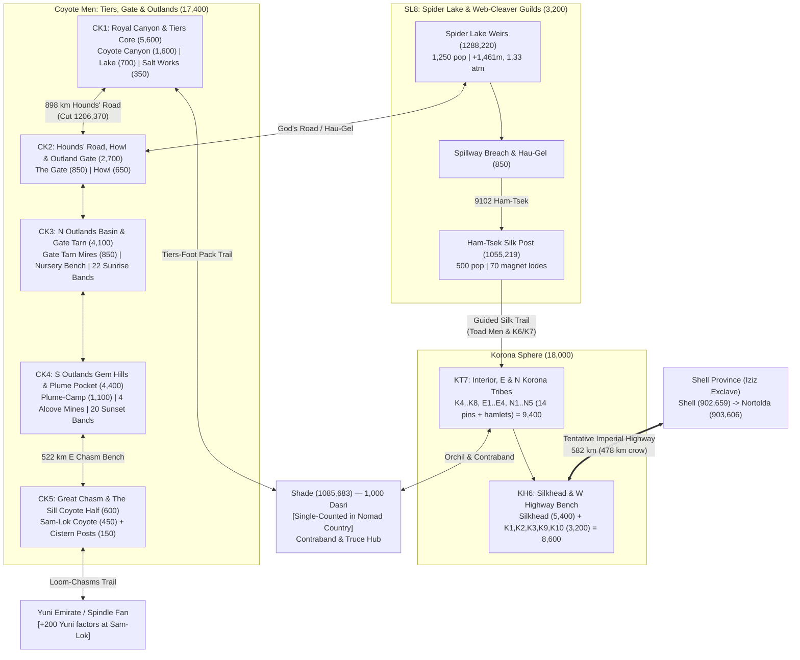

# Simulation & Settlement Scoping Proposal — Coyote Men (`Coyote Kingdom`), Korona (`Silkhead` & `Shade`), Spider Lake & the North/South Outlands

**Status:** Draft for Owner Review (`core/simulation` regional scoping)  
**Date:** 2026-11-18  
**Scope:** Scale-Model `5.1` (`1821 × 1723` px at `2 km/px`) — `Coyote Kingdom` (`rmvp5blj3m4ou`) & `Tiers` (`rmvp5il0uz1yf`), `Korona / NE` (`rmuqm3urh0mo6`: `Silkhead`, Western Imperial Highway Bench, Interior/Eastern/Northern Korona Tribes, and the `Shade` southern contraband border), `Spider Lake` (`rmvyj4v2ozgb1`) & `Arachnoid Canyons` (`rmvarachnoids`), `Outland Gate` (`rmvoutlandpass`), `N Outlands` (`rmvp5489oiy6z`), `S Outlands` (`rmvp52gbbc8pf`), `Great Chasm` (`rmw4vh9t20da4` & `The Sill / Sam-Lok`), and `Tharn Uplands` (`rmvtharnuplands`).  
**Companion Quantitative Scan:** Raw 1:1 raster, 39-family geology, highway profile, and `CROPS` / `KHAMLET` / `KCAMP` verification logged in `scratch/coyote_outlands_census_out.txt` via `scratch/scan_coyote_outlands.py`.  
**Cross-Session Alignments Locked:**
- **[PROPOSAL-IZIZ-EXCLAVES.md](file:///home/antigravity/traviso761-debug/krator-master/core/simulation/PROPOSAL-IZIZ-EXCLAVES.md)** (`Shell Province` Wards `S1`–`S3`: `Shell` `902,659` [`10,000`], `Buruku Hold` `906,638` [`800`], `Nortolda / Bitir Saltpeter & Korona-Watch Fort` `903,606` [`350`, `40.8 km` south of `Korona K9` `907,586`]).
- **[PROPOSAL-RAIDING-FACTIONS.md](file:///home/antigravity/traviso761-debug/krator-master/core/simulation/PROPOSAL-RAIDING-FACTIONS.md)** (`Painted Men` `5,200` across Clans I–IV in `rmumc14txxzq9` [`X=914..1128, Y=544..677`]: `PM1` `1101,624`, `PM2` `1015,611`, `PM3` `1058,600`, `PM4a` `954,611`, `Ràv-Lip` `956,554`, `orchil` lichen-dye trade with `K7`/`K8`/`K9`, and `Shade` truce fairs).
- **[PROPOSAL-BEAST-RIDERS.md](file:///home/antigravity/traviso761-debug/krator-master/core/simulation/PROPOSAL-BEAST-RIDERS.md)** (`R6` `Łichíí' Lake Post` `~1049,683` [`800` across 4 posts] on the `Pinnacle Rock <-> Shade (1085,683)` contraband & `dirt.coyote` corridor; `1.35 atm` / `+1,360 m` flyer ceiling).
- **Owner Canon Ruling Incorporated (2026-11-18):** *"there should be a tentative trade road, a poorly maintained imperial highway up north from shell to silkhead"* — traced cell-by-cell in **§4.2** (`477.8 km` crow-flies / `581.9 km` alignment road from `Shell` `902,659` through `Buruku Hold`, `Nortolda`, `K9`, `K10`, and `K2` to `Silkhead` `932,425`).

---

## 1. Hypsometry (`atm`), Hydrology, 39-Family Geology & `CROPS` / Outlands Ecology

### 1.1 Barometric & Thermal Architecture Across the Northeast Quadrant

Atmospheric pressure follows the global scale-model barometric law (`P(h) = 1.60 * exp(-max(0, h) / 8000 m)`, `pO₂ = 0.21 * P(h)`). Unlike the dense-air Ring Sea floor (`-1,500..0 m`, `1.60 atm`), the northeast quadrant spans the steepest barometric staircase on the map — from Korona's inner-ring trenches (`-2,557 m`, capped at `1.60 atm` in `CROPS.ATM = 'dense'`, physical `~2.20 atm`) up through the `+1,423..1,769 m` (`1.28–1.34 atm`) **Outland Gate** water-gap to the `+3,200..4,500 m` (`0.91–1.07 atm`) Outlands basins and the abiotic `+6,000..13,029 m` (`0.31–0.75 atm`) **Tharn Uplands** and outer crater walls.

| Region / Polygon (`5.1` ID) | Total Area (`km²`) | Land / Water (`km²`) | Elev `p10 / p50 / p90` (`m`) | `P(h)` `p10 / med / p90` (`atm`) | Rain `med [p10..p90]` (`mm/yr`) | `T_mean` `med` (`tw / tc` `°C`) | Dominant Köppen (`%` land) |
|---|---:|---:|---:|---:|---:|---:|---|
| **Coyote Kingdom** (`rmvp5blj3m4ou`) | `132,812` | `126,052` / `6,760` | `+427 / +4,237 / +6,074` | `0.75 / 0.94 / 1.52` | `94 [16..831]` | `+4.0` (`+17 / -9`) | `Dsc 21.8%`, `ET 19.3%`, `BWk 14.0%`, `BSk 13.7%`, `Csa 6.1%`, `BSh 5.1%`, `Aw 4.1%` |
| **Tiers (biome)** (`rmvp5il0uz1yf`) | `128,348` | `122,496` / `5,852` | `+694 / +4,232 / +6,354` | `0.72 / 0.94 / 1.47` | `94 [16..753]` | `+4.0` (`+17 / -9`) | `Dsc 21.5%`, `ET 21.0%`, `BSk 13.4%`, `BWk 13.2%`, `Csa 5.7%`, `BSh 5.1%` |
| **Korona NET** (`rmuqm3urh0mo6` excl. Coyote/PM/Shell/Nomad/FC/JJ) | `277,204` | `249,244` / `27,960` | `-949 / +997 / +4,311` | `0.93 / 1.41 / 1.80*` | `502 [94..1,710]` | `+22.0` (`+31 / +13`) | `BSh 16.8%`, `Cfa 14.5%`, `BWh 10.6%`, `BSk 9.1%`, `Aw 8.7%`, `Csa 7.3%` |
| **Spider Lake** (`rmvyj4v2ozgb1`) | `72,928` | `66,688` / `6,240` | `+1,340 / +1,613 / +2,701` | `1.14 / 1.31 / 1.35` | `1,459 [1,208..1,820]` | `+19.0` (`+29 / +10`) | `Cfa 90.8%`, `Dfc 4.7%`, `Cfb 2.9%`, `Dfb 1.0%` |
| **Arachnoid Canyons** (`rmvarachnoids`) | `437,092` | `436,032` / `1,060` | `+849 / +2,842 / +6,498` | `0.71 / 1.12 / 1.44` | `863 [63..1,569]` | `+12.0` (`+23 / +1`) | `Cfa 38.9%`, `ET 10.4%`, `Dfc 6.5%`, `Dsc 6.1%`, `EF 5.5%`, `Csa 5.3%` |
| **Outland Gate** (`rmvoutlandpass`) | `121,204` | `120,980` / `224` | `+1,634 / +4,371 / +10,640` | `0.42 / 0.93 / 1.30` | `706 [0..1,286]` | `+4.0` (`+16 / -8`) | `Cfa 36.1%` (`42,468 km² <2.5 km` trough!), `O 26.8%`, `ET 7.9%`, `HF 6.7%` |
| **N Outlands FULL** (`rmvp5489oiy6z`) | `404,312` | `400,036` / `4,276` | `+3,063 / +6,629 / +10,816` | `0.41 / 0.70 / 1.09` | `16 [0..816]` | `-11.0` (`+2 / -24`) | `ET 30.8%`, `O 27.1%`, `HF 7.9%`, `Cfa 7.6%`, `BSk 5.6%`, `EF 5.6%` |
| — *N Outlands Habitable (`<4,500 m`)* | *`94,368`* | *`90,092` / `4,276`* | *`+1,750 / +3,291 / +4,162`* | *`0.95 / 1.06 / 1.29`* | *`659 [157..1,365]`* | *`+10.0` (`+23 / -3`)* | *`Cfa 33.8%`, `BSk 20.1%`, `Dfb 12.8%`, `BWk 8.9%`, `Dfc 7.0%`* |
| **S Outlands FULL** (`rmvp52gbbc8pf`) | `217,620` | `209,976` / `7,644` | `+1,756 / +5,664 / +7,534` | `0.62 / 0.79 / 1.28` | `157 [47..1,004]` | `-7.0` (`+5 / -20`) | `ET 38.1%`, `BWk 16.6%`, `Dfb 9.3%`, `EF 9.2%`, `Dfc 5.0%`, `Cfa 3.4%` |
| — *S Outlands Habitable (`<4,500 m`)* | *`87,392`* | *`86,132` / `1,260`* | *`+740 / +2,840 / +4,093`* | *`0.96 / 1.12 / 1.46`* | *`376 [47..1,239]`* | *`+10.0` (`+21 / -1`)* | *`BWk 40.5%`, `Dfb 22.6%`, `Cfa 8.3%`, `ET 7.9%`, `BSh 5.0%`* |
| **Great Chasm** (`rmw4vh9t20da4`) | `73,996` | `73,996` / `0` | `-524 / +1,596 / +4,693` | `0.89 / 1.31 / 1.71*` | `47 [0..78]` | `+17.0` (`+24 / +9`) | `BWk 71.3%`, `XW 15.2%`, `ET 5.4%`, `HF 2.8%` |
| **Tharn Uplands** (`rmvtharnuplands`) | `405,568` | `405,568` / `0` | `+2,531 / +11,301 / +12,251` | `0.35 / 0.39 / 1.17` | `0 [0..1,082]` | `-90.0` (`O` cap) | `O 69.8%` (`>6 km` hypobaric), `Cfa 9.5%` (NW/SW rim apron `<2.5 km`), `HF 5.9%` |

> [!IMPORTANT]
> **Three Structural Barometric Regimes Govern Settlement & Carrier Physics:**
> 1. **Dense-Air Trenches, Gate Trough & Plume Pockets (`-2,500..+1,800 m`, `1.28–1.60+ atm`):** Includes `Silkhead` (`-122 m`, `1.60 atm`), `Shade` (`-406 m`, `1.60 atm`), `Coyote Lake Village` (`+132 m`, `1.57 atm`), `Coyote Canyon` (`+1,603 m`, `1.31 atm`), `Spider Lake` (`+1,460 m`, `1.33 atm`), `The Gate` (`+1,423 m`, `1.34 atm`), `Gate Tarn Mires` (`+1,769 m`, `1.28 atm`), and `Peak Coyote Plume-Camp` (`+699 m`, `1.47 atm`). Note also that **Beast Rider flyers cap at `1.35 atm` (`+1,360 m`)** ([PROPOSAL-BEAST-RIDERS.md](file:///home/antigravity/traviso761-debug/krator-master/core/simulation/PROPOSAL-BEAST-RIDERS.md)): raptors/wyverns can reach `Shade` (`-406 m`) and low Korona trenches, but **cannot fly over the Tiers (`+4,237 m` median), `Coyote Canyon` (`+1,603 m`), `Spider Lake` (`+1,460 m`), or `The Gate` (`+1,423 m`)**.
> 2. **Earth-Normal Mid-Highland Basins (`+2,300..+4,500 m`, `0.91–1.20 atm`):** Because sea-level pressure is `1.60 atm`, `+3,760 m` equals **`1.00 atm` (`0.21 atm O₂`, Earth sea level!)**. This is why the `3,200–4,200 m` N/S Outlands basins (`Nursery Bench` `+4,007 m` = `0.97 atm`, `S Outlands Mires` `+3,196 m` = `1.07 atm`), `Korona K7 Hoar Table` (`+3,825 m` = `0.99 atm`), and the Tiers' `3,500–4,500 m` summer pastures (`39,740 km²` at `0.96 atm`) are fully breathable for Coyote Men and cold-hardy humans, constrained by frost and aridity rather than hypoxia!
> 3. **Hypobaric Alpine & Outer-Wall Dead Zone (`>4,800..13,000 m`, `0.31–0.88 atm`):** Covers `42.0%` of `Coyote Kingdom`, `75.7%` of `N Outlands`, `58.9%` of `S Outlands`, and `58.8%` of `Tharn Uplands` (`O` / `HF` / `ET` / `EF`). Uninhabitable for permanent settlement; crossed only on engineered cuts such as the **Hounds' Road 16-cell Cut** (`1206,370`, `+6,000..6,445 m`, `0.71–0.75 atm` — Earth `~2,500 m` equivalent, passable by unladen Coyote runners and summer pack strings).

### 1.2 Master Hydrology & Water-Gap Corridors

Four drainage systems knit the sphere together:
1. **The Outland Gate — Spider Lake — Web-Cleaver Trunk (`9106 Hau-Gèl` -> `Spider Lake` -> `9102 Hām-Tsēk`):**
   - **`9106` `Hau-Gèl` (*Outland Gate River*):** Rises in N Outlands' `+2,241 m` lake basin (`4,276 km²` water, center `1572,604`), drops through `Upper Gate Tarn` (`1544,474`, `+1,521.5 m`, `224 km²`) past `Gate Tarn Mires` (`1544,470`), threads **The Gate** (`1438,326`, `+1,423 m`) at **`Q = 640 m³/s`** (`680 km` mainstem), and empties into **Spider Lake** at `(1328,228)` (`+1,460.0 m`, `6,240 km²` inside `rmvyj4v2ozgb1`, `8,716 km²` full basin water).
   - **`9102` `Hām-Tsēk` (*Web-Cleaver River*):** Bursts out of Spider Lake's single southwest spillway breach at `(1272,193)` (`+1,449 m`) at **`Q = 1,650 m³/s`** (`890 km` length), carving the Venusian volcano-tectonic **Arachnoid Canyons** past **`Ham-Tsek Silk Post`** (`1055,219`, `+847 m` bench above the `+413..680 m` gorge).
2. **The Tiers Canyon-Step & Southern Fresh Lake System (`Coyote Kingdom`):**
   - Dominated by `398 km` of seasonal flash-flood wadis (`r432 Tsēk-Gèl` `308 km`, `r461 Sām-Gèl` `148 km`, `r479 Yūt-Gèl` `97 km`, `r484 Hāk-Gèl` `87 km`) plunging off `+4,000..6,400 m` quartzite/granite benches into **`6,760 km²` of fresh Tier-foot lake** (`level = +380.1 m`, center `1234,539`, fed by perennial `r121 Yūt-Hām` `Q = 39.5 m³/s` and `r387 Lām-Kē` `Q = 17.7 m³/s`), on whose warm `Aw` south shore stands **`Coyote Lake Village`** (`1220,564`).
3. **Korona Concentric Ring-Trench Rivers (`Sīng-Hām`, `Hōng-Hām`, `Hau-Kē`, `Tōng-Hām`, `Ràv Rìv`, `Àirn Rìv`):**
   - Perennial ring-fault rivers draining westward and inward into `27,960 km²` of deep inner-ring lakes (`-1,890 m` median level): **`r045 Sīng-Hām`** (`Q = 91.3 m³/s`, `119 km`, the primary river barrier crossed by the `Shell -> Silkhead` Imperial Highway at `911,542`), `r062 Hōng-Hām` (`68.7 m³/s`), `r085 Hau-Kē` (`55.2 m³/s`), `r125 Tōng-Hām` (`38.7 m³/s` at `K1`/`Silkhead`), `r185 Ràv Rìv` (`25.1 m³/s`), and `r199 Àirn Rìv` (`23.6 m³/s`).
4. **South Outlands `Sām-Hām` Plume Basin vs the Waterless Great Chasm:**
   - S Outlands' perennial **`r098 Sām-Hām`** (`Q = 47.0 m³/s`, `151 km`) and `r244 Pāk-Kē` (`16.1 m³/s`) feed the dense-air `+705.3 m` lake (`1,260 km²` below `4.5 km`, `Peak Coyote Plume-Camp` at `1656,700`). Immediately south (`Y = 798..1032`), **`great chasm` (`rmw4vh9t20da4`, `73,996 km²`) has `0` perennial pixels, `0` wadi pixels, and `0 km²` surface water** (`47 mm/yr` median rain) — making rock-cut cisterns mandatory along the `522 km` east bench road to **`The Sill (Sam-Lok)`** (`1697,1028`).

### 1.3 39-Family Geology, Placer Belts & `ledger.json` Audit Resolution

Scanning [geology.json](file:///home/antigravity/traviso761-debug/krator-master/kits/resources/data/geology.json) (`911 × 862` cells at `16 km²/cell`) and [ledger.json](file:///home/antigravity/traviso761-debug/krator-master/kits/resources/data/ledger.json) across our polygons reveals a sharp mineralogical division of labor — and explains both the **`emerald` / `turquoise`** test in [test-hamlet-coyote.js](file:///home/antigravity/traviso761-debug/krator-master/core/hamlet/test-hamlet-coyote.js) and the single `Coyote Kingdom` failure in `ledger.json`:

| Region | Dominant Rock Provinces | Signature High-Yield Lodes (`Good >= 100` `km²` / `GoodYield`) | Placer Gold / Tin Belts | Strategic Scarcities |
|---|---|---|---|---|
| **Coyote Kingdom** (`126,052 km²`) | `quartzite 65.2%`, `sedimentary 12.8%`, `crystalline 12.7%`, `granite 9.2%` | `saltpeter` (`92,352 km²` / `4,437`), `iron` (`32,800` / `2,120`), `tin` (`11,760` / `593.5`), `silver` (`457.5`), `gold` (`446.5`), `rare-earth` (`382`), `silica` (`234`), `diamond` (`2,352 km²` / `22.0`), `emerald` (`224 km²` / `2.0`), `turquoise` (`192 km²` / `0.5`) | **9 gold + 11 tin placers** inside (`r461`, `r479`, `r484`, `r533`, `r624` on E Tiers fans) | Zero coal/oil; **`Coyote Canyon` (`1265,500`) has `0` halite within `30 km`**, solved by **`Coyote salt works` (`1190,463`)** on the W Korona-Tiers evaporite contact (`rawMax30 halite = 225`, `6` good halite + `8` alkali + `3` gypsum + `1` potash lodes in `30 km`!) |
| **Korona NET** (`249,244 km²`) | `quartzite 88.0%`, `evaporite 9.0%`, `sedimentary 3.0%` | `saltpeter` (`98,432 km²` / `4,003`), `silica` (`14,112` / `504`), **`halite`** (`4,160` / `304`, peak `248` at `1098,454`; `52` good lodes within `30 km` of `Silkhead`!), `gypsum` (`277`), **`alkali`** (`159`), **`diamond`** (`9,664 km²` / `98.0`, peak `1000,338` near `K6`!), `alabaster` (`28`), `potash` (`19`), `nickel` (`15.5`), `iron` (`14.5`) | Minor border placers (`9102`, `r203` near `Shade`/`Łichíí'`) | **Iron-poor (`GoodYield = 14.5`) & tin/copper-barren** across central/western Korona — explaining why `Korona Tribes` and `Silkhead` must import iron/tools from `Shell`, `Jimjam`, or `Coyote`! |
| **Spider Lake & Arachnoids** (`502,720 km²`) | `carbonate 100%` (Spider Lake); `sedimentary 40.1%`, `quartzite 21.5%`, `impact 17.9%` (Arachnoids) | **`amber`** (`154,608 km²` combined / `1,925.5` yield!), **`lodestone` (`magnets`)** (`46,784 km²` rich `220` in Arachnoids / `1,218.5` yield — **`70` good lodes within `30 km` of `Ham-Tsek Silk Post`!**), `peat` (`326`), `marble` (`138`), `iron` (`10,096` in N/W Arachnoids), `tin` (`884`), `gold` (`814.5`), `emerald` (`143`), `turquoise` (`134.5`) | `3` low gold/tin placers on `9102 Hām-Tsēk` (`1091,333`) | `Spider Lake` proper is pure limestone/amber/peat (`halite max = 12`); imports all salt and heavy metalware via `Silkhead` or `The Gate` |
| **Outland Gate, N & S Outlands** (`731,000 km²` land) | `crystalline 51–63%`, `granite 14–26%`, `sedimentary 10–20%`, `evaporite 7.1%` (S Outlands) | **World's premier gem & polymetallic province:** **`emerald`** (`480,064 km²` good / **`4,943` GoodYield**!), **`turquoise`** (`374,672 km²` good / **`4,807.5` GoodYield**!), `iron` (`43,235`), `saltpeter` (`26,786`), `gold` (`9,532.5`), `silver` (`9,335`), `tin` (`8,051.5`), `rare-earth` (`7,036.5`), `silica` (`468.5`), `copper` (`63.0` good, peak `170` at `1592,660`), S Outlands `halite` (`39.0` good at `1592,670`) & `potash` (`38.5`) | **64 gold + 68 tin placers** across N & S Outlands (`load` up to `7.04` gold & `12.84` tin at `1533,478` / `1667,682`!) | Timber & grain restricted to `<4,200 m` basins; zero volcanic obsidian (`volcanic = 0` — Coyote knappers flake `silica` quartzite/chert `157–162` and impactite glass `255` at `Vitreous Hollow` `1258,326`!) |
| **Great Chasm & The Sill** (`73,996 km²`) | `crystalline 39.6%`, `granite 26.3%`, `sedimentary 25.4%`, `evaporite 8.1%`, `basalt 0.5%` | `iron` (`4,005`), `saltpeter` (`3,665.5`), `tin` (`929.5`), `gold` (`754`), `silver` (`718.5`), `turquoise` (`174.5`), `emerald` (`143`), plus **`41` good `copper` lodes (`170` in `60 km`) right at `The Sill (Sam-Lok)` (`1697,1028`)** | Dry chasm walls (no perennial wash) | **`0` water, `0` wood, `0` clay** — pure caravan corridor & dry-wall copper/saltpeter/gem transfer post |

### 1.4 `CROPS` Audit, Outlands Flora/Fauna ([SURVEY.md](file:///home/antigravity/traviso761-debug/krator-master/biomes/outlands/SURVEY.md)) & Spider Lake Arachniculture

Running `CROPS.forBiome` and `CROPS.at` in Node against [kits/crops/src/](file:///home/antigravity/traviso761-debug/krator-master/kits/crops/src/) uncovered a critical **wiring gap** alongside clean site-level crop palettes:
1. **`CROPS.BIOMES` Registration Gap (Actionable `[G data]` Fix):** While `necanyons` (Korona, `88` rain/wild crops), `paintedhighlands` (`75` rain + `32` irrigated), and `loom-chasms` (`69` rain + `50` irrigated) are registered in `CROPS.BIOMES`, **six biomes in our sphere throw `crops: no biome <name>`**: `outlands`, `tiers`, `spiderlake`, `arachnoids`, `outlandgate`, and `greatchasm`! Until those six zone rows are added to `kits/crops`, settlements in those biomes must call `CROPS.at({warmth, arid, atm, wet})` directly:
   - **`Silkhead` (`-122 m`, `tropic/subhumid/dense`, `wet=true`):** `76` rainfed/wild crops (`rice`, `ashmillet`, `wild-rice`, `bambara`, `taro`, `sweet-potato`, `shade-manioc`, `breadfruit`, `banana`, `plantain`).
   - **`Korona` Highway Bench (`K9` `1,787 m` -> `K2` `517 m`):** Shifts from `44` temperate crops at `K9` (`frostoat`, `helix-bean`, `acorn`, `wingnut`, `persimmon`, `tamarillo`, `rowan`) to `66` subtropic crops at `K2` (`rice`, `emmer`, `helix-bean`, `sweet-potato`, `murnong`, `painted-camas`, `pinyon`, `almond`).
   - **`Korona K7 Hoar Table` (`3,825 m`, `0.99 atm`, `cool/humid/standard`):** `47` cool highland crops (`frostoat`, `helix-bean`, `fiddlehead`, `crabapple`, `serviceberry`, `rowan`, `bilberry`, `tea`, `bistort`, `mountain-sorrel`, `cloudberry`), plus wild `orchil` / `circlelichen` dyes and snow-lotus reagent.
   - **`Spider Lake Weirs` (`1,461 m`, `1.33 atm`, `subtropic/wet/dense`) & `Gate Tarn Mires` (`1,769 m`):** `21–24` perhumid wetland crops (`rice`, `wild-rice`, `ashroot`, `wineweed`, `fiddlehead`, `ironplum`, `tamarillo`, `coffee`, `tea`, `mat-reed`, `willow`, `lotus-root`, `lotus-silk`, `bamboo`).
   - **`Coyote Canyon` (`1,603 m`, `1.31 atm`, `subtropic/semiarid/dense`, spring/wadi-irrigated):** `59` rainfed/dryland (`emmer`, `basin-amaranth`, `helix-bean`, `tepary-bean`, `sweet-potato`, `murnong`, `painted-camas`, `pinyon`, `pistachio`) + `13` irrigated (`rice`, `wild-rice`, `tea`, `mat-reed`, `lotus-root`).
   - **`Coyote Salt Works` (`2,355 m`, `1.19 atm`, `temperate/arid/standard`, `wet=false`):** Only `14` hardy xerophytes without irrigation (`basin-amaranth`, `pistachio`, `juniper`, `umbel-seed`, `dustmillet`, `cave-date`, `bench-garlic`, `rabbitbrush`, `cave-madder`).
   - **`N Outlands Nursery Bench` (`4,007 m`, `0.97 atm`, `cool/arid/standard`):** `13` dry-steppe crops (`juniper`, `sweetroot`, `bearroot`, `snowpotato`, `goldroot`, `dustmillet`, `bench-garlic`, `circlelichen`) + `37` spring-irrigated (`helix-bean`, `painted-camas`, `apricot`, `serviceberry`, `bilberry`, `bistort`).
   - **`S Outlands` (`Plume-Camp` `699 m`, `1.47 atm` vs `Mires / Gem Hills` `3,196 m`, `1.07 atm`):** `66` warm valley crops (`rice`, `emmer`, `sweet-potato`, `pinyon`, `almond`) below vs `49` cool montane crops (`frostoat`, `helix-bean`, `tea`, `cloudberry`, `bilberry`) above, plus `biomes/outlands/SURVEY.md`'s **Fog Wall colonial fungoid flora** (`reagent` / `mushroom` / `incense` exports) and boreal muskeg peat.
2. **Endemic Animal Husbandry & Live Arachniculture:**
   - **Outlands / Tiers Pastoralism (`biomes/outlands/PLAN.md` & `core/camp/11-camp-coyote.js`):** Coyote *Sunrise* (`Tōng-Hau`) and *Sunset* (`Sī-Hau`) bands herd **flightless Outland ostriches** (`cy_ostrich_pen`, `cy_feather_rack`, `cy_egg_cache` — yielding plumes/feathers, giant eggs, meat, and light pack/scout mounts) alongside **mountain goats/sheep** (`cy_fold` — wool, cheese, hides) and hunt steppe hexapods across N Outlands' `BSk` plains.
   - **Spider Lake Live Smudge-Smoke Silk Harvest (`biomes/spiderlake/PLAN.md` & `TRADE-SCOPE.md` §7.1):** Eusocial *Arachneapolita sericifera* weave multi-hectare communal sheet-canopies across `Cfa` `1,804 mm` lakeside cedar/willow arbors around `+1,460 m` Spider Lake (`0.28 atm O₂` fuels giant chelicerate metabolism). Human `Spider Lake Guilds` never kill the colonies; smudge-pot crews calm a sector on a 4-year rotation to reel **three commercial grades**:
     1. **`Golden Cable` (`cordage`):** `1.3 GPa` dragline hawser — prized across the Ring Sea (`League: Tethys`, `Fulcrum`, `Jimjam`) for ship rigging, crane cables, and Beast Rider harness lines.
     2. **`Cloud-Fleece` (`wool` / `qiviut`-tier thermal batting):** Waterproof egg-sac & winter-nest felt.
     3. **`Lake-Sheen Gossamer` (`silk`):** Iridescent fine filament woven at `Silkhead`, `Mav's Refuge`, and Imperial courts.

---

## 2. Coyote Men Species Bio-Energetics, Social Structure & Kit / `peoples.json` Audit

### 2.1 Species Bio-Energetics & Behavioral Ecology (`Coyote Men`)

Cross-referencing [LORE.md](file:///home/antigravity/traviso761-debug/krator-master/LORE.md), [kits/coyote/PLAN.md](file:///home/antigravity/traviso761-debug/krator-master/kits/coyote/PLAN.md), [peoples.json](file:///home/antigravity/traviso761-debug/krator-master/core/charactermodels/data/peoples.json#L3095-L3161), and [22-hamlet-coyote.js](file:///home/antigravity/traviso761-debug/krator-master/core/hamlet/22-hamlet-coyote.js) establishes the `[G data]` simulation profile for **Coyote Men**:
- **Morphology & Scale (`CY.SCALE = 1.0`):** Digitigrade canid-humanoid therians (`height = 1.65–1.80 m` to crown, **`2.00 m` clear to erect pinnae tips** — hence `kits/coyote`'s mandatory `2.0 m` "ear doors" and `0.30 m` digitigrade ladder-rung spacing). Coated in tawny-ochre/grey desert-steppe pelage (`peoples.json`: `coyote_men`), shedding heat via panting + large vascularized ears and retaining warmth down to `-15 °C` in winter undercoat.
- **Metabolic & Locomotor Multipliers (`core/simulation` `[G data]` constants):**
  - **Caloric intake:** `1.05×` standard human baseline (`~2,200 kcal/day`), omnivorous with higher protein/fat tolerance (`0.40` meat/egg/fish/legume share vs `0.60` grain/tuber/nut; `0.85×` water demand in `BSh`/`BWk`/`BSk` drylands due to nasal counter-current moisture recovery).
  - **Endurance trotting & thin-air tolerance:** Digitigrade elastic-tendon gait yields **`1.35×` overland foot/courier speed** (`45–55 km/day` sustained runner-relay between `cy_runner_shrine` posts) and **`0.75×` slope penalty** up to `slope = 0.80` (`38.7°`, matching `KHAMLET.CULTURES.coyote_tier.slopeMax = 0.8`). Broad thoracic capacity grants unpenalized work down to **`0.80 atm` (`~5,545 m`)** and seasonal pass transit to **`0.70 atm` (`~6,600 m`, Hounds' Road Cut)**.
- **Language, Script & Social Five-Fold Division (*Hum*):**
  - Speak **Hum**, a tonal contour language whose pitched syllables end sentences in a rising-falling **howl**; carved into lintels and boundary stones as continuous geometric tone-lines (`cyContour`, verified by `11/11` assertions in [test-contour.js](file:///home/antigravity/traviso761-debug/krator-master/kits/coyote/tests/test-contour.js)).
  - Divided into **five socio-ecological nations** under the loose paramountcy of the Tierhound High Council at **`Coyote Canyon`**:
    1. ***Lōk-Hau* (`Tierhounds`, `coyote_tier`):** Stepped-terrace canyon dwellers, toll-keepers of `The Gate` & `Howl`, and lake-weir fishers (`Coyote Canyon`, `Coyote Lake Village`, `The Gate`, `Howl`).
    2. ***Hām-Hau* (`Valley Coyotes`, `coyote`):** Roof-entered 2-storey Çatalhöyük mud-brick tell farmers, reed-weir tenders, and salt-boilers (`Gate Tarn Mires`, `Coyote Salt Works`, N Outlands tells).
    3. ***Kām-Hau* (`Peak Coyotes`, `coyote_peak`):** 3-storey Mesa Verde cliff-alcove emerald/turquoise/gold miners and plume-camp traders (`S Outlands` Gem Hills, `Peak Coyote Plume-Camp`, `The Sill`).
    4. ***Tōng-Hau* (`Sunrise Herders`, `coyote-herder`):** N Outlands & NE Tiers ostrich-and-goat transhumant tipi bands (`~60` souls / `8` households per `KCAMP` horseshoe pitch).
    5. ***Sī-Hau* (`Sunset Herders`, `coyote-herder`):** S Outlands & SW Tiers transhumant bands wintering in `Peak Coyote Plume-Camp` (`699 m`) and Tier-foot stone-ring bases (`cy_winter_base`).

### 2.2 Human & Non-Coyote Neighbour Populations in Sphere

| Population Group | Polities / Sites | Kit / `KHAMLET` / Character Wiring | Economic & Social Role |
|---|---|---|---|
| **Silkhead Guild-Burghers** (Human, mixed Korona / Jimjam / Imperial factor stock) | `Silkhead` (`932,425`) + immediate canal/potash hamlets | Vernacular / Highlands-hybrid masonry & timber loft town; `peoples.json` northern crater human mix | Chartered merchant-guild republic (`Korona Gateway`): reels raw `Spider Lake` silk, brokers `Ham-Tsek` lodestone magnets, boils `halite`/`potash`/`alkali`, operates `Serai` canal barges and the revived `Shell` Imperial Highway |
| **Korona Ring & Rim Tribes** (17 human clans + **cold-modded Hoar-Table clans** at `K7`/`N3` + therian **Toad Men** at `K4`/`K5` & `Hām-Tsēk` silk guides) | `K1`–`K10`, `E1`–`E4`, `N1`–`N5` across `Korona NET` | `KHAMLET` village rows (stilt/reed lake villages in `Aw` `-430..+147 m` inner rings; stone/timber terrace villages on `Cfa`/`Dfc` ring crests); **Toad Men** need amphibious therian morph/head in `charactermodels` (`TODO`) | Decentralized ring-valley farmers, `orchil` lichen-dye gatherers (`K7`/`K8`/`K9` trading with `Painted Men`), diamond/saltpeter panners (`K6`/`K9`), and hereditary **Guided Silk Trail** escorts (`Ham-Tsek <-> K6/K7 <-> Silkhead`) |
| **Spider Lake & Web-Cleaver Guilds** (Human silk-tenders & gorge packers) | `Spider Lake Weirs` (`1288,220`), `Breach` (`1272,193`), `Hau-Gèl Mouth` (`1328,228`), `Ham-Tsek Silk Post` (`1055,219`) | Timber-pile weir & smudge-loft architecture (`islander_east` / `highlands` rustic proxy until dedicated silk-loft dress) | Guild households tending *Arachneapolita* arbors, harvesting Baltic-scale `amber` & `peat`, and panning `70` rich `lodestone` (`magnets`) lodes at `Ham-Tsek` |
| **Shade Oasis Freebooters (`Dasri`)** (`Eastern Nomads` + contraband factors) | `Shade` (`1085,683`, `-406 m`, `BSh`) | `settlements/shade/NOTES.md` sunken sandstone canyon-oasis (`Yuni`/`Eastern Nomad` kit); `eastern_nomads` in `peoples.json` | **`1,000` permanent Dasri** (single-counted in `Nomad Country`!) running a neutral canyon-rim free port where `Painted Men`, `Beast Riders` (`R6`), `Korona` (`E1`/`E2`), and `Coyote` pack-traders fence contraband, saltpeter, gems, mounts, and pigments |

### 2.3 Code & Kit Verification Audit (`kits/coyote`, `core/hamlet`, `core/camp`, `peoples.json`)

All four automated test suites in the repo were executed and verified (`46/46` assertions passing):
- **[test-hamlet-coyote.js](file:///home/antigravity/traviso761-debug/krator-master/core/hamlet/test-hamlet-coyote.js) (`10/10 PASS`):** Confirms `coyote` (`household: 5, workShare: 0.45, slopeMax: 0.3`, works `['farming','ranch','salt']`, 2-storey Çatalhöyük `platform`), `coyote_peak` (`workShare: 0.5, slopeMax: 0.45`, works `['mine','quarry','ranch']`, 3-storey cliff-alcove `platform`, auto-binding nearest `emerald` or `turquoise` lode via `KRES.near`), and `coyote_tier` (`workShare: 0.45, slopeMax: 0.8`, works `['farming','fishing']`, Masuleh `terrace` + `trade` stage-house).
- **[kits/coyote/tests/test-rows.js](file:///home/antigravity/traviso761-debug/krator-master/kits/coyote/tests/test-rows.js) (`18/18 PASS`), [test-contour.js](file:///home/antigravity/traviso761-debug/krator-master/kits/coyote/tests/test-contour.js) (`11/11 PASS`), [test-wall.js](file:///home/antigravity/traviso761-debug/krator-master/kits/coyote/tests/test-wall.js) (`7/7 PASS`):** Confirms `KCAMP.CULTURES['coyote-herder']` (`58–66` souls across `8` tipi households, mean `~60`), Hum contour epigraphy, and `The Gate`'s `cy_toll_gate` + `cy_water_gate` long-wall builder.
- **Three Targeted `[G data]` Gaps Identified for Stage-3 Wiring:**
  1. **`coyote_peak` lacks `trade: true`** in [22-hamlet-coyote.js](file:///home/antigravity/traviso761-debug/krator-master/core/hamlet/22-hamlet-coyote.js) — needed for **`The Sill (Sam-Lok)`** (`1697,1028`) and **`Peak Coyote Plume-Camp`** (`1656,700`) so Peak Coyote `KHAMLET.tradePost` sites lay `cy_stage_house` + `cy_larder` without falling back to `coyote_tier`.
  2. **`coyote_tier` lacks `salt` and `mine` work focuses** in [22-hamlet-coyote.js](file:///home/antigravity/traviso761-debug/krator-master/core/hamlet/22-hamlet-coyote.js) (`works` currently only `farming`, `fishing`). Either **`Coyote salt works` (`1190,463`, `slope = 16.7° = 0.30 rise/run`)** uses `culture: 'coyote', focus: 'salt'` on its flat pan bench, or `salt` + `mine` (`tin`/`gold`/`saltpeter`) are aliased onto `coyote_tier`.
  3. **`peoples.json` Therian Head-Mesh Gap:** `coyote_men` (`peoples.json:3095`) currently maps MakeHuman morph/tint sliders onto the human base mesh for crowd placeholders; true canid muzzle + `2.0 m` pinnae + digitigrade hindleg rig (and **Toad Men** batrachian morphs in Korona) should be flagged as explicit character-kit milestones (`core/charactermodels`).

---

## 3. Provincial, Pack-Territory & Gateway Division (`8` Units)

To keep every square kilometre and every soul single-counted with zero polygon overlap, the sphere partitions into **8 Simulation Units (`CK1`–`CK5`, `KH6`, `KT7`, `SL8`)**, plus explicit zero-double-count border handshakes at **`Shade`** (counted in `Nomad Country`), **`Nortolda`** (counted in `Shell Province` `S3`), **`Painted Men`** (`Clans I–IV`), and **`The Sill`** (`200` Yuni factors counted in `Yuni Emirate`):

| Unit ID & Name | Polity / Governance | Net Habitable Land (`<4,500 m` `km²`) | Dominant `KHAMLET` / `KCAMP` Modes | Key Settlements & Works | Grounded 1:1 Pop |
|---|---|---:|---|---|---:|
| **`CK1` — Royal Canyon & Central Tiers** | `Coyote Kingdom` (*Lōk-Hau* High Council) | `72,440` (`126,052` total land) | `coyote_tier` (`terrace`, `fishing`), `coyote` (`salt`), `coyote-herder` (`20` bands) | `Coyote Canyon` (`1,600`), `Coyote Lake Village` (`700`), `Coyote Salt Works` (`350`), 4 Tier Outposts (`750`), 4 hamlets (`1,000`), 20 bands (`1,200`) | **`5,600`** |
| **`CK2` — Hounds' Road, Howl & Outland Gate** | `Coyote Kingdom` (*Lōk-Hau* Gate-Wardens) | `61,292` (`42,468 <2.5 km` `Cfa` trough) | `coyote_tier` (`trade`, `cy_toll_gate`), `coyote-herder` (`7` relay bands) | `The Gate` (`850`), `Howl` (`650`), `Cut` & `Vitreous Hollow` posts (`250`), 3 `Hau-Gèl` hamlets (`530`), 7 bands (`420`) | **`2,700`** |
| **`CK3` — North Outlands, Gate Tarn & Tharn Fringe** | `Coyote Kingdom` (*Hām-Hau* Tells + *Tōng-Hau* Sunrise Bands) | `90,092` (+ seasonal `<3.5 km` SW Tharn apron; `>5.5 km` Tharn = `0`) | `coyote` (`platform` 2-storey tells), `coyote-herder` (`22` ostrich/goat bands) | `Gate Tarn Mires` (`850`), `Nursery Bench Tell` (`450`), `Salt-Tarn Hamlet` (`400`), `Trickster's Rim Watch` (`160`), 6 tells (`920`), 22 bands (`1,320`) | **`4,100`** |
| **`CK4` — South Outlands Gem Hills & Plume Pocket** | `Coyote Kingdom` (*Kām-Hau* Cliff-Miners + *Sī-Hau* Sunset Bands) | `86,132` (`14,920 <1.5 km` dense-air valley) | `coyote_peak` (`platform` 3-storey cliff alcoves, `mine`), `coyote-herder` (`20` bands) | `Peak Coyote Plume-Camp` (`1,100`), 4 Gem/Metal Alcove Villages (`1,200`), 4 `+705 m` Lake/Plume hamlets (`900`), 20 Sunset bands (`1,200`) | **`4,400`** |
| **`CK5` — Great Chasm Bench & `The Sill (Sam-Lok)`** | `Coyote Kingdom` (*Kām-Hau* / Yuni Joint Condominium) | `58,360` (`BWk` `47 mm`, `0` surface water) | `coyote_peak` (`trade` + `mine` copper/saltpeter) + rock-cut cistern relays | `The Sill / Sam-Lok` Coyote half (`450`; *`+200` Yuni factors in Yuni ledger*), 2 Chasm Cistern-Posts (`150`) | **`600`** |
| **`KH6` — Silkhead & W Korona Highway Bench** | `Silkhead (Korona Gateway)` + Highway Treaty Towns (`K1,K2,K3,K9,K10`) | `48,200` (W bench of `Korona NET`) | Urban guild-port + 5 road/river `KHAMLET` towns (`Sīng-Hām` / `Tōng-Hām`) | `Silkhead` (`4,500` urban + `900` potash/barge peri-urban = `5,400`), `K2` (`850`), `K1` (`650`), `K10` (`600`), `K9` (`550`), `K3` (`550`) | **`8,600`** |
| **`KT7` — Interior, Eastern & Northern Korona Tribes** | `Korona Tribes` (human clans + Hoar-Table cold-modded + **Toad Men**) | `183,600` (central/E/N `Korona NET`) | Stilt/reed inner-ring lake villages (`K4,K5`), rim tables (`K6,K7,N3`), crest farms (`E1..E4,N1..N5`) | `K7 Hoar Table` (`800`), `E1` (`750`), `N1` (`750`), `K4` (`650`, Toad Men), `K5` (`600`, Toad Men), `K6` (`550`), `K8` (`500`), `E2..E4` (`1,350`), `N2..N5` (`1,550`), 6 ring hamlets (`1,900`) | **`9,400`** |
| **`SL8` — Spider Lake & Web-Cleaver Silk Guilds** | `Spider Lake Guilds` | `66,384` (`Spider Lake`) + `Hām-Tsēk` gorge benches | Weir & smudge-loft lake villages + gorge magnet/silk pack-post | `Spider Lake Weirs` (`1,250`), `Ham-Tsek Silk Post` (`500`), `Spillway Breach` (`450`), `Hau-Gèl Mouth` (`400`), 4 arbor/magnet hamlets (`600`) | **`3,200`** |
| **SPHERE TOTAL (Single-Counted)** | **4 Polities / Confederations** | — | **`0` hidden off-screen multipliers (`1.0×` grounded)** | *Excludes `Shade` (`1,000` in `Nomad Country`), `Nortolda` (`350` in `Shell Province`), and `Sam-Lok` Yuni half (`200` in `Yuni Emirate`)* | **`38,600`** |

---

## 4. Grounded 1:1 Census, `Shell -> Silkhead` Tentative Imperial Highway & `Shade` Contraband Hub

### 4.1 Reconciling `populations-gemini.json` vs Grounded 1:1 Census

| Polity | `populations-gemini.json` (`on_screen` -> `nat_total`) | Flaw in Gemini Synthetic Estimate | Proposed Grounded 1:1 Total |
|---|---:|---|---:|
| **Coyote Kingdom** (`CK1`–`CK5`) | `4,600` -> `29,850` (`5.0×` rural) | Ranked `Peak Coyote Plume-Camp` (`1,875`) `4×` larger than royal capital `Coyote Canyon` (`450`); omitted `Howl` & `Coyote Salt Works`; invented `24,875` off-screen roamers (`7` camps of `3,500` each!) | **`17,400`** (`13,260` in `KHAMLET` towns/tells/alcoves/terraces + `4,140` in `69` `KCAMP` `coyote-herder` ~60-soul bands) |
| **Silkhead + Korona** (`KH6` + `KT7`) | `Silkhead` `17,640` + `Korona` `12,000` = `29,640` | Packed `11,340` rural farmers into `Silkhead`'s tiny `608 km²` `Aw` pan while leaving **16 of 19 owner-queued Korona pins (`K1,K3..K6,K8..K10,E2..E4,N1..N5`) at `0` pop** | **`18,000`** (`8,600` in `KH6` [`Silkhead` `5,400` + `5` Highway towns `3,200`] + `9,400` across all `14` remaining `KT7` tribal pins & ring hamlets) |
| **Spider Lake Guilds** (`SL8`) | `1,550` -> `3,938` (`1.2×` rural) | Close in total scale, but missed the `Spillway Breach` (`1272,193`, `1,650 m³/s`) and `Hau-Gèl Mouth` (`1328,228`, `640 m³/s`) ferry/weir nodes | **`3,200`** (`1,250` `Spider Lake Weirs`, `500` `Ham-Tsek Silk Post`, `450` `Breach`, `400` `Hau-Gèl Mouth`, `600` in `4` smudge/magnet hamlets) |
| **Shade Border Node** | `1,000` -> `1,100` (in `Nomad Country`) | `ledger.json` still holds old coordinates `(1229,885)` instead of `(1085,683)` | **`1,000` permanent Dasri** kept in **`Nomad Country`** (`0` double-counted here) + `150–300` seasonal contraband factors |

### 4.2 Full Specification: The `Shell -> Silkhead` Tentative Imperial Highway (Owner Ruling)

> **Owner Canon Ruling:** *"there should be a tentative trade road, a poorly maintained imperial highway up north from shell to silkhead"*

#### Why This Missing Link Matters in `core/simulation`
In `roads-supplement-gemini.json`, `Shell` had only a southern coastal stub (`supp.s8kenhm9vi` `Shell -> Port Goto`, `148 km`) and `Silkhead` had only a northern `180 km` dirt stub down to `K2` (`supp.slm5ul15lp` `[934,424] -> [908,500]`), leaving a **`275.5 km` severed gap (`Nortolda -> K9 -> K10 -> K2`)**. Because of that missing edge, `trade-gemini.json` forced `Ham-Tsek` and `Silkhead` magnets/medicine bound for `Pylon` and `Iziz` onto a **`2,072–2,323 km` detour (`Silkhead -> Serai -> Tethis -> Marr`)** right through the `Iziz-Voth Naval War`! Restoring the lapsed Imperial Highway creates a direct **`477.8 km` crow-flies (`581.9 km` alignment road)** land artery between `Shell`'s Ring Sea docks and `Silkhead`'s northern canal/silk entrepôt.

#### Leg-by-Leg 5.1 Terrain, Slope, River-Crossing & Flank-Threat Profile

| Leg | Waypoints (`5.1 px`) | Crow / Road (`km`) | Elev Span & End `atm` | Slope `med / max` (`%`) | Major River Crossings (`id`, `Q`, `perennial`) | Flank Clearances (`E: Painted Men` / `W: Free Clans & Jimjam`) | Engineering & Maintenance State |
|---|---|---:|---|---:|---|---|---|
| **1** | **`Shell`** (`902,659`) -> **`Buruku Hold`** (`906,638`, `S2`) | `42.8` / **`50.5`** | `-1,240 -> -652 m` (`1.60 atm`, `XA->Aw`) | `4.2% / 6.8%` | `r247 Kumun Buruku` (`15.4 m³/s`, per.) at `(903,656)` & `(906,638)` | `PM poly 21.3 km` (`PM4a 125 km`); `Ardent 242 km` | **Maintained (`Shell S1–S2`):** Paved Imperial causeway & masonry bridge (`PROPOSAL-IZIZ-EXCLAVES.md`) |
| **2** | **`Buruku Hold`** (`906,638`) -> **`Nortolda Watch`** (`903,606`, `S3`) | `64.3` / **`75.9`** | `-652 -> +84 m` (`1.58 atm`, `BSh/Cfa`) | `5.7% / 10.6%` | `r595 Bitir Gulusu` (`10.0 m³/s`, wadi) at `(903,610)` | `PM poly 19.3 km` (`PM4a 101 km`); `Ardent 203 km` | **Garrison-Graded (`Shell S3`):** Packed gravel military road to Iziz's northern saltpeter fort (`350` pop) |
| **3** | **`Nortolda`** (`903,606`) -> **`Korona K9`** (`907,586`, *SW Ring Crest*) | `40.8` / **`51.0`** | `+84 -> +1,787 m` (`1.28 atm`, `Cfa 1,035 mm`) | `1.9% /` **`40.3%`** (`21.9°` scarp!) | `r595` headwater ford `(903,606)` | **`PM poly 20.4 km` (`PM4a 102.5 km`)**; `Ardent 173 km` | **CRITICAL BOTTLENECK (*The Broken Stair*):** `1,703 m` ring-scarp climb with slumped Old-Imperial retaining walls; rockslides limit heavy wagons to half-load or mule relay; `K9` (`550` pop) levies customs & safe-conduct |
| **4** | **`Korona K9`** (`907,586`) -> **`Korona K10`** (`912,556`, *Upper Sīng-Hām*) | `60.8` / **`68.1`** | `+1,787 -> +625 m` (`1.48 atm`, `Cfa->Csa`) | `2.6% / 5.3%` | High dry divide (`0` major crossings) | **`PM poly 20.4 km`** (`PM4a 120 km`, `Ràv-Lip 88 km`); **`Ardent 163 km`** | **Exposed Bench (*Painted Watch*):** Gentle ridgetop flagstones overgrown with scrub; closest pinch between `Painted Men` Clan IV (`X=914` polygon edge just `4 km` east of `K10`!) and `Free Clans` raiders from `Ardent` |
| **5** | **`Korona K10`** (`912,556`) -> **`Korona K2`** (`909,499`, *Lower Sīng-Hām*) | `114.2` / **`142.7`** | `+625 -> +180 -> +517 m` (`1.50 atm`, `BSh/Cfa`) | `6.4% / 9.2%` | **`r045 Sīng-Hām` (`91.3 m³/s`, per.) at `(911,542)`, `+180 m`** | `PM poly 54.4 km` (`Ràv-Lip 92 km`); `Ardent 169 km`, `Serai 196 km` | **Ruined Bridge & Ferry (`Sīng-Hām Crossing`):** Central arch of the Imperial bridge at `(911,542)` collapsed; `K10`/`K2` operate a cable-ferry (`0.6×` wet-season throughput during `tw` monsoon floods) |
| **6** | **`Korona K2`** (`909,499`) -> **`Old Causeway Relay`** (`920,462`) | `77.2` / **`96.5`** | `+517 -> -63 m` (`1.60 atm`, `Cfa->Am`) | `8.0% / 11.4%` | Minor limestone gullies | `PM poly 144 km`; `Serai 177 km` | **Rutted Cobble Bench** (replaces `supp.slm5ul15lp` S half): Subsiding evaporite/gypsum sinkholes patched with brushwork by `K2` & `Silkhead` |
| **7** | **`Old Causeway Relay`** (`920,462`) -> **`Silkhead`** (`932,425`) | `77.8` / **`97.2`** | `-63 -> -122 m` (`1.60 atm`, `Af/Aw`) | `6.7% / 9.9%` | Pan causeway west of `Tōng-Hām` | `PM poly 189 km`; `Serai 212 km` | **Guild-Patrolled Pan Causeway** (replaces `supp.slm5ul15lp` N half): Raised salt-pan dike maintained by `Silkhead` (`5,400` pop) |
| **SUM** | **`Shell (902,659)` <-> `Silkhead (932,425)`** | **`477.8`** / **`581.9`** | `-1,240 .. +1,890 .. -122 m` | — | **3 rivers (`Kumun Buruku`, `Bitir`, `Sīng-Hām 91 m³/s`)** | Min `19.3 km` to `Painted Men`; `163 km` to `Ardent` | `126.4 km` `Shell` military road + **`455.5 km` Lapsed Imperial Highway** (`quality: 'poor'`, speed `0.65×` paved highway) |

#### `[G data]` Traffic, Escort & Raid Mechanics on the Highway (`road.imperial_shell_silkhead`)
- **Northbound (`Shell -> Silkhead`):** Ring Sea `salt` & cured fish, Iziz `iron` tools/blades, `glass`, `medicine`, `cloth`, and `Marr`/`Port Goto` tropical `sugar`/`spices` — bypassing the `Serai`/`Jimjam` canal tolls and naval war zone.
- **Southbound (`Silkhead -> Shell`):** `Spider Lake` `silk` (`Lake-Sheen Gossamer`) & `Golden Cable` `cordage`, `Ham-Tsek` `magnets` (`lodestone`) & `ancient-sensors` (critical for `Pylon` and `Iziz`!), `Korona` `gems` (`diamond` from `K6`/`K9`), `potash`/`alkali`, and `K7`/`K8`/`K9` `orchil` crimson/purple lichen dye.
- **Escort & Raid Balance (`core/camp` ventures):** Unescorted single wagons suffer high interception risk on **Legs 3–5 (`Nortolda <-> K9 <-> K10 <-> Sīng-Hām`)** from **`Painted Men` Clan IV (`PM4a` `954,611`)** foot-ambushes on the `40%` `K9` switchbacks and **`Free Clans` / Boatmurder border reivers** slipping east from `Ardent` (`830,553`). Consequently, traffic runs as **monthly Armed Guild- & Auxilia-Convoy Trains** (`Shell` `S3` auxilia escorting to `K9`, where `Silkhead` guild-guards and `K9`/`K10`/`K2` tribal levy-guides take over in exchange for a `4%` safe-conduct toll and iron-tool stipends).

### 4.3 `Shade` (`1085,683`) Contraband & Truce Hub + Internal Outlands Corridors

1. **`Shade` (`1085,683`, `-406 m`, `1.60 atm`, `BSh` `549 mm`, `settlements/shade/NOTES.md`):**
   - **Single-Count Rule:** `Shade`'s **`1,000` permanent Dasri (`Eastern Nomads`)** belong to **`Nomad Country`** (`LORE.md:379`, coordinated with the Jabal / East Nomads session). We add **`0` permanent residents** to our Coyote/Korona sum, and model **`150–300` rotating seasonal factors** (`Coyote` Tierhound saltpeter/gem drovers, `Korona E1/E2` farmers, `Painted Men` `PM1` pigment-barterers via `supp.skzuw4a73a` `172 km`, and `Beast Riders` from `R6 Łichíí' Lake Post` `1049,683` `72 km` W).
   - **Local Resource Wealth (`30 km` scan at `1085,683`):** Moving `Shade` in `5.1e6` placed it atop a major polymetallic halo (`182` iron, `46` saltpeter, `38` tin, `36` silver, `33` gold, `29` rare-earth lodes within `30 km`), making `Shade` a premier grey-market foundry, weapons-fencing oasis, and neutral truce fair.
2. **Three East-Northeast Arterial Trails:**
   - **The Guided Silk Trail (`Spider Lake Weirs [1288,220] -> Spillway [1272,193] -> Ham-Tsek [1055,219] -> K7/K6 [1033,354 / 1006,340] -> Silkhead [932,425]`):** `~940 km` combined gorge-and-tepui pack route (`22` active pack caravans moving `~447 t/yr` of `magnets`, `cordage`, `silk`, `amber`, and `relics`), guided across the northern Korona rim by `K7` cold-modded mountaineers and **Toad Men** river-pilots.
   - **The Hounds' Road & God's Road (`Coyote Canyon [1265,500] -> 16-Cell Cut [1206,370, +6.0–6.4 km] -> Vitreous Hollow [1258,326] -> Howl [1393,283] -> The Gate [1438,326]`, `898 km`; plus `Spider Lake <-> The Gate <-> Trickster's Rim`):** Controlled at **`The Gate`** (`1438,326`), where Tierhound wardens levy a `5%` transit toll on all Outlands `emerald`, `turquoise`, `gold`, `tin`, `plumes`, and `Fog-Wall reagents` heading west, and bar entry to large foreign warbands.
   - **The Great Chasm Cistern Trail (`Peak Coyote Plume-Camp [1656,700] -> Chasm-Head Cistern [1660,810] -> Mid-Bench Cistern [1685,920] -> The Sill / Sam-Lok [1697,1028] -> Spindle Fan / Yuni`):** `522 km` waterless `1.6 km` east bench (`BWk` `47 mm`) linking `CK4` Peak Coyote miners to **`The Sill (Sam-Lok)`** (`450` Coyote + `200` Yuni factors), exporting `saltpeter`, `emerald`/`turquoise`, `placer gold/tin`, and `copper` (`41` good lodes at `Sam-Lok`!) south to `Yuni Emirate` and `Iziz` in exchange for grain, dates, cloth, and forged steel.

---

## 5. Pin, Polygon & Data Hygiene Fixes Found in `5.1` Scan

> [!WARNING]
> **Six Concrete Data Desynchronizations Were Caught by `scan_coyote_outlands.py` (Do Not Patch Until Owner Approves):**
> 1. **`kits/resources/data/ledger.json` Stale Coordinates & False Coyote Salt Failure:**
>    - `ledger.json` fails `"Coyote Kingdom: Coyote Canyon lacks salt within 30 km"` because `sd3o47efic` (**`Coyote salt works`**, `1190,463`, added by the owner 2026-11-12 specifically to give Coyote Kingdom salt: `rawMax30 halite = 225`, `6` good halite + `8` alkali lodes!) has empty `polity: ""` in `60-settlements.js` and was skipped when `ledger.json` was last built! Setting `polity: "Coyote Kingdom"` on `sd3o47efic` and regenerating `ledger.json` clears the audit failure cleanly.
>    - `ledger.json` also still lists **`Shade`** at its pre-`5.1e6` coordinates `(1229, 885)` instead of `(1085, 683)` and **`Ardent`** at `(851, 572)` instead of `(830, 553)`.
> 2. **`openworld/gods-road.json` Pre-`nw_expansion` Coordinate Offset (`-302, -242`):**
>    - `gods-road.json` still stores `"the Gate": [1136.0, 84.0]` and raw leg polylines from `[773.0, 446.6]` to `[1239.6, 330.5]`. Adding `nw_expansion.py`'s exact `(+302, +242)` shift maps `[1136, 84]` to **`[1438, 326]` (`sthegate`, exact to the pixel!)**; note, however, that its east endpoint `[1239.6+302, 330.5+242] = [1541.6, 572.5]` (`5,134 m` ridge!) differs by `94 px` (`188 km`) from `strickstershouse` in `60-settlements.js` at **`(1512, 660)` (`2,053 m`, `1.24 atm`)** — `gods-road.json` leg 2 needs re-tracing to `(1512, 660)` in `5.1` space!
> 3. **`biomes/tiers/outposts.json` Legacy Coordinates (`-302, -242`):**
>    - Its 4 outposts (`[893,225]`, `[1036,173]`, `[969,255]`, `[1037,253]`) are in pre-expansion coordinates; shifting `(+302, +242)` lands Outpost 2 `(1338,415)` on a reshaped `10,052 m` `5.1` peak (`0.46 atm`), so Outposts 2 and 4 need re-snapping onto `<3,800 m` `5.1` canyon shelves.
> 4. **Missing `Howl` (`1393,283`) Settlement Pin in `60-settlements.js`:**
>    - `biomes/outlandgate/PLAN.md` and `kits/coyote/PLAN.md` canonically establish **`Howl` (`1393,283`, `1,745 m`, `1.29 atm`, `Cfa`)** as the northern Hounds' Road caravanserai staging into `The Gate` (`1438,326`), yet `60-settlements.js` has `sthegate` without `Howl`.
> 5. **Unassigned `polity: ""` on `K1`–`K10`, `E1`–`E4`, `N1`–`N5` in `60-settlements.js`:**
>    - All 19 owner-queued Korona village pins (`sq11kork1`..`sq11korn5`) are live in `60-settlements.js` with `polity: ""`, while `populations-gemini.json` only attached 3 of them (`K2`, `K7`, `E1`) to `Korona Tribes`.
> 6. **Polygon Overlaps Requiring Explicit Priority Order in Rasterizers (`§1b` of scan):**
>    - `Korona / NE` (`rmuqm3urh0mo6`, `kind: biome`, `432,180 km²`) overlaps `Coyote Kingdom` (`89,992 km²`), `Painted Men` (`53,824 km²`), `Nomad Country` (`12,280 km²`), and `Shell Province` (`1,808 km²`); `Outland Gate` (`rmvoutlandpass`) overlaps `N Outlands` (`47,448 km²`) and `Spider Lake` (`10,696 km²`); `S Outlands` overlaps `Great Chasm` (`20,548 km²`). Political masks must always take precedence over biome/geographic masks (`Shell / Painted Men / Nomad / Coyote > Korona`; `Spider Lake > Outland Gate > N Outlands > S Outlands > Great Chasm`).

---

## 6. Key Open Choices for the Owner

1. **Governance of the Western Korona Highway Towns (`K9` `907,586`, `K10` `912,556`, `K2` `909,499`):**
   - **Option A (Recommended — Silkhead Highway League):** `K9`, `K10`, and `K2` (+ nearby `K1`, `K3`) form a loose **Highway Safe-Conduct League** allied to **`Silkhead (Korona Gateway)`** (`KH6`, `8,600` pop), keeping the `455 km` lapsed Imperial Highway open for `Silkhead` <-> `Shell` convoys in exchange for toll shares and Imperial iron tools, while the 14 interior/eastern/northern villages (`KT7`, `9,400` pop) remain independent **`Korona Tribes`**.
   - **Option B (Split Sphere):** `K9` (`40.8 km` N of `Nortolda`) is an Iziz client-customs village of `Shell Province`, `K2`/`K1` belong to `Silkhead`, and `K10` is an independent `Korona` toll-chiefdom between them.
2. **Where Do Korona's Therian `Toad Men` Sit Among the Queued Pins (`TRADE-SCOPE.md` §12)?**
   - **Option A (Recommended — Inner-Ring Wet Lakes + River Guides):** Place the **Toad Men**'s home stilt/reed towns on the hot, dense-air (`1.60+ atm`, `+28–29 °C`) inner-ring lakes **`K4` (`978,540`, `-430 m`, `Ràv Rìv`)** and **`K5` (`964,462`, `-382 m`, `Hau-Kē`)**, with seasonal river-pilot lodges up on the **`Hām-Tsēk` (`Ham-Tsek Silk Post` `1055,219`)**, while **`K6` (`1006,340`)** and **`K7` (`1033,354`, `3,825 m` Hoar Table)** are held by the cold-modded human rim tribes who guide the overland silk leg.
   - **Option B:** Place the Toad Men directly in the perhumid northern gorge/rim corridor (`Ham-Tsek` + `N1` `1063,468`, where `1,929 mm/yr` rain falls).
3. **Coyote Capital Hierarchy (`Coyote Canyon` vs `Peak Coyote Plume-Camp`) & `Howl` Pin:**
   - Confirm flipping Gemini's inverted urban ranking so **`Coyote Canyon` (`1265,500`, `1,600` pop)** is the largest permanent seat of the `Coyote Kingdom` (`17,400` total Coyote Men), demoting **`Peak Coyote Plume-Camp` (`1656,700`)** from `1,875` permanent urban to **`1,100` permanent + winter Sunset-band moot**, and adding **`Howl` (`1393,283`, `650` pop)** + assigning `polity: "Coyote Kingdom"` to **`Coyote salt works` (`1190,463`, `350` pop)**.
4. **`The Sill (Sam-Lok)` (`1697,1028`) Condominium Split:**
   - Confirm single-counting `The Sill` (`650` total souls) as **`450` Peak/Tierhound Coyote Men** in `Coyote Kingdom` (`CK5`) + **`200` Yuni Emirate caravan factors & cistern-keepers** in `Yuni Emirate`, operating as a joint toll-free transfer caravanserai at the south lip of the Great Chasm.
5. **Naming Pass for Unnamed Pins (`sd3o47efic`, `s7ci2atl8h`, `K1`–`K10`, `E1`–`E4`, `N1`–`N5`):**
   - Approve generating canonical **Hum** names (using tonal contour orthography matching `Hau-Gèl`, `Hām-Tsēk`, `Sām-Lōk`) for `Coyote salt works` (e.g., *Yām-Pān* / *Sēk-Yām*), `Coyote Lake Village` (e.g., *Hām-Lōk*), and Hum / Korona / Painted-border names for `K1`–`K10`, `E1`–`E4`, `N1`–`N5`.
