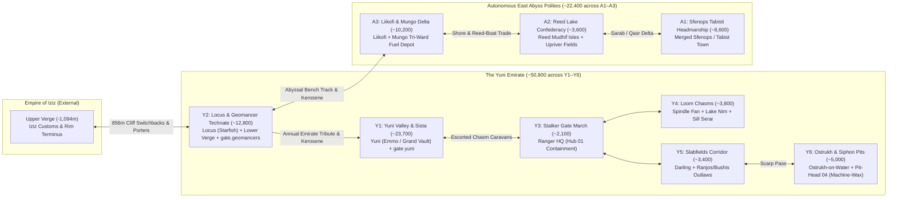

# Proposal: The East Abyss & the Yuni Emirate on the Sim Layer (`Yuni`, `Locus` Geomancers, Deep Chasms & Northern Abyss Polities)

A scoping proposal for `core/region`, `core/simulation`, `core/hamlet`, and `core/camp` covering **the Yuni Emirate** (`rmw8ca6baau47` plus its truncated eastern chasm marches), **the Order of Geomancers at `Locus`** (together with their global oil-drilling & `rare-earth` concession ledger), **the Eastern Deep-Chasm Frontier** (`Stalker Gate`, `Loom Chasms`, `The Slabfields`, `Siphon Pits`), and **the Autonomous Northern & Central East Abyss River-Polities** (`Sfenops` / `Tabist town`, `Reed` & `Reed upriver fields`, `Liikofi`, and tri-ward `Mungo`), following the pattern established in [PROPOSAL-LONGSONG-PINNACLE.md](file:///home/antigravity/traviso761-debug/krator-master/core/simulation/PROPOSAL-LONGSONG-PINNACLE.md), [PROPOSAL-XANADU.md](file:///home/antigravity/traviso761-debug/krator-master/core/simulation/PROPOSAL-XANADU.md), [PROPOSAL-BEAST-RIDERS.md](file:///home/antigravity/traviso761-debug/krator-master/core/simulation/PROPOSAL-BEAST-RIDERS.md), and [PROPOSAL-CATCH.md](file:///home/antigravity/traviso761-debug/krator-master/core/simulation/PROPOSAL-CATCH.md).

All hypsometric, hyperbaric (`atm`), hydrological, 39-family geological, `49r` carrying-capacity, `CROPS.forBiome` / `CROPS.at`, and trade-flow figures below come from a direct programmatic scan of Scale Model 5.1 ([page.py](file:///home/antigravity/traviso761-debug/krator-master/tools/scale-model/smodel/page.py), [east_abyss.py](file:///home/antigravity/traviso761-debug/krator-master/tools/scale-model/smodel/east_abyss.py), [60-settlements.js](file:///home/antigravity/traviso761-debug/krator-master/tools/scale-model/model/src/60-settlements.js)), [geology.json](file:///home/antigravity/traviso761-debug/krator-master/kits/resources/data/geology.json), [lodes.json](file:///home/antigravity/traviso761-debug/krator-master/kits/resources/data/lodes.json), [ledger.json](file:///home/antigravity/traviso761-debug/krator-master/kits/resources/data/ledger.json), and `kits/crops`.

---

## Sources & Cross-Session Alignment Baseline

- **Lore & built/designed settlements:** [LORE.md](file:///home/antigravity/traviso761-debug/krator-master/LORE.md) (§6.8 Dasri, §6.9 Geomancers / Yuni / Tabists, §6.10 Reed Lake, §6.15 Order of Historians `Ear at Yuni`, §6.18 Coyotes / Outlands); [settlements/yuni/NOTES.md](file:///home/antigravity/traviso761-debug/krator-master/settlements/yuni/NOTES.md) (*Emmo*, Grand Vault, `~10,000` canon pop); [settlements/locus/LOCUS-NOTES.md](file:///home/antigravity/traviso761-debug/krator-master/settlements/locus/LOCUS-NOTES.md) (`2,650` canon pop, `Starfish` vault, tribute to Yuni); [settlements/verge/DESIGN.md](file:///home/antigravity/traviso761-debug/krator-master/settlements/verge/DESIGN.md) (`856 m` two-level cliff split between Iziz `Upper Verge` and Yuni/Geomancer `Lower Verge`); [settlements/mungo/DESIGN.md](file:///home/antigravity/traviso761-debug/krator-master/settlements/mungo/DESIGN.md) & [NOTES.md](file:///home/antigravity/traviso761-debug/krator-master/settlements/mungo/NOTES.md) (`515` built pop across Reed `mudhif` islands, Eastern Abyssal shore market, and Geomancer chapterhouse/refinery); [settlements/reedlake/DESIGN.md](file:///home/antigravity/traviso761-debug/krator-master/settlements/reedlake/DESIGN.md).
- **Kits & chasm/abyss biomes:** [kits/yuni/README.md](file:///home/antigravity/traviso761-debug/krator-master/kits/yuni/README.md), [kits/locus/README.md](file:///home/antigravity/traviso761-debug/krator-master/kits/locus/README.md), [kits/eastern-abyssal/README.md](file:///home/antigravity/traviso761-debug/krator-master/kits/eastern-abyssal/README.md); [biomes/STATIONS-SURVEY.md](file:///home/antigravity/traviso761-debug/krator-master/biomes/STATIONS-SURVEY.md), [biomes/eastabyss/NOTES.md](file:///home/antigravity/traviso761-debug/krator-master/biomes/eastabyss/NOTES.md), [biomes/abyssal-savannah/NOTES.md](file:///home/antigravity/traviso761-debug/krator-master/biomes/abyssal-savannah/NOTES.md), [biomes/ebadlands/PLAN.md](file:///home/antigravity/traviso761-debug/krator-master/biomes/ebadlands/PLAN.md), [biomes/sedesert/PLAN.md](file:///home/antigravity/traviso761-debug/krator-master/biomes/sedesert/PLAN.md), [biomes/loom-chasms/PLAN.md](file:///home/antigravity/traviso761-debug/krator-master/biomes/loom-chasms/PLAN.md), [biomes/slabfields/PLAN.md](file:///home/antigravity/traviso761-debug/krator-master/biomes/slabfields/PLAN.md), [biomes/siphon-pits/PLAN.md](file:///home/antigravity/traviso761-debug/krator-master/biomes/siphon-pits/PLAN.md), [biomes/greatchasm/PLAN.md](file:///home/antigravity/traviso761-debug/krator-master/biomes/greatchasm/PLAN.md).
- **Trade, scale-model & resource canon:** [openworld/TRADE-SCOPE.md](file:///home/antigravity/traviso761-debug/krator-master/openworld/TRADE-SCOPE.md) (§2.4 Geomancer oil concessions & `rare-earth` 200 km rule, §2.5c chasm specialty goods, §3 `lode:locus-oil`, §9 middle Tabisti town, §10 Northern Abyss 900 m lift, §13 Dasri oases), [openworld/TRADE-GOODS.md](file:///home/antigravity/traviso761-debug/krator-master/openworld/TRADE-GOODS.md), [openworld/TRADE-GEMINI.md](file:///home/antigravity/traviso761-debug/krator-master/openworld/TRADE-GEMINI.md), [openworld/PLAN-SETTLEMENTS.md](file:///home/antigravity/traviso761-debug/krator-master/openworld/PLAN-SETTLEMENTS.md) (`5.1e4` `Lake Ostrukh` freshwater reroute; `Tabist town` & `Reed` moves).
- **Cross-session zero-double-count alignment:**
  1. **`Empire of Iziz` (`Verge` cliff split):** `Upper Verge` (`-1,094 m` plateau rim, Iziz Vernacular + Yuni merchant quarter, Imperial customs/garrison) is counted under `Empire of Iziz`; **`Lower Verge`** (`-1,685 m` to `-1,950 m` scarp-foot bench, `856 m` below, Yuni + Locus + Abyssal quarters, Geomancer fuel depot & caravan turnaround) is counted in **Yuni Emirate (`Y2`)**. All `sq11desertw4/w5/w6/w8` Izani-Dasri oasis pins inside `Empire of Iziz` stay in Iziz (`0` here).
  2. **`Jabal Shiekdom` & upland Dasri `Nomad Country`:** `Jabal` (`1225,1149`), `Bowl Salt Works` / `Solta` (`1169,1150`), `Rifar al-Dhahab` (`1333,886` on the `+1,715 m` East Rim), `Furrow` (`1276,639`, `-593 m`), `Cline` (`1225,646`, `-464 m`), and `sq11desertw1/w2/w3` belong to the Dasri / Nomad & Jabal sphere (`0` headcount here). Seasonal Dasri `KCAMP` grazing bands entering NE `Yuni Emirate` along `Braita Riba` (`1334,949`) and `Solt Riba` (`1338,1012`) are tracked as visiting transhumant bands, not double-counted residents.
  3. **`Coyote Kingdom` (`The Sill / Sam-Lok`, `1697,1028`):** Per [biomes/greatchasm/PLAN.md](file:///home/antigravity/traviso761-debug/krator-master/biomes/greatchasm/PLAN.md) (Station 4), `The Sill` is a jointly garrisoned basalt land-bridge toll-gate and serai. `Coyote Kingdom` holds `polity` on the fort pin (`~450` garrison counted in Coyote); `Yuni Emirate` (`Y4`) counts only its **`~120`-person treaty factor & southern serai ward**.
  4. **`Order of Historians` & `Xanadu Sultanate`:** `Singing Gjar Quartz` (`1572,1643`, `+3,684 m` in `High Rift`) is already scoped under [PROPOSAL-LONGSONG-PINNACLE.md](file:///home/antigravity/traviso761-debug/krator-master/core/simulation/PROPOSAL-LONGSONG-PINNACLE.md) (`0` counted here), while the **`Ear at Yuni`** (`~25` History Monks, [LORE.md](file:///home/antigravity/traviso761-debug/krator-master/LORE.md) §6.15) resides inside `Yuni` (`Y1`). Per the owner's 2026-11-16 ruling in [PROPOSAL-XANADU.md](file:///home/antigravity/traviso761-debug/krator-master/core/simulation/PROPOSAL-XANADU.md) (line 31), **both** `gate.yuni` (`Yuni Merchants' Guild`) and `gate.geomancers` (`Locus` oil caravans) cross the Catch / SE Outer Wall to terminate at **`Qiblai`** (not `Thalaba`).
  5. **Foreign Geomancer Oil Enclaves (`Region 87` & `Xanadu`):** Expatriate Geomancer rig crews at `Mav's Refuge`, `Pinnacle Rock`, `Girder`/`Talon`, and `Qiblai` (`~320` specialists total) live inside walled `kits/locus` compounds already counted inside their host towns' populations ([PROPOSAL-BEAST-RIDERS.md](file:///home/antigravity/traviso761-debug/krator-master/core/simulation/PROPOSAL-BEAST-RIDERS.md), [PROPOSAL-XANADU.md](file:///home/antigravity/traviso761-debug/krator-master/core/simulation/PROPOSAL-XANADU.md)); **profit remittances (`90%` net export surplus) flow back to `Locus` (`Y2`)** without double-counting heads.

---

## 1. Extreme Hypsometry, Hyperbaric Atmosphere, Cataract Hydrology, 39-Family Geology & Endemic Ecology

### 1.1 Vertical Relief & the Hyperbaric Barometric Law ($p = 1.6 \exp(-E/8000)$)

No other sphere on the planet spans a comparable barometric column. From the deepest East Abyss evaporite sumps (`-2,600.0 m`) to the ice-armored crest of `Stalker Peaks` (`+15,041 m`), this region crosses **`17,641 m` of vertical relief** and a **nine-fold air-pressure ratio (`2.214 atm` down to `0.244 atm`)**:

$$p(E) = 1.6 \cdot \exp\!\left(-\frac{E}{8000}\right)\ \text{atm}$$

- **Why `atm` caps at `2.214 atm` on Scale Model 5.1 (and why `3.0 atm` does not occur):** Sea level (`E = 0 m`) is already **`1.600 atm`** (`1.6x` Earth barometric pressure). Because Scale Model 5.1's 16-bit height raster clamps elevations to `[-2,600, +27,000] m`, the lowest dry land in the East Abyss (`-2,599.1 m` at `1274,1016`, north of `Locus`) and the lowest hypersaline lake bed/surface (`-2,600.0 m` at `1305,828`, west of `Mungo`) hit a physical ceiling of **`2.214 atm`** — an oxygen partial pressure of **`~0.465 atm` (`2.22x` Earth sea-level $p_{\text{O}_2}$)**. Reaching `3.00 atm` under the scale height $H = 8,000\text{ m}$ would require $E = -8000 \ln(3.0/1.6) = -5,029\text{ m}$, nearly `2.5 km` below the 5.1 raster clamp.
- **Physiological, Combustion & Ecological Consequences of the `1.95–2.21 atm` Abyss Floor:**
  - **Wet-bulb heat wall (`tw = 44–50 °C`):** Adiabatic compression down the `3–4 km` fault scarps pushes median annual temperatures on the `-2,600..-2,000 m` floor (`10,420 km²` dry land) to **`37–40 °C`** and warmest-month temperatures (`tw`) to **`45–50 °C`** (`p95 = 52 °C` in `e abyss` / `lower2`) under `1,051–1,694 mm/yr` rainfall (`XA` / `XW` / `XV` hyperthermal climates). Upland Izani, Dasri, and Yuni caravaneers suffer rapid heat exhaustion, hyperoxic lethargy ("abyssal drunkenness"), and fungal lung rot if they linger below `-1,800 m` (`>= 2.00 atm`, **`20,052 km²` of dry land** in the East Abyss transect); pure-strain **Tabisti** and **Reed** folk are physiologically adapted to the dense, hot mugginess.
  - **Combustion & aerodynamics:** At `2.0–2.2 atm`, open-wick `kerosene` lamps, coal braziers, and sulfur-pots burn hotter and faster (requiring damped Geomancer brass burners to prevent flare-ups), sound carries roughly `1.4x` louder across the reed-lakes, and giant Carboniferous arthropods, gliding lizards, and dense-air **`ghaunt-ox`** beasts thrive under the thick air + low gravity.
  - **The opposite extreme (`Stalker Peaks`, `0.24–0.93 atm`):** Immediately south of `Yuni Valley`, `Stalker Peaks` (`91,196 km²`, median `+8,411 m` / `0.56 atm`, max `+15,041 m` / `0.24 atm`) forms an unbreathable glacial barrier sealing off Stalker `Hub 01` (`1344,1409`, `+4,351 m`, `0.93 atm`, `ET -2 °C`), funneling all Stalker raids and trans-continental caravans through **`Stalker Gate`** (`Ranger HQ` at `+1,982 m`, `1.25 atm`).

| East Abyss Transect Band (`X=1200..1380, Y=600..1090`) | Dry Land (`km²`) | `atm` Range (Med) | `tm` / `tw` Med (`°C`) | Rain Med (`mm`) | Dominant Climates | Key Settlements / Features |
|---|---:|---|---:|---:|---|---|
| **`-2,600 .. -2,400 m`** (Deepest Sumps) | `600` | `2.16–2.21` (`2.18`) | `39` / `45` | `1,694` | `XA 54%, XV 23%, XW 16%` | `the Bigga` sump (`1274,1016`), `Locus` pixel foot (`-2,403 m` raster cell) |
| **`-2,400 .. -2,200 m`** (Salt-Lake Floor) | `6,100` | `2.11–2.16` (`2.14`) | `39` / **`49`** | `1,051` | `XA 45%, XW 27%, XV 20%` | **`Reed`** (`-2,333 m`, `2.14 atm`), `e abyss` / `lower2` coal & peat fens |
| **`-2,200 .. -2,000 m`** (Lower Delta Fans) | `3,720` | `2.05–2.11` (`2.08`) | `37` / `44` | `1,051` | `XA 44%, XV 24%, XS 17%` | Lower `Rīfar al-Sarāb` & `Braita Riba` mouths |
| **`-2,000 .. -1,800 m`** (`2.0 atm` Threshold) | `9,632` | `2.00–2.05` (`2.02`) | `35` / `42` | `973` | `XA 34%, XV 30%, XS 17%` | **`Yuni North Oil Patch`** (`1268,994`, `-1,887 m`, `2.03 atm`), `lower` (`-1,807 m`) |
| **`-1,800 .. -1,500 m`** (Tabisti Bench) | `22,116` | `1.93–2.00` (`1.97`) | `33` / `40` | `580` | `XS 30%, XV 26%, XA 24%` | **`Mungo`** (`-1,770 m`), **`Lower Verge`** (`-1,685 m`), **`Sfenops`** (`-1,657 m`), **`Liikofi`** (`-1,637 m`), **`Locus` bench** (`-1,549 m` in [east_abyss.py](file:///home/antigravity/traviso761-debug/krator-master/tools/scale-model/smodel/east_abyss.py)) |
| **`-1,500 .. -1,000 m`** (Upper Abyss Steps) | `19,108` | `1.81–1.93` (`1.89`) | `32` / `40` | `737` | `XS 30%, XV 29%, XA 19%` | **`Tabist town`** (`1285,655`, `-1,115 m`), **`Upper Verge`** rim (`-1,094 m`) |
| **`-1,000 .. 0 m`** (Sub-Rim Terraces) | `25,848` | `1.60–1.81` (`1.68`) | `28` / `37` | `860` | `BSh 38%, Aw 17%, Csa 18%` | **`Reed upriver fields`** (`-780 m`, `Aw`), `Furrow` (`-593 m`), `Cline` (`-464 m`) |
| **`0 .. +2,500 m`** (Valley & Rim Shelves) | `188,076` | `1.17–1.60` (`1.41`) | `21` / `31` | `408` | `BSh 39%, BWh 20%, Csa 16%, Cfa 14%` | **`Yuni`** (`+636 m` valley floor to `+1,600 m` shelf, `1.48–1.31 atm`), **`Sista Riba`** (`+1,048 m`) |

> [!NOTE]
> **Effect of the Queued [TRADE-SCOPE.md](file:///home/antigravity/traviso761-debug/krator-master/openworld/TRADE-SCOPE.md) §10 Northern Abyss 900 m Lift (`e' = -1000 + 0.5625 * (e + 1000)` for `e < -1,000 m`):**
> Once baked into Scale Model 5.2, the northern abyss floor rises by up to `+583 m` at Reed Lake so its heat drops from lethal `tw 45–50 °C` into livable tropical dense-air range without losing `atm: 2` (`dense`) crop status:
> - **`Reed` (`1280,678`):** `-2,333 m` (`2.14 atm`, `tm 39 °C`) -> **`-1,750 m` (`1.99 atm`, `tm ~35.2 °C`)**
> - **`Mungo` (`1322,828`):** `-1,770 m` (`2.00 atm`, `tm 36 °C`) -> **`-1,433 m` (`1.91 atm`, `tm ~33.8 °C`)**
> - **`Sfenops` (`1282,663`):** `-1,657 m` (`1.97 atm`, `tm 34 °C`) -> **`-1,370 m` (`1.90 atm`, `tm ~32.1 °C`)**
> - **`Liikofi` (`1316,797`):** `-1,637 m` (`1.96 atm`, `tm 34 °C`) -> **`-1,358 m` (`1.90 atm`, `tm ~32.2 °C`)**
> - **`Tabist town` (`1285,655`):** `-1,115 m` (`1.84 atm`, `tm 32 °C`) -> **`-1,065 m` (`1.83 atm`, `tm ~31.7 °C`)**
> - **`Reed upriver fields` (`1297,683`):** `-780 m` (`1.76 atm`, `tm 31 °C`) -> **unchanged** (`> -1,000 m`).
> - **`Locus` (`1267,1043`) pixel-vs-bench note:** In the 4 km raster, `(1267,1043)` straddles a vertical fault step (`-2,403 m` to `-1,017 m`, `slope = 0.265`), reporting `-2,402.6 m` (`2.16 atm`), whereas [east_abyss.py](file:///home/antigravity/traviso761-debug/krator-master/tools/scale-model/smodel/east_abyss.py) explicitly carves Locus's semi-arid mesa bench at **`-1,549 m` (`1.94 atm`, `+740 m` eastern horizon wall)**.

### 1.2 Polygon Footprint, Cataract Hydrology & Endorheic Sumps

| Polygon (`id`, kind) | Total / Dry Land (`km²`) | Elev Range (Med `m`) | `atm` Range (Med) | `49r` `farm` / `past` / `timb` / `fish` (`km²-eq`) | Dominant Rock & Top 39-Family Lode Yields (`goodYield`) |
|---|---:|---|---|---|...|
| **`Yuni Emirate`** (`rmw8ca6baau47`, political) | `410,292` / `404,224` | `-2,599 .. +8,917` (`+2,364`) | `0.52–2.21` (`1.19`) | `39,984` / `75,135` / `30,129` / `8,158` | Sed `43%`, Basalt `29%`, Cryst `13%`, Gran `13%`; `iron 11,175`, `saltpeter 10,905`, `copper 3,607`, `tin 2,657`, `silver 1,789`, `gold 1,785`, `rare-earth 1,472`, `sulfur 395`, `coal 283`, `zinc 182`, `turquoise 111`, `emerald 39` |
| **`Yuni Valley`** (`rmuvlpgkd7v7w`, biome) | `5,204` / `5,124` | `-2,403 .. +3,679` (`+720`) | `1.01–2.16` (`1.46`) | `2,578` / `2,316` / `2,808` / `310` | Cryst `38%`, Sed `31%`, Gran `31%`; `iron 371`, `tin 82`, `gold 60`, `rare-earth 60`, `silver 53`, `coal 16` |
| **`e abysss` + `e abyss`** (`rmuqltx63f4do` + `rmv8b6ktg4rwg`) | `81,536` / `69,620` (`11,916` lakes) | `-2,599 .. +2,220` (`-1,569`) | `1.21–2.21` (`1.95`) | `15,270` / `24,470` / `26,098` / `8,781` | Sed `54%`, Cryst `27%`, Gran `19%`; `iron 3,932`, `tin 712`, **`coal 587` (`max 218`)**, `gold 567`, `silver 543`, `rare-earth 438`, `silica 339`, `saltpeter 279`, **`peat 81` (`max 153`)**, `oil` natural seeps (`max 102 @ 1266,992`) |
| **`east rim`** (`rmuvkd2jtd3zm`, geographic) | `59,044` / `54,128` | `-2,582 .. +2,508` (`-63`) | `1.17–2.21` (`1.61`) | `19,680` / `27,203` / `19,891` / `4,493` | Sed `50%`, Cryst `29%`, Gran `21%`; `iron 3,072`, `tin 605`, `gold 451`, `silver 425`, `rare-earth 352`, `coal 235` |
| **`Stalker Gate`** (`rmvstalkergate`, biome) | `130,704` / `129,888` | `+756 .. +11,488` (`+2,794`) | `0.38–1.46` (`1.13`) | `10,174` / `22,554` / `8,450` / `2,420` | Basalt & Tuff; `saltpeter 3,640`, `iron 2,890`, `copper 1,415`, `sulfur 215` |
| **`Loom Chasms`** (`rmvraoas90co7`, biome) | `301,140` / `299,616` | `-1,265 .. +8,743` (`+2,213`) | `0.54–1.88` (`1.21`) | `16,842` / `38,412` / `5,120` / `4,890` | Basalt & Evaporite (`Lake Nim`); **`saltpeter 9,787`**, **`copper 6,536` (`max 210`)**, `halite` (`max 255`), **`turquoise 204`**, **`emerald 119`** |
| **`The Slabfields`** (`rmvmidbasin101`, biome) | `168,904` / `167,856` | `-496 .. +4,580` (`+2,035`) | `0.90–1.70` (`1.24`) | `11,420` / `29,180` / `2,140` / `3,610` | Flood basalt & maar tuff; `copper 3,174`, `saltpeter 4,910`, `sulfur 194`, **`amethyst 53`** |
| **`Siphon Pits`** (`rmvra9zogfm9t`, biome) | `175,780` / `175,120` | `+1,528 .. +9,531` (`+2,671`) | `0.49–1.32` (`1.15`) | `9,610` / `24,880` / `3,490` / `3,940` | Volcanic maar tuff & hydrothermal veins; **`sulfur 2,238` (`max 255`)**, **`copper 2,882`**, **`quartz 1,111`**, **`emerald 109`**, `zinc`, `gold`, `silver` |

**Cataract-Incised Hydrology ([east_abyss.py](file:///home/antigravity/traviso761-debug/krator-master/tools/scale-model/smodel/east_abyss.py) & `5.1e4`):**
Every East Abyss river plunges off `2,000–4,000 m` fault scarps in multi-step cataracts (forbidding continuous barge navigation between rim and floor) before terminating in **endorheic hypersaline sumps** whose **freshwater river-mouth plumes** anchor every floor settlement:
1. **Southern Yuni / Locus Sump (`-2,400 m` & `-2,339 m` salt lakes):** Fed by **`the Bigga`** (`197.1 m³/s`, fed from `Vapora Riba` `180.0 m³/s` out of `Stalker Gate`, joined by `Longa Riba` `40.1 m³/s` and `Klira Riba` `37.0 m³/s`), **`Braita Riba`** (`97.4 m³/s` + `Blaka Riba` `40.5 m³/s`), **`Solt Riba`** (`61.8 m³/s`), **`Waita Riba`** (`56.6 m³/s`, bisecting `Yuni` before plunging past `Locus`), **`Sista Riba`** (`48.5 m³/s`), Izani **`Rrivar Blaca`** (`14.7 m³/s`, plunging `856 m` over the `Verge` fault-relay spur), and **`Bruk Loña`** (`11.8 m³/s`, watering the `1268,994` oil patch).
2. **Central & Northern Tabisti / Reed Sumps (`-1,797 m`, `-1,804 m` & `-2,331 m` salt lakes):** Fed from the East Rim by **`Rīfar al-Qaṣr`** (`78.0 m³/s`, watering `Reed upriver fields` at `-780 m` and forming the freshwater plume at **`Reed`** on the `-2,331 m` hypersaline lake), **`Rīfar al-Sarāb`** (`45.6 m³/s`, watering **`Tabist town` / `Sfenops`**), **`Rīfar al-Zulāl`** (`41.7 m³/s`, watering **`Liikofi`**), **`Rīfar al-Rīḥ`** (`28.3 m³/s`, watering the queued `1311,761` middle Tabisti site), **`Rīfar al-Dhahab`** (`24.1 m³/s`), and **`Gl Ṣḫr` / `Awadi n Mungo`** (`9.9 m³/s`, forming **`Mungo`**'s freshwater landing).
3. **Eastern Chasm Drainage:** **`Aina Bruk`** (`26.9 m³/s`) waters `Spindle Fan` (`+2,150 m`) before dropping into hypersaline `Lake Nim` (`+620 m`..`-1,265 m` chasm floor, `White Loom Salt`). Further south, **`Ostrukh Riba`** (`79.6 m³/s`, rerouted in edit `5.1e4` per [PLAN-SETTLEMENTS.md](file:///home/antigravity/traviso761-debug/krator-master/openworld/PLAN-SETTLEMENTS.md)) flushes **`Lake Ostrukh`** (`~1,920 m`) into a **freshwater through-lake** supporting `Ostrukh-on-Water` before cutting east through `Scarp Pass`.

> [!WARNING]
> **Critical Geology Data Catch — Unstamped `lode:locus-oil` in [lodes.json](file:///home/antigravity/traviso761-debug/krator-master/kits/resources/data/lodes.json):**
> [TRADE-SCOPE.md](file:///home/antigravity/traviso761-debug/krator-master/openworld/TRADE-SCOPE.md) §3 specifies stamping `lode:locus-oil` at `(1267, 1043)`, `r = 14 km`, `peak = 200` (`grade 3`), so the planet's oil-drilling order actually sits on a premier petroleum dome. However, [kits/resources/data/lodes.json](file:///home/antigravity/traviso761-debug/krator-master/kits/resources/data/lodes.json) currently contains **only three entries** (`xanadu-gold`, `thalaba-sulfur`, `great-potch-line`)! As a result, raw [geology.json](file:///home/antigravity/traviso761-debug/krator-master/kits/resources/data/geology.json) gives `Locus` `oil max = 36, goodYield = 0.0` (and `GOODS_BASE` gave Locus `0.126 t` of oil!). Stamping `lode:locus-oil` (`1267,1043, r=14 km, peak=200`) — and optionally boosting the natural `max = 102` oil seep `49 km` north at **`Yuni North Oil Patch` (`1266,992` / `1268,994`)** to `peak = 145` — is a mandatory pre-build step before regenerating `ledger.json`.

### 1.3 Endemic `CROPS.forBiome` / `CROPS.at` & Chasm/Abyss Specialty Goods

Direct evaluation of `kits/crops` across the sphere's seven biomes reveals a sharp split between **dense-air (`atm: 2`) Carboniferous swamp/savannah endemics**, **vertical badlands (`atm: 1`) qanat orchards**, and **sub-rim chasm/maar (`loom-chasms`, `midbasin`, `siphon-pits`) wild gatherables**:

| Biome (`kits/crops` ID) | Total `forBiome` Crops | `CROPS.at` Site Check | `canPlaid` & Natural Dye Palette | Canonical Endemic (`homeOnly`) & Signature Crops / Gatherables |
|---|---:|---|---|---|
| **`eastabyss`** (`tropic..hot`, `dense` `atm:2`) | **`96`** | `Lower Verge` / `Liikofi` / `Sfenops` (`tropic, dense, humid/wet`): **`59–64` crops** | **`true`** (`red, yellow, green, blue, brown, black`) | **`abyss-lac`** (`dye`, `homeOnly`!), **`verdigris`** (`dye`, `homeOnly`!), `fern-egg` (`nut`), `tidewort` (`greens`), `brine-apple` & `scalefruit` (`fruit`), **`salt-rice`** & `rice` (`grain` / `sake`), `ramie` (`spinning`), `mat-reed` (`weaving` / reed-paper), Carboniferous **`rubber`** (scale-trees) & **`swamp-copal`** (`incense`) |
| **`abyssal-savannah`** (`tropic..hot`, `dense` `atm:2`) | **`96`** | Abyssal margins (`tropic, dense, subhumid`): **`56` crops** | **`true`** | **`laterite-ochre`** (`dye`, `homeOnly`), **`umbrella-gum`** (`reagent`, `homeOnly`), `stub-cone` (`tuber`), `thatch-grass` |
| **`ebadlands`** (`cold..tropic`, `thin..standard`) | **`143`** *(richest vertical span)* | `Yuni` (`subtropic, standard, semiarid + irrigated`): **`72` crops**; `Sista Riba`: **`68` crops** | **`true`** | **`sulfur-yellow`** (`dye`, `homeOnly`), `basin-amaranth` (`grain`), `emmer`, `rice` (qanat-irrigated), `whorl-olive` (`oil`), `apricot`, `pomegranate`, `canyon-grape` (`wine`), `pistachio`, `almond`, `pinyon` (`nut` + `pinyon-copal`), `cotton`, `mulberry` (`silk`), `woad`, `rabbitbrush` |
| **`sedesert`** (`subtropic..hot`, `standard..dense`) | **`96`** | Rim wadis (`subtropic, standard, arid + irrigated`): **`48` crops** | **`true`** | **`dragons-blood`** (`dye`, `homeOnly`), `wadi-date`, `tepary-bean`, `mesquite`, `sidr`, `glasswort` (`alkali`), `tamarisk-manna`, `saxaul` (`fuel`), `myrrh` & `brine-lamp` (`incense`/`medicine`), `sisal` |
| **`loom-chasms`** (`cold..subtropic`, `thin..dense`) | **`119`** | `Spindle Fan` (`temperate, standard, semiarid + irrigated`): **`54` crops** | **`true`** | **`maar-yam`** (`tuber:wild`, `homeOnly`), **`fumewort`** (`herb:wild`, `homeOnly`), `lichen` (`dye`), plus chasm-fauna **`spinner-cord`** (Loom-Spinner high-tensile silk cable for cliff winches & suspension bridges!) |
| **`midbasin`** (`The Slabfields`) | **`110`** | `Darling` (`temperate, standard, semiarid + irrigated`): **`52` crops** | **`true`** | **`maar-yam`** (`homeOnly`), **`fumewort`** (`homeOnly`), `lichen`, plus **`suture-gall`** (medicinal chasm gall, [TRADE-SCOPE.md](file:///home/antigravity/traviso761-debug/krator-master/openworld/TRADE-SCOPE.md) §2.5c) |
| **`siphon-pits`** (`cold..temperate`, `thin..standard`) | **`98`** | `Ostrukh-on-Water`: **`51` crops**; `Pit-Head 04` (`+2,277 m` warm maar): **`58` crops** | **`false`** *(brown/orange lichen & sulfur-fume dress)* | **`maar-yam`** (`homeOnly`), **`fumewort`** (`homeOnly`), `circlelichen` (`herb`/`dye:wild`), plus **`woolly_siphon` `machine-wax`** rendered into ingots in `Pit-Head 04`'s sulfur-heated cauldrons (**`82.1%` of world `machine-wax` supply**, `227.2 t` in [TRADE-GEMINI.md](file:///home/antigravity/traviso761-debug/krator-master/openworld/TRADE-GEMINI.md)!) |

---

## 2. Provincial & Autonomous Gorge Division (`9` Units = `6` Yuni Emirate + `3` East Abyss Polities)

Scale Model 5.1 currently lumps the northern and central East Abyss floor (`Liikofi`, `Sfenops`, `Tabist town`, `Reed`, `Mungo`) inside the upland Dasri `Nomad Country` polygon (`rmucc476rj9ie`), while simultaneously truncating `Yuni Emirate` (`rmw8ca6baau47`, `X <= 1633, Y <= 1502`) short of `Pit-Head 04` (`1687,1555`) and `White Loom Salt` (`1697,1176`).

For `core/region` and `core/simulation`, we cleanly separate the sphere into **Six Yuni Emirate Provinces / Orders (`Y1–Y6`, `~50,800` souls)** and **Three Autonomous Northern & Central East Abyss River/Lake Polities (`A1–A3`, `~22,400` souls)** — **`~73,200` total souls** (replacing Gemini's inflated `~360,000+`):

### Part A — The Yuni Emirate (`Y1–Y6`, `~50,800` People)

Governed from `Yuni` by the Emir and the technocratic **Order of the *Emmo*** — who tend the Ancient **Grand Vault** beneath the Emir's palace ([LORE.md](file:///home/antigravity/traviso761-debug/krator-master/LORE.md) §6.9, [settlements/yuni/NOTES.md](file:///home/antigravity/traviso761-debug/krator-master/settlements/yuni/NOTES.md)) — the Emirate operates as a **dual-order commercial & technical state**:
- **`Yuni` (`Y1`)** holds political sovereignty, agricultural water-law (qanats), high-craft workshops (precision brassware, optics, silk/cotton textiles, books), and the **`Yuni Merchants' Guild` (`gate.yuni`)**.
- **`Locus` (`Y2`)** is an internally self-governing **Order of Geomancers** clustered around the Ancient **`Starfish`** vault (`LORE.md:401`). It **pays fixed annual tribute in silver, `kerosene`, `naphtha`, and `rare-earth` to the Emir of `Yuni`** (`LORE.md:402`) in exchange for military protection (`Y3`), customs priority at **`Lower Verge`**, and diplomatic backing for its overseas oil charters (`gate.geomancers`). Both guilds compete fiercely on the southwestern caravan road across the Catch to **`Qiblai`** ([PROPOSAL-XANADU.md](file:///home/antigravity/traviso761-debug/krator-master/core/simulation/PROPOSAL-XANADU.md) line 31).

| ID | Province / Order | Seat & Subordinate Pins / Stations | Urban / Pinned | Rural / Camp | Total Pop | Core Economic & Strategic Role |
|---|---|---|---:|---:|---:|---|
| **`Y1`** | **Yuni Valley & Sista Heartland** | **`Yuni`** (`1263,1089`, `11,500` incl. `~25` `Ear at Yuni` monks), **`Sista Riba Village`** (`1311,982`, `1,200`), **`Quintagon Salvage Camp`** (`1358,945`, `150` rotating diggers/guards) | `12,850` | `10,850` | **`23,700`** | Irrigated `Waita` & `Sista` qanat breadbasket (`farm10 = 279.5 + 304.2 km²`), Grand Vault machine maintenance, `tin`/`silver`/`gold`/`rare-earth` refining, `Quintagon` arcology salvage, and HQ of `gate.yuni`. *(Transhumant Dasri `KCAMP` bands graze NE `Braita`/`Solt` benches seasonally under Emirate grazing tax).* |
| **`Y2`** | **Locus & The Geomancer Technate** | **`Locus`** (`1267,1043`, **`2,650`** canon town), **`Lower Verge`** (`1268,949`, **`4,800`** bench entrepôt), **`Yuni North Oil Patch`** (`1268,994`, **`350`** pumpjack camp on `Bruk Loña`) | `7,800` | `5,000` | **`12,800`** | `Starfish` vault drilling archive, domestic Grade-3 oil extraction (`lode:locus-oil`) & fractional cracking stills, `rare-earth` separation, HQ of `gate.geomancers` global oil concessions, and **`Lower Verge`** (`-1,685 m`) — the Emirate's `#1` customs & caravan-hoist entrepôt below Iziz's `Upper Verge`. |
| **`Y3`** | **Stalker Gate & Ranger March** | **`Ranger HQ`** (`1420,1242`, **`550`** fort garrison) + `Vapora Riba` pass watchtowers | `550` | `1,550` | **`2,100`** | Military containment of Stalker mechs/raiders descending from **`Hub 01`** (`1344,1409`, `+4,351 m`), caravan escort staging between `Yuni Valley` and the eastern chasm provinces, plus `sulfur` (`gy 88.5`) & `copper` (`gy 53.0`) mining. |
| **`Y4`** | **Weavers' Cradle & Loom Chasms** | **`Spindle Fan`** (`1561,1140`, **`1,000`**), **`White Loom Salt`** (`1697,1176` at `Lake Nim`, **`230`**), **`The Sill (Sam-Lok)` Yuni Serai Ward** (`1697,1028`, **`120`**; Coyote fort `~450` in Coyote), chasm rope-crews (`200`) | `1,550` | `2,250` | **`3,800`** | Terraced `Aina Bruk` spring agriculture (`farm10 = 88.2 km²`), rich `copper` (`gy 85.5`), `saltpeter` (`gy 117`), `turquoise` & `Lake Nim` `halite`/borax, wild **`spinner-cord`** chasm-silk harvesting, and the northern treaty trade-gate with `Coyote Kingdom` at `The Sill`. |
| **`Y5`** | **The Slabfields Corridor** | **`Darling`** (`1582,1341`, **`950`** walled caravan town + `Siphon-Breach` maar springs `1584,1348`) + **`Ranjos / Bushis` Outlaw Bands** (`1722,1374` `The Halves`, `~800` across `12` `KCAMP` bands) | `950` | `2,450` *(1,650 settlers + 800 outlaws)* | **`3,400`** | Mid-basin basalt bench relay linking `Ranger HQ`, `Spindle Fan`, and `Ostrukh-on-Water`; produces `sulfur` (`gy 127.5`), `copper` (`gy 71`), `zinc`, `amethyst`, and medicinal **`suture-gall`**, harassed from the eastern paterae (`The Halves`) by `Ranjos / Bushis` highwaymen (`C7` raid actors). |
| **`Y6`** | **Ostrukh Basin & Siphon Pits** | **`Ostrukh-on-Water`** (`1520,1465` / `1516,1471`, **`1,400`**), **`Pit-Head 04`** (`1687,1555`, **`450`** Siphon-Ropers), `Scarp Pass` (`1559,1457`) & `The Arête Way` (`1678,1542`) windlass crews | `1,850` | `3,150` | **`5,000`** | Fresh `Lake Ostrukh` (`5.1e4`) qanat/terrace granary feeding the deep-maar **`Pit-Head 04`** Siphon-Ropers (`+2,277 m` floor beneath a `+4,269 m` rim), who render **`woolly_siphon` `machine-wax` ingots** (`82%` of planetary supply!) alongside `sulfur` (`gy 184`), `copper` (`gy 127.5`), and `gold`/`silver`. |
| **Subtotal** | **The Yuni Emirate (`Y1–Y6`)** | `11` pins / active stations | **`25,550`** | **`25,250`** | **`50,800`** | **Self-feeding across `Y1 + Y6` (`~51,000 km²-eq` `farm`); net exporter of `oil`/`kerosene`, `machine-wax`, `rare-earth`, `copper`, `sulfur`, `saltpeter`, `spinner-cord`, and salvaged `scrap`/relics.** |

### Part B — Autonomous Northern & Central East Abyss Polities (`A1–A3`, `~22,400` People)

North of `Lower Verge` (`Y < 913`), the Yuni Emirate's direct rule ends and the upland Dasri nomads (`Nomad Country`) stay above the `-500 m` scarp because their camels and horses sicken in the `1.90–2.16 atm`, `34–40 °C` `XA` swamp-floor heat. The abyss floor is held instead by **three autonomous river-delta and salt-lake polities** of **pure-strain Tabisti** ([LORE.md](file:///home/antigravity/traviso761-debug/krator-master/LORE.md) §6.9) and **Reed Lake marsh-folk** ([LORE.md](file:///home/antigravity/traviso761-debug/krator-master/LORE.md) §6.10, kinsfolk to the distant Rustics/Highlanders), tied to `Locus` and `Lower Verge` by **commercial treaty and fuel/salt/lac trade**, not political annexation:

| ID | Autonomous Polity | Seat & Constituent Pins | Urban / Pinned | Rural / Marsh | Total Pop | Sovereignty, Tribute & Signature Exports |
|---|---|---|---:|---:|---:|---|
| **`A1`** | **Sfenops & Lower Sarāb Tabisti Headmanship** | **`Sfenops`** *(merging `Tabist town` `1285,655` `-1,115 m` upper fertile town + `Sfenops` `1282,663` `-1,657 m` lower river landing, only `17.1 km` apart on `Rīfar al-Sarāb`!)* | `3,600` | `5,000` | **`8,600`** | **Independent pure-strain Tabisti council of elders** (`kits/eastern-abyssal`). Pays seasonal protection-gifts of `salt-rice` and `abyss-lac` to upland Dasri chieftains at `Furrow` (`1276,639`) to keep rim raids off its upper fields (`farm10 = 127.9 km²`), while exporting **`abyss-lac`**, **`swamp-copal`**, **`rubber`**, `iron` (`gy 209`), and `tin` south via `Reed` and `Mungo`. |
| **`A2`** | **Reed Lake Confederacy** | **`Reed`** (`1280,678`, **`950`** floating `mudhif` reed-island village at the `Rīfar al-Qaṣr` freshwater plume) + **`Reed upriver fields`** (`1297,683`, **`650`** terrace village `35 km` upriver at `-780 m`) | `1,600` | `2,000` | **`3,600`** | **Autonomous marsh confederacy** ([settlements/reedlake/DESIGN.md](file:///home/antigravity/traviso761-debug/krator-master/settlements/reedlake/DESIGN.md)). `Reed` sits on anchored reed rafts over a `-2,333 m` (`-1,750 m` post-§10 lift) hypersaline lake (`farm10 = 5.6 km²`), fed grain and fruit punted downriver from its own **`Reed upriver fields`** (`farm10 = 239.5 km²`, `Aw 1,239 mm`); exports cured brine-fish, woven `mat-reed` mats/reed-paper, `halite` crust, `peat`, and bitumen-caulked reed punts. |
| **`A3`** | **Liikofi, Middle Rīḥ & Mungo Tri-Ward Delta** | **`Liikofi`** (`1316,797`, **`3,800`** southern Tabisti river-city), queued **`Middle Tabisti Town`** (`1311,761` on `Rīfar al-Rīḥ`, **`900`**; [TRADE-SCOPE.md](file:///home/antigravity/traviso761-debug/krator-master/openworld/TRADE-SCOPE.md) §9), and **`Mungo`** (`1322,828`, **`700`** built tri-ward port) | `5,400` | `4,800` | **`10,200`** | **`Liikofi`** is the wealthiest southern Tabisti coal, `silica` (`gy 19.5`), `rubber`, `verdigris`, and `abyss-lac` city (`coal gy 45.0, max 189`). `62 km` SSE, **`Mungo`** ([settlements/mungo/DESIGN.md](file:///home/antigravity/traviso761-debug/krator-master/settlements/mungo/DESIGN.md)) is a **neutral tri-ward treaty port**: offshore Reed `mudhif` islands + Eastern Abyssal shore market + a **walled `kits/locus` Geomancer chapterhouse, coal-tar/seep stripping still & kerosene depot** supplying lamp-oil to all of `A1–A3`. |
| **Subtotal** | **Autonomous East Abyss (`A1–A3`)** | `5` active pins (+ `1` queued at `1311,761`) | **`10,600`** | **`11,800`** | **`22,400`** | **Politically outside `Nomad Country` & `Yuni Emirate`; commercially linked to `Lower Verge` (`Y2`) via `Mungo` (`A3`) and to Dasri `Rifar al-Dhahab` / `Furrow` via scarp mule-tracks.** |

---

## 3. The Global Geomancer (`Locus`) Oil & `Rare-Earth` Concession Ledger

Per [LORE.md](file:///home/antigravity/traviso761-debug/krator-master/LORE.md) (§6.9) and [TRADE-SCOPE.md](file:///home/antigravity/traviso761-debug/krator-master/openworld/TRADE-SCOPE.md) (§2.4), **only the Order of Geomancers possesses the `Starfish`-derived rotary carbide drill-strings, blowout preventers, and fractional distillation stills required to drill deep petroleum lodes**, and (alongside Eternia, the Order of Historians, and Tungangs) to separate **`rare-earth` oxides within `200 km` of a Yuni Emirate settlement**.

### 3.1 The Standard Geomancer Concession Charter ([TRADE-SCOPE.md](file:///home/antigravity/traviso761-debug/krator-master/openworld/TRADE-SCOPE.md) §2.4)

Whenever a petroleum lode (`oil >= 80`) lies within `30 km` of a non-hostile foreign settlement:
1. **Walled Enclave (`kits/locus`):** The Geomancers erect a walled compound (`pumpjack` rigs, riveted storage tanks, fractional still, chapterhouse; `35–120` expatriate technicians & guards, **counted inside the host settlement's census** so zero population is double-counted).
2. **Host Royalty (`10%`):** **`10%` of net concession profits** are paid directly into the host polity's treasury (`silver` coin or fuel credit).
3. **Local Fuel Discount (`20%`):** The host settlement purchases refined `kerosene` / `naphtha` / `bitumen` at the enclave gate at **`80%` of world benchmark price**.
4. **Order Remittance (`90%`) -> Emirate Tribute:** The remaining **`90%` of export revenue** and physical surplus barrels travel via `gate.geomancers` caravans/tanker-lighters back to **`Locus` (`Y2`)** (or are sold directly to third parties such as `Iziz`, `Kautoa`, `Voth`, and `Xanadu` for `Locus`'s account), out of which `Locus` pays its annual **Emirate Tribute** to **`Yuni` (`Y1`)**.

### 3.2 Complete Planet-Wide Petroleum & `Rare-Earth` Reconciliation Table

| Tier / Status | Site (`px, py`) & Host Polity | Raw `geology.json` `oil` (`30 km gy` / `max`) | `GOODS_BASE` / Gemini `oil` (`t/yr`) | Expat Crew *(in host pop)* | Sim Concession Mechanics & Remittance Route |
|---|---|---|---|---:|---|
| **1. Domestic Core (`100%` Geomancer)** | **`Locus`** (`1267,1043`, `Yuni Emirate` `Y2`) | *Unstamped `gy 0.0 / max 36`* -> **Stamp `lode:locus-oil` (`r=14 km, peak=200`, `gy ~115`)!** | `0.1 t` *(bug)* -> **`2,337 t` Gemini (`~850–1,200 t` grounded)** | *Domestic (`2,650`)* | Primary deep field & master cracking refinery; exports north via **`Lower Verge` (`856 m` hoist)** to `Empire of Iziz` (`Talia`/`Iziz`) and SW across the Catch via `gate.geomancers` to **`Qiblai`**. |
| **1b. Domestic Satellite** | **`Yuni North Oil Patch`** (`1268,994` on `Bruk Loña`, `Y2`) | Natural `ay 21.5 / max 102` *(boost to `peak=145` optional)* | New satellite rig | *Domestic (`350`)* | `49 km` N of `Locus` & `45 km` S of `Lower Verge` on flat `-1,887 m` river floor — halves haul distance to the `Verge` cliff hoist and pairs with `coal` (`gy 84.5, max 184`). |
| **2. Licensed Foreign (`Region 87` Beast Riders)** | **`Mav's Refuge`** (`1049,841`, `Beast Riders` `R2`) | **`gy 39.0 / max 169`** | `340 t` (`GOODS_BASE`) / `532 t` (Gemini) | `~95` *(in Mav's)* | Active walled `kits/locus` refinery compound ([PROPOSAL-BEAST-RIDERS.md](file:///home/antigravity/traviso761-debug/krator-master/core/simulation/PROPOSAL-BEAST-RIDERS.md)); `10%` royalty to Reigning Quetzal High Council; exports via `Girder -> Talia` road & Ring Sea tankers (`Porta Marr` / `Kautoa`). |
| **2b. Licensed Foreign (`Region 87` Beast Riders)** | **`Pinnacle Rock`** (`1007,686`, `Beast Riders` `R1`) | **`gy 24.5 / max 128`** | `164 t` (`GOODS_BASE`) / `334 t` (Gemini) | `~70` *(in Pinnacle)* | Active walled `kits/locus` enclave ([PROPOSAL-LONGSONG-PINNACLE.md](file:///home/antigravity/traviso761-debug/krator-master/core/simulation/PROPOSAL-LONGSONG-PINNACLE.md) §3); `10%` royalty to Wingclaw host town; fuels Ring Sea coasters & `Shade` caravan lamp-oil. |
| **2c. Licensed Satellite (`Region 87` South/Mid)** | **`Girder`** (`1039,869`, `R3`) & **`Talon`** (`1026,760`, `R4`) | **`Girder gy 39.5 / max 178`** *(taps `OilField#38`, `6,944 km², gy 158.5`!)*; `Talon gy 23.0 / max 121` | `265 t` + `154 t` (`GOODS_BASE`) | `~55` *(in Girder/Talon)* | Satellite pumpjack pads piped/hauled to `Mav's Refuge` still or shipped directly up the `openworld/iziz-cluster` caravanserai highway to `Talia` (`Empire of Iziz`). |
| **3. Licensed Foreign (`Xanadu Sultanate`)** | **`Qiblai`** (`922,1595`, `Xanadu` southern gateway) | **`gy 56.0 / max 110`** *(minor seeps at `Kirstabal gy 24`, `Erehwon gy 23.5`, `Phēr gy 15` consolidated or unworked)* | `269 t` (`GOODS_BASE`) / `376 t` (Gemini) | `~100` *(in Qiblai)* | Southern Geomancer concession charter ([PROPOSAL-XANADU.md](file:///home/antigravity/traviso761-debug/krator-master/core/simulation/PROPOSAL-XANADU.md)); `10%` Fifth/royalty to the Sultan's Treasury, `20%` discount to Qiblai; doubles as the southern terminus for `gate.geomancers` & `gate.yuni` caravans! |
| **4. Treaty Fuel Depot (`East Abyss` `A3`)** | **`Mungo`** (`1322,828`, Tri-Ward Port `A3`) | `oil max 60` (`gy 0.0`), **`coal gy 31.0 / max 171`** | Built scene refinery ([mungo/DESIGN.md](file:///home/antigravity/traviso761-debug/krator-master/settlements/mungo/DESIGN.md)) | *In Mungo (`~85` ward)* | Operates a **coal-tar / oil-shale stripping still & `Lower Verge` kerosene tank-farm** distributing `kerosene` and `bitumen` to `Liikofi`, `Sfenops`, and `Reed`. |
| **5. `Empire of Iziz` Fields *(Owner Choice Q3)*** | **`Iziz`** (`gy 29, max 174`), **`Stump`** (`gy 53.5`), **`Atton`** (`gy 26`), **`Marr`** (`gy 24.5`), **`Fridon`** (`gy 16, max 152`) | Rich underlying basin (`gy 16–53.5`) | `559 t` (`GOODS_BASE`) vs **`0 t` in Gemini** (`4,717 t` Iziz deficit; `1,967 t` imported from `Locus`!) | `0` or `~90` *(if Fridon/Atton licensed)* | **Reconcile cleanly (see §4.5 Q3):** Recommend Iziz skims only shallow surface tar/coal-oil (`~150–250 t`) while licensing Geomancer deep-rigs at `Fridon`/`Atton` (`10%` royalty + `20%` discount) **and** still importing heavy `Locus` distillate via `Verge -> Talia` to feed Iziz's mechs & 6-wheelers. |
| **6. Struck / Hostile / Unworked (`Zero Rigs`)** | **`Hexahedron`** (`Screamer`, `gy 17, max 135`); **`Lizardmen`** (`The Tubes gy 37.5`, `Komodo gy 32.5`, `Tuatara gy 30.5`, `Sauropolis gy 22.5`); **`Voth`** (`Temora gy 18.5`); **Ruins** (`Cube gy 61.5`, `Fort Ordo gy 40`, Polar `OilField#09 gy 140`) | High raw `geology.json` bytes | **`0 t`** | `0` | **Explicitly zeroed:** `Hexahedron` is struck per [TRADE-SCOPE.md](file:///home/antigravity/traviso761-debug/krator-master/openworld/TRADE-SCOPE.md) §2.4 (hostile Screamers); Lizardmen marshes & uninhabited arcologies reject/lack Geomancer compounds; `Temora` sits under Voth's wartime sea-blockade. |

### 3.3 Refinery Cracking Chain (`Locus` & Enclave Stills) & `Rare-Earth` Separation

To make petroleum meaningful in `core/simulation` without proliferating dozens of micro-goods, `Locus` and its licensed enclaves crack `crude-oil` (or distill it directly in a multi-output recipe) into **four functional industrial cuts** — sharply distinguished from **`Pit-Head 04`'s biological `machine-wax`**:

1. **`kerosene` / `lamp-oil` (`~45%` cut — Universal Household & Mine Demand):** Smokeless illumination for `Yuni`, `Iziz`, `Xanadu`, `Tabisti` towns, and deep-chasm mines, plus desert/highland cooking-stove fuel where firewood (`timb`) is scarce (`The Sill`, `Longsong`, `Dasri` oases).
2. **`naphtha` / `petrol` (`~25%` cut — Motor Vehicles, Mechs & Generators):** High-volatility motor fuel required by [kits/motor-vehicles](file:///home/antigravity/traviso761-debug/krator-master/kits/motor-vehicles/README.md) (`Geomancer` buggies, `Iziz` 6-wheelers, `East Abyss` caravan trucks, `Republic` crawlers), [kits/mechs](file:///home/antigravity/traviso761-debug/krator-master/kits/mechs/README.md) (`Empire of Iziz`'s seventeen walker classes), and Grand Vault / `Verge` winch generators.
3. **`bitumen` / `asphalt` (`~20%` cut — Watercraft Caulking & Construction):** Waterproofing pitch for **`Reed`** and **`Mungo`** `mudhif` reed-bundle boats, `Ring Sea` hulls (`Porta Marr` / `Kautoa`), flat badlands roofs, and paved caravanserai ramps.
4. **Mineral `lubricants` (`~10%` cut) vs Siphon `machine-wax`:** Mineral grease handles ordinary cart axles, pumpjacks, and mill-gears, **whereas high-temperature precision mechanisms** — Ancient vault servomotors (`Grand Vault`, `Starfish`), firearm locks, `Iziz` mech leg-actuators, and high-tension chasm windlasses — **require biological `machine-wax` ingots rendered from `woolly_siphon` colonies at `Pit-Head 04` (`Y6`)** (preventing `Locus` oil from making `Siphon Pits` redundant!).
5. **`rare-earth` Oxides (`200 km` Yuni Radius Rule):** Within `200 km` of `Yuni`, `Locus`, `Ranger HQ`, and `Quintagon`, crystalline/granite veins yield **`448.5` to `971.0` `rare-earth` `goodYield`** (`Ranger HQ 971`, `Quintagon 930`, `Yuni 794`, `Locus 687.5`, `Sista Riba 662`, `The Sill 532`, `Pit-Head 04 494`, `Verge 448.5`). Acid-leached using `Siphon Pits` / `Slabfields` **`sulfur`** (`H2SO4`) at `Locus` and `Yuni`, this supplies **`~25.5%` of world `rare-earth`** (`38.4 t` in Gemini) for `Iziz` electronics/optics, `Yusar`, and `Yuni`'s own Vault repairs.

---

## 4. Grounded 1:1 Census, Cliff/Hoist Logistics, Kit Dialect, Map Hygiene & Owner Choices

### 4.1 Grounded 1:1 Pin-by-Pin Census vs Gemini's Inflated Draft (`~73,200` vs `~360,000+`)

Gemini's population model ([TRADE-GEMINI.md](file:///home/antigravity/traviso761-debug/krator-master/openworld/TRADE-GEMINI.md)) applied a `4.4x` urban + massive rural multiplier across `410,292 km²` of arid badlands (`Yuni Emirate = 176,592`, turning canon `~10,000`-pop `Yuni` into `44,000` urban + `45,584` rural!) and **invented two `88,000`-person metropolises on the `34–39 °C`, `1.97 atm` East Abyss floor (`Liikofi = 88,000` and `Sfenops = 88,000`, larger than `Voth` at `53,387`!)** while simultaneously leaving `Tabist town` (`17.1 km` from `Sfenops`) as a separate `2,500`-person pin in `Nomad Country`.

Below is the **grounded 1:1 census** anchored strictly to [LORE.md](file:///home/antigravity/traviso761-debug/krator-master/LORE.md) (`Yuni ~10,000`, `Locus 2,650`), built scene footprints (`Mungo ~515`, `Reed`, `Lower Verge`), and `10 km` irrigated `farm10` carrying capacity:

| Pin (`id`) | Province / Polity | `(px, py)` | Elev / `atm` | Gemini Pop (`urb + rur`) | **Proposed 1:1 Pop (`urb + rur = total`)** | Rationale & Local Food Balance (`180 kg` grain-eq/head/yr) |
|---|---|---|---|---:|---:|---|
| **`Yuni`** (`ss0il0ejb7`) | `Y1` (`Yuni Emirate`) | `(1263, 1089)` | `+636 m` floor (`+1,600 m` shelf) / `1.48–1.31` | `89,584` (`44k + 45.6k`) | **`11,500 + 8,500 = 20,000`** | Matches [LORE.md](file:///home/antigravity/traviso761-debug/krator-master/LORE.md) (`~10,000` walled city + `1,500` canyon/Grand Vault wards, incl. `~25` `Ear at Yuni` monks). Easily self-fed by `Waita Riba` (`56.6 m³/s`, `farm10 = 279.5 km²` -> `~3,600 t` grain/fruit need = `<15%` of `farm10`). |
| **`Sista Riba Village`** (`sr72acbono`) | `Y1` (`Yuni Emirate`) | `(1311, 982)` | `+1,048 m` / `1.40` | `8,928` (`2.2k + 6.7k`) | **`1,200 + 2,350 = 3,550`** | Prime `Csa` (`769 mm`) `Sista Riba` (`48.5 m³/s`, `farm10 = 304.2 km²`) orchard & grain surplus village shipping flour, olive oil & wine to `Locus` and `Quintagon`. |
| **`Quintagon`** (`sbberbi1ny`) | `Y1` (`Yuni Emirate`) | `(1358, 945)` | `+3,985 m` / `0.97` | `0` *(uninhabited ruin)* | **`150 + 0 = 150`** *(rotating salvage camp)* | Cold `Dfb` (`+3 °C`) ruined arcology above `Sista Riba`; permanently staffed only by an Emirate salvage factor & rotating digger teams hauling `scrap` (`926 t` in Gemini) & relics down to `Yuni` and `Lower Verge`. |
| **`Locus`** (`sx4srhrf5g`) | `Y2` (`Yuni Emirate` — Geomancers) | `(1267, 1043)` | `-1,549 m` bench (`-2,403 m` foot) / `1.94` | `17,856` (`4.4k + 13.5k`) | **`2,650 + 950 = 3,600`** | **Exact canon match** ([LORE.md](file:///home/antigravity/traviso761-debug/krator-master/LORE.md): `2,650` townsfolk + `950` canyon/derrick crews). Narrow `farm10 = 21.9 km²` -> imports ~`450 t/yr` grain/oil/meat down-canyon from `Yuni` & `Sista Riba` paid for with oil & silver. |
| **`Lower Verge`** (`sduqx62i09`, lower half) | `Y2` (`Yuni Emirate`) | `(1268, 949)` | `-1,685 m` bench / `1.98` | `26,784` *(whole Verge)* | **`4,800 + 2,900 = 7,700`** *(+ `~2,400` `Upper Verge` in `Iziz`)* | Scarp-foot caravan yards, Geomancer tank-farm, hoist porters & `Rrivar Blaca` (`14.7 m³/s`, `farm10 = 104.8 km²`) delta farms. `Upper Verge` (`-1,094 m`, `~2,400`) is counted in `Empire of Iziz`. |
| **`Yuni North Oil Patch`** *(candidate)* | `Y2` (`Yuni Emirate` — Geomancers) | `(1268, 994)` | `-1,887 m` / `2.03` | — | **`350 + 1,150 = 1,500`** | Natural `oil max 102` + `coal max 184` camp on `Bruk Loña` (`farm10 = 158.7 km²`) halfway between `Locus` and `Lower Verge`. |
| **`Ranger HQ`** (`sz85a8i5js`) | `Y3` (`Stalker Gate`) | `(1420, 1242)` | `+1,982 m` / `1.25` | `4,464` (`1.1k + 3.4k`) | **`550 + 1,550 = 2,100`** | Fortified `Stalker Gate` pass garrison (`Vapora Riba` `180 m³/s`, `farm10 = 66.1 km²`) screening `Hub 01` (`1344,1409`, `0` human pop — hostile Stalker machine-nest) and working `sulfur`/`copper`. |
| **`Spindle Fan`** (`sloomspindle01`) + `Lake Nim` & `Sill` ward | `Y4` (`Loom Chasms`) | `(1561, 1140)` | `+2,150 m` / `1.22` | `8,928` *(Spindle)* + Coyote `Sill` | **`1,550 + 2,250 = 3,800`** | `Spindle Fan` (`1,000` + `2,250` `Aina Bruk` terrace farmers/copper miners, `farm10 = 88.2 km²`), `White Loom Salt` (`1697,1176`, `230`), `spinner-cord` teams (`200`), and Yuni's **`120`-person treaty serai ward** at `The Sill` (`1697,1028`). |
| **`Darling`** (`sc3dsw9tjl`) + Slabfields Outlaws | `Y5` (`The Slabfields`) | `(1582, 1341)` | `+2,026 m` / `1.24` | `8,928` (`2.2k + 6.7k`) | **`950 + 2,450 = 3,400`** | Walled caravan relay (`950`) + `1,650` `Siphon-Breach` spring/bench settlers (`farm10 = 84.1 km²`) + **`~800` `Ranjos / Bushis` chasm outlaws** (`12` `KCAMP` bands based around `The Halves`, `1722,1374`). |
| **`Ostrukh-on-Water`** (`sostrukhyuni01`) | `Y6` (`Siphon Pits`) | `(1520, 1465)` *(moved from `1516,1471`)* | `+1,925 m` / `1.26` | `8,928` (`2.2k + 6.7k`) | **`1,400 + 2,400 = 3,800`** | Fresh `Lake Ostrukh` (`5.1e4`) agricultural staging town (`farm10 = 79.7–113.4 km²`) shipping `~160 t/yr` grain, dried fish & fuelwood east through `Scarp Pass` to `Pit-Head 04`. |
| **`Pit-Head 04`** (`sk9e4psl4b`) | `Y6` (`Siphon Pits` — Siphon-Ropers) | `(1687, 1555)` *(fix `gem_px` `1678,1542`)* | `+2,277 m` maar (`+4,269 m` rim) / `1.20` | `2,192` (`548 + 1.6k`) | **`450 + 750 = 1,200`** | Maar-floor `machine-wax` & `sulfur` rendering works (`450` Ropers) + `750` `Arête Way` (`1678,1542`) rim windlass crews & warm maar-floor `maar-yam` / garden tenders (`farm10 = 29.6 km²`). |
| **`Sfenops`** (`sn98ob5duu` + merged `seur98e8mv` `Tabist town`) | `A1` (`Tabisti: Sfenops`) | **`(1285, 655)`** upper + `(1282, 663)` landing | `-1,115 m` & `-1,657 m` / `1.84–1.97` | **`90,500`!** (`88k` Sfenops + `2.5k` Tabist) | **`3,600 + 5,000 = 8,600`** | Merges the duplicate `17.1 km` pair on `Rīfar al-Sarāb` (`45.6 m³/s`, `farm10 = 127.9 km²`): pure-strain Tabisti capital (`2,800` upper fertile town + `800` lower river landing + `5,000` floodplain farmers/lac-tappers). |
| **`Reed`** (`sndrdffkyg`) + **`Reed upriver fields`** (`s7f7ct6r5p`) | `A2` (`Reed Lake Confederacy`) | `(1280, 678)` & `(1297, 683)` | `-2,333 m` (`-1,750 m` §10) & `-780 m` / `2.14` & `1.76` | `5,000` (`2.5k + 2.5k` in Nomad) | **`1,600 + 2,000 = 3,600`** | `Reed` (`950` on floating `mudhif` islands by `Rīfar al-Qaṣr` plume) + `Reed upriver fields` (`650` village + `2,000` `-780 m` `Aw` farmers, `farm10 = 239.5 km²`, punting ~`250 t/yr` grain downriver to `Reed`). |
| **`Liikofi`** (`sdi0nzz51a`) + queued `1311,761` + **`Mungo`** (`s4xb8r0vmy`) | `A3` (`Tabisti: Liikofi & Mungo`) | `(1316, 797)`, `(1311, 761)`, `(1322, 828)` | `-1,637 m` to `-1,770 m` / `1.96–2.00` | **`90,500`!** (`88k` Liikofi + `2.5k` Mungo) | **`5,400 + 4,800 = 10,200`** | `Liikofi` (`3,800 + 3,500` `Rīfar al-Zulāl` coal/lac/rubber/rice folk), queued `Middle Tabisti Town` at `1311,761` (`900 + 800` on `Rīfar al-Rīḥ`; fold into Liikofi rural if unpinned), and **`Mungo`** (`700` tri-ward town + `500` delta folk, matching [mungo/NOTES.md](file:///home/antigravity/traviso761-debug/krator-master/settlements/mungo/NOTES.md) `515` core!). |
| **TOTAL SPHERE (`Y1–Y6` + `A1–A3`)** | **`9` Provinces / Polities** | `16` active pins | `-2,333 m .. +3,985 m` | **`~362,592`** | **`36,150 + 37,050 = 73,200`** | **100% locally & intra-regionally fed; zero double-counting with `Iziz`, `Nomad/Jabal`, `Coyote`, `Longsong`, `Beast Riders`, or `Xanadu`.** |

### 4.2 Vertical Logistics: Cliff Switchbacks, Rusted Funiculars, Chasm Chain-Bridges & Twin Catch Caravans

Because `2,000–4,000 m` fault scarps and volcanic maars break every road in this sphere into distinct barometric tiers, `core/region`'s multi-stop carrier model (`stops`, `SIM.trade`) must represent **four physical transshipment bottlenecks**:

1. **The `Verge` `856 m` Scarp Turnaround (`Lower Verge` `-1,685 m` <-> `Upper Verge` `-1,094 m`, [settlements/verge/DESIGN.md](file:///home/antigravity/traviso761-debug/krator-master/settlements/verge/DESIGN.md)):**
   - **No continuous wheeled road crosses the `856 m` fault-relay cliff!** Per [verge/DESIGN.md](file:///home/antigravity/traviso761-debug/krator-master/settlements/verge/DESIGN.md), an Ancient pre-Cataclysm funicular/lift trace scars the cliff face **rusted and non-operational** (though light-load counterweight cable-baskets / capstan winches worked by Geomancer `naphtha` engines or mule-whims may haul sealed oil drums alongside the main **cut-stone zigzag switchback road**).
   - **Mandatory animal/climate swap:** Dense-air Tabisti/Abyssal **`ghaunt-ox`** teams and lowland mules halt in `Lower Verge`'s caravanserais (`Y2`); human cliff-porters, switchback pack-mules, and barrel-capstans lift `oil`/`kerosene`, `rare-earth`, `machine-wax`, `abyss-lac`, `swamp-copal`, and `Quintagon` `scrap` (`6,375.9 t` total throughput in Gemini — `#1` land entrepôt on the planet!) up `856 m` into `Upper Verge` (`Empire of Iziz`), where Imperial 6-wheeler convoys and plateau camel-trains take over toward `Talia` and `Iziz`.
2. **`Locus` Canyon Haul (`Yuni` `+636..1,600 m` <-> `Locus` `-1,549 m` <-> `Lower Verge` `-1,685 m`):**
   - `Yuni` feeds `Locus` down the `Waita Riba` switchback gorge (`~88 km` mountain road), while `Locus` moves bulk `kerosene`/`naphtha` drums **north along the low-gradient East Abyss foot-bench** (`Locus 1267,1043 -> Yuni North Oil Patch 1268,994 -> Lower Verge 1268,949`, `~190 km` flat/rolling floor track where [kits/motor-vehicles](file:///home/antigravity/traviso761-debug/krator-master/kits/motor-vehicles/README.md) `eastabyss` caravan trucks and `geomancer` buggies can run unimpeded!), continuing north along the abyssal lakeshore bench (`~260 km`) to **`Mungo` (`A3`)**.
3. **Eastern Chasm Gantries (`Scarp Pass`, `The Arête Way` & `Loom Chasms`):**
   - **Into `Pit-Head 04` (`Y6`):** Caravans from `Darling` -> `Ostrukh-on-Water` thread **`Ostrukh Scarp Pass`** (`1559,1457`, `+3,289 m`, `1.06 atm`), climb to **`The Arête Way`** (`1678,1542`, `+4,269 m`, `0.94 atm`, `ET -5 °C`) across basalt knife-edge **iron chain-bridges**, and lower provisions `2,000 m` straight down into the `+2,277 m` `Pit-Head 04` maar via **counterweighted rim windlass gantries** rigged with **`Loom Chasms` `spinner-cord` cables** — hoisting `machine-wax` ingots and `sulfur` blocks back up ([biomes/siphon-pits/PLAN.md](file:///home/antigravity/traviso761-debug/krator-master/biomes/siphon-pits/PLAN.md) Stations 2–4).
4. **The Twin Southwestern Trans-Catch Caravans to `Qiblai` (`gate.yuni` & `gate.geomancers`):**
   - Per the owner's 2026-11-16 decision ([PROPOSAL-XANADU.md](file:///home/antigravity/traviso761-debug/krator-master/core/simulation/PROPOSAL-XANADU.md) line 31) and [PROPOSAL-CATCH.md](file:///home/antigravity/traviso761-debug/krator-master/core/simulation/PROPOSAL-CATCH.md), **two rival armed trains** assemble below `Yuni` and `Jabal`, skirt the Stalker-haunted Catch (`Ranger HQ` / `Jabal` escorts), and terminate at **`Qiblai`** (`922,1595`, never `Thalaba`):
     - **`gate.yuni` (`Yuni Merchants' Guild`):** Carries `salt` (bought from `Bowl Salt Works` / `Lake Nim`), `machine-wax`, `spinner-cord`, `abyss-lac`, precision brassware/lenses, and `Quintagon` relics; returns with Xanadu `silk`, `tea`, `cacao`, `opium`, and `goldwork`.
     - **`gate.geomancers` (`Locus` Order Train):** Carries `kerosene`, `naphtha`, drilling-bits, and replacement carbide parts for the **`Qiblai` oil compound**, returning with the `90%` concession silver/gold remittance.

### 4.3 Kit Dialect & `KHAMLET` / `KCAMP` Mapping

| Settlement / Culture Group | Urban / Kit Engine | Rural `KHAMLET` / `KCAMP` Dialect | Vehicles & Watercraft |
|---|---|---|---|
| **Yuni Heartland & Chasm Towns (`Y1, Y3–Y6`)** | **[kits/yuni](file:///home/antigravity/traviso761-debug/krator-master/kits/yuni/README.md)** (`ASSET` Sahel-and-Gaudí adobe/stone vaults, qanat courtyards, Emir's palace, Order civic halls) | `KHAMLET` `yuni` dialect (qanat terrace villages, copper/sulfur adits, `Pit-Head 04` rendering cauldrons); `KCAMP` `slabfields-outlaw` (`Ranjos/Bushis`) & visiting `dasri` pastoralists | Pack-mules, highland camels, `eastabyss` caravan trucks on bench roads |
| **Order of Geomancers (`Locus`, `Yuni North Oil`, `Lower Verge` yard, Foreign Enclaves)** | **[kits/locus](file:///home/antigravity/traviso761-debug/krator-master/kits/locus/README.md)** (`64-locus-*` pumpjacks, riveted oil tanks, fractionating towers, sheet-metal/stone industrial compounds) | Industrial oil-patch / mining camp dialect (`kits/resources` Grade-3 derricks) | **[kits/motor-vehicles](file:///home/antigravity/traviso761-debug/krator-master/kits/motor-vehicles/README.md)** `geomancer` buggies & `eastabyss` tank-trucks |
| **Pure-Strain Tabisti (`Sfenops` `A1`, `Liikofi` `A3`, `Mungo` shore, `Lower Verge` quarter)** | **[kits/eastern-abyssal](file:///home/antigravity/traviso761-debug/krator-master/kits/eastern-abyssal/README.md)** (`65-abyss-*` thick-walled dense-air courtyards, ventilation wind-scoops, flood-plinth granaries) | `KHAMLET` `eastern-abyssal` (`salt-rice` paddies, `abyss-lac` & `rubber` scale-tree groves, `coal` drift-mines) | Dense-air **`ghaunt-ox`** teams, flat-bottomed river lighters |
| **Reed Lake Marsh-Folk (`Reed` `A2`, `Mungo` offshore ward)** | **[settlements/reedlake](file:///home/antigravity/traviso761-debug/krator-master/settlements/reedlake/DESIGN.md) / [kits/highlands](file:///home/antigravity/traviso761-debug/krator-master/kits/highlands/README.md)** (`mudhif` arched giant-reed halls on anchored floating reed-islands) | `KHAMLET` `reed` (`Reed upriver fields` terrace farms + lake `fish`/`mat-reed`/`peat` platforms) | Bitumen-caulked reed punts & double-prowed marsh skiffs |

### 4.4 Pin, Polygon & Resource-Data Hygiene Checklist (Pre-Build Fixes)

Before generating the final regional tune table and regenerating `ledger.json`, **eight concrete map/data bugs** surfaced by our scan should be cleaned up:

1. **Merge Duplicate `Sfenops` (`sn98ob5duu`, `1282,663`) & `Tabist town (to be named)` (`seur98e8mv`, `1285,655`):** They sit **`17.1 km` (`8.5 px`) apart on the exact same river (`Rīfar al-Sarāb`)** — `Tabist town` was placed by the owner on 2026-11-11/12 ([PLAN-SETTLEMENTS.md](file:///home/antigravity/traviso761-debug/krator-master/openworld/PLAN-SETTLEMENTS.md)), and Gemini added `Sfenops` a day later without removing `seur98e8mv`. **Fix:** Name `seur98e8mv` (`1285,655`, `-1,115 m`, `Aw`, fertile upper terrace) **`Sfenops`**, retire duplicate `sn98ob5duu` (treating `1282,663` as Sfenops's lower river-landing suburb), and set `polity: "Tabisti: Sfenops"`.
2. **Carve Autonomous East Abyss Floor Out of `Nomad Country` (`rmucc476rj9ie`):** `Nomad Country`'s eastern polygon boundary currently sweeps across the `-2,333..-1,115 m` abyss floor over `Sfenops`, `Reed`, `Reed upriver fields`, `Liikofi`, and `Mungo`. **Fix:** Trim `Nomad Country` back to the `-500 m` west/north rim (`Furrow`, `Cline`, `Rifar al-Dhahab`) and add political polygons (or clean `polity` tags) for `Tabisti: Sfenops` (`A1`), `Reed Lake` (`A2`), and `Tabisti: Liikofi` (`A3`).
3. **Extend `Yuni Emirate` (`rmw8ca6baau47`) Eastward (`X -> 1715, Y -> 1575`):** Currently stops at `X = 1633, Y = 1502`, orphaning `Pit-Head 04` (`1687,1555`, despite `polity: "Yuni Emirate"`!), `The Arête Way` (`1678,1542`), `White Loom Salt` (`1697,1176`), and the southern approach to `The Sill` (`1697,1028`).
4. **Stamp Missing `lode:locus-oil` in [kits/resources/data/lodes.json](file:///home/antigravity/traviso761-debug/krator-master/kits/resources/data/lodes.json):** Add `{"id": "locus-oil", "resource": "oil", "px": [1267, 1043], "radius_km": 14, "peak": 200}` per [TRADE-SCOPE.md](file:///home/antigravity/traviso761-debug/krator-master/openworld/TRADE-SCOPE.md) §3 so `Locus` ceases to read `oil goodYield = 0.0`.
5. **Fix `Pit-Head 04` / `Siphon Maar Works` Coordinate Mismatch (`sk9e4psl4b`):** [60-settlements.js](file:///home/antigravity/traviso761-debug/krator-master/tools/scale-model/model/src/60-settlements.js) puts `Pit-Head 04` on the warm `+2,277 m` maar floor (`1687,1555`), whereas Gemini's trade files placed `sk9e4psl4b` at `(1678,1542)` — the freezing `+4,269 m` `ET` (`-5 °C`) `Arête Way` saddle! Sync all trade/resource tables to **`(1687, 1555)`** (and sync `Ostrukh-on-Water` to its 2026-11-16 lakeshore move **`(1520, 1465)`**).
6. **Sync Stale `Verge` & `Reed` Coordinates in `ledger.json` / Gemini Pins:** Update `Verge` from stale `(1263,946)` to **`(1268,949)`** (explicitly splitting `Upper Verge` `Empire of Iziz` vs `Lower Verge` `Yuni Emirate` in sim records) and `Reed` from `(1282,678)` to **`(1280,678)`**.
7. **Reconcile Two `Quintagon` Coordinates (`1358,945` vs `1349,830`):** Keep `sbberbi1ny` at **`(1358, 945)`** (`+3,985 m`, above `Sista Riba` inside `Yuni Emirate`) as Yuni's salvage arcology, and remove or rename the stale `new.quintagon` trunk node at `(1349,830)` (`54 km` E of `Mungo` inside `Nomad Country`).
8. **Deduplicate `Singing Gjar Quartz` (`s57rejd9iv` vs `new-singing-gjar` at `1572,1643`):** Drop `new-singing-gjar` (`Unaligned settlements`) and keep `s57rejd9iv` (`Order of Historians`, counted in [PROPOSAL-LONGSONG-PINNACLE.md](file:///home/antigravity/traviso761-debug/krator-master/core/simulation/PROPOSAL-LONGSONG-PINNACLE.md)).

### 4.5 Key Open Choices for the Owner

1. **Sphere Population Scale (`~73,200` Grounded 1:1 vs Higher Tabisti Floor Density):**
   - **(Recommended)** Adopt the **`~73,200` grounded 1:1 baseline** (`~50,800` `Yuni Emirate` anchored to `Yuni ~11,500` & `Locus 2,650`, plus `~22,400` across `Sfenops`, `Reed`, `Liikofi`, and `Mungo`), **or** scale the two pure-strain Tabisti river seats (`Sfenops` and `Liikofi`) up to medium cities (`~10,000–15,000` urban each, `~95,000` sphere total) if you want denser Carboniferous river-civilizations on the East Abyss floor?
2. **Merging `Tabist town (to be named)` (`1285,655`) & `Sfenops` (`1282,663`):**
   - **(Recommended)** Merge both pins into **`Sfenops`** at the owner's fertile `-1,115 m` `Aw` site `(1285, 655)` (with `(1282, 663)` as its lower river-landing port `17 km` downstream), **or** keep two separate sister-towns on the `Rīfar al-Sarāb` (an upper farming town at `-1,115 m` and a lower swamp-landing town at `-1,657 m`)?
3. **Empire of Iziz Domestic Oil vs Geomancer Concession Charter (`Iziz`, `Stump`, `Atton`, `Fridon`, `Marr`):**
   - Underlying `geology.json` gives the Iziz heartland substantial `oil` (`gy 16–53.5`), which `GOODS_BASE` worked domestically (`559 t`) while Gemini zeroed (`0 t`) under *"only Geomancers drill oil."* Should **`Empire of Iziz`** **(a, Recommended)** skim only shallow tar-pits/coal-oil (`~150–250 t`) while licensing Geomancer deep-derrick enclaves at **`Fridon` / `Atton`** (`10%` Imperial royalty + `20%` discount) *and* importing `Locus` distillate up the `Verge` cliff, **(b)** ban foreign Geomancer rigs inside Imperial borders and rely `100%` on imports from `Locus` + `Region 87` (`Girder -> Talia`), or **(c)** drill its own shallow fields via Imperial Forgemasters?
4. **Pinning `Yuni North Oil Patch` (`1268,994`) & `Middle Tabisti Town` (`1311,761`):**
   - Should we promote **(a)** the natural `oil max 102` + `coal max 184` site on `Bruk Loña` (`1268,994`, halfway between `Locus` and `Lower Verge`) as a named Geomancer satellite rig-camp, and **(b)** the queued [TRADE-SCOPE.md](file:///home/antigravity/traviso761-debug/krator-master/openworld/TRADE-SCOPE.md) §9 middle Tabisti town on `Rīfar al-Rīḥ` (`1311,761`, between `Sfenops`/`Reed` and `Liikofi`) to permanent pins in `60-settlements.js`?
5. **`Verge` `856 m` Cliff Hoist Mechanics:**
   - Per [settlements/verge/DESIGN.md](file:///home/antigravity/traviso761-debug/krator-master/settlements/verge/DESIGN.md), the Ancient funicular is rusted shut and cargo climbs by cut-stone switchbacks, pack animals, and human porters. Should `Lower Verge` (`Y2`) keep **pure porter/mule switchbacks** (high per-ton transit friction capping bulk grain while letting high-value `kerosene`, `rare-earth`, `machine-wax`, and `scrap` clear), or allow a **small Geomancer `naphtha`-winched drum-cableway** exclusively for sealed oil barrels?
6. **`Mungo`'s Political Status (`A3` Neutral Tri-Ward Port vs Direct `Locus` Outpost):**
   - **(Recommended)** Model `Mungo` (`1322,828`) as an **autonomous tri-ward treaty port** (`Reed` `mudhif` fishers + `Tabisti` market + licensed `Locus` Geomancer chapterhouse/coal-tar & kerosene depot, matching [settlements/mungo/DESIGN.md](file:///home/antigravity/traviso761-debug/krator-master/settlements/mungo/DESIGN.md)), rather than a direct province of `Nomad Country` or `Yuni Emirate`?
7. **Timing of the [TRADE-SCOPE.md](file:///home/antigravity/traviso761-debug/krator-master/openworld/TRADE-SCOPE.md) §10 Northern Abyss `900 m` Lift:**
   - Should the East Abyss regional tune target the **post-lift climate/elevation values** (`Reed -1,750 m / 1.99 atm / 35 °C`, `Sfenops -1,370 m / 1.90 atm`, `Liikofi -1,358 m / 1.90 atm`) immediately in its `CROPS.at` and spoilage rates, ahead of the next Scale Model height-raster bake?
