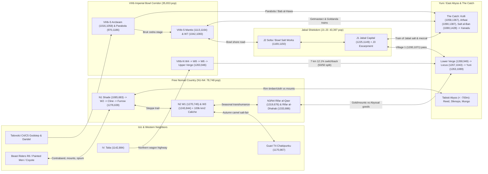

# Simulation & Regional Geography Proposal: Jabal Shiekdom, the Eastern Nomads (Dasri Confederacy) & the Imperial Bowl Frontier (`VIIIb`)

*Status: Draft regional scoping proposal (`[G data]` — plain records, pure functions, `KRAND` deterministic seeding, zero off-screen population multipliers).*
*Companion proposals: [PROPOSAL-GUARI-TALOVOLCI.md](file:///home/antigravity/traviso761-debug/krator-master/core/simulation/PROPOSAL-GUARI-TALOVOLCI.md), [PROPOSAL-CATCH.md](file:///home/antigravity/traviso761-debug/krator-master/core/simulation/PROPOSAL-CATCH.md), [CATCH-SURVEY.md](file:///home/antigravity/traviso761-debug/krator-master/core/simulation/CATCH-SURVEY.md), [PROPOSAL-BEAST-RIDERS.md](file:///home/antigravity/traviso761-debug/krator-master/core/simulation/PROPOSAL-BEAST-RIDERS.md), [PROPOSAL-RAIDING-FACTIONS.md](file:///home/antigravity/traviso761-debug/krator-master/core/simulation/PROPOSAL-RAIDING-FACTIONS.md), [PROPOSAL-IZIZ-EXCLAVES.md](file:///home/antigravity/traviso761-debug/krator-master/core/simulation/PROPOSAL-IZIZ-EXCLAVES.md), [PROPOSAL-EAST-ABYSS-YUNI.md](file:///home/antigravity/traviso761-debug/krator-master/core/simulation/PROPOSAL-EAST-ABYSS-YUNI.md), and the Imperial provincial handoff (`IV. Talia` & `VIII. Daridel / Corredor del Cuenco`).*
*Quantitative backing: [page.py](file:///home/antigravity/traviso761-debug/krator-master/tools/scale-model/smodel/page.py), [51-region-store.js](file:///home/antigravity/traviso761-debug/krator-master/tools/scale-model/src/51-region-store.js), [49r-region-stats.js](file:///home/antigravity/traviso761-debug/krator-master/tools/scale-model/src/49r-region-stats.js), [geology.json](file:///home/antigravity/traviso761-debug/krator-master/kits/resources/data/geology.json), [rivers.json](file:///home/antigravity/traviso761-debug/krator-master/tools/scale-model/data/rivers.json), [basins.json](file:///home/antigravity/traviso761-debug/krator-master/tools/scale-model/data/basins.json), [palaeolakes.json](file:///home/antigravity/traviso761-debug/krator-master/tools/scale-model/data/palaeolakes.json), [springs.json](file:///home/antigravity/traviso761-debug/krator-master/tools/scale-model/data/springs.json), [tubes.json](file:///home/antigravity/traviso761-debug/krator-master/tools/scale-model/data/tubes.json), [CROPS](file:///home/antigravity/traviso761-debug/krator-master/kits/crops/API.md), [KHAMLET](file:///home/antigravity/traviso761-debug/krator-master/core/hamlet/README.md), and [KCAMP](file:///home/antigravity/traviso761-debug/krator-master/core/camp/PLAN.md).*

---

## 1. Executive Summary, Three Desert Regimes & Cross-Session Seam Contract

The south-eastern arid quadrant of the crater (`X = 950..1386, Y = 575..1196`, spanning biomes `sedesert`, `the bowl`, and `e badlands`) is one interconnected dromedary-and-oasis world governed by **three distinct political-economic regimes** sharing an Arabic-inflected **Dasri** cultural substrate ([LORE.md](file:///home/antigravity/traviso761-debug/krator-master/LORE.md), [TRADE-SCOPE.md](file:///home/antigravity/traviso761-debug/krator-master/openworld/TRADE-SCOPE.md)):

1. **`Jabal Shiekdom` (`rmwelppnigssz` — `J1–J3`, `34,736 km²` total / `33,224 km²` dry, `1,512 km²` Bowl salt-lake shore; `43,397` people):** An autonomous, wealthy Dasri oasis principality anchored in the `-1,206 m` (`1.86 atm`) heat sink of **`Jabal`** (`1225,1149`) and **`Solta / Bowl Salt Works`** (`1169,1150`). Through the chartered **Train of Jabal** caravan company, the Sheikhdom operates a dual-basin evaporite and caravan monopoly linking `Solta` on the Bowl's hypersaline lake with **`Ṣalṭ al-Bān / Catch Salt Works`** (`1080,1428`) and **`Arfwai Oasis`** (`1090,1387`) in the northern Catch, while collecting transit tolls and distilling `mezcal` (`197.9 t/yr` #1 export) on the southern trunk between `Mantis`, `Yuni`/`Locus`, and `Xanadu`.
2. **Free `Nomad Country` / Dasri Confederacy (`rmucc476rj9ie` — `N1–N4`, `273,492 km²` single-counted / `273,412 km²` dry, `80 km²` mid-desert pans & alpine lakes; `78,748` people):** Unconquered confederate camel- and horse-herding *qabā'il* ranging across the northern rim towns (**`Shade`** `1085,683`, **`W2`** `1190,671`, **`Cline`** `1225,646`, **`Furrow`** `1276,639`), the central nitrate-caliche and wadi steppe (**`W1`** `1270,745`, **`W3`** `1243,844`), and the **5 high eastern badland summer valleys** (`1,550–3,063 m` around **`Rīfar al-Qaṣr`** `1319,676` and **`Rifar al-Dhahab`** `1333,886`). They run the autumn `Chakipunku` (`1170,867`) salt-for-tuber fair with Guari (`T4`), broker contraband through `Shade`, and trade riding dromedaries, raw wool, hides, gold dust, potash, and saltpeter to every rim neighbor.
3. **The Imperial Bowl & `Izani-Dasri` Frontier Corridor (`VIIIb` — `VIIIb-N` & `VIIIb-S`, `162,564 km²` total / `154,708 km²` dry, `7,856 km²` Bowl hypersaline lake; `35,653` people):** The eastern lowland half of Marr's Province `VIII` (*Corredor del Cuenco*). Here the Empire of Iziz holds the western arcology gates (**`Arcbeam`** `1016,1058` and **`Parabola`** `970,1186`), the Socotran monsoon-oasis depot of **`Mantis`** (`1113,1164`, ruled by Izani merchant houses `Getmastarz` and `Goldanda`), the cliff-lip trailhead of **`Upper Verge`** (`1263,946`), and the settled `Izani-Dasri` wagon-cistern oases (**`W4`** `1184,935`, **`W8`** `1172,974`, **`W6`** `1240,960`, **`W7`** `1042,1083`, plus safe-conduct Dasri **`W5`** `1172,1042`).



### Cross-Session Single-Counted Boundary Contract

Every square kilometre, settlement pin, and pastoral band across all neighboring regional proposals is **strictly single-counted**:

| Seam / Neighbor | Companion Document | Single-Counted Boundary & Pin Ownership Rule |
|---|---|---|
| **East Abyss & Yuni Emirate (`E` seam)** | [PROPOSAL-EAST-ABYSS-YUNI.md](file:///home/antigravity/traviso761-debug/krator-master/core/simulation/PROPOSAL-EAST-ABYSS-YUNI.md), [DESIGN.md](file:///home/antigravity/traviso761-debug/krator-master/settlements/verge/DESIGN.md) | **1. Northern/Central Abyss (`TABISTI_SEAM`):** Raw `Nomad Country` (`rmucc476rj9ie`) overreaches down the sheer Abyssal wall to `-2,582 m` (`53,932 km²` overlap with `e abysss`). We cut `Nomad Country` cleanly at the **`E = -700 m` upper cliff contour** (`X >= 1206`): upper-plateau Dasri **`Furrow`** (`1276,639`, `-593 m`), **`W1`** (`1270,745`, `+205 m`), **`Rīfar al-Qaṣr`** (`1319,676`, `+909 m`), and **`Rifar al-Dhahab`** (`1333,886`, `+1,715 m`) belong 100% to Free Dasri (`N1–N4`), while gorge-floor Tabisti **`Tabist town`** (`1285,655`, `-1,115 m`), **`Sfenops`** (`1282,663`, `-1,657 m`), **`Reed`** (`1280,678`, `-2,333 m`), **`Reed upriver`** (`1297,683`, `-780 m`), **`Liikofi`** (`1316,797`, `-1,637 m`), and **`Mungo`** (`1322,828`, `-1,770 m`) belong 100% to [PROPOSAL-EAST-ABYSS-YUNI.md](file:///home/antigravity/traviso761-debug/krator-master/core/simulation/PROPOSAL-EAST-ABYSS-YUNI.md) (`48,936 km²` handed off).<br>**2. Twin-Town `Verge`:** **`Upper Verge`** (`1263,946`, `-516 m` raw raster / `-1,094 m` carved plateau rim, `5,200` pop, Izani vernacular) is counted in `VIIIb-N` (`Empire of Iziz`); **`Lower Verge`** (`1268,949`, `-1,685 m` raw raster / `-1,950 m` scarp-foot bench `856 m` below, `5,800` pop, Yuni/Abyssal adobe) + **`Locus`** (`1267,1043`, `lode:locus-oil`), **`Yuni`** (`1263,1089`), and **`Village 1`** (`1200,1071`, inside `Yuni Emirate`) are counted in [PROPOSAL-EAST-ABYSS-YUNI.md](file:///home/antigravity/traviso761-debug/krator-master/core/simulation/PROPOSAL-EAST-ABYSS-YUNI.md).<br>**3. Seasonal Badland Grazing:** Summer Valleys #1 (`Braita Riba` `1334,949`, `+1,932 m`) and #4 (`Solt Riba` `1338,1012`, `+1,550 m`) lie geographically inside `Yuni Emirate`: land/permanent hamlets stay in `Yuni Emirate`, while `N4` Dasri bands hold seasonal summer-pasture safe-conducts (`īlāf`) without double-counting population. |
| **Talia (`NW` seam)** | Marr `IV. Talia`, [PLAN.md](file:///home/antigravity/traviso761-debug/krator-master/kits/talia/PLAN.md) | `Talia` (`1142,884`) and the Lesser Throne highland rim stay in Marr's `IV. Talia`. Once the eastern road descends below the Lesser Throne apron (`X >= 1150, Y >= 905`), `W4` (`1184,935`), `W8` (`1172,974`), `W5` (`1172,1042`), and `W6` (`1240,960`) belong to `VIIIb-N`. |
| **Guari / Tiguantin (`W` central seam)** | [PROPOSAL-GUARI-TALOVOLCI.md](file:///home/antigravity/traviso761-debug/krator-master/core/simulation/PROPOSAL-GUARI-TALOVOLCI.md) | Follows the **`+2,200 m` eastern chord contour**: `1,072 km²` of `>= +2,200 m` highland inside raw `Nomad Country` belongs to Guari `T4`, while Guari's `< +2,200 m` eastern desert fan (`X >= 1178`) belongs to Dasri `N2`. **`Chakipunku`** (`1170,867`, `+2,272 m`) is counted in Guari `T4` as the permanent highland salt-fair town where `N2` Dasri camel trains exchange salt/caliche/potash for dehydrated tubers and highland grain each autumn. |
| **Talovolci & `Daridel` (`SW` Bowl seam)** | [PROPOSAL-GUARI-TALOVOLCI.md](file:///home/antigravity/traviso761-debug/krator-master/core/simulation/PROPOSAL-GUARI-TALOVOLCI.md) (`C4`/`C5`) | `>= +700 m` `Godstep` (`C4`) and `Daridel` (`937,1068` in `C5`) belong to `Talovolci`, **except** the `20 km`-radius Imperial arcology enclave around **`Arcbeam`** (`1016,1058`, `+2,119 m`) and **`Parabola`** (`970,1186`, `+1,716 m`), which anchor `VIIIb-S` and step down to `W7` (`1042,1083`, `+896 m`) and `Mantis` (`1113,1164`, `-978 m`). |
| **Beast Riders `R6`, Painted Men & Coyote (`NW/N` canyon seam)** | [PROPOSAL-BEAST-RIDERS.md](file:///home/antigravity/traviso761-debug/krator-master/core/simulation/PROPOSAL-BEAST-RIDERS.md), [PROPOSAL-RAIDING-FACTIONS.md](file:///home/antigravity/traviso761-debug/krator-master/core/simulation/PROPOSAL-RAIDING-FACTIONS.md) | Minor polygon overlaps along the `Painted Men` (`2,968 km²`) and `Coyote Kingdom` (`388 km²`) rims are ceded to their respective regions; **`Shade`** (`1085,683`, `-406 m`) sits cleanly inside `Nomad Country` (`N1`) as the neutral canyon contraband bazaar serving Beast Riders (`Łichíí' Lake` `1063,689` in `R6`), Painted Men, Korona (`E1`), Coyote, and Dasri alike. |
| **The Catch & Xanadu (`S` escarpment seam)** | [PROPOSAL-CATCH.md](file:///home/antigravity/traviso761-debug/krator-master/core/simulation/PROPOSAL-CATCH.md), [CATCH-SURVEY.md](file:///home/antigravity/traviso761-debug/krator-master/core/simulation/CATCH-SURVEY.md) | `Jabal Shiekdom` (`rmwelppnigssz`) ends along the `Y = 1193` crest (`+6,749 m`). Permanent station keepers inside the Catch — **`Kolli`** (`1058,1367`, Mantis houses `Getmastarz` & `Goldanda`), **`Arfwai Oasis`** (`1090,1387`, `60–150` keepers), and **`Ṣalṭ al-Bān / Catch Salt Works`** (`1080,1428`, `120–350` keepers) — are single-counted in `PROPOSAL-CATCH.md`, while the mobile **Train of Jabal** camel bands cycling between `Jabal`, `Solta`, `Arfwai`, and `Ṣalṭ al-Bān` are home-rostered in `Jabal Shiekdom` (`J2`). |

---

## 2. Physical Geography, Hydrology, 39-Family Geology & `CROPS.at` Ecology

### 2.1 Hypsometry, Dense-Air Heat Sinks & Wind-Shadow Climate

Across the three desert spheres (`470,792 km²` single-counted total: `461,344 km²` dry land, `9,448 km²` lakes/pans), elevation spans nearly **8 vertical kilometres** — from `-1,259 m` (`1.87 atm`) on the Bowl floor to `+6,749 m` (`0.68 atm`) on Jabal's southern Catch-rim wall:

- **The Bowl Super-Greenhouse (`J1`, `J2`, `VIIIb-S` floor; `-1,259 m` to `-500 m`, `1.70–1.87 atm`):** Adiabatic compression raises mean annual temperature to `+28..+29 °C` (warmest month `+35..+38 °C`). Moisture spilling around the southern Outer Wall creates a sharp Socotran gradient: hyper-arid `BWh` (`110–250 mm`) across the western/central Bowl salt flats, hot semi-arid `BSh` (`533–659 mm`) across `Jabal` and `Solta`, and an extraordinary **`Am` monsoon pocket (`1,553 mm/yr`, `+28 °C`, `1.81 atm`)** right on the southwest lake shore at **`Mantis`** (`1113,1164`), clothed in mist-fed dragon's-blood and frankincense woodland ([PLAN-BOWL.md](file:///home/antigravity/traviso761-debug/krator-master/biomes/sedesert/PLAN-BOWL.md)).
- **The Central Caliche & Wadi Plateau (`N2`, `VIIIb-N`; `+180 m` to `+1,400 m`, `1.35–1.55 atm`):** Rain-shadowed behind the Lesser Throne and East Badlands (`94–282 mm/yr`, `BWh` and `BSh`), flat-lying (`median slope 0.018–0.022`) sedimentary hamada and nitrate-crusted playas cut by incised wadis and exotic perennial streams — including the anomalous wet **`Cfa` (`1,020 mm/yr`)** upland bench at **`W8`** (`1172,974`, `+1,045 m`).
- **The Northern Canyon Rim & Eastern Badland Steppe (`N1`, `N3`, `N4`, `J3`; `-593 m` to `+6,749 m`, `1.10–1.71 atm`):** In the north (`N1`), sandstone canyons drop to `-406 m` at `Shade` (`BSh 549 mm`) and `-593 m` at `Furrow` (`Aw 1,224 mm` Abyss-lip moist updraft). In the east (`N3`, `N4`), dissected badland mesas climb into `1,550–3,063 m` `Csa`/`Cfa`/`BSk`/`Dsb` alpine-steppe valleys ([PLAN-STEPPE.md](file:///home/antigravity/traviso761-debug/krator-master/biomes/sedesert/PLAN-STEPPE.md), [PLAN-STATIONS.md](file:///home/antigravity/traviso761-debug/krator-master/biomes/ebadlands/PLAN-STATIONS.md)), giving Dasri pastoralists snowmelt summer grass above the summer furnace.

### 2.2 Endorheic Playas, Exotic Rivers, Wadis & Deep Aquifers

Scanning [palaeolakes.json](file:///home/antigravity/traviso761-debug/krator-master/tools/scale-model/data/palaeolakes.json) (`2` northern dam basins) and [springs.json](file:///home/antigravity/traviso761-debug/krator-master/tools/scale-model/data/springs.json) (`8` Mid-Basin Slab maars/pateras) confirms **zero discrete JSON point-spring or palaeolake records** inside the SE desert; [tubes.json](file:///home/antigravity/traviso761-debug/krator-master/tools/scale-model/data/tubes.json) places one sealed volcanic tube (`tube_lesser_06`, `1138,858` -> `1132,851`, with fumarolic `vent` at `1130,854`) on the Lesser Throne flank just west of `N2`. Instead, water availability across the entire region is governed by **four physical hydrological systems** in [basins.json](file:///home/antigravity/traviso761-debug/krator-master/tools/scale-model/data/basins.json) and [rivers.json](file:///home/antigravity/traviso761-debug/krator-master/tools/scale-model/data/rivers.json):

| Hydrological System | Sub-Regions | Key Features, Elevations & Discharges (`Q_mouth` in `rivers.json`) | Economic & Settlement Role |
|---|---|---|---|
| **1. Bowl Hypersaline Endorheic Sea & Desert Playas** | `VIIIb-S`, `J1`, `J2`, `N2`, `N3` | **Bowl Salt Sea** (`W_LBL=295`, `9,592 km²` contiguous surface at `-990.3 m`; [basins.json](file:///home/antigravity/traviso761-debug/krator-master/tools/scale-model/data/basins.json) sub-depressions at `-1,158 m` `3,129 km²` off Jabal/Solta, `-1,071 m` `176 km²` off Mantis, `-1,068 m` `112 km²` off `Bruk cedra`; `surplus_m3s = 0.0` — 100% evaporative sink!).<br>**Mid-Desert Salt Playa** (`W_LBL=231/235`, `48 km²` at `1259,851`, `+408 m`, `surplus = 0.0`, `32 km` ENE of `W3`).<br>**NE Badland Through-Lake** (`W_LBL=183`, `32 km²` at `1367,663`, `+2,587 m`, `surplus = 32.9 m³/s`). | Precipitates infinite halite, potash, gypsum, and alkali crusts harvested at **`Solta`** (`1169,1150`), **`Mantis`** (`1113,1164`), and **`W3`'s pan** (`1259,851`), mirroring the Catch pans (`497 km²` + `257 km²`) worked at **`Ṣalṭ al-Bān`** (`1080,1428`). |
| **2. Exotic Perennial Snowmelt Rivers (`per = true`)** | `J1`, `J2`, `N1`, `N3`, `N4`, `VIIIb-N`, `VIIIb-S` | **Into the Bowl (`J1/J2/VIIIb-S`):** `Rvr Ḥmm` (`r037`, `120.1 m³/s`, `158 km`), `Rvr Bḥr` (`r054`, `87.6 m³/s`, `129 km`), `Brk Qmr` (`r137`, `32.0 m³/s`), `Rvr Ḥdd` (`r158`, `27.6 m³/s`), `Brk Ǧbl` (`r204`, `20.9 m³/s`, `120 km`), `Bruk cedra` (`r361`, `10.6 m³/s`, `189 km` past `W7`).<br>**Across `VIIIb-N` to East Abyss:** `Rrivar Blaca` (`r284`, `14.7 m³/s`, `196 km` past `W4`), `Bruk Loña` (`r334`, `11.8 m³/s`, `128 km` past `W6`), `Winda Riba` (`r267` past `W5`).<br>**Across `N1/N3/N4` to East Abyss:** `Rīfar al-Qaṣr` (`r062`, `78.0 m³/s`, `180 km`), `Rvr Fḍḍ` (`r083`, `57.3 m³/s`, `191 km`), `Rīfar al-Sarāb` (`r100`, `45.6 m³/s`), `Rīfar al-Zulāl` (`r110`, `41.7 m³/s`), `Rīfar al-Rīḥ` (`r156`, `28.3 m³/s`), `Rīfar al-Dhahab` (`r184`, `24.1 m³/s`), `Rīfar al-Milḥ` (`r197`, `22.5 m³/s`), `Rīfar al-Ṣakhr` (`r200`, `22.0 m³/s`), `Rīfar al-Kawkab` (`r229`, `18.5 m³/s`), `Rīfar al-Bālm` (`r260`, `11.8 m³/s`, `178 km` past `Cline`). | Irrigates `Jabal`'s dense date-and-rice delta (`riv_2km = 1,008 km²`), powers the `VIIIb` wagon-highway oases (`W4, W5, W6, W7`), feeds `Cline` (`1225,646`), and anchors the **5 high badland summer valleys** (`N3/N4`) plus rich gold/tin placer bars. |
| **3. Ephemeral Wadis & Sub-Surface Underflow (`per = false`)** | `N1`, `N2`, `J3`, `VIIIb` | `Wādī al-Layl` (`r537`, `313 km`, `8.7 m³/s` peak), `Wādī al-Kawkab` (`r519`, `228 km`, `10.1 m³/s` near `W1`), `Wādī al-Bālm` (`r502`, `184 km`), `Wādī al-Sarāb` (`r526`, `178 km`), `Wādī al-Raml` (`r541`, `166 km`), `Wādī al-Qaṣr` (`r534`, `158 km`), `Wādī al-Bīr` (`r512`, `122 km`), `Wādī al-Jabal` (`r637`, `7.4 m³/s`), plus Izani-mapped Bowl washes (`Guli Soka`, `Guli Drai`, `Guli Ston`). | Flash-flood channels dry 10 months of the year, but gravel underflow feeds `4–8 m` hand-dug *bi'r* wells for `W1` (`1270,745`), `W3` (`1243,844`), and the **14 winter spring/wadi camps**. |
| **4. Deep Canyon Contact Aquifers & Escarpment Seeps** | `N1` (`Shade`, `W2`) | At **`Shade`** (`1085,683`, `-406 m`), incision into the canyon floor exposes a perennial sandstone aquifer feeding `Wādī al-Bīr al-Sharq` (`r544`, `9.5 m³/s` flowing NW toward Beast Riders' `Łichíí' Baatar`, [DESIGN.md](file:///home/antigravity/traviso761-debug/krator-master/settlements/shade/DESIGN.md)). At **`W2`** (`1190,671`, `+502 m`), a contact spring-line emerges along the northern cuesta toe. | Creates defensible, hidden water monopolies in otherwise waterless rim country (`Shade`'s neutral Khanate; `W2` staging post). |

### 2.3 39-Family Quantitative Geology ([geology.json](file:///home/antigravity/traviso761-debug/krator-master/kits/resources/data/geology.json))

Aggregating the `4 × 4 km` (`16 km²/cell`) resource grids across our single-counted masks (`Good` = byte `>= 100`, `Rich` = byte `>= 180`, `GoodY` = `kits/resources` grade-weighted node yield sum `1.0 / 1.5`) reveals **five signature geological endowments** (and one decisive absence):

| Mineral Family | `Jabal Shiekdom` (`J1–J3`) `Good km²` (`GoodY`) | Free Dasri (`N1–N4`) `Good km²` (`GoodY`) | Imperial Bowl (`VIIIb`) `Good km²` (`GoodY`) | Sphere Total `Good km²` (`GoodY`) | Top High-Grade Localities & Trade Role |
|---|---:|---:|---:|---:|---|
| **`saltpeter` (Caliche)** | `12,288` (`350.0`) | **`143,776`** (`5,675.0`) | `115,712` (`4,156.0`) | **`271,776`** (`10,181.0`) | **Planetary Nitrate Belt:** `N2` alone holds `99,968 km²` Good (`GoodY = 4,121.0`, byte `225`)! Raw caliche crusts feed Iziz, Yuni, and Jabal gunpowder, nitric-acid, and fertilizer works. |
| **`halite` (Rock/Pan Salt)** | `1,008` (`133.5`) | `192` (`18.0`) | `1,168` (`135.5`) | **`2,368`** (`287.0`) | `J2` **`Solta`** (`1169,1150`, byte `255`), `VIIIb-S` **`Mantis`** shore (`byte 253`), `N2` **`1258,852` playa** (`byte 229`, feeding `Chakipunku`), plus Train of Jabal's Catch **`Ṣalṭ al-Bān`** (`1080,1428`, `GoodY = 88.0`, byte `255`). |
| **`gypsum` & `alabaster`** | `944` (`109.0`) / `560` (`21.5`) | `16` (`1.5`) / `16` (`0.5`) | `1,104` (`142.0`) / `896` (`43.5`) | **`2,064`** (`252.5`) / **`1,472`** (`65.5`) | Bowl lake evaporite rings (`J2` byte `255`, `VIIIb-S` byte `254`): plaster-of-Paris mortar for vaulted oasis roofs and translucent carved alabaster screens. |
| **`potash` & `alkali` (Borax/Trona)** | `368` (`35.5`) / *trona* | `448` (`40.5`) / `max=80` | `928` (`110.0`) / *trona* | **`1,744`** (`186.0`) | Bowl shore (`VIIIb-S` byte `242`, `J2` byte `231`) & `N2` `1258,852` playa (`GoodY = 40.5`, byte `222`, `alkali` byte `80`); **high-grade `alkali`/borax (`GoodY = 23.5`, byte `195`)** is worked by the **Train of Jabal** at Catch **`Ṣalṭ al-Bān`** (`1,037 t/yr` glass/soap flux!). |
| **`gold` (+ `placers`)** | `9,344` (`292.0`) | `31,552` (`986.5`) | `18,672` (`307.0`) | **`59,568`** (`1,585.5`) | Escarpment veins + rich `rivers.json` placer bars: `Wādī al-Jabal` (`load 4.64`), `Rīfar al-Milḥ` (`4.28`), `Wādī al-Layl al-Gharb` (`4.14`), `Wādī al-Shams` above **`Rifar al-Dhahab`** (`3.32`), `Shade`'s `Wādī al-Bīr al-Sharq` (`3.20`), `Cline`'s `Rīfar al-Bālm` (`3.05`). |
| **`silver`** | `9,088` (`284.0`) | `29,520` (`922.5`) | `18,672` (`315.5`) | **`57,280`** (`1,522.0`) | Polymetallic granite/crystalline veins in `J3` (`byte 150`), `N3/N4` (`GoodY = 602.5`), and `VIIIb-S` rim (`GoodY = 269.0`). |
| **`tin`** | `7,488` (`370.5`) | `26,576` (`1,314.5`) | `8,720` (`428.0`) | **`42,784`** (`2,113.0`) | Heavy granite cassiterite placers (`Rvr Ḥmm` `r037:10` load `4.77`; `N3` `GoodY = 507.0`; `N1` `GoodY = 398.5`). |
| **`iron`** | `21,760` (`1,569.0`) | `135,968` (`8,725.5`) | `41,248` (`2,928.0`) | **`198,976`** (`13,222.5`) | Ubiquitous red-bed & crystalline ironstone (`byte 255` in `J3`, `N1–N4`, and `VIIIb-S`), smelting blades and camel-tack hardware where saxaul/tamarisk charcoal permits. |
| **`copper` & `zinc`** | `16` (`0.5`) / `16` (`0.5`) | `2,944` (`103.5`) / `2,816` (`88.0`) | `288` (`11.5`) / `288` (`8.5`) | **`3,248`** (`115.5`) / **`3,120`** (`97.0`) | Concentrated in `N3` (`GoodY = 41.5`, byte `195` at `1350,746`), `N4` (`GoodY = 37.0`, byte `195` at `1348,890`), `N1` (`1218,596`), and near `Arcbeam` (`1016,1058`, byte `210`). Jabal lacks domestic copper (`GoodY = 0.5`), trading salt for brass/bronze! |
| **`coal`** | `0` (`0.0`) | `0` (`0.0`) | **`1,424`** (`65.0`) | **`1,424`** (`65.0`) | **Mantis Seam (`1090,1154`, byte `156`):** The *only* Good coal in the entire desert sphere lies `45 km` WNW of **`Mantis`** (`VIIIb-S`), fueling Mantis's evaporite pans and steam/foundry works! |
| **`emerald` & `diamond`** | `752` (`23.5`) / `0` | `528` (`16.5`) / **`1,600`** (`16.5`) | `10,064` (`70.0`) / `0` | **`11,344`** (`110.0`) / **`1,600`** (`16.5`) | **Bowl Emeralds** along the southern metamorphic rim (`VIIIb-S` & `J2`); **Northern Kimberlite Diamonds** in `N1` (`1260,576`, `Rich = 1,600 km²`, byte `180`), smuggled west through `Furrow`, `Cline`, and `Shade`! |
| **`nickel` & `rare-earth`** | `0` / `9,088` (`191.5`) | `1,728` (`42.0`) / `29,488` (`681.5`) | `2,064` (`48.5`) / `18,640` (`232.0`) | **`3,792`** (`90.5`) / **`57,216`** (`1,105.0`) | Impactite melt sheets (`N1/N2` & `VIIIb` around `Arcbeam`/`Parabola`, byte `220`) + granite monazite sands. |
| **`oil` & `bitumen`** | **`0` (`0.0`)** | **`0` (`0.0`)** | **`0` (`0.0`)** | **`0` (`0.0`)** | **Zero Good `oil` or `bitumen`** anywhere in `Jabal`, `Free Dasri`, or `VIIIb` (`max byte = 86` trace). Confirms why Geomancer **`Locus`** (`1267,1043`) holds an absolute regional petroleum monopoly — and proves Gemini's `57.4 t` `Nomad Country` oil export was a polygon-leak artifact from Tabisti `Mungo`! |

### 2.4 Oasis, Halophyte & Steppe Ecology (`CROPS.forBiome`, `CROPS.at`, `CROPS.palette`)

Running [CROPS](file:///home/antigravity/traviso761-debug/krator-master/kits/crops/API.md) across `sedesert` (`warmth [3,5], atm [1,2], arid [0,1]`), `ebadlands` (`warmth [2,4], atm [0,1], arid [1,2]`), and site-specific `CROPS.at` niches — filtered by the **Native-Crop Lock** in [TRADE-GOODS.md](file:///home/antigravity/traviso761-debug/krator-master/openworld/TRADE-GOODS.md) (`cotton`, `sugar-cane`, `cacao`, and `sky-poppy`/`opium` are locked to their native polygons even where raw warmth/aridity axes overlap) — defines five crisp agricultural zones:

1. **Bowl & Canyon Irrigated Oases (`J1 Jabal`, `J2 Solta`, `N1 Shade/Cline`, `VIIIb W4/W6/W7`; `warmth 4–5, atm 1–2, irrigated`):**
   - *Date-palm upperstory & orchard:* `wadi-date` (`fruit/sweetener`), `bell-date` (dense-air `atm 2` specialist in `Jabal`/`Solta`/`Mantis`), `cave-date`, `pomegranate`, `fig`, `stack-fig`, `citron`, `almond`, `carob`, `sidr` (jujube + `sidr` honey), `mesquite` (pod flour & fodder).
   - *Understory cereals, pulses & cucurbits:* `ashmillet`, `sandpan-fonio`, `bambara`, irrigated `rice` (on the `120 m³/s` `Rvr Ḥmm` delta at `Jabal` and `Rrivar Blaca` at `W4`), `ballmelon`, `measuremelon`, `desert-gourd`, `onion`, `garlic`, ` sesame`, `myrrh`, `tamarisk-manna`, `indigo`, and `ghost-gum`.
2. **Bowl & Desert Wild Cash Endemics ([PLAN-BOWL.md](file:///home/antigravity/traviso761-debug/krator-master/biomes/sedesert/PLAN-BOWL.md) + `TRADE-GEMINI.md`):**
   - **Wild & Escarpment `agave` -> `mezcal` (`spirits`):** Roasted desert agave piñas distilled in `Jabal` (`197.92 t/yr`, Jabal's #1 export by value!) and Train of Jabal's `Arfwai` (`28.87 t/yr`).
   - **Socotran Resins & Dragon's-Blood (`Mantis` `Am 1,553 mm` & `J2/J3` fog cliffs):** *Boswellia* **`frankincense`**, *Commiphora* **`myrrh`**, and *Dracaena cinnabari* **`dragon's blood`** crimson resin (`CROPS.palette('sedesert')` -> `{"colours":["brown","red"],"sources":{"brown":["lichen:wild"],"red":["dragons-blood:wild"]}}`), plus `coconut`, `guava`, `hyperbamboo`, and `bamboo-rice` inside Mantis's monsoon pocket.
   - **Dye & Plaid Dependency:** Because `sedesert` has only **2** native dye families (`brown` + `red`, `canPlaid = false`), Dasri and Jabal weavers achieve `>= 3`-colour striped/plaid *bayt* tent-cloth and *kiswa* hangings by combining `sedesert` `dragons-blood` (`red`) + `lichen` (`brown`) with **`ebadlands` summer-range dyes** (`CROPS.palette('ebadlands')` -> `blue` `woad:wild` + `yellow` `rabbitbrush:wild` / `sulfur-yellow:wild`)!
3. **`W8` Wet `Cfa` Upland Breadbasket (`1172,974`, `+1,045 m`, `1.40 atm`, `1,020 mm/yr`):**
   - A `2,400 km²` `Cfa` orographic oasis in `VIIIb-N` growing rainfed `rice`, `emmer`, `helix-bean`, `sweet-potato`, `avocado`, `persimmon`, `citron`, `flax`, `mulberry`, and `woad` — provisioning the `VIIIb` Imperial wagon garrisons (`W4`, `W6`, `Upper Verge`).
4. **High Badland Summer Valleys (`N3`, `N4`, `J3`; `+1,715 m` to `+3,063 m`, `warmth 2, atm 1`):**
   - `emmer`, `frostoat`, ` rye`, `helix-bean`, `lentil`, `pinyon`, `almond`, `whorl-olive`, `apricot`, `canyon-grape`, `saffron`, `sumac`, `madder`, and dense seasonal bunchgrass supporting `425,835` sheep/goats and `108,007` dromedaries across the sphere.
5. **Halophyte & Desert-Fuel Gap Note ([PLAN-BOWL.md](file:///home/antigravity/traviso761-debug/krator-master/biomes/sedesert/PLAN-BOWL.md), [PLAN-STEPPE.md](file:///home/antigravity/traviso761-debug/krator-master/biomes/sedesert/PLAN-STEPPE.md)):**
   - Three wild gather plants documented in the biome plans are flagged for future `kits/crops` registration (not yet in `CROPS.LIST`, zero edits made here): **`glasswort`** (Bowl/Catch halophyte burned for soda-ash `alkali`), **`saxaul`** (smokeless high-heat desert wood charcoal for wadi smithies), and **`brine-lamp`** (dense-air Bowl heat-remedy herb).

---

## 3. Sub-Regional & Tribal Division (`9` Single-Counted Units)

To capture the exact political, hydrological, and pastoral anatomy without conflating autonomous `Jabal`, unconquered `Dasri` nomads, and Iziz's `VIIIb` highway corridor, we divide the sphere into **`9` single-counted units** (`3` in `Jabal Shiekdom`, `4` in Free `Nomad Country`, and `2` in `VIIIb`):

| ID | Unit / Tribal Range Name | Polity | Dry `km²` (`Wet km²`) | Elev med `[min..max]` (`atm`) | Rain med (`Köppen`) | `49r` Farm / Past / Timb eq `km²` | Anchors & Primary Economic Role |
|---|---|---|---:|---|---|---:|---|
| **`J1`** | **Jabal Oasis & `Rvr Ḥmm`–`Brk Ǧbl` Delta** | `Jabal Shiekdom` | `6,744` (`256`) | `-787 m` `[-1223..-103]` (`1.77`) | `659 mm` (`BSh 46%`, `Cfa 19%`, `Aw 18%`) | `3,992 / 4,254 / 1,865` | **`Jabal`** (`1225,1149`, `-1,206 m`): Sheikh's seat, `mezcal` distilleries, date/rice gardens, Yuni–Mantis–Catch caravan serais. |
| **`J2`** | **`Solta` & South-Bowl Evaporite Shore** | `Jabal Shiekdom` | `12,780` (`1,256`) | `-893 m` `[-1183..+6449]` (`1.79`) | `596 mm` (`BSh 38%`, `BWh 22%`, `Aw 19%`) | `4,925 / 5,338 / 3,574` | **`Solta / Bowl Salt Works`** (`1169,1150`, `-1,115 m`): **Train of Jabal** home depot; halite, gypsum, potash, alabaster & Bowl Bedouin winter shore. |
| **`J3`** | **Catch-Rim & Yuni-Pass High Escarpment** | `Jabal Shiekdom` | `13,700` (`0`) | `+2,995 m` `[-97..+6749]` (`1.10`) | `361 mm` (`Dfc 30%`, `Csa 15%`, `BSh 13%`) | `335 / 2,677 / 3,229` | Escarpment mines (`iron`, `tin`, `gold` placers on `Wādī al-Jabal` `4.64`), highland agave slopes & fortified Yuni/Catch toll passes. |
| **`N1`** | **Northern Canyon, Steppe & Rim March (*Āl al-Ẓill* & *Banū Bālm*)** | `Nomad Country` (Free Dasri) | `70,532` (`0`) | `+536 m` `[-749..+4759]` (`1.50`) | `392 mm` (`BSh 46%`, `BWh 21%`, `Csa 12%`) | `17,730 / 26,388 / 7,472` | **`Shade`** (`1085,683`), **`W2`** (`1190,671`), **`Cline`** (`1225,646`), **`Furrow`** (`1276,639`): neutral contraband hub, steppe horse/camel breeding, `1,600 km²` `diamond` pipe (`1260,576`) & Tabisti rim trade. |
| **`N2`** | **Central Wadi, Caliche & `Chakipunku` Salt Circuit (*Banū Layl* & *Āl al-Milḥ*)** | `Nomad Country` (Free Dasri) | `114,676` (`48`) | `+1,137 m` `[-699..+6552]` (`1.39`) | `188 mm` (`BWh 43%`, `BSh 33%`, `BSk 9%`) | `6,235 / 14,184 / 1,588` | **`W1`** (`1270,745`), **`W3`** (`1243,844`), **`48 km²` salt playa** (`1259,851`): `99,968 km²` Good `saltpeter` caliche, winter wadi wells & autumn Guari `Chakipunku` (`1170,867`) salt fair. |
| **`N3`** | **NE Badlands & `Qaṣr`–`Ṣakhr`–`Kawkab` Summer Valleys (*Banū Qaṣr* & *Banū Ṣakhr*)** | `Nomad Country` (Free Dasri) | `65,716` (`32`) | `+1,738 m` `[-700..+5005]` (`1.29`) | `486 mm` (`BSh 25%`, `Csa 21%`, `Cfa 20%`) | `24,377 / 35,436 / 10,475` | **`Rīfar al-Qaṣr`** (`1319,676`), Summer Valleys #2 (`1353,732`), #3 (`1359,671`), #5 (`1372,773`): richest Dasri summer grass (`35,436 km²` past-eq!), wool, woad/yellow dyes, copper, tin & gold. |
| **`N4`** | **SE `Rīfar al-Dhahab` Gold & High-Pasture Range (*Banū Dhahab*)** | `Nomad Country` (Free Dasri) | `22,488` (`0`) | `+2,232 m` `[-700..+4866]` (`1.21`) | `424 mm` (`Csa 28%`, `BSk 22%`, `Dfc 13%`) | `4,473 / 8,677 / 3,125` | **`Rifar al-Dhahab`** (`1333,886`, `+1,715 m`): placer gold (`Rīfar al-Milḥ` `4.28`, `Wādī al-Shams` `3.32`), copper, and cross-border summer grazing into `Braita`/`Solt Riba`. |
| **`VIIIb-N`** | **`Blaca`–`Winda`–`Loña` Settled Oases & `Upper Verge`** | `Empire of Iziz` (`VIIIb`) | `55,048` (`0`) | `+984 m` `[-1639..+2944]` (`1.41`) | `282 mm` (`BSh 72%`, `BWh 19%`, `Cfa 4%`) | `6,523 / 13,812 / 2,661` | **`W4`** (`1184,935`), **`W8`** (`1172,974`), **`W6`** (`1240,960`), Dasri **`W5`** (`1172,1042`), **`Upper Verge`** (`1263,946`): Iziz's northern wagon highway & Verge switchback head. |
| **`VIIIb-S`** | **`Arcbeam`–`Parabola`–`Mantis` Bowl & Arcology Gate** | `Empire of Iziz` (`VIIIb`) | `99,660` (`7,856`) | `-149 m` `[-1259..+4273]` (`1.63`) | `267 mm` (`BWh 43%`, `BSh 23%`, `BSk 7%`) | `15,433 / 18,808 / 9,290` | **`Arcbeam`** (`1016,1058`), **`W7`** (`1042,1083`), **`Parabola`** (`970,1186`), **`Mantis`** (`1113,1164`): Ancients arcology gates, `Mantis` coal/salt/frankincense depot & Catch road. |

### 3.1 `Jabal Shiekdom` (`J1–J3`) & the Train of Jabal

- **`J1` — Capital Oasis (`Jabal`, `1225,1149`, `-1,206 m`, `1.86 atm`):** Built where the `120.1 m³/s` `Rvr Ḥmm` and `20.9 m³/s` `Brk Ǧbl` fan out toward the Bowl shore (`F20 = 929`, `P20 = 935` inside `20 km`!). Under dense `1.86 atm` air, Jabal's multi-storey mudbrick quarters, *malqaf* wind-catchers, and subterranean *qanat* cisterns stay `8–10 °C` cooler than the street. Jabal is politically independent of both Iziz and Yuni: its Sheikh levies light, predictable *khafāra* safe-conduct tolls (`3–4%` ad valorem) on caravans linking `Yuni`/`Locus` (via `Village 1` `1200,1071`), `Mantis` (`224 km` W), and the Catch passes, while turning escarpment agave and Bowl date syrup into `mezcal` and `arrack`.
- **`J2` — `Solta / Bowl Salt Works` (`1169,1150`, `-1,115 m`, `1.84 atm`) & the Train of Jabal:** `112 km` west of `Jabal` on the southern salt-crust bays of the Bowl lake (`1,256 km²` wet brine shore fed by `Rvr Bḥr` `87.6 m³/s`, `Brk Qmr` `32.0 m³/s`, and `Rvr Ḥdd` `27.6 m³/s`). Per [LORE.md](file:///home/antigravity/traviso761-debug/krator-master/LORE.md) and [TRADE-SCOPE.md](file:///home/antigravity/traviso761-debug/krator-master/openworld/TRADE-SCOPE.md), `Solta` is the home operational yard of the **Train of Jabal**, the great Dasri joint-stock caravan guild that simultaneously works **`Ṣalṭ al-Bān / Catch Salt Works`** (`1080,1428`) and **`Arfwai Oasis`** (`1090,1387`) in the Catch — giving Jabal direct leverage over both Bowl halite/potash/gypsum and Catch halite/borax (`alkali`), in commercial rivalry with Mantis's Izani houses (`Getmastarz` & `Goldanda`, who hold `Kolli` `1058,1367`).
- **`J3` — Southern Catch-Rim & Yuni-Pass Escarpment (`median +2,995 m`, max `+6,749 m`):** Steep crystalline and granite wall supplying `Jabal`'s domestic `iron` (`GoodY = 1,569` across the Sheikhdom), `tin` (`GoodY = 370.5`), and alluvial `gold` (`Wādī al-Jabal` load `4.64`), plus cool summer *yayla* pastures for `J1/J2` Bowl Bedouin herds escaping the `+38 °C` low-basin summer.

### 3.2 Free `Nomad Country` (`N1–N4`): Confederate *Qabā'il* & the 5-Summer / 14-Winter Transhumance Cycle

Free Dasri society has **no paramount king**: clans (*qabā'il*, singular *qabīla*) govern themselves by council (*majlis*) under elected raid- and caravan-sheikhs, bound by water-truce law (*ḥawḍ* — wells and cisterns may never be poisoned) and seasonal grazing compacts (*īlāf*). Grounding [PLAN-STEPPE.md](file:///home/antigravity/traviso761-debug/krator-master/biomes/sedesert/PLAN-STEPPE.md) and [PLAN-STATIONS.md](file:///home/antigravity/traviso761-debug/krator-master/biomes/ebadlands/PLAN-STATIONS.md) on the exact river and terrain grids connects the **5 high eastern badland summer valleys** (`May–Sep`) to **14 named winter wadi/spring-line camp clusters** (`Oct–Apr`):

1. **`N1` — *Āl al-Ẓill* (Canyon & Rim) & *Banū Bālm* (Northern Steppe):**
   - Anchored by **`Shade`** (`1085,683`, `-406 m` — neutral canyon Khanate where Dasri camel-brokers meet Beast Riders from `Łichíí' Lake` `1063,689`, Painted Men raiders, Korona factors, and Coyote smugglers), **`W2`** (`1190,671` — proposed Dasri name **`Bi'r al-Ṣafā`**, `+502 m` cuesta spring-line), **`Cline`** (`1225,646`, `-464 m` on `Rīfar al-Bālm`), and **`Furrow`** (`1276,639`, `-593 m`, wet `Aw 1,224 mm` Dasri rim market town just above the Tabisti Abyss).
   - Breeds the desert's fastest riding dromedaries and `Aw/BSh` steppe horses (`15%` horse share in `N1`), works the `1,600 km²` Rich `diamond` pipe (`1260,576`), and trades wool, camels, and saltpeter down the cliff trails to Tabisti `Tabist town` (`1285,655`) and `Sfenops` (`1282,663`) for Abyssal timber and cloth.
2. **`N2` — *Banū Layl* (Central Wadis) & *Āl al-Milḥ* (Playa & Caliche Trains):**
   - Holds **`W1`** (`1270,745` — proposed **`Qaṣr al-Kawkab`**, `+205 m` on `Wādī al-Kawkab` above the East Abyss cliff), **`W3`** (`1243,844` — proposed **`Bi'r al-Malāḥa`**, `+582 m` mid-desert wadi crossroads `32 km` WSW of the `48 km²` halite/potash playa at `1259,851`), and `99,968 km²` of Good `saltpeter` caliche.
   - Every late summer/autumn (`Aug–Oct`), `95` *Āl al-Milḥ* and *Banū Layl* salt-train bands load slab salt, potash, and caliche at the `1259,851` playa (supplemented by Bowl blocks from `Solta`) and march `152 km` WNW up the `< +2,200 m` alluvial fan to Guari's **`Chakipunku`** (`1170,867`, `+2,272 m` in `T4`), trading evaporites and hides for Guari freeze-dried tubers (*chuño*), highland grain, and camelid wool ([PROPOSAL-GUARI-TALOVOLCI.md](file:///home/antigravity/traviso761-debug/krator-master/core/simulation/PROPOSAL-GUARI-TALOVOLCI.md)).
3. **`N3` & `N4` — *Banū Qaṣr*, *Banū Ṣakhr* & *Banū Dhahab* (The 5 Eastern Summer Valleys <-> 14 Winter Wadi Camps):**
   - **Summer High-Pasture Valleys (`May–Sep`, `+1,550 m` to `+3,063 m`):**
     1. *Valley #1 — Upper `Braita Riba`* (`1334,949`, `+1,932 m`, geographically inside `Yuni Emirate`): grazed by `N4` *Banū Dhahab* bands under annual Yuni wool-and-mount grazing compact.
     2. *Valley #2 — Upper `Rīfar al-Ṣakhr`* (`1353,732`, `+2,357 m` in `N3`): main summer *maṣyaf* of *Banū Ṣakhr* (`copper` byte `195`, `woad` & `rabbitbrush` dyes).
     3. *Valley #3 — Upper `Rīfar al-Qaṣr`* (`1359,671`, `+2,437 m` in `N3`, above oasis town **`Rīfar al-Qaṣr`** `1319,676`, `+909 m`, `78.0 m³/s`): summer seat of *Banū Qaṣr* tribal *majlis*.
     4. *Valley #4 — Upper `Solt Riba`* (`1338,1012`, `+1,550 m`, inside `Yuni Emirate` SE of `Locus`): grazed under Yuni/Locus meat-and-pack-camel supply treaty.
     5. *Valley #5 — Upper `Rīfar al-Kawkab`* (`1372,773`, `+3,063 m` in `N3`): highest alpine-steppe pasture, feeding horses, sheep, and *Banū Layl* summer herds.
   - **Winter Low-Desert Dispersion (`Oct–Apr`, `-593 m` to `+950 m`):** In autumn the *qabā'il* descend from `N3/N4` frost into **14 winter spring-line and wadi-underflow camp clusters** across `N1/N2/N4`: (1) `W2 / Bi'r al-Ṣafā` (`1190,671`), (2) `Cline` reach (`1225,646`), (3) `Furrow` bench (`1276,639`), (4) `Shade` outer wash (`1102,690`), (5) `Wādī al-Bīr` wells (`1148,712`), (6) `W1 / Qaṣr al-Kawkab` (`1270,745`), (7) `Lower Rīfar al-Qaṣr` (`1319,676`), (8) `Wādī al-Sarāb` fan (`1292,762`), (9) `Wādī al-Layl` wells (`1198,795`), (10) `Lesser Throne` apron (`1158,838`), (11) `W3 / Bi'r al-Malāḥa` (`1243,844`), (12) `1259,851` Playa rim (`1256,856`), (13) `Rīfar al-Milḥ` gold wash (`1312,866`), and (14) `Lower Rīfar al-Dhahab` (`1318,895` below **`Rifar al-Dhahab`** `1333,886`, `+1,715 m`).

### 3.3 Reconciling `VIIIb` (Imperial Bowl Highway & `Izani-Dasri` Oases) with Free `Dasri` & `Jabal`

Why does the Empire of Iziz hold `VIIIb` (`W4–W8`, `Arcbeam`, `Parabola`, `Mantis`, `Upper Verge`) without conquering `Nomad Country` (`N1–N4`) or `Jabal Shiekdom` (`J1–J3`)? **Transport physics and water geometry:**

- **Iziz's Highway Problem:** Heavy Imperial freight from `Iziz` and `Talia` moves by **wheeled ox/horse/mule wagons** and foot columns (`30–35 km/day`), which require perennial river/cistern water every **`30–80 km`** (`45–60 L/day` per draft team). Iziz therefore fortified the **two narrow perennial-stream chains** crossing the basin:
  1. **`VIIIb-N` (`Talia -> Upper Verge` Highway):** Follows `Rrivar Blaca` (**`W4`** `1184,935`), climbs `80 km` SSW to the wet `Cfa` breadbasket of **`W8`** (`1172,974`, `+1,045 m`), and runs `138 km` E down `Bruk Loña` (**`W6`** `1240,960`) and `50 km` ENE to **`Upper Verge`** (`1263,946`, `-516 m`), while granting safe-conduct recognition to settled Dasri **`W5`** (`1172,1042` on `Winda Riba`) `136 km` south.
  2. **`VIIIb-S` (`Arcbeam -> Mantis` & `Parabola -> Catch` Gate):** Steps down from Ancients **`Arcbeam`** (`1016,1058`, `+2,119 m`) `72 km` SE along `Bruk cedra` to **`W7`** (`1042,1083`, `+896 m`) and `216 km` SE to **`Mantis`** (`1113,1164`, `-978 m`), while **`Parabola`** (`970,1186`, `+1,716 m`) guards the southern `Bab al-Hawa / Godsgate` (`1028,1246`) climb into the Catch.
- **The `Izani-Dasri` Frontier Equilibrium:** Inside `VIIIb`, the oasis peasantry and drovers (`W4, W6, W7, W8`, `Mantis` lower town, plus `110` tolerated `viiib_bowl_dasri` `KCAMP` bands) are **settled or semi-nomadic Dasri** governed by Izani highway commandants (`W4–W8`, `Upper Verge`) or chartered Izani merchant houses (`Getmastarz` & `Goldanda` in `Mantis`). North of `Y ≈ 905` (`N1–N4`), perennial streams vanish into `130–165 km` dry gravel hamada where wheeled Imperial columns cannot operate; south-east along the `-1,200 m` Bowl sink (`J1–J3`), `Jabal`'s neutrality gives both Iziz (`Mantis`) and `Yuni` a tax-light buffer and reliable salt/mezcal partner cheaper to trade with than to besiege under `1.86 atm` heat.

---

## 4. Grounded 1:1 Human + Camel/Herd Census vs. Gemini Draft

### 4.1 Audit of [TRADE-GEMINI.md](file:///home/antigravity/traviso761-debug/krator-master/openworld/TRADE-GEMINI.md) & `world-pins-gemini.json`

Gemini's draft assigned `46,000` to `Jabal Shiekdom` and `84,910` to `Nomad Country`, but introduced **four structural distortions** that break 1:1 `core/` world-building:

1. **Arbitrary Off-Screen `rural_ratio` Multipliers:** Gemini multiplied `Nomad Country` pins by `6.0×` (`72,780` unplaced "rural" people with zero `KCAMP` bands or villages!) and `Jabal` by `1.5×` (`+27,600` unplaced rural).
2. **Tabisti Abyssal Leak:** Because raw `Nomad Country` overreached down the East Abyss cliff, Gemini counted Tabisti **`Mungo`** (`1,800` + `57.4 t` oil!) and **`Reed`** (`1,200`) inside `Nomad Country` while leaving `Furrow` at `500` and omitting `W1, W2, W3` (`0` pins).
3. **Stale `Shade` Coordinates in `ledger.json`:** `tools/scale-model/data/ledger.json` placed `Shade` at `1229,885` in the mid-desert instead of its true canyon pin `1085,683` in [51-region-store.js](file:///home/antigravity/traviso761-debug/krator-master/tools/scale-model/src/51-region-store.js).
4. **Erased `VIIIb` Oases & `Upper Verge`:** Gemini assigned 100% of `Verge` (`14,000` sim) to `Yuni Emirate` — erasing Iziz's half of the twin town (`Upper Verge` `1263,946`, [DESIGN.md](file:///home/antigravity/traviso761-debug/krator-master/settlements/verge/DESIGN.md)) — and omitted `W4, W5, W6, W7, W8` altogether.

### 4.2 `[G data]` `KCAMP.CULTURES.nomad` Registration on [kits/desert-nomads](file:///home/antigravity/traviso761-debug/krator-master/kits/desert-nomads/README.md)

[10-camp-cultures.js](file:///home/antigravity/traviso761-debug/krator-master/core/camp/10-camp-cultures.js) currently defines `'scyvoi'` and `'beast-rider'`, with `'nomad'` slated next in [PLAN.md](file:///home/antigravity/traviso761-debug/krator-master/core/camp/PLAN.md). Using the exact verified building keys from [kits/desert-nomads](file:///home/antigravity/traviso761-debug/krator-master/kits/desert-nomads/README.md) (`tent-sheikh`, `tent-bayt-great`, `tent-caidal`, `tent-khaima-small`, `tent-smithy`, `tether-line`, `goat-zariba`, `sheep-fold`, etc.), here is the pure `[G data]` culture row used to run our deterministic `KCAMP.census` (`world = 20261118`):

```js
// Proposed [G data] addition to core/camp/10-camp-cultures.js (zero THREE/DOM, numeric defaults x == null ? d : x)
KCAMP.CULTURES['nomad'] = {
  kind: function (k) {
    if (k === 'tent-sheikh') return 'chief';
    if (k === 'tent-hookah') return 'council';
    if (k === 'tent-seer') return 'shrine';
    if (/^tent-(bayt-great|caidal|square-great|khaima-twin|pavilion|bayt-small|khaima-small|square-small|tuareg)$/.test(k)) return 'dwelling';
    if (k === 'tent-hide-wedge') return 'sleep';
    if (/^tent-(smithy|hidemaker|supply)$/.test(k)) return 'trade';
    if (/^(tether-line|goat-zariba|sheep-fold|cattle-zariba)$/.test(k)) return 'pen';
    return null;
  },
  capacity: function (k) {
    if (k === 'tent-sheikh') return 12;
    if (/^tent-(bayt-great|caidal|square-great)$/.test(k)) return 10;
    if (/^tent-(khaima-twin|pavilion)$/.test(k)) return 8;
    if (/^tent-(bayt-small|khaima-small|square-small|tuareg)$/.test(k)) return 6;
    if (k === 'tent-hide-wedge') return 4;
    return 0;
  },
  pickDwelling: function (need, rng) {
    if (need >= 9) return rng.pick(['tent-bayt-great', 'tent-caidal', 'tent-square-great']);
    if (need >= 7) return rng.pick(['tent-khaima-twin', 'tent-pavilion', 'tent-bayt-great']);
    if (need >= 5) return rng.pick(['tent-bayt-small', 'tent-khaima-small', 'tent-square-small', 'tent-tuareg']);
    return 'tent-hide-wedge';
  },
  chiefKey: 'tent-sheikh',
  councilKey: 'tent-hookah',
  shrineKey: 'tent-seer',
  tradeKeys: ['tent-smithy', 'tent-hidemaker', 'tent-supply'],
  penKeys: ['tether-line', 'goat-zariba', 'sheep-fold'],
  defaultFormation: 'horseshoe', // lee-open bayt crescent; salt/bullion caravans pitch 'laager' at night
  mountKind: 'dromedary',        // N1/N3 steppe clans mix 10-15% horses alongside dromedaries
  beastsPerRider: 1.4,           // 1 riding/war dromedary + 0.4 spare/remount camel per adult rider
  packPerHousehold: 4.5,         // heavy baggage & salt-slab camels (up to 9.5-10.7 in salt-train bands)
  smallStockPerHousehold: 38     // black-hair goats (tent haircloth!) + fat-tailed desert sheep
};
```

### 4.3 Grounded 1:1 Population & Herd Ledger (`world = 20261118`)

Every single human is placed on-screen in a **named settlement**, a **`KHAMLET.village` (`<= 500` pop)**, or a **seeded `KCAMP.census` band**:

| Unit | Named Cities, Towns & Arcologies (1:1 On-Screen) | `KHAMLET` Villages (`<= 500` pop) | `KCAMP` Bands & Seeded Pop (`world=20261118`) | Total Human Pop | Riding / War Camels | Pack Camels | Sheep & Black-Hair Goats (+ Horses/Draft) |
|---|---|---|---|---:|---:|---:|---:|
| **`J1`** | **`Jabal`** (`1225,1149`): **`16,500`** | `12` delta/qanat/agave villages: **`4,200`** (mean `350`) | `110` `jabal_bowl_bedouin` bands: **`6,790`** | **`27,490`** | `4,151` | `2,374` | `37,620` (`+250` mules/horses) |
| **`J2`** | **`Solta / Bowl Salt Works`** (`1169,1150`): **`2,800`** | `6` shore/evaporite villages (`Rvr Bḥr`/`Qmr`/`Ḥdd`): **`1,950`** | `55` Bowl Bedouin (`3,200`) + `95` **Train of Jabal** salt bands (`6,507`, of which `~40` cycle across the Catch): **`9,707`** (`150` bands) | **`14,457`** | `6,541` | `10,291` | `30,780` |
| **`J3`** | *(High escarpment passes)*: **`0`** | `5` mining & Yuni-pass toll hamlets: **`1,450`** | *(Seasonal summer *yayla* of `J1/J2` bands)* | **`1,450`** | *(in J1/J2)* | *(in J1/J2)* | *(in J1/J2; `+200` pack mules)* |
| *Subtotal* | **`Jabal Shiekdom` (`2` urban)** | **`23` `KHAMLET` (`7,600` pop; `26,900` settled)** | **`260` bands (`16,497` `KCAMP` pop)** | **`43,397`** *(vs Gemini `46,000`)* | **`10,692`** | **`12,665`** (`23,357` camels) | **`68,400`** (`+450` mules/horses) |
| **`N1`** | **`Shade`** (`1085,683`): **`2,400`** (+`800` transient fairgoers)<br>**`Furrow`** (`1276,639`): **`2,200`**<br>**`Cline`** (`1225,646`): **`1,250`** | **`W2 / Bi'r al-Ṣafā`** (`1190,671`): **`450`** + `8` spring/canyon hamlets (`2,750`): **`3,200`** | `140` `n1_steppe_clan` (`9,824`) + `55` `n1_dune_raider_train` (`3,793`): **`13,617`** (`195` bands) | **`22,667`** | `8,922` | `8,328` | `55,520` (`+1,900` steppe horses) |
| **`N2`** | *(Pure wadi/playa range)*: **`0`** | **`W1 / Qaṣr al-Kawkab`** (`1270,745`): **`450`**<br>**`W3 / Bi'r al-Malāḥa`** (`1243,844`): **`480`**<br>+ `7` winter wadi/caliche well hamlets (`2,220`): **`3,150`** | `155` `n2_wadi_clan` (`10,968`) + `95` `n2_chakipunku_salt` (`6,505`): **`17,473`** (`250` bands) | **`20,623`** | `11,522` | `14,944` | `62,425` |
| **`N3`** | **`Rīfar al-Qaṣr`** (`1319,676`): **`1,100`** | `8` alluvial & summer-valley *kishlak* keeper hamlets (`#2, #3, #5`): **`2,650`** | `260` `n3_qasr_sakhr_sept` bands: **`15,801`** | **`19,551`** | `9,661` | `6,213` | `107,640` (`+1,500` steppe horses) |
| **`N4`** | **`Rifar al-Dhahab`** (`1333,886`): **`850`** | `2` placer-gold wash hamlets (`Rīfar al-Milḥ` / `al-Shams`): **`550`** | `190` `n4_dhahab_sept` (`11,487`) + `45` `n4_dhahab_caravan` (`3,020`): **`14,507`** (`235` bands) | **`15,907`** | `9,256` | `8,483` | `96,210` |
| *Subtotal* | **Free `Dasri` (`4` towns, `7,800` pop)** | **`27` `KHAMLET` (`9,550` pop; `17,350` settled)** | **`940` bands (`61,398` `KCAMP` pop — `78%` mobile!)** | **`78,748`** *(vs Gemini `84,910` w/ Tabisti leak)* | **`39,361`** | **`37,968`** (`77,329` camels) | **`321,795`** (`+3,400` horses) |
| **`VIIIb-N`** | **`Upper Verge`** (`1263,946`): **`5,200`** *(+ `Lower Verge` `5,800` in Yuni = `11,000`)*<br>**`W8`** (`1172,974`): **`1,800`**<br>**`W6`** (`1240,960`): **`1,100`**<br>**`W4`** (`1184,935`): **`950`** | **`W5`** (`1172,1042` Dasri oasis): **`450`** + `6` `W8` `Cfa` farmsteads (`2,100`) + `5` highway cistern/caliche posts (`1,650`): **`4,200`** | `60` tolerated `viiib_bowl_dasri` bands: **`3,630`** | **`16,880`** | `2,236` | `1,757` | `19,440` (`+1,150` wagon oxen/horses) |
| **`VIIIb-S`** | **`Arcbeam`** (`1016,1058`): **`6,500`**<br>**`Mantis`** (`1113,1164`): **`4,800`**<br>**`Parabola`** (`970,1186`): **`1,100`**<br>**`W7`** (`1042,1083`): **`850`** | `8` Bowl-shore, `Mantis` coal-seam & `Bruk cedra` hamlets: **`2,500`** | `50` tolerated `viiib_bowl_dasri` bands: **`3,023`** | **`18,773`** | `1,863` | `1,465` | `16,200` (`+700` wagon oxen/mules) |
| *Subtotal* | **`VIIIb` Corridor (`8` urban/oasis, `22,300` pop)** | **`20` `KHAMLET` (`6,700` pop; `29,000` settled)** | **`110` bands (`6,653` `KCAMP` pop)** | **`35,653`** | **`4,099`** | **`3,222`** (`7,321` camels) | **`35,640`** (`+1,850` draft/horses) |
| **TOTAL** | **`14` Cities, Arcologies & Oasis Towns (`49,400`)** | **`70` `KHAMLET` Villages (`23,850`; `73,250` settled)** | **`1,310` `KCAMP` Bands (`84,548` mobile pastoralists)** | **`157,798`** | **`54,152`** | **`53,855`** (**`108,007`** camels) | **`425,835`** sheep/goats + **`5,700`** equids/oxen |

---

## 5. Architectural & Kit Dialect Across Four Desert Built Forms

Rather than stretching a single generic mudbrick look across `470k km²`, the sphere resolves cleanly into **four kit dialects** built on existing `kits/` infrastructure:

1. **Free Dasri Mobile `KCAMP` (`N1–N4`, Bowl Bedouin, Train of Jabal) -> [kits/desert-nomads](file:///home/antigravity/traviso761-debug/krator-master/kits/desert-nomads/README.md) (`core/engine`):**
   - Already built and verified (`26` pieces on `core/engine`, merged by material key): low-slung brown/black goat-hair *bayt al-sha'r* (`tent-bayt-great`, `tent-bayt-small`, `tent-sheikh`), white/striped Mamluk-Maghrebi ridge and caidal pavilions (`tent-caidal`, `tent-pavilion`, `tent-khaima-twin`, `tent-hookah`), `tent-smithy` / `tent-hidemaker` / `tent-supply`, camel `tether-line`, and thorny `goat-zariba` / `sheep-fold`.
   - **Regional Cloth Tinting via `CROPS.palette`:** `N1/N2` winter bands weave dark natural goat-hair brown + Bowl `dragons-blood` crimson stripes; `N3/N4` summer-valley bands add `ebadlands` `woad` indigo and `rabbitbrush` ochre plaids (`canPlaid = true`). Pastoral camps pitch in lee-open `'horseshoe'` crescents (`KCAMP.pitch`); salt and bullion trains pitch closed `'laager'` rings around `tether-line` and salt slabs at night.
2. **Northern Contraband Canyon Hub (`Shade` `1085,683`) -> [settlements/shade/DESIGN.md](file:///home/antigravity/traviso761-debug/krator-master/settlements/shade/DESIGN.md):**
   - Already specified: **25% Petra-style rock-cut canyon facades** (treasuries, tombs, cistern vaults), **25% recessed cliff dwellings**, **35% stacked canyon-floor adobe pueblo & the fortified central `Khan` caravanserai**, and **15% outer `kits/desert-nomads` tent rings** for visiting Dasri, Beast Rider (`kits/beast-riders` raptor/mount tethers), Painted Men, and Coyote traders.
3. **Autonomous Oasis & Salt-Works Dialect (`Jabal` `1225,1149`, `Solta` `1169,1150`, `Furrow` `1276,639`, `Cline`, `Rīfar al-Qaṣr`, `Rifar al-Dhahab`):**
   - **Massing & Climate Adaptation (`1.86 atm` Bowl heat):** Thick battered ochre/buff rammed-earth and sun-dried mudbrick walls (Yemeni Shibam / Mamluk Cairo / Sahelian oasis massing), flat gypsum-plastered roofs with crenelated parapets, tall directional **`malqaf` wind-catcher towers**, carved Bowl-`alabaster` and mashrabiya lattice screens, vaulted stone-and-gypsum **`wakāla` salt-and-mezcal caravanserais**, copper-alembic agave distilleries, and sunken *qanat* garden courts.
   - **Kit Implementation Path:** Minor oasis villages (`W1, W2, W3`, `J1/J2` delta hamlets, `N3/N4` *kishlaks*) register a pure **`KHAMLET.CULTURES.dasri`** row combining mudbrick compound houses with outer `kits/desert-nomads` `tether-line` and `goat-zariba` pens; capital **`Jabal`** and **`Solta`** warrant either a compact **`kits/jabal`** (Mamluk-Yemeni wind-catcher & *wakāla* kit on `core/engine`, sharing `kits/catalog` `nomad`/`yuni` furniture) or a targeted `31-alt-takes.js` + wind-catcher dress over the `kits/yuni` Sahelian-adobe lineage (see **§8 Choice 2**).
4. **Imperial Bowl `Izani-Dasri` Creole Corridor (`VIIIb`):**
   - **`Arcbeam` (`1016,1058`) & `Parabola` (`970,1186`):** Monumental **[kits/ancients](file:///home/antigravity/traviso761-debug/krator-master/kits/ancients)** white/gold heliostat-tower and parabolic solar-dish arcologies, skirted by **[kits/iziz-vernacular](file:///home/antigravity/traviso761-debug/krator-master/kits/iziz-vernacular/README.md)** (`74b-vern-frontier.js`) garrison compounds and wagon depots.
   - **`Upper Verge` (`1263,946`):** Already built on `core/city` ([DESIGN.md](file:///home/antigravity/traviso761-debug/krator-master/settlements/verge/DESIGN.md)) using **[kits/iziz-vernacular](file:///home/antigravity/traviso761-debug/krator-master/kits/iziz-vernacular/README.md)** (`~870` buildings) facing Yuni/Abyssal `Lower Verge` (`~930` buildings) across the `1,168 m` cliff switchback.
   - **`Mantis` (`1113,1164`) & `W4, W6, W7, W8` (`Izani-Dasri` Creole):** Per [LORE.md](file:///home/antigravity/traviso761-debug/krator-master/LORE.md), `Mantis` is culturally Yuni/Dasri in substrate under Izani merchant-house rule (`Getmastarz` & `Goldanda`): lower streets use vaulted Yuni/Dasri adobe courtyard compounds and salt/coal warehouses, crowned by Izani-render counting houses, heliograph towers, and colonnaded guild halls (`VASSAL-KITS.md` pattern). Along the highway (`W4, W6, W7, W8`), `KHAMLET` places an `Izani-Dasri` hybrid: a fortified Izani frontier `tradePost` + stone wagon-cistern inside a ring of Dasri mudbrick date-farmsteads and camel lines.

---

## 6. Trans-Desert Caravan Math, Water/Fodder Stages & Trade Corridors

### 6.1 `[G data]` Carrier Physics: Why Camels Own the Interior & Wagons Hug `VIIIb`

To make trans-desert `SIM.trade` stages deterministic in Node and Godot without hand-waving, carrier range is governed by three plain `[G data]` equations parameterized by ambient pressure/heat (`heatMult = 1.0` on plateau `<= +24 °C`, `1.35` in the `-1,200 m / 1.86 atm` Bowl summer):

```js
// [G data] Pure carrier stage feasibility check for core/simulation/trade
function checkDesertStage(stageKm, slopePct, carrier, hasPasture, heatMult) {
  var h = heatMult == null ? 1.0 : heatMult;
  // Daily march speed (km/day), payload (kg), daily water (L/day), max dry endurance (days)
  var SPEC = {
    dromedary_pack: { kmDay: 38, loadKg: 180, waterL: 18 * h, dryDays: h > 1.2 ? 4.5 : 6.0, maxSlope: 18 },
    dromedary_fast: { kmDay: 55, loadKg:  90, waterL: 15 * h, dryDays: h > 1.2 ? 5.0 : 7.0, maxSlope: 18 },
    mule_pack:      { kmDay: 32, loadKg: 100, waterL: 24 * h, dryDays: 2.0,                 maxSlope: 22 },
    ox_wagon:       { kmDay: 24, loadKg: 900, waterL: 55 * h, dryDays: 1.5,                 maxSlope:  8 },
    horse_wagon:    { kmDay: 32, loadKg: 750, waterL: 48 * h, dryDays: 1.5,                 maxSlope:  9 }
  }[carrier];
  var days = stageKm / (SPEC.kmDay * (slopePct > 8 ? 0.65 : 1.0));
  var waterSelfKg = days > SPEC.dryDays ? Infinity : (days > 1.0 ? (days - 1.0) * SPEC.waterL : 0);
  var fodderSelfKg = hasPasture ? 0 : days * (carrier.indexOf('wagon') >= 0 ? 18 : 6);
  var netPayloadKg = Math.max(0, SPEC.loadKg - waterSelfKg - fodderSelfKg);
  return {
    viable: slopePct <= SPEC.maxSlope && days <= SPEC.dryDays && netPayloadKg > 0,
    days: +days.toFixed(2),
    netPayloadKg: Math.round(netPayloadKg)
  };
}
```

- **Key Consequence 1 (`VIIIb` Wagon Lock):** `ox_wagon` (`max dry span = 36 km`) and `horse_wagon` (`max dry span = 48 km`, or `80–95 km` with a barrel tender) **can only cross `VIIIb`** where `W4, W8, W6, W7` and `1` intermediate Imperial masonry cistern (*birka*) split every leg to `<= 45–70 km` and keep grade `<= 8%` — stopping dead at **`Upper Verge`** (`1263,946`), where the **7 km, 12.1% cliff switchback** (`1,168 m` vertical drop to `Lower Verge` `1268,949`) forces a **mandatory break-of-bulk** onto pack mules/camels (`50%` turnaround split at Verge per [DESIGN.md](file:///home/antigravity/traviso761-debug/krator-master/settlements/verge/DESIGN.md)!).
- **Key Consequence 2 (Dasri Camel Monopoly):** `dromedary_pack` marches **`170–228 km` between wells** (`4.5–6.0` dry days) with `130–160 kg` net payload per camel, giving Free Dasri (`N1–N4`) and the **Train of Jabal** (`J1–J2`) unchallenged control over the `Chakipunku`, `Shade`, `Arfwai`/`Ṣalṭ al-Bān`, and `Rifar al-Dhahab` interiors.

### 6.2 Master Stage-by-Stage Trunk Corridor Table (`2 km/px` Euclidean × `1.22` Terrain Tortuosity)

| Corridor | Stage Leg (`From -> To`) | Straight / Trail `km` | Elev Change (`m`) | Carrier & Days | Water / Fodder Provision & Toll Regime | Principal Goods Carried |
|---|---|---:|---|---|---|
| **1. Northern Imperial Highway** (`Iziz/Talia <-> Verge <-> Locus/Yuni`) | `Talia (1142,884) -> W4 (1184,935)`<br>`W4 -> W8 (1172,974)`<br>`W8 -> W6 (1240,960)`<br>`W6 -> Upper Verge (1263,946)`<br>`Upper Verge <-> Lower Verge (1268,949)`<br>`Lower Verge -> Locus (1267,1043) -> Yuni (1263,1089)` | `132 / 161 km`<br>`81 / 99 km`<br>`139 / 169 km`<br>`54 / 66 km`<br>`11 / 14 km` (`12.1%`!)<br>`188 / 229 km` + `92 / 112 km` | `+1,450 -> +325`<br>`+325 -> +1,045`<br>`+1,045 -> +181`<br>`+181 -> -516`<br>`-516 <-> -1,685`<br>`-1,685 -> -1,600` | `horse_wagon` + `dromedary_pack` (`14.5 d` to Upper Verge; `1 d` switchback mule/camel relay; `9 d` Abyss floor) | `Rrivar Blaca` (`W4`), `W8` `Cfa` grain/fodder, `1` mid-cistern (`1206,967`), `Bruk Loña` (`W6`). **Twin trailhead tollgates** at `Upper Verge` (Iziz) & `Lower Verge` (Yuni); **50% turnaround** at Verge inns/warehouses. | **E-bound:** Izani machinery, optics, firearms, highland grain, caliche.<br>**W-bound:** Locus refined `oil`/kerosene, Yuni textiles, ceramics, Abyssal spices & timber. |
| **2. Southern Bowl & Jabal Trunk** (`Arcbeam <-> Mantis <-> Solta <-> Jabal <-> Yuni`) | `Arcbeam (1016,1058) -> W7 (1042,1083)`<br>`W7 -> Mantis (1113,1164)`<br>`Mantis -> Solta (1169,1150)`<br>`Solta -> Jabal (1225,1149)`<br>`Jabal -> Village 1 (1200,1071) -> Yuni (1263,1089)` | `72 / 88 km`<br>`216 / 263 km`<br>`115 / 140 km`<br>`112 / 137 km`<br>`164 / 200 km` + `131 / 160 km` | `+2,119 -> +896`<br>`+896 -> -978`<br>`-978 -> -1,115`<br>`-1,115 -> -1,206`<br>`-1,206 -> +880 -> -1,450` | `dromedary_pack` (`3–7 d/leg`; wagons only `Arcbeam–W7` & `Solta–Jabal` shore) | `Bruk cedra` (`W7`) + `1` mid-spring (`Guli Soka`); perennial rivers `Rvr Bḥr`/`Qmr`/`Ḥmm` along `Solta–Jabal`; Jabal *khafāra* safe-conduct (`3.5%`) & Yuni `Village 1` pass customs. | **Both ways:** `Solta` halite/potash/gypsum, `Jabal` `mezcal` (`198 t/yr`), dates, `Mantis` coal/frankincense/dragon's blood, `Yuni` cotton (`34 t/yr` into Jabal) & copper/brassware. |
| **3. Train of Jabal & Mantis Catch Salt/Xanadu Trains** (`Bowl <-> Catch <-> Xanadu`) | **West branch:** `Arcbeam -> Parabola (970,1186) -> Bab al-Hawa (1028,1246) -> Kolli (1058,1367)`<br>**Mantis branch:** `Mantis -> Kolli -> Ṣalṭ al-Bān (1080,1428)`<br>**Jabal branch:** `Solta/Jabal -> J3 Pass -> Arfwai (1090,1387) -> Ṣalṭ al-Bān -> Stair (1030,1513) -> Xanadu` | `274 km` -> `166 km` -> `249 km` (trail)<br>`510 km` trail (`3` stages)<br>`590 km` trail (`Jabal -> Arfwai -> Ṣalṭ al-Bān`) | `+2,119 -> +1,716 -> +2,950 -> +1,120`<br>`-978 -> +3,100 -> +458`<br>`-1,206 -> +3,400 -> +1,074 -> +458` | `dromedary_pack` (`Train of Jabal` & `Getmastarz`/`Goldanda` convoys, `14–18 d` Bowl-to-Catch) | Escarpment snowmelt cisterns in `J3` & `Bab al-Hawa`; `Arfwai` (`Train of Jabal` oasis) vs `Kolli` (`Mantis` oasis) -> `Ṣalṭ al-Bān` (`alkali` `1,037 t`, `salt` `1,525 t`) -> `Stair` mule/yak handover into Xanadu ([CATCH-SURVEY.md](file:///home/antigravity/traviso761-debug/krator-master/core/simulation/CATCH-SURVEY.md)). | **S-bound:** Bowl `mezcal`, dates, Izani tools, Jabal saltpeter.<br>**N-bound:** Catch borax/`alkali` (`1,037 t`), slab salt, Xanadu silk, tea, porcelain & silver. |
| **4. `Chakipunku` Autumn Salt-Fair Trail** (`N2/J2 <-> Guari T4`) | `Solta (1169,1150) -> W5 (1172,1042) -> W3 (1243,844)` (or direct `1259,851 Playa -> W3`) -> `Chakipunku (1170,867)` | `32 km` (`Playa->W3`) + `153 / 187 km` (`W3->Chakipunku`) | `+408 -> +582 -> +2,272` (`< +2,200 m` fan to fairground) | `dromedary_pack` (`95` `n2_chakipunku_salt` bands, `5.0 d` `W3 -> Chakipunku`) | `W3` wadi wells + `Lesser Throne` apron seeps (`1158,838`); zero-tariff autumn fair truce (`Sep–Oct`) at `Chakipunku` (`T4`). | **W-bound:** `N2`/`Solta` halite, potash, caliche saltpeter, goat hides, dates.<br>**E-bound:** Guari *chuño* (freeze-dried tubers), highland barley/quinoa, llama/alpaca wool & copper ingots. |
| **5. Northern Contraband & Rim Trail** (`Furrow <-> Cline <-> W2 <-> Shade <-> West`) | `Furrow (1276,639) -> Cline (1225,646) -> W2 (1190,671) -> Shade (1085,683)` <-> `Łichíí' Lake (1063,689, R6)` / `Coyote` / `Korona` | `103 / 126 km` + `86 / 105 km` + `211 / 257 km` (`54 km` `Shade -> Łichíí' Lake`) | `-593 -> -464 -> +502 -> -406 -> +210` | `dromedary_fast` & steppe horses (`8–10 d` `Furrow -> Shade`) | `Rīfar al-Bālm` (`Cline`), `W2` cuesta spring, `Wādī al-Bīr` mid-well (`1148,712`), `Shade` canyon aquifer (`5%` Khan brokerage fee; raid-truce inside canyon walls). | `N1` uncut `diamonds`, riding dromedaries, steppe horses, smuggled `opium`, stolen raid cattle, firearms & Korona/Coyote contraband. |
| **6. Abyss-Lip Pastoral & Bullion Exchange** (`N1/N3/N4 <-> Tabisti & Yuni`) | `Furrow / W1 -> Tabist town (1285,655) & Sfenops (1282,663)`<br>`Rifar al-Dhahab (1333,886) -> Braita/Solt Riba -> Locus/Yuni` | `25–45 km` steep cliff-trail relays (`12–16%`); `135 / 165 km` SE trail | `-593 / +205 -> -1,657`; `+1,715 -> +1,550 -> -1,450` | `mule_pack` & `dromedary_pack` (`2–5 d`) | Perennial badland rivers (`al-Qaṣr`, `al-Dhahab`, `Braita`, `Solt Riba`); cliff-head barter markets at `Furrow` and `W1`. | **Down-cliff:** Live sheep/goats, wool, raw hides, `Rifar al-Dhahab` placer `gold`, `copper`, `tin`, `saltpeter`.<br>**Up-cliff:** Tabisti/Abyssal timber, woven cotton cloth, iron tools, Locus lamp oil & grain. |

---

## 7. Scale-Model Pin & Polygon Hygiene Fixes (`9` Actionable Items)

*(Documented for owner sign-off; **no tracked files modified in this proposal pass**.)*

1. **Trim `Nomad Country` (`rmucc476rj9ie`) at the `E = -700 m` East Abyss Cliff Lip (`X >= 1206`):** Removes `48,936 km²` (`41,848 km²` dry, `7,088 km²` Abyssal lakes) of sheer gorge wall and floor (`Tabist town`, `Sfenops`, `Reed`, `Reed upriver`, `Liikofi`, `Mungo` -> `PROPOSAL-EAST-ABYSS-YUNI.md`), while preserving Dasri **`Furrow`** (`1276,639`, `-593 m`) and **`W1`** (`1270,745`, `+205 m`).
2. **Trim Minor NW/W Rim Overlaps on `Nomad Country`:** Cede `2,968 km²` overlap with `Painted Men`, `388 km²` with `Coyote Kingdom`, `4 km²` with `Yuni Emirate`, and `1,072 km²` (`>= +2,200 m`) with `Tiguantin` (`Guari` `T4`), while absorbing Guari's `< +2,200 m` eastern alluvial fan (`X >= 1178`) into `N2`.
3. **Fix Stale `Shade` Pin in `tools/scale-model/data/ledger.json`:** Move `Shade` in `ledger.json` from stale `1229,885` to its canonical canyon coordinates **`1085,683`** (`slfozs6c7z` in [51-region-store.js](file:///home/antigravity/traviso761-debug/krator-master/tools/scale-model/src/51-region-store.js)).
4. **Split Twin-Town `Verge` into Two Explicit Scale-Model Pins & Close the `pol=[]` Cliff Gap:** Keep **`Upper Verge`** (`1263,946`, `-516 m`, `5,200` pop) in `Empire of Iziz` (`VIIIb-N`) and register **`Lower Verge`** (`1268,949`, `-1,685 m`, `5,800` pop — currently sitting in an unclaimed `pol=[]` sliver between `Empire of Iziz` and `Yuni Emirate`!) inside **`Yuni Emirate`**.
5. **Close the Central `sedesert` & Bowl Unclassified Polygon Gaps (`pol=[]`):** Assign the northern `Y = 885..943` `sedesert` gap (`~8,472 km²` dry caliche steppe south of `W3`) to `Nomad Country` (`N2`), and fold the southern `Y = 905..1050` highway/Bowl shore strips cleanly into `VIIIb-N` and `VIIIb-S`.
6. **Assign Canonical Dasri & `Izani-Dasri` Names to Placeholder Pins `W1–W8`:**
   - Free Dasri (`N1/N2`): **`W1`** (`1270,745`) -> **`Qaṣr al-Kawkab`**; **`W2`** (`1190,671`) -> **`Bi'r al-Ṣafā`**; **`W3`** (`1243,844`) -> **`Bi'r al-Malāḥa`**.
   - `VIIIb` (`Izani-Dasri` creole): **`W4`** (`1184,935` on `Rrivar Blaca`) -> **`Blaca Cistern / Bi'r Blāka`**; **`W5`** (`1172,1042` on `Winda Riba`, Dasri safe-conduct oasis) -> **`Wādī Winda`**; **`W6`** (`1240,960` on `Bruk Loña`) -> **`Loña Stage / Maḥaṭṭat Lūnya`**; **`W7`** (`1042,1083` on `Bruk cedra`) -> **`Cedra Ford / Maʿbar Sidra`**; **`W8`** (`1172,974`, wet `Cfa` breadbasket) -> **`Khadra / Greenbench`**.
7. **Carve `Arcbeam` (`1016,1058`) & `Parabola` (`970,1186`) Cleanly on the `Talovolci` Seam:** Retain a `20 km` Imperial arcology enclave around `Arcbeam` and `Parabola` in `VIIIb-S` while handing the rest of `>= +700 m` `Godstep` and `Daridel` (`937,1068`) to `Talovolci` (`C4`/`C5`).
8. **Tag Charter Operators on Northern Catch Oasis Pins:** Tag `Ṣalṭ al-Bān / Catch Salt Works` (`1080,1428`) and `Arfwai` (`1090,1387`) with `operator: 'train-of-jabal'` (`polity: 'catch'`, commercial revenue split to `Jabal`), and `Kolli` (`1058,1367`) with `operator: 'mantis-houses'` (`Getmastarz` & `Goldanda`).
9. **Fix Biome ID Typo `e abysss` -> `e abyss` on Next Scale-Model Rebuild:** `51-region-store.js` (`rmuqltx63f4do`) currently spells the biome name with three `s`'s (`e abysss`); keep a compatibility alias in scripts until the next full rebuild.

---

## 8. Key Open Choices for the Owner

1. **Placeholder Names `W1–W8` & Confederate *Qabīla* Names:**
   - **(Recommended)** Adopt the Arabic-inflected Dasri names for Free `Nomad Country` (`W1` `Qaṣr al-Kawkab`, `W2` `Bi'r al-Ṣafā`, `W3` `Bi'r al-Malāḥa`; clans *Āl al-Ẓill*, *Banū Bālm*, *Banū Layl*, *Āl al-Milḥ*, *Banū Qaṣr*, *Banū Ṣakhr*, *Banū Dhahab*) and bilingual `Izani-Dasri` stage names for `VIIIb` (`W4` `Blaca Cistern`, `W5` `Wādī Winda`, `W6` `Loña Stage`, `W7` `Cedra Ford`, `W8` `Khadra / Greenbench`).
   - *Alternative:* Keep pure Izani phonetic spellings across `W4–W8` (`Blaka`, `Winda`, `Lonya`, `Sedra`, ` Grinbenj`) and pure Arabic across `W1–W3`.
2. **Architectural Kit Path for `Jabal` (`1225,1149`) & `Solta` (`1169,1150`):**
   - **(Recommended)** Build a compact dedicated **`kits/jabal`** (`core/engine`, Mamluk-Yemeni rammed-earth towers, *malqaf* wind-catchers, Bowl-alabaster mashrabiya screens, vaulted *wakāla* salt/mezcal serais, and *qanat* cistern courts), paired with a `KHAMLET.CULTURES.dasri` village adapter.
   - *Alternative:* Dress `kits/yuni` courtyard assets with wind-catcher and *wakāla* alt-takes (`31-alt-takes.js`) plus `kits/desert-nomads` outer camps.
3. **`Mantis` (`1113,1164`) Kit Target (`Izani` Houses over `Yuni/Dasri` Substrate):**
   - **(Recommended)** Build `Mantis` on `core/city` mixing `kits/yuni` / `kits/jabal` lower oasis quarters with a `VASSAL-KITS.md` Izani merchant-house civic/guild layer (`Getmastarz` & `Goldanda` counting houses, coal-fired salt pans, and Socotran frankincense/dragon's-blood warehouses).
4. **Twin-Town `Verge` Population & Customs Split (`Upper Verge` `1263,946` vs. `Lower Verge` `1268,949`):**
   - **(Recommended)** Split `Verge` `11,000` 1:1 into **`5,200` in `Upper Verge` (`VIIIb-N`, Iziz)** and **`5,800` in `Lower Verge` (`Yuni Emirate`)**, with symmetric `2.5%` trailhead tolls at each gate and a `50/50` carrier turnaround at the switchback inns ([DESIGN.md](file:///home/antigravity/traviso761-debug/krator-master/settlements/verge/DESIGN.md)).
5. **Train of Jabal Revenue & Escort Split (`Solta` <-> `Arfwai` <-> `Ṣalṭ al-Bān`):**
   - **(Recommended)** Roster the `95` **Train of Jabal** caravan bands (`6,507` people, `13,758` camels) in `Jabal Shiekdom` (`J2`), single-count permanent Catch station keepers in `PROPOSAL-CATCH.md`, and remit `70%` of `Ṣalṭ al-Bān` salt/borax net profit to `Jabal` (`15%` to Dasri escarpment escort clans, `15%` to local Catch station upkeep).
6. **Cross-Border Badland Summer Grazing (`Braita Riba` `1334,949` & `Solt Riba` `1338,1012` inside `Yuni Emirate`):**
   - **(Recommended)** Keep the territory and permanent valley hamlets inside `Yuni Emirate`, while modeling `N4` *Banū Dhahab* summer entry (`May–Sep`) as a seasonal `KCAMP` *īlāf* compact exchanging live slaughter sheep, wool, and remount camels for Yuni grain and Locus kerosene.
7. **`Shade` (`1085,683`) Contraband Brokerage & Raid-Immunity Rules:**
   - **(Recommended)** Treat `Shade`'s canyon floor as an enforced neutral sanctuary (`5%` Khan brokerage tariff; zero `SIM.raid` combat inside the canyon walls), allowing Beast Riders (`R6`), Painted Men, Coyote, Korona, and Dasri bands to fence raid loot, uncut `N1` diamonds, mounts, and smuggled opium without diplomatic flags blocking entry.
8. **Pending Bowl & Steppe `kits/crops` Registrations (`agave`, `glasswort`, `saxaul`, `brine-lamp`):**
   - **(Recommended)** In the next `kits/crops` pass (not touched here), register desert **`agave`** (`sweetener/beverage` -> `mezcal`), Bowl/Catch halophyte **`glasswort`** (`reagent` -> `alkali`), desert **`saxaul`** (`fuel` -> high-heat charcoal), and Bowl **`brine-lamp`** (`herb` -> dense-air heat remedy) so `CROPS.forBiome('sedesert')` natively drives Jabal's `mezcal` and `Solta`/`Ṣalṭ al-Bān` soda-ash chains.
9. **`W5` (`1172,1042` on `Winda Riba`) Political Status inside `VIIIb-N`:**
   - **(Recommended)** Model `W5` (`Wādī Winda`, `450` settled + winter camp ring) as an autonomous Dasri safe-conduct oasis inside `VIIIb-N` (tax-exempt in exchange for watering `Solta <-> Chakipunku` and Imperial patrol camels), bridging `Jabal`, `VIIIb`, and Free `Nomad Country`.
