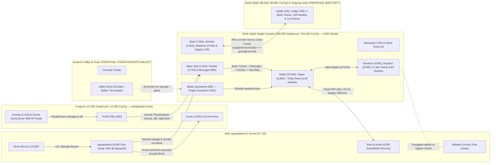

# North Dalab & the Frogmen — Regional Grounding, Bio-Energetic & Economic Proposal

**Scope:** The northern / non-Rift heartland of **`Realm of Dalab`** (`rmw5ruqmv60t3`, north of the West Rift Outer-Wall rim and outside `ancient's valley`, plus Dalab's **`Span`** `seed01` hold at `554,1010`), the **`Ruins of Nazar`** (`rmudixtchczxm`, `Nazar` `582,1079`), the amphibious **`Frogmen`** (`rmwek6u4ztszp`: `Jrrmiah` `557,959`, `Krrmt` `643,1023`), and the surrounding **`sw highlands`** (`rmvkaigq68hv7`) buffer on Scale Model 5.1 (`OW=1586 × OH=2115`, `2 km/px`, `4 km²/px`; `geology.json` `793 × 1058`, `4 km/cell`, `16 km²/cell`).

**Companion & Seam Documents (Zero Double-Counting Across All Three Borders):**
- **Northwest / `Ancient's Valley` Seam (`PROPOSAL-YUSAR-ANCIENTS-VALLEY.md`):** All Ancient blast-bowl pins inside **`ancient's valley` (`rmvowuvfa6urs`)** — `Carcosa` (`395,812`), `Babel` (`456,908`), `Necropolis` (`406,944`), `Dorado` (`483,964`), and `Henge` — are owned and counted in [PROPOSAL-YUSAR-ANCIENTS-VALLEY.md](file:///home/antigravity/traviso761-debug/krator-master/core/simulation/PROPOSAL-YUSAR-ANCIENTS-VALLEY.md). Conversely, per `PROPOSAL-YUSAR-ANCIENTS-VALLEY.md` Seam S (`0` counted there), Dalab's Valley-rim quarantine gate **`Blade` (`451,1022`, `900` pop / `992` `cal-eq`, sitting inside the `1,789 px = 7,156 km²` `Dalab ∩ ancient's valley` overlap)** is **single-counted exclusively here in `ND5`**, alongside **`Span` (`554,1010`), `Nufelds` (`442,1053`), `Rokwal` (`413,1088`), `Dalab` (`477,1108`), `Dapor` (`485,1105`), `Shelf` (`461,1161`), `Daranch` (`527,1149`), `Dayshun` (`608,1168`), `Nazar` (`582,1079`), all `10` new North Dalab river/shore market towns, `305` North Dalab `KHAMLET` villages, and `Frogmen` (`Jrrmiah`, `Krrmt`)** (`ΔPop = 0` across the Valley seam).
- **South / West Rift Seam (`PROPOSAL-WEST-RIFT.md`):** Pairs zero-overlap (`ΔPop = 0`) with [PROPOSAL-WEST-RIFT.md](file:///home/antigravity/traviso761-debug/krator-master/core/simulation/PROPOSAL-WEST-RIFT.md), which owns **South / Rift-Wall Dalab (`SD1`–`SD3`, `90,000` headcount / `85,861` `cal-eq`: `Ledge` `437,1330`, `Nulab` `443,1359`, `4` new Great Lake/valley towns, `149` `KHAMLET` villages, `Chimes` `468,1392`, and `Blaktol` `441,1400`, while `Tungang Union` enclaves `Loj Twenny` `457,1269` and `Loj Fower` are counted in `TU2`)**. Together, **North Dalab (`230,000` / `224,490` `cal-eq`) + South Dalab (`90,000` / `85,861` `cal-eq`) = `320,000` headcount (`310,351` `cal-eq`) for Greater `Realm of Dalab`**. Section 1.3 provides **both** pixel-exact seams — **Seam A (`Y <= 1210`)** and **Seam B (`Y <= Y_crest(x)` along the `9.5–11.4 km` airless Outer-Wall divide)** — proving `North + South == 66,782 px (267,128 km²)` with zero settlements or hamlets crossing `Y = 1205..1235`.
- **Eastern & Northeastern Seams:** Aligns directly with [PROPOSAL-VOTH.md](file:///home/antigravity/traviso761-debug/krator-master/core/simulation/PROPOSAL-VOTH.md) (`Vothic Kingdom` `92,813` pop; `Shim` `654,1118`, `Azoth` `651,1160`, `Agropolis` `717,917`, `Drum` `673,932`), the Stage-1 `Drum` blueprint ([drum_stage1_blueprints.md](file:///home/antigravity/.gemini/jetski/brain/v1/default/jetski_remote_agents_3p/d9ad298c-9921-437e-bcb1-9ba4718513f5/drum_stage1_blueprints.md), `13,500` pop), [PROPOSAL-GUARI-TALOVOLCI.md](file:///home/antigravity/traviso761-debug/krator-master/core/simulation/PROPOSAL-GUARI-TALOVOLCI.md) (`1.42×` two-armed Cloud Giant bio-energetics benchmark), and [PROPOSAL-RAIDING-FACTIONS.md](file:///home/antigravity/traviso761-debug/krator-master/core/simulation/PROPOSAL-RAIDING-FACTIONS.md).
- **Primary Quantitative Scans:** Reproducible scripts at [scan_north_dalab_frogmen.py](file:///home/antigravity/.gemini/jetski/brain/v1/default/jetski_remote_agents_3p/2cc633ac-367f-4e4f-810d-7efa147d63ef/scratch/scan_north_dalab_frogmen.py) ([north_dalab_frogmen_census_out.txt](file:///home/antigravity/.gemini/jetski/brain/v1/default/jetski_remote_agents_3p/2cc633ac-367f-4e4f-810d-7efa147d63ef/scratch/north_dalab_frogmen_census_out.txt)) and decentralized countryside/pin verification at [audit_dalab_census_math.py](file:///home/antigravity/.gemini/jetski/brain/4e15133daeba06a2652f155d6fa60a52/scratch/audit_dalab_census_math.py) ([dalab_expansion_verified_out.txt](file:///home/antigravity/.gemini/jetski/brain/4e15133daeba06a2652f155d6fa60a52/scratch/dalab_expansion_verified_out.txt)).

---

## 0. Executive Summary & Locked Canon Rulings

### 0.1 Locked Owner Rulings Incorporated Here
1. **Agropolitans (`Agropolis` `717,917`):** Per the Owner's locked ruling, the **Agropolitans are not enslaved**; they are a **free semi-nomadic ruin tribe (`4,000` souls total)** in a client-state arrangement with Vothic `Torus` (`773,1007`), making their living as **scrap merchants**. On the SW frontier they serve as licensed neutral salvage brokers linking Voth's `Drum` L01 Salvage Bourse (`673,932`) and `Wing` (`699,1042`) across the `Kowld Rivrh` (`r126`) passes into **Frogmen `Krrmt` (`643,1023`)** and across the unclaimed **`Ruins of Nazar` (`582,1079`)** to Dalab's **`Span` (`554,1010`)** and `Nazawach` customs post (`552,1060`).
2. **`Azoth` (`651,1160`) & `Dayshun` (`608,1168`) — Twin Former-Shumari Border Cities:** Per the Owner's locked ruling, Voth's `Azoth` (`651,1160`, `8,500` pop in [PROPOSAL-VOTH.md](file:///home/antigravity/traviso761-debug/krator-master/core/simulation/PROPOSAL-VOTH.md)) is a former Shumari city mostly assimilated into Voth, retaining Shumari + `"Shim" vassal / old Chichani` buildings (`Shim` & `Sethas` are `100%` old Chichani). Just **`86 km` west across the border**, Dalab's **`Dayshun` (`608,1168`, `+293 m`, `Cfa`)** is likewise recorded in [populations-gemini.json](file:///home/antigravity/traviso761-debug/krator-master/openworld/populations-gemini.json) as a **former Shumari city conquered and converted by `Realm of Dalab`**. Together, `Dayshun` (`8,500`) and `Azoth` (`8,500`) form a symmetrical architectural and cultural seam on the fertile southern rim of the Great SW Lake: `Dayshun` keeps a weathered Shumari masonry substrate overlaid with Dalab ceremonial mounds, cold teal-white God-lamps on priest compounds, and Giant patrols watching both Vothic `Azoth` (`86 km` E) and the **Free Giant (`Vrivolci`)** refuge of `Tallwalls` (`650,1268`, `214 km` SE up the `Carnosriba` / `Branosbruk` valleys).
3. **Dalab Highway Repairs (`ANCIENT-NETWORK.md` §8.14):** Per the Owner's ruling in [ANCIENT-NETWORK.md](file:///home/antigravity/traviso761-debug/krator-master/openworld/ANCIENT-NETWORK.md#L971-L975), Dalab builds no separate paved highway network; instead it maintains **`shoddy` tan rammed-earth and rubble repairs** over Ancient trunk alignments (`Dalab–Shelf–Crest`, `Dalab–Basin Tunnel–Span–Nazar`, and the capital mound-ring).
4. **Frogmen & `Span`'s Thunderdome (`settlements/span/PLAN.md` Q10):** [biomes/swhighlands/PLAN.md](file:///home/antigravity/traviso761-debug/krator-master/biomes/swhighlands/PLAN.md) and [settlements/span/PLAN.md](file:///home/antigravity/traviso761-debug/krator-master/settlements/span/PLAN.md) left open who the SW highlanders are who come down to `Span` (`554,1010`, standing `5 px` inside the `Frogmen` polygon border!) for Dalab's proselytizing mission and annual **Thunderdome** single-combat selections. Scale Model 5.1 resolves this cleanly: `Frogmen` (`rmwek6u4ztszp`) occupies `99.0%` within `sw highlands` immediately abutting `Span`. Young Frogmen leaper-braves descend to `Span`'s `42 m` sunken arena to test themselves against Dalab's champions for iron weapons, salt bricks, and the God's healing/augments, while refusing wholesale annexation of their high karst fens.
5. **Decentralized Greater Dalab Countryside, Small/Medium Towns & Massive `KHAMLET` Network (Locked 2026-11-18):** Per the Owner's continental scope review (*"Dalab's pop should be bigger, they should have a spread out decentralized pop in the countryside with a few more small and medium size settlements and a large hamlet network"*), Greater `Realm of Dalab` scales from `143,000` to **`320,000` headcount (`310,351` `cal-eq`)** across its `84,494.3 km²` of `49r` `farm-eq` land (**`230,000` North Dalab `ND1`–`ND5` incl. `Blade` + `90,000` South Dalab `SD1`–`SD3`**):
   - **Moderate Ceremonial Capital:** **`Dalab` (`477,1108`) is kept moderate at `24,500` (`7.7%` of Greater Dalab)** alongside four regional cities/arcologies (`Ledge` `10,000`, `Nulab` `10,000`, `Dayshun` `8,500`, `Shelf` `7,000` -> `60,000` urban = `18.8%`), preventing urban top-heaviness.
   - **Expanded Small & Medium Countryside Town Tier (`29` towns of `2,000–4,600` pop = `75,200`, `23.5%`):** Adds **`14` brand-new 5.1-verified river/lakeshore/terrace settlements** (`10` in `ND2`–`ND5`: `Brodbruk`, `Waitbruk`, `Windbruk`, `Windrib`, `Mistibruk`, `Klirbruk`, `Pirlafod`, `Koleben`, `Panfod`, `Geitbruk`; `4` in `SD2`: `Kouldmauf`, `Chimsfod`, `Silbabruk`, `Kopafol`) alongside `15` upgraded existing/canonical ring, port, and ranch towns (`Dapor`, `Daranch`, `Nufelds`, `Rokwal`, `Span`, `Konwel`, `Riidom`, `Grinmach`, `Asfol`, `Midmar`, `Dafiri`, `Okeben`, `Tonbruk`, `Konbruk`, `Kleibruk`), plus `9` frontier/bore/toll posts (`5,525` incl. `Blade` `900`).
   - **Majority Rural `KHAMLET` Bailiwick Network (`454` hamlets = `179,275` souls, `56.0%` of Greater Dalab):** `305` hamlets (`120,000` pop, mean `393.4`) in `ND1`–`ND5` and `149` hamlets (`59,275` pop, mean `397.8`) in `SD1`–`SD3` (`§4.3b`), using just **`0.275%` (`232.8 km²`)** of Greater Dalab's `84,494.3 km²` `49r` `farm-eq` capacity at `0.075 ha/cal-eq`.

### 0.2 Headline Numbers (`1:1` Single-Counted Scale vs Prior Baselines)

| Polity / Sub-Region | Single-Counted Land (`km²`) | Wet Area (`km²`) | `trade-goods.json` Pop | `populations-gemini.json` (`cur` -> `nat_total`) | Proposed Grounded `1:1` Headcount | Caloric-Eq (`1.0×` Human-Eq) | Single-Counted Pins (Existing + Proposed) |
|---|---:|---:|---:|---:|---:|---:|---:|
| **North Dalab (`ND1`–`ND5` incl. `Blade` `900`)** | `147,136` *(ex-Valley: `140,092`)* | `21,704` *(`21,592`)* | `30,300` *(3 pins only)* | `32,600` *(incl. `Blade` `500`)* -> `~390,000` | **`230,000`** (`226,000` green Dalabites + **`4,000` Giants**) | **`224,490`** | `9` existing (`Dalab`, `Dapor`, `Nufelds`, `Rokwal`, `Shelf`, `Daranch`, `Dayshun`, `Span`, `Blade`) + `25` proposed = **`34`** *(+`305` `KHAMLET`s)* |
| **`Ruins of Nazar` (`rmudixtchczxm` net non-Dalab)** | `13,840` *(full poly: `16,632`)* | `3,176` *(`3,720`)* | `0` *(uninhabited ruin)* | `0` *(uninhabited ruin)* | **`0`** *(uninhabited megacity ruin; seasonal salvage)* | **`0`** | `1` existing ruin pin (`Nazar` `582,1079`) |
| *Seam S Check w/ `PROPOSAL-YUSAR-ANCIENTS-VALLEY.md`* | *(`7,044` `Dalab ∩ Valley` in `ND5` above)* | *(`112`)* | *`0`* | *(`Blade` `500` above)* | *`0` counted in Yusar doc (`Blade` `900` counted once in `ND5` above)* | *`0`* | *Valley ruins (`Babel`, `Necropolis`, `Dorado`, `Carcosa`) in Yusar doc* |
| *Handoff to `PROPOSAL-WEST-RIFT.md` (South Dalab `SD1`–`SD3`)* | *`95,784` (`Seam B`)* | *`2,504`* | *`18,000` (`Nulab` + `Ledge`)* | *`8,000` (`Nulab` cur)* | ***`90,000` (`89,050` Dalabites + `950` Giants; counted in `PROPOSAL-WEST-RIFT.md`)*** | ***`85,861`*** | *`Ledge`, `Nulab`, `Chimes` + `4` new basin towns + `3` posts (`+149` `KHAMLET`s)* |
| **Frogmen (`FM1`–`FM4`, `rmwek6u4ztszp`)** | `36,096` | `84` *(+`2,588` fen)* | **`0` *(omitted!)*** | `1,450` -> `14,625` | **`11,500`** (`100%` amphibious Frogmen) | **`10,925`** | `2` existing (`Jrrmiah`, `Krrmt`) + `10` proposed = **`12`** |
| **Combined Single-Counted Total (This Doc)** | **`197,072`** *(ex-Valley: `190,028`)* | **`24,964`** | `30,300` | `34,050` -> `~405,000` | **`241,500`** *(Greater Dalab N+S = **`320,000`**)* | **`235,415`** *(Greater Dalab = **`310,351`**)* | **`12` existing + `35` proposed = `47`** *(+`305` `KHAMLET`s here / `454` in Greater Dalab)* |

> **Exact Caste & `Cal-Eq` Accounting (`230,000` North Dalab = `224,490` `cal-eq`; `320,000` Greater Dalab = `310,351` `cal-eq`):** Under [LORE.md](file:///home/antigravity/traviso761-debug/krator-master/LORE.md) §6.1 and §3.1 below, human-scale Chloroplast Dalabites (`1.78 m`, including tall-blood human-rigged bailiffs) draw **`0.92×`** net dietary rations in sunny/humid lowlands, while true `3.56 m` (`2.0×`) Giants split into **2-armed Patrol/Bailiff Giants (`4.10×`)** and **4-armed Temple/Shock Giants (`4.35×`)**:
> - **North Dalab (`ND1`–`ND5` incl. `Blade`):** `226,000` Dalabites × `0.92` (`207,920`) + `3,320` 2-Arm Giants × `4.10` (`13,612`) + `680` 4-Arm Giants × `4.35` (`2,958`) = **`230,000` headcount (`4,000` Giants) / `224,490` `cal-eq`**.
> - **South Dalab (`SD1`–`SD3` in `PROPOSAL-WEST-RIFT.md`):** `89,050` Dalabites × `0.92` (`81,926`) + `790` 2-Arm Giants × `4.10` (`3,239`) + `160` 4-Arm Giants × `4.35` (`696`) = **`90,000` headcount (`950` Giants) / `85,861` `cal-eq`**.
> - **Greater `Realm of Dalab` (`ND1`–`ND5` + `SD1`–`SD3`):** `315,050` Dalabites × `0.92` (`289,846`) + `4,110` 2-Arm Giants × `4.10` (`16,851`) + `840` 4-Arm Giants × `4.35` (`3,654`) = **`320,000` headcount (`4,950` Giants, `1.55%`) / `310,351` `cal-eq`** — the `8%` photosynthetic food savings of `315,050` green Dalabites (`-25,204` human-eq) more than pays the `+15,555` surplus caloric cost of all `4,950` Giants!

---

## 1. Physical Geography, Hydrology & the Exact North/South Dalab Seam

### 1.1 Macro-Topography & Atmospheric Regimes
North Dalab and the Frogmen occupy two starkly contrasting steps of the southwestern Ring-Wall amphitheatre:

1. **The Dense-Air SW Lowland & Great SW Lake Basin (`ND1`, `ND4`, lower `ND2`/`ND5`; `-388 m .. +1,500 m`, `1.33–1.68 atm`):**
   - Sheltered inside the `9.5–11.4 km` airless Outer Wall to the south and west, North Dalab's core (`61,816 km²` below `+1,500 m`, `42.0%` of crest-seam land) is a warm, dense-air (`1.45–1.64 atm`), humid-subtropical to tropical-monsoon (`Cfa` `56,120 km²`, `Csa` `22,584 km²`, `Aw`/`Af`/`Am` `9,280 km²`) alluvial and mound-builder plain (`tm` median `+21–24 °C`, rainfall `850–3,200 mm/yr`, gentle slopes `0.008–0.025`).
   - Its northern and eastern margin wraps around **WaterBody `#23` — the `-9.2 m` Great SW Lake (`39,184 km²` total surface area, max depth `771 m`, `bbox = 456..683, 1051..1166`)**.
2. **The Western Loess Terraces & High `Shelf` Arcology Bench (`ND2` upper, `ND3`; `+1,500 m .. +5,500 m`, `0.80–1.33 atm`, rising to `11,385 m`):**
   - Climbing southwestward toward `Rokwal` (`413,1088`, `+3,235 m`, `1.07 atm`, `Csa`/`Dsb`) and `Shelf` (`461,1161`, `+3,760 m`, `1.00 atm`, `Dsb`), the air thins to standard pressure (`0.85–1.15 atm`) and cools (`tm` `+1 °C .. +9 °C`, `Dsb` `22,716 km²`, `Dsc` `11,572 km²`), before hitting the **uninhabitable airless Outer-Wall crest (`>8,000 m`: `9,340 km²` on the crest seam, `0.40–0.58 atm`, `-31 °C`, `0 mm` precipitation)**.
3. **The `sw highlands` Karst & Landslide Tableland of the Frogmen (`FM1`–`FM4`; `+1,743 m .. +5,851 m`, median `+3,556 m`, `1.03 atm`):**
   - `99.0%` of `Frogmen` (`35,828 km²` of `36,180 km²`) lies inside `sw highlands` (`rmvkaigq68hv7`, `93,816 km²` total; `37,056 km²` of `sw highlands` remains unclaimed alpine buffer).
   - It is a cool-summer / snowy-winter montane karst plateau (`Dsb` `46.5%`, `Dsc` `20.2%`, `Dfb` `14.3%`, `Dfc` `5.8%`; median `tm = +6.0 °C`, warmest month `+18 °C`, coldest month **`-7.0 °C`**, rainfall `298–1,867 mm/yr` peaking along the wet western `FM1` rain-wall around `Jrrmiah` `1,270–1,460 mm/yr`).
   - Per [KARST-SITES-5.1.md](file:///home/antigravity/traviso761-debug/krator-master/biomes/KARST-SITES-5.1.md) §2, `sw highlands` (`552,978`) is one of Krator's premier **ring-fold karst** provinces: concentric impact-ring carbonate/sandstone folds riddled with sinkholes, phreatic caves, springs, and landslide-dammed lakes.
4. **The Quarantined `ancient's valley` Blast Bowl (`rmvowuvfa6urs`, `123,856 km²`: `104,372 km²` land, `19,484 km²` wet):**
   - Immediately north of Dalab's `Blade` (`451,1022`, `+1,935 m`) and west of Frogmen's `Jrrmiah` (`557,959`, `+2,878 m`), the floor drops to `+17.4 m` (`1.40–1.60 atm`, `Csa` `59.6%` / `Cfa` `21.1%`, `tm = +20 °C`). Seven `25–45 km` eigenweapon craters form the `+17.4 m` Valley Lake (`19,356 km²`, max depth `484 m`), surrounded by `2,112 km²` of vitrified blast glass (`max 255` at `448,892`) and cursed megacity ruins (`Babel` `456,908`, `Necropolis` `406,944`, `Dorado` `483,964`), interdicted on the north by the Eternal State (`Wheel` `406,886`, `Thera` `526,956`) and on the south by Dalab (`Blade`).

### 1.2 Hydrological Discovery: The `-9.2 m` Great SW Lake (`39,184 km²`) & River Systems
A critical finding of the 5.1 raster audit is that the **`-9.2 m` freshwater Great SW Lake (`WaterBody #23`) is a single continuous inland sea (`39,184 km²`, `227 px = 454 km` E–W by `115 px = 230 km` N–S)** shared across three jurisdictions:
- **North Dalab (`ND1`, `ND4`, `ND5`):** `21,176 km²` (`54.0%` of lake surface; `519 px ≈ 1,038 km` of shoreline inside North Dalab).
- **Vothic Kingdom (`Shim` / `Azoth` / `Sethas` basin — "Lake of Shim" in [PROPOSAL-VOTH.md](file:///home/antigravity/traviso761-debug/krator-master/core/simulation/PROPOSAL-VOTH.md)):** `9,264 km²` (`23.6%`).
- **Unclaimed Central / `Ruins of Nazar` Waters (`rmv4d862fbq0m`):** `8,744 km²` (`22.3%`, including `2,792 km²` inside the `Ruins of Nazar` polygon).

> **Cross-Document Coordinate Fix (`Dapor`):** [PROPOSAL-VOTH.md](file:///home/antigravity/traviso761-debug/krator-master/core/simulation/PROPOSAL-VOTH.md) cited an older coordinate (`519,1152`) for `Dapor`. In [60-settlements.js](file:///home/antigravity/traviso761-debug/krator-master/tools/scale-model/src/60-settlements.js), **`Dapor` (`svvu4ssvzc`) is at `485,1105`** (`wpin` `486,1104`, `+123 m`), just **`18 km` ENE of moved `Dalab` (`477,1108`, `+7 m`)** on the northwestern bay of the `-9.2 m` Great SW Lake! Open-water barge runs from `Dapor` (`486,1104`) reach `Nazar` (`582,1079`) in `~198 km`, `Dayshun` (`608,1168` via `608,1163` landing) in `~272 km`, Voth's `Azoth` (`651,1160`) in `~348 km`, and Voth's `Shim` (`654,1118`) in `~338 km` without a single portage.

**Major Rivers (`rivers.json`, `Q >= 10 m³/s`):**

| River ID & Canonical Name | Peak `Q` (`m³/s`) | Course & Basin | Economic / Strategic Role |
|---|---:|---|---|
| `r008` **`Waywater Coldkeep`** | `603.9` | Rises in central Frogmen (`FM1`/`FM3`), cuts W through `sw highlands` into `Ancient's Valley` (`+17.4 m` lake) | Largest river of Frogmen; rich alluvial **gold placers** (`gold:110`, `iron:180`); cold gorge barrier |
| `r015` **`Waywater Fallhigh`** | `308.4` | Northern `sw highlands` / `FM4` W past `Thera` (`526,956`) into `Ancient's Valley` | Northern Frogmen–Eternal State quarantine gorge |
| `r291` **`Waywater Windlow`** | `267.6` | Western `sw highlands` (`FM1`/`FM2`) WNW into `Ancient's Valley` | Drains the ring-fold karst west of `Span` |
| `r026` **`Pan Riba`** *(Low Tongue: Span River)* | `152.7` | Rises at `Span` (`554,1010`) / `FM2` rim, flows SSW (`146 km`) into North Dalab's `-9.2 m` Great SW Lake (`521,1067`) | Primary perennial river corridor linking `Span` & `Beisngeit` down to Dalab's northern lake plain |
| `r045` **`Carnosriba`** & `r055` **`Spirlariba`** | `102.6` / `82.7` | Rise near Vrivolci `Tallwalls` (`650,1268`), flow N across `ND4`/`Voth` border (`629,1166`) into the `-9.2 m` Great SW Lake | Escape & raid valleys between `Dayshun` (`608,1168`), `Azoth` (`651,1160`), and Vrivolci Free Giants |
| `r058` *(Western Bench River)* | `75.8` | Drains `ND2` (`Nufelds`/`Kleibruk` loess bench) E (`182 km`) into `ND1` lake bay (`475,1076`) | Irrigates `ND2` grain terraces and powers `ND1` northern mills |
| `r117` **`Waywater Sleepdown`** | `41.0` | Rises in `FM3` (`Drrm-Sleep` `632,1047`), flows S through `Ruins of Nazar` into Great SW Lake (`595,1078`) | Frogmen–Nazar salvage & reed-raft trail |
| `r126` **`Kowld Rivrh`** | `38.7` | Rises in `FM3` past **`Krrmt` (`643,1023`)**, drops E down the eastern `sw highlands` scarp toward `Wing`/Ring Sea | Primary **Agropolitan scrap-caravan** & salt trail into `Krrmt` |
| `r106` **`Wind Bruk`** | `34.9` | Flows `142 km` E out of `ND2`/`ND1` directly past **`Dalab` (`477,1108`)** into the `-9.2 m` lake (`478,1108`) | Feeds Dalab's sacred mound canals (`CHANNELS` in `84-city-geo.js`) and `Dalab`–`Dapor` harbor front |
| `r158` **`Brait Riba`** | `29.6` | Flows `88 km` from `ND5` (`Blade`/`Span` bench) into Great SW Lake (`484,1069`) | Northern `ND1`/`ND5` agricultural valley |
| `r144` **`Star Bruk`** | `27.3` | Feeds **`Jrrmiah`'s `+2,877.8 m` landslide lake** (`WaterBody #10`, `104 km²` total, `84 km²` in Frogmen, max depth `169 m`) | Core Frogmen spawning lake & warm karst-spring refuge |

### 1.3 Exact North Dalab vs South/Rift Dalab Seam (`PROPOSAL-WEST-RIFT.md` Handshake)
`Realm of Dalab` (`rmw5ruqmv60t3`) covers **`66,782 px = 267,128 km²`** (`242,920 km²` land, `24,208 km²` wet; `bbox = 332..630, 996..1417`). Because the Outer-Wall watershed crest (`9,458–11,385 m`) bows slightly south of `Y = 1210` across `X = 432..504` (`Y_crest = 1221..1253`), we tabulate **both** exact pixel partitions below so `PROPOSAL-WEST-RIFT.md` can adopt **Seam B (recommended physical watershed)** or **Seam A (flat `Y <= 1210`)** with zero discrepancy:

| Metric | Full `Realm of Dalab` (`rmw5ruqmv60t3`) | **Seam A (`Flat Y <= 1210`)** North Dalab | **Seam A (`Flat Y > 1210`)** South Dalab | **Seam B (`Crest Y <= Y_crest(x)`)** North Dalab *(Recommended)* | **Seam B (`Crest Y > Y_crest(x)`)** South Dalab *(Recommended)* |
|---|---:|---:|---:|---:|---:|
| **Total Pixels (`4 km²/px`)** | **`66,782`** | `39,122` | `27,660` | **`42,210`** | **`24,572`** |
| **Total Area (`km²`)** | **`267,128`** | `156,488` | `110,640` | **`168,840`** | **`98,288`** |
| **Land Area (`km²`)** | **`242,920`** | `134,784` | `108,136` | **`147,136`** | **`95,784`** |
| **Wet Area (`km²`)** | **`24,208`** | `21,704` | `2,504` | **`21,704`** | **`2,504`** |
| **Airless Crest `>8 km` (`km²`)** | **`18,744`** | `2,592` | `16,152` | **`9,340`** | **`9,404`** |
| **`49r` Farm-Eq (`km²`)** | **`83,608.5`** | `72,830.4` | `10,778.1` | **`73,711.2`** | **`9,897.3`** |
| **`49r` Strict Arable (`km²`)** | **`69,646.9`** | `62,340.8` | `7,306.1` | **`62,847.2`** | **`6,799.7`** |
| **`49r` Pasture-Eq (`km²`)** | **`102,596.7`** | `67,717.9` | `34,878.8` | **`69,894.1`** | **`32,702.6`** |
| **`49r` Timber-Eq (`km²`)** | **`92,429.2`** | `60,581.8` | `31,847.4` | **`60,726.3`** | **`31,702.9`** |
| **Inhabited / Ruin Pins** | `45` Dalab + `2` TU (`+454` `KHAMLET`s) | `34` N Dalab (`9` existing incl. `Blade` & `Span` + `25` proposed) + `Nazar` (`+305` `KHAMLET`s) | `10` S Dalab (`Ledge`, `Nulab`, `Chimes` + `4` `SD2` towns + `3` posts; `+149` `KHAMLET`s) + `Loj Twenny`/`Loj Fower`*(TU)* | **Identical `34` + `Nazar` (`+305` `KHAMLET`s)** | **Identical `10` (`+149` `KHAMLET`s) + `2` TU** |
| **Net Pixels ex-`ancient's valley`** | `64,993` | `37,333` (`149,332 km²`) | `27,660` (`110,640 km²`) | **`40,421` (`161,684 km²`: `140,092` land)** | **`24,572` (`98,288 km²`)** |
| **Single-Counted Dalab Pop (`Cal-Eq`)** | **`320,000` (`310,351`)** | **`230,000` (`224,490`)** *(incl. `Blade` `900`)* | **`90,000` (`85,861`)** | **`230,000` (`224,490`)** *(incl. `Blade` `900`)* | **`90,000` (`85,861`)** |

**Definition of `Y_crest(x)` (Seam B):** For each column `x` in `0..1585`, `Y_crest(x) = argmax_{y in 1165..1285} E[y, x]` smoothed with a `±4 px` boxcar across the Outer-Wall ridge (`Y_crest(360)=1210`, `Y_crest(404)=1199`, `Y_crest(420)=1209`, `Y_crest(444)=1250` at `10,596 m`, `Y_crest(476)=1238` at `9,458 m`, `Y_crest(492)=1244` at `10,615 m`, `Y_crest(504)=1228` at `11,012 m`, and following the southern polygon edge `Y = 1177..1230` east of `X = 508`).
- **Why Seam B + Seam S (`Blade` in `ND5`) is 100% airtight:** Per [PROPOSAL-YUSAR-ANCIENTS-VALLEY.md](file:///home/antigravity/traviso761-debug/krator-master/core/simulation/PROPOSAL-YUSAR-ANCIENTS-VALLEY.md) Seam S (`0` counted there), Dalab's rim quarantine hold **`Blade` (`451,1022`, `900` pop / `992` `cal-eq`)** is single-counted once in `ND5` while all blast-bowl ruins (`Babel`, `Necropolis`, `Dorado`, `Carcosa`) stay in `PROPOSAL-YUSAR-ANCIENTS-VALLEY.md`; meanwhile the Dalab Crest Road tunnel ([ANCIENT-TUNNELS.md](file:///home/antigravity/traviso761-debug/krator-master/openworld/ANCIENT-TUNNELS.md) §3: `Shelf` -> `Nulab`, `54 km` tunnel under `8,000 m`) keeps its **North Portal (`488,1220`, `7,969 m`)** inside `ND3` and its **South Portal (`Sautgeit` `477,1245`, `100` pop)** plus the **Tungang `9.6 km` saltpeter works (`492,1255`, `9,585 m`)** cleanly inside `PROPOSAL-WEST-RIFT.md`. Zero settlements or hamlets move between Seam A and Seam B (`ΔPop = 0`: `230,000 + 90,000 = 320,000`).

---

## 2. 39-Family Geology (`geology.json`), Salvage Clusters & `CROPS.at` Ecology

### 2.1 Master Geological Comparison (`geology.json` `793 × 1058`, `16 km²/cell`)
One of the sharpest structural findings of the `geology.json` scan is the **extreme mineral asymmetry between North Dalab and South/Rift Dalab**:
- **North Dalab** holds virtually **all of Dalab's coal (`1,451` of `1,452` yield — `99.9%`), oil (`433` — `100%`), fertile alluvial clay, `89%` of its farm capacity, and `89.5%` of its ruin-salvage ground (`3,952 km²` vs `464 km²`)**, plus massive **iron (`3,741.5` good yield), saltpeter (`964.5` good yield below `Shelf`), tin (`491.5` good), gold (`396.0` good), and silver (`384.5` good)**.
- **South/Rift Dalab (`Y > 1210`)**, conversely, holds **`99.8%` of Dalab's good copper (`2,650.0` vs `4.5` in North Dalab!)**, **`99.7%` of its zinc (`2,498.0` vs `8.0`)**, **`100%` of its good sulfur (`284.0` vs `0.0`)**, and **`85.7%` of its good rare-earths (`1,898.0` vs `315.5`)**! Thus North Dalab **must** import copper, bronze, sulfur, and Tungang rare-earths across the `Shelf` Rift-Line / Crest-Tunnel axis (or across the lake from Voth's `Shim`/`Azoth`) in exchange for grain, coal, cloth, timber, lizards, and `genecraft`.

| Family / Metric | North Dalab (`Seam A` `135,808 km²` geol) | North Dalab (`Seam B` `148,160 km²` geol) | South Dalab (`Seam A` `107,936 km²` geol) | **Frogmen (`36,752 km²` geol)** | **`Ancient's Valley` (`104,720 km²` geol)** |
|---|---:|---:|---:|---:|---:|
| **Ruin-ground (`0x80` `km²`)** | **`3,952`** | **`3,952`** | `464` *(`Chimes`)* | `0` *(5 px `Span` on `OW`)* | **`544`** *(4 ruin cores)* |
| **Rock Provinces (`%`)** | `sed 55 / cry 15 / vol 21 / gra 9` | `sed 51 / cry 16 / vol 24 / gra 10` | `vol 44 / sed 22 / cry 19 / gra 14` | **`sed 58 / cry 24 / gra 17`** | `sed 66 / vol 16 / gra 11 / cry 7` |
| **`iron` (Nodes / GoodYield)** | `5,108` / **`3,741.5`** | `5,810` / **`4,321.5`** | `5,717` / **`4,782.0`** | `2,284` / **`2,214.0`** | `3,001` / `1,916.5` |
| **`copper` (Nodes / GoodYield)** | `751` / **`4.5`** *(deficit!)* | `898` / **`69.0`** *(crest only)* | `3,190` / **`2,650.0`** | `358` / **`164.0`** | `725` / `18.5` |
| **`tin` (Nodes / GoodYield)** | `811` / **`491.5`** | `1,048` / **`695.0`** | `1,158` / `783.0` | `323` / **`253.5`** | `454` / `231.0` |
| **`gold` (Nodes / GoodYield)** | `644` / **`396.0`** | `772` / **`493.5`** | `855` / `542.0` | `204` / **`174.0`** | `312` / `146.5` |
| **`silver` (Nodes / GoodYield)** | `615` / **`384.5`** | `737` / **`476.0`** | `1,004` / `706.5` | `223` / **`195.5`** | `273` / `136.0` |
| **`zinc` (Nodes / GoodYield)** | `248` / **`8.0`** | `308` / `55.0` | `3,221` / **`2,498.0`** | `110` / `82.0` | `135` / `13.0` |
| **`lead` (Nodes / GoodYield)** | `6` / `0.0` | `6` / `0.0` | `1,252` / **`578.0`** | `0` / `0.0` | `7` / `0.0` |
| **`coal` (Nodes / GoodYield)** | **`1,582` / `298.5`** *(all `1,451.0`)* | **`1,583` / `298.5`** | `1` / `0.0` | **`0` / `0.0`** | `1,027` / `45.0` |
| **`oil` (Nodes / AllYield)** | **`467` / `433.0`** *(good `1.0`)* | **`467` / `433.0`** | `0` / `0.0` | **`0` / `0.0`** | `258` / `236.0` |
| **`saltpeter` (Nodes / GoodYield)** | **`1,161` / `964.5`** | **`1,631` / `1,354.5`** | `1,546` / `1,148.5` | `83` / `0.0` *(all `78.5`)* | `149` / `22.5` |
| **`sulfur` (Nodes / GoodYield)** | `51` / **`0.0`** *(all `43.5`)* | `67` / **`0.0`** *(all `57.0`)* | `767` / **`284.0`** | `0` / `0.0` | `40` / `0.0` |
| **`halite` (Nodes / MaxByte)** | `187` / `52` *(low-grade brines)* | `187` / `52` | `133` / `101` *(`3.5` good)* | `34` / **`16`** *(salt-starved!)* | `169` / `58` |
| **`rare-earth` (Nodes / GoodYield)**| `410` / `315.5` *(unworked)* | `541` / `428.0` *(unworked)* | `2,334` / `1,898.0` | `155` / `154.0` *(unworked)* | `223` / `169.0` |
| **`limestone` (`>=100 km²` / Mean)**| `51,376 km²` / `63.6` | `51,952 km²` / `58.9` | `10,944 km²` / `20.9` | **`36,400 km²` (`99%`!) / `113.9`**| `53,344 km²` / `68.8` |
| **`marble` (Nodes / GoodYield)** | `670` / **`578.0`** | `855` / **`744.0`** | `444` / `389.0` | **`614` / `595.5`** *(`opal-shell`)* | `395` / `284.5` |
| **`glass` / `silica` (`>=100 km²`)**| `0` / `4,000 km²` | `0` / `4,224 km²` | `0` / `2,464 km²` | `0` / `0 km²` | **`2,112 km²` (`255`!) / `5,888 km²`**|
| **`clay` (`>=170 km²` / Mean)** | **`37,696 km²`** / `80.1` | `37,696 km²` / `73.4` | `4,880 km²` / `14.1` | `848 km²` / `17.9` | `30,000 km²` / `82.7` |

### 2.2 Technical Extraction Gates ([TRADE-SCOPE.md](file:///home/antigravity/traviso761-debug/krator-master/openworld/TRADE-SCOPE.md) §2.4 & [ANCIENT-TUNNELS.md](file:///home/antigravity/traviso761-debug/krator-master/openworld/ANCIENT-TUNNELS.md))
1. **Rift-Line `5 km` Bore Check (`rare-earth` Monopoly):** Under [TRADE-SCOPE.md](file:///home/antigravity/traviso761-debug/krator-master/openworld/TRADE-SCOPE.md) §2.4, Dalab lacks rare-earth separation technology (`trade-goods.json`'s `15.5 t` Dalab rare-earth export was an artifact of unseparated rock and misassigned `Ledge`). Within `5 km` (`2.5 px`) of the `252 km` Rift Line bore (`Shelf` `461,1161` <-> `Loj Twenny` `457,1269` <-> `Ledge` `437,1330`), our scan finds **`10` rare-earth nodes (`10.0` good yield) on the North Dalab side** (around `Shelf` / `Borgeit` `458,1160`) and **`45` nodes (`42.5` good yield) on the South Dalab side**. By treaty at `Shelf` (`Station #2`), **Tungang Union miners** work the bore-wall rare-earth veins and export concentrates through `Shelf` and `Ledge`, paying Dalab a toll in **bronze, copper, sulfur, and cut bore-stone**.
2. **Oil Seeps (`467` nodes, `433.0` all-grade yield, `max 101` at `628,1168` near `Dayshun`/`Istgeit`):** Dalab has no oil-drilling industry (`only Iziz, Geomancers, and Post-Apoc drill`). Surface bitumen/pitch seeps in eastern `ND4` (`560,1145`..`628,1168`) and `ND1` are skimmed by hand for **hull caulking on Great SW Lake barges**, mound-torch pitch, and healing salves — with an optional small **Geomancer / Vothic concession** if desired (see §8 Q5).
3. **Coal (`1,583` nodes, `298.5` good / `1,451.0` all-grade yield, peaking `205` at `508,1064`):** Outcrops right on the Great SW Lake shore between `Dapor` (`485,1105`), `Okeben` (`496,1114`), `Konbruk` (`508,1066`), and `Istgeit` (`619,1168`), giving Dalab lakeside coal barges to fuel smithies, brick/lime kilns, and `Dayshun`/`Dapor` trade.
4. **Ruin-Salvage (`0x80`) Clusters:**
   - **Giant `Nazar` Megacity Ruin Field (`587` geol cells = `9,376 km²` total centered at `576.2,1058.4`):** Spans eastern `ND5`/`ND4` (**`3,072 km²` inside Dalab!**), the unclaimed `Ruins of Nazar` polygon (`2,792 km²`), and western Voth/unclaimed marsh (`3,512 km²`).
   - **`Span` Ruin Cluster (`29` cells = `464 km²` at `553.9,1010.8`)** and **`Blade` Ruin Cluster (`26` cells = `416 km²` at `451.8,1021.7`)**.
   - **`Ancient's Valley` Blast Ruins (`544 km²` ruin-ground + `2,112 km²` blast `glass:255` + `5,888 km²` `silica`):** `Necropolis` (`224 km²`), `Dorado` (`224 km²`), `Babel` (`96 km²`). Dalab's `Blade` quarantine wardens license only tightly screened salvage expeditions onto the outer southern rim (`Dorado` causeway approach), confiscating intact electronics for the God's archive while trading bulk `scrap`, `ancient-alloys`, and `glass` cullet.

### 2.3 `CROPS.forBiome` & `CROPS.at` Ecological Audit (`kits/crops`)
Running `kits/crops` against the 5.1 elevation/pressure/climate bands of North Dalab and Frogmen highlights **two codebase gaps in [10-crop-core.js](file:///home/antigravity/traviso761-debug/krator-master/kits/crops/src/10-crop-core.js)** (documented for Stage 2; untouched here):
1. **`swhighlands` and `ancientsvalley` are both absent from `CROPS.BIOMES`** (whereas `wouterwall`, `shighlands`, `paintedhighlands`, and `oidong` are registered).
2. **`swlowlands` currently sets `atm: 1, atmNote: '?'`**, whereas on 5.1 North Dalab's lowland mound & lake basin (`-388..+800 m`) sits at **`1.45–1.68 atm` (`atm: 2`, `dense`)**, transitioning to `atm: 1` (`standard`) only on its `+800..+3,800 m` western and northern benches!

| Agro-Ecological Zone (`CROPS.at` Query) | `CROPS` Fit Count | Core Staples (`grain` / `pulse` / `tuber` / `starch-fruit`) | Oils, Drinks, Fibres, Dyes & Biome Specialties |
|---|---:|---|---|
| **1. `ND1`/`ND4` Dense-Air Mound & Lake Plain** (`-300..+600 m`, `1.50–1.64 atm`, `Cfa`/`Aw`: `{warmth:4, atm:2, arid:3}`) | **`63`** *(+`50` wet chinampa)* | `rice`, `wild-rice`, `bamboo-rice`, `taro`, `sweet-potato`, `shade-manioc`, `ashroot`, `breadfruit`, `banana`, `plantain` | `coconut`, `avocado`, `sugar-cane`, `coffee`, `cacao`, `kava`, `tobacco`, `cotton`, `ramie`, `mat-reed`, `pandan`, `indigo`, `annatto`, `rimdew`; plus native **Dalab `hashish`** & **Dalab giant lizards** (`DFAUNA`) |
| **2. `ND1`/`ND2` Subtropic Mid-Bench** (`+400..+1,200 m`, `1.38–1.50 atm`, `Cfa`/`Csa`: `{warmth:3, atm:2, arid:2}`) | **`68`** | `emmer`, `rice`, `helix-bean`, `sweet-potato`, `murnong`, `painted-camas` | `whorl-olive`, `avocado`, `pinyon`, `almond`, `canyon-grape`, `fig`, `pomegranate`, `saffron`, `cotton`, `flax`, `mulberry`, `woad`, plus **cultivated blue-agave `tequila`** |
| **3. `ND2`/`ND5` Standard-Air Grain & Ranch Terrace** (`+1,200..+2,600 m`, `1.15–1.35 atm`, `Csa`/`Csb`: `{warmth:2, atm:1, arid:2}`) | **`75`** | `emmer`, `frostoat`, `dustmillet`, `redstem`, `helix-bean`, `dust-lentil`, `murnong`, `painted-camas` | `flax`, `cairn-nettle`, `mulberry`, `wallhemp`, `willow`, `ivanchai`, `tea`*(irr)*, `sky-poppy`, `camphor`, `cedar-incense` |
| **4. `ND3` High `Shelf` Loess Bench** (`+3,000..+4,200 m`, `0.94–1.10 atm`, `Dsb`/`Dsc`: `{warmth:1, atm:1, arid:1}`) | **`74`** | `bistort`, `dustmillet`, `redstem`, `frostoat`*(irr)*, `dust-lentil`, `frostroot`, `snowpotato`, `sweetroot` | `stonepine`, `ichu` thatch, `beard-lichen`, `goldroot`, `bearroot`, `juniper`, `alecap`/`pale-fungi` in heated arcology dark-beds |
| **5. `FM1`/`FM2` Rain-Wall Karst & Landslide Fen** (`+1,800..+3,100 m`, `1.09–1.28 atm`, `Cfb`/`Dfb`: `{warmth:2, atm:1, arid:3..4, wet:true}`) | **`52` dry / `32` wet** | `wild-rice` *(fens)*, `lotus-root` *(fens)*, `frostoat`, `redstem`, `helix-bean` | `lotus-silk` *(fens)*, `wineweed` alga, `fiddlehead`, `moon-cap`, `sphagnum`, `willow`, `bamboo`, `valley-ginseng`, `maple-syrup`; plus **`swhighlands` biome harvests** below! |
| **6. `FM2`/`FM3`/`FM4` Cool Montane Spawning Fen** (`+3,000..+4,500 m`, `0.85–1.10 atm`, `Dsb`/`Dsc`: `{warmth:1, atm:1, arid:3, wet:true}`) | **`57`** *(polar `42`)* | `lotus-root`, `bistort`, `frostoat`, `redstem`, `frostroot`, `snowpotato` | `cairn-nettle`, `lotus-silk`, `woolly-willow`, `sphagnum`, `cottongrass`, `snow-lotus`, `beard-lichen`, `birch-tar` |

**Endemic `biomes/swhighlands` Wild & Semi-Domesticated Harvests of the Frogmen ([biomes/swhighlands/PLAN.md](file:///home/antigravity/traviso761-debug/krator-master/biomes/swhighlands/PLAN.md) §2–§3):**
- **`beadcone` (`silk` / resin-spun highland fibre):** Frogmen gather sticky resin-coated cocoons and cone-fibres in `FM1`/`FM3` gorges (`trade-gemini.json` already detects `Frogmen` exporting `silk`!), reeling a waterproof, slightly iridescent bog-silk prized in `Span`, `Dalab`, and `Drum`.
- **`brush-oil` & `cedar-incense`:** Pressed aromatic waterproof skin-oils and bog-resins (`incense` export) that keep Frogmen skin supple during dry overland treks to `Span` or `Krrmt`.
- **`cell-lamp` & `fishing-bridge` venom:** Bioluminescent bog-lantern organs and paralytic karst-cave angler-worm venoms used on Frogmen blow-darts/harpoons and bought by Dalab's Genepriests as `reagent`.
- **`opal-shell` stone (`marble:104` in `geology.json`) & `shelf coral` ore-indicators:** Iridescent fossil-shell karst limestone/ammolite carved into Frogmen clan-fetishes and traded as `gems`/`marble`, while `shelf coral` growths mark `FM1`–`FM4`'s shallow bog-iron and tin seams.

---

## 3. Species Bio-Energetics, Demography & Character Rig Audit

### 3.1 Comparative Species Multiplier Matrix (`core/simulation` Schema)
To keep `core/simulation` strictly unified across all non-human and modified-human polities, we benchmark **Dalab's human-scale chloroplast commoners (`dalabites`)**, **Dalab's two-armed and four-armed `3.56 m` (`2.0×`) Green Giants (`mpfb_giant`)**, and **Frogmen (`mod_head_frog` + `mod_legs_frog`)** directly against the `1.00×` baseline human and the `1.42×` (`2.53 m`) two-armed Talovolci Cloud Giant established in [PROPOSAL-GUARI-TALOVOLCI.md](file:///home/antigravity/traviso761-debug/krator-master/core/simulation/PROPOSAL-GUARI-TALOVOLCI.md) §3:

$$\text{Mass Ratio} \approx (\text{Scale})^{3} \times k_{\text{build}}, \qquad \text{Basal Caloric Ratio (Kleiber)} \approx (\text{Mass Ratio})^{0.75} \times k_{\text{activity}} \times k_{\text{chloroplast}}$$

- **Why `3.56 m` (`2.0×`) Giants Draw `4.10×–4.35×` Food (Not `8.0×`):** At `2.0×` linear stature (`3.56 m` vs `1.78 m` human; [tools/giant.py](file:///home/antigravity/traviso761-debug/krator-master/core/charactermodels/tools/giant.py)), raw cubic volume is `8.0×`, or `~7.0×` (`~560 kg` two-armed) and `~7.5×` (`~600 kg` four-armed with second pectoral girdle on `Left2Arm`/`Right2Arm`, [tools/arms2.py](file:///home/antigravity/traviso761-debug/krator-master/core/charactermodels/tools/arms2.py)). Kleiber `M^{0.75}` scaling gives `7.0^{0.75} = 4.30×` (`7.5^{0.75} = 4.53×`); applying a modest `0.95×` green-skin chloroplast daytime offset (smaller surface-to-volume ratio than human-scale Dalabites!) yields **`4.10×` (`patrol` 2-armed)** and **`4.35×` (`temple` 4-armed)**.

| Species / Caste Key | Rig / Height / Mass | `food_mult` | Diet Composition (`staple : protein/fat : veg/fruit`) | `salt_mult` | `cloth_mult` | `heavy_labor` / Combat Mult | Architectural / Environmental Constraint |
|---|---|---:|---|---:|---:|---:|---|
| **Baseline Human** (`human`) | `mpfb_male`/`female`, `1.78 m`, `~75 kg` | `1.00×` | `65%` grain/tuber : `15%` pulse/meat/fish : `20%` produce | `1.00×` | `1.00×` | `1.00×` / `1.0×` | Standard `2.1 m` lintels |
| **Chloroplast Dalabite** (`dalabites`) | `mpfb_male`/`female` green tint (`skinHue -86..+108`), `1.78 m`, `~75 kg` | **`0.92×`** *(sunny lowland; `0.97×` at `Shelf`)* | `62%` grain/tuber : `16%` pulse/lizard/fish : `22%` produce + **solar basking** | `1.05×` *(mineral/Mg²⁺ chlorophyll need)* | **`0.85×`** *(leave shoulders/arms bare to sun)* | `1.00×` / `1.0×` | Needs open plazas/terraces for mid-day basking; famine mortality `-35%` |
| *Benchmark: Talovolci Cloud Giant* *(from Guari/Talovolci doc)* | `mpfb_giant` (`0.71×` = `1.42×` human), `2.53 m`, `~230 kg`, 2 arms | *`2.35×`* | *Pastoral meat/dairy + highland grain* | *`2.50×`* | *`2.15×`* | *`2.10×` / `2.4×`* | *`3.0 m` lintels* |
| **Dalab 2-Armed Patrol Giant** (`dalab_giant_2a`) | `mpfb_giant` (`1.0×` = `2.0×` human), **`3.56 m`**, `~560 kg`, 2 arms, green skin | **`4.10×`** | `55%` grain/mash : `30%` lizard-meat/bean/oil : `15%` produce | **`4.40×`** *(heavy sweat & nerve load)* | **`3.90×`** *(surface area `~4.0×`, kilt/harness)* | **`3.20×`** haul/earthwork / **`4.0×`** melee | **`>= 4.2 m` portals** (`dalab_barracks`, `dalab_gate`, `dalab_halls`); cannot enter `2.1 m` peasant huts |
| **Dalab 4-Armed Temple / Shock Giant** (`dalab_giant_4a`) | `mpfb_giant` + `mod_arms_flesh` (`Left2Arm`/`Right2Arm`), **`3.56 m`**, `~600 kg`, **4 arms**, green skin | **`4.35×`** | `50%` grain/mash : `35%` high-protein lizard/fish/pulse : `15%` produce | **`4.60×`** | **`4.30×`** *(bespoke double-armhole cuirass/baldric)* | **`3.80×`** dual-rigged quarry/siege / **`5.2×`** pike+shield+halberd | **`>= 4.2 m` portals & `>= 2.4 m` corridor width**; requires bespoke `armor_giant_4a` smithing |
| **Amphibious Frogman** (`frogmen`) | `mpfb_male`/`female` + `mod_head_frog` + `mod_legs_frog`, `1.68 m` crouched (`1.85 m` extended leap), `~68 kg` | **`0.95×`** *(annualized: `1.12×` warm season, **`0.45×` winter karst torpor**)* | **`35%` bog-grain/tuber** (`wild-rice`, `lotus-root`, `bistort`) : **`50%` fish/insect/amphibian/crustacean** : `15%` alga/greens | **`1.35×` dietary** *(cutaneous ion loss in snowmelt; **toxic if dry-salted**)* | **`0.45×`** *(cutaneous respiration requires wet bare skin; oil + bog-silk loin-kilt)* | `0.90×` dry-haul / **`1.65×` wet/fen/tunnel & vertical leap** | **Mandatory wetland/karst water access**; `-40%` work/march in `arid <= 1` without `brush-oil`; winter brumation sumps |

### 3.2 Character Models & Kit Rig Audit (`core/charactermodels` & Building Kits)
Inspecting [NONHUMAN.md](file:///home/antigravity/traviso761-debug/krator-master/core/charactermodels/NONHUMAN.md), [peoples.json](file:///home/antigravity/traviso761-debug/krator-master/core/charactermodels/data/peoples.json), [giant.py](file:///home/antigravity/traviso761-debug/krator-master/core/charactermodels/tools/giant.py), [arms2.py](file:///home/antigravity/traviso761-debug/krator-master/core/charactermodels/tools/arms2.py), and [amphibian.py](file:///home/antigravity/traviso761-debug/krator-master/core/charactermodels/tools/amphibian.py) surfaces four concrete asset items:

1. **Human-Scale Dalabites (`peoples.json` -> `id: "dalabites"`):** **Ready.** Already configured in [peoples.json](file:///home/antigravity/traviso761-debug/krator-master/core/charactermodels/data/peoples.json) with green chloroplast skin tint (`skinHue: [-86, 108]`, `skinSat: [0.35, 0.7]`).
2. **Dalab Giants (`mpfb_giant` + `mod_arms_flesh`):**
   - **Built & Verified:** `mpfb_giant` (`3.56 m`, `2.0×` tall, `1.07×` wide, smaller head ratio) and `mod_arms_flesh` (`Left2Arm`/`Right2Arm` lower-arm sockets) are both built and animation-tested (`dalab-giant` `patrol` 2-armed and `temple` 4-armed presets in [NONHUMAN.md](file:///home/antigravity/traviso761-debug/krator-master/core/charactermodels/NONHUMAN.md)).
   - **Rig Gap #1 — Male-Only `mpfb_giant` vs `Daranch` Lore:** `mpfb_giant` currently has a male body mesh only (`dalab_kilts` wardrobe), whereas `Daranch` (`527,1149`) is Dalab's dedicated Giant/monster breeding ground ([LORE.md](file:///home/antigravity/traviso761-debug/krator-master/LORE.md) §6.1). Either (a) add a female `mpfb_giant_female` morph/asset for `Daranch` and `Nulab`/`Tallwalls`, or (b) codify in lore that `680` North Dalab (`840` Greater Dalab) 4-armed Temple Giants are vat-gestated / Genepriest-reformed cohorts from the `dalab_halls` vats while 2-armed Giants breed in family compounds at `Daranch` and Vrivolci `Tallwalls`.
   - **Kit Scale Audit (`settlements/dalab`):** `dalab_barracks`, `dalab_watchtower`, `dalab_gate`, `dalab_halls`, and `63-anc-dalab.js` already accommodate Giants; when porting `Dayshun`, `Shelf`, `Daranch`, `Span`, `Blade`, and the 25 North/South Dalab market towns onto `core/city`, tag Giant-accessible civic/garrison lots (`minDoorH: 4.2`) separately from `1.0×` `dalab_hut_*`/`dalab_rowhouse` commoner lots so pathfinding (`core/city` NPC layer) keeps Giants on plazas, avenues, gates, mounds, and Giant barracks.
3. **Frogmen (`peoples.json` Gap + Wetland Kit Direction):**
   - **Rig Status:** [amphibian.py](file:///home/antigravity/traviso761-debug/krator-master/core/charactermodels/tools/amphibian.py) and [digitigrade.py](file:///home/antigravity/traviso761-debug/krator-master/core/charactermodels/tools/digitigrade.py) already generate `mod_head_frog` (broad gular throat sac, dorsal eyes, neck-seam blend) and `mod_legs_frog` (digitigrade webbed hind legs) on `mpfb_male`/`mpfb_female`, **but both still carry `"test": true` in the Cosmetic Lab and there is NO `"frogmen"` entry in [peoples.json](file:///home/antigravity/traviso761-debug/krator-master/core/charactermodels/data/peoples.json)**!
   - **Needed `peoples.json` Addition:** Register `id: "frogmen"` equipping `["mod_head_frog", "mod_legs_frog"]`, mottled bog-olive /moss-green / ochre-spotted amphibious skin (`skinHue`, specular wet-sheen roughness), bare torso + `beadcone-silk` / woven-reed loin-wraps, bone/bronze harpoon-belts, and `opal-shell` gorgets (omitting boots, which clip digitigrade webbed feet!).
   - **Frogmen Wetland Architectural Kit Direction (`kits/frogmen` or `core/engine` variant):** Frogmen should **not** use dry timber cabins or human stairways. Their kit should combine:
     1. **Karst-Sinkhole & Fen Pile-Platforms:** Low, broad, dome-woven `mat-reed` / `woolly-willow` / `sphagnum`-packed lodges set on oiled cedar/stone piles directly over `0.5–2.0 m` water, entered via **water-level swim-traps and `2.5–3.5 m` leaping ledges** rather than stairs!
     2. **Submerged Winter Torpor Vaults (Karst Spring Sumps):** Corbelled `limestone` (`115`) and iridescent `opal-shell` (`marble:104`) half-flooded spring-chambers fed by `+8..+12 °C` phreatic karst water that never freezes during `-7 °C` `Dsb`/`Dsc` winters.
     3. **Spawning-Pool Chorus Rings:** Circular stone-curbed shallow water courts at the heart of `Jrrmiah` and `Krrmt` where clan elders conduct resonant gular-sac night-choruses (replacing human market halls/taverns).

---

## 4. Provincial (`ND1`–`ND5`) & Clan (`FM1`–`FM4`) Partition + Grounded `1:1` Census

### 4.1 Naming Linguistic Key
- **Dalab Bilingual Naming ([lore/tongues-of-krator.html](file:///home/antigravity/traviso761-debug/krator-master/lore/tongues-of-krator.html#L1715-L1845)):** Only the Genepriesthood reads and prompts **The God** in liturgical **High Tongue** (archaic technical English: *Ashfold, Greenmarch, Reedholm, Oakhaven, Cornwell, Stonebrook, Broadbrook, Clearbrook, Spirlaford, Spanford, Halls of Reformation*). Common Dalabites and Giants speak the **Dalab Low Tongue** (`the -> da-` fused prefix, `-dem` plural, `th -> d/t`, `v -> b`, `-er -> -a`, initial `s + stop -> stop`: e.g. `Dalab` < *the Lab*, `Dapor` < *the Port*, `Daranch` < *the Ranch*, `Tonbruk` < *Stonebrook*, `Pirlafod` < *Spirlaford*, `Panfod` < *Spanford*, `Pan Riba` < *Span River*). Every proposed Dalab site below carries both its **Low Tongue** map pin name and its **Priestly High Tongue** register!
- **Frogmen Naming (`Jrrmiah`, `Krrmt`):** Consonant-heavy labial/trill croak-roots (`Jrrm-`, `Krrm-`, `Grrm-`, `Brrm-`, `Trrm-`, `Vrrm-`, `Srrm-`, `Drrm-`, `Rrrm-`) paired with a descriptive translation for outsiders.

### 4.2 North Dalab: Five Provinces / Priestly Lordships (`ND1`–`ND5` — Expanded Decentralized Census)

| ID | Province Name (Low Tongue / Priestly High Register) | Pixel Partition Rule (inside `m_nd_crest`) | Land (`km²`) | Wet (`km²`) | `49r` Farm-Eq (`km²`) | Ruin `0x80` (`km²`) | Towns, `KHAMLET` Network & Strategic Role | Headcount (`Giants`) | `Cal-Eq` (`1.0×`) |
|---|---|---|---:|---:|---:|---:|---|---:|---:|
| **`ND1`** | **`Dadem-Ring` / Sacred Mound-Ring of the Lab** | `(X-480)² + (Y-1108)² <= 38²` (`76 km` radius around `Dalab`/`Dapor`) | `13,220` | `4,932` | `10,336.1` | `0` *(Lab dome intact)* | Moderate capital **`Dalab` (`24.5k`)** + **`Dapor` (`4.6k`)** + **7 ring/coal market towns (`2.0k–2.6k` = `15.9k`)** + **`84` `Dadem` Mound-Chinampa `KHAMLET`s (`33.0k`, `42.3%`)**; `clay:255`, `coal:162`, `iron:912` good, dense-air (`1.5–1.6 atm`) rice/emmer/hashish heartland | **`78,000`** (`1,350` G) | **`76,113`** |
| **`ND2`** | **`Nufeld–Rokwal` / Western Loess & Ranch March** | `Not ND1`, `X <= 505`, `Y in 1037..1142` | `33,972` | `0` | `20,762.8` | `0` | **`Nufelds` (`4.0k`)**, **`Rokwal` (`2.7k`)**, **`Brodbruk` (`2.7k`)**, **`Waitbruk` (`2.4k`)**, **`Windbruk` (`2.2k`)**, **`Kleibruk` (`2.0k`)**, `Aianwal` (`700`) + **`76` Loess & Lizard-Ranch `KHAMLET`s (`30.3k`, `64.5%`)**; `iron:731`, `tin:129`, `marble:176`, agave `tequila` & giant-lizard ranches | **`47,000`** (`650` G) | **`45,317`** |
| **`ND3`** | **`Dashelf` / High Arcology & Rift-Bore Lordship** | `Not ND1/ND2`, `X <= 505`, `Y > 1142` *(crest `Y_crest(x)` or `Y<=1210`)* | `44,156` *(`31,804` flat)* | `0` | `8,386.6` *(`7,505.8`)* | `0` *(Shelf arcology)* | **`Shelf` (`7.0k`, Station #2)**, **`Windrib` (`2.6k`)**, **`Mistibruk` (`2.0k`)**, `Borgeit` (`800`), `Salpita` (`700`) + **`26` Bench & Frostroot Terrace `KHAMLET`s (`9.9k`, `43.0%`)**; **`saltpeter:1,197` good**, Tungang `rare-earth` customs & Crest Tunnel N portal (`488,1220`) | **`23,000`** (`450` G) | **`22,616`** |
| **`ND4`** | **`Daranch–Dayshun` / Breeding Grounds & Lake-East March** | `Not ND1`, `X > 505`, `Y > 1062` | `29,984` | `14,944` | `22,718.6` | **`640`** *(SW Nazar)* | **`Dayshun` (`8.5k`)**, **`Daranch` (`4.6k`)**, **`Klirbruk` (`2.7k`)**, **`Pirlafod` (`2.5k`)**, **`Midmar` (`2.3k`)**, **`Dafiri` (`2.2k`)**, **`Koleben` (`2.1k`)**, `Istgeit` (`800`) + **`84` Lake-South & Bayou Rice `KHAMLET`s (`33.3k`, `56.4%`)**; `coal:1,226`, `oil:257` pitch seeps | **`59,000`** (`1,050` G) | **`57,664`** |
| **`ND5`** | **`Span–Nazar–Blade` / Northern Arena, Valley & Quarantine March** | `Not ND1..ND4` (`+Span`, `Nazar` rim & single-counted `Blade` `451,1022`) | `18,760` *(full `25,804`)* | `1,716` *(`1,828`)* | `11,507.2` *(ex-Val `10,118.4`)* | **`3,312`** *(`Span` + W `Nazar` + `Blade` `416`)* | **`Panfod` (`2.7k`)**, **`Span` (`2.3k`, Thunderdome)**, **`Geitbruk` (`2.1k`)**, **`Blade` (`900`, single-counted here)**, `Beisngeit` (`800`), `Nazawach` (`700`), `Nazar` (`0`) + **`35` Pan & Brait Valley `KHAMLET`s (`13.5k`, `58.7%`)**; `iron:707`, `tin:185` | **`23,000`** (`500` G) | **`22,780`** |
| **Total** | **North Dalab (`ND1`–`ND5` Single-Counted incl. `Blade`)** | **`42,210 px` (`Seam B` full) / `40,421 px` (ex-Valley)** | **`147,136`** *(`140,092`)* | **`21,704`** *(`21,592`)* | **`73,711.2`** *(`72,322.5`)* | **`3,952`** *(`3,536`)* | **`226,000` Dalabites (`0.92×` = `207,920`) + `3,320` 2-arm Giants (`4.10×` = `13,612`) + `680` 4-arm Giants (`4.35×` = `2,958`); `305` `KHAMLET`s = `120,000` rural (`52.2%`)** | **`230,000`** (**`4,000` G**) | **`224,490`** |

### 4.3 Complete Single-Counted Settlement & `KHAMLET` Ledger — North Dalab & `Nazar` (`35` Named Sites + `305` `KHAMLET`s)
*Every coordinate below (including all `10` new small/medium market, causeway, ferry, and river-bench towns marked **`[NEW]`**) was verified directly against `tools/scale-model/model/data/h.png`, `rivers.json`, `geology.json`, and `Seam A`/`Seam B` masks (`whas == False`, gentle slope `slope <= 0.025`, `>= 19.7 km` pairwise spacing, and `ΔPop = 0` across seams).*

| Prov | ID (`60-settlements` / Proposed) | Low Tongue Pin Name | Priestly High Register | Pos (`px,py`) | Elev (`m`) / `atm` | Clim / Rain | Headcount | Dalabites (`0.92×`) | 2-Arm G (`4.10×`) | 4-Arm G (`4.35×`) | `Cal-Eq` | Kit / Economic & Bailiwick Function |
|---|---|---|---|---|---:|---|---:|---:|---:|---:|---:|---|
| `ND1` | `seed05` *(existing)* | **`Dalab`** | *The Laboratory / High Seat* | `477,1108` | `+7 m` / `1.60` | `Cfa` `1,349 mm` | **`24,500`** | `23,800` | `480` | `220` | `24,821` | Moderate ceremonial/tech capital (`7.66%` of Greater Dalab): `180 m` Ancient Lab Dome (**The God**), Halls of Reformation, High Priest's Mound, 5 foreign embassies, `genecraft` hub |
| `ND1` | `svvu4ssvzc` *(existing)* | **`Dapor`** | *Havenport* | `485,1105` *(wpin `486,1104`)* | `+123 m` / `1.58` | `Am` `1,976 mm` | **`4,600`** | `4,500` | `80` | `20` | `4,555` | Chief Great SW Lake entrepôt (`18 km` ENE of `Dalab`); grain/coal/hashish/genecraft barges to `Dayshun`, `Shim`, `Azoth`, `Nazar` |
| `ND1` | `prop.nd1.konwel` *(lore ring)* | **`Konwel`** | *Cornwell* | `478,1128` | `+613 m` / `1.48` | `Csa` `847 mm` | **`2,600`** | `2,550` | `50` | `0` | `2,551` | Canonical south mound-ring market town ([tongues-of-krator.html](file:///home/antigravity/traviso761-debug/krator-master/lore/tongues-of-krator.html#L1730)); seat of `12` southern emmer/rice Mound-Hundred hamlets |
| `ND1` | `prop.nd1.riidom` *(lore ring)* | **`Riidom`** | *Reedholm* | `477,1099` | `-14 m` / `1.60` | `Cfa` `1,145 mm` | **`2,500`** | `2,450` | `50` | `0` | `2,459` | Canonical north-shore causeway & reed-paddy market town (`shore=1`, `clay:255`); chinampa rice, reed-matting & kiln brickworks |
| `ND1` | `prop.nd1.grinmach` *(lore ring)* | **`Grinmach`** | *Greenmarch* | `464,1096` | `+586 m` / `1.49` | `Csa` `878 mm` | **`2,400`** | `2,350` | `50` | `0` | `2,367` | Canonical NW mound-ring market seat on the `Blade–Dalab` trunk; pressed lowland hemp/`hashish` & cotton estates |
| `ND1` | `prop.nd1.asfol` *(lore ring)* | **`Asfol`** | *Ashfold* | `464,1119` | `+334 m` / `1.53` | `Csa` `878 mm` | **`2,300`** | `2,250` | `50` | `0` | `2,275` | Canonical SW mound-ring market seat (`dalab.html` view `"Ashfold"`); river-irrigated orchards, whorl-olive & blue-agave benches |
| `ND1` | `prop.nd1.okeben` *(lore ring)* | **`Okeben`** | *Oakhaven* | `496,1113` | `+1 m` / `1.60` | `Aw` `1,192 mm` | **`2,100`** | `2,050` | `50` | `0` | `2,091` | Canonical east-shore shipbuilding & timber market town (`shore=1`, `coal:100`, `clay:255`); live-oak barge yards & pottery |
| `ND1` | `prop.nd1.tonbruk` *(lore ring)* | **`Tonbruk`** | *Stonebrook* | `494,1130` | `+435 m` / `1.52` | `Csa` `973 mm` | **`2,000`** | `1,950` | `50` | `0` | `1,999` | Canonical SE mound-ring quarry & road-market town on the `Dalab–Daranch` causeway; Giant-dressed limestone & rammed-earth works |
| `ND1` | `prop.nd1.konbruk` *(proposed)* | **`Konbruk`** | *Coalbrook* | `508,1066` | `-21 m` / `1.60` | `Am` `2,525 mm` | **`2,000`** | `1,950` | `50` | `0` | `1,999` | Lakeside colliery & barge port (`shore=1`) right on Dalab's peak `coal:162` & `clay:255` outcrop (`508,1064`) |
| `ND1` | *`84` `KHAMLET` villages* | *`Dadem` Mound-Chinampas* | *Sacred Ring Hundreds (`8` rings)* | — | `-30..+650 m` | `Cfa`/`Csa` | **`33,000`** | `32,800` | `200` | `0` | `30,996` | **`84` hamlets (`280–490` pop, mean `392.9`)**: canal-grid chinampa mounds, solar basking courts, taro/rice paddies & lizard pens |
| `ND2` | `sdfnky6vm8` *(existing)* | **`Nufelds`** | *Newfields* | `442,1053` | `+91 m` / `1.58` | `Cfa` `1,020 mm` | **`4,000`** | `3,900` | `80` | `20` | `4,003` | Chief NW agrarian shire seat; grain granaries, whorl-olive presses & cultivated blue-agave `tequila` distilleries |
| `ND2` | `sgnwyt5n59` *(existing)* | **`Rokwal`** | *Rockwall* | `413,1088` | `+3,235 m` / `1.07` | `Dsb` `627 mm` | **`2,700`** | `2,600` | `80` | `20` | `2,807` | Western highland quarry, flax/wool staple & Giant watch-fort beneath the W Outer Wall (`marble:176`, `iron:180`) |
| `ND2` | `prop.nd2.brodbruk` **`[NEW]`** | **`Brodbruk`** | *Broadbrook* | `454,1075` | `+517 m` / `1.50` | `Csa` `957 mm` | **`2,700`** | `2,650` | `50` | `0` | `2,643` | Ford & bailiwick market town on `r259 Brod Bruk` (`14 m³/s`, `sl=0.011`, `clay:249`, `iron:120`) linking `Nufelds` & `Grinmach` |
| `ND2` | `prop.nd2.waitbruk` **`[NEW]`** | **`Waitbruk`** | *Whitebrook* | `412,1063` | `+791 m` / `1.45` | `Csa` `894 mm` | **`2,400`** | `2,350` | `50` | `0` | `2,367` | NW foothill limestone-kiln & lizard-drover market on `r198 Wait Bruk` (`23 m³/s`, `sl=0.025`, `clay:246`, `limestone:142`) |
| `ND2` | `prop.nd2.windbruk` **`[NEW]`** | **`Windbruk`** | *Windbrook* | `442,1129` | `+759 m` / `1.46` | `Csa` `706 mm` | **`2,200`** | `2,150` | `50` | `0` | `2,183` | SW loess-bench ranch & agave-spirit market on `r106 Wind Bruk` (`44 m³/s`, `sl=0.017`, `clay:235`) between `Asfol` & `Shelf` |
| `ND2` | `prop.nd2.kleibruk` *(proposed)* | **`Kleibruk`** | *Claybrook* | `428,1071` | `+724 m` / `1.46` | `Csa` `988 mm` | **`2,000`** | `1,950` | `50` | `0` | `1,999` | River-crossing stoneware, olive-oil & watermill market (`clay:253`, `riv=1`) on the `Rokwal–Nufelds` road |
| `ND2` | `prop.nd2.aianwal` *(proposed)* | **`Aianwal`** | *Ironwall* | `396,1111` | `+4,481 m` / `0.91` | `Dsc` `408 mm` | **`700`** | `650` | `50` | `0` | `803` | Cold-modded western `iron:180`, `gold:90` & `saltpeter:96` alpine mining bailiwick |
| `ND2` | *`76` `KHAMLET` villages* | *West Loess & Lizard-Ranch Hamlets* | *Western Hundreds (`7` rings)* | — | `+500..+3,200 m` | `Csa`/`Csb` | **`30,300`** | `30,100` | `200` | `0` | `28,512` | **`76` hamlets (`260–495` pop, mean `398.7`)**: terraced dryland emmer/helix-bean villages, giant-lizard paddocks & agave benches |
| `ND3` | `sw96wqyc7j` *(existing)* | **`Shelf`** | *Shelf Arcology (Station #2)* | `461,1161` | `+3,760 m` / `1.00` | `Dsb` `533 mm` | **`7,000`** | `6,800` | `140` | `60` | `7,091` | Intact Rim Arcology & Rift-Line Bore Station #2; cold-adapted Dalabites + Tungang bore factors; `bronze`/`copper`/`saltpeter` staple |
| `ND3` | `prop.nd3.windrib` **`[NEW]`** | **`Windrib`** | *Windriver* | `491,1155` | `+550 m` / `1.49` | `Csa` `1,035 mm` | **`2,600`** | `2,550` | `50` | `0` | `2,551` | Lower bench caravan-staging & grain-transfer town on `r097 Wind Riba` (`47 m³/s`, `sl=0.011`) where `ND1` barges/carts begin the `Shelf` climb |
| `ND3` | `prop.nd3.mistibruk` **`[NEW]`** | **`Mistibruk`** | *Mistybrook* | `500,1159` | `+794 m` / `1.45` | `Csa` `957 mm` | **`2,000`** | `1,950` | `50` | `0` | `1,999` | Timber-flume, charcoal & terraced orchard market town on `r383 Misti Bruk` (`17 m³/s`, `sl=0.018`, `iron:120`) on the SE `Dashelf` toe |
| `ND3` | `prop.nd3.borgeit` *(proposed)* | **`Borgeit`** | *Boregate* | `457,1165` | `+4,464 m` / `0.92` | `Dsc` `424 mm` | **`800`** | `750` | `30` | `20` | `900` | Rift-Line North Portal & Tungang ore-transfer compound (`iron:120`, `gold:90`, `5 km` bore rare-earths) |
| `ND3` | `prop.nd3.salpita` *(proposed)* | **`Salpita`** | *Nitrepost* | `482,1192` | `+4,967 m` / `0.86` | `ET` `235 mm` | **`700`** | `650` | `30` | `20` | `808` | High saltpeter (`146`), iron (`180`), gold (`110`) & silver (`110`) works guarding Crest Tunnel N Portal (`488,1220`) |
| `ND3` | *`26` `KHAMLET` villages* | *Bench & Frostroot Hamlets* | *Dashelf Hundreds (`3` rings)* | — | `+600..+4,200 m` | `Csa`/`Dsb` | **`9,900`** | `9,850` | `50` | `0` | `9,267` | **`26` hamlets (`250–460` pop, mean `380.8`)**: terraced foothills (`Windrib` ring) + cold `frostroot`/`snowpotato`/stonepine bench villages |
| `ND4` | `s5xupuwq1h` *(existing)* | **`Dayshun`** | *Dayshun (East-Hold)* | `608,1168` | `+423 m` / `1.52` | `Cfa` `1,867 mm` | **`8,500`** | `8,250` | `170` | `80` | `8,635` | **Assimilated former-Shumari city** (`172 km` W of Vothic `Azoth`); Shumari stone lower wards + Dalab mounds; east border garrison |
| `ND4` | `semn6wzmqx` *(existing)* | **`Daranch`** | *The Breeding Ranch* | `527,1149` | `+677 m` / `1.47` | `Csa` `1,098 mm` | **`4,600`** | `4,350` | `170` | `80` | `5,047` | Priestly **Giant-cohort & Dalab giant-lizard** breeding, veterinary & cohort-muster seat ([LORE.md](file:///home/antigravity/traviso761-debug/krator-master/LORE.md) §6.1) |
| `ND4` | `prop.nd4.klirbruk` **`[NEW]`** | **`Klirbruk`** | *Clearbrook* | `510,1137` | `+30 m` / `1.59` | `Am` `1,537 mm` | **`2,700`** | `2,650` | `50` | `0` | `2,643` | SW lake-bay ferry, fish-weir & wet-rice market town (`shore=1`, `riv=1` on `r266 Klir Bruk` `12 m³/s`, `sl=0.008`, `clay:255`) |
| `ND4` | `prop.nd4.pirlafod` **`[NEW]`** | **`Pirlafod`** | *Spirlaford* | `580,1165` | `+6 m` / `1.60` | `Cfa` `1,929 mm` | **`2,500`** | `2,450` | `50` | `0` | `2,459` | Major SE estuary causeway & barge port (`shore=1`, `riv=1` on `r071 Spirlariba` `60 m³/s`, `sl=0.004`, `clay:254`) `112 km` W of `Dayshun` |
| `ND4` | `prop.nd4.midmar` *(proposed)* | **`Midmar`** | *Midmarch* | `560,1145` | `+295 m` / `1.54` | `Csa` `1,286 mm` | **`2,300`** | `2,250` | `50` | `0` | `2,275` | Overland `Daranch–Dayshun` bailiwick town, pitch-seep caulking works & sugar/indigo/cacao market hub |
| `ND4` | `prop.nd4.dafiri` *(proposed)* | **`Dafiri`** | *Ranchferry* | `534,1133` | `+5 m` / `1.60` | `Af` `2,996 mm` | **`2,200`** | `2,150` | `50` | `0` | `2,183` | Great SW Lake ferry & livestock-barge port (`shore=1`) shipping `Daranch` mounts/cohorts & bayou rice across the lake |
| `ND4` | `prop.nd4.koleben` **`[NEW]`** | **`Koleben`** | *Coalhaven* | `544,1079` | `+42 m` / `1.59` | `Am` `1,616 mm` | **`2,100`** | `2,050` | `50` | `0` | `2,091` | North-peninsula colliery, lime-kiln & lake-barge town (`sl=0.007`, `coal:138`, `clay:255`) facing `Ruins of Nazar` across the narrows |
| `ND4` | `prop.nd4.istgeit` *(proposed)* | **`Istgeit`** | *Eastgate* | `619,1168` | `+208 m` / `1.56` | `Cfa` `2,494 mm` | **`800`** | `750` | `30` | `20` | `900` | Fortified border & coal/bitumen post (`coal:132`, near `oil:101`) watching `Azoth` (`651,1160`) & Vrivolci fugitive trails |
| `ND4` | *`84` `KHAMLET` villages* | *Lake-South & Bayou Hamlets* | *Eastern Lake Hundreds (`8` rings)* | — | `-20..+600 m` | `Cfa`/`Am` | **`33,300`** | `33,050` | `250` | `0` | `31,431` | **`84` hamlets (`270–500` pop, mean `396.4`)**: river-levee rice/taro villages, fish-weir pile hamlets & Shumari-substrate tenant bailiwicks |
| `ND5` | `prop.nd5.panfod` **`[NEW]`** | **`Panfod`** | *Spanford* | `520,1039` | `+288 m` / `1.54` | `Cfa` `1,443 mm` | **`2,700`** | `2,650` | `50` | `0` | `2,643` | Chief `Pan Riba` (`r026`, `153 m³/s`, `sl=0.009`, `clay:255`, `iron:150`) valley-floor market & barge-head linking `Dalab` to `Beisngeit`/`Span` |
| `ND5` | `seed01` *(existing)* | **`Span`** | *Span Hold & Arena* | `554,1010` | `+2,545 m` / `1.16` | `Cfa` `1,820 mm` | **`2,300`** | `2,150` | `90` | `60` | `2,608` | Ancient bridge-ruin (`464 km²` `0x80`), **Thunderdome (`42 m` pit)**, Frogmen mission & Agropolitan/Nazar salvage staple |
| `ND5` | `prop.nd5.geitbruk` **`[NEW]`** | **`Geitbruk`** | *Gatebrook* | `489,1053` | `+258 m` / `1.55` | `Csa` `1,318 mm` | **`2,100`** | `2,050` | `50` | `0` | `2,091` | North-corridor causeway & orchard market on `r209 Geit Bruk` (`21 m³/s`, `sl=0.012`, `clay:252`) astride the `Dalab–Blade` trunk |
| `ND5` | `s4tcb5iuwc` *(existing — **single-counted in `ND5`!**)* | **`Blade`** | *Blade Quarantine Hold* | `451,1022` | `+1,229 m` / `1.37` | `Csa` `1,114 mm` | **`900`** | `850` | `30` | `20` | `992` | **Single-counted here (`0` in `PROPOSAL-YUSAR-ANCIENTS-VALLEY.md` Seam S):** Dalab's fortified quarantine & rim-salvage gate overlooking `Ancient's Valley` (`416 km²` `0x80`) |
| `ND5` | `prop.nd5.beisngeit` *(proposed)* | **`Beisngeit`** | *Basingate* | `540,1014` | `+1,826 m` / `1.27` | `Cfa` `1,271 mm` | **`800`** | `750` | `30` | `20` | `900` | **Lower Basin Tunnel portal** (`28 km` WSW of `Span`, `-719 m` below `Span` per [settlements/span/PLAN.md](file:///home/antigravity/traviso761-debug/krator-master/settlements/span/PLAN.md)) on upper `Pan Riba` |
| `ND5` | `prop.nd5.nazawach` *(proposed)* | **`Nazawach`** | *Nazarwatch* | `552,1060` | `+723 m` / `1.46` | `Csa` `910 mm` | **`700`** | `650` | `30` | `20` | `808` | Customs & salvage-sorting fort on the western edge of the `9,376 km²` `Nazar` ruin field (`3,072 km²` inside Dalab) |
| `Nazar` | `s3i61t95z5` *(existing ruin)* | **`Nazar`** | *Ruins of Nazar* | `582,1079` | `+466 m` / `1.51` | `Csa` `1,051 mm` | **`0`** | `0` | `0` | `0` | `0` | Uninhabited megacity ruin (`9,376 km²` `0x80` field); seasonally worked by free **Agropolitan** scrap caravans & Dalab `Nazawach` parties |
| `ND5` | *`35` `KHAMLET` villages* | *Pan & Brait Valley Hamlets* | *Northern Valley Hundreds (`4` rings)* | — | `+250..+2,200 m` | `Cfa`/`Csa` | **`13,500`** | `13,400` | `100` | `0` | `12,738` | **`35` hamlets (`260–470` pop, mean `385.7`)**: `Pan Riba` alluvial rice/mulberry villages, timber/quarry hamlets & south-rim beacon steads |

### 4.3b Greater Dalab Decentralized Countryside, `KHAMLET` Bailiwick Network (`454` Hamlets = `179,275` Pop) & `49r` Surplus Ledger

Per the Owner's **2026-11-18 ruling**, Dalab is deliberately structured **not** around a swollen primate metropolis, but as a **decentralized, spread-out agrarian, lacustrine, and valley-bench realm (`320,000` headcount / `310,351` `cal-eq` across `ND1–ND5` + `SD1–SD3`)** in which **`56.0%` of all inhabitants (`179,275` souls across `454` `KHAMLET` villages)** live directly in the countryside and **`23.5%` (`75,200` across `29` small & medium towns of `2,000–4,600`)** staff local priestly market bailiwicks:

1. **Greater Dalab Settlement Hierarchy (`ND1–ND5` + `SD1–SD3`, Zero Double-Counting):**
   - **Moderate Sacred Capital (`1` city, `7.66%`):** **`Dalab`** (`477,1108`: **`24,500`** headcount / **`24,821`** `cal-eq`).
   - **Regional Cities & Rim Arcologies (`4` seats, `11.09%`):** **`Ledge`** (`10,000`), **`Nulab`** (`10,000`), **`Dayshun`** (`8,500`), **`Shelf`** (`7,000`) = **`35,500`** headcount / **`35,592`** `cal-eq`.
   - **Small & Medium Bailiwick, Causeway, Ferry & Valley-Bench Towns (`29` towns of `2,000–4,600` pop, `23.50%`):** **`25` in North Dalab** (`Dapor` `4,600`, `Daranch` `4,600`, `Nufelds` `4,000`, plus `22` towns of `2,000–2,700` incl. `10` new 5.1-grounded pins = `64,600` headcount / `64,888` `cal-eq`) + **`4` new Great Lake basin towns in South Dalab `SD2`** (**`Kouldmauf`** `434,1355` `3,100`; **`Chimsfod`** `460,1380` `2,900`; **`Silbabruk`** `462,1366` `2,400`; **`Kopafol`** `436,1375` `2,200` = `10,600` headcount / `10,388` `cal-eq`; full `SD1–SD3` table in [PROPOSAL-WEST-RIFT.md](file:///home/antigravity/traviso761-debug/krator-master/core/simulation/PROPOSAL-WEST-RIFT.md) §3.3) = **`75,200`** headcount / **`75,276`** `cal-eq`.
   - **Fortified Gate, Bore, Nitre, Quarantine & Toll Outposts (`9` posts of `25–900` pop, `1.73%`):** `Blade` (`900`), `Borgeit` (`800`), `Istgeit` (`800`), `Beisngeit` (`800`), `Aianwal` (`700`), `Salpita` (`700`), `Nazawach` (`700`), `Sautgeit` (`100`), `Blaktol` (`25`) = **`5,525`** headcount / **`6,390`** `cal-eq`.
   - **Decentralized `KHAMLET` Countryside Network (`454` villages of `250–500` pop, mean `394.9`, `56.02%`):** **`305` hamlets in North Dalab (`120,000` headcount / `112,944` `cal-eq`)** + **`149` hamlets in South Dalab (`59,275` headcount / `55,328` `cal-eq`, incl. `Skarnpit` `475`)** = **`179,275`** headcount / **`168,272`** `cal-eq`.
   - **Exact Tier-Sum Identity:** `24,500 + 35,500 + 75,200 + 5,525 + 179,275 = 320,000` headcount (`ΔPop = 0`); `24,821 + 35,592 + 75,276 + 6,390 + 168,272 = 310,351` `cal-eq`.

2. **Five `KHAMLET` Village Archetypes (`core/hamlet` `KHAMLET.village`) & Priestly Mound-Hundred Rings:**
   - Every `8–12` neighbouring `KHAMLET`s (`~3,200–4,800` countryfolk) form a **Mound-Hundred (*Da-Hundad*)** centred on one of the `29` small/medium bailiwick towns (`2,000–4,600` pop), staffed by a minor Genepriest deacon (who dispenses seed-stock, lizard veterinary care, and basic flesh-knitting) and **`2–3` two-armed Patrol Giants (`dalab_giant_2a`)** quartered in a stone gate-house (`minDoorH: 4.2`) for canal dredging, road/causeway corvée, and bandit suppression:
     1. **Mound-and-Chinampa Wetland Bailiwicks (`~168` hamlets: `ND1` `84`, `SD2` `84`):** Raised rammed-earth hut mounds (`dalab_hut_*` around a basking green) ringed by rectangular canal chinampas (`rice`, `wild-rice`, `taro`, `lotus-root`, `mat-reed`, `hashish`).
     2. **River-Levee & Lake-Weir Fishing/Barge Villages (`~102` hamlets: `ND4` `64`, `SD2` `28`, `ND5` `10`):** Pile-and-levee `KHAMLET`s along `WaterBody #23`, `Great Lake`, `Pan Riba`, and `Spirlariba` (`fish` weirs, `bamboo-rice`, `sugar-cane`, `ramie`, pitch-caulked reed/plank skiffs).
     3. **Terraced Valley-Bench Orchard, Grain & Agave Villages (`~114` hamlets: `ND2` `54`, `SD2` `24`, `ND5` `18`, `ND3` `18`):** Dry-stone bench villages cultivating `emmer`, `helix-bean`, `whorl-olive`, `canyon-grape`, `cotton`, `woad`, and `tequila` blue-agave.
     4. **Giant-Lizard Ranch & Highland Tuber Bailiwicks (`~42` hamlets: `ND2` `22`, `ND4` `12`, `ND3` `8`):** Stockaded `DFAUNA` lizard-grazing steadings (`Daranch` & `Nufeld` rings) and high `Dsb` `frostroot`/`snowpotato` terrace hamlets.
     5. **Giant-Assisted Quarry, Colliery, Timber & Skarn-Mining Hamlets (`~28` hamlets: `SD1` `12`, `ND4` `8`, `ND5` `7`, `SD3` `1` `Skarnpit`):** Specialized `KHAMLET` resource villages (`coal`, `limestone`, `clay`, `iron`, `copper` skarn, live-oak/stonepine `timber`) where `2–6` resident two-armed Giants (`3.20×` heavy-haul mult) work capstans and sled-ways.

3. **Verified `49r` Carrying Capacity & Export Surplus Math (`0.075 ha/cal-eq` = `1,333.3 cal-eq/km²`):**

| Macro-Sector | Headcount | `Cal-Eq` (`1.0×`) | `KHAMLET`s (`Rural Pop` / `%`) | `49r` `Farm-Eq` (`km²`) | Rural / Total Density (`head / km² farm-eq`) | Cultivated Land @ `0.075 ha/cal-eq` (`km²`) | **`%` of `Farm-Eq` Used** | Verified Export Surplus Capacity |
|---|---:|---:|---|---:|---:|---:|---:|---|
| **North Dalab (`ND1`–`ND5` incl. `Blade`)** | **`230,000`** | **`224,490`** | **`305`** (`120,000` / `52.2%`) | `73,711.2` | `1.63` rural / `3.12` total | `168.4 km²` | **`0.228%`** | Massive lakeside rice/emmer/bean/lizard surplus -> `Dapor`/`Shim`/`Azoth` barges & `Shelf` Rift-Bore |
| **South Dalab (`SD1`–`SD3`, `Y > 1210`)** | **`90,000`** | **`85,861`** | **`149`** (`59,275` / `65.9%`) | `10,783.0` *(`SD2`: `4,958`)* | `5.50` rural / `8.35` total *(`SD2`: `15.13`)* | `64.4 km²` | **`0.597%`** *(`SD2`: `1.070%`)* |Easily feeds `Ledge` (`10k`), `Tungang` (`~1,200 t/yr` grain), `Blakhed` (`~450 t/yr`), & **Great Caravan** |
| **GREATER DALAB TOTAL** | **`320,000`** | **`310,351`** | **`454`** (**`179,275` / `56.0%`**) | **`84,494.2`** | **`2.12` rural / `3.79` total** | **`232.8 km²`** | **`0.275%` (`< 0.3%`!)** | Chloroplast `0.92×` offset saves `~25,200` `cal-eq/yr` — **exceeding the entire `20,505` `cal-eq` draw of all `4,950` Giants!** |

---

### 4.4 Frogmen: Four Spawning-Fen & Karst Clan Confederacies (`FM1`–`FM4`)
`Frogmen` (`rmwek6u4ztszp`, `9,045 px = 36,180 km²`: `36,096 km²` land + `84 km²` lake + `2,588 km²` riparian/bog fen) has no kings or tax-bureaucracy; clans federate around **perennial spawning fens and non-freezing phreatic karst winter sumps**:

| ID | Clan Confederacy | Pixel Rule (inside `m_frog`) | Area (`km²`) | Elev Med (`m`) / `atm` | Fen + Wet (`km²`) | Key Hydrology & Karst Geology | Proposed `1:1` Pop |
|---|---|---|---:|---:|---:|---|---:|
| **`FM1`** | **`Jrrmiah` Rain-Wall, Landslide-Lake & Sump Clans** | `Y in 945..992`, `X <= 608` | `7,828` | `3,388 m` / `1.05` | `976` *(incl. `84 km²` lake)* | **`Jrrmiah`** (`2,878 m` landslide lake), **`Waywater Coldkeep` (`604 m³/s`)**, **Site #2 Ring-Fold Karst** (`552,978`), flooded **Inner Wall West Portal** (`553,952`), `beadcone-silk`, `iron:420.5` good, gold placers | **`4,700`** |
| **`FM2`** | **`Trrmb–Vrrm` Pillar-Rim & Arena-Trail Clans** | `Y > 992`, `X <= 602` | `7,364` | `3,389 m` / `1.05` | `544` | Headwaters of **`Pan Riba` (`153 m³/s`)** & `Waywater Windlow` (`268 m³/s`) right above **`Span` (`554,1010`)**; `iron:440.5` good, `marble:122.0` (`opal-shell`), `tin:62.5`; primary **Thunderdome** warrior-braves & proselyte contact zone | **`1,900`** |
| **`FM3`** | **`Krrmt` Eastern Bog-Basin & Scrap-Marsh Clans** | `Y > 944`, remaining E (`X > 602/608`) | `14,040` | `3,420 m` / `1.04` | `848` | **`Krrmt`** (`643,1023`) on **`Kowld Rivrh` (`39 m³/s`)** & `Waywater Sleepdown` (`41 m³/s` to `Nazar`); **`iron:829.0` good**, `marble:214.0` (`opal-shell`), `tin:72.0`; chief **Agropolitan scrap-merchant** & Vothic `Wing`/`Drum` barter basin | **`3,700`** |
| **`FM4`** | **`Rrrmk` Northern Ring-Fold & Cascade–Drum Frontier Clans** | `Y <= 944` | `6,948` | `4,295 m` / `0.94` | `304` | Headwaters of **`Waywater Fallhigh` (`308 m³/s`)**; cold subalpine tarns (`Dsc`/`ET`), **`iron:524.0` good**, `marble:181.0`, **`tin:98.5` good**, `gold:60.0`; winter cave-torpor clans watching the `Cascade`–`Drum` Izani highway (`40–60 km` N) | **`1,200`** |
| **Total** | **Frogmen (`rmwek6u4ztszp`)** | **`9,045 px`** | **`36,180`** | **`3,556 m` / `1.03`** | **`2,672`** | **`99%` karst `limestone` (`36,400 km²`), `2,214` good `iron`, `595.5` `opal-shell` `marble`, `0` coal/oil, acute `salt` deficit** | **`11,500`** |

### 4.5 Complete Settlement & Spawning-Fen Ledger — Frogmen (`12` Sites)

| Clan | ID (`60-settlements` / Proposed) | Frogmen Name (Outsider Gloss) | Pos (`px,py`) | Elev (`m`) / `atm` | Clim / Rain | Pop | Primary Fen / Karst Resource & Trade Link |
|---|---|---|---|---|---:|---:|---|
| `FM1` | `sfuf85wred` *(existing — **fix wet pin!**)* | **`Jrrmiah`** *(Great-Lake Chorus)* | `557,959` -> **`556,958`** *(dry shore)* | `+2,878 m` / `1.12` | `Cfb`/`Dfb` `1,318 mm` | **`2,100`** | Chief western Frogmen seat on the `104 km²` landslide lake (`Star Bruk` `r144`); pile-lodges, `lotus-root`/`wild-rice` fens, `beadcone-silk`, warm karst winter sumps |
| `FM1` | `prop.fm1.grrmp` *(proposed)* | **`Grrmp-Sump`** *(Tunnel-Mouth Fen)* | `554,955` | `+2,908 m` / `1.11` | `Cfb` `1,271 mm` | **`850`** | `8 km` NW of `Jrrmiah` beside the **flooded Inner Wall Tunnel West Portal (`553,952`)**; Frogmen dive the drowned Ancient bore sumps for `scrap`, `ancient-alloys` & `cell-lamp` |
| `FM1` | `prop.fm1.brrml` *(proposed)* | **`Brrml-Silk`** *(Ring-Cave Fen)* | `552,977` | `+2,866 m` / `1.12` | `Cfb` `1,333 mm` | **`750`** | **Site #2 Ring-Fold Karst** (`552,978`); `beadcone-silk` reeling, `fishing-bridge` cave-venom & `brush-oil` pressing |
| `FM1` | `prop.fm1.krrok` *(proposed)* | **`Krrok-Wash`** *(Coldkeep Placer)* | `568,963` | `+3,653 m` / `1.01` | `Dsb` `565 mm` | **`550`** | Alluvial **gold & silver panning** + bog-iron bloomeries on `Waywater Coldkeep` (`r008`, `604 m³/s`) |
| `FM1` | *Dispersed fen kin* | *Rain-wall sinkholes* | — | `+2,500..+3,800 m`| `Cfb`/`Dsb` | **`450`** | Seasonal insect-trapping, fern/fiddlehead & silk camps |
| `FM2` | `prop.fm2.trrmb` *(proposed)* | **`Trrmb-Pillar`** *(Arena-Trail Fen)* | `574,1015` | `+2,984 m` / `1.10` | `Cfb` `1,098 mm` | **`800`** | `40 km` E of `Span` (`riv=1`, `iron:180`, `clay:255`, `marble:104`); staging fen for young braves walking to **`Span`'s Thunderdome** & trading `opal-shell` stone for salt/iron |
| `FM2` | `prop.fm2.vrrm` *(proposed)* | **`Vrrm-Reed`** *(South-Lobe Fen)* | `580,1023` | `+2,818 m` / `1.12` | `Cfb` `1,239 mm` | **`700`** | Sheltered reed-marsh & cassiterite (`tin:200` nearby at `588,1028`) clan seat above `Pan Riba` |
| `FM2` | *Dispersed fen kin* | *Pillar-rim tarns* | — | `+2,600..+3,700 m`| `Dsb` | **`400`** | Bog-tuber & reed-mat camps |
| `FM3` | `sks1pzfrfg` *(existing)* | **`Krrmt`** *(East-River Chorus)* | `643,1023` | `+2,978 m` / `1.10` | `Dsb` `675 mm` | **`1,500`** | Chief eastern Frogmen seat on `Kowld Rivrh` (`r126`); primary **Agropolitan scrap-merchant** fair (`scrap`/`salt`/`cloth` <-> `beadcone-silk`/`opal-shell`/`incense`/gold) |
| `FM3` | `prop.fm3.srrmk` *(proposed)* | **`Srrmk-Fens`** *(Scrap-Landing)* | `657,1027` | `+3,020 m` / `1.10` | `Dsb` `659 mm` | **`650`** | Eastern border marsh (`sl=0.001`, `iron:180`, `clay:234`) receiving pack-trains up from `Wing` (`699,1042`) & `Agropolis` (`717,917`) |
| `FM3` | `prop.fm3.drrm` *(proposed)* | **`Drrm-Sleep`** *(Sleepdown Marsh)*| `632,1047` | `+2,826 m` / `1.12` | `Dsb` `659 mm` | **`600`** | Headwaters of `Waywater Sleepdown` (`r117`) facing `Ruins of Nazar` (`582,1079`) |
| `FM3` | `prop.fm3.prrm` *(proposed)* | **`Prrm-Tarn`** *(Opal-Tarn)* | `611,1004` | `+4,432 m` / `0.92` | `Dsc` `439 mm` | **`450`** | High karst tarn working `opal-shell` `marble:104`, `tin:200` & `copper:130` (`608,1001`) |
| `FM3` | *Dispersed fen kin* | *Eastern bog-hollows*| — | `+2,700..+4,200 m`| `Dsb` | **`500`** | Bog-iron & `lotus-root` gatherers |
| `FM4` | `prop.fm4.rrrmk` *(proposed)* | **`Rrrmk-Spring`** *(Warm-Sump Tarn)* | `581,927` | `+5,045 m` / `0.85` | `Dsc` `376 mm` | **`550`** | Deep thermal/phreatic karst spring (`sl=0.001`, `gold:110`, `silver:110`, `marble:104`) enabling winter brumation at `5 km` |
| `FM4` | `prop.fm4.hrrm` *(proposed)* | **`Hrrm-Pass`** *(North-Watch Fen)* | `579,926` | `+5,133 m` / `0.84` | `Dsc` `376 mm` | **`350`** | Summer cassiterite (`tin:200` at `564,892`) & watch-clan overlooking the `Cascade` (`568,840`) – `Drum` (`673,932`) frontier |
| `FM4` | *Dispersed fen kin* | *Subalpine cave-clans*| — | `+3,800..+5,200 m`| `Dsc`/`ET` | **`300`** | Transhumant summer insect/berry & winter cave-sump kin |

---

## 5. Economic & Trade Architecture (`core/simulation` & Cross-Polity Corridors)

### 5.1 Resolving Prior `trade-goods.json` & `trade-gemini.json` Distortions
1. **Frogmen Were `0` Pop in `trade-goods.json`:** `Frogmen` (`rmwek6u4ztszp`) was completely absent from `trade-goods.json` (`0` settlements, `0` goods) and over-inflated `10.1×` (`1,450 -> 14,625`) in `populations-gemini.json`. At **`11,500` grounded souls**, Frogmen become a distinct highland-karst specialty exporter (**`beadcone-silk`**, **`opal-shell` marble/gems**, **alluvial `gold` & `silver`**, **`tin` cassiterite**, **`brush-oil` / `incense`**, and **bog-venom / `cell-lamp` `reagent`**) with a hard structural import hunger for **dietary `salt` (`halite` max byte `16`!)**, **worked `scrap` / forged `weapons` & tools** (zero coal for high-heat steelmaking, though abundant bog `iron` + charcoal bloomeries), and **winter `grain` / `dried-fruit` starch**.
2. **Dalab's `Ledge` / `Loj Fower` Vertical Split & Phantom `rare-earth`:** `trade-goods.json` lumped `Ledge` (`437,1330`) into North Dalab and credited Dalab with `15.5 t` of `rare-earth` exports despite [TRADE-SCOPE.md](file:///home/antigravity/traviso761-debug/krator-master/openworld/TRADE-SCOPE.md) §2.4 ruling that Dalab lacks rare-earth separation tech. Splitting `Ledge` cleanly by vertical layer in [PROPOSAL-WEST-RIFT.md](file:///home/antigravity/traviso761-debug/krator-master/core/simulation/PROPOSAL-WEST-RIFT.md) (`10,000` South Dalab `SD1` surface arcology/bronze-foundry vs `1,500` `Tungang Union` `Loj Fower` in `TU2` owning the `5 km` bore rare-earths) and routing `Shelf`'s bore rare-earths through Tungang separation restores North Dalab's true export profile:
   - **High-Value Monopoly & Specialty Exports:** **`genecraft` & Genepriest healing** (`Dalab` dome + `Daranch` cohorts — sold across the continent via the 5 embassies at `Dalab` and `Dapor`), **`hashish`** (pressed SW lowland hemp-resin), **cultivated blue-agave `tequila`** (`ND1`/`ND2` chaparral benches), **trained `mounts` / beast-stock** (Dalab giant lizards from `Daranch`), **`saltpeter`** (`ND3` `Salpita` / `Shelf`, `1,354.5` good yield!), and **curated `scrap` / `ancient-alloys`** (`Span`, `Nazawach`, `Blade`).
   - **Bulk Basin Surpluses (Great SW Lake Barges):** **`grain`** (`rice`, `emmer`), **`coal`** (`Konbruk` `508,1066`, `Koleben` `544,1079` & `Istgeit` `619,1168`), **`cloth`** (`cotton`/`ramie`/`flax` — enhanced by Dalabites' `0.85×` personal cloth consumption!), **`clay`/`ceramics`**, and **`sugar`/`coffee`/`cacao`**.
   - **North Dalab Structural Imports:** **`copper` & `bronze`** (from **South Dalab `Ledge`/`Nulab`/`Kopafol`** & **`Tungang Union` `Loj Fower`/`Loj Twenny`** via `Shelf`, and from **Vothic `Shim`/`Zey'danin`** across the Great SW Lake), **`sulfur`** (from South Dalab via `Shelf` for black-powder mixing with `ND3` `saltpeter`!), **high-grade `salt`** (from Vrivolci `Tallwalls`, Voth, or South Rift `Drovers` salt pans), **Republic `lenses` & `weapons`** (via the Republican embassy at `Dalab` and `Span`/`Drum`), and **luxury `silk`/`pearls`/`spices`** for the Genepriest caste.

### 5.2 Six Grounded Regional Trade & Diplomatic Corridors

1. **Corridor 1 — The Great SW Lake Freshwater Shipping Ring (`Dapor` <-> `Dafiri` <-> `Dayshun` <-> Vothic `Azoth` / `Shim` / `Sethas`):**
   - `WaterBody #23` (`-9.2 m`, `39,184 km²`) acts as an inland Mediterranean between Dalab and Voth. Flat-bottomed pitch-caulked Dalab barges sail from `Dapor` (`486,1104`), `Konbruk` (`508,1066`), and `Koleben` (`544,1079`) to `Klirbruk` (`510,1137`), `Dafiri` (`534,1133`), `Pirlafod` (`580,1165`), `Dayshun` (`608,1168`), and across the border to Voth's `Azoth` (`651,1160`) and `Shim` (`654,1118`, `338 km`), carrying **`hashish`, `tequila`, `coal`, `genecraft` envoys, and `rice`** back-hauled against Vothic **`copper`, `silver`, `salt`, and `tools`**.
2. **Corridor 2 — The `Agropolitan` Scrap-Merchant Triangle (`Drum` `673,932` <-> `Agropolis` `717,917` <-> `Krrmt` `643,1023` <-> `Nazar` `582,1079` <-> `Span` `554,1010`):**
   - Implementing the Owner's locked ruling (`4,000` free semi-nomadic Agropolitan scrap merchants in a Torus-like client pact with Voth), Agropolitan mule-and-cart trains buy bulk raw salvage at `Drum`'s L01 Salvage Bourse ([drum_stage1_blueprints.md](file:///home/antigravity/.gemini/jetski/brain/v1/default/jetski_remote_agents_3p/d9ad298c-9921-437e-bcb1-9ba4718513f5/drum_stage1_blueprints.md)) and pick the `Wing` and `Nazar` megacity ruins.
   - Because Agropolitans are neutral ruin-traders rather than Vothic or Dalabite soldiers, **Frogmen welcome their seasonal caravans up the `Kowld Rivrh` (`r126`) to `Srrmk-Fens` (`657,1027`) and `Krrmt` (`643,1023`)**, trading **`salt`, `scrapgoods`, iron spearheads, and pots** for Frogmen **`beadcone-silk`, `opal-shell` gems, `brush-oil`, and `gold` dust**. A second Agropolitan circuit crosses the `Nazar–Span` Ancient trunk (`r.s3i61t95z5.seed01`, `167 km`) to trade sorted `circuits`, `microchips`, and `scrap` with Dalab's factors at `Span` and `Nazawach`.
3. **Corridor 3 — `Span`'s Thunderdome, Proselyte Mission & the Basin Tunnel (`FM1`/`FM2` -> `Span` `554,1010` -> `Beisngeit` `540,1014` -> `Panfod` `520,1039` -> `Dalab`):**
   - Directly realizing [settlements/span/PLAN.md](file:///home/antigravity/traviso761-debug/krator-master/settlements/span/PLAN.md), Frogmen clans from `FM2` (`Trrmb-Pillar`) and `FM1` (`Jrrmiah`) gather each summer at `Span` (`+2,545 m`). Champions leap into the `42 m` sunken **Thunderdome**; victors win priestly `genecraft` healing, salt cakes, and bronze/iron harpoons, while converts descend through `Span`'s **Basin Tunnel** (`28 km` WSW, `-719 m` vertical drop) to `Beisngeit` (`540,1014`, `+1,826 m`), `Panfod` (`520,1039`), and down `Pan Riba` (`r026`) into `ND1`.
4. **Corridor 4 — The Flooded Inner-Wall Bore Sump (`Jrrmiah` / `Grrmp-Sump` `554,955` <-> West Portal `553,952`):**
   - Per [ANCIENT-TUNNELS.md](file:///home/antigravity/traviso761-debug/krator-master/openworld/ANCIENT-TUNNELS.md) §2, the `539 km` `Drum–Babel` Inner Wall highway's western bore (`179 km` bored, West Portal `553,952` just `8 km` from `Jrrmiah`!) is **flooded by ring-fold karst groundwater**. Dry-land humans from `Drum` or `Cascade` (`sgjwyb4xj5`) are stopped cold at the flooded sumps — **but amphibious Frogmen from `Grrmp-Sump` dive the dark phreatic bore**, salvaging corrosion-free `ancient-alloys`, `power-relays`, and bioluminescent cave `reagent` from drowned Ancient convoys!
5. **Corridor 5 — The `Shelf` Rift-Line Bore & Crest-Tunnel Axis (`Dalab` <-> `Shelf` `461,1161` <-> `Tungang Union` & South Dalab `Nulab`):**
   - Connects North Dalab (`ND1`–`ND3`) into `PROPOSAL-WEST-RIFT.md` via the `252 km` Rift Line bore (`Shelf` Station #2 <-> `Loj Twenny` Station #3 <-> `Ledge` Station #4) and the `54 km` Dalab Crest Road tunnel (`488,1220` -> `477,1245`). North Dalab sends **`grain`, `cloth`, `timber`, `coal`, `hashish`, `saltpeter`, and `genecraft` altitude/pressure adaptations** south; South Dalab (`Nulab`) and `Tungang Union` send **`copper`, `bronze`, `sulfur`, `zinc/lead`, and bore-toll revenues** north.
6. **Corridor 6 — The Two Hostile/Shadow Frontiers (`Blade` Quarantine on the `Ancient's Valley` Seam & the `Dayshun–Tallwalls` Vrivolci Escape Line in `ND4`):**
   - **`Blade` (`451,1022`, `900` pop / `992` `cal-eq` — single-counted in `ND5`; `0` counted in `PROPOSAL-YUSAR-ANCIENTS-VALLEY.md` Seam S) & `Span`–`Thera` (`span.span-thera`, `134 km`):** Seals `Ancient's Valley` against Eternal State (`Wheel`/`Thera`) and Yusar cyborg (`Carcosa` `395,812`) incursions, permitting only quarantined rim-salvage parties for blast `glass`, `silica`, and `scrap`.
   - **`Dayshun` (`608,1168`) & `Daranch` (`527,1149`) vs Vrivolci `Tallwalls` (`650,1268`):** Runaway Dalab Giants flee `Daranch` and `Dayshun` southeast up the `Branosbruk`/`Carnosriba` gorges to the Free Giant stronghold of `Tallwalls` (`7,750` polity pop in `PROPOSAL-WEST-RIFT.md`, rich in `saltpeter`, `salt`, and `tin`). Officially Dalab and Vrivolci are bitter enemies ([LORE.md](file:///home/antigravity/traviso761-debug/krator-master/LORE.md) §6.17); unofficially, Shumari-speaking smugglers between `Dayshun` and Vothic `Azoth` (`651,1160`) launder Vrivolci `tin` and `salt` onto Great SW Lake barges.

---

## 6. Map, Pin & Polygon Hygiene Audit (For Stage 2 Execution — Untouched Here)

Our pixel-level audit in [north_dalab_frogmen_census_out.txt](file:///home/antigravity/.gemini/jetski/brain/v1/default/jetski_remote_agents_3p/2cc633ac-367f-4e4f-810d-7efa147d63ef/scratch/north_dalab_frogmen_census_out.txt) §2 & §10 flags **seven concrete data/hygiene items** to apply cleanly when Stage 2 opens:

1. **WET PIN #1 — `Jrrmiah` (`sfuf85wred`, `557,959`):** Currently sits **inside open water (`whas[959,557] == True`)** in `WaterBody #10` (`+2,877.8 m` landslide lake).
   - *Fix:* Move `px, py` `2 km` WNW to **`(556, 958)`** (`E = +2,884 m`, `sl = 0.015`, dry lake-fen shore) or `2 km` E to **`(558, 959)`** (`E = +2,892 m`, `sl = 0.024`), keeping `wpin` at `(557, 959)`.
2. **WET PIN #2 *(Neighbor Note for `PROPOSAL-YUSAR-ANCIENTS-VALLEY.md`)* — `Dorado` (`sbxpx1u95q`, `483,964`):** Sits in `+17.4 m` Valley Lake water (`whas[964,483] == True`), where its causeway (`r.sbxpx1u95q.valley.thera`) begins; either mark `submerged_ruin: true` or nudge `2 km` NE to **`(484, 963)`** (`+28 m`).
3. **Stale `water_at_pin` Flag on `Dalab` (`seed05`, `477,1108`) in `resources-settlements.json`:** Line 1868 of [resources-settlements.json](file:///home/antigravity/traviso761-debug/krator-master/openworld/resources-settlements.json) still records `clim: "WS", water_at_pin: true` from an older water mask, whereas on 5.1 `whas[1108,477] == False` (`E = +7 m`, `Cfa`, `sl = 0.015`, right beside the `-9.2 m` lake mouth at `478,1108`). Refresh on the next `resources-settlements.json` bake.
4. **Cross-Doc `Dapor` Coordinate Alignment (`485,1105`):** Update the stray reference in [PROPOSAL-VOTH.md](file:///home/antigravity/traviso761-debug/krator-master/core/simulation/PROPOSAL-VOTH.md) (`519,1152`) to `60-settlements.js`'s canonical **`485,1105`** (`wpin` `486,1104`).
5. **`20 km²` (`5 px`) Polygon Sliver at `Span` (`554,1010`):** `Span` (`nation: "Realm of Dalab"`) sits `1–2 px` inside the SW edge of `Frogmen` (`rmwek6u4ztszp`), where `Realm of Dalab` and `Frogmen` overlap by `5 px` (`20 km²`). Either trim `5 px` from `rmwek6u4ztszp` around `(554,1010)` or keep it intentionally as Dalab's fortified extraterritorial hold on the Frogmen rim (`dalab_gate` + `dalab_post` in [settlements/span/PLAN.md](file:///home/antigravity/traviso761-debug/krator-master/settlements/span/PLAN.md)).
6. **`Tungang Union` Overlap on `Shelf` (`5,344 km²` total `Dalab ∩ Tungang` overlap, of which `648 km²` is north of `Y_crest` right over `Shelf` `461,1161`):** Represents the subterranean `Tungang Union` Rift-Line tunnel sphere under surface Dalab territory (`Loj Twenny` `457,1269` & `Ledge` `437,1330` in South Dalab). Keep `Shelf` (`461,1161`) `nation: "Realm of Dalab"` on the surface while `PROPOSAL-WEST-RIFT.md` assigns `Loj Twenny` to `Tungang Union` and `Ledge` (`10,000` surface Dalabites + `1,500` subterranean `Loj Fower` Tungangs) to their respective vertical layers.
7. **`CROPS.BIOMES` Registration (`kits/crops/src/10-crop-core.js`):** Add `swhighlands` (`atm: 1`, zones `rainwall`, `fen` `wet:true`, `tableland`, `tarn` `wet:true`) and `ancientsvalley` (`atm: 2`, zones `floor`, `lakeshore` `wet:true`, `rim` `atm:1`), and split `swlowlands` so its `-300..+600 m` `bayou`/`plain` zones carry `atm: 2` (`1.5–1.64 atm`) while `hills` carries `atm: 1`.

---

## 7. Key Open Design Questions for the Owner

1. **Four-Armed vs Two-Armed Giant Ratio & Female Rig (`Daranch` `527,1149`):**
   - Under the expanded **`320,000` Greater Dalab** census, we station **`4,000` Giants in North Dalab** (`1.74%` of `230,000`, incl. `50` at `Blade`) and **`950` Giants in South Dalab** (`1.06%` of `90,000`) = **`4,950` Giants total (`1.55%`)**, split **`83%` two-armed Patrol/Bailiwick Giants (`4,110` = `3,320` N + `790` S)** (including `1–3` bailiff/warden Giants per rural `KHAMLET` hundred!) and **`17%` four-armed Temple/Shock Giants (`840` = `680` N + `160` S)**. Should four-armed Giants be **(a)** a Genepriest vat/surgical elevation performed in the `dalab_halls` vats & `Daranch` (explaining why `mpfb_giant` needs no separate 4-armed peasant families), or **(b)** a true-breeding lineage requiring a female `mpfb_giant` mesh for `Daranch` and Vrivolci `Tallwalls`?
2. **Frogmen Political Structure & `Span` Relationship (`11,500` Pop across `FM1`–`FM4`):**
   - Does **`11,500` Frogmen (`10,925` `cal-eq`)** across two major chorus-towns (`Jrrmiah` `2,100`, `Krrmt` `1,500`) and ten karst-sump/fen villages match your vision, and do you approve making the **Frogmen of `FM1`/`FM2` the highland ritual-combatants of `Span`'s Thunderdome** (resolving [settlements/span/PLAN.md](file:///home/antigravity/traviso761-debug/krator-master/settlements/span/PLAN.md) Q10) while keeping `FM1`–`FM4` politically independent of Dalab?
3. **Frogmen Diving the Flooded Inner-Wall Tunnel (`Grrmp-Sump` `554,955` -> `553,952`):**
   - Since the `Drum–Babel` Inner Wall bore's West Portal (`553,952`) opens `8 km` NW of `Jrrmiah` and is flooded by karst water ([ANCIENT-TUNNELS.md](file:///home/antigravity/traviso761-debug/krator-master/openworld/ANCIENT-TUNNELS.md) §2), should Frogmen dive those drowned bore sumps as a signature source of corrosion-free Ancient salvage (traded out via `Agropolitan` scrap caravans at `Krrmt` and Dalab factors at `Span`)?
4. **Twin Former-Shumari Cities (`Dayshun` `608,1168` vs Vothic `Azoth` `651,1160`):**
   - Confirm pairing Dalab's **`Dayshun` (`8,500`)** with Voth's **`Azoth` (`8,500`)** as twin pre-conquest western Shumari lake-plain cities: `Azoth` keeping Shumari + `"Shim" / old Chichani` buildings under Voth, and `Dayshun` keeping a Shumari masonry lower town crowned by a Dalab ceremonial mound, cold teal-white priestly God-lights, and Giant border patrols?
5. **Eastern `ND4` Bitumen / Oil Seeps (`628,1168` & `560,1145`):**
   - Keep North Dalab's `467` low-grade oil nodes strictly as **hand-skimmed pitch/bitumen seeps** for Great SW Lake barge caulking and mound-torches (preserving [TRADE-SCOPE.md](file:///home/antigravity/traviso761-debug/krator-master/openworld/TRADE-SCOPE.md) §2.4's rule that Dalab drills no oil), or allow a single small foreign **Geomancer derrick enclave** near `Istgeit`/`Dayshun`?
6. **North / South Dalab Watershed Seam (`Seam B: Y <= Y_crest(x)` vs `Seam A: Y <= 1210`):**
   - Both seams yield the exact same single-counted pins and **`230,000` North Dalab (`224,490` `cal-eq`) + `90,000` South Dalab (`85,861` `cal-eq`) = `320,000` Greater Dalab (`310,351` `cal-eq`, `ΔPop = 0`)**, while **Seam B (`Y <= Y_crest(x)`)** cleanly places the Dalab Crest Tunnel North Portal (`488,1220`) in `ND3` and the South Portal (`477,1245`) + Tungang `9.6 km` saltpeter works (`492,1255`) in South Dalab (`PROPOSAL-WEST-RIFT.md`). Confirm locking **Seam B** as the canonical boundary?
