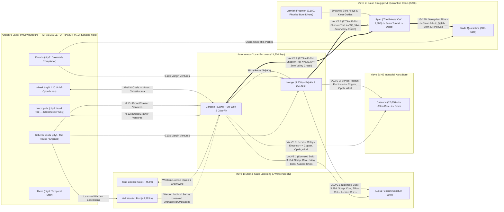

# Yusar & Ancient's Valley — Grounded 1:1 Worldbuilding, Salvage & Simulation Proposal

**Status:** Draft for Owner Review (2026-11-18)  
**Scope:** Living **Yusar (`Cybernetics`)** arcology enclaves (`Carcosa` `svfznb8426`, `Henge` `sf6a9gdawx`, and four frontier relay/kiln/staging wards) + **Ancient's Valley** (`rmvowuvfa6urs` biome, `123,856 km²`; `rmucbbtytfxy1` geographic, `102,884 km²`), its six numbered ruin sectors (`Babel`, `Necropolis`, `Dorado`, `Blade` seam, `Wheel` Cyberliches, `Thera` Temporal Stair), seven vitrified Eigenweapon blast basins, **`1/10` danger-discounted salvage field**, cybernetics supply chain, and dual quarantine/smuggling valves with the **Eternal State**, **North Dalab (`Span` / `Blade`)**, **Frogmen (`Jrrmiah`)**, and **Iron Republic (`Cascade`)**.  
**Companion Proposals (Clean Seams — Zero Double-Counting):** [`PROPOSAL-NORTH-DALAB-FROGMEN.md`](file:///home/antigravity/traviso761-debug/krator-master/core/simulation/PROPOSAL-NORTH-DALAB-FROGMEN.md) (`Blade`, `Span`, `Beisngeit`, `Jrrmiah`), [`PROPOSAL-IRON-REPUBLIC.md`](file:///home/antigravity/traviso761-debug/krator-master/core/simulation/PROPOSAL-IRON-REPUBLIC.md) (`Cascade`, `Footfall`, `Drum–Cascade` karst bore), [`PROPOSAL-XANADU.md`](file:///home/antigravity/traviso761-debug/krator-master/core/simulation/PROPOSAL-XANADU.md) (`Opal Valley` `photonic-opals`), [`PROPOSAL-CATCH.md`](file:///home/antigravity/traviso761-debug/krator-master/core/simulation/PROPOSAL-CATCH.md) (`Arfwai Oasis` `alkali`), [`PROPOSAL-VOTH.md`](file:///home/antigravity/traviso761-debug/krator-master/core/simulation/PROPOSAL-VOTH.md) (`Zey'danin` `copper`, `Voth` court demand).  
**Primary Sources Audited:** [`biomes/ancientsvalley/README.md`](file:///home/antigravity/traviso761-debug/krator-master/biomes/ancientsvalley/README.md), [`biomes/ancientsvalley/PLAN.md`](file:///home/antigravity/traviso761-debug/krator-master/biomes/ancientsvalley/PLAN.md), [`biomes/ancientsvalley/PLAN-ANOMALIES.md`](file:///home/antigravity/traviso761-debug/krator-master/biomes/ancientsvalley/PLAN-ANOMALIES.md), [`kits/metropolis/README.md`](file:///home/antigravity/traviso761-debug/krator-master/kits/metropolis/README.md), [`kits/metropolis/PLAN.md`](file:///home/antigravity/traviso761-debug/krator-master/kits/metropolis/PLAN.md), [`LORE.md`](file:///home/antigravity/traviso761-debug/krator-master/LORE.md) (§4, §6.13–6.20, §12), [`core/charactermodels/README.md`](file:///home/antigravity/traviso761-debug/krator-master/core/charactermodels/README.md), [`core/charactermodels/tools/mods.py`](file:///home/antigravity/traviso761-debug/krator-master/core/charactermodels/tools/mods.py), [`core/charactermodels/data/peoples.json`](file:///home/antigravity/traviso761-debug/krator-master/core/charactermodels/data/peoples.json#L2422-L2567), [`settlements/span/PLAN.md`](file:///home/antigravity/traviso761-debug/krator-master/settlements/span/PLAN.md), [`openworld/ANCIENT-TUNNELS.md`](file:///home/antigravity/traviso761-debug/krator-master/openworld/ANCIENT-TUNNELS.md), [`openworld/TRADE-SCOPE.md`](file:///home/antigravity/traviso761-debug/krator-master/openworld/TRADE-SCOPE.md) (§7.6, §8.2–8.3), [`openworld/PLAN-SITES.md`](file:///home/antigravity/traviso761-debug/krator-master/openworld/PLAN-SITES.md), [`openworld/TRADE-GEMINI.md`](file:///home/antigravity/traviso761-debug/krator-master/openworld/TRADE-GEMINI.md), Scale Model 5.1 (`1821×1723`, `2 km/px`), [`kits/resources/data/geology.json`](file:///home/antigravity/traviso761-debug/krator-master/kits/resources/data/geology.json), and [`kits/crops/`](file:///home/antigravity/traviso761-debug/krator-master/kits/crops/API.md).

---

## 1. Executive Summary & Grounded Census vs `TRADE-GEMINI.md`

### 1.1 Why `TRADE-GEMINI.md`'s `37,250` Draft Must Be Grounded — and Separated from the Valley Interior

In [`openworld/TRADE-GEMINI.md`](file:///home/antigravity/traviso761-debug/krator-master/openworld/TRADE-GEMINI.md) and [`tools/scale-model/gemini_trade_model.py`](file:///home/antigravity/traviso761-debug/krator-master/tools/scale-model/gemini_trade_model.py), **`Yusar (Cybernetics)`** was modeled at **`37,250`** across just **2 pins** (`Carcosa` `3,500` override + `Henge` `1,800` override = `5,300` urban, inflated `7.03×` by a generic agrarian hinterland multiplier into `~31,950` rural peasants). Quantitative audit against Scale Model 5.1 and [`LORE.md`](file:///home/antigravity/traviso761-debug/krator-master/LORE.md#L878-L958) exposes three structural defects in that draft:

1. **Both `Carcosa` (`395,812`) and `Henge` (`457,735`) sit INSIDE the `Eternal State` political polygon (`rmvg89rejmqat`) with ZERO dedicated Yusar polygon:** In [`51-region-store.js`](file:///home/antigravity/traviso761-debug/krator-master/tools/scale-model/src/51-region-store.js), `Eternal State` (`238,996 km²` total, `210,784 km²` land) covers the entire NW lowlands down to `Y=863`. Giving Yusar a `32,000`-peasant agrarian hinterland silently double-counts Eternian farmland.
2. **Sociological & Lore Mismatch ([`LORE.md`](file:///home/antigravity/traviso761-debug/krator-master/LORE.md#L878-L958), [`peoples.json`](file:///home/antigravity/traviso761-debug/krator-master/core/charactermodels/data/peoples.json#L2422-L2567)):** The Yusar are **not** an extensive peasant kingdom. They are an endogamous, urbanized **cyberneticist, drone-rigger, and deep-ruin salvager caste** concentrated in two semi-intact pre-Cataclysm arcology complexes (`Carcosa` and `Henge`) north of the Valley rim, speaking swapped-compound avoidance speech (*Spēk-Stak*: `comewel`, `byegood`, `placemarket`, `stilsta`) and writing forbidden Latin script. Eternia's **True Heirs** (`1,000–1,500` metallic-skinned rulers fearing *The Call*) regard Yusar flesh-cutting with ideological revulsion, tolerating their autonomous enclaves only as a quarantined buffer-guild that harvests `scrap`, `energy-cells`, and `microchips` from a Valley where True Heirs risk psychological/mutagenic corruption.
3. **Zero Civilian Towns Inside `Ancient's Valley` (`rmvowuvfa6urs`):** Per [`biomes/ancientsvalley/PLAN.md`](file:///home/antigravity/traviso761-debug/krator-master/biomes/ancientsvalley/PLAN.md) and [`PLAN-ANOMALIES.md`](file:///home/antigravity/traviso761-debug/krator-master/biomes/ancientsvalley/PLAN-ANOMALIES.md), the `123,856 km²` Valley (`104,372 km²` land + `19,484 km²` terminal lake at `+17.4 m`) is a **shattered Eigenweapon battlefield** swept by **`pH 2.5` oily rain** (`50%` `foul` ground), **seven vitrified blast basins**, **spatial/temporal/gravity anomalies (`KANOM`)**, **hard radiation (`KHAZ.rad`)**, and **extraplanar breaches**. Normal human agriculture and permanent civilian family towns inside the Valley are **zero**. Its sole resident sentient enclave is the tiny post-human machine-court of ***the Unleft* (`Cyberliches`, `~120` chassis)** at **`Wheel` (`city5`, `405,886`)**, alongside rotational `KCAMP` salvage ventures (`~180–320` seasonal/expeditionary crew, already counted in their home rim polities).

### 1.2 Master Single-Counted Census & Boundary Seam Ledger

| Code | Polity / Sector (`51-region-store` / Proposed ID) | Enclave / Polygon Land (`km²`) | Elev Span (Med) & Atm | Pins + Sub-Sites | `TRADE-GEMINI` Draft | **Grounded Headcount** | **Caloric-Eq (`1.0×` Human)** | Role & Sustenance Basis |
|---|---|---:|---|---:|---:|---:|---:|---|
| **`Y1`** | **Yusar — Carcosa Enclave** (`prop.poly.yusar_carcosa`) | **`1,680`** *(carved from `rmvg89rejmqat`)* | `+95..+680 m` (`139 m`, `1.57 atm`) | `1` pin + `2` wards + `4` `KHAMLET`s | `~24,200` | **`13,200`** | **`13,200`** | Primary cybernetics & Valley-salvage arcology (`Carcosa` `8,800`), SE rim decon lock (*Stil-Wōk* `1,600`), glass/circuit kilns (*Glās-Fīr* `1,500`), paddy/fungal vaults (`1,300`); breathy imperative dialect |
| **`Y2`** | **Yusar — Henge Enclave & Relay** (`prop.poly.yusar_henge`) | **`2,120`** *(carved from `rmvg89rejmqat`)* | `+180..+820 m` (`685 m`, `1.47 atm`) | `1` pin + `2` posts + `3` `KHAMLET`s | `~13,050` | **`8,300`** | **`8,300`** | Northern megalith-arcology (`Henge` `5,200`), `processor-cores` & `coal`/`silica-sand` barge hub, mid-corridor relay (*Brīj-Kē* `1,200`), S expedition depot (*Gēt-Nōth* `950`), `Cfa` bench farms (`950`); nasal dialect |
| **SUB** | **Living `Yusar` Polity Total (`polity: "yusar"`)** | **`3,800`** | `+95..+820 m` (`1.45–1.58 atm`) | **`2` core + `4` minor + `7` hamlets** | **`37,250`** | **`21,500`** | **`21,500`** | **65% urban (`14,000` in Carcosa+Henge), 24% industrial/staging wards (`5,250`), 11% terrace/fungal farmers (`2,250`); `2,374 km²` strict `farm-eq` in `25 km` cores (`>6×` self-sufficient in staple calories!)** |
| **`AV-W`** | ***The Unleft* (`Cyberliches` at `Wheel`, `city5`)** | `656` *(16 km floor pocket)* | `+16..+65 m` (`57 m`, `1.59 atm`) | `1` machine-arcology (`405,886`) | `0` | **`120`** *(non-civilian)* | **`18`** *(`0.15×`)* | Post-Ancient lich-cyborgs (metal below the neck; [`PLAN.md`](file:///home/antigravity/traviso761-debug/krator-master/biomes/ancientsvalley/PLAN.md) settled 2026-11-04); consume `energy-cells`, `alkali` electrolyte & neural parts; command `ancient` keeper walkers |
| **`AV-1..6`** | **Uninhabited Valley Ruin Sectors** (`rmvowuvfa6urs`) | **`103,716`** *(excl. `Wheel` pocket; +`19,484` wet)* | `-27..+4,671 m` (`1.60–0.89 atm`) | `Babel`, `Necropolis`, `Dorado`, `Thera` (+3 built stations) | `0` | **`0`** *(+180–320 transient `KCAMP`s)* | **`0`** | Eigenweapon megacity ruin-field: `Babel` (*The House*), `Necropolis` (*Radiation*), `Dorado` (*Drowned/Extraplanar*), `Thera` (*Temporal/Lizardmen stair*); transient salvagers counted in home rim towns |
| *Seam N* | *Eternal State Rim Quarantine* (`PROPOSAL-ETERNIANS.md`) | *In `rmvg89rejmqat`* | `+454..+3,393 m` | `Veil` (`448,838`), `Tone` (`368,776`) | *In ES* | *`0` here (`~1,400` + `~2,200` in ES)* | *`0` here* | **Owned by Eternal State:** `Veil` True Heir Warden pass-fort (`+3,393 m`) & `Tone` western license/customs town (`90 km` NW of Carcosa); **not double-counted** |
| *Seam S* | *North Dalab Rim Cork & Toll Gate* ([`PROPOSAL-NORTH-DALAB-FROGMEN.md`](file:///home/antigravity/traviso761-debug/krator-master/core/simulation/PROPOSAL-NORTH-DALAB-FROGMEN.md)) | *In `ND5`* | `+1,229..+2,545 m` | `Blade` (`451,1022`), `Span` (`554,1010`), `Beisngeit` (`540,1014`) | *In Dalab* | *`0` here (`900` + `1,800` + `650` in `ND5`)* | *`0` here* | **Owned by Realm of Dalab (`ND5`):** `Blade` mutagenic-margin quarantine garrison & `Span` Thunderdome / `"the priests' cut"` smuggling tunnel valve; **not double-counted** |
| *Seam E* | *Frogmen & Iron Republic Rim* (`PROPOSAL-NORTH-DALAB-FROGMEN` / `IRON-REPUBLIC`) | *In `FM1` / `IR`* | `+2,783..+3,205 m` | `Jrrmiah` (`558,960`), `Cascade` (`568,841`) | *In FM / IR* | *`0` here (`2,100` in `FM1`; `12,000` in `IR`)* | *`0` here* | **Owned by Frogmen & Iron Republic:** `Jrrmiah` dives the flooded `Drum–Babel` West Portal (`553,952`); `Cascade` anchors the `89 km` `Cascade–Drum` karst tunnel; **not double-counted** |
| **TOTAL** | **Net New Headcount Added by This Proposal** | **`108,172` land** *(+`19,484` Valley Lake)* | `-27..+4,671 m` | **`2` Yusar enclaves + `6` Valley sectors** | `37,250` | **`21,620`** *(`21,500` Yusar + `120` Unleft)* | **`21,518`** | **Eliminates `15,750` phantom Eternian peasants while preserving 100% of Yusar's industrial/salvage output via `65%` urban guild specialization!** |

---

## 2. Quantitative Scale-Model 5.1 & Salvage-Field Audit

### 2.1 Hypsometry, Option-B Metropolis Geometry & Biophysical Carrying Capacity

Per [`biomes/ancientsvalley/PLAN.md`](file:///home/antigravity/traviso761-debug/krator-master/biomes/ancientsvalley/PLAN.md) (Option B settled), the Valley was not a uniform `100,000 km²` skyscraper carpet, but a concentric pre-Cataclysm basin-metropolis ringed by Paolo Soleri pod-terraces and forested ramparts. Direct pixel audit of `rmvowuvfa6urs` (`30,964 px` = `123,856 km²`) confirms a near-exact match between Scale Model 5.1's hypsometric bands and Option B's architectural rings:

| Elevation / Hydrologic Band | `rmvowuvfa6urs` Area (`km²`) | Med Elev & Pressure | Med Rain & Temp | Dominant Köppen | `49r` Raw `farmStrict` (`km²-eq`) | **Hazard-Adjusted Viable `farm-eq`** | Built Architectural & Ecological Regime ([`biomes/ancientsvalley/README.md`](file:///home/antigravity/traviso761-debug/krator-master/biomes/ancientsvalley/README.md)) |
|---|---:|---|---|---|---:|---:|---|
| **1. Valley Terminal Lake (`whas`)** | **`19,484`** | `-24 m` bed (`+17.4 m` `wlev`, `1.60 atm`) | `2,024 mm`, `26.0 °C` | `WH` (`19,364 km²`) | `0.0` | **`0.0`** *(tainted/anomalous)* | Shallow `-12..-46 m` drowned urban shelf (`Dorado` at `-4 m`, 2 drowned blast basins + 1 half-drowned shore crater); oily slicks & extraplanar shimmer |
| **2. Sub-Zero Dry Floor (`<0 m`)** | **`528`** | `-20 m` (`1.60 atm`) | `1,553 mm`, `25.0 °C` | `WS` / `Aw` / `Af` | `312.4` | **`0.0`** | Sump basins & vitrified blast-rim aprons below lake level (`Dorado` dry causeway `481,966` at `-27 m`) |
| **3. Metropolis Core Floor (`0–100 m`)** | **`3,068`** | `+51 m` (`1.59 atm`) | `1,553 mm`, `24.0 °C` | `Aw` (`1,064`), `Af` (`872`) | `2,184.0` | **`0.0`** *(urban slab + `50%` foul)* | **`kits/metropolis` Skyscraper Core** (`Spindle`, `Organ`, `Wedge`, `Yoke`, `Reed`, `Telescope`, `Stalk`, `Swell` on `17°` street grid: `11 m` streets, `26 m` avenues every 3rd, `165 m` pitch); `Babel` (`+55 m`), `Station 0 Overlook` (`+84 m`), `Wheel` (`+57 m`) |
| **4. Metropolis Shelf Rings (`100–300 m`)** | **`7,480`** | `+200 m` (`1.56 atm`) | `1,380 mm`, `24.0 °C` | `Aw` (`2,992`), `Af` (`1,716`), `Cfa` (`1,196`) | `5,490.2` | **`0.0`** *(yards/midrises + rad)* | **Midrise & Industrial Rail-Yard Rings** (`8` midrises + `25` `kits/ancients` civic/industrial halls + `Hive`/`Star`/`Iris` active engines); `Station 2a Yards` (`+210 m`), `Necropolis` (`+168 m`) |
| **5. Soleri Farm Terraces (`300–600 m`)** | **`15,804`** | `+464 m` (`1.51 atm`) | `1,114 mm`, `22.0 °C` | `Csa` (`10,848`), `Cfa` (`4,672`) | `10,413.1` | **`~310.0`** *(feral forage only, `0` plow)* | **`Station 2b Terraces` (`+330 m`):** `4×19` hex honeycombs + Soleri `pod`/`vault`/`aqueduct`/`pumphouse` clusters; `50%` `foul` oily-rain lobes (`pH 2.5`), feral genemod orchards (`1,956` parcels) harvested only by passing expeditions |
| **6. Feral Forest Belt (`600–1,200 m`)** | **`47,204`** | `+906 m` (`1.43 atm`) | `925 mm`, `20.0 °C` | `Csa` (`38,416`), `Cfa` (`8,788`) | `33,812.0` | **`~140.0`** *(`Blade` margin only)* | Overgrown pre-war parkway corridors, collapsed viaducts, mutant megafauna & `taint` spores (`Blade` stands at `+1,229 m` on the S edge) |
| **7. Mid Walls & Ramparts (`1,200–2,500 m`)** | **`19,188`** | `+1,462 m` (`1.33 atm`) | `941 mm`, `17.0 °C` | `Csa` (`11,564`), `Cfa` (`6,840`) | `9,618.5` | **`0.0`** *(anomalous scarps)* | Linear trunk switchbacks, collapsed Valley Tunnel mouths (`538,998`), and **`Thera` (`526,955`, `+1,653 m`)** temporal-anomaly stair |
| **8. High Rim & Peaks (`>2,500 m`)** | **`11,100`** | `+3,480 m` (`1.04 atm`) | `595 mm`, `6.5 °C` | `Dsb` (`5,748`), `Dfb` (`2,180`), `Dsc` (`1,720`) | `887.8` | **`0.0`** *(quarantine crest)* | Cold alpine ring-wall separating the Valley from `Veil` (`+3,393 m`), `Cascade` (`+2,783 m`), `Jrrmiah` (`+2,904 m`), and `Span` (`+2,545 m`) |
| **VALLEY TOTAL (`rmvowuvfa6urs`)** | **`123,856`** *(`104,372` land)* | `+842 m` med land (`1.44 atm`) | `1,035 mm`, `20.0 °C` | `Csa` / `Cfa` / `Aw` / `Af` | **`62,718.0`** *(raw illusion!)* | **`0` civilian plow** *(~450 feral/rim)* | **Demonstrates why raw climate `49r` (`62,718 km²`!) MUST be multiplied by `0.0` for civilian settlement inside `rmvowuvfa6urs`!** |

By contrast, north of the rim wall, **Carcosa** and **Henge** sit in clean, warm, well-watered lowland basins shielded from the Valley's `pH 2.5` oily rain shadow by the `+3,393 m` `Veil` ridge:
- **Carcosa `25 km` Core (`1,188 km²` land, excl. Valley):** `741.7 km²` strict `farm-eq` (`1,018.7 km²` `2 km` terrace-eq), `677.4 km²` `past-eq`, `978.0 km²` `timb-eq` (`Am` monsoon `2,024 mm`, `25.0 °C`, `1.57 atm`, drained by `Ngān-Kē` `r122` `39.4 m³/s`, `Ngān-Mā` `r153` `30.3 m³/s`, and `Tōng-Mā` `r164` `28.7 m³/s`). At a conservative `50 ppl/km²` on just `30%` of its `25 km` core (`222 km²` worked), Carcosa feeds **`11,100+` people** locally, plus high-yield dark-grown `alecap` and `glow-mushroom` in wet arcology sub-basements (`13,200` enclave pop easily sustained with small luxury grain/sugar/beer imports).
- **Henge `25 km` Core (`1,956 km²` land):** `1,632.4 km²` strict `farm-eq` (`1,726.5 km²` `2 km` eq), `1,195.2 km²` `past-eq`, `1,687.8 km²` `timb-eq` (`Cfa` humid subtropical `1,396 mm`, `22.0 °C`, `1.47 atm`, drained by `Hōng-Kē` `r187` `24.2 m³/s` and `Fūng-Kē` `r193` `23.9 m³/s` into `Hāk-Mā` `r012` `379.5 m³/s`). Working just `12%` of its core (`~195 km²`) feeds **`9,750+` people** (`8,300` enclave pop is net self-sufficient in staple food).

### 2.2 Metropolis Ruin-Cut Distribution, Eigenweapon Blast Basins & `KANOM`/`KHAZ` Hazard Tiers

Inside the `10,548 km²` urban floor-and-shelf (`0–300 m`), [`biomes/ancientsvalley/README.md`](file:///home/antigravity/traviso761-debug/krator-master/biomes/ancientsvalley/README.md) fixes the war-ruin survival curve (`AV.RUIN_CUTS`): **only `2%` intact, `5%` gutted, `8%` crown-gone (`14–15%` standing tall), `22%` broken mid-shaft, `25%` stumps, `16%` structural skeletons, and `22%` toppled/fallen across the `11 m` streets**. Across this wrecked lattice lie the **seven vitrified Eigenweapon blast basins** (`anc_blast_specs` in [`tools/scale-model/README.md`](file:///home/antigravity/traviso761-debug/krator-master/tools/scale-model/README.md#L557), cut `85–110 m` deep with `+36..+48 m` fused glass rims):

| Basin ID | 5.1 Pixel `(px, py)` | Radius (`km`) | Total Melt Footprint (`1.5 r`, `km²`) | Hydrologic State | Nearest Sector (`km`) | Dominant `KANOM` / `KHAZ` Signature ([`PLAN-ANOMALIES.md`](file:///home/antigravity/traviso761-debug/krator-master/biomes/ancientsvalley/PLAN-ANOMALIES.md)) | Signature Salvage & Resource Yield |
|---|---|---:|---:|---|---|---|---|
| **`basin1`** | `(450, 896)` | `5.0` | `177` | **Dry** melt-floor | **`Babel`** (`27 km` SSE) & **`Terraces`** (`12 km` SE) | **Spatial Fold (*The House*):** non-Euclidean doorways, repeating stairwells, subway loops | Intact vault `relics`, `archaeotech`, optical blast `glass:255` (`448,892`), `silica:204` |
| **`basin2`** | `(476, 915)` | `6.0` | `254` | **Dry** melt-floor | **`Station 2a Yards`** (`17 km` SW) & **`Babel`** (`42 km` WNW) | **Electromagnetic / Engine Surge + Oily Rain (`pH 2.5`):** live arc-rail discharges round `Hive`/`Star`/`Iris` | Heavy `power-relays`, `servomotors`, `ancient-alloys`, locomotive `scrap` |
| **`basin3`** | `(406, 908)` | `6.5` | `299` | **Dry** melt-floor | **`Wheel`** (`44 km` N) & **`Necropolis`** (`72 km` S) | **Crushing & Lift Gravity (`KHAZ.crushing` / `KHAZ.lift`):** inverted-plumb debris plumes, `4 g` floor pockets | High-density `ancient-alloys`, gyroscopic `ancient-sensors`, walker `servomotors` |
| **`basin4`** | `(398, 966)` | `5.5` | `214` | **Dry** melt-floor | **`Necropolis`** (`47 km` NNE) | **Hard Prompt/Residual Radiation (`KHAZ.rad`):** lethal biological soak (`89wr-host-radiation.js`); zero flora | **Unpicked `microchips`, `energy-cells` & `processor-cores`** (accessible only to drone/cyber-chassis rigs!) |
| **`basin5`** | `(428, 948)` | `7.5` | `398` | **Drowned** (`-44 m` bed under `+17.4 m` lake) | **`Necropolis`** (`45 km` W) | **Radiolytic Brine & Sub-Lake Thermal Plume:** glowing Cerenkov silt, flooded vault airlocks | Sealed submarine `energy-cells`, corrosion-free `ancient-alloys` (amphibious/diving drones only) |
| **`basin6`** | `(460, 962)` | `7.0` | `346` | **Drowned** (`-46 m` bed under `+17.4 m` lake) | **`Dorado`** (`46 km` E) | **Extraplanar Thinning (`kits/extraplanar`):** geometry-shearing portals, phase-hunters | Exotic `archaeotech`, resonant `relics`, drowned transit-pod `ancient-sensors` |
| **`basin7`** | `(420, 984)` | `6.5` | `299` | **Half-Drowned** (`+17.4 m` N / dry melt S) | **`Blade`** (`98 km` SE) & **`Necropolis`** (`85 km` NNW) | **Mutagenic / Temporal Drift (`taint` + `KHAZ.aging`, `KANOM.owed <= 1d`):** fast-sporing chimera thickets | Bio-mutagenic `reagent`s, blast `glass` cullet, `coal:213` (`430,952` nearby) |

### 2.3 Fixing `geology.py` `RUIN_REGIONS` & Quantifying the `TRADE-SCOPE.md` §7.6 `1/10` Danger Rule

Our audit of [`tools/scale-model/geology.py`](file:///home/antigravity/traviso761-debug/krator-master/tools/scale-model/geology.py#L79) uncovered a major discrepancy: `RUIN_REGIONS = ('ruins of nazar',)` omits `"ancient's valley"`, leaving **only `960 km²` (`60` cells)** of the Valley's `104,512 km²` land stamped with the `0x80` ruin bit (`12 km` halos round `Babel`, `Necropolis`, `Dorado`, `Blade`). When `"ancient's valley"` is added to `RUIN_REGIONS` and paired with [`openworld/TRADE-SCOPE.md`](file:///home/antigravity/traviso761-debug/krator-master/openworld/TRADE-SCOPE.md#L480-L505) §7.6 (**`0.10×` danger multiplier on all Valley `0x80` cells**, plus **zero transit routes across `rmvowuvfa6urs`**), passive `80 km` rim salvage and deep `KCAMP` expedition yields separate cleanly into two distinct `[G data]` mechanisms:

| Rim / Enclave Settlement | Polity | Local Non-Valley `0x80` in `80 km` (`km²`) | Valley `0x80` Land in `80 km` (`km²`) | **Passive `80 km` Tapered `1/10` Eq (`km²-eq`)** | **Deep-Valley `KCAMP` Expedition Target(s) (`>80 km`, `0.10×` Survival-Weighted)** | Grounded Annual Salvage Role (`SIM.salvage`) |
|---|---|---:|---:|---:|---|---|
| **`Carcosa`** `(395,812)` *(+`Stil-Wōk` `414,821`)* | **Yusar (`Y1`)** | **`320`** *(own arcology)* | `192` *(NW lip; `1,680` from `Stil-Wōk`)* | **`315.6`** *(+`112.4` via `Stil-Wōk`)* | **`Wheel` (`150 km`, Cyberlich barter), `Babel` (`227 km`), `Necropolis` (`265 km` drone/cyber-crews)** | **#1 Continental High-Tech Salvager:** combines deep arcology sub-vaults + drone-assisted `Necropolis`/`Babel` expeditions (`220 t` expedition `scrap`, `14.5 u` `microchips`, `9.5 u` `energy-cells`, `1.85 u` `archaeotech`) |
| **`Henge`** `(457,735)` *(+`Gēt-Nōth` `467,790`)* | **Yusar (`Y2`)** | **`512`** *(own arcology)* | `0` *(`640` from `Gēt-Nōth`)* | **`484.9`** | **`Babel` NE Margin & `Station 2a Yards` (`260–346 km` via E of `Veil`)** | **#2 Yusar Salvage & `processor-cores` Hub:** mines `512 km²` local ring-arcology + seasonal crawler convoys (`120 t` expedition `scrap`, `7.5 u` `microchips`, `5.0 u` `energy-cells`) |
| **`Veil`** `(448,838)` | **Eternal State** | `0` | **`6,944`** | **`440.6`** *(down from `4,405.5` raw!)* | **Licensed North-Rim Vaults & `Terraces` (`120–141 km`)** | **Chartered Warden Licensing Gate:** `1/10` cut prevents `Veil` (`+3,393 m` fort) from flooding the world with `4,405 km²` of easy scrap; yields controlled `95 t` expedition `scrap` + `4.2 u` `energy-cells` |
| **`Blade`** `(451,1022)` | **Realm of Dalab (`ND5`)** | `0` *(in Valley poly)* | **`12,048`** | **`827.6`** *(down from `8,276.3` raw!)* | **Quarantined SW Margin & `basin7` Melt-Sheet (`98–132 km`)** | **Southern Quarantine Cork:** `1/10` danger cut keeps `Blade` (`900` garrison) realistic (`130 t` local + `85 t` rim expedition `scrap`, blast `glass`, `relics` tithed to Dalab) |
| **`Span`** `(554,1010)` *(+`Beisngeit` `540,1014`)* | **Realm of Dalab (`ND5`)** | **`1,632`** *(`Ruins of Nazar` + `Span`)* | `112` *(`1,472` from `Beisngeit`)* | **`1,107.0`** | **Ruined Valley Tunnel (`538,998`) & `Thera` Scarp (`123 km` smuggler scouts)** | **Nazar Salvage + Valley Contraband Laundering:** bulk scrap comes from safe `Nazar` (`1,632 km²` `1.0×`), while high-tier `ancient-sensors` & `processor-cores` arrive via the Eastern Rim smuggler trail |
| **`Jrrmiah`** `(558,960)` | **Frogmen (`FM1`)** | `0` | **`1,664`** | **`93.1`** *(down from `930.6` raw!)* | **Flooded `Drum–Babel` Inner Wall Bore (`553,952`, `8 km` NW)** | **Submerged Karst-Bore Divers:** amphibious Frogmen bypass terrestrial anomalies to strip drowned Ancient convoys (`ancient-alloys`, `power-relays`) |
| **`Wheel`** `(405,886)` | **Cyberliches (`AV-W`)** | `0` | **`14,928`** | **`1,001.5`** *(immune to `rad` & `pH 2.5`!)* | **Direct Keeper-Walker Harvesting of `basin3` (`44 km`) & `Necropolis` (`116 km`)** | **In-Valley Machine Brokers:** *the Unleft* suffer `~0.35×` rather than `0.10×` attrition in `rad`/`foul` zones, trading curated `microchips`, `ancient-sensors`, and `archaeotech` to Carcosa `Hierophants` for `alkali` & `photonic-opals`! |

### 2.4 39-Family Mineral Endowments & Critical Deficits (Why Yusar Must Trade)

Direct audit of [`kits/resources/data/geology.json`](file:///home/antigravity/traviso761-debug/krator-master/kits/resources/data/geology.json) reveals an extraordinary geochemical asymmetry that **naturally forces the Yusar into continental long-distance trade**:

| Geological Zone | Land (`km²`) | **Abundant Local Endowments (`Good >= 100` `km²` / Peak Byte)** | **Critical Structural Deficits (`Good >= 100` = `0 km²`!)** | Economic Consequence for Cybernetics & Salvage |
|---|---:|---|---|---|
| **Carcosa Enclave (`Y1`, Voronoi `<=44 km`)** | `4,256` | **`coal`** (`1,200 km²`, max `157` at `392,806`), **`silica`** (`624 km²`, max `150` at `404,794`), **`clay`** (`752 km²`, max `255`), **`stone`** (`4,256 km²`), **`wood`** (`4,256 km²`), `oil` (mod, max `96`), NW placer `gold`/`tin` on `Tōng-Mā` (`360,842` high `2.60`/`2.45`) | **`copper` (`0 km²`, max `10`!)**, **`iron` (`0 km²`, max `40`!)**, **`silver` (`0 km²`)**, **`alkali` (`0 km²`)**, **`opal` (`0 km²`)**, **`halite` (`0 km²`, max `10`)** | Carcosa has coking `coal`, high-purity `silica`, `clay` ceramics, and `480 t` arcology `scrap`, **but ZERO domestic `copper`, `silver`, `alkali`, `salt`, or `photonic-opals`!** |
| **Henge Enclave (`Y2`, Voronoi `<=44 km`)** | `5,888` | **`coal`** (`2,176 km²`, max `154` at `442,738`), **`silica`** (`240 km²`, max `150` at `446,716`), **`clay`** (`480 km²`, max `255`), **`peat`** (`144 km²`, max `111`), **`wood`** (`5,888 km²`) | **`copper` (`0 km²`, max `10`!)**, **`iron` (`0 km²`, max `40`!)**, **`silver` (`0 km²`)**, **`alkali` (`0 km²`)**, **`opal` (`0 km²`)**, **`halite` (`0 km²`, max `11`)** | Henge exports **`1,542 t/yr` `coal`** and **`238 t/yr` `silica-sand`** downriver via `Lux`/`Palewharf`, financing Yusar's heavy imports of `copper`, `silver`, `alkali`, and `photonic-opals`! |
| **Veil Quarantine Pass (`<=25 km` N Rim)** | `1,808` | **`iron`** (`1,808 km²`, max `180`), **`tin`** (`800 km²` rich, max `200`), **`gold`** (`1,312 km²`, max `110`), **`silver`** (`1,312 km²`, max `110`), **`rare-earth`** (`1,312 km²`, max `160` at `444,828`) | `coal` (`0 km²`), `copper` (`0 km²`, max `50`), `halite` (`0 km²`), steep `Dsb` alpine pass (`+3,393 m`) | Eternia's Warden fortress at `Veil` sits atop crystalline `tin`/`silver`/`rare-earth` veins right on the quarantine crest — giving Wardens strategic leverage over Yusar solder/rare-earth access! |
| **Ancient's Valley Interior (`rmvowuvfa6urs`)** | `104,512` | **`iron`** (`28,832 km²`, `12,096` rich), **`gold`/`silver`/`rare-earth`** (`12,016 km²` each on N scarp `408,846`), **`coal`** (`7,968 km²`, max `213` at `430,952`), **`tin`** (`6,928 km²` rich), **`silica`** (`5,888 km²`, max `204` at `448,892`), **blast `glass`** (`2,112 km²` rich, max `255` at `448,892`), **`impactite`** (`7,840 km²`) | **`copper` (`0 km²` good, max `50`!)**, `halite` (`0 km²`), `alkali` (`0 km²`); **all interior lodes locked behind `0.10×` anomaly/oily-rain hazard!** | Even inside the Valley, `copper` is absent (`0 km²` good), while fused **blast `glass` (`2,112 km²`)** and **`silica` (`5,888 km²`)** around `basin1` (`448,892`) supply prized pre-vitrified optical cullet to rim expeditions |

### 2.5 Crop Plausibility & the Missing `CROPS.BIOMES['ancientsvalley']` Entry

Auditing [`kits/crops/`](file:///home/antigravity/traviso761-debug/krator-master/kits/crops/API.md) in Node revealed that **`CROPS.forBiome('ancientsvalley')` currently throws `Error: crops: no biome ancientsvalley`** (`CROPS.BIOMES` defines `28` zones including `'nwlowlands'` and `'swlowlands'`, but omits `'ancientsvalley'`, even though `Station 2b Terraces` places `1,956` feral crop/orchard parcels!).
- **Living Yusar Enclaves (`nwlowlands` climate zone: `Carcosa` `Am` `25 °C`, `1.57 atm`, `2,024 mm`; `Henge` `Cfa` `22 °C`, `1.47 atm`, `1,396 mm`):** Plausible rainfed staples are **`rice`**, **`emmer`** (`Henge` benches), **`basin-amaranth`**, **`taro`**, **`sweet-potato`**, **`shade-manioc`**, **`helix-bean`**, **`plantain`/`banana`**, **`whorl-olive`** & **`avocado`** oils, plus **dark-grown arcology-vault fungi** (**`alecap`**, **`pale-fungi`**, **`the-mat`**, **`glow-mushroom`** — which [`kits/crops/PLAN.md`](file:///home/antigravity/traviso761-debug/krator-master/kits/crops/PLAN.md) specifies take an indoor works rather than open sky, fitting Carcosa and Henge's shadowed lower levels!).
- **Feral Soleri Terraces (`Station 2b`, `300–600 m`, `Cfa`/`Csa`, `1.51–1.54 atm`):** Register `'ancientsvalley'` in `CROPS.BIOMES` (`warmth: [0.55, 0.88]`, `atm: [1.35, 1.62]`, `arid: [0.45, 0.85]`) so feral genemod survivors (`wild-rice`, `murnong`, `breadfruit`, `wingnut`, `mahogany-nut`, `whorl-olive`, `sky-poppy` reagent, `wineweed` alga) populate the `50%` `wild` Soleri honeycombs while dying back to stunted lichens/fungi in the `50%` `foul` oily-rain lobes.

---

## 3. Enclave & Sector Breakdown of Yusar & Ancient's Valley

### 3.1 Living Yusar Enclaves (`Y1` Carcosa & `Y2` Henge) — *Spēk-Stak* Avoidance Speech & Cybernetic Caste Culture

Per [`LORE.md`](file:///home/antigravity/traviso761-debug/krator-master/LORE.md#L878-L958) and [`core/charactermodels/data/peoples.json`](file:///home/antigravity/traviso761-debug/krator-master/core/charactermodels/data/peoples.json#L2422-L2567), the Yusar are descendants of pre-Cataclysm Valley maintenance, surgical, and telemetry crews who evacuated only as far as the northern rim arcologies (`Carcosa` and `Henge`) and refused Eternia's anti-augmentation orthodoxy:

| ID | Settlement / Ward | Coords `(px, py)` | Elev & Atm | Climate | Pop | Dialect & Social Dominant (`peoples.json` Tiers) | Primary Works, Guilds & Infrastructure |
|---|---|---|---:|---|---:|---|---|
| **`Y1-A`** | **`Carcosa`** *(`svfznb8426`, `ruin` -> `arcology`)* | `(395, 812)` | `+139 m` (`1.57 atm`) | `Am` `2,024 mm`, `25 °C` | **`8,800`** | **Core Yusar** (breathy imperative *Spēk-Stak*: `comewel`, `stilsta`; Latin bench-stencils) | **Dark-Shibuya Cybernetics Metropolis (`refs/machine-35`):** Surgical & Loader Mod-Vaults (`cybernetics` `11.5 u`), Wet-Cell `alkali` Rebuilding Baths (`energy-cells` `32.0 u` total), Salvage Sorting Concourse (`scrap` `700 t` local+exped), Optical Opal Resonator Benches |
| **`Y1-B`** | ***Stil-Wōk*** *(SE Rim Decon & Drone Lock)* | `(414, 821)` *(new)* | `+624 m` (`1.48 atm`) | `Csa` `1,271 mm`, `22 °C` | **`1,600`** | `Corsair` (`16%`) & `Dronemaster` (`18%`) | Commands the NW rim lip above `Wheel` (`150 km` S); alkaline lime-wash sluices neutralizing `pH 2.5` oily rain, lead-lined `Necropolis` drone-rig hangars, Faraday relic vaults |
| **`Y1-C`** | ***Glās-Fīr*** *(Silica, Cullet & Ceramic Kilns)* | `(394, 807)` *(new)* | `+166 m` (`1.57 atm`) | `Am` `1,945 mm`, `24 °C` | **`1,500`** | `Lightkeeper` (`20%`) & `Electromonk` (`16%`) | Co-located on `coal:136` + `silica:150` + `clay:255`; fuses Valley blast-glass cullet (`78 t`) into `electrics` vacuum bulbs (`28 u`) and fires white surgical-ceramic limb housings (`mod_arms_surgical`) + `circuits` |
| **`Y1-H`** | *Carcosa Paddy & Fungal-Vault `KHAMLET`s (×4)* | `<=18 km` of `(395,812)` | `+95..+220 m` | `Am` / `Aw` | **`1,300`** | Kin-wards of `Lightkeeper`s | Monsoon `rice`, `taro`, `whorl-olive` terraces + indoor arcology-cellar `alecap` & `glow-mushroom` beds |
| **`Y2-A`** | **`Henge`** *(`sf6a9gdawx`, `ruined arcology`)* | `(457, 735)` | `+685 m` (`1.47 atm`) | `Cfa` `1,396 mm`, `22 °C` | **`5,200`** | **Northern Yusar** (clipped nasal *Spēk-Stak*; heavier Eternian bilingualism) | Ring of monolithic Ancient pylons (`Henge`); **`processor-cores` clean-bench hall (`9.5 u`)**, `coal` (`1,542 t` export) & `silica-sand` (`238 t` export) river-barge wharves toward `Lux` (`195 km`) & `Fulcrum` (`247 km`) |
| **`Y2-B`** | ***Brīj-Kē*** *(Mid-Corridor Crawler Relay)* | `(422, 776)` *(new)* | `+185 m` (`1.56 atm`) | `Am` `1,631 mm`, `25 °C` | **`1,200`** | `Dronemaster` & `Corsair` convoy crews | Exact midpoint (`99 km` from `Carcosa`, `108 km` from `Henge`) on `coal:138` + `clay:255` (`sl=0.007`); battery-charging station for six-wheeled Yusar crawlers (`kits/motor-vehicles`) |
| **`Y2-C`** | ***Gēt-Nōth*** *(South-Rim Expedition Depot)* | `(467, 790)` *(new)* | `+678 m` (`1.47 atm`) | `Cfa` `1,647 mm`, `22 °C` | **`950`** | `Corsair` & `Crescent Vigilant` (`2%`) | Stages Henge's salvage crawlers east of `Veil` (`448,838`), splitting payloads between licensed `Lux` barges and covert Eastern Rim mule-packs (`X=532..544`) bound for `Span` |
| **`Y2-H`** | *Henge `Cfa` Bench & Orchard `KHAMLET`s (×3)* | `<=18 km` of `(457,735)` | `+650..+815 m` | `Cfa` | **`950`** | `Lightkeeper` tenant households | `emmer`, `rice`, `sweet-potato`, `helix-bean`, `whorl-olive`, and peat/coal brickmaking |

**Cybernetic Body-Mod Integration (`core/charactermodels` & `tools/mods.py`):**
- All seven [`peoples.json`](file:///home/antigravity/traviso761-debug/krator-master/core/charactermodels/data/peoples.json#L2422-L2567) Yusar social tiers map directly onto `[G data]` citizen/guild roles and the three [`core/charactermodels/tools/mods.py`](file:///home/antigravity/traviso761-debug/krator-master/core/charactermodels/tools/mods.py) rig families (`Left2Shoulder..Right2HandThumb3` lower sockets + `arms_up` full shoulder replacements):
  1. **`lightkeeper` (`20%`):** Lamp-tenders, kiln-workers, and grid-maintainers; subtle ocular/cranial jacks or single bronze lower utility arm (`mod_arms_cyber`).
  2. **`dronemaster` (`18%`):** Telemetry riggers piloting tethered/autonomous walkers into `Necropolis` and `Babel`; cranial antenna harnesses + `photonic-opals` neural-link visors.
  3. **`electropriest` (`18%`) & `electromonk` (`16%`):** Keepers of the `alkali` cell-baths, `processor-cores` clean-rooms, and surgical theatres; **white ceramic + teal-cabled `mod_arms_surgical`** (lower or four-arm precision rigs).
  4. **`corsair` (`16%`):** Armed deep-Valley salvage raiders and Eastern Rim contraband escorts; **hazard-yellow hydraulic 3-claw `mod_arms_loader`** (`arms_up` heavy pry/cutter rigs for breaching jammed arcology blast-doors).
  5. **`hierophant` (`12%`) & `crescent_vigilant` (`2%`):** Senior guild-judges and elite bodyguards wearing **four-arm bronze/steel `mod_arms_cyber` (`mod_arms_cyber_4`: upper replacement + lower socketed pair)**, veiled in dark Shibuya layered rain-slicks (`pH 2.5`-proof rubberized silk/cotton) that conceal how little organic torso remains beneath.

### 3.2 The Six Sectors of Ancient's Valley (`city1`–`city6`) & Architectural Kit Recipes

| Sector | Name & Pin Status | 5.1 Coords `(px, py)` | Elev & Atm | Canonical Theme ([`PLAN.md`](file:///home/antigravity/traviso761-debug/krator-master/biomes/ancientsvalley/PLAN.md) Settled) | Resident Census | **Architectural & Biome Kit Recipe (`kits/` + `core/`)** |
|---|---|---|---|---|---:|---|
| **`city1`** | **`Babel`** (`s7g2cj1u2b`, `ruined arcology`) + Built Stations `0`, `2a`, `2b` | `(456, 908)` *(+`457,907`, `470,921`, `455,899`)* | `+55..+330 m` (`1.59–1.54 atm`) | **The House** *(non-Euclidean interior labyrinth, subway loops, active yard engines)* | **`0`** | **`kits/metropolis`** (`8` skyscrapers + `8` midrises on `165 m` `17°` grid, `KSHELL` distance shells, `AV.RUIN_CUTS`) + **`kits/ancients`** (`25` civic/industrial halls, `Hive`/`Star`/`Iris` live engines) + **`kits/ancient-transit`** (viaducts/subways) + Soleri `pod`/`aqueduct` honeycombs (`2b`) + `KANOM` portal/loop rooms (`41c`/`75`) |
| **`city2`** | **`Necropolis`** (`si1wh7atlt`, `ruin`) | `(406, 944)` | `+168 m` (`1.57 atm`) | **Hard Radiation** *(`KHAZ.rad` dead-ground between `basin3`, `basin4`, `basin5`)* | **`0`** | Bleached, vine-less **`kits/metropolis`** midrise/tower skeletons (`0%` `wild` overgrowth — bare bone-white concrete, fused black `glass` aprons, `89wr` Cherenkov haze); highest density of unlooted `microchips` & `energy-cells` |
| **`city3`** | **`Dorado`** (`sbxpx1u95q`, `ruin` — **drowned**) | `(483, 964)` *(`-4 m` in `+17.4 m` lake; dry causeway `480,966`)* | `-4 m` bed / `+17.4 m` water (`1.60 atm`) | **Extraplanar Rifts** *(drowned towers + dimensional breaches near `basin6`)* | **`0`** | Half-submerged **`kits/metropolis`** spires (`Telescope`, `Organ`, `Cupola`) rising out of `+17.4 m` lake water + **`kits/extraplanar`** (`phenomena`, `portals`, phase-shifted crystalline growths, extraplanar hunters) + **`kits/ancient-transit`** flooded causeway (`480,966`) |
| **`city4`** | **`Blade`** (`s4tcb5iuwc`, `ruined arcology` — **Dalab Seam**) | `(451, 1022)` | `+1,229 m` (`1.37 atm`) | **Mutagenic Margin** *(`taint`, chimera flora/ghouls; Dalab quarantine garrison)* | *`900` in `ND5`* | Sheared **`kits/metropolis` `Wedge`/`Spindle`** monolith stump plugged with **`kits/highlands` / Dalab** quarantine bastions, flame-cleared kill-zones, and Genepriest `taint`-inspection pens (**counted in [`PROPOSAL-NORTH-DALAB-FROGMEN.md`](file:///home/antigravity/traviso761-debug/krator-master/core/simulation/PROPOSAL-NORTH-DALAB-FROGMEN.md)**) |
| **`city5`** | **`Wheel`** (`prop.av.wheel`, `ruined arcology` — **add pin**) | `(405, 886)` *(dry `+57 m` pad beside `406,886` `+17.4 m` pond)* | `+57 m` (`1.59 atm`) | **Machines & Cyberliches (*The Unleft*)** *(settled 2026-11-04)* | **`120` *Unleft*** *(`18` cal-eq)* | Ring-shaped **`kits/metropolis` `Spiral`/`Arcades`** hub + **`kits/ancients` `Star`/`Iris`** rotary power-wheel + **`kits/post-apoc`** cable/conduit webs + **`kits/mechs`** (`ancient` keeper walkers patrolling perimeter); dark Shibuya bronze/ceramic surgical alcoves where *the Unleft* swap chassis parts |
| **`city6`** | **`Thera`** (`prop.av.thera`, `ruin` — **add pin**) | `(526, 955)` | `+1,653 m` (`1.30 atm`) | **Temporal Pockets & Lizardmen Stair** *(settled 2026-11-04)* | **`0`** *(feral Lizardmen)* | Stepped **`kits/ancients`** cyclopean rampart-stair + Soleri `vault`/`aqueduct` ruins frozen in **`KANOM` time-bubbles** (`KHAZ.aging`, stilled rain-curtains, `owed <= 1d`) + feral **`kits/lizardmen`** brood-nests guarding the ancestral ascent |

**Living Yusar Architectural Kit Recipe (`Carcosa` & `Henge`):**
- **Structural Shell (`60%`):** Semi-intact **`kits/metropolis`** lower podiums (`Arcades`, `Terrarium`, `Ledger`, `Pods`) and **`kits/ancients`** vault halls (`kits/ancients-interiors` audited rooms), spared Eigenweapon direct hits (`30–45%` intact lower 8 storeys, upper crowns sheared and roofed over against monsoon rain).
- **Dark-Shibuya Cyber-Organic Dress (`30%`, `LORE.md` `refs/machine-35`):** Dense **`kits/post-apoc`** & custom Yusar street-canyon dress — bundled black rubberized HV trunk-cables slung like lianas between facades, teal/amber vacuum-tube & `glow-mushroom` bioluminescent shop-signs stenciled in forbidden Latin characters, copper-finned transformer shrines, `alkali` mist-scrubbers, and overhead gantry cranes lowering crawler chassis into surgical pits.
- **Frontier & Rim Vernacular (`10%`):** Eternian stone-and-tile warehouse annexes (`kits/eternian`) at `Henge`/`Brīj-Kē` barge wharves + шести-wheel / tracked salvage crawlers (`kits/motor-vehicles`) parked in decon locks at *Stil-Wōk* and *Gēt-Nōth*.

---

## 4. Cybernetics Supply Chain & Dual Quarantine/Toll Valves

### 4.1 The Five-Input Cybernetics & Cell-Rebuilding Production Chain (`[G data]` Recipe Audit)

Yusar's continental near-monopoly on **`cybernetics`** (`62.9%` of world exports in `TRADE-GEMINI`, `17.0 u` net factory output at `Carcosa` `11.5 u` + `Henge` `5.5 u`) and **`processor-cores`** (`29.5 u` at `Carcosa` `20.0 u` + `Henge` `9.5 u`), alongside **`energy-cells`** (`34.0 u` rebuilt + `14.5 u` expedition = `48.5 u`), rests on **five non-substitutable long-distance imports** combined with Valley salvage:

| Input Good | Annual Yusar Need (`Carcosa` + `Henge`) | Domestic Yusar Supply | **Required Import & Primary Source Polity** | Transport Corridor into Yusar | Exact Physical Role in Cybernetics / Salvage Rebuilding |
|---|---:|---:|---|---|---|
| **`photonic-opals`** | **`87.4 kg`** *(43.2% of world trade!)* | **`0.0 kg`** *(`opal=0` in NW!)* | **`Xanadu Sultanate`:** `Opal Valley Mines` (`1038,1662`, `68.5 kg`) & `Strongbow` (`18.9 kg`) | `Opal Valley -> Strongbow -> Marr -> Tethis -> Trigon -> Roketstad/Cascade -> Carcosa/Henge` (`3,017–3,558 km`) | **Neural-Optical Signal Resonators:** bridges organic peripheral nerves to Ancient silicon `processor-cores` without immune rejection or latency |
| **`copper`** *(+ `silver` `79.6 kg`)* | **`131.5 t`** `Cu` + `79.6 kg` `Ag` | `~7.5 t` *(trace salvage only; `0 km²` lode!)* | **`Vothic Kingdom` (`Zey'danin` `795,860`)**, **`Iron Republic` (`Stahlborn` `618,859`)**, & **`South Dalab` (`Nulab`)** | `Zey'danin -> Almua -> Drum -> Cascade` (`89 km` karst bore) `-> Henge/Carcosa` (`1,018 km`); smuggled S bars via `Span` | **Micro-Solenoid Windings & Busbars:** rewinds corroded `servomotors` (`+18 u`), `power-relays` (`+15 u`), `electrics` (`42 u`), and silver-brazed neural pins |
| **`alkali`** *(soda ash / caustic)* | **`178.4 t`** *(`120.7 t` imported)* | `0.0 t` *(wet `Am`/`Cfa` leaches soda!)* | **`Catch Oasis Stations` (`Arfwai Oasis` `1090,1387`)** & eastern soda playas ([`PROPOSAL-CATCH.md`](file:///home/antigravity/traviso761-debug/krator-master/core/simulation/PROPOSAL-CATCH.md)) | `Arfwai -> Arcbeam -> Marr -> Tethis -> Roketstad -> Carcosa/Henge` (`2,782 km`) | **Electrolyte Re-Cracking & Oily-Rain Decon:** flushes sulfated Ancient nickel-iron/alkaline **`energy-cells`**, etches `circuits`, and neutralizes `pH 2.5` Valley rain at *Stil-Wōk* |
| **`spider-silk`** *(+ `rubber` `54.3 t`)* | **`22.2 t`** silk + `54.3 t` rubber | `0.0 t` | **`Spider Lake Guilds` (`Hām-Tsēk` / `Silkhead`)** via Korona guided silk trail; **`East Abyss` / `Tabisti`** `rubber` | `Silkhead -> Jimjam -> Palewharf -> Bastion -> Lux -> Henge -> Carcosa`; `rubber` via Ring Sea -> `Tethis` | **Dielectric Myomer Tendon-Sheaths & Seals:** high-tensile `spider-silk` wraps artificial muscle bundles & neural leads; `rubber` seals joints against acid mist |
| **`books` & `almanacs`** *(+ `lenses`)* | **`21.1 t`** *(40.3% of world `books`!)* | Low *(oral *Spēk-Stak*)* | **`Order of Historians` (`Longsong`)**, **`Eternal State` (`Fulcrum`/`Lux` `604 t` paper)**, **`Jimjam` (`glass` `19.8 t`)** | `Lux -> Henge -> Carcosa` (`276–719 km` barge/trail); covert Historian codices smuggled via `Corpus` | **Pre-Cataclysm Pinout Schematics & Anatomy Atlases:** Latin technical manuals needed by `Electropriests` to decode `Babel`/`Wheel` IC pinouts |
| *Local + Valley Salvage* | `microchips` (`46.5 u`), `servomotors`, `alloys` | **`100%` domestic + Valley (`Y1`+`Y2`+`Wheel`)** | Harvested from `Carcosa`/`Henge` sub-vaults, `Stil-Wōk`/`Gēt-Nōth` `KCAMP` ventures, & **`Wheel` Cyberlich barter** | `Babel`/`Necropolis` (`150–265 km` crawler/drone) -> *Stil-Wōk* decon -> `Carcosa`/`Henge` clean-rooms | `microchips` + etched `circuits` -> **`processor-cores` (`29.5 u`)** + `photonic-opals` + `servomotors` + `ancient-alloys` + `spider-silk` -> **`cybernetics` (`17.0 u` net export)** |

### 4.2 The Dual Quarantine / Toll Valves: Eternian Licenses vs Dalab's `"Priests' Cut"` at `Span`

Because [`TRADE-SCOPE.md`](file:///home/antigravity/traviso761-debug/krator-master/openworld/TRADE-SCOPE.md#L480-L505) §7.6 forbids **any trade route from crossing `rmvowuvfa6urs`**, all Yusar and rim salvage exits through **two competing political valves** plus one northeastern industrial tunnel — creating a classic three-way institutional tension:

1. **Valve 1 — The Northern Official Channel (`Eternal State` Salvage Licenses via `Veil`, `Tone` & `Lux` -> `Fulcrum`):**
   - **Mechanism:** Under Eternia's **Sanctum Quarantine Statute** ([`LORE.md`](file:///home/antigravity/traviso761-debug/krator-master/LORE.md#L142-L184), §6.19), True Heir **Wardens** at **`Veil` (`448,838`, `+3,393 m`)** and customs magistrates at **`Tone` (`368,776`)** & **`Lux` (`495,643`)** issue numbered **Valley Salvage Charters**. Yusar guilds hold standing hereditary charters in exchange for:
     - Delivering **bulk industrial `scrap` (`3,594 t/yr` to `Fulcrum` alone), `silica-sand` (`220 t/yr`), rebuilt `energy-cells` (`21.3 u/yr`), and audited `microchips` (`29.8 u/yr`)** north through `Lux` at fixed State monopsony tariffs;
     - Submitting every crate to **Warden Censorate inspection**, which confiscates autonomous AI (`ai-cores`), live mutagenic `taint`, and **any evidence of the True Heirs' darkest state secret** ([`LORE.md`](file:///home/antigravity/traviso761-debug/krator-master/LORE.md#L168-L180): that some degenerated Valley ghouls bear metallic True Heir hair/skin — True Heirs who answered *The Call* and mutated!).
     - *Hypocrisy Valve:* Publicly, Eternian ministries condemn Yusar `cybernetics`; privately, aging non-Heir Eternian oligarchs and injured frontier officers buy **`13.8 u/yr` of discreet bronze/porcelain Yusar prosthetics** (`Carcosa -> Fulcrum` `8.7 u`, `Henge -> Fulcrum` `5.1 u`).
2. **Valve 2 — The `870 km` Eastern Rim Shadow-Trail & Dalab's `"Priests' Cut"` at `Span` (`554,1010`):**
   - **Verified Scale-Model Geometry:** Confirming `trade-gemini.json`'s exact pathfinder polyline (`[396,812] -> [444,820] -> [492,848] -> [522,874] -> [540,906..986] -> [554,1010]`), smuggler pack-trains and six-wheeled crawlers skirt **100% outside `rmvowuvfa6urs`** (`X=532..544` vs Valley max `X=528`), threading the `+2,400..+3,100 m` eastern rampart shelf between `Thera` (`526,955`) and `Jrrmiah` (`558,960`) down to **`Span` (`554,1010`)**!
   - **Mechanism (`"the priests' cut"`, [`settlements/span/PLAN.md`](file:///home/antigravity/traviso761-debug/krator-master/settlements/span/PLAN.md)):** Everything Eternia's Wardens would seize or underpay for — **unfettered `processor-cores` (`42.5 u/yr` to Dalab!), `ancient-sensors` (`38.2 u/yr`), unsterilized combat `cybernetics`, `archaeotech`, and forbidden True-Heir ghoul-relics** — goes south along the Eastern Rim to `Span`'s rock-cut customs house above the Thunderdome. Dalab's Genepriests ask **zero Eternian license questions**: they take **`"the priests' cut"` (`20%` in-kind tithe on `ancient-sensors`/`processor-cores`/`relics` for the Sacred Temple of The God, `12%` silver ad-valorem on commercial crates)** and lower the laundered cargo `719 m` through the **`28 km` Basin Tunnel** to `Beisngeit` (`540,1014`), whence barges on `Daranch`/`Dapor` carry it to `Dalab`, `Shim`, `Voth`, and Ring Sea freeports!
   - **Why `Blade` (`451,1022`) Does NOT Compete with `Span`:** `Blade` sits directly on the mutagenic SW Valley floor-lip (`ND5` military quarantine); Dalab's own Genepriests forbid commercial through-caravans at `Blade` to keep `taint` spores out of the fertile `Nufelds`/`Dalab` basin, funneling all high-value contraband intentionally through `Span`'s isolated `+2,545 m` tableland lock!
3. **Valve 3 — The `Cascade–Drum` (`89 km`) Inner Wall Karst Bore & Ring-Sea Return Loop:**
   - **Mechanism:** Legal non-contraband `servomotors` (`36.3 u` to `Pylon`, `15.0 u` to `Voth`), `power-relays`, `electrics`, and `scrapgoods` travel east from `Carcosa`/`Henge` over the northern highland road (`577–733 km`, bypassing `Veil`'s Valley gate) to **`Cascade` (`568,841`)** and **`Roketstad` (`609,684`)**, passing through the **`89 km` `Cascade–Drum` karst tunnel** ([`PROPOSAL-IRON-REPUBLIC.md`](file:///home/antigravity/traviso761-debug/krator-master/core/simulation/PROPOSAL-IRON-REPUBLIC.md)) to reach `Voth` and `Tethis`/`Hook`/`Marr` ships — bringing back Xanadu **`photonic-opals`**, Catch **`alkali`**, and Vothic/Republican **`copper`**.
4. **In-Valley Shadow Broker — *The Unleft* at `Wheel` (`405,886`):**
   - Modeled in `[G data]` as a `SIM.barterNode` (`id: "node.av.wheel"`): Carcosa `Hierophants` send insulated `alkali` drums, `machine-wax`, `photonic-opals`, and Latin technical `books` `150 km` south from *Stil-Wōk* (`414,821`) to `Wheel`; in return, *the Unleft* hand over **radiation-hot `Necropolis` `microchips`, `ancient-sensors`, and `archaeotech`** harvested by their `ancient` keeper walkers — with a deterministic `KRAND` betrayal/ambush roll (`p = 0.12` per unlicensed party, `0.02` for sworn Carcosa `Hierophants`).

---

## 5. Scale Model 5.1 Pin, Ruin-Stage & Polygon Hygiene Edits

 *(Strictly documented as proposed edits for the master bake — **zero tracked files modified** in this pass.)*

| # | Target File / Layer | Record / Polygon ID | Current State Found by Audit | **Recommended 5.1 Hygiene Edit** | Rationale |
|---|---|---|---|---|---|
| **1** | [`51-region-store.js`](file:///home/antigravity/traviso761-debug/krator-master/tools/scale-model/src/51-region-store.js) (`political`) | **`prop.poly.yusar_carcosa`** & **`prop.poly.yusar_henge`** *(vs `rmvg89rejmqat`)* | **Both `Carcosa` (`395,812`) and `Henge` (`457,735`) sit inside `Eternal State` (`rmvg89rejmqat`)**; Yusar has `0` political polygons | Carve two autonomous enclave polygons out of `rmvg89rejmqat` (`~1,680 km²` round `Carcosa` `376..418, 796..826`; `~2,120 km²` round `Henge` `440..476, 720..754`, plus optional `Brīj-Kē` corridor easement) | Prevents double-counting land/rural pop between `Eternal State` and `Yusar` while preserving `Tone` (`368,776`) & `Veil` (`448,838`) inside `Eternal State` |
| **2** | [`51-region-store.js`](file:///home/antigravity/traviso761-debug/krator-master/tools/scale-model/src/51-region-store.js) (`political` vs `biome`) | **`rmvowuvfa6urs`** overlaps with `ES`, `Dalab`, `IR` | `rmvowuvfa6urs` (`123,856 km²`) is overlapped on its rim walls by `Eternal State` (`3,836 km²`), `Realm of Dalab` (`7,156 km²` round `Blade`), and `Iron Republic` (`1,256 km²`) | Keep `Blade` (`451,1022`) in Dalab's `ND5` quarantine strip (`~1,200 km²`), and trim the unintentional high-scarp political overlaps (`ES` `3,836 km²` & `IR` `1,256 km²` & excess `Dalab` `~5,950 km²`) back to the topographic rim crest (`+2,500 m`) | Makes `98.8%` of `rmvowuvfa6urs` unambiguously stateless anomalous dead-zone, matching `rmucbbtytfxy1` (`0 km²` ES/IR overlap!) |
| **3** | [`60-settlements.js`](file:///home/antigravity/traviso761-debug/krator-master/tools/scale-model/src/60-settlements.js) | **`Carcosa`** (`svfznb8426`) & **`Henge`** (`sf6a9gdawx`) | `Carcosa`: `type: "ruin"`, `nation: ""`, `pop: null` (`DRY`, `+139 m`, `sl=0.034`); `Henge`: `type: "ruined arcology"`, `nation: ""`, `pop: null` (`DRY`, `+685 m`, `sl=0.009`) | Set `nation: "Yusar"`, `status: "inhabited_arcology_ruin"`, `population: 8800` (`Carcosa`, upgrade `type: "arcology"` or inhabited `"ruined arcology"`) and `population: 5200` (`Henge`); add `4` minor Yusar pins (`Stil-Wōk` `414,821`, `Glās-Fīr` `394,807`, `Brīj-Kē` `422,776`, `Gēt-Nōth` `467,790` — all verified `DRY` & `sl <= 0.018`!) | Distinguishes living Yusar cyberneticist arcologies from dead uninhabited ruins (`Babel`, `Necropolis`, `Dorado`) |
| **4** | [`60-settlements.js`](file:///home/antigravity/traviso761-debug/krator-master/tools/scale-model/src/60-settlements.js) | **`Wheel`** (`city5`) & **`Thera`** (`city6`) | Settled in [`biomes/ancientsvalley/PLAN.md`](file:///home/antigravity/traviso761-debug/krator-master/biomes/ancientsvalley/PLAN.md) (`406,886` & `526,955`), **but missing from `60-settlements.js`!** Note `(406,886)` is `WET` (`wlev=17.4 m`, `E=15 m` floor pond) | Add **`Wheel`** at verified dry pedestal **`(405, 886)`** (`2.0 km` W, `DRY`, `+57 m`, `sl=0.026`, `type: "ruined arcology"`, `nation: "Cyberliches"`, `pop: 120`) and **`Thera`** at **`(526, 955)`** (`DRY`, `+1,653 m`, `sl=0.025`, `type: "ruin"`, `pop: 0`, temporal/Lizardmen stair) | Completes all 6 canonical Valley centres on the world map and avoids placing `Wheel` on a wet pond pixel |
| **5** | [`60-settlements.js`](file:///home/antigravity/traviso761-debug/krator-master/tools/scale-model/src/60-settlements.js) | **`Dorado`** (`sbxpx1u95q`, `483,964`) | `WET` (`E = -4 m` under `+17.4 m` Valley Lake, `sl=0.006`) | **Keep `(483, 964)` intentionally `WET`** with explicit `tags: {drowned: true, dry_landing: [480, 966]}` (`480,966` is dry `-4 m` sump-causeway `6 km` WSW; `488,968` is `+67 m` dry shore `12 km` ESE) | `Dorado` is canonically **the Drowned City** ([`PLAN.md`](file:///home/antigravity/traviso761-debug/krator-master/biomes/ancientsvalley/PLAN.md)); do not snap it out of the lake during automated wet-pin sweeps! |
| **6** | [`tools/scale-model/geology.py`](file:///home/antigravity/traviso761-debug/krator-master/tools/scale-model/geology.py#L79) & `SIM.salvage` | **`RUIN_REGIONS`** (`0x80` bit) | `RUIN_REGIONS = ('ruins of nazar',)` -> only `960 km²` of `104,512 km²` Valley land has `0x80` | Set `RUIN_REGIONS = ('ruins of nazar', "ancient's valley")` (`+103,552 km²` `0x80`) **simultaneously with** `VALLEY_SALVAGE_MULT = 0.10` (`TRADE-SCOPE.md` §7.6) in the resource/trade solver | Coupled edit: stamping `0x80` without the `0.10×` danger discount would inflate `Veil`/`Blade` passive salvage `10×`! |
| **7** | [`kits/crops/src/`](file:///home/antigravity/traviso761-debug/krator-master/kits/crops/API.md) | **`CROPS.BIOMES['ancientsvalley']`** | Missing (`CROPS.forBiome('ancientsvalley')` throws) | Register `'ancientsvalley': {warmth: [0.55, 0.88], atm: [1.35, 1.62], arid: [0.45, 0.85]}` + `foul` `pH 2.5` filter | Enables `Station 2b Terraces` (`1,956` feral parcels) to query `CROPS.forBiome('ancientsvalley')` cleanly |

---

## 6. Prioritized Open Questions for the Owner

| # | Decision Topic | **Recommended Default (Used Above)** | Alternative Options |
|---|---|---|---|
| **`Q1`** | **Living Yusar Population & Urbanization (`21,500` vs `37,250`)** | **Lock `21,500` single-counted Yusar** (`Carcosa` `8,800` + `4,400` enclave wards/hamlets = `13,200`; `Henge` `5,200` + `3,100` relay/depot/hamlets = `8,300` — `65%` urban guild-arcology profile, `0` stolen Eternian peasant hinterland) | **(a)** Minimalist strict-arcology **`12,000`** (`Carcosa` `7,500`, `Henge` `4,500`, almost zero farming — heavy food importer from `Tone`/`Lux`); or **(b)** keep `TRADE-GEMINI`'s **`37,250`** by carving a larger `~8,500 km²` agrarian buffer out of southern `Eternal State` |
| **`Q2`** | **Political Polygon Status of `Carcosa` & `Henge`** | **Carve two autonomous enclave polygons (`3,800 km²` total) out of `Eternal State` (`rmvg89rejmqat`)** as de-facto independent treaty-arcologies (`polity: "yusar"`), bound to Eternia by Salvage Charter rather than direct rule | Keep `Carcosa` and `Henge` geographically inside `Eternal State` as **extraterritorial autonomous municipalities** (subtracting `3,800 km²` from Eternia's rural census formula in code without splitting `rmvg89rejmqat`'s border) |
| **`Q3`** | ***The Unleft* (`Cyberliches`) at `Wheel` (`405,886`) in `SIM`** | **Add `Wheel` (`405,886`, `120` *Unleft*, `18` caloric-eq) as a non-civilian `SIM.barterNode`** that harvests `rad`-hot `Necropolis`/`basin3` `microchips` & `archaeotech` (`0.35×` hazard attrition vs human `0.10×`) and trades coldly with Carcosa `Hierophants` (`12%` betrayal risk to outsiders) | Keep `Wheel` purely an unsimulated encounter/quest site (`pop: 0` in `SIM`, all `Necropolis` chips harvested directly by Carcosa's own `Dronemaster` rigs) |
| **`Q4`** | **The `870 km` Eastern Rim Smuggler Trail (`Carcosa -> Span`)** | **Canonize the verified `X=532..544` Eastern Rim Shadow-Trail** (skirting outside `rmvowuvfa6urs` between `Thera` and `Jrrmiah` down to `Span`'s `"priests' cut"` customs house & `28 km` Basin Tunnel) as the primary black-market exit for unlicensed Yusar `processor-cores`, `ancient-sensors` & `cybernetics` | Route southern contraband **west** around the `w outer wall` (`Carcosa -> Tone -> coastal/foothill smuggler track -> Rokwal -> Dalab`), keeping `Span`'s `"priests' cut"` strictly for local `Dorado`/`Thera`/`Jrrmiah` rim looters |
| **`Q5`** | **Eternian Demand for Yusar `cybernetics` (Public Ban vs Elite Hypocrisy)** | **Hypocrisy Valve:** Eternian Sanctum law bans civilian flesh-cutting and bars True Heirs from implants, **but non-Heir Eternian oligarchs & maimed frontier officers quietly import `~13.8 u/yr` via `Lux`/`Fulcrum`** while `Iziz`, `Dalab` & `Pylon` buy the rest | **Hard Eternian Total Embargo (`0.0 u` imported by `Eternal State`):** all Yusar `cybernetics` must exit east via `Cascade` (`Iziz`/`Pylon`/`Voth`) or south via `Span` (`Dalab`/Ring Sea), sharpening Eternia's ideological purity |
| **`Q6`** | **Registering `Wheel` (`405,886`) & `Thera` (`526,955`) in `60-settlements.js`** | **Add both pins** (`Wheel` on dry `+57 m` pad `405,886`; `Thera` at `+1,653 m` `526,955`) and mark **`Dorado` (`483,964`) `drowned: true`** so all 6 canonical [`biomes/ancientsvalley/PLAN.md`](file:///home/antigravity/traviso761-debug/krator-master/biomes/ancientsvalley/PLAN.md) centres exist on the master map | Keep `Wheel` and `Thera` in `biomes/ancientsvalley` / `openworld` site tables only (leaving `60-settlements.js` with the current 4 Valley pins `Babel`, `Necropolis`, `Dorado`, `Blade`) |
