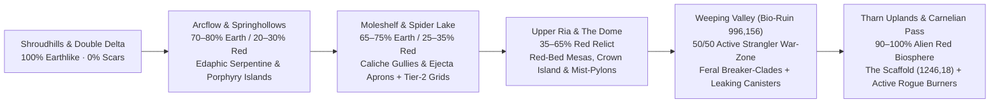

# The SW→NE Carnelian Ecological Frontier & Rogue Ecoforming Gradient (`docs/CARNELIAN-FRONTIER-PLAN.md`)

*Locked master specification (2026-11-24) governing the northern and northeastern ecological transition from `100%` Earthlike coastal forests (`Shroudhills`, `Double Delta`) across the crazy-quilt frontier (`Arcflow`, `Springhollows`, `Spider Lake`, `Moleshelf`, `Upper Ria`, `The Dome`) into the active biological war-zone of `Weeping Valley` (`996, 156`) and the `92–100%` pre-terraforming alien biosphere of `Tharn Uplands` & `Carnelian Pass` (`The Scaffold` `1246, 18`).*

---

## 1. Visual & Biochemical Design of the Pre-Terraforming "Carnelian Biosphere"

To make native Krator life **instantly, unmistakably non-Earthlike** at every camera distance (`1 m` macro to `14 km` `KFAR` vistas):

### 1.1 Pigment Physics (*Erythrophyll* — `605–710 nm` Red / Vermilion / Carnelian Reflectance)
- Evolved under Krator's thicker `1.2–1.6 atm` Rayleigh-scattering sky (rich in `440–565 nm` blue-green diffuse sky light), native photoautotrophs use **Fe/Cu-chelated *Erythrophyll* + phycobilin/astaxanthin pigments** that absorb blue-green photons and reflect **translucent carnelian-orange (`0xd94826`), arterial crimson (`0xa81822`), vermilion (`0xe0341e`), and deep venous plum (`0x5a1428`)**—**strictly zero `520–560 nm` chlorophyll green**!
- **Shader Contract (`KFRONTIER.erythrophyllHook` in [`core/frontier/52-core-frontier-draw.js`](../core/frontier/52-core-frontier-draw.js)):** Injects subsurface **carnelian back-translucency** (glowing like backlit cut carnelian agate at low sun angles and grazing view vectors, using a vertex-derived normal varying so both `MeshStandardMaterial` and `MeshLambertMaterial` compile cleanly in Three.js `r128`) rather than waxy Earth chlorophyll leaf sheen.

### 1.2 Non-Botanical Structural Geometry (*Chitin-Silica & Pneumatic `0.75 g` Architecture*)
Zero woody bark, zero pinnate/palmate Earth leaves, zero blossoms. Instead, Carnelian autotrophs construct **fenestrated biogenic silica-chitin endoskeletons** and **buoyant gas-filled bladders** under `g = 7.4 m/s²` (`0.75 g`):

| Clade Key (`KFRONTIER`) | Name & Scale | Structural & Ecological Role |
|---|---|---|
| **`carnelian-organpipe`** | **Sanguine Flute-Colony** (`3.0–11.0 m`) | Clustered vertical crimson-and-ivory fluted silica-chitin chimneys exhaling warm spore-plumes; replaces trees on ultramafic serpentinite (`Arcflow`), insoluble rhyolite/quartz-porphyry knobs (`Springhollows`, `The Dome`), and `Carnelian Pass` cliffs. |
| **`erythra-veil`** | **Pleated Lattice-Fan** (`1.5–4.5 m`) | Perforated sea-fan-like scarlet solar sails oriented perpendicular to prevailing sun-tracks (`Arcflow` cumulate ribs, `Spider Lake` `Hau-Gèl` ejecta gorge walls). |
| **`bladder-kelp-land`** | **Pneumatophore Tether-Vine** (`2.0–9.0 m`) | Buoyant translucent ruby `H2/CH4`-filled spheres (`0.75 g` + `1.33–1.58 atm` dense air) tethered on sinewy rust-black chitinous tendons, swaying slowly in `ATMOS` wind (`Arcflow` `seep`/`neva`, `Spider Lake` `haugel`). |
| **`agate-window`** | **Chalcedony Window-Dome** (`0.2–1.1 m`) | Hemispherical armour-plated crimson rosettes capped by clear biogenic chalcedony "skylight windows" over subterranean *Erythrophyll* tissue (`Arcflow` whalebacks, `Springhollows` porphyry balds, `Moleshelf` caliche, `The Dome` east flank). |
| **`blood-strangler`** | **Reactive Chitin-Web** (`0.5–6.0 m`) | Mycelial arterial-red cable-mats that calcify around invading Earth tree roots along active `Bleach-Scar` and `Kill-Line` margins (`Arcflow` `auger`, `Weeping Valley`, `The Dome` `eastflank`). |

### 1.3 Relict Native Fauna (`kits/fauna` `[G data]` Contract)
- **`silicagrazer` (*Crimson Silica-Grazer*):** Radial/hexamerous trilobite-like plated grazer (`0.45–0.85 m`) rasping silica-chitin fronds with magnetite radulae on serpentine and porphyry islands.
- **`belldrifter` (*Carnelian Bell-Drifter*):** Translucent ruby medusoid aerostat (`0.35–0.70 m`) buoyed by `1.33–1.58 atm` air and warm vent/seep updrafts.
- **`veinmounder` (*Carnelian Sinter-Mounder*):** Colonial hexapod cementing red carnelian-chalcedony sinter spires along high NE fractures.

---

## 2. Deterministic Crazy-Quilt Microclimate & Substrate Partition Law (`KFRONTIER.quiltAt`, `[G data]`)

Implemented as pure engine-neutral `[G data]` maths in [`core/frontier/18-core-frontier.js`](../core/frontier/18-core-frontier.js) (zero `THREE`, zero `DOM`, deterministic on `KRAND`, tested by [`core/frontier/test-frontier.js`](../core/frontier/test-frontier.js)). Across all transitional biomes (`20%–80%` mix), patch ownership is **never random noise**—it follows four readable environmental axes:

| Environmental Axis | **Earth Biosphere Wins (`Chlorophyll` Green)** | **Native Krator Biosphere Wins (`Erythrophyll` Carnelian-Red)** |
|---|---|---|
| **1. Bedrock & Soil Chemistry (`edaphicToxicity01`)** | Loess, alluvial silt, soluble carbonate dolomite hollows, humic peat (`Ca/Mg > 1`, `P`-rich, `pH 4.5–7.5`) | **Ultramafic serpentinite (`Ni > 2,200 ppm`, `Mg/Ca > 8`)**, **insoluble rhyolite/quartz-porphyry**, **ballistic `secondary-ejecta`**, **gypsum/caliche**, **`pH > 9.5` alkaline seeps** |
| **2. Moisture & Aspect (`xericExposure01`)** | Sheltered wet valley bottoms, spring-runs, cool-moist poleward slopes, irrigated river benches | Sun-baked rain-shadowed spurs, wind-stripped ridge crests, bare bornhardt rock tors, scalding silica sinter |
| **3. Elevation & Sky Scatter (`skyExposure01`)** | Low-to-mid sheltered basins where closed broadleaf canopy (`LAI > 3`) shades out low Carnelian crusts | High open crowns (`Springhollows` `+2,400–2,570 m` knobs, `The Dome` `+2,250–2,925 m` flanks, `Tharn Uplands`, `Carnelian Pass`) with intense blue-sky Rayleigh scatter |
| **4. Anthropogenic / Ecocide History** | Irrigated dynastic terraces, **`ecof_soil_auger` `45 m` lime/phosphate discs**, and post-defoliant valley bottoms below active `ecof_mist_pylon` needles | Unreached NE highlands, heavy-metal hardpans where Earth seeds fail, and **unbroken red sanctuaries upslope of stalled `Kill-Lines`** |

---

## 3. NE Escalation of Ecocide Scars & Autonomous Rogue Ecoforming Agents

### 3.1 The "Bleach-Scar" Tri-Band Signature (`KFRONTIER.bleachSwathAt`)
Ancient defoliant corridors were cut along **strict orbital survey azimuths** (`40–150 m` dead-straight geometric swaths or hexagonal dosing cells—instantly unnatural against organic terrain). Every swath exhibits a **three-band ecological cross-section**:
- **Band A (`carnelian` wall):** Intact crimson `carnelian-organpipe` and `agate-window` colonies outside the spray boundary, armoured at the seam by `blood-strangler` webs.
- **Band B (`bleach` core):** Bone-white mineralized silica-ash **Bleach-Hardpan** littered with **petrified white chitin-skeletons** of killed Carnelian organ-pipes (`KFRONTIER.buildSkeletonPipe`).
- **Band C (`vanguard` edge):** Invading pioneer Earth silver-birch, redcedar, fireweed, or feral strangler-amber colonizing neutralized soil where heavy-metal toxicity permits.

### 3.2 Feral "Breaker-Clade" Bio-Weapons (`Weeping Valley` Epicentre `996, 156`)
Before seeding oaks or crops, the Ancients deployed engineered **Breaker organisms**: psychoactive **Weeping-Amber Strangler Trees** (whose resinous root-acids dissolve native chitin-silica) and **Pale *Chitinovore* Ring-Molds**. Left unmanaged after the Cataclysm, they mutated into a **self-propagating biological war-front** choking both Carnelian pillars and Earth timber across `Weeping Valley`.

### 3.3 Four Autonomous Rogue Ecoforming Machines (`[G data]` Schedules + `KHAZ` + `[draw]` Builders)

| Machine Key | Title & Geometry | `[G data]` Schedule & Ecological Inversion | `KHAZ` Hazard Binding |
|---|---|---|---|
| **`ecof_mist_pylon`** | **18 m Atmospheric Defoliant / Mycelium Needle** (tri-fluted titanium-ceramic spire + pulsing ceramic vent-rings & solar fins) | Pulses heavier-than-air pale chartreuse-white defoliant mist at dawn (`05:00–09:00` `PULSE_MIST`, `09:00–18:00` `SOLAR_CHARGE`, `18:00–05:00` `STANDBY`); mist pools in topographic depressions (**bleaching/greening valley floors while leaving hilltops & high flanks crimson**—`Springhollows` inert pylon on `porphyryrelict`, `The Dome` active solar pylon on `eastflank`) | `toxic` / `corrode` (`r = 28 m` when `active: true`; `0` hazard when `state: 'inert'`) |
| **`ecof_soil_auger`** | **Lime-Phosphate Terra-Doser Rig** (stalled 3-legged gantry tripod + central helical drill-auger & radial lime-slurry booms) | Endlessly neutralizes (`CaCO3 + PO4`) and seeds a **`45 m`-radius circular oasis** (`00:00–24:00` `DOSE_ROTATE`), punching surreal **emerald-green Earth birch & clover circles** straight into crimson Carnelian serpentine/caliche barrens (`Arcflow` Station 5 `auger`, `Moleshelf`, `Carnelian Pass` `oasisdisc`) | `crush` (`r = 6 m` directly under rotating auger bit) |
| **`ecof_swath_burner`** | **Autonomous Perimeter Crawler** (weather-streaked 6-legged forestry chassis + optical `650 nm` turret & thermal/defoliant arc-lance) | Patrols fixed orbital survey loops (`06:00–20:00` `PATROL_SWATH`, `20:00–06:00` `DOCK_RECHARGE`); optical sensors fire at `605–710 nm` red reflectance (`Weeping Valley`, `Tharn Uplands`, `Carnelian Pass`) | `burn` + `corrode` (`r = 24 m` along active swath) |
| **`ecof_canister_train`** | **Ruptured Defoliant Pipeline / Cargo-Sled** (linked cylindrical ceramic pressure-tanks jackknifed across dry washes) | Continuously seeps amber-white chemical plumes down-wash (`00:00–24:00` `SEEP_PLUME`), crystallizing toxic white salt-blooms downstream (`Moleshelf` `The Skeleton` `1036, 106`, `Carnelian Pass` `The Scaffold` `1246, 18`) | `toxic` (`plume` corridor downstream) |

---

## 4. Complete Biome & Station Rollout Matrix Across the Northern / NE Gradient

| Biome (`Scale Model 5.1`) | Relict Red % & Ecocide Tier | Existing Built Stations | **New / Scoped Stations Implementing the Gradient** |
|---|---|---|---|
| **[`biomes/shroudhills`](../biomes/shroudhills/PLAN.md)** (`rmwetizlzivnz`) | **`0%` Red · Tier 0** *(100% Earthlike)* | `4` built (`canopy`, `cove`, `tors`, `antmounds`) | Complete as pure Earthlike WSW baseline |
| **[`biomes/doubledelta`](../biomes/doubledelta/PLAN.md)** (`rmvdoubledelta`) | **`0%` Red · Tier 0** *(100% Earthlike)* | `3` built (`bioherm`, `bitumen`, `throat`) | Complete as pure Earthlike coastal baseline |
| **[`biomes/arcflow`](../biomes/arcflow/PLAN.md)** (`rmwetn7jqgm9g`, *NEW*) | **`25%` Red · Tier 1** *(Serpentine Crazy-Quilt)* | — | **5 Built Stations:** `klint` (`638, 136`), `koski` (`556, 96`), `seep` (`518, 118`), `neva` (`648, 130`), `auger` (`885, 108` w/ Bleach-Swath & `ecof_soil_auger` `45 m` birch oasis) |
| **[`biomes/springhollows`](../biomes/springhollows/PLAN.md)** (`rmvyiyw8ucd1y`) | **`25%` Red · Tier 1** *(Porphyry Knobs vs. Dolomite Hollows)* | `4` built (`spring`, `shutin`, `fenestre`, `glade`) | **Station 5 `porphyryrelict` (`1268, 142`, `+2,570 m`, `1.16 atm`):** High purple-red rhyolite porphyry knob crowned in crimson `carnelian-organpipe` & `agate-window` colonies above green Earth `chinkapinoak` dolomite hollows + inert Ancient `ecof_mist_pylon` |
| **[`biomes/spiderlake`](../biomes/spiderlake/PLAN.md)** (`rmvyj4v2ozgb1`) | **`30%` Red · Tier 1–2** *(Ejecta & NE Gorge vs. Mulberry Bowl)* | `6` built (`spillway`, `narrows`, `pavilion`, `fen`, `dolomite`, `rampart`) | **Station 7 `haugel` (`1354, 238`, `+1,505 m`, `1.33 atm`):** NE `9106` `Hau-Gèl` (`Q = 585 m³/s`) inflow gorge & scalding sinter terrace where crimson `erythra-veil` fans & pneumatic ruby `bladder-kelp-land` hold dry `secondary-ejecta` walls above green `ambermulberry` river-benches |
| **`biomes/moleshelf`** (`rmwetvx15q1m4`, *Scoped*) | **`30%` Red · Tier 2** *(Caliche Badlands & `The Skeleton` `1036, 106`)* | — | `4` Scoped Stations: `dikengyuan`, `badlands`, `skeleton` (`1036, 106` w/ `ecof_canister_train` & checkerboard bleach-grid), `caravan` |
| **[`biomes/riavalley`](../biomes/riavalley/PLAN.md)** + **`weepingvalley`** (`rmwetzg8idewz`) | **`0%` West → `40%` Upper Ria → `50%` Weeping War-Zone (Tier 3)** | Planned (`sound`, `gates`, `upper`) | Scoped: `upper-frontier` (`1305, 100`) + `biomes/weepingvalley` (`strangler`, `bioruin` `996, 156`, `crawler`) |
| **[`biomes/thedome`](../biomes/thedome/PLAN.md)** (`rmweubdnyts8y`) | **`55%` Red · Tier 2** *(Sky-Island Crown Inversion)* | `4` built (`apron`, `moat`, `crown`, `cleft`) | **Station 5 `eastflank` (`1384, 142`, `+2,361 m`, `1.19 atm`):** Eastern quartz-porphyry flank facing `Tharn Hills`—crimson `carnelian-organpipe`, `agate-window` & `blood-strangler` sky-island upslope of a razor-sharp Ancient perimeter `Kill-Line` & solar `ecof_mist_pylon` |
| **`biomes/carnelian`** (`rmweu6x20bj70` & `rmweud6jurkfl`, *Scoped*) | **`92–100%` Red · Tier 3 Peak** *(Pure Alien + `The Scaffold` `1246, 18`)* | — | `4` Scoped Stations: `pass` (`1218, 34`), `scaffold` (`1246, 18` w/ active `ecof_swath_burner` crawlers), `tharn`, `oasisdisc` |
