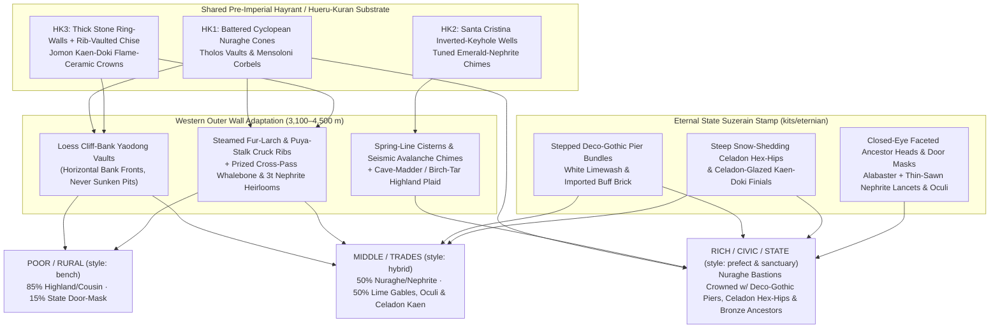

# `kits/hayrant` — Design Plan: The Hayrant Vassal Kit of the Western Outer Wall (`E6`)

*Status: Draft design plan (`2026-11-24`), incorporating settled owner architecture decisions before writing kit fragments.*

The **`Hayrant`** ("Highlanders", speaking the Ainu-shifted Outer Wall dialect of the Eternal State: [LORE.md](../../LORE.md) §6.19; `lore/tongues-of-krator.html` `#et-hl-h`) are the **Eternal State's highland vassal people** across **Circuit `E6` (`Hayrant Western Wall & Saltpeter Circuit`, *Xī-Bì*, `19,000` souls)** on the `3,100–5,500 m` loess-and-megabreccia benches of [biomes/wouterwall](../../biomes/wouterwall/PLAN.md) (`Mirabilis` at `350, 726`, `Sheritu` at `384, 666`, and `38` rural terrace/mining hamlets), and the **inland sister-branch of the unconquered maritime `Hueru-Kuran` ("Whale Clans")** of `Crookshore` ([kits/hueru-kuran](../hueru-kuran/PLAN.md), [CROOK-RIA-SCOPE.md](../../core/region/CROOK-RIA-SCOPE.md)).

> ***`Hom hay an, Setet par an.`*** — *"Home is high, the State is far."* (The Hayrant proverb, `lore/tongues-of-krator.html`)

---

## 0. What the Build Is & Settled Design Decisions (`2026-11-24`)

| Field | Specification |
|---|---|
| **Folder & Output** | `kits/hayrant/` (`src/`, `tests/`, `build.py`, `verify.py`, `kit_bundle.py`, `materials.json`, `mip-variance.json`, `tex/`, `API.md`, `PORT.md`, `INDEX.md`, `KNOWN_ISSUES.md`, `README.md`) -> `dist/hayrant.html` (+ sidecar `.tex.js`) |
| **Culture & Identifiers** | `KIT_ID = 'hayrant'`, `culture: 'hayrant'` (`faction: 'The Eternal State'`, `subfaction: 'Hayrant Clans'`), building key prefix **`hy_`**, fragment prefix **`// prefix: hy`**, sealed world bundle **`HYK`** (`kits/hayrant/kit_bundle.py`) |
| **Reserved Seed Block** | **`34001–34499`** (`34001–34099` dwellings, `34101–34199` State/civic/faith/legation, `34201–34299` defence, `34301–34399` works/trades/land, `34401–34499` mixed vassal streets & samples) — **zero collision** with `kits/eternian` (`7001–7999`), `kits/hueru-kuran` (`8101–8409`), `kits/resources` (`5800–6822`), `kits/ancients` (`10100–20870`), or `kits/qiblai` (`33000–33999`) |
| **Tier-Stratified Synthesis *(Owner Decision 1)*** | **Poor & Rural (`style: 'bench'`):** Hayrant loess-bank *yaodong* cliff-fronts & Hueru-Kuran *chise*/*nuraghe* roots (dry-laid `megabreccia`/basalt rings, steamed larch & century-`puya` cruck vaults, turf/bark domes, sooty *kaen-doki* smoke-pots, Hayrant plaid). **Middle & Trades (`style: 'hybrid'`):** Battered *nuraghe*/hexagonal stone bases & sawn greenstone/nephrite trapezoid lintels paired with Eternian white-lime stepped Deco gables, doorway oculi, closed-eye door masks, and celadon-glazed *kaen-doki* chimney crowns. **Rich, Civic & State (`style: 'prefect'` / `'sanctuary'`):** Battered *nuraghe* bastions (*mensoloni* corbels) crowned with Eternian stepped Deco-Gothic pier bundles, steep celadon hex-hip roofs, bronze tracery over alabaster & thin-sawn emerald-nephrite lancets/oculi, and closed-eye bronze/silver/gold ancestor statuary |
| **Highland Cousin Adaptation *(Owner Decision 2)*** | Coastal whale-rib vaults translate structurally into **steamed `fur-larch` & giant century-`puya` stalk cruck-ribs**; coastal *Santa Cristina* tsunami-drawdown step-wells become **loess-foot spring-line keyhole sanctuaries & seismic sturzstrom/avalanche chime-wells**; true **bleached Leviathan whalebone jaw-arches** & **3-ton sawn Crookshore emerald-nephrite lintels** appear exclusively as prized cross-pass clan/legation status pieces (`124, 710` `ukorTera` pass trade) |
| **Vassal Integration *(Owner Decision 3)*** | Standalone `kits/hayrant` on `core/engine` taking all 2026-11-11 `SURVEY` checks, `core/water`, and `ATMOS` katabatic wind; reads [kits/eternian/src/42-et-head.js](../eternian/src/42-et-head.js) (`[G data]`) in place for authentic closed-eye statuary, enforces the `VASSAL-KITS.md` §2 street/plinth/cornice contract (`≤ 0.5 m` eaves match), and verifies a **Mixed Vassal Street Row** placing `hy_*` buildings plot-to-plot beside lowland `et_*` peers |

---

## 1. Core Adoption (`README.md`, "Core modules are not optional")

Written before the first fragment (`tools/new_build/README.md`, items 22–31 of `tools/checks_optin.json`). Modelled directly on [kits/hueru-kuran/build.py](../hueru-kuran/build.py) and [kits/eternian/build.py](../eternian/build.py).

### 1.1 Modules Taken

| Module | Fragments / Path | How `kits/hayrant` Takes It |
|---|---|---|
| **`core/engine`** | `engine.py` (`10-core.js` ... `99-host-take.js`, `99-tail.html`), read in place | Merged material geometry buckets, `defBuilding`, `place`, openings (`36o-open.js`), stairs (`svStair`, `svStairCase`, `svWell`, `svStripWalk`), walk-box extraction (`37-wk-rec.js`), night window halos, animation, host hand-over |
| **`core/shader`** | `06-core-khook.js`, `06b-core-kcolor.js`, `07-core-kwarp.js` (`KHOOK`, `KCOLOR`) | Composes library PBR detail hooks, cut-away planes, `core/water` shaders, alabaster/nephrite emissive translucency, and the live `atmos-hy-wind` katabatic wind/chime vertex hook; audited via `KHOOK.checkPrograms` |
| **`core/rand`** | `08-core-rand.js` (`KRAND`) | Every `core/tags` uid, `MAT_ALT` take, `etHeadParams` face seed, masonry course jitter, and furniture/chime placement seeded from `KRAND` hashes of `(world, cell, index, salt)` — zero `Math.random` or `Math.sin` |
| **`core/drawn`** | `10-core-drawn.js` (`KDRAWN`) | Registers the kit sheet's drawn ground grid (`KDRAWN.add(KDRAWN.grid(...))`) alongside `groundM.name = 'ground'` so `harness.SURVEY` eye-clearance audits test actual drawn triangles (survey item 28) |
| **`core/materials`** (`record` + library) | `23-mat-record.js`, `24-tex-def.js`, `25-matlib-host.js` (`KMAT`) + `materials.json` -> `tex/` | Packed `512 px` library albedo, lossless normal, and roughness maps (with `mipVariance` & `pom` where appropriate) across every `megabreccia`, `basalt`, `loess`, `lime`, `brick`, `celadon`, `kaen`, `nephrite`, `alabaster`, `larch`, `turf`, `plaid`, `whalebone`, `bronze`, `gold`, and `f_*` furniture surface (`< 15` samplers per program, survey item 27) |
| **`core/tags`** | `50-core-tags.js`, `52-core-tags-vocab.js`, `53-core-tags-host.js` (`KTAGS`) | Pre-draw registration of every placed `hy_*` building, `et_*` mixed-street peer, `kits/resources` lode node, ancestor statue/head, and furniture item (see §8.2 for `52-core-tags-vocab.js` `'hayrant'` registration & `reach.py` rebuild hygiene) |
| **`core/furnish` + `core/catalog`** | `50/52/53-core-furnish*.js` (`KFURN`) + `kits/catalog/furniture_bundle.py` (`indexed: true`) | Bundles `eternian`, `generic`, `generic-goods`, `jobs`, `scrap`, and `arms` catalog sets alongside bespoke `hayrant_*` highland pieces (`39-hy-furn.js`: *irori* larch-hearth, nephrite seismic chime-rack, *inau* ancestor shelf, plaid loom, saltpeter leaching vat, *kaen* storage jar) |
| **`core/host`** | `khost.SHELL + kengine.HOST` | Orbit/WASD/walk camera, frame clock (`core/clock`), UI panel, hover inspector (`class`, `culture`, `types`, `wealth`, `style`), polygon coordinate tool, standard key map (`X` cut-away, `N` night, `E` door, `F` walk), and `window._api` probe |
| **`core/atmos` + `placeholder`** | `89-atmos-*.js` (`ATMOS`, `ATMOS.skylight`, `ATMOS.U`, `ATMOS.GLSL_WIND`) + `core/atmos/placeholder` (`KratorSky`) | Captures sky reflections onto PBR metals/glazes AND drives live katabatic wind sway and gust ripples across Hayrant plaid banners, `wallhemp` drying lines, hide wind-curtains, braided garlic/jujube strings, and rigid-pendulum nephrite/bronze chimes (`SV_CLOTH`) |
| **`core/door`** | `10-core-door.js`, `20-core-glass.js`, `90-core-door-host.js` (`KDOOR`, `KGLASS`, `KDOORHOST`) | Operable larch, iron-studded, and Eternian bronze doors (`svLeaf`) — zero dark voids — plus translucent thin-sawn emerald-nephrite, veined alabaster, and Deco steel-grid windowpanes (`svPane`) |
| **`core/walk` + `walk/box`** | `20-core-walk.js`, `24-core-walk-box.js` (`KWALK`, `KWALKBOX`) | Automatic floor/wall box registration, interior stairs, *nuraghe* spiral/stepped wall-walks, sunken keyhole step-well flights, escarpment cliff-hoist stairs, and flood-fill `reachAudit` from every front door |
| **`core/water`** | `20-core-water.js`, `22-core-water-flow.js`, `50-core-water-draw.js`, `51-core-water-kinds.js` (`WATER`) | Live `WATER.still` spring-line mirror pools inside `hy_spring_stepwell` and `hy_healer_bath`, plus live `WATER.flow` mountain millraces and timber-chute flumes in `hy_larch_flume_yard`, `hy_nephrite_lapidary`, and `hy_granary_nuraghe` |
| **`kits/resources`** | `42r-res-ore.js`, `44r-res-nodes.js`, read in place | Places world mineral nodes (`saltpeter`, `iron`, `tin`, `gold`, `silver`, `rare-earth`, `jade`, `stone`) on the sheet and binds `hy_saltpeter_works`, `hy_ore_adit`, and `hy_nephrite_lapidary` via `resSource` |
| **`kits/eternian` (Head Generator & Street Peers)** | `kits/eternian/src/42-et-head.js` (`[G data]`, read in place) + sealed `ET` peer subset for the Mixed Street row | Reuses the exact deterministic Eternian faceted head, figure (`stand`, `seat`, `lintel`, `folded`), mask, and cloth-veil geometry without copying a line of `42-et-head.js`; places `et_reed_house`, `et_canal_house`, `et_merchant_house`, and `et_registry` beside `hy_*` defs on the Mixed Vassal Street row |

### 1.2 Modules Deliberately Not Taken (With One-Line Reasons)

| Module | Why Not Taken |
|---|---|
| `core/world` | Standalone building-kit sheet on a controlled ground plane; `Mirabilis` (`350, 726`), `Sheritu` (`384, 666`), and `E6` open-world tiles read `core/world` when placing `HYK` |
| `core/terrain` | Kit sheet stands on flat `terrainH = 0` ground; loess-bank breasts, sunken keyhole step-wells, and escarpment hoist buttresses are self-contained architectural masonry so every piece drops cleanly onto sloped `wouterwall` benches |
| `core/space`, `core/mask` | Kit rows are laid out deterministically by `core/engine/90-scene.js` and explicit street offsets; `KSPACE`/`KMASK` run in `core/city` and `core/hamlet` when laying out `Mirabilis` and rural bench villages |
| `core/city`, `core/hamlet`, `core/camp` | Settlement-layout modules; `kits/hayrant` exposes `hyDims()`, `HY_TRADES`, and `HYK` (`kit_bundle.py`) ready for `core/city` (`Mirabilis`, `Sheritu`) and `core/hamlet` (`38` `E6` villages) |
| `core/simulation`, `core/sched` | Citizen schedules and `E6` saltpeter/timber/insulator stocks run in settlement pages; the kit sheet uses `core/clock` (via `core/host`) for the `Mirabilis` Observatory Clock parade and `ATMOS` wind/water |
| `core/biome` | Flora and fauna belong to [biomes/wouterwall](../../biomes/wouterwall/PLAN.md), [biomes/nwouterwall](../../biomes/nwouterwall/PLAN.md), and `kits/fauna` (`README.md`: never bake trees/shrubs into building defs) |
| `core/ruins` | All `hy_*` defs represent living, maintained `E6` highland clan and Eternal State architecture (`state: 'intact'`) |
| `core/coast` | `E6` sits `3,100–5,500 m` up the inland flank of the Western Outer Wall (`0 km` ocean coast; coastal Farside works live in `kits/eternian/src/69-et-coast.js` and coastal Crookshore in `kits/hueru-kuran`) |
| `core/lod`, `core/minimap`, `core/anomaly` | Regional/settlement streaming and Valley anomaly tools, not applicable to a building-kit sheet (`core/export` material/bucket hooks can ride along in `H6` if needed for Godot parity with `kits/eternian`) |

### 1.3 New-Build Survey Opt-In (`tools/checks_optin.json`, Items 22–31)

From its first code commit, `"kits/hayrant"` is added to `recorded`, `samplers`, `drawn-ground`, and `names` in `tools/checks_optin.json` (`minset` is for biome-core builds):
- `build.py` opens with `buildlib.through_tools_build(__file__)`, calls `BSRC.report()` before writing, uses `encoding='utf-8', newline='\n'`, and runs `tools/check_port.py`.
- `verify.py` calls `harness.verify_page(..., checks=harness.SURVEY)`.
- Preset view names contain **zero apostrophes (`'`) and zero colons (`:`)** (item 30).
- Pure-data Node unit tests (`tests/test-hayrant.js`) run on `tools/ktest.js` (`T.ok`, `T.neg`, `T.done()`, item 29).

---

## 2. Geography, Economy & Hayrant Linguistic Grounding

### 2.1 Physical & Economic Reality of Circuit `E6` ([PROPOSAL-ETERNIANS.md](../../core/simulation/PROPOSAL-ETERNIANS.md) & [biomes/wouterwall/PLAN.md](../../biomes/wouterwall/PLAN.md))

Every material and building type in `kits/hayrant` is dictated by the verified `Scale Model 5.1` rasters and `geology.json` audit of the Eternian half of the Western Outer Wall (`49,608–55,304 km²`):

1. **Landforms & Bedrock (`KSTRATA` `megabreccia` + `loess`):**
   - Lower bench (`3,000–4,200 m`, `1.08–0.96 atm`, `Dsb`/`Csa`, `518–627 mm/yr`, mean `+7..+12 °C`, winter `-4..-11 °C`): `100–200 m` of wind-blown golden-buff **loess** (`yuan` flat tables, `100–185 m` box-canyon gullies, contoured agricultural terraces, and a perennial **spring line** at the base of the loess).
   - Upper bench (`3,850–5,600 m`, `0.98–0.78 atm`, `Dfc`/`Dsc`/`ET`, winter `-14..-20 °C`): dark grey/polygonal impact **`megabreccia`** & basalt scarps, eight `52–92 km²` sag-pond **trench lakes**, five `36–42 km` **sturzstrom** rock-avalanche lobes, and fierce nightly **katabatic dust/frost winds** draining off the `8,647 m` airless crest.
2. **The Clay-Poor Bottleneck (`CONTINENTAL-SCOPE.md` §2.3):**
   - Unlike lowland `Lux` and `Fulcrum` (`clay = 255`), **`Sheritu` (`clay = 0`) and `Mirabilis` (`clay = 1`) have almost no local brick-clay!**
   - Consequently, ordinary Hayrant folk build in **dry-laid cyclopean `megabreccia`/basalt**, **cut or rammed golden-buff `loess`**, **`fur-larch` & `needle-cypress` timber**, **birch-tar**, and **alpine turf / century-`puya` spear thatch** — while **pale buff Eternian brick and celadon glazed roof tiles** (barged to Lake `lbl=102` and hauled up the escarpment, or fired in small high-value batches at `Mirabilis`) mark **wealth, guild status, and the Paper State's hand**.
3. **Key Seats & Specialties (`19,000` `1:1` Souls = `4,800` Urban + `14,200` across `38` `KHAMLET` Villages):**
   - **`Mirabilis` (*Mirapiris* / *Sutar-Kotan*, `px 350, 726`, `+3,125 m`, `1.08 atm`, `2,600` pop):** Circuit seat above `Yūt-Mā` (`r227`). Commands Eternia's richest **`saltpeter`** caves (`b = 200`, `GoodY 796`), **`iron`** (`GoodY 2,376`), **`tin`** (`230`), **`silver`** (`152`), **`gold`** (`144`), and **`rare-earth`** (`138`); fires refractory stoneware & **high-voltage porcelain electrical insulators**; and houses the Clock-Keepers' **Astronomical Observatory (`hy_clock_observatory`)**.
   - **`Sheritu` (*Seritu* / *Sip-Rarc-Kotan*, `px 384, 666`, `+3,598 m`, `1.02 atm`, `2,200` pop):** Alpine timber & mining town shooting `1,811 t/yr` of timber and `885 t/yr` of peeled **`ship-timber` larch/cypress logs** down water-lubricated escarpment flumes to `Fulcrum`, and guarding **Withdrawn True-Heir cliff sanctuaries (`hy_withdrawn_sanctuary`)**.
   - **The `Ukor-Tera` Cousin Pass (`124, 710` <-> Western Wall Divide):** High pack-trail connecting `E6` Hayrant clans with their unconquered **`Hueru-Kuran`** cousins (`Kuran-Tera`, `+690 m` flume headworks above `Crookshore`). Carries Eternian `iron`, `tin`, `tea`, and `saltpeter` west in exchange for **sawn `Crookshore` emerald-nephrite (`jade = 200`) lintels, tuned seismic chimes, and ceremonial Leviathan whale-jawbones** — watched closely by Censorate Wardens who fear pan-Hayrant autonomy.

### 2.2 Canonical Hayrant Phonology & Bilingual Naming (`lore/tongues-of-krator.html` `#et-hl-h`)

Unlike lowland Eternian (`Mã-wè`, worn to nasal monosyllables), **Hayrant** preserved polysyllabic English roots under an **Ainu-like phonological shift** (`LORE.md` §6.19, settled `2026-10-23`), sharing direct cognates with coastal **`Hueru-Kuran`**:

- **Voiced stops devoice (`b, d, g → p, t, k`) & labiodentals merge (`v, f → p`):** `gold → korut`, `five → paip`, `far → par`, `cave → kep`, `vault → porut`.
- **Liquids merge (`l → r`) & `wh → hu`:** `highland → hayrant`, `clan → kuran` (identical to `Hueru-Kuran`!), `whale → hueru`, `wall → waru`, `well → weru`, `hall → horu`.
- **Sibilants & affricates (`th → s/t`; `ch, j, sh → c, s`):** `ship → sip`, `jade → cet`, `chime → caym`, `shrine → surayn`, `watch → wac`.
- **Clusters broken by epenthetic `a / i / u / e`; codas restricted to `a i u e o` or `p t k m n r s w y`:** `State → setet`, `star → sutar`, `stone → suton`, `spring → supirin`, `clock → kurok`, `tower → tawar`, `paper → pepar`, `saltpeter → sarutupitar`.
- **Script on Signage:** Public buildings display **bilingual boards** — large gold-on-black Eternian logographic icons (`loop+paper`, `power+man`, `paper+home`, `seal+home`) paired below with smaller vertical columns of **Eternian sound-marks + small katakana-style coda marks** spelling out the Hayrant reading.

| Hayrant Term | English / Substrate Root | Meaning in `kits/hayrant` |
|---|---|---|
| **`Kuran`** | *clan* (`cl → kur`, cognate w/ `Hueru-Kuran`) | Extended highland blood-clan & mining/terrace cooperative |
| **`Cise`** (*Chise*) | Ainu-substrate *house* (shared w/ `hkChise`) | Steamed-larch & puya-cruck vaulted lodge over a battered stone ring |
| **`Suton-Tor`** | *stone-tower* (`nuraghe` cognate) | Battered dry-stone `megabreccia`/basalt truncated-cone keep or silo |
| **`Utari`** | Ainu-substrate *kin / elders* | Council of Hayrant clan headmen & matrons |
| **`Pepar-Hom`** | *paper-house* (Paper speech *peipa-houme*) | Prefectural Warden's Chancery & Assay Compound (`hy_prefect_seat`) |
| **`Sutar-Tawar`** | *star-tower* | `Mirabilis` High-Altitude Clock & Astronomical Observatory (`hy_clock_observatory`) |
| **`Supirin-Weru`** | *spring-well* | Loess-foot inverted-keyhole spring & seismic chime sanctuary (`hy_spring_stepwell`) |
| **`Siru-Hom`** | *seal-house* (Paper speech *sile-houme*) | Sealed cliff sanctuary of the Withdrawn True Heirs at `Sheritu` (`hy_withdrawn_sanctuary`) |
| **`Hueru-Kuran Hom`** | *Whale-Clan house* | Diplomatic & pass-trade legation of the `Hueru-Kuran` cousins (`hy_kuran_legation`) |

---

## 3. Three-Way Architectural Synthesis & Neighbor Separation

### 3.1 How Hueru-Kuran Cousin Forms & Eternian Suzerain Forms Fuse Across Tiers

1. **Tier 1 — Poor & Rural (`style: 'bench'`):**
   - **Loess-Bank *Yaodong* Fronts (`hy_loess_yaodong`, `hy_terrace_row_poor`):** Cut horizontally into a terraced loess bank (backed by a self-contained sloped loess/turf earth-mantle so the piece places cleanly on any lot), armoured across the lower breastwork with dry-laid dark `megabreccia`, a trapezoid `fur-larch` doorway under a triangular relieving slit, braided `bench-garlic` and `cave-date` strings under the eaves, and an unglazed cord-marked *kaen-doki* smoke-pot on the turf brow. Even here, the Eternal State's law reaches the lintel: every front door hangs a **painted ochre or fired-terracotta closed-eye ancestor mask** (`42-et-head.js`).
   - **Highland Larch-Rib *Chise* (`hy_larch_chise_poor`):** Direct highland cousin of `hkChise`: a `1.8–2.2 m` battered `megabreccia`/basalt ring-wall (`nuragheRadius` concave batter) supporting **arching steamed `fur-larch` and dried century-`puya` stalk cruck-ribs** (`hyCruckArc`), roofed in birch-tarred bark shingles and polygon turf, crowned at the smoke-ring by a sculptural Jōmon *kaen-doki* flame-rimmed terracotta pot, with a `cave-madder` red-and-black plaid wind-curtain (`SV_CLOTH`).
2. **Tier 2 — Middle & Artisan Trades (`style: 'hybrid'`):**
   - **Stone Below, Eternian Lime & Celadon *Kaen* Above (`hy_bench_house_mid`, `hy_corner_turret_mid`, trade shophouses):** A battered dark basalt/*nuraghe* ground storey with a **sawn greenstone/nephrite trapezoid lintel** carries an Eternian white-limewashed upper storey with **fluted Deco pilasters**, shuttered windows under stepped Deco heads, an **oculus ring-window** in the gable crown, a terracotta or lead closed-eye door mask with Ainu *moreu* spiral brow-bands, and **celadon-glazed *kaen-doki* flame-ceramic chimney crowns**!
   - **Compound *Nuraghe-Chise* (`hy_nuraghe_chise_mid`):** Pairs a two-storey battered hexagonal/conical *nuraghe* store-tower (with projecting Sardinian *mensoloni* stone corbel-brackets) beside a slate-and-bark larch-vaulted hall lit by **translucent thin-sawn emerald-nephrite windowpanes** (`svPane`).
3. **Tier 3 — Rich, Civic, Sacred & State (`style: 'prefect'` & `style: 'sanctuary'`):**
   - **The "Organ-Pipe *Nuraghe*" Massing:** Where lowland Eternia builds vertical pier bundles from ground level in buff brick, highland snow, katabatic gales, and rockfall tremors demand **battered dark cyclopean basalt/megabreccia *nuraghe* drums or hexagons (`1:6` concave batter + *mensoloni* corbelled parapets) as the lower bastion**, out of which rise **stepped pale-brick and limewashed Deco-Gothic pier bundles** (`etPierBundle`) capped by **steep `42°–48°` snow-shedding celadon-glazed hexagonal hip roofs (`etHexHip`)** with turned-up tips and gilt/celadon *kaen* finials!
   - **Dual Translucent Glazing (Alabaster + Nephrite):** Nobody can make Ancient blue glass (`kits/eternian/PLAN.md` §2). Lowland Eternia fills bronze tracery grids exclusively with imported `Jimjam` **alabaster**; in `E6`, bronze tracery alternates warm cream **alabaster** with glowing **thin-sawn emerald-nephrite jade** (`Crookshore` cousin trade), creating an unmistakable **gold-cream and emerald-green** night glow (`--night`) against black basalt and celadon tile!
   - **Closed-Eye Ancestor Statuary (`42-et-head.js`):** Pier-top niches, *Tomba dei Giganti* exedrae, and `etCivicDoor` portals carry faceted closed-eye heads and lintel-bearing ancestors in **carved dark basalt, polished emerald nephrite, provincial gunmetal, bronze, silver, and True-Heir gold** — strictly preserving Eternia's **`< 10%` open-eyed rule** and **4-pose non-striding rule** (`stand`, `seat`, `lintel`, `folded`).
   - **Prized Cross-Pass Cousin Heirlooms:** Only on `hy_kuran_legation`, `hy_clan_lord_compound`, and the outer *Utari* elders' hall of `hy_prefect_seat` do **bleached Leviathan whale-jawbone portal arches** and **full 3-ton sawn `Crookshore` emerald-nephrite lintel monoliths** appear — instantly marking a clan's living blood-tie over the `124, 710` pass to the free `Hueru-Kuran`!

### 3.2 Strict Silhouette Separation from Neighboring Kits

| Kit | Primary Massing | Wall & Roof Palette | Signature Opening / Crown |
|---|---|---|---|
| **`kits/hayrant` *(this kit)*** | Battered basalt/megabreccia *nuraghe* drums & horizontal loess-bank vaults crowned on mid/upper tiers by Eternian stepped Deco-Gothic piers & celadon hex-hips | Charcoal megabreccia/basalt + golden-buff loess + white limewash + celadon glaze + emerald nephrite + bronze | Trapezoid nephrite-lintel doors w/ closed-eye ancestor masks; alabaster + nephrite lancets/oculi; celadon *kaen-doki* flame chimney crowns |
| [`kits/eternian`](../eternian/README.md) *(lowland suzerain)* | Vertical pale-brick pier bundles from flat canal quays; courtyard villas; octagonal water pavilions | Pale buff brick, white stucco, cast geometric pattern block, celadon & gilt fish-scale | Bundled tall lancets & doorway oculi in alabaster/glass; bronze doors held by gilt ancestors |
| [`kits/hueru-kuran`](../hueru-kuran/README.md) *(coastal cousins)* | Pure Sardinian *Su Nuraxi* dry-stone basalt cones, intertidal knife-prowed *Prou-Torres*, pelagic whale-rib turf domes | Black columnar basalt, bleached whalebone, peat/turf, red-cypress bark, sooty ochre *kaen-doki* | Unpainted 3-ton nephrite lintels; Leviathan jawbone wave-splitter arches; gutskin sails |
| [`kits/molu-che`](../molu-che/README.md) *(Moleshelf)* | **Open-sky square sunken pits (`dikengyuan`)** excavated below flat steppe grade w/ *Talpathere* ramps *(NEVER used in Hayrant!)* | Golden-ochre rammed loess, chalk limewash, dolomite, Mapuche-Cucuteni ochre/indigo diamond friezes | Recessed round barrel-vault arches w/ radial dark-cedar lunettes; earthen vent-hoods |
| [`kits/dzagh-vardzi`](../dzagh-vardzi/README.md) *(Crookwash)* | Stacked flat-roofed Dagestani cliff-*auls* + razor-slender `5:1` needle-towers | Warm **apricot-rose volcanic tuff & black basalt *ablaq* stripes** | Snow-white stepped quartz pyramid roofs & 12-pleat fluted Armenian *gumbat* cones |
| [`kits/yeti`](../yeti/PLAN.md) *(`khaayken`)* | Half-sunk catenary igloo domes linked by half-buried snow tunnels | White pycrete & dry grey slab stone, austere/unornamented exterior | Cold-trap tunnel mouths; zero exterior statuary or glazed tile |

---

## 4. The Eternian Vassal Contract (`VASSAL-KITS.md` Applied to `kits/eternian`)

So that `Mirabilis` (`350, 726`), `Sheritu` (`384, 666`), and `E6` road stations can mix `hy_*` Hayrant vernacular/hybrid buildings seamlessly with lowland `et_*` State/merchant transplants on `core/city` streets, `kits/hayrant` obeys the following geometric and palette contract:

| Rule | `kits/eternian` Today | `kits/hayrant` Vassal Contract |
|---|---|---|
| **Local Frame & Bounds** | Origin `(0, 0, 0)` at plot centre on ground, `+z` front; everything within `w × d × h` (`1.6 m` eaves tolerance) | Identical: stairs, *mensoloni* corbels, loess slope-skirts, and whalebone/nephrite portals stay strictly inside declared `w × d × h` |
| **Plinth Heights (`Y0`)** | Poor `0.20 m`, Middle `0.40 m`, Rich `0.50–0.60 m`, Civic `0.60–1.20 m` | Poor `0.24–0.36 m`, Middle `0.40–0.52 m`, Rich `0.52–0.64 m`, Civic `0.60–1.40 m` (with walkable entrance steps inside `+z` plot margin) |
| **Storey & Cornice Alignment** | Ground `G1 = 3.2–3.9 m`, Upper `U1 = 6.8–7.2 m` (`et_canal_house`), Rich `E = 11.9 m` (`et_merchant_house`) | Street-fronting `hy_*` dwellings hold eaves/parapet lines within **`±0.45 m`** of their `et_*` tier peer (`≤ 0.50 m` `VASSAL-KITS.md` §2 rule, asserted in `verify.py`) |
| **Lot Footprint Classes** | Poor `7–13 m`, Middle `10–14 m`, Rich `12–25 m`, Civic `14–48 m` | Identical lot-width/depth classes in `hyDims()`, allowing `core/city` zone culture-mix tables (`e.g. 75% hayrant / 25% eternian` in `Mirabilis`) to swap lots cleanly |
| **Detached & Row Faces** | Finished on all 4 faces (even canal/row types) | Every `hy_*` building — including loess-bank *yaodongs* (which dress their side/rear retaining batters in `loess` + `megabreccia` + `turf`) — is finished and watertight on all 4 faces |
| **Lighting & Electrification** | Electric warm/cyan light on rich, civic & machine layer; oil/hearth on poor & common | Identical: `Mirabilis` observatory, registry, tube-relay, kiln, and rich houses carry electric porcelain-insulator lamps; bench *chise* and *yaodongs* glow with larch-hearths and stone lamps |
| **Palette Bridge** | Black `#141416`, Gold `#D8B24A`, Celadon `#8FB8A0` / Green `#3F8A5A`, White Lime `#E8E0CC`, Dark Stone `#4A4A50` | Shares Dark Basalt/Stone `#3A3D42`, Off-White Lime `#EAE2D0` (1 step warmer against buff loess `#C9B186`), Celadon `#8FB8A0`, Bronze `#9C7A3C` / Gold `#D8B24A` finials, bridging into Crookshore Emerald Nephrite `#2E7D5B` and Hayrant Cave-Madder Plaid `#8E2F28` |
| **Mixed-Street Proof** | `et_canal_street` (`70-et-canal.js`) | **`hy_mixed_street` row on `dist/hayrant.html`:** alternates `hy_loess_yaodong` / `hy_bench_house_mid` / `hy_clan_lord_compound` / `hy_assay_registry` plot-to-plot with `et_reed_house` / `et_canal_house` / `et_merchant_house` / `et_shrine_niche`; `verify.py --assert` checks `0` footprint overlap and `≤ 0.50 m` cornice delta |

---

## 5. Complete Building Roster (`43` `hy_*` Defs & `44`-Row `HY_TRADES` Census)

### 5.1 Residential Matrix (`6 / 6` Mandatory `(poor | middle | rich) × (single | multi)` Cells + Variants = `10` Defs)

| Key | Seed | Wealth & Type | Style | Approx `w × d × h` | Architectural Description |
|---|---:|---|---|---|---|
| `hy_loess_yaodong` | `34001` | `poor` · `dwelling-single` | `bench` | `8.8 × 8.4 × 5.4 m` | Terraced loess-bank barrel vault fronted by battered `megabreccia` breastwork, trapezoid larch door w/ painted/terracotta closed-eye mask, braided `bench-garlic` & `cave-date` strings, turf brow & sooty *kaen-doki* smoke-pot |
| `hy_larch_chise_poor` | `34002` | `poor` · `dwelling-single` | `bench` | `8.6 × 8.6 × 5.6 m` | `1.9 m` battered basalt ring-wall under steamed `fur-larch` & century-`puya` cruck-rib turf/bark dome, *kaen* flame-collar, birch-tar skirt & Hayrant plaid wind-flap |
| `hy_scarp_cellar_poor` | `34003` | `poor` · `dwelling-single` | `bench` | `7.8 × 7.4 × 5.0 m` | Half-dug boulder-and-turf upper-bench herder's house (`wouterwall/PLAN.md` §5 `refs/07`), dry-stone gable, puya-spear thatch & lead ancestor mask |
| `hy_terrace_row_poor` | `34004` | `poor` · `dwelling-multi` | `bench` | `13.4 × 9.2 × 7.8 m` | Two-level stepped loess-and-megabreccia three-household row, shared stone outside stair & larch gallery, *mensoloni* drip-ledge, terracotta/lead door masks |
| `hy_bench_house_mid` | `34005` | `middle` · `dwelling-single` | `hybrid` | `10.4 × 11.6 × 9.8 m` | Battered basalt lower storey w/ sawn nephrite trapezoid lintel + white-lime upper storey w/ Deco fluted bay, doorway oculus, closed-eye mask & celadon-glazed *kaen* chimney crown |
| `hy_nuraghe_chise_mid` | `34006` | `middle` · `dwelling-single` | `hybrid` | `12.6 × 11.2 × 9.6 m` | Paired 2-storey battered *nuraghe* store-tower (*mensoloni* parapet) + slate/bark larch-vaulted *chise* hall w/ thin-sawn emerald-nephrite panes & household head-niche |
| `hy_courtyard_loess_mid` | `34007` | `middle` · `dwelling-single` | `hybrid` | `13.6 × 13.2 × 8.6 m` | Walled wind-trap forecourt (`katabatic` shelter) in pierced loess-block & basalt in front of a twin-vault limewashed gable house w/ household ancestor shrine |
| `hy_corner_turret_mid` | `34008` | `middle` · `dwelling-multi` | `hybrid` | `12.8 × 12.4 × 10.6 m` | Ground shop + two upper flats anchored by a battered corner *nuraghe* turret under a verdigris hexagonal cap & hanging nephrite lantern (`et_corner_turret` peer) |
| `hy_clan_lord_compound` | `34009` | `rich` · `dwelling-single` | `prefect` | `23.6 × 19.8 × 12.2 m` | Walled `Utari` clan-chief & mine-master manor (`household service`): **3-ton Crookshore nephrite gate lintel** under bronze ancestor head, stepped-pier main hall w/ celadon hex-hip, heirloom whalebone/larch porch, servants' loess wing & chime gallery |
| `hy_merchant_tower_rich` | `34010` | `rich` · `dwelling-multi` | `prefect` | `12.8 × 11.8 × 17.8 m` | Three-storey `Mirabilis` bullion/saltpeter factor's townhouse (`et_merchant_house` cornice peer): battered `megabreccia` base -> pale-brick stepped piers, alabaster + nephrite lancets, bronze door w/ gilt face & steep celadon hip |

### 5.2 Prefectural Governance, State, Machine, Faith & Cousin Diplomacy (`8` Defs)

| Key | Seed | Tags (`types`, `wealth`, `style`) | Census Trades Carried | Architectural Description |
|---|---:|---|---|---|
| **`hy_prefect_seat`** | `34101` | `['civic']`, `rich`, `prefect` | `palace and canton staffs` | **Circuit `E6` Prefectural Seat (*Pepar-Hom*, `52 × 42 × 21 m`, §6 Blueprint):** Trilobate *nuraghe* gatehouse, outer-threshold *Utari* elders' *chise* council, Saltpeter/Bullion Assay Chancery, and central hexagonal stepped-pier Hall & Bronze Prefect's residence under celadon/bronze scale roofs |
| **`hy_clock_observatory`** | `34102` | `['civic', 'infrastructure']`, `rich`, `prefect` | `teachers and scholars`, `palace and canton staffs` | **`Mirabilis` *Sutar-Tawar* Observatory & Ancestor Clock (`18 × 18 × 24 m`):** Battered hexagonal *nuraghe* drum + stepped Deco piers supporting a bronze transit/armillary dome and a live **6-Ancestor Parade Clock** (`core/clock`) |
| **`hy_assay_registry`** | `34103` | `['civic']`, `rich`, `prefect` | `guild officers and clerks`, `customs officers and clerks` | Highland docket, census & mineral-tithe hall: bundled nephrite/alabaster lancets over a cyclopean bullion vault, bilingual Eternian sign + Hayrant sound-mark stele |
| **`hy_examination_school`** | `34104` | `['civic']`, `middle`, `hybrid` | `teachers and scholars` | Hexagonal basalt-and-limewash examination cells & sound-mark school around a sheltered stove-heated court |
| **`hy_tube_relay`** | `34105` | `['infrastructure', 'civic']`, `middle`, `prefect` | `power-house stokers and engineers` | Escarpment pneumatic-capsule & high-voltage **porcelain-insulator** telegraph/power relay tower (`et_tube_pipe` brackets + bronze switch-gear) |
| **`hy_talking_head`** | `34106` | `['civic', 'religious']`, `middle`, `prefect` | `shrine keepers` | Battered basalt & nephrite stele framing a cyan-lit Ancient terminal face (`etFaceScreen`, `voice` tag), stone petition desk & Ainu-style shaved-willow *inau* |
| **`hy_kuran_legation`** | `34107` | `['civic']`, `rich`, `hybrid` | `envoys and embassy staff` | **`Hueru-Kuran` Sister-Clan Legation (*Hueru-Kuran Hom*, `20 × 16 × 11 m`):** Twin of `hk_embassy_hayrant`! **Bleached Leviathan whale-jawbone portal arch**, *nuraghe* treaty-keep w/ 3-ton nephrite lintel, feast *chise*, and tuned jade chimes |
| **`hy_spring_stepwell`** | `34108` | `['religious', 'infrastructure']`, `rich`, `sanctuary` | `temple priests and servants`, `shrine keepers` | **Loess-Foot *Santa Cristina* Keyhole Spring & Seismic Chime Sanctuary (`18 × 22 × 9 m`):** Sunken basalt/ashlar inverted-keyhole stair to a live `WATER.still` spring pool hung w/ **seismic rockfall/sturzstrom nephrite & bronze chimes** below a closed-eye stone ancestor brow |

### 5.3 Seclusion, Funerary & Yeti/Avalanche Frontier Defence (`6` Defs)

| Key | Seed | Tags (`types`, `wealth`, `style`) | Census Trades Carried | Architectural Description |
|---|---:|---|---|---|
| **`hy_withdrawn_sanctuary`** | `34109` | `['religious']`, `rich`, `sanctuary` | `monks and lay brothers` | **`Sheritu` *Siru-Hom* Withdrawn True-Heir Cliff Sanctuary (`22 × 18 × 19 m`):** Blind battered `megabreccia` & pale-brick piers, glowing alabaster/nephrite oculus & lancets, veiled silver/gunmetal ancestor gallery & sealed gate |
| **`hy_ancestor_barrow`** | `34110` | `['funerary', 'religious']`, `middle`, `sanctuary` | `priests and undertakers` | Sardinian *Tomba dei Giganti* crescentic basalt exedra fused w/ an Eternian mask-maker's vault & ranked stone/terracotta closed-eye ancestor niches |
| **`hy_nuraghe_fort`** | `34201` | `['military', 'civic']`, `rich`, `prefect` | `soldiers` | Quadrilobate *Nuraghe Complesso* (`Su Nuraxi` bastion) + Eternian celadon-capped hexagonal watch-turrets, gold/bronze outward faces & heated garrison barracks |
| **`hy_pass_gate`** | `34202` | `['military', 'infrastructure']`, `middle`, `prefect` | `town guard`, `customs officers and clerks` | Battered basalt pass gatehouse w/ upslope **avalanche-splitting stone wedge**, *mensoloni* parapet & two lintel-bearing stone/bronze ancestors (`etCivicDoor`) |
| **`hy_wall_segment`** | `34203` | `['military', 'infrastructure']`, `middle`, `bench` | `soldiers` | Concave-battered `megabreccia` curtain wall segment w/ walkable *mensoloni* stone-corbel parapet & drainage scuppers |
| **`hy_beacon_nuraghe`** | `34204` | `['military', 'infrastructure']`, `middle`, `prefect` | `lighthouse keepers` | Tall blind-base *nuraghe* pass-beacon & katabatic gale-bell watchtower (`Mirabilis`/`Leng` rim warning chain: brazier + electric arc-lantern under celadon hood) |

### 5.4 Highland Works, Timber Flumes, Saltpeter Caves & Voth Census Trades (`19` Defs)

| Key | Seed | Tags (`types`, `wealth`, `style`) | Census Trades Carried (`HY_TRADES`) | Signature Highland Engineering |
|---|---:|---|---|---|
| **`hy_saltpeter_works`** | `34301` | `['industry']`, `middle`, `hybrid` | `industrial workers`, `miners` | **`Mirabilis` Saltpeter Works (`b = 200`):** Cave-nitre leaching vats, wood-ash boiling cauldrons, celadon-vented steam hood & crystal drying racks (`resSource: 'saltpeter'`) |
| **`hy_ore_adit`** | `34302` | `['industry']`, `poor`, `bench` | `miners` | Heavy `fur-larch` & cyclopean basalt mine portal, capstan ore-winch, sorting cobble-floor & assay lockbox (`role: 'mine'`, `resSource`: `iron`/`tin`/`gold`/`silver`/`rare-earth`) |
| **`hy_stoneware_kiln`** | `34303` | `['industry']`, `middle`, `hybrid` | `industrial workers`, `smiths and craftsmen` | Stepped chambered slope-kiln firing **celadon-glazed *kaen-doki* chimney crowns** and **high-voltage porcelain/stoneware electrical insulators** |
| **`hy_nephrite_lapidary`** | `34304` | `['industry', 'shop']`, `middle`, `hybrid` | `quarrymen and masons`, `smiths and craftsmen` | Live `WATER.flow` overshot wheel driving a **pendulum quartz-sand nephrite wire-saw** (shared `Hueru-Kuran` cousin tech!) & megabreccia ashlar yard |
| **`hy_larch_flume_yard`** | `34305` | `['industry', 'infrastructure']`, `middle`, `bench` | `shipwrights and boatbuilders`, `river bargemen and quay hands`, `orchardmen` | **`Sheritu` Ship-Timber Log-Flume Headworks:** Live `WATER.flow` stone-and-larch chute launching peeled `24 m` larch/cypress logs toward `Fulcrum`, w/ sawpit & birch-tar cauldron |
| **`hy_iron_smithy`** | `34306` | `['industry', 'shop']`, `middle`, `hybrid` | `smiths and craftsmen` | Battered basalt forge w/ twin bellows, iron-bar & canal-lock hardware racks, crampons & *kaen*-topped flue |
| **`hy_plaid_weaver`** | `34307` | `['shop', 'industry']`, `middle`, `hybrid` | `weavers and dyers` | `cave-madder` (red), larch-bark & birch-tar dye vats + loom hall + `ATMOS` wind-billowing **Hayrant plaid** & `wallhemp` drying racks |
| **`hy_millet_bakehouse`** | `34308` | `['shop']`, `poor`, `bench` | `bakers` | Loess-and-basalt beehive oven house baking `dustmillet` & `redstem buckwheat` loaves and `cave-date` flatbreads |
| **`hy_smokehouse_butcher`** | `34309` | `['shop']`, `poor`, `bench` | `butchers` | Larch-smoke curing tower & butcher's block hung w/ alpine mutton/yak cuts and braided `bench-garlic` |
| **`hy_buckwheat_brewery`** | `34310` | `['industry', 'tavern']`, `middle`, `hybrid` | `brewers` | Geothermal-warmed loess cellar brewing `dustmillet` mash & spiced highland tea/ivan-chai |
| **`hy_pelt_tannery`** | `34311` | `['industry']`, `poor`, `bench` | `tanners` | Birch-tar & larch-bark hide currier yard w/ `ATMOS` wind-stretched mountain pelts |
| **`hy_granary_nuraghe`** | `34312` | `['infrastructure', 'farm']`, `middle`, `hybrid` | `granary keepers and millers` | Frost-proof corbelled *tholos* basalt *nuraghe* silo + live `WATER.flow` overshot gristmill under an Eternian celadon cap |
| **`hy_warehouse_vault`** | `34313` | `['infrastructure']`, `middle`, `hybrid` | `porters and warehousemen` | Bonded pack-train strong-vault in battered basalt w/ nephrite lintel & State lead-seal tally porch |
| **`hy_escarpment_hoist`** | `34314` | `['infrastructure']`, `rich`, `prefect` | `dockers and stevedores`, `ferrymen` | **Water-Counterweight Escarpment Cliff-Hoist & *Via Ferrata* Stair** (inland Outer Wall cousin of `hk_cliff_hoist`, hauling lowland porcelain/brick crates up the bench!) |
| **`hy_caravanserai_inn`** | `34315` | `['inn', 'tavern']`, `middle`, `hybrid` | `innkeepers and grooms` | Walled pack-mule & yak caravanserai court w/ *nuraghe* corner watch, heated *chise* bunk-hall & fodder loft |
| **`hy_hearth_tavern`** | `34316` | `['tavern']`, `middle`, `hybrid` | `innkeepers and servers` | Sunken-*irori* larch-rib tavern w/ celadon *kaen* smoke-crown, carved Ainu-style lintel & tea/beer counter |
| **`hy_market_hall`** | `34317` | `['market', 'shop']`, `middle`, `hybrid` | `market traders`, `shopkeepers and assistants` | Hexagonal battered-pier covered market protecting traders from summer loess dust and winter snow, hung w/ plaid awnings |
| **`hy_healer_bath`** | `34318` | `['civic']`, `middle`, `hybrid` | `healers and nurses` | Spring-fed hot-stone soaking bathhouse (`WATER.still` steaming basin) & `goldroot`/`bench-garlic` apothecary |
| **`hy_terrace_farmstead`** | `34319` | `['farm']`, `poor`, `bench` | `farmhands and ploughmen`, `chinampa growers`, `orchardmen` | Contoured loess terrace croft (`dustmillet`, `buckwheat`, `lentil`, irrigated spring-line beds & walled frost-trap `cave-date` jujube wall) |
| **`hy_fell_fold`** | `34320` | `['farm']`, `poor`, `bench` | `dairymen`, `swineherds and duck keepers` | Dry-stone `megabreccia` yak/goat/sheep winter byre, turf-roofed cheese cellar & wind-sheltered paddock |
| **`hy_mushroom_drift`** | `34321` | `['farm', 'industry']`, `poor`, `bench` | `mushroom growers` | Dark-sealed moist loess tunnel cultivating `pale-fungi` & `moon-cap` (`kits/crops` dark-grown works) |
| **`hy_trench_fishery`** | `34322` | `['farm', 'infrastructure']`, `poor`, `bench` | `fishers`, `ferrymen` | Sag-pond **trench-lake** (`52–92 km²` `wouterwall` lakes) basalt jetty, larch boat-slip, fish-smoking rack & net-drying frame |

*(Total: `10` residential + `8` State/faith/legation + `6` seclusion/defence + `19` works/trades/land = **`43` `hy_*` `defBuilding`s**, plus `hy_mixed_street` / statuary sample rows in `34401+`.)*

### 5.5 Voth Census Coverage (`HY_TRADES` — `41 / 44` Carried, `0` Gaps, `3` Explicit `na`)

Checked by `tools/check_trades.py` and `verify.py --assert` (`voth-trades`):
- **Carried (`41 / 44`):** Every single trade carried by `ET_TRADES` — **plus** `envoys and embassy staff` (`hy_kuran_legation`, which `ET_TRADES` had tabled!), while `coast guard` is `na` here and `envoys` is active, keeping **`41 / 44` active (`0` `gap` rows)**:
- **Explicit `na` (`3 / 44`):**
  1. `coast guard`: `na: "inland 3,100-5,500 m Western Outer Wall bench (Circuit E6); ocean coast-watch sits down on Farside (Farport) and Crookshore"`
  2. `beetle herders`: `na: "no giant beetles in the cold north-western Outer Wall; Hayrant clans herd yaks, goats and sheep in hy_fell_fold"`
  3. `elephant bug handlers and station hands`: `na: "no elephant bugs in the north-west; yak/mule pack-trains, larch log-flumes and water-ballast escarpment hoists carry E6 freight"`

---

## 6. Vassal Seat Blueprint: `hy_prefect_seat` (*Pepar-Hom*, `52 × 42 m`)

Adapting the four-domain vassal governance logic of [settlements/iziz/VASSAL-KITS.md](../../settlements/iziz/VASSAL-KITS.md) §3.2 (`Ceremony`, `Government/Assay`, `The Local Elders' Door`, `Residence`) out of Iziz's tropical bamboo dome and into **Eternian-Hayrant architecture** (`Mirabilis` Circuit `E6` Prefecture):

1. **Raised Basalt-and-Ashlar Podium (`52 × 42 m`, `y = 0..1.35 m`, Hollow Undercroft):**
   - Battered `megabreccia` and dressed basalt terrace holding the **Saltpeter & Silver/Gold Assay Strong-Vault**, famine `dustmillet` stores, guard armoury (`arms` catalog), and a sealed postern stair toward the gully spring.
2. **Threshold 1 — Trilobate *Nuraghe* Gatehouse (`+z` Front):**
   - Twin battered *nuraghe* flank bastions (*mensoloni* stone corbels) framing an Eternian **`etCivicDoor`** where two bronze closed-eye ancestors hold up a **sawn emerald-nephrite & bronze lintel** under the gold-on-black `paper+home` sign.
3. **Threshold 2 (Left) — The *Utari* Clan-Elders' *Chise* Council Pavilion (`13 m` span, `decor: 3`):**
   - Entered directly from the forecourt so Hayrant clan headmen and `Hueru-Kuran` pass-envoys are received with honour **without crossing into the Prefect's inner bureaucracy**: a battered basalt drum roofed by steamed `fur-larch` + **two ceremonial cross-pass whalebone cruck-arches**, lit through thin-sawn nephrite panes and crowned with a celadon *kaen-doki* lantern.
4. **Threshold 2 (Right) — Saltpeter, Mineral & Docket Chancery (`14 × 10 m`, `decor: 2`):**
   - Hexagonal/stepped-pier wing housing examination-ranked clerks, mineral assay scales (`eternian_common_weighing_scale`), pneumatic dispatch tube head (`etTubeHead`), and bilingual land/corvée registers, with its own exterior clerk stair.
5. **Threshold 3 & 4 (Rear Axis) — Central Hexagonal Stepped-Pier Audience Hall & Bronze Prefect's Suite (`decor: 4`):**
   - Rises out of a battered hexagonal stone base into **stepped pale-brick Deco-Gothic piers** crowned by a two-tier **celadon-glazed hexagonal hip & bronze fish-scale ogee lantern** (`h = 21.0 m`), housing the Audience Dais beneath a closed-eye gold/bronze True-Heir colossus-bust, the Prefect's small working cabinet (`6 × 5 m`) behind the dais, private upper quarters, and the rooftop **porcelain-insulator telegraph & heliograph signal room** sighting down to `Fulcrum`.

---

## 7. Library Materials, Bespoke Furniture & Live `ATMOS` / `WATER` Physics

### 7.1 Verified `core/materials` Library Mapping (`0` Texture Gaps!)

Every surface in `kits/hayrant/materials.json` maps to an existing, battle-tested library set already present in `core/materials` (cross-checked against `biomes/wouterwall/materials.json`, `kits/hueru-kuran/materials.json`, and `kits/eternian/materials.json`):

| Kit `MAT` Key | Library Set (`core/materials`) | Role in `kits/hayrant` |
|---|---|---|
| `megabreccia` | `rock.megabreccia` | Crater-wall patchwork bedrock on `bench` ring-walls, pass bastions & *nuraghe* courses |
| `basalt`, `columnar`, `corbel` | `rock.basalt.polygonal`, `rock.columnar`, `stone.corbel.slab` | Battered *nuraghe* drums, hexagonal plinths, corner piers & Sardinian *mensoloni* brackets |
| `loess`, `silt` | `rock.loess`, `earth.adobe.pale` | Cut loess *yaodong* cliff-banks, rammed loess court walls & warm plaster |
| `lime`, `brick`, `block` | `plaster.white_stucco_02`, `brick.buff`, `concrete.block.relief` | Eternian whitewash gables, `prefect` stepped Deco-Gothic piers & pierced wind-screens |
| `celadon`, `tile`, `gilt` | `roof.tile.celadon`, `roof.tile`, `roof.scale.gilt` | Steep snow-shedding `prefect` hex-hips, glazed *kaen-doki* crowns, common slate-grey roofs & Prefect's finial |
| `kaen` | `ceramic.terracotta.sooty` | Cord-marked Jōmon *kaen-doki* flame-rimmed chimney pots & fired ancestor door masks |
| `nephrite`, `jade`, `alabaster` | `rock.schist.emerald`, `stone.amazonite`, `stone.alabaster` | 3-ton sawn Crookshore lintels, seismic wind-chimes & glowing dual-tint lancet/oculus panes |
| `larch`, `bark`, `tarwood`, `turf` | `wood.timber`, `bark.cedar.red`, `wood.tarred`, `roof.turf` | Steamed `fur-larch` cruck-ribs, red-cypress/larch bark shingles, birch-tar eaves & alpine turf domes |
| `whalebone` | `organic.bone` | Prized cross-pass Leviathan jawbone arch (`hy_kuran_legation`) & clan-lord heirloom ribs |
| `bronze`, `verdigris`, `iron`, `gold` | `metal.bronze.cast`, `metal.bronze.verdigris`, `metal.iron`, `metal.gold` | Closed-eye ancestor statuary by rank, `etCivicDoor` leaves, turret caps, tubes & forge ironwork |
| `plaid`, `hemp`, `hide`, `rope` | `patterns/khaayken/applique-hanging` *(madder/tar tinted)*, `cloth.canvas.sail`, `cloth.hide.canopy`, `fibre.rope.twist` | `CROPS.canPlaid('wouterwall')` red/black/ochre banners, awnings, pelt racks & hoist cables (`SV_CLOTH`) |
| `screen`, `maze`, `frieze`, `sign` | `patterns/eternian/*` | Pierced bronze screens, circuit-maze bands, face friezes & State bilingual signboards |

### 7.2 Bespoke `hayrant_*` Furniture (`src/39-hy-furn.js`) + `eternian` Catalog Chain

Registered on `KratorFurniture.def` under `culture: 'hayrant'` (`setting: 'indoor' | 'outdoor' | 'both'`), placed alongside `eternian_*`, `generic_*`, and `job_*` pieces via indexed `KFURN` batches (`≥ 4` pieces per `cut: true` building):
1. `hayrant_irori_hearth` — sunken basalt-curbed larch hearth with suspended iron kettle & fish/garlic smoke-frame (`poor`/`common`)
2. `hayrant_seismic_chime_rack` — carved larch & bronze frame suspending 5 tuned emerald-nephrite seismic/avalanche slabs (`common`/`court`)
3. `hayrant_inau_ancestor_shelf` — hybrid household shrine combining a closed-eye Eternian ancestor mask/head with shaved-willow *inau* wands & celadon offering cup (`poor`/`common`/`court`)
4. `hayrant_plaid_loom` — vertical highland treadle loom strung with `cave-madder` crimson and birch-tar black warp (`jobs: 'weaving'`)
5. `hayrant_kaen_jar` — sculptural cord-marked Jōmon *kaen-doki* grain/millet-beer storage vessel (`poor`/`common`)
6. `hayrant_saltpeter_vat` — stone-and-larch nitre leaching tub with crystal crust & brass spigot (`jobs: 'alchemy' / 'mining'`)
7. `hayrant_larch_feast_table` — low adzed `fur-larch` plank table inlaid with nephrite stringing (`common`/`court`)
8. `hayrant_yak_pelt_mat` — thick winter yak/mountain-sheep fleece floor mat (`poor`/`common`)
9. `hayrant_insulator_rack` — kiln-master's rack of celadon/white high-voltage porcelain electrical insulators (`jobs: 'pottery'`)
10. `hayrant_jade_lantern_post` — outdoor battered basalt snow-lantern (`yukimi`-nuraghe hybrid) with glowing nephrite/alabaster panes (`setting: 'outdoor'`)

### 7.3 Pure `[G data]` Highland Geometry & Wind Rigging (`hyRigMath` in `src/34-hy-trades.js`)

Engine-neutral pure math (`0` Three.js, `0` DOM, unit-tested on `tools/ktest.js`):
- `hyRigMath.nuragheRadius(rBase, rTop, t)` — Sardinian concave-battered *nuraghe* / bastion profile.
- `hyRigMath.cruckArc(rSpring, ySpring, rCrown, yCrown, s)` — steamed `fur-larch` & `puya` parabolic snow-shedding cruck-rib curve (steeper crown pitch than coastal `whaleRibArc` to shed `-14 °C` `wouterwall` snow loads!).
- `hyRigMath.pierStepTops(n, h0, step)` — organ-pipe stepped Deco-Gothic pier ranks above a *nuraghe* drum.
- `hyRigMath.keyholeHalfWidth(wTop, wPool, f)` — inverted-keyhole spring & seismic chime-well stair profile.
- `hyRigMath.cornerPin(u, v)`, `spanPin(u)`, `hangPin(v)`, `chimePin(v)` — exact `0.0` drift at pinned suspension vertices (`u/v = 0`) for `ATMOS` katabatic wind awnings, plaid banners, braided garlic strings, and rigid-pendulum nephrite/bronze chimes.

---

## 8. Phased Implementation Plan (`H0`–`H6`) & Verification Gates

### 8.1 Fragment Architecture (`kits/hayrant/src/`)

| Fragment | `[G]` Tag | Responsibility |
|---|---|---|
| `00-head.html` | `[B]` | Page title & HUD header |
| `26k-kit.js` | `[G data]` | `KIT` identity, `HY_STYLES` (`bench`, `hybrid`, `prefect`, `sanctuary`), `HY_SEATS` (`Mirabilis`, `Sheritu`, `Ukor-Tera`), `SV_LIB`, `SV_CLOTH`, `SV_CUT`, `SVPAL` |
| `27v-hy-vstack.js` | `[B]` | `KHOOK` vertical-stack shader layer: alabaster/nephrite emissive translucency + `mipVariance` / `pom` |
| `34-hy-trades.js` | `[G data]` | `HY_TRADES` (`44` Voth census rows) + `hyRigMath` pure geometry & pin-weight functions |
| `38-hy-alt.js` | `[B]` | Seeded per-instance `KMAT` alternates (`screen`/`screenB`, `maze`/`mazeB`/`mazeC`) |
| `39-hy-furn.js` | `[B]` | `10` bespoke `hayrant_*` `KratorFurniture` pieces w/ triplanar library detail |
| `40-hy-kit.js` | `[B]` | `// prefix: hy` — *nuraghe* drums, *mensoloni* corbels, larch cruck-ribs, *kaen* crowns (sooty & celadon-glazed), loess-bank vaults, nephrite/alabaster lancets & oculi, stepped Deco-Gothic piers, wrapper around `42-et-head.js` statuary |
| `50-hy-dwell.js` | `[B]` | `// prefix: hy` — all `10` poor, middle, and rich residential defs (`34001–34010`) |
| `54-hy-state.js` | `[B]` | `// prefix: hy` — `hy_prefect_seat`, `hy_clock_observatory`, `hy_assay_registry`, `hy_examination_school`, `hy_tube_relay`, `hy_talking_head`, `hy_kuran_legation` (`34101–34107`) |
| `58-hy-faith-def.js` | `[B]` | `// prefix: hy` — `hy_spring_stepwell`, `hy_withdrawn_sanctuary`, `hy_ancestor_barrow`, `hy_nuraghe_fort`, `hy_pass_gate`, `hy_wall_segment`, `hy_beacon_nuraghe` (`34108–34204`) |
| `62-hy-works.js` | `[B]` | `// prefix: hy` — saltpeter works, ore adit, stoneware/insulator kiln, nephrite wire-saw lapidary, Sheritu larch flume, iron smithy, plaid weaver (`34301–34307`) |
| `66-hy-trades-land.js` | `[B]` | `// prefix: hy` — bakehouse, butcher, brewery, tannery, granary-*nuraghe*, vault warehouse, escarpment cliff-hoist, caravanserai, tavern, market hall, healer bath, terrace croft, fell fold, mushroom drift, trench-lake fishery (`34308–34322`) |
| `70-hy-street.js` | `[B]` | `// prefix: hy` — `hy_mixed_street` (plot-to-plot Hayrant + Eternian vassal street across poor, middle, rich & civic) + statuary rank showcase |
| `89-rows.js` | `[G data]` | `FAMILIES` sheet layout rows |
| `90z-hy-atmos.js` | `[B]` | `ATMOS` skylight + live katabatic wind/chime vertex hook + `Mirabilis` Clock parade driver |
| `91z-hy-world.js` | `[B]` | `KDRAWN` ground grid, `core/water` (`WATER.still` & `WATER.flow`), `kits/resources` lode placement & `resSource` binding, `hyDims()` |
| `99-host-tz-hy.js` | `[B]` | Preset views (survey item 30 clean names) + full `window._api` audit suite |

### 8.2 Shared-File Hygiene: Registering `'hayrant'` in `core/tags/52-core-tags-vocab.js`

Per `AGENTS.md` ("Rebuild what a shared change reaches"):
- Before touching `core/tags/52-core-tags-vocab.js` (to add `'hayrant': 'Hayrant'` to `CULTURE_NAMES` and `'hayrant'` to `NO_CATALOG`, just as Stage 8 D14 added `'qiblai'`, `'marr'`, and `'hueru-kuran'` on `2026-11-24`), run `python3 tools/reach.py core/tags/52-core-tags-vocab.js`.
- **Two clean execution options when coding begins (`H0`):**
  1. **Zero-shared-rebuild option (fast iteration during `H0–H5`):** Alias or register `'hayrant'` cleanly at kit load if keeping `core/` untouched until `H6`, OR
  2. **Canonical `D14` vocab registration (`H6` close-out):** Add `'hayrant'` to `core/tags/52-core-tags-vocab.js`, run `node core/tags/test-tags.js`, rebuild all reached pages via `python3 tools/build.py --all`, and update `PORT-BASELINE.json` intentionally.

### 8.3 Build Phases & Hard Verification Gates (`verify.py --assert`)

| Phase | Deliverable | Gate |
|---|---|---|
| **H0** | Scaffold (`build.py`, `verify.py`, `PORT.md`, `materials.json` -> `tex/`, `checks_optin.json`, `26k-kit.js`, `34-hy-trades.js`, `tests/test-hayrant.js` on `tools/ktest.js`) | `python3 tools/textures/pack.py kits/hayrant` & `node kits/hayrant/tests/test-hayrant.js` pass |
| **H1** | Toolkit (`40-hy-kit.js` + `42-et-head.js` read in place + `39-hy-furn.js`) & Residential Matrix (`50-hy-dwell.js`: all `6/6` wealth × dwelling cells) | First build & headless smoke + `all-surfaces-textured` + `z-fighting = 0` |
| **H2** | Prefectural Seat (`hy_prefect_seat`), Observatory Clock (`hy_clock_observatory`), State/Machine, `Hueru-Kuran` Legation (`hy_kuran_legation`), Faith & Defence (`54`, `58`) | `closed-eyes < 10%`, `statue-poses` (4 valid poses only), Clock animation & `WATER.still` keyhole step-well |
| **H3** | Highland Works, Saltpeter Caves, Sheritu Log-Flume, Nephrite Wire-Saw, Escarpment Hoist & Full Census (`62`, `66`) | `voth-trades` (`41/44` carried, `0` gaps), `WATER.flow` flume/millraces, `oreAudit` (`resSource` links) |
| **H4** | Mixed Vassal Street (`70-hy-street.js` w/ `et_*` peers) + `kit_bundle.py` (`HYK` bundle test in Node) | `mixedStreetAudit` (`0` footprint overlaps, `≤ 0.50 m` cornice match against `et_*` peers) |
| **H5** | Full GPU Verification, Cut-Away (`--cut`), Night (`--night`), Walkability (`reachAudit`), Doors (`doorsAudit`), `ATMOS` Wind (`atmosWindAudit`), `make_index.py`, `check_core_use.py` | `KRATOR_GL=gpu python3 kits/hayrant/verify.py kits/hayrant/dist/hayrant.html --assert --cut --night` passes `100%` of `SURVEY` + bespoke gates |
