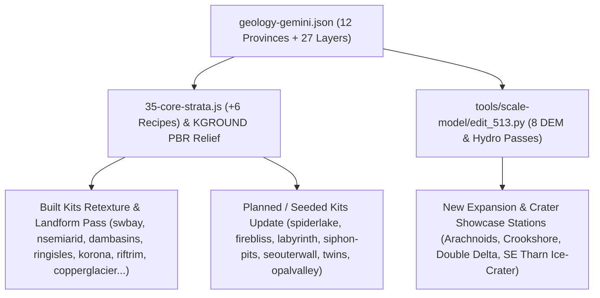

# Proposal: Biome File Updates, Landform & Material Retexturing, New Showcase Stations, and Scale-Model `5.1` Reshaping

Prepared on branch `gemini-trade` to align **Krator's biome kits (`biomes/*` & `core/terrain/*`)** and the **`5.1` Scale Model (`tools/scale-model/model/data/*`)** with the rebaked planetary geology ([geology-gemini.json](file:///C:/Users/travi/Documents/krator-trade/kits/resources/data/geology-gemini.json) and [GEOLOGY-SANITY-CHECK.md](file:///C:/Users/travi/Documents/krator-trade/openworld/GEOLOGY-SANITY-CHECK.md)).

> [!IMPORTANT]
> **Locked Geological & Hydrological Decisions Incorporated**
> 1. **`Spider Lake` (`rmvyj4v2ozgb1`) Secondary Ejecta Crater & SW Arachnoid Drainage**: Revamped into a `176 × 124 km` radial secondary ejecta crater (`center 1295, 212`). Its asymmetric downrange **NW/N/NNE boulder-ejecta rampart (`+1,860–2,120 m`)** seals off the `Ria River` (`9101`) and `Chīng-Mā` (`9109`), eliminating the implausible lake bifurcation in [biomes/spiderlake/PLAN.md](file:///C:/Users/travi/Documents/krator-trade/biomes/spiderlake/PLAN.md#L41). **100% of Spider Lake's `+1,460 m` outflow drains SW** through a single breached-rim spillway gorge (`1272, 193`) directly into **`9102` (`Hām-Tsēk` / *Arachnoid River*)**.
> 2. **Unmarked SE Tharn-Continent Ejecta Crater (`1375, 1525`)**: Baked into both the geology raster and the proposed `5.1` scale-model DEM as a **`D = 108 km` (`r = 27 px`) radial secondary impact crater** punched into the buoyant Tharn-type felsic ice massif SE of `SE outer wall`, hosting a tidally warmed sub-ice cryo-fumarole tarn (`+6,180 m`) beneath `+10,450–11,150 m` anorthosite-megabreccia walls.
> 3. **Circum-Ring-Sea Non-Tower Carbonate Shelves & 360° Dam-Relic Evaporites**: Warm-water `carbonate` benches (`SW Bay`, `Port Goto–Crescent`, `Talon`, `Ring Isles`, `Hook`) use low-relief wave-cut coquina/stromatolite/ooid shelf morphology so **`NW bay` + `k-guilin` remain Krator's sole dramatic tower/tsingy karst**, while the eastmost `n semiarid` dam-relic lake (`dam 2`, `818..946 × 414..486`) receives a full 360° stepped evaporite strandline bowl.
> 4. **Landward Continuations of `The Arch`**: `The Arch`'s concentric `basalt` trap horsts, `rift` graben troughs, and `ultramafic` serpentinite detachment slices continue seamlessly ashore onto SW `Crookshore` (`X <= 156, Y = 470..712`) and NE `Double Delta` / N `Ria` (`X = 470..775, Y <= 176`) up to the `4,400 m` Tharn continental front.
> 5. **Raider Autarky & Rift Rim Transit Rules**: Both `Lizardmen` and `Screamer Country` (`Hexahedron`) are non-trading caravan raid hazards; `Tallwalls ↔ Erehwon` is impassable across the freezing Northern Rift Rim; and `Nulab ↔ Erehwon` operates only as a once-a-year armed **Annual Great Caravan** along the Southern Rift Rim.

---

## 1. Shared Terrain & Material Engine Additions (`core/terrain/`)

Before touching individual biome kits, two small shared upgrades in `core/terrain/` unlock the new geology across every built and planned kit without bespoke per-biome shader hacks:

### 1.1 Six New `KSTRATA` Recipes in [35-core-strata.js](file:///C:/Users/travi/Documents/krator-trade/core/terrain/STRATA-PLAN.md)
Currently, `35-core-strata.js` provides `canyon`, `badland`, `danxia`, `rift`, `tepui`, `outland`, `tibasalt`, `tibasalt-ponded`, `megabreccia`/`crest`, `pillar`, `ringfold`, and `loess`. The rebaked 12-province geology introduces six distinct rock faces that should not be faked with `canyon` or `tepui`:

| New `KSTRATA` Recipe | Target `geology-gemini.json` Province / Layer | Bed Architecture, Hardness Profile & Colour Palette | Kits Using It |
| :--- | :--- | :--- | :--- |
| **`carbonate-shelf`** | `carbonate` (`limestone >= 160`, non-tower Ring Sea shelves) | Thin-to-medium (`0.6–2.2 m`) horizontal cream, warm buff, and pale ochre coralgal-stromatolite-ooid beds with recessed marl partings (`hardness 0.35`), wave-cut undercut notches at water level, and terra-rossa clay pockets — visually distinct from `nwbay-karst` massive dark-grey tower beds | `swbay`, `swlowlands` (gorge), `ringisles`, `hyperjungle` (`Port Goto`), `crater-drylands` (`Talon`) |
| **`contact-marble`** | `marble >= 120` + `skarn >= 90` | Ductile-folded, sugary white, rose-calcite, and blue-grey banded marble (`dip` warped by low-frequency fold harmonic) cross-cut by hard (`0.92`) pistachio-green epidote, rust-red grossular garnet, and brassy chalcopyrite skarn ribs | `swbay` (`Almua`–`Voth`), `neouterwall`, `oidong`, `seouterwall` (`Jade-Karst Polje`), `copperglacier` (`Copper Pass`) |
| **`evaporite-strand`** | `evaporite` (`gypsum`, `halite`, `potash`, `alkali`) | Rhythmic centimetre-to-metre pale alabaster/gypsum benches (`#ebe7dc`), specular selenite crystal ledges (`roughness 0.28`), polygonal halite pressure-ridges, and rose-pink sylvite/potash (`#df9d8f`) or chalky trona (`#e4e8e2`) efflorescence bands | `nsemiarid`, `dambasins`, `eastabyss`, `catch`, `sedesert` (`Bowl`), `cut` |
| **`secondary-ejecta`** | `impact` + exterior `impactite >= 140` collars | Coarse, poorly sorted ballistic boulder megabreccia: sub-angular `2–18 m` target-rock clasts (cherty dolomite at Spider Lake; pale anorthosite/leucogranite at the SE Crater; gneiss/basalt at Crookshore) set in an indurated radial ejecta matrix with overturned flap bedding dipping *outward* (`8°–16°`) from the crater center | `spiderlake`, `arachnoids` (head), `copperglacier` (`Copper Tarn`), `crookshore`, `se-tharn-crater` |
| **`arch-rift-basalt`** | `basalt` + `ultramafic` (`The Arch` & landfalls) | Dark blue-black columnar flood-basalt trap tiers (`3–9 m` colonnades) separated by brick-red baked paleosol (`bole`) partings, paired with fault-zone lenses of waxy, dark olive-emerald slickensided **serpentinite** (`roughness 0.32`) veined with white chrysotile/calcite | `thearch`, `crookshore`, `doubledelta`, `gills` (`White Gills` window) |
| **`obsidian-pancake`** | `volcanic` + `glass >= 180` (`10` pancake domes) | Steep (`35°–45°`) flow-banded vitrophyric black obsidian and pearl-grey perlitic breccia carapace (`roughness 0.18–0.35`, specular glints) over massive vertical cooling-jointed devitrified rhyodacite cores and pumiceous moat aprons | `firebliss` (`5` domes), `korona` (`5` trench/moat domes) |

### 1.2 Retexturing Upgrade Path per [GROUND.md](file:///C:/Users/travi/Documents/krator-trade/core/terrain/GROUND.md)
As documented in `core/terrain/GROUND.md`, 17 of 20 built biome kits still render ground with `MeshLambertMaterial` + `mapOnly` textures ("painted-on" look with per-vertex lighting and zero rock micro-shadowing). Whenever a built kit is touched for the geological updates below, its ground pass (`src/40-*.js` / `src/45-host-stage.js`) should adopt the standard four-part `KGROUND` upgrade:
1. Switch terrain material from `MeshLambertMaterial` to **`MeshStandardMaterial`** (`roughness: 0.88`, lowered dynamically to `0.25–0.45` on wet coquina notches, selenite crusts, obsidian talus, fault mirrors, and serpentinite shear zones).
2. Pack luminance/height into the normal map's `.a` channel in `core/materials` (`tex-rock.js` / `tex-soil.js`) instead of `mapOnly`, enabling per-fragment normal perturbation on all 5 texture slots.
3. Enable **`KGROUND.hook(mat, { relief, tri, cavity })`** with `tri` triplanar projection on cliff slopes (`slope > 0.48`) and `relief.strata` cross-bed micro-steps synced to the station's `KSTRATA` formation.
4. Bind slot weights (`slot 0..4`) to geological sub-masks (`bedrock`, `talus/ejecta`, `evaporite/sinter`, `soil/loess`, `wet/lichen`) derived from `KRELIEF` slope/curvature and `KBASIN` strand elevation.

---

## 2. Biome-by-Biome File Changes (`biomes/<kit>/`)

### 2.1 Built Biome Kits (`src/` + `PLAN.md` / `NOTES.md` + `materials.json`)

| Biome Kit | Files to Update | Underlying Landform Changes (`KRELIEF` / `KKARST` / `KBASIN`) | Retexturing & Landshaping (`KSTRATA` / `KGROUND`) |
| :--- | :--- | :--- | :--- |
| **`swbay`** ([PLAN.md](file:///C:/Users/travi/Documents/krator-trade/biomes/swbay/PLAN.md)) | `PLAN.md`, `materials.json`, `src/40-*.js`, `src/45-host-stage.js` | Add low `12–35 m` wave-cut coastal bluffs (`KRELIEF.stepcut`) and intertidal dissolution benches + littoral karst spring alcoves (`KKARST` Site `#9` at `Agropolis–Drum–Voth`, **zero** Guilin-style towers); add quarried marble headland steps near `Almua`/`Voth`. | Add `KSTRATA` **`carbonate-shelf`** on coastal marl/coquina risers and **`contact-marble`** on the `Almua–Voth` contact cliffs (currently `swbay` has no `KSTRATA` at all!). Retexture shoreline slots from generic grey rock to warm cream coquina, terra-rossa red clay soil, and epidote-veined white marble. |
| **`swlowlands`** ([NOTES.md](file:///C:/Users/travi/Documents/krator-trade/biomes/swlowlands/NOTES.md)) | `NOTES.md`, `materials.json`, `src/45-host-stage.js` | Along the lower `Great River` (`klir Rivrh`, `d < 68 km` of `585, 1095`), replace smooth alluvial banks with incised `25–60 m` **box-canyon limestone bluffs** (`KRELIEF.stepcut`) and spring-fed tufa alcoves (`KARST-SITES-5.1.md` gap fix). | Apply `KSTRATA` **`carbonate-shelf`** along river gorge walls; blend floodplain silt/loam (`loess`) with pale buff limestone ledges and travertine spring rims. |
| **`nsemiarid` & `dambasins`** ([PLAN.md](file:///C:/Users/travi/Documents/krator-trade/biomes/nsemiarid/PLAN.md), [dambasins/PLAN.md](file:///C:/Users/travi/Documents/krator-trade/biomes/dambasins/PLAN.md)) | `nsemiarid/PLAN.md`, `dambasins/PLAN.md`, `src/` basin/ground stages | Register both shrinking dam-relic lakes (`east lake` `818..946 × 414..486` in `dam 2` and `west lake` `582..614 × 436..466` in `dam`) in `KBASIN` with **3 concentric slow-recession strandline terraces** (`KRELIEF.terraces`) completely surrounding the east lake (`360°`), contrasted against catastrophic flood scabland coulees (`KRELIEF.stepcut`, giant ripple bars) higher on the spillway floor. | Pair existing Columbia-style flood-basalt `tibasalt-ponded` / `canyon` walls with `KSTRATA` **`evaporite-strand`** below `+480 m` (east lake) and `+260 m` (west lake). Retexture lower lake margins with high-albedo gypsum/alabaster crusts, specular selenite needles, polygonal halite flats, and pink potash rims. |
| **`ringisles`** ([NOTES.md](file:///C:/Users/travi/Documents/krator-trade/biomes/ringisles/NOTES.md)) | `NOTES.md`, `materials.json`, `src/40-*.js` | Ring non-vent volcanic island aprons (`ventd > 16 km`, e.g. `Nephtos`, `Hetanini`) with `1–4 m` emergent **fringing coralgal/rudist reef flats**, beachrock spits, and shallow lagoonal patch-reefs (`KRELIEF.terraces` + `WATER.open` reef-shoal bathymetry). | Dual-domain rock styling: dark vesicular `tibasalt` on interior volcanic kipukas/cones transitioning at `-1,485 m` to `KSTRATA` **`carbonate-shelf`** cream reef-limestone ledges and white biogenic coralgal sand (`roughness 0.78`, wet intertidal `0.28`). |
| **`hyperjungle` & `crater-drylands`** ([hyperjungle/NOTES.md](file:///C:/Users/travi/Documents/krator-trade/biomes/hyperjungle/NOTES.md), [crater-drylands/NOTES.md](file:///C:/Users/travi/Documents/krator-trade/biomes/crater-drylands/NOTES.md)) | `NOTES.md`, `materials.json`, coastal station stages | Add coastal **stromatolite-ooid barrier shoals & low karstified marine terraces** (`KRELIEF.terraces`, `8–22 m` relief, **no** towers) along the upwind N Ring Sea shelf (`Port Goto–Crescent`, `884..1008 × 684..736`) and dry E Ring Sea promontory (`Talon`, `1002..1058 × 742..804`). | On coastal carbonate cells (`limestone >= 160`), swap dark clastic/basalt shore rock for `KSTRATA` **`carbonate-shelf`** + turquoise shallow-bank water absorption tint (`WATER.open`). Also strip residual S-type tin-granite boulder props from interior `crater-drylands` melt-sheet plains (`impact`/`basalt` regolith). |
| **`korona`** ([PLAN.md](file:///C:/Users/travi/Documents/krator-trade/biomes/korona/PLAN.md)) | `PLAN.md`, `materials.json`, `src/45-host-stage.js`, `src/47-strata.js` | Add the **5 flat-topped steep-sided viscous pancake domes** (`dome_ko_nw_trench`, `ne_trench`, `s_trench`, `se_moat`, `n_trench`, `r = 12–16 km`) in the deep ring-fault trenches using `KRELIEF` mesa-dome records + radial cooling clefts; add contact-skarn talus aprons (`KRELIEF.runout`) where domes/ring-dikes intrude trench-wall carbonate lenses (`-950 m < E < +300 m`). | Keep `tepui` quartzite strata on upper hoar-tables (`> +300 m`), but switch deep trench intrusives to `KSTRATA` **`obsidian-pancake`** (black vitrophyre & grey perlite) and trench contact zones to **`contact-marble`**; remove legacy `sulfur=60` yellow fumarole staining from non-vent `tepui` table tops. |
| **`riftrim`** ([PLAN.md](file:///C:/Users/travi/Documents/krator-trade/biomes/riftrim/PLAN.md)) | `PLAN.md`, `materials.json`, `src/40-*.js`, `src/47-strata.js` | Replace volcanic-cone/lava landform assumptions on non-vent `Rift Rim N` and `Rift Rim S` stations with **planar listric fault-scarp facets (`KRELIEF.scarp`), relay ramps (`KRELIEF.relay`), and frost-shattered horst blockfields (`KFROST`)**; confine volcanic cones/tuff strictly within `18 km` of `D['vents']`. | Swap widespread `tibasalt` wall strata for `rift` + `crystalline` banded gneiss and `megabreccia` (`impact` on `>6.4 km` rim crests), with specular **hematite/pseudotachylite fault-mirror** planes (`roughness 0.22`) on fresh scarp faces (`highrift` pattern). |
| **`gills`** ([PLAN.md](file:///C:/Users/travi/Documents/krator-trade/biomes/gills/PLAN.md)) | `PLAN.md`, `materials.json`, `src/40-*.js` | At **White Gills** (`1035, 1535`; `1015, 1438`; `988, 1458`), expose a fault-exhumed **picritic/dunite serpentinite detachment window** (`KRELIEF.scarp` + hydrothermal chimney mounds) distinct from **Red Gills** (`878, 1442` Fe-rich `tibasalt` Bloodfalls flank). | Use `KSTRATA` **`arch-rift-basalt`** (waxy olive-green serpentinite + brucite/magnesite white veins) and pale Co-Ni-Mn-REE *Lag Solt* collar crusts at White Gills, keeping rust-red `tibasalt` + iron-oxide aprons at Red Gills. |
| **`copperglacier`** ([PLAN.md](file:///C:/Users/travi/Documents/krator-trade/biomes/copperglacier/PLAN.md)) | `PLAN.md`, `materials.json`, `src/40-*.js` | Reshape `Copper Tarn` (`147, 1143`, `+2,380 m` headwater of `9105` *Crook River*) into a **glaciated radial secondary ejecta crater** (`r = 24 km` raised megabreccia rim collar breached WNW by glacial outwash); sharpen `Copper Pass` (`318, 1246`) contact-skarn rib (`KSTACKS.row`). | Add `KSTRATA` **`secondary-ejecta`** on the `Copper Tarn` cirque collar and **`contact-marble`** (malachite-azurite-chalcopyrite IOCG skarn bands) at Station 2 (`Copper Pass`), alongside `rock.gneiss.banded` on the Tharn/Outer-Wall divide. |
| **`farside`, `nwouterwall`, `wouterwall`, `nhighlands`, `shighlands`, `ehighlands`, `cut`** | `PLAN.md` / `NOTES.md`, `materials.json`, `src/47-strata.js` | Enforce **`3–4` concentric listric rotational slump benches** (`KRELIEF.slump` + back-tilted sag ponds) and radial ballistic boulder runouts (`KRELIEF.runout`) across all Inner Peak-Ring and Outer Main-Rim walls (`>5.2–8+ km` crests included); add proximal impact `megabreccia` sea-cliffs on `farside` within `90 km` of `nwouterwall` (`PLAN.md` line 171 override where bluffs meet the kelp coast). | Replace generic `crystalline` grey granite/gneiss on `>8 km` wall crests and `The Cut` walls with `KSTRATA` **`megabreccia` / `crest`** (polymict angular clasts + bottle-green suevite melt lenses + black pseudotachylite fault mirrors) and a `24 km` Sudbury-type norite/impact-melt footwall collar (`tibasalt-ponded` dark norite) along the Inner Crater toe. |
| **`oidong`** ([NOTES.md](file:///C:/Users/travi/Documents/krator-trade/biomes/oidong/NOTES.md)) | `NOTES.md`, `materials.json`, `src/40-*.js` | Add folded **roof-pendant marble & calc-silicate crags** (`KSTACKS` + `KKARST` spring grottos at `1,800–4,600 m`) framing the mist-tea cloud-forest benches below the northern fumarole vents. | Blend mossy plutonic `granite` tors with `KSTRATA` **`contact-marble`** bands on mid-valley cliffs. |

---

### 2.2 Planned & Seeded Biome Kits (`PLAN.md` Updates Before Build)

#### A. `biomes/spiderlake/PLAN.md` — Radial Secondary Ejecta Crater & SW Arachnoid Spillway Revamp
[biomes/spiderlake/PLAN.md](file:///C:/Users/travi/Documents/krator-trade/biomes/spiderlake/PLAN.md) requires four targeted structural revisions before `src/` is built:
1. **Basin Origin (§1 & §2.2)**: Reframe `Spider Lake` (`center 1295, 212`, `176 × 124 km` ellipse oriented `-28°` radially to the main `[865, 935]` impact basin) from a generic pull-apart sag into a **prehistoric radial secondary ejecta crater** excavated by a mountainside ballistic megablock from the Outer Wall. The impact punched cleanly through the exterior ejecta blanket to expose the underlying `Neo-Ozarks` cherty dolomite/limestone (`carbonate`) platform on the crater floor, while impact-fractured ring faults tapped warm (`+28–42 °C`) MVT (`Zn-Pb-Ag-Sr`) hydrothermal brines (`lode:spiderlake-mvt-zn` & `ag`) that drive the "lake-smoke" midge engine.
2. **Single SW Outflow into the Arachnoid River (§1 line 41 & §3.1 line 81)**:
   - **Delete the bifurcated outflow** into `9101` (`Ria`) and `9102` (`Web-Cleaver`).
   - Specify that the downrange **NW/N/NNE ballistic boulder rampart (`+1,860–2,120 m`)** forms an unbroken forested divide between `Spider Lake` (`+1,460.0 m`) and the headwaters of `Chīng-Mā` (`9109`) / `Ria River` (`9101`, which rises independently from outer-rampart & `Neo-Ozarks` karst resurgences).
   - **All outflow from `Spider Lake`** (fed from the ESE by `9106` `Hau-Gèl / Outland Gate River`) exits **exclusively SW** across a single incised megabreccia-and-dolomite spillway gorge at **`(1272, 193)`** into **`9102` (`Hām-Tsēk` / *Arachnoid / Web-Cleaver River*)**, plunging SW through the concentric ring-fault canyons of the `Arachnoids` (`rmvarachnoids`) past `Ham-Tsek Silk Post` (`1055, 219`) before curving NW to join the lower `Ria` upstream of the `Double Delta`.
3. **Zones & Landforms (§3)**:
   - Zone 1 (`narrows`): Emergent stacks re-typed from basalt/dolomite to **slumped impact-megabreccia & hydrothermally silicified MVT dolomite stacks** (`KSTACKS`).
   - Zone 5 (`upland_bluff`): Split into **(5a) Downrange NW Ballistic Boulder-Rampart (`+1,750–2,120 m`, `KSTRATA` `secondary-ejecta` + `KRELIEF.runout`)** and **(5b) Uprange SW Arachnoid Breach & Dolomite Bluffs (`+1,455–1,850 m`, `KSTRATA` `carbonate-shelf` + `secondary-ejecta`)**.
4. **Station 4 Re-Scope (§0 line 25)**: Rename Station 4 from `Ria Headwater Silk-Weirs` to **`Ham-Tsek Spillway Silk-Weirs`** at **`(1272, 193)`** (`+1,455 m`), staging the water-powered silk-reeling frames and alkaline degumming sluices directly in the roaring SW crater-breach cataract into the Arachnoid River, and add **Station 6 (`North Rampart Boulder-Collar & Ria Divide`, `1278, 166`)**.

#### B. Other Planned Interior, Rim & Southern Kits
- **`biomes/firebliss/PLAN.md`** ([PLAN.md](file:///C:/Users/travi/Documents/krator-trade/biomes/firebliss/PLAN.md)): Add the **5 flat-topped viscous rhyodacite/obsidian pancake domes** (`dome_fb_north` `175,1302`, `west` `157,1324`, `south` `175,1335`, `southeast` `201,1331`, `east` `211,1305`) and the `basalt`-crusted **Firebliss Patera** lava-lake floor to §1 & §8 (`KSTRATA` `obsidian-pancake` + `tibasalt`); add **Station 5 (`Great Vale Obsidian Pancake Dome & Perlite Moat`, `175, 1335`)** where Fellgang and Kimr hunters quarry prismatic black obsidian blades (`glass >= 220`).
- **`biomes/labyrinth/PLAN.md`** ([PLAN.md](file:///C:/Users/travi/Documents/krator-trade/biomes/labyrinth/PLAN.md)): Specify the three-tier structural stratigraphy from `geology-gemini.json` in §1 & §7:
  1. Uncollapsed `4,950–6,200 m` horst bastions & tilted chaos mesa caps = **plume-lifted `basalt` flood-trap caprock** (`KSTRATA` `tibasalt-ponded`, tilted `4°–9°` per mesa via `35c` vary);
  2. Lower `3–4 km` graben & chaos escarpment walls = **exhumed `impact` megabreccia & `crystalline` basement** (`KSTRATA` `megabreccia` below an unconformity contact);
  3. `1,350–2,950 m` paddock corridors = **fertile `sedimentary` / `rift` volcano-loess & lacustrine marl** (`loess` + `KGROUND` megafauna trail/wallow masks, watered by Firebliss sulphate-ash plumes).
- **`biomes/siphon-pits/PLAN.md`** ([PLAN.md](file:///C:/Users/travi/Documents/krator-trade/biomes/siphon-pits/PLAN.md)): Lock the sharp `2,620 m` geological split: SE plateau (`>2,620 m`, Stations 3–4) uses `basalt` flood-trap colonnades (`tibasalt-ponded`) cut by phreatomagmatic `KRELIEF.maar` horseshoe siphon pits and knife-edge arête bridges (`1678, 1542`), whereas NW `Lake Ostrukh` graben (`<2,620 m`, Station 1 `Ostrukh-on-Water` `1516, 1471`) uses `sedimentary` `loess` terraces free of bare crystalline cliff shaders.
- **`biomes/seouterwall/PLAN.md`** ([PLAN.md](file:///C:/Users/travi/Documents/krator-trade/biomes/seouterwall/PLAN.md)): Adopt `KSTRATA` **`contact-marble`** inside Station 5 (`Jade-Karst Polje` at `1208, 1254`, `carbonate` + `marble`/`skarn` rafted megablock) and link an **Annex Showcase Station (`Tharn Ice-Caldera & Cryo-Fumarole Tarn`, `1375, 1525`)** for the newly baked `D = 108 km` SE Tharn continental secondary ejecta crater just across its southeastern border.
- **`biomes/neouterwall/PLAN.md` & `biomes/outlandgate/PLAN.md`**: Bind `skarn_badlands` (`neouterwall` §2) and `skarn_alcove` (`outlandgate` §2 at `1416,312; 1429,331; 1446,368`) directly to the new **`contact-marble`** `KSTRATA` recipe (banded green epidote, red garnet, white marble) cross-cut by `KSTACKS.row` basaltic ring-dike fins.
- **`biomes/twins/PLAN.md` & `biomes/opalvalley/PLAN.md`**: Pair `twins` shield flanks (`tibasalt`) with the `White Gills` `ultramafic` fault window on its western/northern toe; in `opalvalley`, replace generic `canyon` strata (§2 line 271) with a bimodal **welded rhyolitic `tuff` ignimbrite over `tibasalt` dike contact** cemented by precious play-of-colour silica sinter (`lode:opal-valley-tuff`).

---

### 2.3 Northern, Western & SE Expansion Biome Kits (New Kit Seeds)

| Expansion Region (`51-region-store.js`) | Proposed Kit Folder | Geological Identity (`geology-gemini.json`) & Core Landforms | Signature `KSTRATA` & `KGROUND` Palette |
| :--- | :--- | :--- | :--- |
| **`arachnoid canyons`** (`rmvarachnoids`, `845..1345 × 180..445`) | `biomes/arachnoids/` | Concentric volcano-tectonic ring-fault & radial dike maze (`basalt`/`volcanic`/`rift` ribs cutting `sedimentary` & exterior `impactite` apron), incised by the `890 km` **SW outflow gorge of `Spider Lake` (`9102` `Hām-Tsēk`)** with rapids, silk-cable suspension spans, and warm skarn seeps. | `tibasalt` radial dike walls (`KSTACKS.row` fins) + `outland`/`secondary-ejecta` canyon strata; dark basalt cobble bars, mossy seep ledges, misty gorge cedar groves. |
| **`neo-ozarks` & `ria valley`** (`rmvyiyw8ucd1y`, `rmvriavalley`) | `biomes/riavalley/` | Dissected Paleozoic-style cherty dolomite/limestone plateau (`Neo-Ozarks`, `carbonate` erosional window stripped of ejecta, `CRYSTAL-CAVES-5.1.md` MVT caves + red `granite` porphyry dikes) feeding the **`2,140 km` `Ria River` (`9101`)** terraced alluvial/loess valley (`sedimentary`). | `nwbay-karst` / `carbonate-shelf` cherty dolomite bluffs (`30–120 m` dendritic river palisades, **not** tropical towers) + brick-red porphyry dike ribs + `loess` river terraces. |
| **`the arch`, `crookshore`, & `double delta`** (`rmvthearch`, `rmw4wknusgc7h`, `rmvdoubledelta`) | `biomes/thearch/` (with `crookshore` & `doubledelta` stations) | Drowned and emergent stagnant-lid **mafic rift-arch (`basalt` + `rift` + `ultramafic` serpentinite core-complexes)** continuing onshore across SW `Crookshore` (`X <= 156, Y = 470..712`, punctuated by two drowned **radial secondary ejecta bay craters** at `89,605` & `82,678`) and NE `Double Delta` (`X = 470..775, Y <= 176`, where basalt horst-gates split the `Ria`/`Arachnoid` distributaries). | **`arch-rift-basalt`** (columnar black trap headlands with red bole seams + slickensided dark-green serpentinite shear coves) + **`secondary-ejecta`** boulder collars on the Crookshore bay rims + estuarine salt-marsh muds. |
| **`the crook` & `tharn uplands` & Unmarked SE Massif** (`rmvthecrook`, `rmvtharnuplands`, SE `1375,1525`) | `biomes/tharnshield/` (or `seouterwall` / `copperglacier` annexes) | Buoyant, low-density **Tharn-type felsic continental crust** (`granite` + `crystalline` anorthosite/orthogneiss, `worlddreambank.org/T/THARN.HTM`) standing above `4,400–12,000+ m` in cold/hypobaric to `Class O` airless conditions, scarred by **radial secondary ejecta craters** — crowned by the `D = 108 km` **SE Tharn Ice-Caldera (`1375, 1525`)**. | New `tharn-felsic` variant of `crest` / **`secondary-ejecta`**: silver-white anorthosite, pale rose leucogranite felsenmeer, blue glacier ice (`KGLACIER`), patterned periglacial polygons (`KFROST`), and steaming cryo-fumarole sulfur/sinter collars. |

---

## 3. Proposed New & Re-Scoped Showcase Stations (`16` Stations)

Every station below sits on a `5.2 × 5.2 km` page centered at exact `5.1 (px, py)` coordinates chosen to highlight a unique landscape created by the rebaked geology:

| # | Host Kit & Station ID | `5.1 (px, py)` | Target Elev (`m`) & Air | Geological Feature Showcased | Landform & Strata Stack (`KRELIEF` / `KSTRATA` / `KKARST`) | Visual & Gameplay Hook |
| :-: | :--- | :---: | :---: | :--- | :--- | :--- |
| **1** | `spiderlake` — **Stn 4 (Re-scoped): `Ham-Tsek Megabreccia Spillway & Silk-Weirs`** | **`1272, 193`** | `+1,455 m` (`1.20 atm`, `Cfb`) | Single SW secondary-crater rim breach draining `Spider Lake` into `9102` (`Arachnoid River`) | `KRELIEF.gap` cataract + `KSTACKS` boulder piers; `secondary-ejecta` over `carbonate-shelf` dolomite | Water-powered cedar-and-porphyry silk-reeling mills & warm alkaline degumming sluices straddling the roaring SW spillway gorge; Golden Cable suspension bridges overhead. |
| **2** | `spiderlake` — **Stn 6 (New): `North Rampart Boulder-Collar & Ria Divide`** | **`1278, 166`** | `+1,920 m` (`1.13 atm`, `Cfb/Dfb`) | Asymmetric downrange ballistic ejecta rampart sealing `Spider Lake` from `Ria` (`9101`/`9109`) | `KRELIEF.runout` (`10–25 m` angular dolomite/gneiss megablocks) + outer karst spring; `secondary-ejecta` | Misty mossy megalithic boulder-forest crest: look S over the shimmering `+1,460 m` crater lake and N down into the independent karst springhead of the Ria Valley. |
| **3** | `arachnoids` — **Stn 1 (New): `Web-Cleaver Ring-Fault Narrows (Ham-Tsek Post)`** | **`1055, 219`** | `+790 m` (`1.30 atm`, `Cfa`) | Arachnoid concentric volcano-tectonic ring-dike canyon carrying Spider Lake's SW river | `KRELIEF.stepcut` gorge + `KSTACKS.row` (`kind:'fin'`) basaltic ring-dikes; `tibasalt` + `outland` | Sheer dark ring-dike fins pinching the emerald `Hām-Tsēk` river into navigable slackwater pools below Spider-Guild cable-ferries and river-barge wharves. |
| **4** | `swbay` — **Stn 5 (New): `Almua–Voth Contact-Marble Sea-Cliffs`** | **`734, 998`** | `-1,465 m` (`1.92 atm`, `Csa/Csb`) | SW Bay warm marine carbonate terrace & contact-metamorphosed marble belt | `KRELIEF.stepcut` (`35 m` sea cliffs) + `KKARST` sea-level spring notch; `contact-marble` + `carbonate-shelf` | Swirled white-and-rose marble sea cliffs veined with green epidote above wave-cut coquina benches, stepped Vothic quarry cranes loading marble blocks bound for Jimjam. |
| **5** | `hyperjungle` — **Stn (New): `Port Goto Stromatolite-Ooid Shoals`** | **`922, 704`** | `-1,488 m` (`1.92 atm`, `Aw/Am`) | Ash-sheltered upwind N Ring Sea carbonate platform & stromatolite bioherms | `KRELIEF.terraces` (`2–12 m` coastal limestone steps) + shallow lagoonal heads; `carbonate-shelf` | Brilliant turquoise ooid sandbars, living giant stromatolite domes in hyperbaric warm shallows, and Shell-province coral-stone breakwaters (`Port Goto` shoreline pin). |
| **6** | `crater-drylands` — **Stn (New): `Talon Coquina-Bluff & Dry Reef Bench`** | **`1026, 772`** | `-1,455 m` (`1.91 atm`, `BSh`) | Clear-water E Ring Sea semi-arid limestone headland north of muddy Hyperjungle mouth | `KRELIEF.stepcut` (`28 m` undercut bluff) + solution-pitted pavement; `carbonate-shelf` | Golden-cream shell-coquina cliffs, dry coastal scrub & fire-mosaic savannas meeting clear sapphire reef drop-offs with zero river silt. |
| **7** | `ringisles` — **Stn 4 (New): `Nephtos Fringing Reef-Flat & Kipuka`** | **`919, 762`** | `-1,492 m` (`1.92 atm`, `Af/Am`) | Volcanic Ring Isle apron ringed by non-tower coralgal/rudist carbonate reef-flats | `KRELIEF.terraces` emergent reef bench + `KSTACKS` basalt sea-stack; `carbonate-shelf` + `tibasalt` | Tethys colonial timber-and-coralstone harbour where dark columnar basalt lava toes plunge into white-sand pearl lagoons and rudist reef tables. |
| **8** | `dambasins` / `nsemiarid` — **Stn 5 (New): `East-Dam Selenite Bathtub & Potash Flat`** | **`942, 452`** | `-245 m` (`1.65 atm`, `BWk/BSh`) | 360° slow-recession evaporite strandlines around the eastmost `n semiarid` dam-relic lake | `KBASIN` + `KRELIEF.terraces` (3 horizontal bathtub benches); `evaporite-strand` | Dazzling white alabaster/gypsum wave-cut steps, `1.5 m` glinting selenite crystal spears, polygonal halite pans, and crimson halophile brine pools along the east shore. |
| **9** | `firebliss` — **Stn 5 (New): `Great Vale Obsidian Pancake Dome`** | **`175, 1335`** | `+2,890 m` (`1.12 atm`, `Csb/Dfb`) | Viscous stagnant-lid rhyodacite/obsidian pancake dome (`r = 14 km`) on Firebliss margin | Flat-topped steep-talus mesa-dome (`KRELIEF` dome + `runout`); `obsidian-pancake` | `300 m` wall of mirror-black banded obsidian and silver perlite talus steaming above warm sinter meadows, with Kimr & Fellgang obsidian knapping workshops. |
| **10** | `korona` — **Stn 6 (New): `SE Moat Pancake Dome & Skarn Trench`** | **`1179, 578`** | `-380 m` (`1.68 atm`, `Cfa`) | Volcano-tectonic corona ring-fault intrusion: obsidian pancake dome vs quartzite/marble wall | `KRELIEF` dome + `relay` fault wall + `KKARST` hypogene sulfuric cave mouth; `obsidian-pancake` + `contact-marble` + `tepui` | Three-geology collision in one vista: glassy black dome carapace on the left, green/white epidote-marble skarn across the steaming river, and `1,500 m` pink `tepui` walls above. |
| **11** | `thearch` / `crookshore` — **Stn 1 (New): `Crookshore Trap Headland & Serpentinite Cove`** | **`95, 545`** | `+28 m` (`1.60 atm`, `Cfb`) | SW landward continuation of `The Arch`'s flood-basalt horsts & serpentinite core-complexes | `KRELIEF.stepcut` trap benches + `scarp` detachment shear zone; `arch-rift-basalt` | Tiered black basalt colonnades with red bole stripes dropping into a sheltered cove carved out of waxy emerald-green slickensided serpentinite and placer-gold black sand. |
| **12** | `crookshore` — **Stn 2 (New): `Twin Ejecta-Bay Breccia Collar`** | **`89, 605`** | `+12 m` (`1.60 atm`, `Cfb`) | Drowned radial secondary ejecta crater bay on the western Crookshore coast | Arcuate `KRELIEF.slump` + `runout` boulder ring-wall (`r = 25 km`, breached to sea); `secondary-ejecta` | Semicircular harbour walled by house-sized impact megablocks draped in giant Farside-style bull-kelp wrack and sea-bird rookeries. |
| **13** | `doubledelta` — **Stn 1 (New): `Double Delta Basalt Horst-Gate`** | **`518, 152`** | `+18 m` (`1.60 atm`, `Cfb/Dfb`) | NE landward continuation of `The Arch` splitting the `Ria`/`Arachnoid` distributaries | Flat-topped `KRELIEF.stepcut` basalt horst island (`+85 m`) dividing braided delta channels; `arch-rift-basalt` | Twin silt-laden rivers (`Mā-Rīa` & `Hām-Tsēk`) surging through narrow columnar-basalt horst gates into tidal marshes and northern sea-lanes. |
| **14** | `copperglacier` — **Stn 5 (New): `Copper Tarn Ejecta-Collar & Verdigris Outwash`** | **`147, 1143`** | `+2,385 m` (`1.19 atm`, `ET`) | Radial secondary ejecta crater (`Copper Tarn`) overprinted by IOCG copper-skarn veins | Circular megabreccia rim + `KGLACIER` snout calving into turquoise tarn; `secondary-ejecta` + `contact-marble` | Malachite-stained impact breccia headwalls and blue glacier ice feeding the headwater cascade of `9105` (`Kopa-Tarn Warra / Crook River`). |
| **15** | `seouterwall` (Annex) — **Stn 7 (New): `Tharn Ice-Caldera & Cryo-Fumarole Tarn`** | **`1375, 1525`** | `+6,185 m` (`0.74 atm`, `EF/HT`) | Newly baked `D = 108 km` radial secondary ejecta crater in the unmarked SE Tharn ice continent | Stepped complex crater (`KRELIEF.slump` + central peak mound + `KGLACIER` ice walls); `secondary-ejecta` (pale anorthosite/granite clasts) | Otherworldly hypobaric ice-bowl walled by `10.8 km` silver-white Tharn anorthosite cliffs, centered on a steaming `+24 °C` tidal cryo-fumarole meltwater oasis with glowing ice-cave mats. |
| **16** | `riftrim` — **Stn 6 (New): `South-Rim Great Caravan Saddle & Gneiss Mirror`** | **`624, 1618`** | `+3,920 m` (`0.98 atm`, `ET/BSk`) | Non-volcanic crystalline/impact horst shoulder on the `Nulab ↔ Erehwon` Annual Great Caravan trail | Planar `KRELIEF.scarp` fault mirror + `KFROST` felsenmeer saddle; `rift` + `megabreccia` | Polished specular hematite fault-scarp plunging `4,500 m` north into the hazy, hostile Lizardman Rift while seasonal Dalab–Xanadu armed caravan cairns thread the windy gneiss col. |

---

## 4. Proposal for Reshaping the Scale-Model Map (`tools/scale-model/edit_513.py`)

To make the `1821 × 1723` (`2 km/px`) scale model (`h.png`, `wl.png`, `basins.json`, `rivers.json`, `vents.json`, `landforms.json`, climate rasters, and `t.jpg`/`st.jpg`/`rt.jpg`) physically match [geology-gemini.json](file:///C:/Users/travi/Documents/krator-trade/kits/resources/data/geology-gemini.json), we propose an additive scale-model build script **`tools/scale-model/edit_513.py`** following the exact `smodel` boxed-edit contract (`edit_511.py` / `edit_512.py`: localized masks, `priority_fill` pit checks, monotonic river bed re-grading, `C.lapse` + `C.reclimate`, `PA.relight` + `PA.retint`, and `tests/test_smodel.py` verification).

```mermaid
flowchart LR
    P1["Pass 1: Spider Lake Crater & SW 9102 Spillway"] --> P2["Pass 2: SE Tharn Ejecta Crater (1375,1525)"]
    P2 --> P3["Pass 3: Arch SW/NE Landward Horsts & W Craters"]
    P3 --> P4["Pass 4: N Semiarid Dam-Relic Salt Lakes (360° Benches)"]
    P4 --> P5["Pass 5: Circum-Ring-Sea Carbonate Terraces & Shoals"]
    P5 --> P6["Pass 6: 10 Pancake Domes & Rift-Rim Horst Facets"]
    P6 --> P7["Pass 7: Labyrinth, Slabfields & Siphon Trap-Steps"]
    P7 --> P8["Pass 8: Impact Listric Walls vs Smooth Tharn Shields"]
```

### Pass 1 — `Spider Lake` Radial Secondary Ejecta Crater & SW Arachnoid Spillway (`box 1205..1435 × 135..310`)
- **Current `5.1` DEM Defect**: `Spider Lake` (`WL = +1,460.0 m`) has a dangerously low NW rim saddle at `(1252, 175)` (`H = 1,339.4 m`) and `Chīng-Mā` headwater (`1246, 172`, `H = 1,289.8 m`), creating an artificial western spill ambiguity toward `9101` (`Ria`), while its outline reads as an amorphous sag rather than a secondary impact crater.
- **Proposed DEM & Hydrography Reshape**:
  1. **Elliptical Crater Bowl & Stepped Inner Bench**: Center at `(1295, 212)`, semi-axes `a = 44 px (88 km)`, `b = 31 px (62 km)`, rotated `-28°` (radial to main basin center `[865, 935]`). Carve a crisp stepped inner megabreccia terrace at `+1,510..+1,680 m`, sublacustrine hydrothermal MVT mounds at `+1,442..+1,456 m`, and **5 emergent rocky silk-weir island stacks** (`+1,468..+1,488 m`) across the central narrows (`1284..1308, 204..220`).
  2. **Asymmetric Downrange NW/N/NNE Ballistic Rampart (`Seal the Ria Divide`)**: Along the downrange NW-to-NE arc (`θ ∈ [195°, 355°]` in crater coords, `py ≈ 152..196`), raise an asymmetric hummocky ejecta collar (`+320 to +580 m` radial ridge + `T.ridged` boulder-hummock roughness, decaying as `(r/R)^{-3}` outward over `18 px`) so the NW rim crest stands at **`+1,860 to +2,120 m`** (`(1252, 175)` rises from `1,339 m` -> **`+1,915 m`**).
  3. **Re-anchor `9109` (`Chīng-Mā`) on the Outer NW Rampart**: Shift `9109`'s source vertex `4 px` NW to `(1238, 162)` (`bed_m = 1,560 m`) on the *outer* flank of the ejecta collar, feeding `9101` (`Ria River`) cleanly without touching `Spider Lake`.
  4. **Carve the Single SW Arachnoid Spillway Gorge (`9102` `Hām-Tsēk`)**: Across the uprange SW rim (`[1272, 193]` -> `[1256, 201]` -> `[1234, 209]`), incise a `3–4 px` (`6–8 km`) V-to-slot megabreccia water-gap (`sill = +1,458.5 m` at `[1272, 193]`, dropping monotonically along `9102`'s thalweg through the `Arachnoids` ring-fault gorges). Update `DATA.outlets` so `Spider Lake` -> `9102` (`Hām-Tsēk`) is its sole outlet, and add `{id: 'lf_spider_crater', kind: 'secondary_crater', px: [1295, 212], rx_px: 44, ry_px: 31, angle_deg: -28}` to `DATA.landforms`.

---

### Pass 2 — Unmarked SE Tharn-Continent Secondary Ejecta Crater (`box 1305..1445 × 1455..1595`, Center `1375, 1525`)
- **Current `5.1` DEM State**: Unfeatured `9,736–13,902 m` `Class O` dome (`H = 9,946.9 m` at `1375, 1525`).
- **Proposed DEM, Tarn & Vent Stamp**:
  1. **Complex Crater Profile (`D = 108 km`, `R = 27 px`)**:
     - **Downrange SE Ejecta Rim (`r = 25..31 px`, SE azimuth `135°`)**: Raised asymmetric collar peaking at **`+10,450 to +11,150 m`**, surrounded by a radial hummocky ejecta blanket (`r = 27..45 px`) with secondary radial grooves (`±220 m` amplitude).
     - **Uprange NW Rim & Stepped Listric Slump Walls (`r = 16..25 px`)**: Two concentric rotational slump terraces at **`+8,350 m`** and **`+7,150 m`** (`KRELIEF.slump` macro-steps).
     - **Breathable-Margin Glaciated Floor & Central Peak Mound (`r = 0..16 px`)**: Excavate the crater floor down to **`+6,185..+6,420 m`** (`P ≈ 0.74 atm`, `EF`/`HT` — bringing the crater interior out of `Class O` vacuum into the upper alpine/hypobaric explorer envelope!), with a fractured anorthosite **central peak mound** rising to **`+6,740 m`** at `(1373, 1527)`.
  2. **Sub-Ice Tidal Cryo-Fumarole Tarn**: Carve a `3.2 px`-radius (`~128 km²`) ice-cauldron lake in the northern moat of the central peak at **`(1378, 1522)`** (`WL = +6,180.0 m`, `bed = +6,156.0 m`), register it in `DATA.basins` (`kind: 'crater tarn'`, `climate: 'HT'`), and append a low-flux hydrothermal fumarole cluster in `DATA.vents` (`px: [1378.0, 1522.0], floor: 6180.0, radius: 3.5, peak: 6260.0`) + `DATA.landforms` (`id: 'lf_se_tharn_crater'`).
  3. **Climate & Paint**: Re-run `C.lapse` + `C.reclimate` inside `box 1295..1455 × 1445..1605` (converting the crater floor from `Class O` to `EF`/`HT` with a `+4 °C` geothermal micro-halo on the tarn) and `PA.relight` + `PA.retint` (pale silver-pink Tharn anorthosite-granite rim + cobalt-turquoise meltwater tarn in blue glacier ice).

---

### Pass 3 — `The Arch` SW (`Crookshore`) & NE (`Double Delta` / N `Ria`) Landward Extensions + Western Secondary Craters
- **Boxes**: `Crookshore` (`0..185 × 465..725`), `Double Delta / N Ria` (`465..785 × 0..182`), `Copper Tarn` (`115..180 × 1110..1175`).
- **Proposed DEM Reshape**:
  1. **Continuous Onshore Horst-and-Graben Grain**: Evaluate the same curvi-parallel arch-axis harmonic (`r_arch` concentric to `The Arch`'s curvature) across the shoreline into `Crookshore` (`E < 4,400 m`) and `Double Delta` / N `Ria` (`E < 4,400 m`), sculpting flat-topped **flood-basalt trap horst ridges (`+85 to +650 m`, crisp `35–90 m` `stepcut` cliff risers)** alternating with **`<65 m` `rift` graben valleys** and coastal sea-lochs (leaving the active `Double Delta` alluvial wedge `<85 m` flat and braided between basalt horst-gates at `518, 152` and `615, 148`).
  2. **Western Radial Secondary Ejecta Collars**:
     - **`Crookshore` Twin Ejecta Bays (`89, 605` `r = 12 px` & `82, 678` `r = 13 px`)**: Raise `180–340 m` arcuate boulder-megabreccia rim collars around the landward `270°` of both semicircular bays (`breached to sea on W`), with `15–25 m` submerged outer sill bars (kelp reefs).
     - **`Copper Tarn` (`147, 1143`, `r = 12 px`, `WL = +2,380.1 m`)**: Stamp a raised `+2,680..+3,050 m` secondary-ejecta cirque rim collar breached on the WNW by `9105` (`Crook River`).

---

### Pass 4 — `n semiarid` / `dam 2` Relic Salt Lakes & 360° Evaporite Strandlines (`box 565..635 × 420..482` & `box 795..975 × 392..508`)
- **Current `5.1` DEM Defect**: Neither the eastmost relic lake (`818..946 × 414..486`, water pixels sitting around `-277 to -60 m` with a steep un-terraced eastern rise at `932, 450`) nor the west relic lake (`582..614 × 436..466`) is registered as a closed/shrinking `salt lake` in `DATA.basins`, and the eastern shore lacks recessed paleolake strand benches.
- **Proposed DEM, Basin & Paint Reshape**:
  1. Level water surfaces cleanly and register both `basin_dam2_east_relic` and `basin_dam1_west_relic` in `DATA.basins` (`kind: 'salt lake'`).
  2. Around the **eastmost lake (`798..968 × 396..502`)**, sculpt **three concentric horizontal wave-cut evaporite strandline benches** (`+45 m`, `+145 m`, and `+285 m` above lake level, `width = 2.5–5.0 px` around the *entire* `360°` perimeter including the eastern shore `x = 922..966`), grading smoothly up toward the `+1,050 m` `dam 2` highstand notch.
  3. In `PA.retint`, tint the lowest `+0..+90 m` concentric ring in high-albedo white/cream alabaster-halite (`#e8e3d5`) with subtle rose potash pan accents (`#d9aba0`) so theshrinking-lake bathtub ring is immediately legible on `t.jpg` and `st.jpg`.

---

### Pass 5 — Circum-Ring-Sea Non-Tower Carbonate Shelves (`SW Bay`, `Port Goto–Crescent`, `Talon`, `Ring Isles`, `Hook`)
- **Boxes**: `SW Bay` (`635..780 × 890..1045`), `Port Goto–Crescent` (`880..1012 × 680..740`), `Talon` (`998..1062 × 738..808`), `Hook & Ring Isles` (`740..955 × 740..948`).
- **Proposed DEM & Bathymetry Reshape**:
  1. **Onshore Low-Relief Marine Terraces (`Zero Tower Noise`)**: Apply a gentle terrace quantizer (`step = 22 m`, `slope < 0.08`) within `6 px` (`12 km`) of the Ring Sea shoreline (`-1,500 m` sea level -> `-1,492 m` reef flat -> `-1,468 m` coquina bench -> `-1,435 m` bluff top), keeping relief flat-topped and horizontal in contrast to `NW bay` (`676..813 × 707..854`) and `k-guilin`'s steep conical tower karst.
  2. **Submerged Turquoise Carbonate Barrier Shoals**: Raise nearshore `h.png` bathymetry within `2–4 px` of these four carbonate shelves to **`-1,514..-1,503 m`** (`3–14 m` water depth below the `-1,500 m` Ring Sea level) and tint shallow carbonate water pixels warm turquoise-jade on `t.jpg`/`st.jpg`.

---

### Pass 6 — `10` Viscous Pancake Domes (`Firebliss` & `Korona`) + `Rift Rim N/S` Non-Volcanic Horst Facets
- **Proposed DEM & `landforms.json` Stamp**:
  1. **Stamp all `10` Pancake Domes** (`5` in `Firebliss` at `175,1302; 157,1324; 175,1335; 201,1331; 211,1305` and `5` in `Korona` trenches at `1007,490; 1131,494; 1038,581; 1179,578; 1071,430`): use the Venusian/Capsican steep-margin viscous-dome profile
     $$h_{\text{dome}}(r) = H_{\text{dome}} \cdot \left(1 - \left(\frac{r}{R}\right)^{6}\right)^{1/3} + \Delta h_{\text{ogive}}(r)$$
     (`R = 4..8 px = 8–16 km`, `H_dome = 220..380 m`, flat-to-slightly-concave summit with concentric `±12 m` pressure-ridge ogives and a `1.5 px` pumice/perlite moat depression around the toe), and record all `10` in `DATA.landforms` (`kind: 'pancake_dome'`).
  2. **`Rift Rim N` & `Rift Rim S` Fault-Scarp Facets**: Outside `9 px` (`18 km`) of `D['vents']`, strip small residual conical volcano bumps along `rift rim N` (`496..759 × 1338..1516`) and `rift rim S` (`344..929 × 1379..1682`) and sharpen Rift-facing **planar triangular fault facets (`dip 28°–38°`)** cut by short V-shaped wineglass gullies.

---

### Pass 7 — `Labyrinth`, `The Slabfields`, & `Siphon Pits` Flood-Basalt Trap-Steps
- **Proposed DEM Reshape**:
  1. **`Labyrinth` (`90..393 × 1349..1640`)**: Give the `22` chaos mesas (`245..388 × 1352..1595`) planar, slightly tilted (`4°–8°` radial outward dip) flood-basalt caprock tops and crisp `stepcut` cliff shoulders above an mid-wall unconformity bench.
  2. **`The Slabfields` (`x > 1535` in `mid basin`)**: Reinforce domino-style tilted flood-basalt trap blocks (`E < 6,200 m`) stepping down toward `Great Chasm` with narrow fault-angle sag depressions along the block toes.
  3. **`Siphon Pits` (`1456..1769 × 1387..1628`)**: Sharpen the `2,620 m` NW scarp separating the flat, loess-mantled `Lake Ostrukh` terrace (`<2,620 m`) from the pitted `basalt` SE plateau (`>2,620 m`), ensuring Station 2 (`Scarp Pass` `1559, 1457` at `+3,289 m`) and Station 4 (`Arête Way` `1678, 1542`) hit their exact `PLAN.md` target heights (`±25 m`).

---

### Pass 8 — Multi-Ring Impact Wall Listric Terraces vs Smooth Buoyant Tharn Continental Shields
- **Why This Matters Visually on the World Map**: Currently on `rt.jpg` / `st.jpg`, high `>7,000 m` impact-basin walls and high `>7,000 m` map-edge Tharn continental shields share similar isotropic fractal ridge noise. Differentiating their macro-geomorphology makes Krator's two grandest crustal provinces readable at a glance:
  1. **Inner Peak-Ring & Outer Main-Rim Impact Walls** (including the rescaled `SE outer wall` alpine cordillera `+3,350..+6,450 m` with the carved **Godsgate Pass** at `1031, 1252` and its **5 Highland Tarn Oases** per [biomes/seouterwall/PLAN.md](file:///C:/Users/travi/Documents/krator-trade/biomes/seouterwall/PLAN.md#L230-L285)): Imprint **concentric basin-facing listric rotational slump benches** (`3–4` arcuate steps concentric to `[865, 935]`) and jagged radial horst spurs.
  2. **Map-Edge Tharn-Type Felsic Continental Shields** (`tharn uplands`, Far-N shield `Y < 185`, W Cordillera `X < 175`, Far-SW `X < 420, Y > 1515`, and the Unmarked SE Ice Massif `X > 1075, Y > 1345` outside the `(1375, 1525)` secondary crater): Apply broad-wavelength **anorthosite/granite plateau-dome planation + radial glacial U-trough scouring** on the ice margins, giving the ancient buoyant continents a broad, whalebacked, ice-sheet-scoured silhouette dramatically distinct from the terraced impact-megabreccia walls.

---

## 5. Recommended Implementation Sequence

1. **Step A — Scale Model `edit_513.py` (`Passes 1–8`) + Geology Re-Sync**: Run `edit_513.py` on an isolated branch/copy of `tools/scale-model/model/data/`, verify `0` interior pits (`priority_fill`), `0` non-monotonic river segments, and `100%` `tests/test_smodel.py` pass, then re-run [gemini_geology_rebake.py](file:///C:/Users/travi/Documents/krator-trade/tools/scale-model/gemini_geology_rebake.py) against the reshaped `5.1` rasters.
2. **Step B — Shared `35-core-strata.js` Recipes & `core/materials` Height-in-Alpha Pack**: Add the 6 `KSTRATA` recipes (`carbonate-shelf`, `contact-marble`, `evaporite-strand`, `secondary-ejecta`, `arch-rift-basalt`, `obsidian-pancake`) and pack `.a` relief height on rock/evaporite/coquina textures (`GROUND.md`).
3. **Step C — Built Kits Geological & `KGROUND` Pass**: Update `swbay`, `swlowlands`, `nsemiarid` + `dambasins`, `ringisles`, `korona`, `riftrim`, `gills`, and `copperglacier`, adding Showcase Stations `#4, #7, #8, #10, #14, #16`.
4. **Step D — Planned & Expansion Kits Build**: Update `PLAN.md` in `spiderlake` (SW `9102` spillway!), `firebliss`, `labyrinth`, `siphon-pits`, and `seouterwall` (plus SE Tharn Ice-Caldera Annex `#15`), then seed `arachnoids`, `thearch`/`crookshore`/`doubledelta`, and `riavalley`.
