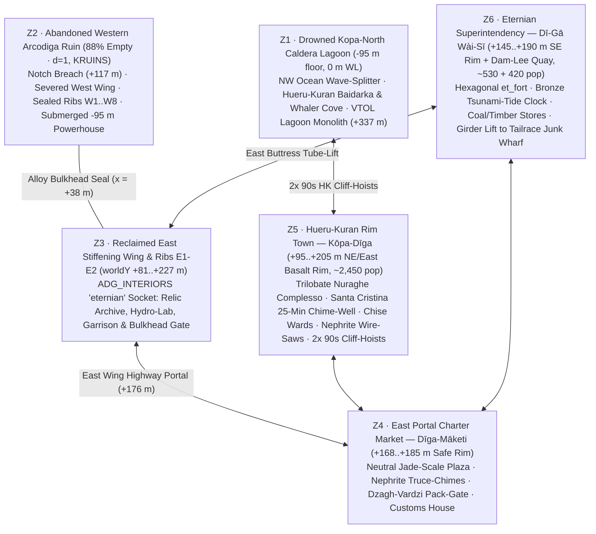

# Kōpa-Dīga / Arcodiga (`settlements/arcodiga/`): Build Plan

> [!IMPORTANT]
> **Status (`2026-11-24`, branch `claude/arcodiga-hueru-eternian` off `claude/integration-4`):** **Build-ready settlement scope** adapting Paolo Soleri's **Plate 18: Arcodiga** (`kits/ancients/targets/arcodiga`) at **Crookshore North Crater (`Kopa-North`, Scale Model `5.1` `px 89, 604` / southern caldera throat `88.5, 608`)** into a **mostly abandoned, tsunami-scarred dam-arcology** flanked by a **`Hueru-Kuran` rim & lagoon charter-market town (`~2,450` people)** and a fortified **`Eternal State` (`Eternian`) expeditionary superintendency (`~950` people)** dispatched `320 km` WSW from **`Farport` (`248, 585`)**.

---

## 0. Overview Table

| Field | Specification |
|---|---|
| **Folder & Pages** | `settlements/arcodiga/` (`src/`, `tests/`, `bundles.py`, `build.py`, `verify.py`, `arcodiga_site_blueprint.py`, `materials.json`, `BUDGETS.json`, `PLAN.md`, `API.md`, `PORT.md`, `INDEX.md`, `KNOWN_ISSUES.md`) -> `dist/arcodiga-town.html` (+ `P0` coarse massing gate `mock.html`) |
| **Names & Glosses** | **Arcodiga** *(Order of Historians / Ancient plate name)*; **`Kōpa-Dīga`** *(`Hueru-Kuran`: "Caldera-Dam")*; **`Dī-Gā Wài-Sī` / `Dò-gā-pò`** *(`Pè-wè` Paper / `Mã-wè` Lowland Eternian: "Outer Dam Superintendency / Dam-Port")*; **`qDī-gā cMā-pò`** *(`Farport` 3-Parent Creole: `Eternian + Hueru-Kuran + cFlīt-qBōn` clicks, spoken in the shared Charter Market)* |
| **Scale-Model `5.1` Site** | **`px (89, 604)` / throat `(88.5, 608)`** (`Crookshore` `rmw4wknusgc7h`, `5.2 × 5.2 km` `1:1` cut): `~11 km`-wide drowned `secondary-ejecta` basalt caldera (`-95 m` central lagoon, `+184..+205 m` circular basalt rim, `1,663–1,804 mm/yr` `Cfa`/`Am` cloudforest, `1.60 atm` sea level). **Arcodiga** (`1,460 m` arch chord, `2,040 m` Horizontal Stiffening Wing) spans the **`1.5–2.0 km` southern basalt gorge-throat (`87..90, 608`, `-65 m` channel between twin `+200 m` basalt cliffs)** separating the `-95 m` crater lagoon from the intra-coastal sound toward `Kōpa-Hueru` (`75, 679`) |
| **Ancient Megastructure** | **`kits/ancients/targets/arcodiga`** read in place (`8av0..8av3`, `8zz3`, `{ noTerrain: true, noWater: true, ground }`, `ARCODIGA.HULL`) seated on the **`-95 m` bedrock crater-throat sill (`worldY = localY - 95 m`)**: **`88%` abandoned ruin (`d = 1` + `KRUINS.watch` + `dormant` bulkheads)** with drowned lower Powerhouse (`-95..-49 m`), severed West Stiffening Wing (`x = -348..-182 m`), Notch cascade scar (`worldY +117 m`), wind-moaning Western Ribs (`W1..W8`) & sea-bird VTOL tower (`worldY +337 m`); **`12%` occupied Eternian enclave** inside the intact East Stiffening Wing (`wing.learning`, `wing.hub`, `worldY +81..+227 m`) & inner East Buttresses (`E1..E2`), live-socketed via `ADG_INTERIORS.entry(AI, { culture: 'eternian' })` |
| **Town Kits & Biome** | **`core/city`** (`KCITY` + `42/53` `hostMultikit` `DataTexture2DArray` atlas + `54` `constructMesh`), **`kits/hueru-kuran`** (sealed as `HKK` in `bundles.py`), **`kits/eternian`** (sealed as `ETK` in `bundles.py`), **`kits/ringsea`** (`hkWhaler`, `arkChainedWard`, Eternian state supply coaster), **`kits/port`** (cranes & salvage winches), **`biomes/crook`** (`CROOK_PHYS` `+65 m` tsunami trimline, `< +65 m` lithistid basalt chimney-sponges, `>= +65 m` *benihi* red-cypress & canopy fog-sponges), **`kits/crops`** (`CROPS.BIOMES.crook`), **`kits/resources`** (`jade = 200`, `coal = 209`, `tin = 200`, `iron = 180`, `silica = 150`) |
| **Population & Polities** | **`~3,400` total (`715` households; `0` permanent dwellings below `+65 m`):** 1. **`Hueru-Kuran` Whale-Clans (`~2,450`, `72%`, East & NE Rim `+95..+205 m` + Sheltered Crater Lagoon):** Trilobate *Nuraghe Complesso*, *Santa Cristina* `25-min` Ghost-Tsunami chime-well, whale-rib *Chise* market town, nephrite pendulum wire-saws, `90-second` cliff-hoists & *baidarka*/*whaler* lagoon yards; 2. **`Eternal State` Expeditionary Superintendency (`~950`, `28%`, Intact East Wing `+81..+227 m` + SE Rim Fort `+145..+190 m`):** `~420` engineers, hydrographers, relic-clerks & halberdiers inside `Arcodiga`'s East Wing + `~530` in the walled `ETK` cliff-cantonment, customs gate & dam-lee coaling quay |
| **Hard Budgets (`BUDGETS.json`)** | Page `<= 14.5 MB` (`< 16 MB` cap), Scene `<= 5.8M` tris (`<= 2.3M` rendered via `core/lod` & bulkheaded ribs), Draw calls `<= 260`, Active samplers **`<= 13`** per program (`< 15` survey cap), `KSHADOW` **off at load** |

---

## 1. Strategic & Geomorphic Synthesis: Why `Arcodiga` Sits at `Kopa-North` (`89, 604`)

### 1.1 Exact Scale-Model `5.1` Raster Fit (`2 km/px` Surveyed Elevations)

Direct inspection of `h.png` and `wl.png` across `x = 82..99, y = 593..612` shows why `Kopa-North` (`89, 604`) is a natural 1:1 seat for Soleri's **Arcodiga**:
- **Circular Drowned Caldera Bowl (`88..90, 603..605`):** **`-95 m` deep lagoon** (`~10 km` across) encircled by **`+184 to +205 m` columnar `arch-rift-basalt` and `secondary-ejecta` rims** on the north (`88..91, 599`: `+199..+200 m`), west (`84..86, 604..608`: `+184..+200 m`), and east (`93..94, 600..607`: `+184..+200 m`).
- **Two Narrow Sea Breaches:**
  1. **NW Ocean Breach (`86..87, 601..603`, `-38 to -86 m`):** Blasted open during a Cataclysmic `Farside` / `Steaming Seamounts` mega-tsunami, drowning the former freshwater/pumped-storage caldera reservoir to `0.0 m` sea level while leaving the inner SE lagoon baffled from direct WNW (`287°–294°`) bores.
  2. **Southern Basalt Gorge-Throat (`87..89, 608`, `-36 to -65 m` channel between `86, 608` `+200 m` West Cliff and `91, 608` `+200 m` East Cliff):** A **`1.5–2.0 km` rock-jawed strait** matching `ARCODIGA.DIM.SPAN = 1,460 m` and `WING = 2,040 m` (`WING.rockX = 930 m` per side) without rescaling a single metre of `8av0-arcodiga-plan.js`!

### 1.2 Seating Datum (`worldY = localY - 95 m`) & Vertical Ruination Profile

Seating `buildArcodiga`'s foundation (`localY = 0`) on the **`-95 m` caldera-throat bedrock floor** produces a dramatic four-band coastal ruin:

| `Arcodiga` Organ (`8av0-arcodiga-plan.js`) | `localY` (m) | **`worldY` (m)** | Present Condition & Occupant |
|---|---:|---:|---|
| **Power House (`5` chutes) & Automated Industries** | `0 .. +46` | **`-95 .. -49`** | **Completely submerged** beneath the `-65 m` tidal strait; ruptured turbine draft-tubes act as submarine tidal reefs explored only by `cFlīt-qBōn` & `Hueru-Kuran` breath-hold salvage divers |
| **Lower Dam Arch & Submerged Buttress Toes** | `+46 .. +160` | **`-49 .. +65`** | **Intertidal & Megatsunami Scour Belt (`< +65 m`):** Encrusted up to `+65 m` with `biomes/crook` salt-mist **lithistid chimney- and cushion-sponges**; battered by `15–50 m` Ghost-Tsunami run-up (`0` dwellings!) |
| **West Dam, Notch Scar (`x = -265 m`), Severed West Wing (`-348..-182 m`), Axial Spine West & `14` Ribs (`W1..W8, E3..E8`)** | `+152 .. +376` | **`+57 .. +281`** | **Mostly Abandoned Ruin (`88%` of floor area, `d = 1` + `dormant`):** Severed highway span, wind-sighing empty cellular tiers, sealed alloy bulkheads, `KRUINS.watch`-verified megablock talus on the west shoal, and canopy fog-sponges |
| **VTOL Elevator Spire (`z = -490 m` in Crater Lagoon)** | `+16 .. +432` | **`-79 .. +337`** | **Drowned-Base Lagoon Monolith:** Rises straight out of `-86 m` crater water to **`+337 m`**; flight deck abandoned to sea-eagles, with a joint `Hueru-Kuran` whale-oil / `Eternian` bronze storm-beacon on its SE corner |
| **Intact East Stiffening Wing (`wing.learning`, `wing.hub`, `x = +40..+1,020 m`) & Inner East Ribs (`E1..E2`)** | `+152 .. +322` | **`+57 .. +227`** | **Active `Eternal State` Expeditionary Enclave (`12%` of arcology, `~420` residents, `worldY >= +81 m` highway deck):** Dry, structurally sound, keyed directly into the `+200 m` East Basalt Rim; re-dressed in `eternian` via `ADG_INTERIORS` |

### 1.3 Why This Gives the Eternal State a Vital Interest on Northern Crookshore

1. **Close Coastal Reach from `Farport` (`248, 585` -> `89, 604`, `320 km` WSW):** Unlike the `Shroudhills` interior (blocked by `Yonni` Spear-Queens and Shroud-Ants), `Kopa-North` is a **1.5-day coastal junk sail WSW from `Farport`** along the `Farside`–`Crookshore` shelf.
2. **Timber, Coal, Tin & Nephrite for Timber-Starved `Farside`:** `Farport`'s promontory is wind-scoured and timber-poor, whereas northern `Crookshore` (`biomes/crook` §2.1) holds **`wood = 255`** (`30 m` *benihi* red-cypress ship-masts), **`coal = 209`**, **`tin = 200`**, **`iron = 180–255`**, **`silica = 150`**, and **`jade = 200`** (Krator's #1 nephrite province).
3. **The Machine Layer & Ancestor Archive Obsession (`LORE.md` §6.19):** `Arcodiga`'s intact **East Learning Center (`arcodiga.wing.learning`, `168 ha` gross shell)** preserves pre-Cataclysm technical plates, hydro-governor gearboxes, and alloy bulkheads that Fulcrum's Ministry of Works & Relic Censors study and ship back to `Farport` and `Lux` (`498, 644`).
4. **25-Minute Ghost-Tsunami Early Warning for `Farport`:** Because WNW (`287°–294°`) abyssal shield-slump bores strike `Kopa-North` (`X = 89`) **`~22–28 minutes` before** reaching `Farport` (`X = 248`), the Eternian Superintendency pairs `Hueru-Kuran`'s *Santa Cristina* drawdown chime-well with a mechanical bronze **Tide-and-Warning Clock (`et_clock`)** and heliograph/telegraph relay along the coast!
5. **Living Birthplace of the `Farport` 3-Parent Creole (`CROOK-RIA-SCOPE.md` §1.1):** At the East Wing Highway Portal (`worldY +176..+185 m`), painted Eternian clerks, `Hueru-Kuran` whale-clan matrons, upland `Dzagh-Vardzi` (`Vardzieti`) metallurgists, and pelagic `cFlīt-qBōn` `paktong`/salvage divers trade side-by-side under a strict **Charter of the Chime** — the exact three-culture contact zone that forged `Farport` Creole!

---

## 2. Core Adoption & Survey Checks (`README.md`, "CORE MODULES ARE NOT OPTIONAL")

Verified against `tools/check_core_use.py` (`REQUIRED['settlements'] = ['rand', 'tags']`, `simulation -> city`, `PLACED` world/biome sync) and `tools/checks_optin.json` (items 22–33):

### 2.1 Modules & Kits Taken

| Module / Kit | Fragments / Bundle | Role in `settlements/arcodiga` |
|---|---|---|
| **`core/rand`** | `08-core-rand.js` (`KRAND`) | Deterministic `(world, cell, index, salt)` seeding across arcology deltas, `KCITY` lots, salvage scatter, and flora (`0` `Math.random`, `0` `Math.sin` hash) |
| **`core/tags`** | `50/52/53-core-tags*.js` (`KTAGS`) | Pre-draw registration of every `Arcodiga` organ/ruin, `hueru-kuran` & `eternian` building, cliff-hoist, vessel, resource node, flora stand & citizen |
| **`core/space`** & **`core/mask`** | `20-core-space.js` (`KSPACE`), `KMASK.canvas` | Unified spatial occupancy across East Rim `KCITY` districts, `Arcodiga` wing abutments, cliff-hoist corridors, and rainforest clearings (`0` `getImageData`) |
| **`core/drawn`** | `10-core-drawn.js` (`KDRAWN`) | Registers caldera rims, submarine throat floor, dam crest, East Wing highway deck, and harbour quays for `drawn-ground` eye-clearance audits |
| **`core/city`** | `10..40`, `42-city-multikit.js`, `50`, `53-city-host-multikit.js`, `54-city-host-construct.js` (`KCITY`) | Multi-culture `[G data]` layout (`stance: 'door'`, `TUNE.exact = true`): **Instance 1 (`hk_rim`)** lays out the `Hueru-Kuran` NE/East Caldera Rim town (`+95..+205 m`); **Instance 2 (`et_cantonment`)** lays out the walled `Eternian` SE Rim Superintendency & Charter Market (`+145..+190 m`); **Instance 3 (`cove_works`)** places expendable `< +65 m` lagoon *baidarka* yards & dam-lee Eternian salvage wharves; `53` packs `HKK` + `ETK` into one `DataTexture2DArray` (`<= 13` samplers) |
| **`core/world`** & **`core/coast`** | `core/world/` (`WORLD.H`, `44c-world-coast.js`) + `30-core-coast.js` (`KCOAST`) | `1:1` Scale Model `5.1` terrain around `(89, 604)` / `(88.5, 608)` (`PLACED`), binding `KCOAST` basalt sea-cliff, wave-planed spray bench, and calm caldera-lagoon profiles |
| **`core/terrain`** | `30`, `35` (`KSTRATA`: `arch-rift-basalt` + `secondary-ejecta`), `36` (`KCARVE`), `38` (`KRELIEF`), `43` (`KGROUND` `<= 5` layers), `44` (`KFAR`), `45` (`KHORIZON`) | Cuts the `1,460 m` southern basalt throat, East Wing highway portal tunnel (`x = +930 m`), rock-cut cliff-hoist slots, `KGROUND` hex-blended basalt/turf/forest floor, and `16 km` `KFAR` Crookshore mountain backdrop |
| **`core/water`** | `20..22`, `50..51`, `ext/56..61`, `62` (`WATER.flood`), `farbed/53` | Heavy `1.60 atm` NW ocean breakers outside the NW breach (`surf: true`) vs. calm sheltered `-95 m` `Kopa-North` lagoon (`surf: false`), *Santa Cristina* step-well `WATER.still` mirror pool, nephrite sawmill `WATER.flow` leats, and `[Ghost-Tsunami Drawdown & Surge]` drill |
| **`core/atmos`** & **`core/shadow`** | `ATMOS.bindHost` (`1.58–1.60 atm`, `Crookshore` fog-belt & sea-spray, `#include <atmos_waves>` driving `HKK` gutskin awnings & nephrite chimes) + `KSHADOW` (**off at load**) | Standard Krator skybox, live wind on `Hueru-Kuran` sails/kelp/chimes and `Eternian` ministry banners, `?shadow=1` cascade |
| **`core/materials`** | `23-mat-record.js`, `25-matlib-host.js`, `27-matlib-m1.js` (`KMAT_M1`) | Stage 8 vertical-stack PBR (`hemi-oct8` normals, `mip-variance` roughness AA, 6-step POM on cyclopean basalt, Eternian carved stone & Ancient concrete, `< 15` samplers) |
| **`core/ruins`** | `20-core-ruins.js`, `21-core-ruins-host.js` (`KRUINS.watch`) | Watches `Arcodiga`'s severed West Stiffening Wing, Notch breach talus, collapsed western rib bays, and drowned powerhouse debris (`0` floaters) |
| **`kits/ancients` (`arcodiga`) & `kits/ancients-interiors`** | `kits/ancients/targets/arcodiga` (`8av0..8av3`, `8zz3`) + `KratorAncientsInteriors` + `core/interiors` (`KROOMLIGHT`) | Draws `Arcodiga` with `{ noTerrain: true, noWater: true, ground }` and custom partial-occupation delta (`ADG_CROOK_DELTA`): furnishes **only** East `wing.learning`, `wing.hub` & `E1..E2` in `'eternian'` (`KROOMLIGHT` 6-light pool), leaving `spine` west, `crest` west & `W1..W8` ruined/sealed |
| **`kits/hueru-kuran`** & **`kits/eternian`** | Sealed in `bundles.py` as `HKK` (`hk_*`, `hkDims`, `HK_TRADES`) and `ETK` (`et_*`, `etDims`, `ET_TRADES` in official painted `ministry` / `common` frontier dress) | Supplies all `Hueru-Kuran` *nuraghi*, *Santa Cristina* step-wells, whale-rib *chise* lodges, `90s` cliff-hoists & nephrite wire-saws alongside official painted `Eternal State` frontier fort, customs house, clock, and warehouses |
| **`core/catalog`**, **`core/furnish`**, **`kits/interiors`**, **`kits/construction`** | `KFURN.useBatch(..., {indexed: true})`, `KCONS` + `KCITY.constructMesh` | Furnishes hero `Hueru-Kuran` & `Eternian` cut-aways (`39-hk-furn.js` + `eternian` catalog) and active East Wing salvage / rim construction lots |
| **`kits/ringsea`** & **`kits/port`** | Read in place (`89h` `hkWhaler`, `89g` `arkChainedWard`, Eternian coastal supply junk, `hkBaidarka`, `kits/port` salvage sheerlegs) | Populates the calm `-95 m` crater whale-lagoon, the `cFlīt-qBōn` dive-anchorage above the drowned powerhouse, and the Eternian tailrace coaling wharf |
| **`core/door`**, **`core/walk`**, **`core/host`**, **`core/minimap`** | `KDOOR`, `KGLASS`, `KWALK`, `khost.FULL + UNDERGROUND` | Operable nephrite-lintel `hkJadeDoor`, Eternian ancestor-lintel `etCivicDoor` & Ancient bulkhead doors; continuous `KWALK` across East Rim -> East Wing Highway (`+81 m`) -> `E1..E2` ribs -> `90s` cliff-hoists -> quays |
| **`core/simulation`**, **`core/clock`**, **`core/sched`** | `SIM` (`settlement: 'arcodiga'`), `20-core-clock.js`, `20-core-sched.js` | `3,400` citizens, dual-polity charter market ledger, `nephrite` wire-sawing, whale-oil rendering, `Arcodiga` alloy/relic salvage, `coal`/`tin` transshipment & `4` `SIM.trade` routes (`Farport`, `Kōpa-Hueru`, `Vardzieti`, `cFlīt-qBōn` Cove) |
| **`core/charactermodels`** | `data/peoples.json` (`hueru_kuran` whale-clan coats, **rank-painted official `eternian` magistrates/engineers**, `cflit_qbon` divers, visiting `dzagh_vardzi` muleteers) | Contrasts white-painted Eternian state officials & halberdiers directly against bare-faced `Bè-tõ-pò` smugglers (`settlements/battered-port`) and `Hueru-Kuran` oiled-gutskin mariners |
| **`biomes/crook`**, **`kits/crops`**, **`kits/fauna`**, **`kits/resources`**, **`core/hazard`**, **`core/export`** | Read in place (`CROOK`, `CROOK_PHYS`, `CROPS.BIOMES.crook`, `KHAZ`, `EXPORT`) | Enforces strict **`+65 m` tsunami trimline** (`basaltSpongeOk` below, *benihi* red-cypress & `canopySpongeOk` above), `KHAZ` `< +65 m` surge & Notch rockfall zones, and M6 Godot/`openworld` export |

### 2.2 Modules Deliberately NOT Taken

- **`core/hamlet` (`KHAMLET`) & `core/camp` (`KCAMP`):** Multi-ward `3,400`-person dual-polity charter town on `core/city`; pelagic `cFlīt-qBōn` salvage crews berth on floating `arkChainedWard` hulls over the drowned powerhouse.
- **`core/anomaly` (`KANOM`) & `core/water/geyser`:** `Crookshore` is non-volcanic `secondary-ejecta` / `arch-rift-basalt` (`0` fumaroles in `biomes/crook` §1.2) and outside `Silent Vales`'s *Great Hush* boundary.

---

## 3. Spatial Layout: Six Vertical & Cultural Zones (`5.2 × 5.2 km`)

### 3.1 Zone-by-Zone Breakdown & Census (`~3,400` On-Screen / Sim Pop)

| Zone | ID & Name | Elev Band | Polities & Kit | Pop (`HH`) | Key Structures & Gameplay Role |
|---|---|---|---|---:|---|
| **Z1** | **`caldera_lagoon`** (*Kopa-North* Sheltered Basin & Lower Hoist Foot) | `-95 .. +42 m` | `Hueru-Kuran` + `cFlīt-qBōn` (`HKK` + `ringsea`) | `140` *(shift crews & ark divers; `0` land homes)* | `hk_wave_splitter` whale-jawbone breakwater baffling the NW breach, `hk_prou_torre` `+18 m` intertidal refuge keep, `hk_baidarka_yard`, lower cradles of `2` `hk_cliff_hoist` lifts, and `cFlīt-qBōn` `arkChainedWard` diving over the `-65 m` drowned `Arcodiga` powerhouse |
| **Z2** | **`arcodiga_ruin`** (*Western Breach, VTOL Spire & Sealed Ribs*) | `-95 .. +337 m` | Ancient Ruin (`targets/arcodiga` `d=1`, `KRUINS.watch`) | `0` *(uninhabited exploration zone)* | Severed West Wing (`x = -348..-182 m`), Notch cascade scar (`+117 m`), `14` dark/bulkheaded Living-Working ribs (`W1..W8, E3..E8`), drowned `-95..-49 m` turbine vaults, and the `+337 m` lagoon-surrounded VTOL tower |
| **Z3** | **`arcodiga_east_wing`** (*Reclaimed Learning Wing & `E1–E2` Buttresses*) | `+81 .. +227 m` | `Eternal State` (`ADG_INTERIORS` `'eternian'` socket) | `420` (`95`) | **Official Eternian Expeditionary Core** inside `arcodiga.wing.learning`, eastern `wing.hub`, and `E1..E2`: Relic Transcription Hall, Tsunami/Tide Telemetry Loft, Salvage Machine Shop, Halberdier Wardrooms, and the great **Bronze Ancestor-Lintel Bulkhead** sealing off the ruined Western Spine at `x = +38 m` |
| **Z4** | **`portal_market`** (*Dīga-Māketi / East Highway Charter Plaza*) | `+168 .. +186 m` | Joint Truce (`HKK` + `ETK` + `KCONS`) | `220` (`48`) | Built directly across `Arcodiga`'s `2,040 m` East Wing Highway portal apron: `et_customs_house` (painted clerks weighing coal, tin & Ancient alloy plate) facing `hk_council_hall` (*Ukor* Chime-Court), jade-beam assay scales, `et_tea_house`, blubber-lamp tavern, and `Dzagh-Vardzi` mountain mule-caravan corrals |
| **Z5** | **`kopa_diga_rim`** (*Hueru-Kuran Caldera-Rim Market Town*) | `+95 .. +205 m` | `Hueru-Kuran` (`HKK` on `KCITY` Instance 1) | `2,090` (`452`) | `100%` tsunami-immune basalt & cloudforest bench: trilobate *Nuraghe Complesso* keep, ***Santa Cristina* `25-min` Ghost-Tsunami drawdown step-well** (`hk_stepwell_sanctuary`), `~360` basalt-ringed whale-rib *Chise* lodges (*kaen-doki* flame-ceramic crowns & glowing emerald-nephrite panes), `hk_jade_sawmill` pendulum wire-saws on eastern cloudforest cascades, `hk_cypress_flume_yard` receiving `30 m` *benihi* logs, and `2` upper `hk_cliff_hoist` heads |
| **Z6** | **`eternian_cantonment`** (*Dī-Gā Wài-Sī Fort & Dam-Lee Coaling Quay*) | `+145 .. +190 m` *(+ `+6 m` lee wharf)* | `Eternal State` (`ETK` on `KCITY` Instance 2 & 3) | `530` (`120`) | Walled hexagonal `et_fort` & `et_ministry` superintendency on the SE basalt bluff overlooking the strait, **`et_clock` mechanical bronze tsunami-tide clock** synced to the *Santa Cristina* chime-well, `et_talking_head` oracle shrine, `et_warehouse` coal/timber yards, and an Eternian girder/tube cliff-lift dropping behind East Buttress `E2`'s tsunami shadow to the sheltered **Farport Junk Coaling & Timber Quay** (`et_dock`, `et_lighthouse`) |

---

## 4. Adapting `kits/ancients/targets/arcodiga` Without Forking (`ADG_CROOK_DELTA`)

Because `8av3-arcodiga-draw.js` and `8zz3-arcodiga-host.js` on `claude/integration-4` already isolate terrain RNG (`reseed(12790 + d)` vs `reseed(12700 + d)`), expose `ARCODIGA.HULL`, and support `ADG_INTERIORS.entry(AI, { culture: 'eternian' })`, adapting `Arcodiga` requires **zero forks of `kits/ancients`**:

1. **Read in Place with `{ noTerrain: true, noWater: true, ground }`:** `settlements/arcodiga/build.py` reads `8av0..8av3` directly from `kits/ancients/targets/arcodiga/` (`TARGET_READS`), placing the dam arch across the `(88.5, 608)` basalt gorge-throat at `yOffset = -95.0 m` (`0` synthetic canyon rock or flat silt-basin geometry drawn).
2. **Asymmetric Partial-Refurbishment Mode (`d = 1` Exterior Breach + Selective East-Wing `d = 5` Socket):**
   - A small settlement-side adapter (`src/44-adg-crook-delta.js`, `[G data]`, `< 120` lines) runs `buildArcodiga` in its breached/tsunami-scarred geometry (`Notch` cascade sill at `worldY +117 m`, severed West Wing `x = -348..-182 m`, `KRUINS.watch` debris seated on the real `-65..+12 m` throat bed) while keeping the **East Stiffening Wing (`x >= +38 m`)** structurally whole and dry.
   - In the interior pass, `ADG_INTERIORS` furnishes **only** `wing` east (`wing.learning` + east `wing.hub`) and `ribs` east (`E1, E2`) in `culture: 'eternian'` (`~185` rooms, `KFURN` indexed, `KROOMLIGHT` 6-light pool), sealing `x = +38 m` with a bronze Eternian ancestor-lintel bulkhead (`etCivicDoor`) and leaving all western/lower organs as dark ruined or drowned sockets (`<= 350 MB` VRAM, fast build).

---

## 5. Regional Economy & `SIM` Chains (`41/44` Voth Trades Across `HKK` + `ETK`)

Combining `HK_TRADES` (`kits/hueru-kuran/src/34-hk-trades.js`) and `ET_TRADES` (`kits/eternian/src/68-et-trades.js`) covers `41/44` Voth census trades naturally across the two quarters (`3` canonical `na` insect/beast rows), driven by **five active workshop & charter-trade chains**:

1. **`crook-nephrite-sawing` (`HKK` `hk_jade_sawmill` + `hk_jade_quarry`):** Slices `Crookshore` `jade = 200` boulders with `silica = 150` quartz abrasive into emerald-nephrite lintels, translucent windowpanes, tsunami float-chimes, and Eternian magistrate seals.
2. **`benihi-mast-and-coal-export` (`HKK` `hk_cypress_flume_yard` + `ETK` `et_warehouse` / `et_mine`):** Flumes `30 m` rot-proof *benihi* red-cypress logs off the eastern cloudforest and mines `coal = 209` seams to load `Farport` state supply junks in the dam-shielded tailrace cove.
3. **`arcodiga-relic-and-alloy-salvage` (`ETK` East Wing Works + `cFlīt-qBōn` Dive Crews):** Strips non-structural Ancient bronze/alloy plates, ceramic insulators, and Machine-Layer archive tablets from dormant `Arcodiga` bays (`KCONS` stockpiles + export to `Farport` / `Fulcrum`).
4. **`pelagic-whale-oil-and-glass` (`HKK` Try-Works & Kelp-Soda Glassworks):** Renders whale-oil & ambergris for storm-lamps and fires sea-green kelp-ash glass (`silica = 150`) alongside Jōmon *kaen-doki* ceramics.
5. **`vardzieti-tin-pack-exchange` (`Dīga-Māketi` Charter Plaza):** Trades Eternian porcelain, tea, salt, and printed almanacs to upland `Dzagh-Vardzi` (`Crookwash`) mule-trains for `tin = 200` cassiterite, skarn iron, and mountain furs.

---

## 6. Phased Order of Work & Verification Gates (`P0` -> `P5`)

1. **`P0` — Coarse Massing & Datum Gate (`mock.html` + `arcodiga_site_blueprint.py`):** Place the `(89, 604)` / `(88.5, 608)` `-95 m` caldera & `+200 m` basalt gorge-throat, `Arcodiga` at `yOffset = -95 m` (submerged powerhouse, severed West Wing, intact East Wing keying into the `+200 m` East Rim), the NE `Hueru-Kuran` *Nuraghe* rim massing, and the SE `Eternian` hexagonal fort & dam-lee wharf across `8` camera presets for owner review.
2. **`P1` — `[G data]` Multi-Kit `KCITY` Layout & `ADG_CROOK_DELTA` (`tests/test-arcodiga-town.js`):** Prove `0` OBB overlaps, **`0` permanent dwellings below `+65.0 m`**, continuous `KWALK` across `HKK` Rim <-> Charter Market <-> `Arcodiga` East Wing (`+81 m`) <-> `ETK` Fort <-> `90s` Cliff-Hoists, and `41/44` Voth trades on `tools/ktest.js` (with `T.neg` negatives).
3. **`P2` — `HKK` + `ETK` `DataTexture2DArray` Atlas & `Arcodiga` Asymmetric Dress:** Seal `bundles.py` (`HKK`, `ETK`), wire `KCITY.hostMultikit` (`<= 13` samplers), seat `KRUINS.watch` on the western dam breach, and furnish the East Wing `'eternian'` rooms (`KROOMLIGHT`, `0` sky PMREM leak in deep vaults).
4. **`P3` — `biomes/crook` Trimline Ecology, `1.60 atm` Wind & Tsunami Drill:** Bind `CROOK` flora (`< +65 m` lithistid basalt sponges vs. `>= +65 m` *benihi* red-cypress & canopy fog-sponges), `ATMOS` wind on `HKK` gutskin awnings & nephrite chimes, and interactive `[Ghost-Tsunami Drawdown]` (`-8 m` pre-bore drawdown ringing the *Santa Cristina* chimes + syncing `et_clock` + raising all `90s` cliff-hoists!).
5. **`P4` — `SIM` 30-Day Charter Economy, Painted vs. Whale-Clan Crowds & `verify.py --assert`:** Pass all 7 `harness.SURVEY` checks (`samplers`, `drawn-ground`, `water-mouths`, `leaf-stems`, `names`, `KRUINS`, `KSHADOW` off), `closed-eyes` Eternian statuary assert, `zfightAudit`, 30-day `SIM` stock proof, and M6 Godot `4.7.2` export.
