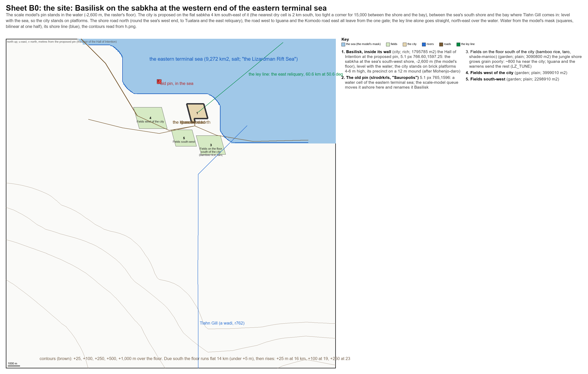
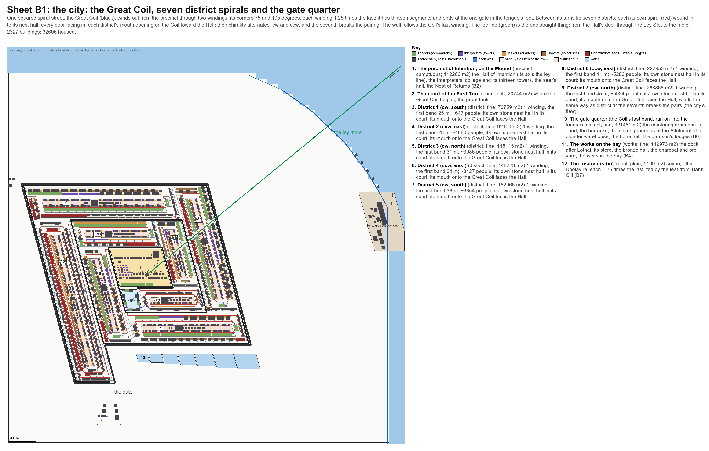
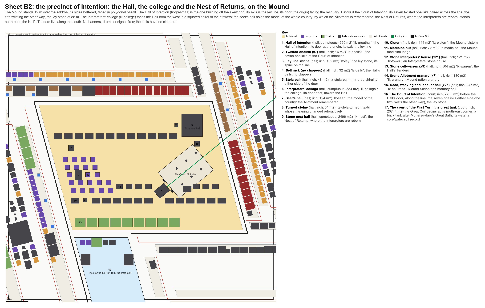
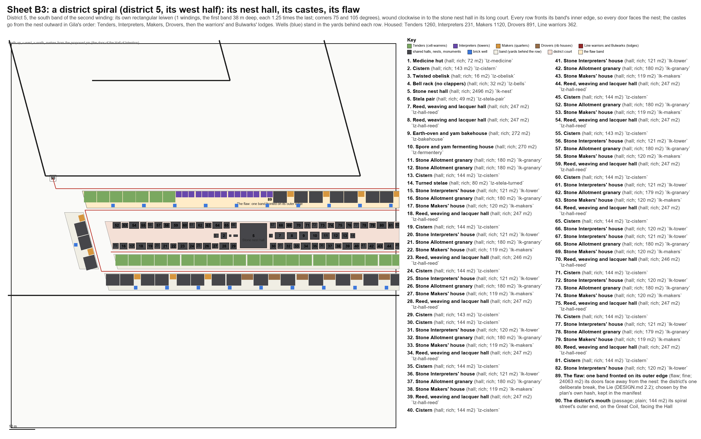
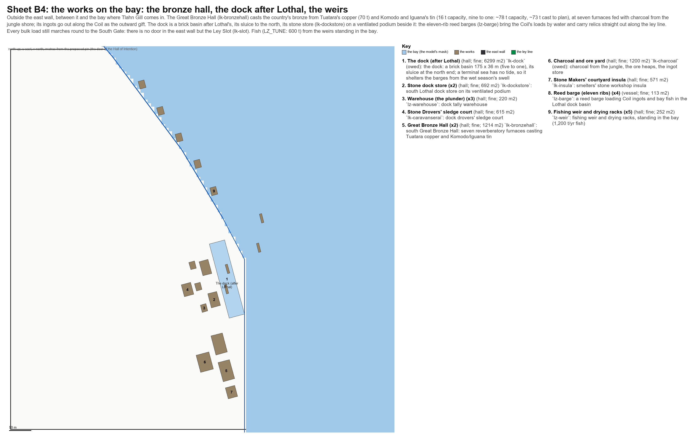
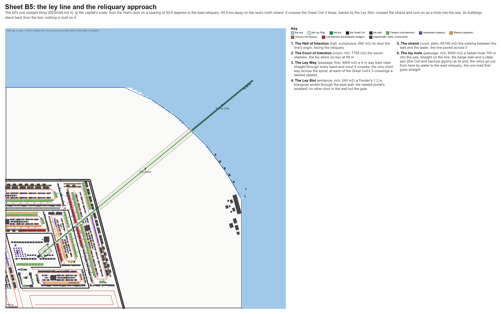
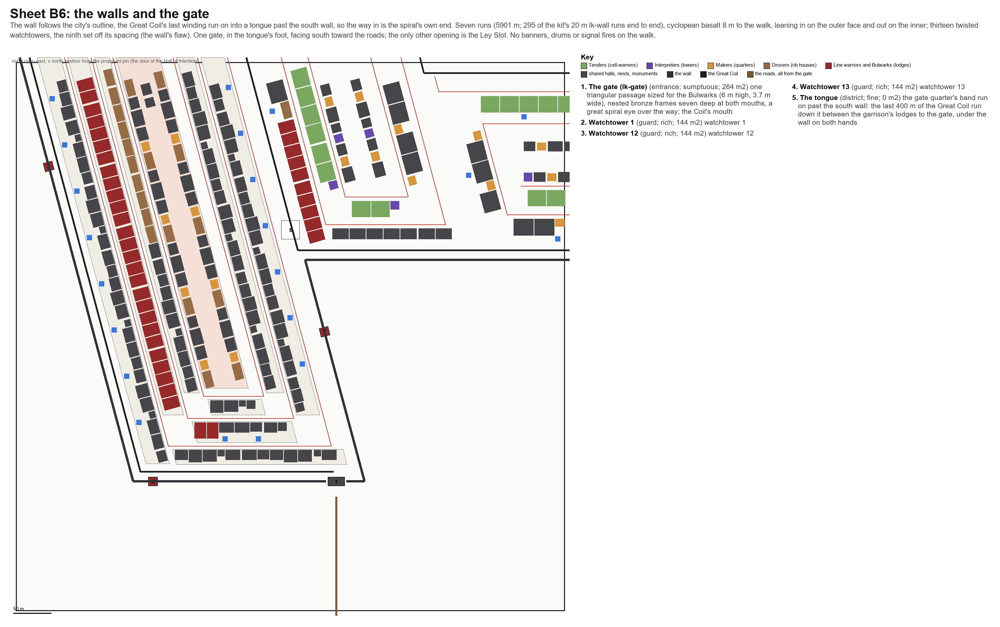
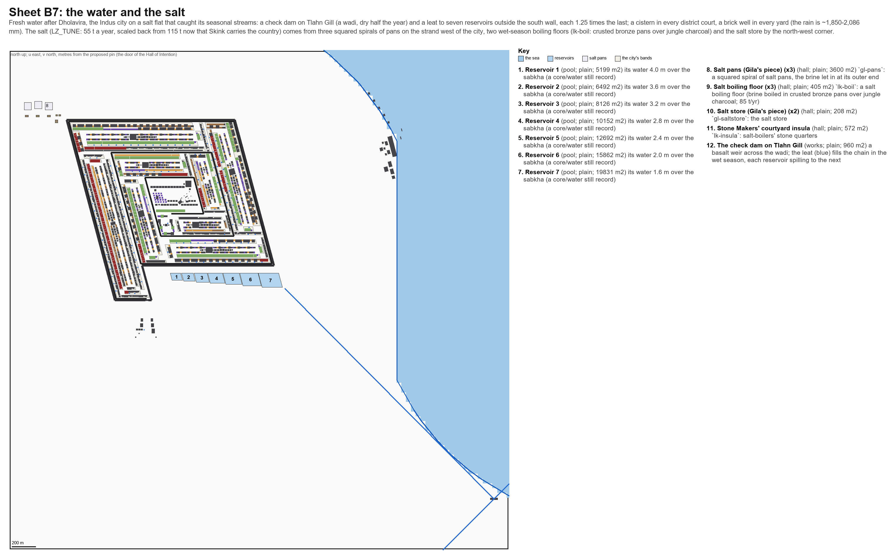
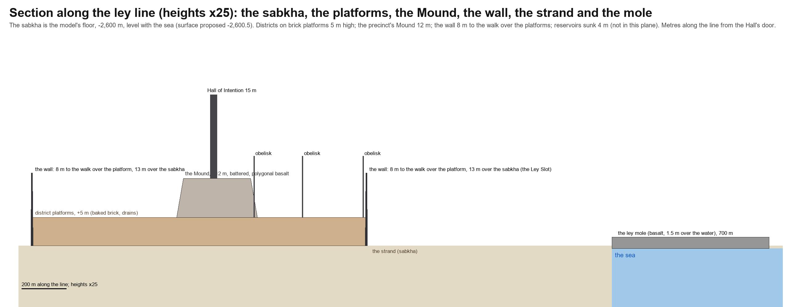

# Basilisk: the blueprint sheets

Generated by `basilisk_blueprint.py` from `basilisk_layout.py` (the same numbers as `basilisk_plan.json`); drawn by the shared sheet generator
`settlements/voth/palace/blueprint.py`. Every sheet is north up and to scale (its bar); u east, v north, metres from the proposed pin, the door of
the Hall of Intention. Everything is *proposed*: `PLAN.md` is the plan and the owner's questions.

## Sheet B0: the site: Basilisk on the sabkha at the western end of the eastern terminal sea

The scale model's pin stands in the water (-2,600 m, the raster's floor). The city is proposed on the flat sabkha 4 km south-east of it (the nearest dry cell is 2 km south, too tight a corner for 15,000 between the shore and the bay), between the sea's south shore and the bay where Tlahn Gill comes in: level with the sea, so the city stands on platforms. The shore road north (round the sea's west end, to Tuatara and the east reliquary), the road west to Iguana and the Komodo road east all leave from the one gate; the ley line alone goes straight, north-east over the water. Water from the model's mask (squares, bilinear at one half), its shore line (blue), the contours read from h.png.

| # | Item | m2 | Note |
|---|---|---|---|
| 1 | Basilisk, inside its wall | 1795785 | the Hall of Intention at the proposed pin, 5.1 px 766.60,1597.25: the sabkha at the sea's south-west shore, -2,600 m (the model's floor), level with the water; the city stands on brick platforms 4-6 m high, its precinct on a 12 m mound (after Mohenjo-daro) |
| 2 | The old pin (slrodrkrls, "Sauropolis") | 129600 | 5.1 px 765,1596: a water cell of the eastern terminal sea; the scale-model queue moves it ashore here and renames it Basilisk |
| 3 | Fields on the floor south of the city (bamboo rice, taro, shade-manioc) | 3090800 | the jungle shore grows grain poorly: ~800 ha near the city; Iguana and the warrens send the rest (LZ_TUNE) |
| 4 | Fields west of the city | 3999010 |  |
| 5 | Fields south-west | 2298910 |  |

## Sheet B1: the city: the Great Coil, seven district spirals and the gate quarter

One squared spiral street, the Great Coil (black), winds out from the precinct through two windings, its corners 75 and 105 degrees, each winding 1.25 times the last; it has thirteen segments and ends at the one gate in the tongue's foot. Between its turns lie seven districts, each its own spiral (red) wound in to its nest hall, every door facing in, each district's mouth opening on the Coil toward the Hall; their chirality alternates, cw and ccw, and the seventh breaks the pairing. The wall follows the Coil's last winding. The ley line (green) is the one straight thing: from the Hall's door through the Ley Slot to the mole. 2327 buildings; 32605 housed.

| # | Item | m2 | Note |
|---|---|---|---|
| 1 | The precinct of Intention, on the Mound | 112266 | the Hall of Intention (its axis the ley line), the Interpreters' college and its thirteen towers, the seer's hall, the Nest of Returns (B2) |
| 2 | The court of the First Turn | 20744 | where the Great Coil begins; the great tank |
| 3 | District 1 (cw, south) | 76759 | 1 winding, the first band 25 m; ~647 people; its own stone nest hall in its court; its mouth onto the Great Coil faces the Hall |
| 4 | District 2 (ccw, east) | 92100 | 1 winding, the first band 28 m; ~1886 people; its own stone nest hall in its court; its mouth onto the Great Coil faces the Hall |
| 5 | District 3 (cw, north) | 118115 | 1 winding, the first band 31 m; ~3086 people; its own stone nest hall in its court; its mouth onto the Great Coil faces the Hall |
| 6 | District 4 (ccw, west) | 148223 | 1 winding, the first band 34 m; ~3427 people; its own stone nest hall in its court; its mouth onto the Great Coil faces the Hall |
| 7 | District 5 (cw, south) | 182966 | 1 winding, the first band 38 m; ~3864 people; its own stone nest hall in its court; its mouth onto the Great Coil faces the Hall |
| 8 | District 6 (ccw, east) | 222953 | 1 winding, the first band 41 m; ~5286 people; its own stone nest hall in its court; its mouth onto the Great Coil faces the Hall |
| 9 | District 7 (cw, north) | 268868 | 1 winding, the first band 45 m; ~5934 people; its own stone nest hall in its court; its mouth onto the Great Coil faces the Hall; winds the same way as district 1: the seventh breaks the pairs (the city's flaw) |
| 10 | The gate quarter (the Coil's last band, run on into the tongue) | 321481 | the mustering ground in its court, the barracks, the seven granaries of the Allotment, the plunder warehouse, the bone hall; the garrison's lodges (B6) |
| 11 | The works on the bay | 119973 | the dock after Lothal, its store, the bronze hall, the charcoal and ore yard; the weirs in the bay (B4) |
| 12 | The reservoirs (x7) | 5199 | seven, after Dholavira, each 1.25 times the last; fed by the leat from Tlahn Gill (B7) |

## Sheet B2: the precinct of Intention: the Hall, the college and the Nest of Returns, on the Mound

The Mound stands 12 m over the sabkha, its sides battered, faced in polygonal basalt. The Hall of Intention (lk-greathall) is the one building off the skew grid: its axis is the ley line, its door (the origin) facing the reliquary. Before it the Court of Intention, its seven twisted obelisks paired across the line, the fifth twisting the other way, the ley stone at 58 m. The Interpreters' college (lk-college) faces the Hall from the west in a squared spiral of their towers; the seer's hall holds the model of the whole country, by which the Allotment is remembered; the Nest of Returns, where the Interpreters are reborn, stands north-east; the Hall's Tenders live along the south. No banners, drums or signal fires; the bells have no clappers.

| # | Item | m2 | Note |
|---|---|---|---|
| 1 | Hall of Intention | 660 | `lk-greathall`: the Hall of Intention: its door at the origin, its axis the ley line |
| 2 | Twisted obelisk (x7) | 16 | `lz-obelisk`: the seven obelisks of the Court of Intention |
| 3 | Ley line shrine | 132 | `lz-ley`: the ley stone, its spine on the line |
| 4 | Bell rack (no clappers) | 32 | `lz-bells`: the Hall's bells, no clappers |
| 5 | Stela pair | 48 | `lz-stela-pair`: mirrored chirality either side of the door |
| 6 | Interpreters' college | 384 | `lk-college`: the college: its door east, toward the Hall |
| 7 | Seer's hall | 194 | `lz-seer`: the model of the country: the Allotment remembered |
| 8 | Turned stelae | 81 | `lz-stela-turned`: texts whose meaning changed retroactively |
| 9 | Stone nest hall | 2496 | `lk-nest`: the Nest of Returns: where the Interpreters are reborn |
| 10 | Cistern | 144 | `lz-cistern`: the Mound cistern |
| 11 | Medicine hut | 72 | `lz-medicine`: the Mound medicine lodge |
| 12 | Stone Interpreters' house (x21) | 121 | `lk-tower`: an Interpreters' stone house |
| 13 | Stone cell-warren (x9) | 504 | `lk-warren`: the Hall's Tenders |
| 14 | Stone Allotment granary (x7) | 180 | `lk-granary`: Mound ration granary |
| 15 | Reed, weaving and lacquer hall (x26) | 247 | `lz-hall-reed`: Mound Scribe and memory hall |
| 16 | The Court of Intention | 7755 | before the Hall's door, along the line: the seven obelisks either side (the fifth twists the other way), the ley stone |
| 17 | The court of the First Turn, the great tank | 20744 | the Great Coil begins at its north-east corner; a brick tank after Mohenjo-daro's Great Bath, its water a core/water still record |

## Sheet B3: a district spiral (district 5, its west half): its nest hall, its castes, its flaw

District 5, the south band of the second winding: its own rectangular leiwen (1 windings, the first band 38 m deep, each 1.25 times the last; corners 75 and 105 degrees), wound clockwise in to the stone nest hall in its long court. Every row fronts its band's inner edge, so every door faces the nest; the castes go from the nest outward in Gila's order: Tenders, Interpreters, Makers, Drovers, then the warriors' and Bulwarks' lodges. Wells (blue) stand in the yards behind each row. Housed: Tenders 1260, Interpreters 231, Makers 1120, Drovers 891, Line warriors 362.

| # | Item | m2 | Note |
|---|---|---|---|
| 1 | Medicine hut | 72 | `lz-medicine` |
| 2 | Cistern | 143 | `lz-cistern` |
| 3 | Twisted obelisk | 16 | `lz-obelisk` |
| 4 | Bell rack (no clappers) | 32 | `lz-bells` |
| 5 | Stone nest hall | 2496 | `lk-nest` |
| 6 | Stela pair | 49 | `lz-stela-pair` |
| 7 | Reed, weaving and lacquer hall | 247 | `lz-hall-reed` |
| 8 | Reed, weaving and lacquer hall | 247 | `lz-hall-reed` |
| 9 | Earth-oven and yam bakehouse | 272 | `lz-bakehouse` |
| 10 | Spore and yam fermenting house | 270 | `lz-fermentery` |
| 11 | Stone Allotment granary | 180 | `lk-granary` |
| 12 | Stone Allotment granary | 180 | `lk-granary` |
| 13 | Cistern | 144 | `lz-cistern` |
| 14 | Turned stelae | 80 | `lz-stela-turned` |
| 15 | Stone Interpreters' house | 121 | `lk-tower` |
| 16 | Stone Allotment granary | 180 | `lk-granary` |
| 17 | Stone Makers' house | 120 | `lk-makers` |
| 18 | Reed, weaving and lacquer hall | 247 | `lz-hall-reed` |
| 19 | Cistern | 144 | `lz-cistern` |
| 20 | Stone Interpreters' house | 121 | `lk-tower` |
| 21 | Stone Allotment granary | 180 | `lk-granary` |
| 22 | Stone Makers' house | 119 | `lk-makers` |
| 23 | Reed, weaving and lacquer hall | 246 | `lz-hall-reed` |
| 24 | Cistern | 144 | `lz-cistern` |
| 25 | Stone Interpreters' house | 121 | `lk-tower` |
| 26 | Stone Allotment granary | 180 | `lk-granary` |
| 27 | Stone Makers' house | 119 | `lk-makers` |
| 28 | Reed, weaving and lacquer hall | 247 | `lz-hall-reed` |
| 29 | Cistern | 143 | `lz-cistern` |
| 30 | Cistern | 144 | `lz-cistern` |
| 31 | Stone Interpreters' house | 120 | `lk-tower` |
| 32 | Stone Allotment granary | 180 | `lk-granary` |
| 33 | Stone Makers' house | 119 | `lk-makers` |
| 34 | Reed, weaving and lacquer hall | 247 | `lz-hall-reed` |
| 35 | Cistern | 144 | `lz-cistern` |
| 36 | Stone Interpreters' house | 121 | `lk-tower` |
| 37 | Stone Allotment granary | 180 | `lk-granary` |
| 38 | Stone Makers' house | 119 | `lk-makers` |
| 39 | Reed, weaving and lacquer hall | 247 | `lz-hall-reed` |
| 40 | Cistern | 144 | `lz-cistern` |
| 41 | Stone Interpreters' house | 121 | `lk-tower` |
| 42 | Stone Allotment granary | 180 | `lk-granary` |
| 43 | Stone Makers' house | 119 | `lk-makers` |
| 44 | Reed, weaving and lacquer hall | 247 | `lz-hall-reed` |
| 45 | Cistern | 144 | `lz-cistern` |
| 52 | Stone Allotment granary | 180 | `lk-granary` |
| 53 | Stone Makers' house | 119 | `lk-makers` |
| 54 | Reed, weaving and lacquer hall | 247 | `lz-hall-reed` |
| 55 | Cistern | 143 | `lz-cistern` |
| 56 | Stone Interpreters' house | 121 | `lk-tower` |
| 57 | Stone Allotment granary | 180 | `lk-granary` |
| 58 | Stone Makers' house | 120 | `lk-makers` |
| 59 | Reed, weaving and lacquer hall | 247 | `lz-hall-reed` |
| 60 | Cistern | 144 | `lz-cistern` |
| 61 | Stone Interpreters' house | 121 | `lk-tower` |
| 62 | Stone Allotment granary | 179 | `lk-granary` |
| 63 | Stone Makers' house | 120 | `lk-makers` |
| 64 | Reed, weaving and lacquer hall | 247 | `lz-hall-reed` |
| 65 | Cistern | 144 | `lz-cistern` |
| 66 | Stone Interpreters' house | 120 | `lk-tower` |
| 67 | Stone Interpreters' house | 121 | `lk-tower` |
| 68 | Stone Allotment granary | 180 | `lk-granary` |
| 69 | Stone Makers' house | 120 | `lk-makers` |
| 70 | Reed, weaving and lacquer hall | 246 | `lz-hall-reed` |
| 71 | Cistern | 144 | `lz-cistern` |
| 72 | Stone Interpreters' house | 120 | `lk-tower` |
| 73 | Stone Allotment granary | 180 | `lk-granary` |
| 74 | Stone Makers' house | 120 | `lk-makers` |
| 75 | Reed, weaving and lacquer hall | 247 | `lz-hall-reed` |
| 76 | Cistern | 144 | `lz-cistern` |
| 77 | Stone Interpreters' house | 121 | `lk-tower` |
| 78 | Stone Allotment granary | 179 | `lk-granary` |
| 79 | Stone Makers' house | 119 | `lk-makers` |
| 80 | Reed, weaving and lacquer hall | 247 | `lz-hall-reed` |
| 81 | Cistern | 144 | `lz-cistern` |
| 82 | Stone Interpreters' house | 120 | `lk-tower` |
| 89 | The flaw: one band fronted on its outer edge | 24063 | its doors face away from the nest: the district's one deliberate break, the Lie (DESIGN.md 2.2); chosen by the plan's own hash, kept in the manifest |
| 90 | The district's mouth | 144 | its spiral street's outer end, on the Great Coil, facing the Hall |

## Sheet B4: the works on the bay: the bronze hall, the dock after Lothal, the weirs

Outside the east wall, between it and the bay where Tlahn Gill comes in. The Great Bronze Hall (lk-bronzehall) casts the country's bronze from Tuatara's copper (70 t) and Komodo and Iguana's tin (16 t capacity, nine to one: ~78 t capacity, ~73 t cast to plan), at seven furnaces fed with charcoal from the jungle shore; its ingots go out along the Coil as the outward gift. The dock is a brick basin after Lothal's, its sluice to the north, its stone store (lk-dockstore) on a ventilated podium beside it: the eleven-rib reed barges (lz-barge) bring the Coil's loads by water and carry relics straight out along the ley line. Every bulk load still marches round to the South Gate: there is no door in the east wall but the Ley Slot (lk-slot). Fish (LZ_TUNE: 600 t) from the weirs standing in the bay.

| # | Item | m2 | Note |
|---|---|---|---|
| 1 | The dock (after Lothal) | 6299 | `lk-dock` (owed): the dock: a brick basin 175 x 36 m (five to one), its sluice at the north end; a terminal sea has no tide, so it shelters the barges from the wet season's swell |
| 2 | Stone dock store (x2) | 692 | `lk-dockstore`: south Lothal dock store on its ventilated podium |
| 3 | Warehouse (the plunder) (x3) | 220 | `lz-warehouse`: dock tally warehouse |
| 4 | Stone Drovers' sledge court | 615 | `lk-caravanserai`: dock drovers' sledge court |
| 5 | Great Bronze Hall (x2) | 1214 | `lk-bronzehall`: south Great Bronze Hall: seven reverberatory furnaces casting Tuatara copper and Komodo/Iguana tin |
| 6 | Charcoal and ore yard | 1200 | `lk-charcoal` (owed): charcoal from the jungle, the ore heaps, the ingot store |
| 7 | Stone Makers' courtyard insula | 571 | `lk-insula`: smelters' stone workshop insula |
| 8 | Reed barge (eleven ribs) (x4) | 113 | `lz-barge`: a reed barge loading Coil ingots and bay fish in the Lothal dock basin |
| 9 | Fishing weir and drying racks (x5) | 252 | `lz-weir`: fishing weir and drying racks, standing in the bay (1,200 t/yr fish) |

## Sheet B5: the ley line and the reliquary approach

The kit's one straight thing (DESIGN.md 4), at the capital's scale: from the Hall's door on a bearing of 50.6 degrees to the east reliquary, 60.6 km away on the sea's north strand. It crosses the Great Coil 3 times, leaves by the Ley Slot, crosses the strand and runs on as a mole into the sea. Its buildings stand back from the line; nothing is built on it.

| # | Item | m2 | Note |
|---|---|---|---|
| 1 | The Hall of Intention | 660 | its door the line's origin, facing the reliquary |
| 2 | The Court of Intention | 7755 | the seven obelisks, the ley stone (lz-ley) at 58 m |
| 3 | The Ley Way | 4909 | a 9 m way kept clear straight through every band and court it crosses: the only short way across the spiral; at each of the Great Coil's 3 crossings a twisted obelisk |
| 4 | The Ley Slot | 240 | a Tender's 1.2 m triangular wicket through the east wall, the nested portal's smallest; no other door in the wall but the gate |
| 5 | The strand | 65190 | the sabkha between the wall and the water, the line paved across it |
| 6 | The ley mole | 8400 | a basalt mole 700 m into the sea, straight on the line; the barge stair and a stela pair (the Coil and fracture glyphs) at its end; the relics go out from here by water to the east reliquary, the one load that goes straight |

## Sheet B6: the walls and the gate

The wall follows the city's outline, the Great Coil's last winding run on into a tongue past the south wall, so the way in is the spiral's own end. Seven runs (5901 m; 295 of the kit's 20 m lk-wall runs end to end), cyclopean basalt 8 m to the walk, leaning in on the outer face and out on the inner; thirteen twisted watchtowers, the ninth set off its spacing (the wall's flaw). One gate, in the tongue's foot, facing south toward the roads; the only other opening is the Ley Slot. No banners, drums or signal fires on the walk.

| # | Item | m2 | Note |
|---|---|---|---|
| 1 | The gate (lk-gate) | 264 | one triangular passage sized for the Bulwarks (6 m high, 3.7 m wide), nested bronze frames seven deep at both mouths, a great spiral eye over the way; the Coil's mouth |
| 2 | Watchtower 1 | 144 | watchtower 1 |
| 3 | Watchtower 12 | 144 | watchtower 12 |
| 4 | Watchtower 13 | 144 | watchtower 13 |
| 5 | The tongue | 0 | the gate quarter's band run on past the south wall: the last 400 m of the Great Coil run down it between the garrison's lodges to the gate, under the wall on both hands |

## Sheet B7: the water and the salt

Fresh water after Dholavira, the Indus city on a salt flat that caught its seasonal streams: a check dam on Tlahn Gill (a wadi, dry half the year) and a leat to seven reservoirs outside the south wall, each 1.25 times the last; a cistern in every district court, a brick well in every yard (the rain is ~1,850-2,086 mm). The salt (LZ_TUNE: 55 t a year, scaled back from 115 t now that Skink carries the country) comes from three squared spirals of pans on the strand west of the city, two wet-season boiling floors (lk-boil: crusted bronze pans over jungle charcoal) and the salt store by the north-west corner.

| # | Item | m2 | Note |
|---|---|---|---|
| 1 | Reservoir 1 | 5199 | its water 4.0 m over the sabkha (a core/water still record) |
| 2 | Reservoir 2 | 6492 | its water 3.6 m over the sabkha (a core/water still record) |
| 3 | Reservoir 3 | 8126 | its water 3.2 m over the sabkha (a core/water still record) |
| 4 | Reservoir 4 | 10152 | its water 2.8 m over the sabkha (a core/water still record) |
| 5 | Reservoir 5 | 12692 | its water 2.4 m over the sabkha (a core/water still record) |
| 6 | Reservoir 6 | 15862 | its water 2.0 m over the sabkha (a core/water still record) |
| 7 | Reservoir 7 | 19831 | its water 1.6 m over the sabkha (a core/water still record) |
| 8 | Salt pans (Gila's piece) (x3) | 3600 | `gl-pans`: a squared spiral of salt pans, the brine let in at its outer end |
| 9 | Salt boiling floor (x3) | 405 | `lk-boil`: a salt boiling floor (brine boiled in crusted bronze pans over jungle charcoal; 85 t/yr) |
| 10 | Salt store (Gila's piece) (x2) | 208 | `gl-saltstore`: the salt store |
| 11 | Stone Makers' courtyard insula | 572 | `lk-insula`: salt-boilers' stone quarters |
| 12 | The check dam on Tlahn Gill | 960 | a basalt weir across the wadi; the leat (blue) fills the chain in the wet season, each reservoir spilling to the next |

## The section along the ley line

