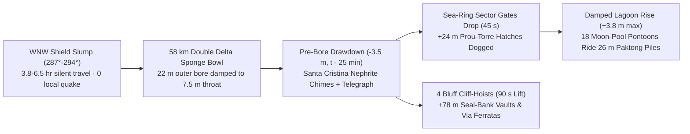
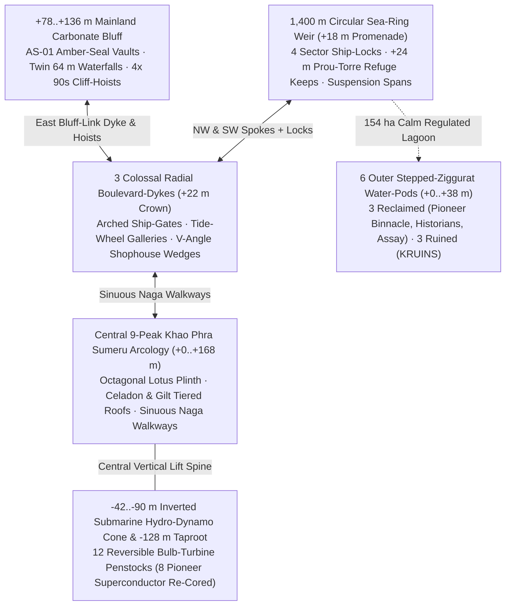

# The Floating City: Build Plan (`settlements/floating-city/`)

> [!IMPORTANT]
> **Status (`2026-11-24`, branch `claude/floating-city-plan` off `claude/integration-4`):** **Owner-approved (`§8` settled `2026-11-24`, including `edit_528_ria_sound.py` natural 3-river dendritic Ria reshape & East Bluff Kuruneva sister town `sriasound1` at `649, 141`) — ready for `P0` `mock.html` massing gate.**
> Synthesizes Paolo Soleri's *Noahbabel* coastal-arcology section, Ancient Siam's *Wat Phra Sumeru* (*Khao Phra Sumeru*) tiered celadon-and-gold water-mandala, concentric *prang* harbour rings, plunging bluff-reservoir waterfalls, radial Ancient boulevard-dykes, modular ziggurat water-pods, and cellular moon-pool pontoons with locked `Sphere 27` canon in [CROOK-RIA-SCOPE.md](file:///home/antigravity/traviso761-debug/krator-floating-city/core/region/CROOK-RIA-SCOPE.md), [NORTHERN-CARTELS-SCOPE.md](file:///home/antigravity/traviso761-debug/krator-floating-city/core/region/NORTHERN-CARTELS-SCOPE.md), [kits/ria/PLAN.md](file:///home/antigravity/traviso761-debug/krator-floating-city/kits/ria/PLAN.md), [kits/kulanewa/PLAN.md](file:///home/antigravity/traviso761-debug/krator-floating-city/kits/kulanewa/PLAN.md), [biomes/doubledelta/PLAN.md](file:///home/antigravity/traviso761-debug/krator-floating-city/biomes/doubledelta/PLAN.md), and [biomes/riavalley/PLAN.md](file:///home/antigravity/traviso761-debug/krator-floating-city/biomes/riavalley/PLAN.md).

---

## 0. Overview Table

| Field | Specification |
|---|---|
| **Folder & Pages** | `settlements/floating-city/` (`src/`, `tests/`, `build.py`, `verify.py`, `materials.json`, `BUDGETS.json`, `PLAN.md`, `API.md`, `PORT.md`, `INDEX.md`, `KNOWN_ISSUES.md`) -> `dist/floating-city.html` (+ `P0` massing gate `mock.html`, untracked or in `wip/` until approved) |
| **English Name** | **the Floating City** (glossed distinctly across every regional tongue, `§1`; recurring **Imperial Capital of the Unified North** commanding the single ocean gate of both the Heartland *Rīwa-Wāta* and Arcflow *Suur-Neva* / *Musta-Jõgi* river systems; twinned across the bay with **`sriasound1` / East Bluff `Suudme-Kuluuna` at `649, 141`** in [60-settlements.js](file:///home/antigravity/traviso761-debug/krator-floating-city/tools/scale-model/model/src/60-settlements.js)) |
| **Scale-Model `5.1` Site** | **`px (635, 138)`** (`world [1270000, 276000]` in the reshaped S-curving 3-arm dendritic **Ria Sound** from [edit_528_ria_sound.py](file:///home/antigravity/traviso761-debug/krator-floating-city/tools/scale-model/edit_528_ria_sound.py); `5.6 × 5.6 km` `1:1` cut spanning the `-48 m` central capital bay inside the `6 km` S-bend rock narrows `[622, 141]` and the `+85..+135 m` northern Crown Headland `[627, 135]`, `28 km` WNW across sheltered sound water from Sister Land City **East Bluff `[649, 141]`**) |
| **Engines & Bundles** | **`core/city`** (`KCITY` + `42/53` multikit `DataTexture2DArray` atlas + `54` `constructMesh` + approved opt-in `core/city/float/`), **`kits/ria`** (`kit_bundle.bundle('RIK')`: primary `style: 'lower-ria'` + imperial `style: 'upper-ria'`), **`kits/kulanewa`** (`kit_bundle.bundle('KLK')`: `style: 'suudme'` syncretic lowland Kuruneva × Lower Ria for the *Tooka-Hoov* Treaty Pontoon-Wards), **`kits/ancients`** & **`kits/port`** (read in place for the *Sumeru-Noahbabel* megastructure, radial boulevard-dykes, ziggurat pods & sector locks), **`kits/ringsea`** (`89i–89l` Ria barges + `89c–89h` `cFlīt-qBōn` & `Hueru-Kuran` hulls), **`kits/interiors`** + **`core/interiors`** (`KROOMLIGHT`) + **`core/furnish`** (`KFURN` indexed), **`biomes/doubledelta`** + **`biomes/riavalley`** (`nwlowlands`/`swlowlands` kin strictly `>= +38 m` trimline) |
| **Population & Polities** | **Grand Metropolitan Capital Scale (owner, `2026-11-24`): `16,500` on-screen / `24,000` `sim_urban_pop`** (`~3,800` households across `28` cellular moon-pool pontoons, V-wedge finger-pier wards, the *Sumeru* imperial terrace rings & the `+85..+135 m` Crown Headland Seal-Bank bluff; twinned with **East Bluff `Suudme-Kuluuna` `[649, 141]`**, the southernmost assimilated Kuruneva port city): 1. **Western Ria Dynasty (`Lower Ria`, *Rīwa-Tōka*, `64%`):** Historic Pan-Ria Imperial Sea-Court, port-prefecture, customs water-gates & 5-headed *Uktena* royal fleet; 2. **The Court of the Amber Seal (*Kūri-Āmpala*, `AS-01` Supreme HQ, `12%`):** Sovereign bond, Ghost-Tsunami/*bottomry* insurance & bullion vault on the `+85..+135 m` Crown Headland bluff; 3. **The Pioneers / Society of the Needle (*Kālō-Nīdala*, `PN-12` + Dynamo Collegium, `8%`):** Neutral engineers running the re-cored `-90 m` `superconductor` submarine tidal turbines, flux-binnacle loft & `90-second` eddy-current cliff-hoists; 4. **Upper Ria (*Līwa-Tōga*) Co-Court & Assimilated Kuruneva *Tooka-Hoov* Enclaves (`16%`):** Permanent Eastern Dynasty *Hongsa* palace-embassy, assimilated lowland **Kuruneva (`style: 'suudme'`)** *Tooka-Hoov* pontoon counting-houses, `Battered Isle` / `Farport` *Matok* & click-creole brokers, `cFlīt-qBōn` dive-crews, and an Order of Historians archive cell |
| **Hard Budgets (`BUDGETS.json`)** | Page `<= 14.5 MB` (`dist/floating-city.html` + `.tex.js` sidecars under `16 MB` cap), Scene `<= 6.5M` tris (`<= 2.6M` live rendered via 3-ring HLOD & `KSHELL`), Draw calls `<= 280`, Active samplers **`<= 13`** per program (hard fail at `16`, warn at `15`), Compiled programs `<= 28`, Estimated VRAM `<= 350 MB`, `KSHADOW` **off at load** |

---

## 1. Name & Multilingual Glosses (`[proposed]` on Locked Phonologies)

In English and in the repo tree, the settlement is called **the Floating City** (`settlements/floating-city/`), seated in the `-48 m` central confluence bay of **Ria Sound (`[635, 138]`)** opposite its sister bluff-port **Suudme-Kuluuna (`sriasound1`, `[649, 141]`)**. Because it commands the single ocean throat of **both** the Heartland (*Rīwa-Wāta*) and Arcflow (*Suur-Neva* / *Musta-Jõgi* / *Tōng-Qū* Grand Canal) river systems, every regional tongue glosses *"the Floating City"* according to its own sound-laws ([CROOK-RIA-SCOPE.md](file:///home/antigravity/traviso761-debug/krator-floating-city/core/region/CROOK-RIA-SCOPE.md#L104-L117), [26k-kit.js](file:///home/antigravity/traviso761-debug/krator-floating-city/kits/ria/src/26k-kit.js#L15-L26), [kits/kulanewa/src/26k-kit.js](file:///home/antigravity/traviso761-debug/krator-floating-city/kits/kulanewa/src/26k-kit.js#L31-L67), [LORE.md](file:///home/antigravity/traviso761-debug/krator-floating-city/LORE.md), [tongues-of-krator.html](file:///home/antigravity/traviso761-debug/krator-floating-city/lore/tongues-of-krator.html)):

| Tongue & Speakers | Gloss for *"the Floating City"* (`[proposed]`) | Script & Orthography | Phonological & Morphological Derivation |
|---|---|---|---|
| **English** *(Repo & Default UI)* | **the Floating City** | Standard Latin | Plain English descriptive name used across Krator's maps and UI |
| **Lower Ria (*Rīwa-Tōka*)** *(Western Ria Dynasty — local majority)* | **`Fulōtį-Sīti`** *(colloquial)* **`Pālasi-Bāča`** / **`Sumēru-Bāča`** *(court poetic: "Palace-Barge" / "Meru-Barge")* | **64-Sign Amber-Seal Syllabary** (stamped in `ria-amber` & glazed brick) | **Mississippian / Muskogean labial-preserving shift:** keeps `f, p, b, m` and `r`; breaks initial `fl-` cluster with echo `u` (`float-ing` -> `fulōtį` with nasalised `-į` from `-ing`, cf. `kulūną`, `sitōną`); `city` -> `sīti` |
| **Upper Ria (*Līwa-Tōga*)** *(Eastern Ria Dynasty enclave & river factors)* | **`Hwalōdi-Sīdi`** *(colloquial)* **`Kwālasi-Gwātsa-Sīdi`** *(court: "Palace-Barge City")* | **Same 64-Sign Amber-Seal Syllabary** (read with High-Ria values) | **Cherokee / Iroquoian labial-loss & `r -> l` shift:** labials `p, b -> kw, gw` and **`f -> hw`** (`float` -> `hwalōd-` with intervocalic voicing `t -> d` matching `Wāta -> Wāda`, `Tōka -> Tōga`; `palace-barge` -> `kwālasi-gwātsa`) |
| **Külaneva / Kuruneva (*Külaneva-keel*)** *(Assimilated East Bluff & *Tooka-Hoov* factors)* | **`Uju-Linna`** *(vernacular: "Floating-City")* **`Uju-Kuluuna`** *(assimilated estuary *Suudme* court: "Floating-Crown")* | **64-Sign Amber-Seal Syllabary** *(estuary)* & **Bark-Paper Tally Latin** | **Finnic-Estonian substrate + Rian loan:** Finnic `uju-` (*floating/swimming*) + `linna` (*fortified city*), or assimilated lowland Rian loan `kuluuna` (*crown*, contrasting with upland *Ilma-Kuluuna* "Uncrowned") |
| **Fleetborn (*cFlīt-qBōn*)** *(Pelagic Ark-Fleet free-divers)* | **`xFlōt-cSīt`** *(deck speech)* **`xFlōt-qRīng`** *(dive-click name: "Floating-Ring")* | Unwritten at sea; tallied in sawn `nephrite` notches or `Farport` `sã-ma` | **Cetacean-coda click prefixes** on clipped English roots: lateral click `x` (`ǁ`) before lateral cluster `fl-` (`xFlōt`), dental click `c` (`ǀ`) before coronal `s-` (`cSīt`), palatal click `q` (`ǃ`) on `qRīng` (naming the `-90 m` submerged weir/cone) |
| **Eternian (`Mã-wè` / `Pè-wè`) & `Farport` Creole** | **`Fò-wò-si`** *(Lowland `Mã-wè`)* **`Fulòte-Siti`** *(Paper `Pè-wè`)* **`xFò-wò-cSi`** *(`Farport` Creole)* | **3 Eternian Brush-Signs** `[FLOAT · WATER · CITY]` + `sã-ma` sound-marks | **`Mã-wè` monosyllabic wear:** `float` drops `l` and `-t` -> `fò`; paired with `wò` (*water*) + `si` (*city*) to disambiguate homophones (`"float-water-city"`). `Farport` creole prefixes lateral `x` and dental `c` clicks |
| ***Matok*** *(Northern Traders' Argot — Dam Basins, `Silkhead`, `Farport`)* | **`Fulota-Sidi`** *(or **`Wata-Mape`**, "Water-Market")* | **Izani Capitals + Eternian Signs** (`[WATER] · FULOTA · SIDI ☉`) | **2-of-3 shared-sound rule** ([tongues-of-krator.html](file:///home/antigravity/traviso761-debug/krator-floating-city/lore/tongues-of-krator.html#L3283-L3301)): plain 5 vowels, initial cluster broken (`fulota`), final stop takes `-a`, intervocalic `t -> d` from Izani `sidi` |
| **Jamṭōkku** *(Jimjam Day-Keepers & Almanac Reckoners)* | **`Folōṭṭu-Si'i`** *(echo-form: **`isilōṭṭu-folōṭṭu`**, "the floating city & all its pontoons")* | **Rounded Palm-Leaf Syllable Blocks** (ending with the Three Wheels) | **Dravidian-Maya sound-laws** ([tongues-of-krator.html](file:///home/antigravity/traviso761-debug/krator-floating-city/lore/tongues-of-krator.html#L2370-L2392)): `fl-` split by next-vowel echo (`folō-`), final `-t` retroflexed, geminated & given `-u` (`folōṭṭu`, cf. `ēṭṭu`, `ṭōkku`); intervocalic `t` before unstressed `i` becomes glottal catch `si'i` (cf. `va'ar`, `li'il`) |
| **Izani** *(Empire of Iziz Admiralty & `Hook` Bond-Clerks)* | **`Sidi Flodiñ`** *(full: **`De Flodiñ Sidi`**, `DE · FLODIÑ · SIDI ☉`)* | **27-Letter Straight-Cut Izani Capitals** with interpuncts & sun-stop | **Imperial Romance/Georgian rules** ([tongues-of-krator.html](file:///home/antigravity/traviso761-debug/krator-floating-city/lore/tongues-of-krator.html#L3800-L3819)): `the -> de`, `city -> sidi` (attested intervocalic voicing), `-ing -> -iñ` (letter `Ñ` *Iñ*) with voiced `t -> d` (`flodiñ`), Romance head-first `Sidi Flodiñ` |
| **Order of Historians' Book-English** *(Longsong / Keepwell / Local Cell)* | **the Floating City** *(archive rubric: **"the Floating City of Ria Sound, `Noahbabel` Hydro-Arcology ◉"**)* | **Rounded Oidong Book Hand** with Xanadui evidential margin marks | Preserved pre-Cataclysm English spoken with dental `th`, slight retroflex `t/d`, and honorific `sar`; tagged **`◉` (*seen*, `-sin`)** for the standing *Sumeru* superstructure & sea-ring, and **`△` (*inferred*)** for the sealed `-90 m` Pioneer superconductor turbine core |

### Local Civic & Structural Toponyms (Low-Ria *Rīwa-Tōka* / High-Ria *Līwa-Tōga* / Kuruneva *Külaneva-keel*, `[proposed]`)

- **The Ancient *Sumeru-Noahbabel* Core:** Low-Ria **`Kāo-Sumēru`** / High-Ria **`Kāo-Sumēlu`** (*Mount Sumeru of the Sound*).
- **The `1,400 m` Circular Sea-Ring Weir:** Low-Ria **`Sitōną-Rīngą`** / High-Ria **`Sidōna-Līnga`** (*The Stone Ring*).
- **The `+85..+135 m` Crown Headland Seal-Bank Citadel (`AS-01`):** Low-Ria **`Kūri-Āmpala`** / High-Ria **`Kūli-Ākwala`** (*Court of the Amber Seal*).
- **The `-90 m` Pioneer Submarine Dynamo Cone (`PN-12`):** Low-Ria **`Kālō-Nīdala Dīpą`** (*Deep Hall of the Society of the Needle*).
- **The Sister Bluff Port (`sriasound1` at `649, 141`, `+112 m`):** Kuruneva **`Suudme-Kuluuna`** / Low-Ria **`Sūmi-Kulūną`** (*Estuary-Mouth Crown*, southernmost assimilated `style: 'suudme'` Kuruneva town).

---

## 2. Site, Macrotidal Physics & Ghost-Tsunami Engineering

### 2.1 Scale-Model `5.1` Bathymetry & Pin Audit: `Ria Sound` (`626, 140`) vs. Outer Horst-Gates (`535, 145` & `545, 172`)

Direct pixel-level inspection of `h.png`, `wl.png`, `rivers.json`, `60-settlements.js`, `geology.json`, and `populations-gemini.json` across the `Double Delta` / `Ria Sound` estuary (`1821 × 1723`, `2 km/px`) compares the two candidate settings:

| Criterion | **Option A (Recommended): `Ria Sound` Funnel Throat (`px 626, 140`, `sriasound1`)** | **Option B: Outer Delta Mouths (`px 535, 145` N-Gate & `px 545, 172` S-Gate)** |
|---|---|---|
| **Raw `5.1` `h.png` / `wl.png` & Bathymetry** | `(626, 140)` stands at **`+77.9 m`** (`+65..+142 m` bluff ridge, climbing to `+301..+421 m` by `660, 146`) immediately above the **`-14.2 m`** (`2 km`-cell mean) throat channel (`620..624, 140..142`) and **`-35 to -49.4 m`** inner ria basin (`650..663, 136..140`), locally scoured to **`-68..-95 m`** in the throat constriction | `(534..540, 145..147)` cuts a **`-70 to -99 m`** scour trench beside `+2..+12 m` bars; `(536..548, 172)` cuts a **`-39 to -156 m`** outer trench beside `+2..+11 m` bars |
| **Locked Geological Truth (`geology.json` & `doubledelta/PLAN.md` §2.2)** | **Competent Bedrock Throat:** Cuts through **`carbonate-shelf` cherty limestone (`KSTRATA`)** capped by `loess`, with `clay = 255`, `coal = 169`, `silica = 150`, `amber = 108`, `oil = 102` — capable of anchoring *Noahbabel*'s `-128 m` bedrock caisson without settlement subsidence | **Locked Sedimentary Override Violation:** `biomes/doubledelta/PLAN.md` §2.2 (`CROOK-RIA-DECISIONS.md` §2.1) explicitly overrides basalt islands east of `X = 514`: `95.3%` unconsolidated `sedimentary` silt/peat/lignite (`0` basalt, `0` hard rock) and **forbids any permanent settlement in the `< +25 m` bowl** |
| **Tidal Amplification & Perennial River Discharge** | **`8.4–11.6 m` spring tidal range** (funnel convergence up the `58 km` delta throat) **PLUS `6,230–8,170 m³/s` perennial river outflow** (`9101` `Rīwa-Wāta` `4,850` + `9107` `Suur-Neva` `1,380` + `9103` `Mere-Upe` `1,420` + `9104` `Helme-Koski` `520`), yielding **`3.8–5.4 m/s` ebb races** and guaranteed 24/7 head even at neap slack | `4.9×–5.1×` barotropic Laplace tidal amplification (`9–14 m` spring range, `4–6 m/s` races), but split across shifting unconsolidated distributary sand-bars |
| **WNW (`287°–294°`) Ghost-Tsunami Survival (`CROOK-RIA-SCOPE.md` §2)** | **Protected by 4 Layers:** (1) `58 km` of hydro-elastic `Double Delta` sponge-marsh attenuating a `22 m` outer bore to `6.5–9.5 m`; (2) *Santa Cristina* nephrite chime-wells (`25-min` warning); (3) *Noahbabel*'s `+18 m` sea-ring weir & `+24 m` *Prou-Torre* keeps; (4) **immediate `+78..+136 m` mainland bluff refuge** via `90-second` cliff hoists! | **Direct Unattenuated Impact (`wnwExposure01 = 0.88–0.96`):** Takes full `15–25 m` Tier-2 (`20–35 yr`) and **`35–55 m` Tier-3 (`150–300 yr`)** bores head-on, **`26–45 km` from the nearest `>= +25 m` bluff refuge** |
| **Canon & Census Alignment (`Sphere 27`)** | **100% Locked Match:** Matches `sriasound1` (`626, 140`, `5,500` on-screen / `7,600` sim pop), `AS-01` Seal-Bank Supreme HQ, `PN-12` Pioneer Hoist/Binnacle Hub, and `biomes/doubledelta` Station 4's `site:ria-sound` reserve (`ΔPop = 0`) | Requires either creating a second coastal city pin or moving `sriasound1` `180 km` west into `rmvdoubledelta` and amending `CROOK-RIA-SCOPE.md` & `biomes/doubledelta/PLAN.md` |

> [!TIP]
> **Design Synthesis (`Option A` Default, Confirmed in `§8 Q1`):** Anchoring **the Floating City** at **`Ria Sound` (`px 626, 140`)** gives us **every single visual and physical element at once** — *Noahbabel*'s `1,400 m` circular sea-ring weir and `-90 m` submarine hydro-dynamo cone seated in the scoured limestone funnel throat, *Wat Phra Sumeru* and the cellular Ria pontoon archipelago riding the calm `154 ha` lagoon, **and** the lush polychrome terraced `+78..+136 m` mainland bluff (`Ref 4`) plunging twin `64 m` aqueduct waterfalls straight into the harbour while housing the tsunami-proof **Court of the Amber Seal (`AS-01`)**!

### 2.2 Bidirectional Macrotidal & Fluvial-Bore Head Model (`FC_TIDE`, `[G data]`)

Implemented in `src/40-fc-tide-phys.js` (zero `THREE`, zero `DOM`, deterministic on `core/clock` + `KRAND`, tested on `tools/ktest.js`):

1. **Composite Tide Wave Outside the Sea-Ring (`y_sound(t)`):**
   - Combines Krator's primary `24.0 h` gas-giant libration semi-diurnal/diurnal tide (`A_lib = 3.6 m` mean, `4.8 m` spring at funnel throat) with the `7-day` *Vīkku* and `13-day` *Tarṭīn* lunar spring-neap envelope (`91-day` *Kaunṭu* beat, peaking on *Ḍabal Ḍārkku* / Double Dark springs at **`±5.4 m` = `10.8 m` range**) plus the `+0.65 m` perennial backwater setup of the `6,230–8,170 m³/s` `Rīwa-Wāta` + `Suur-Neva` confluence.
2. **Controlled Two-Basin *Noahbabel* Lagoon Regulation (`y_lagoon(t)` & `ΔH_turb(t)`):**
   - The `1,400 m`-diameter circular Ancient sea-ring (`area = 1.54 km²`) separates outer `y_sound(t)` from inner `y_lagoon(t)` through `12` submarine reversible Kaplan/bulb turbine penstocks (`-28 m` to `-48 m` in the inverted cone) and `4` surface sector-locks:
   - **Flood Generation (`y_sound > y_lagoon + 1.8 m`):** Rising sound water drives the submarine bulb-turbines inward while keeping inner lagoon tide damped and gentle (`y_lagoon ∈ [-1.8 m, +2.2 m]`, `4.0 m` operating range vs. `10.8 m` outside).
   - **Ebb + River-Bore Boost (`y_lagoon > y_sound + 1.8 m`):** Diverted `Rīwa-Wāta` / bluff-waterfall inflow (`340 m³/s` regulated intake through the East Dyke sluices) re-tops the lagoon at high water so ebb generation runs at **`ΔH = 4.5–7.8 m` head** (`18–42 MW` mechanical/electrical shaft power across the `8` Pioneer-restored superconducting units — zero dead-slack blackout!).
3. **Four-Stage Ghost-Tsunami Emergency Sequence (`state: 'normal' | 'drawdown' | 'surge' | 'backwash'`):**

---

## 3. Core Adoption & Survey Checks (`README.md`, "CORE MODULES ARE NOT OPTIONAL")

Verified before the first fragment against `tools/check_core_use.py` (`REQUIRED['settlements'] = ['rand', 'tags']`, plus `simulation -> city` and `PLACED` biome-sync rules) and `tools/new_build/README.md` (`tools/checks_optin.json` items 22–33):

### 3.1 Core Modules & Kits Taken

| Module / Kit | Fragments / Bundle | Role in `settlements/floating-city` |
|---|---|---|
| **`core/rand`** | `08-core-rand.js` (`KRAND`) | All cell, lot, pontoon, barge, wave-phase, and damage seeding via `KRAND.child` / `KRAND.hash(world, cell, idx, salt)` (`0` `Math.random`, `0` `Math.sin` hash) |
| **`core/tags`** | `50-core-tags.js`, `52-core-tags-vocab.js`, `53-core-tags-host.js` (`KTAGS`) | Pre-draw registration of every Ancient spire/weir/pod, Ria building, pontoon ward, lock gate, dynamo unit, resource node, vessel, flora stand & citizen (`culture: 'ria' \| 'ancients'`, `style: 'lower-ria' \| 'upper-ria'`) |
| **`core/space`** & **`core/mask`** | `20-core-space.js` (`KSPACE`), `KMASK.canvas` | Unified spatial occupancy across fixed bluff lots, dyke lots, floating pontoon lots, shipping lanes, and bluff flora (`0` `getImageData`) |
| **`core/drawn`** | `10-core-drawn.js` (`KDRAWN`) | Registers drawn bluff terrain, submarine basin floor, sea-ring promenade, boulevard-dykes, and pontoon decks for `drawn-ground` eye-clearance audits (item 28) |
| **`core/city`** *(+ proposed `float/` opt-in)* | `10..40`, `42-city-multikit.js`, `50`, `53-city-host-multikit.js`, `54-city-host-construct.js` + **`core/city/float/44-city-float.js` & `55-city-host-float.js`** | Multi-instance `[G data]` layout (`KCITY`): **Instance 1 (`bluff`)** `+78..+136 m` Seal-Bank & upper terraces (`stance: 'door'`); **Instance 2 (`dykes`)** V-angle wedge-infill & boulevard-dyke lots (`+6..+22 m`); **Instance 3 (`pontoons`)** `18` hex/octagon moon-pool wards (`y = tideLagoonY(t) + freeboard` + hinged gangways); `53` `DataTexture2DArray` atlas (`<= 350 MB` VRAM) & `54` `constructMesh` on active pontoon/bluff yard lots |
| **`core/world`** & **`core/coast`** | `core/world/` (`WORLD.H`, `44c-world-coast.js`) + `30-core-coast.js` (`KCOAST`) | `1:1` Scale Model `5.1` terrain cut around `(626, 140)` (`PLACED`), `KCOAST` limestone cliff, oyster-visor notch, shingle slipway, and west delta-marsh transition profiles |
| **`core/terrain`** | `30`, `35` (`KSTRATA`: `carbonate-shelf` + `loess`), `36` (`KCARVE`), `38` (`KRELIEF`), `39..39h` (`KCAVERN.cutLayer`), `43` (`KGROUND` `<= 5` layers), `44` (`KFAR`), `45` (`KHORIZON`) | Carves the `-95 m` bedrock kolk caisson seat, rock-cut cliff-hoist slots, *Santa Cristina* chime-shafts, bluff aqueduct grottoes, `KGROUND` hex-tiled ground, `40 km` `KHORIZON` shadow & `16 km` `KFAR` delta/sound vista |
| **`core/water`** *(+ proposed `ext/63` opt-in)* | `20`, `21`, `22`, `50`, `51`, `ext/53` (terraces), `56`, `57`, `58` (mirror off at load), `60`, `61` (`WATER.plume`), `62` (`WATER.flood`), `farbed/53` + **`ext/63-core-water-tide.js`** | Outer macrotidal `WATER.open` + golden-silt `Rīwa-Wāta` `WATER.plume`; calm regulated inner `154 ha` lagoon + moon-pools; **`Twin +78 m Bluff Reservoir Waterfalls`** (`WATER.fall` + `WATER.still` plunge pool overlapping `25 m` under channel `WATER.flow`); dynamic lock-chamber & `[Ghost-Surge Drill]` bore wave (`WATER.flood`) |
| **`core/atmos`** & **`core/shadow`** | `ATMOS.bindHost` (`pressure: 1.58 atm`, sky `[354, -190]`, `#include <atmos_waves>`, `ATMOS.skylight`, monsoon mist & waterfall spray) + `KSHADOW` (**off at load**) | Standard Krator gas-giant skybox, shared wave field, PBR sky reflections (with indoor `envMapIntensity` suppression per `KROOMLIGHT`), dawn throat mist, `?shadow=1` cascade |
| **`core/materials`** | `23-mat-record.js`, `25-matlib-host.js`, `27-matlib-m1.js` (`KMAT`, `KMAT_M1`) | Stage 5/8 `M1–M4` & `K1–K4` vertical-stack material pipeline (`hemi-oct8` normals, `xy8` on `class: glazed` celadon/cobalt/gilt tiles, `mip-variance.json` `km1RoughAA`, 6-step planar POM `< 18 m`, plot-base & mortar cavity AO, `< 15` samplers) |
| **`core/ruins`** | `20-core-ruins.js`, `21-core-ruins-host.js` (`KRUINS.watch`) | Watches all `3` damaged outer ziggurat water-pods, the breached NW sea-ring parapet, and flooded turbine bay wreckage (`0` floaters, seated debris) |
| **`core/engine`**, **`kits/ria`**, **`kits/ancients`**, **`kits/port`** | `kits/ria/kit_bundle.py` (`RIK` sealed bundle: `38` `lower-ria` + `38` `upper-ria` defs) + pruned `kits/ancients/src/` & `kits/port/src/` builders | Draws all `76` Ria Dynasty buildings via `KCITY.hostMultikit`, while `kits/ancients` & `kits/port` supply Ancient ceramic/bronze massing, cranes, sector-locks, and pontoon collars |
| **`kits/metropolis`** (`KSHELL`) & **`core/lod`** | `KSHELL` (`polar` cages on *Sumeru* spires, `box` cages on boulevard-dykes) + `core/lod` | Range-tiered shells + interior-mapped ribbons beyond `450 m` so the `9`-peak megastructure + `1,180`-lot city stays `< 2.4M` active triangles |
| **`core/catalog`**, **`core/furnish`**, **`kits/interiors`**, **`kits/ancients-interiors`**, **`core/interiors`** | `catalog.py`, `KFURN.useBatch(..., {indexed: true})`, `ROOM()`, `KratorAncientsInteriors`, `10-core-roomlight.js` (`KROOMLIGHT`) | Camera-independent baked interior JSON (`bake_interiors.py` + piece-id delta overlay) for the Seal-Bank Bullion Hall, Pioneer Submarine Dynamo Control Room, *Sumeru* Lotus Sanctum, Chancellery & Truce Court, lit by Stage 7 `KROOMLIGHT` (`6-PointLight` portal/lamp pool + `I4` corner AO) |
| **`kits/construction`** | `KCONS` (`kits/construction/src/`) + `KCITY.constructMesh` | Active pontoon-hull framing & bluff warehouse construction lots (`0 < f < 1`) |
| **`kits/ringsea`** | Read in place (`89i` `riaWestPalaceBarge`, `89j` `riaEastPalaceBarge`, `89k` `riaPatricianBarge`, `89l` `riaNobleSalon`, `89c–89g` `cFlīt-qBōn` arks, `89h` `hkWhaler`) | Populates the Royal *Uktena* Anchorage, Upper Ria *Hongsa* Berth, Coaster Locks, and moving tidal-channel ferry/barge routes |
| **`core/door`**, **`core/walk`**, **`core/host`**, **`core/minimap`** | `KDOOR`, `KGLASS`, `KWALK`, `khost.FULL + khost.UNDERGROUND` (`91b` follow, `99-host-section`, `88b/97b` deck minimap, `08-core-kfade`) | Operable doors & lock-gates, continuous `KWALK` graph across Naga walkways, pitching bascule bridges, cliff-hoists & `-90 m` submarine turbine decks; `X` / `C` vertical section cut & Tube-style vertical deck schematic (`L`) |
| **`core/simulation`**, **`core/clock`**, **`core/sched`**, **`core/region`** | `SIM` (`settlement: 'floating_city'`), `20-core-clock.js`, `20-core-sched.js` | `7,600` simulated urban citizens (`5,500` on-screen), `41/44` Voth census trades, Seal-Bank `AS-01` bottomry/lien ledger, Pioneer `PN-12` superconductor dynamo output, tide-gated lock schedules & `6` sea/river trade lines |
| **`core/charactermodels`** | `data/peoples.json` (`ria` Lower/Upper cohorts + `cflit_qbon` free-divers + `eternian` / `Farport` factors + `historians` monk) | Scheduled crowds wearing Lower Ria glazed-silk robes, Pioneer `paktong`-caliper aprons, Seal-Bank amber-tally sashes, and `cFlīt-qBōn` dive gear |
| **`biomes/doubledelta`**, **`biomes/riavalley`**, **`kits/crops`**, **`kits/fauna`**, **`kits/resources`**, **`core/hazard`** | Read in place (`DDELTA`, `nwlowlands`/`swlowlands` kin, `CROPS.forBiome('riavalley')`, `kits/fauna`, `kits/resources`, `KHAZ`) | Enforces crisp **`+38 m` tsunami trimline** (oyster visors, bellows-reeds & sponge cushions below; camphor, sprawl-oak, stone-pine, `tea` & citrus loess terraces above); `KHAZ` turbine-intake suction & `[Ghost-Surge Drill]` bore hazard |
| **`core/export`** | `07-core-export.js`, `09-core-export-adapters.js` (`EXPORT`) | Full M6 `krator-city` + `krator-field` + `float` ward kinematics + `sim` export for `openworld/` (`bake_towns.py`) and Godot `4.7.2` |

### 3.2 Modules Deliberately NOT Taken (One-Line Reasons)

- **`core/hamlet` (`KHAMLET`):** Full multi-ward `KCITY` dynastic port-metropolis (`5,500` on-screen / `7,600` sim pop); upland loess terraces are `KCITY` `fields` districts, and `< +25 m` `Double Delta` holds `0` permanent villages by locked rule.
- **`core/camp` (`KCAMP`):** Maritime and riverine port-city; pelagic `cFlīt-qBōn` visitors live aboard coupled `89g` `arkChainedWard` catamarans in the West Coaster Basin rather than land tent-rings.
- **`core/anomaly` (`KANOM`):** `Ria Sound` is an intact/pragmatically re-cored northern hydro-arcology (`Ruling #102`), free of `Ancients' Valley` or `Cut` reality-warping physics anomalies (`Weeping Valley` sap-hazards lie `740 km` upriver on `KHAZ`).
- **`core/water/geyser`:** Non-volcanic `carbonate-shelf` + `loess` sedimentary throat (`0` volcanic vents or boiling fumaroles).

### 3.3 Mandatory 2026-11-11 Survey Checks (`tools/checks_optin.json`) & Stage 8 Vertical-Stack Compliance

1. **All 7 Opt-In Survey Lists from Commit 1:** `"settlements/floating-city"` is added to **`recorded`** (item 25: `buildlib.through_tools_build(__file__)`, `build_sources.report()`, LFS pointer refusal), **`minset`** (item 26: `buildlib.CORE_BIOME_MIN` for bluff/estuary flora), **`samplers`** (item 27: `harness.SURVEY` `< 15` samplers per linked program), **`drawn-ground`** (item 28: `KDRAWN.h` eye-clearance across bluff, lagoon & `-90 m` submarine galleries), **`names`** (item 30: zero `'` or `:` in `VIEWS`), **`water-mouths`** (item 32: every `WATER.flow` / waterfall plunge faded cleanly into `WATER.open`/`still`), and **`leaf-stems`** (item 33: tight `BIO.attachAudit` stem origins on bluff trees & pontoon crops), plus **`PLACED`** in `tools/check_core_use.py`.
2. **Stage 8 Vertical-Stack Graphics (`M1–M4`, `K1–K4`, `I1–I4`):**
   - **`M1–M4`:** `27-matlib-m1.js` `hemi-oct8` normals (`xy8` lossless 8-bit normals preserved on `class: glazed` celadon, cobalt, emerald & gilt roof scales), `mip-variance.json` specular roughness AA (`km1RoughAA` eliminating shimmer on multi-tier *Sumeru* roofs over water), 6-step planar POM (`< 18 m`) on `travertine`, `dolomite`, `brick` & Ancient seamed plates, and plot-base + tide-line oyster/moss contact AO (`0.68 -> 1.00`).
   - **`K1–K4`:** Uniform-deduplicated `KMAT` & `DataTexture2DArray` (`<= 28` compiled shader programs, `<= 13` samplers), sine-free 3D breakup hash, `boxBevel` chamfered masonry piers, and indexed `KF.batch({indexed: true})` furniture batches.
   - **`I1–I4`:** `KROOMLIGHT.buildTable` + `pickPool` (`6-PointLight` portal-daylight & warm amber-oil/arc-lamp pool) + `vertexCornerAO` inside all enterable halls and the `-90 m` submarine dynamo chamber (with exterior sky `PMREM` suppressed on `vault: true` submarine rooms per `5z`!).

### 3.4 Two Clean Zero-Reach Core Opt-Ins (No Existing Core Files Edited)

Following `core/host/UNDERGROUND.md` ("opt-in by file in a subfolder so `port_baseline.py` stays byte-identical across all 400+ pages"):
1. **`core/water/ext/63-core-water-tide.js` (`[G data]`) + `63b-core-water-tide-draw.js` (`[web]`):** Pure two-basin tidal weir surface `WATER.tide({outer, lagoon, sluices, clock})` exposing `tideY(basin, t)`, `headM(t)`, `sluiceVelMs(t)`, and live `wtrLevel` uniform updates for `[Low Ebb]`, `[Slack]`, `[High Spring Flood]`, and `[Ghost-Surge Drill]`.
2. **`core/city/float/44-city-float.js` (`[G data]`) + `55-city-host-float.js` (`[web]`):** Pure rigid-pontoon & hinged-bascule kinematics `KCITY.floatPose(ward, t)` keeping `[G data]` lot records in stable ward coordinates while updating world `y(t) = tideY('lagoon', t) + ward.freeboardM`, guide-pile `paktong` collar travel, `KWALK` ramp normals, and `|pitch| <= 14°` gangway articulation identically in Three.js and Godot `4.7.2`.

---

## 4. Architecture I: The Ancient *Sumeru-Noahbabel* Megastructure

### 4.1 Reference-Image-to-Rule Synthesis Table (`painting-to-3d-world/SKILL.md` §5v)

Every reference image is distilled into explicit structural rules rather than copied whole:

| Ref # & File | Structural & Compositional Rule Taken into `settlements/floating-city` |
|---|---|
| **1.** `upload/image_2.png` *(Soleri's `3. Noahbabel`)* | **`1,400 m`-diameter (`154 ha`) circular coastal harbour bowl**: flush/low double-decked circular sea-ring weir harvesting bidirectional tidal head; **`-60 to -90 m` inverted submarine production/turbine cone** & **`-128 m` bedrock anchor taproot** directly beneath the central vertical arcology |
| **2.** `image.png` *(Ancient Siam's `Wat Phra Sumeru` — **PRIMARY MODEL FOR THE ANCIENT STRUCTURE**)* | **Cruciform/octagonal *Mount Meru* cluster rising straight from a stepped lotus-mandala water-plinth**: cascading multi-tier celadon-jade/verdigris glazed roofs with gleaming golden `chofa`/ridge ribs (`1` tall central peak + `4` corner spires + `4` axial porch *mondops*, paired with a `3`-spire southern lotus pavilion) linked across lily/lotus water by **sinuous, serpent-curved Naga over-water walkways** punctuated by **octagonal umbrella-roofed *Sala-Nam* pavilions** |
| **3.** `d554c50d...jpg` *(Concentric *Prang* Lagoon)* | **Concentric green-planted ring causeways** subdividing outer vs. inner harbour lagoons, punctuated by **fluted parabolic *prang*-arcology towers** crowned with twin/quadruple lotus-bud finials and linked across shipping cuts by **high suspension foot/tram spans** |
| **4.** `432b29fe...jpg` *(Polychrome Bluff & Waterfall Harbour)* | **Stepped mainland limestone bluff metropolis (`+41..+136 m`)** with **twin white waterfalls plunging `64 m` from an upper aqueduct terrace straight into a turquoise harbour plunge-basin**, above wide channels lined with **dense rectangular finger-piers** and colourful shophouses |
| **5.** `ca5032e5...jpg` *(Circular Weir & Snowflake Mandala)* | **Arcaded circular outer breakwater with ocean ship lock-cuts**, framing a **branching snowflake/mandala network of hexagonal & octagonal floating ward-islands** radiating around a **stepped octagonal central amphitheatre water-court** |
| **6.** `4565557b...jpg` *(Colossal Radial Boulevard-Dykes)* | **Monumental tree-planted radial Ancient causeway-dykes** (`36 m` wide, `+22 m` crown) pierced at water level by **giant arched ship-gates** and **cantilevered reversible tide-wheel galleries**, with **dense terraced vernacular houses and finger-piers wedged into the V-angles between spokes** |
| **7.** `f7de658e...jpg` *(Modular Ziggurat Water-Pods)* | **Chamfered square/octagonal stepped-pyramid Ancient water-pods** (`kits/ancients` white ceramic + dark recessed clerestory ribbons + corner stair-ramps on floating/grounded caissons) forming `6` outer lagoon satellite wards (`3` intact/reclaimed, `3` gutted/listed on `KRUINS`) |
| **8.** `21bfda97...jpg` *(Hex Moon-Pool Pontoons & Glowing Cables)* | **Hexagonal/octagonal cellular pontoons with open central moon-pools** and rooftop crop/glaze arrays, joined by **hinged bascule/truss causeways**, **vertical guide-pile collars**, and **submerged catenary mooring & Pioneer superconductor power cables glowing cyan-teal under clear lagoon channels** |

### 4.2 Five Structural Zones of the Ancient Megastructure

1. **Zone A1 — Submarine Inverted Hydro-Dynamo Cone & Bedrock Taproot (`y = -128 m to -12 m`, `Ref 1` + `khost.UNDERGROUND`):**
   - Seated inside the `-95 m` scoured `carbonate-shelf` bedrock kolk at the throat focus (`x = 0, z = 0`): a **`-128 m` central anchor/geodetic taproot** (`PN-12` flux-pendulum chamber at bottom) flaring upward into a **`220 m`-diameter inverted board-formed concrete & white-ceramic submarine cone (`-90 m to -42 m`)**.
   - Pierced radially by **`12` cyclopean `6.4 m`-bore bronze-lined reversible tidal penstocks**: **`8` active penstocks** have been re-cored by **The Pioneers (*Society of the Needle*)** using zero-iron `Compass Hills` `Lodestone` `superconductors`, `paktong` non-magnetic housings, and `Spider Lake` `Golden Cable` dielectric silk windings; **`4` flooded SE penstocks** remain Cataclysm-ruptured behind armoured bulkhead glass (`KRUINS.watch`), visible through underwater viewport galleries!
   - Accessible to the walker (`F` / `V` follow camera) via the central *Sumeru* lift-and-stair spine, and inspectable from orbit via **`C` / `X` `khost.UNDERGROUND` vertical section & deck-band cuts** (`99-host-section.js`, `88b/97b` Tube-style schematic map).
2. **Zone A2 — Outer Circular Arcaded Sea-Ring Weir (`R = 700 m`, `1,400 m` Dia., `y = -32 m to +18 m`, `Refs 1, 3, 5`):**
   - Encloses the **`154 ha` (`1.54 km²`) calm regulated lagoon**. Below `-4 m`, `64` submerged radial venturi-sluices with `paktong` trash-racks feed the tidal head basin; above `0 m`, a battered Ancient white-ceramic and basalt-ashlar double arcade supports a **`24 m`-wide `+18.0 m` circular park-and-highway promenade** (`Ref 1` #3 & `Ref 3`).
   - Pierced by **`4` Sector Locks (`42 m` wide)**: `West Ocean/Delta Ship-Lock` (`285°`, guarded by twin knife-prowed **`+24 m` *Prou-Torre* dogged-hatch tsunami refuge keeps** and spanned at `+34 m` by a parabolic suspension bridge `Ref 3`), `North Suur-Neva Barge-Lock`, `South Rīwa-Wāta Palace-Barge Lock`, and `East Bluff Basin Cut`.
   - **Cataclysm Scar:** A `95 m` arc of the NW outer sea-ring parapet was sheared by an ancient mega-tsunami and repaired by the Western Dynasty in **Babylonian cobalt-and-saffron glazed brick & `paktong` tie-beams** alongside seated Ancient concrete blocks on the outer shoal (`KRUINS.watch`).
3. **Zone A3 — Central 9-Peak *Khao Phra Sumeru* Arcology Cluster (`260 × 260 m` Lotus Plinth, `y = 0 to +168 m`, **Primary Model `Ref 2`** + `Ref 3`):**
   - **Fusion by Structural Zone (`SKILL.md` §5z):** An Ancient stepped octagonal/cruciform laterite-basalt and white-seamed ceramic water-plinth (`0 to +16 m`, `kits/ancients`) and fluted parabolic Structural Cores (`kits/metropolis` `polar` shells with bronze transfer hoops) crowned and dressed in the Ancients' own "Siam-Meru" hydro-palace idiom that birthed Lower Ria's sacred architecture: **cascading 5-to-9-tier celadon-emerald & verdigris glazed roofs edged with gilded ridge-ribs and upturned `chofa` flame-finials (`Ref 2`)**!
   - **Massing (`9 + 3` Spires):**
     - **Central *Mahā-Sumeru* Spire (`+168 m` tip, `+142 m` observation & Pioneer `lodestone` lightning/flux lantern):** Houses the Neutral River-Peace & Tide- Charter Rotunda at `+18 m`, vertical shaft to `-90 m` turbines, and upper Dynastic & Seal-Bank archives.
     - **4 Diagonal *Prang*-Arcology Towers (`+92 m`, `Refs 2 & 3`)** + **4 Cardinal Gabled Water-*Mondops* (`+48 m`)** joined by multi-tier glazed gallery cloisters around `4` sunken lotus water-courts.
     - **Southern 3-Spire *Bussabok* Audience Island (`+56 m`, foreground of `Ref 2`):** Linked across the lotus-pad inner lagoon by twin sinuous Naga walkways; hosts the Western Monarch's Seasonal Water-Court & 5-Headed *Uktena* Royal Barge Landing.
4. **Zone A4 — Three Colossal Radial Boulevard-Dykes (`Ref 6`) & Sinuous Naga Over-Water Walkways (`Ref 2`):**
   - **3 Radial Ancient Causeway-Dykes (`East` to Mainland Bluff `x = +240..+880 m`, `NW` `135°`, `SW` `225°`):** `36 m` wide, `+22.0 m` stone-flagged upper avenue planted with double rows of camphor and palm/cycad urns (`>= +22 m`), pierced at `0..+14 m` by **monumental cobalt-glazed & white-ceramic arched ship-gates** and flanked by **projecting arcaded reversible tide-wheel mill-galleries (`Ref 6`)** that grind grain, saw `Hueru-Kuran` nephrite, and hammer bronze on every tide!
   - **Sinuous Meandering Naga Walkways (`Ref 2`):** $C^1$-continuous curved over-water boardwalks (`w = 5.5 m`, `y = +3.6 m` above damped lagoon max) with ochre-gilt serpentine *Uktena* balustrades and **`14` octagonal celadon-and-gold umbrella-roofed *Sala-Nam* water pavilions** at every node and ferry landing.
5. **Zone A5 — Six Outer Modular Stepped-Ziggurat Water-Pods (`54 × 54 m`, `y = 0 to +38 m`, `Ref 7`):**
   - Positioned in the NW and SW outer lagoon quadrants: white horizontal-band Ancient stepped pyramids with recessed dark ribbon windows and corner terraced stairs on chamfered square caissons (`Ref 7`):
     - **`3` Intact / Reclaimed Pods:** `Pod N1` (**`PN-12` Pioneer Flux-Binnacle & Telegraph Calibration Pod**), `Pod N2` (**Order of Historians Sound Archive & Evidential Scriptorium**), `Pod S1` (**Amber-Seal Quarantine & Bottomry Assay Pod**).
     - **`3` Damaged / Listed Pods (`KRUINS.watch`):** `Pod N3` (*Crown-Sheared Heron Rookery*), `Pod S2` (*11°-Listed Half-Submerged Salvage Pod* grounded on `-6 m` silt shoal), `Pod S3` (*Gutted Frame Pod* being stripped for `KCONS` repair plates).

---

## 5. Architecture II: Ria Dynasty Pontoon Wards, Wedge-Infill & Seal-Bank Bluff Works

### 5.1 Seven Civic & Residential Districts (`KCITY` 3-Instance Layout, `5,500` On-Screen / `7,600` Sim Pop)

| # | District ID & Name | Setting & Elev | `KCITY` Instance & Strategy | On-Screen Pop (`HH`) | Architectural Character & Signature Landmarks |
|---|---|---|---|---:|---|
| **D1** | **`sumeru_core`** (*Kāo-Sumēru* & Submarine Dynamo Cone) | Lagoon Center (`-90..+168 m`) | Landmarks (`Step 1–6`) + `khost.UNDERGROUND` | `420` (`90`) | Central `9`-peak *Sumeru* cluster, Southern `3`-spire Audience Island, `-90 m` Pioneer Submarine Hydro-Dynamo Hall (`fc_pioneer_dynamo_hall`), Naga walkways & `14` octagonal *Sala-Nam* pavilions |
| **D2** | **`mandala_pontoons`** (*Snowflake Moon-Pool Archipelago*) | Inner Lagoon (`y = tide(t) + 2.2 m`) | **Instance 3 (`pontoons`)** (`18` hex/oct floating wards) | `1,680` (`365`) | Branching mandala (`Refs 5 & 8`) around the **Stepped Octagonal Central Water-Court**: `18` `paktong`-collared hex/oct pontoons with open central **Moon-Pools** (`Sea-Byssus` & oyster cages, skiff wells), `RIK` `lower-ria` shophouses/villas, hinged bascule spans, and **glowing submerged Pioneer power conduits** |
| **D3** | **`dyke_wedges`** (*Boulevard-Dyke V-Angle Finger-Pier Wards*) | Radial Spokes (`+4.5..+22 m`) | **Instance 2 (`dykes`)** (`alleys` + finger-piers) | `1,340` (`290`) | Dense polychrome `lower-ria` *insulae*, covered souks (`ra_west_covered_bazaar`), glaze kilns, `Sea-Byssus` ropewalks, and **rectangular finger-piers** (`Refs 4 & 6`) wedged into the V-angles of the `3` Boulevard-Dykes + tide-wheel mill-galleries |
| **D4** | **`weir_enclaves`** (*Sea-Ring Locks, Upper-Ria & Treaty Berths*) | Circular Weir (`+6..+24 m`) | **Instance 2 (`dykes`)** (`frontage-courts` + `kits/port`) | `620` (`135`) | `4` Sector Ship-Locks, `+24 m` *Prou-Torre* refuge keeps, **Upper Ria (*Līwa-Tōga*) Truce Court** (`style: 'upper-ria'` `ra_east_stoa_agora`, `ra_east_archon_residences`, `riaEastPalaceBarge`), `Farport`/*Matok* Fondaco, `cFlīt-qBōn` `arkChainedWard` dive-berth, `3` intact ziggurat pods |
| **D5** | **`slipway_ghats`** (*Lower Bluff Waterfall Basin & Hoist Foot*) | Mainland Foot (`+4.5..+44 m`) | **Instance 2 (`dykes`)** (`harbour` + ghats) | `260` (`55`) | `+41.3 m` stone careening & `bitumen`-paying bench, **Twin `64 m` Bluff Waterfall Plunge-Harbour (`Ref 4`)**, *Santa Cristina* Nephrite Drawdown Chime-Well, and lower cradles of the **Four `90-Second` Cliff-Hoists** (zero permanent dwellings below `+65 m`!) |
| **D6** | **`amber_seal_bluff`** (*Kūri-Āmpala* Citadel & Upper Port Town) | Safe Bluff (`+78..+136 m`) | **Instance 1 (`bluff`)** (`stance: 'door'`, `alleys` + `courts`) | `920` (`190`) | `100%` tsunami-immune `carbonate-shelf` + `loess` tableland: **Supreme Seat of *The Court of the Amber Seal* (`AS-01`)** (`ra_west_chakri_chancellery` + `paktong` bullion/amber vaults), Western Strategion Keep (`ra_west_strategion_keep`), stilted *hórreo* state granaries (`ra_west_ziggurat_granary`), upper hoist heads (`PN-12`), and reservoir weir feeding the twin waterfalls |
| **D7** | **`loess_terraces`** (*Tea, Citrus & Camphor Bluff Gardens*) | Eastern Rim (`+88..+142 m`) | **Instance 1 (`bluff`)** (`fields` + `CROPS`) | `260` (`55`) | Above `+38 m` trimline: terraced `tea`, citrus, `camphor`, `taro` spring-beds, and water-buffalo/duck folds watered by the bluff aqueduct before it plunges over the `D5/D6` cliff lip |

### 5.2 Signature Engineering Details (`Refs 4, 5, 6, 8` + `Sphere 27` Workshop Chains)

1. **Hexagonal & Octagonal Moon-Pool Pontoons on `Paktong` Collars (`Refs 5 & 8`):**
   - Each of the `18` floating ward-islands (`56 m` or `74 m` outer diameter, `18 m` open hexagonal/octagonal central **Moon-Pool**) is built as a compartmentalized bitumen-caulked red-cypress & Ancient-plate cellular ring-barge (`2.2 m` freeboard, `3.4 m` draft).
   - Held against `3.8–5.4 m/s` ebb currents and damped surges by **`4` vertical `26 m` stone-and-ceramic guide-piles** (`y = -18 to +26 m`) encircled by low-friction **corrosion-proof `paktong` (`Cu-Ni-Zn` white-copper smelted by `cFlīt-qBōn`!) roller-collars** and diagonal **`Sea-Byssus` golden keratin shock-hawsers** harvested from `Double Delta` Station 3 `bar`!
2. **Glowing Submerged Pioneer Power Conduits (`Ref 8`):**
   - Rising from the `-42 m` submarine dynamo manifold, **catenary bundles of `Spider Lake` dielectric-silk-wrapped copper/`superconductor` power cables** drape through the clear turquoise lagoon water from pontoon to pontoon (`Ref 8`), rendered with depth-attenuated soft cyan-teal luminescence (`emissive` modulated by `SIM` dynamo load, `0` extra texture samplers!) feeding arc-braziers, glaze-kilns, lock capstans, and cliff-hoist eddy brakes.
3. **Voth 44-Trade Census Closure (`FC_TRADES`: `41/44` Active, `3` `na`) & Regional `SIM` Chains:**
   - Reads `RA_TRADES` (`kits/ria/src/72-ra-trades.js`) for all `40` standard Ria trades **and activates #17 `power-house stokers and engineers`** (`fc_pioneer_dynamo_hall` at `-60 m` & `fc_bluff_hoist_head` at `+78 m`), leaving only the `3` canonical northern `na` rows (`beetle herders`, `mushroom growers`, `elephant bug handlers and station hands`).
   - **Five Active Regional Workshop Chains (`SIM.stocks('floating_city')`):**
     1. **`pioneer-hydro-dynamo` (`PN-12`):** Consumes `Compass Hills` `superconductors` + `lodestone` magnets + `Spider Lake` `silk` + `Weeping Valley` insulating sap-varnish -> outputs `electrics` (`32 MW` continuous town/hoist/kiln power) + `flux-binnacles` (`lenses`) exported down the **Western Maritime Pincer** (`Ria Sound -> Battered Isle -> Farport -> Roketstad -> Ys`).
     2. **`amber-seal-mint` (`AS-01`):** Consumes `Double Delta` / `Weeping Valley` `ria-amber` + `Crook` sawn `nephrite-jade` + `paktong` vault-frames -> stamps continent-wide sovereign infrastructure bonds, *bottomry* cargo policies, and customs-lien tallies.
     3. **`byssus-cordage-loft`:** Spins `Double Delta` `Sea-Byssus` golden keratin fibers (`penshell`) into rot-proof `20-ton` tsunami mooring hawsers and imperial brocade warp.
     4. **`polychrome-glaze-kilns`:** Fires `clay = 255` + `silica = 150` + `coal = 169` (electrically draft-boosted by Pioneer blowers) into cobalt, celadon, and saffron architectural tile.
     5. **`delta-bitumen-shipyard`:** Caulks `Lower Ria` *Uktena* barges, leeboard delta-skiffs, and ocean coasters with `Double Delta` `bitumen = 118` pitch and `paktong` hull sheathing.
   - **Six Multi-Polity `SIM.trade` Lines:** (1) `Heartland` & `Mā-Kōu ("Iron Gates")` upriver `Rīwa-Wāta` grain/amber/superconductor barges (`riaWestPalaceBarge` / commissary lighters); (2) `Upper Ria` & `Springhollows` truce envoy & `lodestone` barges (`riaEastPalaceBarge`); (3) `Arcflow` *Veche* `Suur-Neva` timber & bronze-bell rafts; (4) `Double Delta` daytime sponge, `ria-amber`, `Sea-Byssus` & `bitumen` harvesting skiffs (plus nocturnal `Battered Isle` smuggler skiffs slipping past the outer weir!); (5) `Battered Isle` -> `Farport` -> `Roketstad` / `Ys` **Western Maritime Pincer** ocean coasters; (6) `Crookshore` (`Hueru-Kuran`) & `Drownlands` (`cFlīt-qBōn`) nephrite, whale-oil & `paktong` arks.

---

## 6. Fragment Plan, Seed Blocks & Order of Work (`P0` -> `P6`)

### 6.1 Numbered `src/` Fragment Architecture & Deterministic Seed Blocks

| Fragment | `PORT.md` Tag | Seed Block (`KRAND`) | Responsibility |
|---|---|---|---|
| `00-head.html` / `99-tail.html` | `[web]` | — | Self-contained UTF-8 LF HTML shell |
| *(Shared `core/` & `kits/` via `build.py`)* | `[G data]` / `[web]` | — | `KRAND`, `KMASK`, `KSPACE`, `KTAGS`, `KDRAWN`, `KCITY` (`10..54` + `float/44,55`), `WORLD.H`, `KCOAST`, `KSTRATA`, `KCARVE`, `KRELIEF`, `KCAVERN.cutLayer`, `KGROUND`, `KFAR`, `KHORIZON`, `WATER` (`+ ext/61,62,63`), `ATMOS`, `KSHADOW`, `KMAT_M1`, `KRUINS`, `RIK` (`kits/ria` bundle), pruned `kits/ancients` & `kits/port`, `KSHELL`, `KFURN`, `KROOMLIGHT`, `KCONS`, `kits/ringsea`, `KDOOR`, `KGLASS`, `KWALK`, `khost.FULL + UNDERGROUND`, `SIM`, `CROPS`, `KHAZ`, `EXPORT` |
| `40-fc-tide-phys.js` | **`[G data]`** | `0xFC1000` | `FC_TIDE` & `FC_SITE`: `(626, 140)` `5.6 × 5.6 km` throat bathymetry (`-128 m` kolk to `+142 m` bluff), two-basin tidal/fluvial head solver, `+38 m` woody & `+65 m` permanent-land-dwelling trimline rules, Ghost-Tsunami attenuation & *Santa Cristina* drawdown trigger |
| `42-fc-megastructure-plan.js` | **`[G data]`** | `0xFC2000` | Pure blueprints & room graphs (`CURREC.rooms`) for *Noahbabel*'s `-90 m` submarine turbine cone (`12` penstocks), `1,400 m` circular sea-ring weir (`4` sector locks + `+24 m` *Prou-Torre* keeps), `9+3`-peak *Sumeru* cluster, `3` radial Boulevard-Dykes, `14` *Sala-Nam* Naga walkways, and `6` outer ziggurat pods (`3` intact, `3` `KRUINS`) |
| `45-fc-city-steps.js` | **`[G data]`** | `0xFC3000` | Runs `KCITY` **Instance 1 (`bluff`)**, **Instance 2 (`dykes`)**, and **Instance 3 (`pontoons`)** (`18` hex/oct moon-pool wards + `KCITY.floatPose` bascule gangways), `FC_TRADES` (`41/44` active), and `KSPACE` stamps |
| `50-fc-sumeru-draw.js` | `[G partial]` | `0xFC4000` | Builds the Ancient *Sumeru-Noahbabel* megastructure, submarine hydro-dynamo cone (`khost.UNDERGROUND` deck-tagged), radial ship-gate dykes, tide-wheel galleries, sinuous Naga walkways, ziggurat pods (`KRUINS.watch`), and `KSHELL` polar/box cages |
| `55-fc-pontoons-hoists.js` | `[G partial]` | `0xFC5000` | Builds the `18` cellular moon-pool pontoons, `26 m` `paktong`-collared guide-piles, `Sea-Byssus` hawsers, pitching bascule bridges, glowing submerged Pioneer power catenaries (`Ref 8`), **Four `90s` Eddy-Braked Bluff Hoists**, *Santa Cristina* nephrite chime-well, and moored/moving `kits/ringsea` fleets |
| `58-fc-interiors-bake.js` | **`[G data]`** / `[web]` | `0xFC6000` | Camera-independent fingerprinted interior records (`bake_interiors.py` JSON + delta overlay) & `KROOMLIGHT` (`6-PointLight` pool) for the `-60 m` Pioneer Dynamo Control Hall, `+82 m` Amber-Seal Bullion Vault, *Sumeru* River-Peace Rotunda, Chancellery & Upper-Ria Truce Court |
| `60-fc-sim.js` | **`[G data]`** | `0xFC7000` | `SIM.settlement({id: 'floating_city', pop: 24000, onScreen: 16500})`, `~3,800` households, `5` workshop chains (`superconductors` dynamos, `ria-amber` bonds, `Sea-Byssus`, glaze, `bitumen`), tide-scheduled lock transits & `6` trade corridors |
| `70-fc-chars.js` | `[web]` | `0xFC8000` | `core/charactermodels` crowds (`Lower Ria` citizens, `Amber Seal` actuaries, `Pioneer` caliper-badged technicians, `Upper Ria` envoys, `cFlīt-qBōn` moon-pool divers, `Historians` scribe) |
| `85-fc-world-scene.js` | `[web]` | `0xFC9000` | Binds `KSTRATA`, `KGROUND` (`<= 5` layers), `biomes/doubledelta` (`< +38 m`) + `nwlowlands`/`swlowlands` (`>= +38 m`) flora, `WATER` (`open`, `plume`, `tide`, `fall` **Twin `64 m` Bluff Waterfalls**, `flood` surge), `ATMOS` (`1.58 atm`), and `KCITY.hostMultikit` |
| `99-fc-host-take.js` | `[web]` | — | `KHOST.take` (`FULL + UNDERGROUND`), `[Low Ebb] / [Slack] / [High Spring Flood] / [Ghost-Surge Drill]` state bar, `C`/`X` submarine section cuts, `L` vertical deck map, `VIEWS`, and `window._api` |

### 6.2 Phased Order of Work (`P0` Mockup Gate -> `P6` Open-World Bake)

- **`P0` — Mandatory Coarse Massing Gate (`mock.html`, `SKILL.md` §1):** Before writing ornament or interiors, build a fast low-poly massing page (`mock.html`) placing the `(626, 140)` `+78..+142 m` bluff, twin `64 m` waterfall chutes, `1,400 m` circular sea-ring weir, `-90 m` submarine cone, `9+3`-peak *Sumeru* silhouette, `3` radial Boulevard-Dykes, `28` hex/oct moon-pool pontoons, and `6` ziggurat pods across all preset camera views for owner proportion review.
- **`P1` — `[G data]` Physics, Tide Opt-In & 3-Instance `KCITY` Layout (`tests/test-fc-city.js`):** Land `core/water/ext/63-core-water-tide.js`, `core/city/float/44-city-float.js`, and `src/40..45`; prove `~2,400+` instanced/batched lots (`0` OBB overlaps, `0` mainland dwellings `< +65 m`, `|gangwayPitch| <= 14°` across full tide/surge range, `41/44` Voth trades) in Node `< 3.5 s`.
- **`P2` — *Sumeru-Noahbabel* Megastructure, Submarine Cone & `KRUINS` Pods (`50-fc-sumeru-draw.js`):** Build the celadon-and-gold *Wat Phra Sumeru* cluster, radial ship-gate dykes, tide-wheel galleries, sinuous Naga walkways, `-90 m` `khost.UNDERGROUND` turbine hall, `KSHELL` LOD cages, and `KRUINS.watch`-verified outer ziggurat pods.
- **`P3` — Floating Moon-Pool Wards, Glowing Conduits, Waterfalls & `90s` Bluff Hoists (`55-fc-pontoons-hoists.js`):** Wire `RIK` (`kits/ria`) + `DataTexture2DArray` atlas (`<= 13` samplers), `paktong` pile collars, glowing submerged Pioneer power cables, twin `64 m` bluff waterfalls (`water-mouths` compliant), *Santa Cristina* chime-well, `4` cliff-hoists, and `kits/ringsea` barges.
- **`P4` — Baked Interiors (`KROOMLIGHT`) & Stage 8 Vertical-Stack Polish (`58-fc-interiors-bake.js`):** Bake camera-independent interiors for the `5` hero halls (`KFURN` indexed), verify `KROOMLIGHT` 6-light portal/lamp pool (zero sky PMREM leak in `-90 m` submarine rooms!), `km1RoughAA` roof anti-shimmer, and `KWALK` + `KDOOR` reachability.
- **`P5` — `SIM` Economy, Tide-Scheduled Locks & Crowds (`60-fc-sim.js`, `70-fc-chars.js`):** Prove 30-day positive food, fresh water, `ria-amber`, and `32 MW` `electrics` balance in `tests/test-fc-sim.js`; animate lock-gate cycles, Palace-Barges, moon-pool divers, and `[Ghost-Surge Drill]`.
- **`P6` — M6 Export, Godot `4.7.2` Parity & `openworld/` Town Bake:** Pass `EXPORT.check`, `godot/tests/export/floating_city_test.gd`, `core/world/bake_towns.py` (`onWater: true`), and `python3 tools/test_all.py`.

---

## 7. Verification Views & Tide-Cycle Assertions (`verify.py --assert`)

### 7.1 Preset Camera Views (`VIEWS` — Zero Apostrophes or Colons per Survey Item 30)

1. `overview` — Elevated WSW three-quarter panorama framing the `1,400 m` circular sea-ring weir, `9`-peak celadon-and-gold *Khao Phra Sumeru* cluster, snowflake moon-pool pontoons, `3` radial Boulevard-Dykes, and the `+78..+136 m` Seal-Bank bluff with its twin plunging waterfalls.
2. `sumeru-naga-mandala` — Low water-level vista (`Ref 2` angle) across sinuous gilded *Uktena* Naga walkways and octagonal *Sala-Nam* umbrella pavilions toward the cascading celadon roofs of *Mahā-Sumeru*.
3. `moon-pool-pontoons-dusk` — Oblique lagoon shot (`Ref 8` angle) over hexagonal moon-pool pontoons, `paktong` guide-pile collars, pitching bascule spans, and cyan-glowing submerged Pioneer superconductor cables.
4. `boulevard-dyke-shipgate` — Eye-level harbour shot (`Ref 6` angle) looking into a colossal radial dyke's cobalt-glazed ship-gate, spinning tide-wheel mill gallery, and V-angle finger-pier shophouses.
5. `bluff-waterfalls-and-hoists` — Harbour channel view (`Ref 4` angle) of the twin `64 m` bluff waterfalls plunging into the turquoise basin beside the four `90-second` Pioneer cliff-hoists and `+78 m` *Kūri-Āmpala* Seal-Bank citadel.
6. `submarine-dynamo-cut` — `khost.UNDERGROUND` vertical section (`C` mode) slicing `-12 m -> -128 m` through the inverted submarine cone, `8` glowing Pioneer `superconductor` bulb-turbines, `4` flooded wreck bays, and bedrock taproot.
7. `outer-ziggurat-pods` — Lagoon-west view (`Ref 7` angle) comparing the intact `PN-12` Flux-Binnacle ziggurat pod against the `11°`-listed ruined pod (`KRUINS.watch`).
8. `sea-ring-sector-lock` — Outer throat approach showing the `Rīwa-Wāta` golden silt `WATER.plume` meeting the circular sea-ring weir, `+24 m` *Prou-Torre* refuge keeps, suspension bridge (`Ref 3`), and an entering `riaWestPalaceBarge`.

### 7.2 Hard `verify.py --assert` & `ktest.js` Tide-Cycle Invariants (Each Paired with `T.neg`)

- **All 7 `harness.SURVEY` Universal Checks (`checks_optin.json` items 25–33):** `samplers` (`< 15` active samplers, `0` programs `>= 16`), `drawn-ground` (`KDRAWN.h` positive eye clearance on every view), `water-mouths` (`0` unfaded `WATER.flow` > `24 m` in `WATER.open`, waterfall plunge overlapped `25 m` under channel surface), `leaf-stems` (`BIO.attachAudit` `kStem <= 0.16, pad <= 0.30 m`), `names` (`0` `'` or `:`), `KRUINS` (`0` floaters on all `3` ruined pods & weir scar), and `KSHADOW` off at load.
- **Four Explicit Tide & Emergency State Assertions (`_api.setTideState(mode)`):**
  1. **`[Low Ebb]` (`y_sound = -5.2 m`, `y_lagoon = -1.8 m`):** `ΔH_turb = +3.4 m` outward ebb generation active (`MW > 18`); all `28` moon-pool pontoons float clear of `-12 m` lagoon bed (`draftClearanceM >= 6.8 m`); `100%` of bascule gangways satisfy `|pitchDeg| <= 12.0°` (`T.neg`: synthetic `-9 m` lagoon drop flags `grounded === true` and `gangwayPitchOk === false`).
  2. **`[Slack]` (`y_sound = +0.4 m`, `y_lagoon = -1.4 m`):** Sector ship-locks equalize and open (`KDOOR` miter-gates swing clear for `riaWestPalaceBarge` `14.5 m` beam); `Rīwa-Wāta` East-Dyke diversion maintains `>= 1.8 m` net head so Pioneer dynamos never drop to `0 MW`.
  3. **`[High Spring Flood]` (`y_sound = +5.6 m`, `y_lagoon = +2.2 m`):** Inward flood generation active; pontoons rise `+4.0 m` smoothly along `26 m` `paktong` guide-piles (`collarTopMarginM >= 21.6 m`); Naga walkways (`+3.6 m`) and radial dyke ship-gates (`+14 m` crown) maintain `>= 1.4 m` and `>= 11.8 m` air-draft clearance.
  4. **`[Ghost-Surge Drill]` (`Tier-2` WNW Bore: `y_sound = -3.5 m -> +8.2 m`, `y_lagoon` damped to `+4.4 m`):** *Santa Cristina* nephrite float-chime triggers at `y_sound <= -2.0 m` (`leadTimeMin >= 22`); all `4` sea-ring sector gates & *Prou-Torre* `+24 m` hatches dog shut; all `4` bluff cliff-hoists reach `+78 m` in `<= 90 s`; pontoons ride `+4.4 m` safely below `+26 m` pile caps (`T.neg`: un-gated weir test overflows `+6 m` inner quays).
- **Tsunami Trimline & Mainland Floor (`trimline-floor`):** `0` permanent mainland dwellings, granaries, or Seal-Bank vaults stand below **`+65.0 m`** (`D6/D7` `minCornerElev >= 76.0 m`), and `0` woody `nwlowlands`/`swlowlands` trees stand on mainland slopes below **`+38.0 m`** (`T.neg` verified).
- **Submarine `KROOMLIGHT` & `KWALK` Audit (`underground-audit`):** Zero exterior sky `PMREM` specular leak (`envMapIntensity === 0`) inside `vault: true` `-42..-90 m` submarine turbine rooms; `100%` `KWALK` floor/ramp/lift connectivity from `+115 m` Seal-Bank bluff -> `+22 m` East Dyke -> `+3.6 m` Naga walkways -> `28` floating pontoons -> `-90 m` Dynamo Control Hall.
- **Voth Census & `SIM` 30-Day Proof (`voth-trades` + `sim-stocks`):** `41/44` trades carried (`3 na`), positive 30-day food, fresh water, `electrics`, `ria-amber`, and `paktong` stocks across `24,000` citizens and `6` trade corridors.

---

## 8. Owner Decisions (`All Settled 2026-11-24`)

1. **Settled (`2026-11-24`) — Natural 3-River Dendritic Ria Reshape ([edit_528_ria_sound.py](file:///home/antigravity/traviso761-debug/krator-floating-city/tools/scale-model/edit_528_ria_sound.py)) & Capital Bay (`px 635, 138`):** Replaced the synthetic `10 × 3 px` horizontal slot (`615..624`), `1-px` `+78 m` spike (`626, 140`), `44 km` mud plug, and `x = 648` vertical cut with a continuous `70 km` S-curving drowned dendritic ria (`-28..-51 m`) fed by verified `0.00 m`-climb mouths of `9101` *Rīwa-Wāta* (`645.08, 154.21`), `9107` *Suur-Neva* (`672.60, 129.31`), and `9108` *Musta-Jõgi* + *Tōng-Qū* Grand Canal (`649.54, 130.18`). **The Floating City** anchors in the `-48 m` central bay (`[635, 138]`) inside the `6 km` S-bend rock narrows (`[622, 141]`) beneath the `+85..+135 m` northern Crown Headland (`[627, 135]`), commanding **both** northern river basins.
2. **Settled (`2026-11-24`) — Scaled-Up Pan-Ria Imperial Capital Population (`16,500` on-screen / `24,000` `sim_urban_pop`) & East Bluff Sister Land City (`sriasound1` at `px 649, 141`):**
   - Expanded to `28` cellular moon-pool pontoons, dense V-wedge finger-pier wards, a permanent Upper Ria *Hongsa* Imperial Co-Court, and assimilated **Kuruneva (`KLK` `style: 'suudme'`)** *Tooka-Hoov* Treaty Pontoon-Wards.
   - **Sister Land Settlement (`Q2b` Settled — East Bluff Option, `sriasound1` moved to `px 649, 141`, `+112 m`):** Seated on the tsunami-safe promontory dividing the *Rīwa-Wāta* and *Suur-Neva* estuary arms (`1` cell south of `-26 m` harbor water) as ***Suudme-Kuluuna / Sūmi-Kulūną***, the **southernmost lowland Kuruneva (`Arcflow Republics`) port city**—built in the deeply Rian-assimilated `kits/kulanewa` 3rd style (`style: 'suudme'`, featuring *Bell-Mondops*, Ishtar-`kura` vaults, `travertine` arcades, *Ruan-Thai* `teak` + `sanjhya` galleries & `paktong`-hooped glazed pylons), while unassimilated original Kuruneva stave/bell culture (`style: 'ikki'`) thrives upriver.
3. **Settled (`2026-11-24`) — Layered Palimpsest *Sumeru* Dress:** Ancient white-ceramic/bronze *Noahbabel* podium, parabolic cores & submarine cone crowned over centuries by Ria Dynasty celadon-jade roofs, gilt `chofa` ribs & 5-headed *Uktena* Naga bridges.
4. **Settled (`2026-11-24`) — Multilingual Glosses (`§1`):** Approved (`Fulōtį-Sīti` / `Sumēru-Bāča`, `Hwalōdi-Sīdi`, `Uju-Linna` / `Uju-Kuluuna`, `xFlōt-cSīt`, `Fò-wò-si`, `Fulota-Sidi`, `Folōṭṭu-Si'i`, `Sidi Flodiñ`, `the Floating City ◉`).
5. **Settled (`2026-11-24`) — Subfolder Core Opt-Ins (`§3.4`):** Approved (`core/water/ext/63-core-water-tide.js` + `63b` and `core/city/float/44-city-float.js` + `55`).
6. **Settled (`2026-11-24`) — Submarine Hydro-Dynamo Access & Cable Glow (`Refs 1 & 8`):** Full walkable (`F`/`V`) + section-cut (`C`/`X`) `-90 m` Dynamo Hall and soft cyan-teal luminescence on submerged Pioneer superconductor cables approved.
