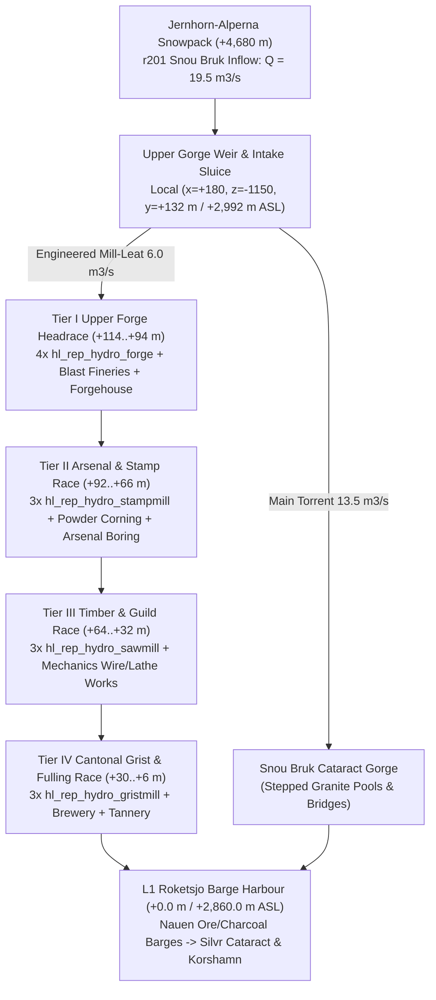

# Roketstad Rebuild Blueprint (`s28hf1s9ab`, `px 632, 716`, `+2,949.6 m ASL`)

**Site:** Eastern Shore-Terrace & *Snou Bruk* Gorge above `L1` *Roketsjö* (`+2,860.0 m`), `R1` *Roket-Kanton*, The Iron Republic
**Companion Plan:** [`PLAN.md`](PLAN.md) · **Hydropower Proof-of-Concept:** [`settlements/iron-millstream/`](../iron-millstream/PLAN.md) · **Kit:** [`kits/highlands/`](../../kits/highlands/README.md) (`republican` + `rustic` + `77c-rep-hydro.js`, Slavic woodcarving grammar) + [`kits/ancients/`](../../kits/ancients/) (`82a`–`82e` Spaceport ruins).

---

## 1. Site Frame & Coordinate Blueprint (`3,600 × 3,600 m` Town Cut)

In the rebuild, Roketstad's local settlement frame (`origin = [0, 0]` at Scale Model 5.1 pin `px = 632.0, py = 716.0`, datum `y = 0` at `L1` *Roketsjö* lake level **`+2,860.0 m ASL`**, `x` East, `z` South) maps the four natural benches of `(631..633, 715..719)` directly into distinct urban and industrial terraces:

| Zone / Terrace | Local `(x, z)` Bounds (`m`) | Height Over *Roketsjö* (`m` / `m ASL`) | Ground Delta (`WORLD.landHook`) | Function & Primary Landmarks |
|---|---|---|---|---|
| **I. *Roketsjö* Arsenal Quay & Lower Suburb** | `x: -1650..-820`, `z: -420..+980` | `+0.0..+28.0 m` (`2,860..2,888 m`) | Breakwater mole + `levelPad` quay wall at `+2.6 m` | *Nauen* bulk ore/charcoal/timber barge harbour, customs cranes, `hl_rep_warehouse_a/b`, `hl_rep_hull_vault`, lakeside fishers' & bargemen's Slavic log *izbas*. |
| **II. Old Hill Citadel & Cantonal Burgh** | `x: -820..+40`, `z: -680..+640` | `+58.0..+112.0 m` (`2,918..2,972 m`) | Crown pads (`r = 32..48 m`, `150 m` ease) on moraine knoll | **Fortress of the First Citizen** (`hl_rep_fortress` at crest `-560, -110, +112 m`), **Hall of the Republic** (`hl_rep_hall_republic`), **Temple of the Pantheon** (`hl_rep_temple` in polychrome Zsolnay tile), **Town Hall**, **Mint**, **Astronomers' & Mechanics' Guilds**, Slavic merchant *terems* (`hl_rep_house_rich_*`). |
| **III. The *Snou Bruk* Hydropower Gorge** | `x: +40..+360`, `z: -1300..+920` | `+138.0 m` (N) -> `+0.0 m` (SSW) (`2,998..2,860 m`) | Carved `22 m` granite channel + 4 stepped masonry leat benches | Diverts `6.0 m³/s` of `r201` *Snou Bruk* (`19.5–21.9 m³/s`) through **13 water-powered mills & arsenals** (`hl_hydro_weir`, `hl_hydro_sluice_gate`, `hl_hydro_flume`, `hl_rep_hydro_forge/stampmill/sawmill/gristmill`) spanned by 3 arched stone/timber bridges. |
| **IV. Scraptown & Rocketeers' Ward** | `x: +360..+780`, `z: -460..+480` | `+82.0..+98.0 m` (`2,942..2,958 m`) | Gentle `3%` west-tilted apron inside eastern rampart | **Salvagers' Guild** (`hl_rep_guild_scav`), **Rocketeers' & Alchemists' Guilds** (`hl_rep_rocketeers`, `hl_rep_guild_alch`), **Scrap Kontor**, **Smelter**, `hl_rep_tank_house`, `hl_rep_stage_tenement`, `hl_rep_gasholder`. |
| **V. Pre-Cataclysm Launch Pentagon** | `x: +780..+1680`, `z: -620..+580` | `+96.0..+118.0 m` (`2,956..2,978 m`) | Consolidated `impactite` bedrock table (`levelPad` per pad) | Central **Ancient Starport** (`82b-anc-starport.js`) ringed by **5 Launch Arcology Sites** (`82c-anc-launch.js`: Pads 0–3 launched empty flame-trenches worked as scrap/nitre pits; **Pad 4** unlaunched ruined Launch Arcology watched by `KRUINS`), cryogenic fuel spheres (`82a`), and bunkers (`82d`). |

---

## 2. Quantitative Hydropower & Charcoal-Conservation Engineering

### 2.1 Why Hydropower Governs Roketstad's Urban Form
Scale Model 5.1's `geology.json` gives Roketstad **`iron = 180`**, **`clay = 254`**, **`stone = 255`**, **`wood = 255`**, and nearby **`saltpeter = 115`**, **but `coal = 0` (`0` within `50 km`)**. In pre-electrical or early-dynamo metallurgy, ironmaking consumes energy in two distinct ways:
1. **Chemical & Smelting Heat (Irreplaceable Carbon):** Reducing magnetite (`Fe3O4 + 2C -> 3Fe + 2CO2`) and melting pig-iron requires pure carbon (`charcoal` from sustainable `nhighlands` beech/spruce coppicing, supplemented by `peat = 84` for annealing/domestic hearths and scarce imported `Drum`/`Eternal State` coking coal for crucible steel).
2. **Mechanical Shaft Power (100% Replaceable by Water Head):** Crushing raw magnetite & flux (`stampmill`), blowing continuous high-pressure blast air into fineries and cupolas (`hydro_forge` leather crank-bellows / trompes), forging `180 kg` blooms under helve trip-hammers (`hydro_forge`), sawing structural baulks (`hydro_sawmill`), boring steel rocket tubes, corning black powder, and milling grain/fulling highland wool (`hydro_gristmill`).

### 2.2 The Four-Tier *Snou Bruk* Leat Cascade (`6.0 m³/s` Diverted, `126 m` Net Head)

Diverting just **`6.0 m³/s`** (`30%` of `r201`'s `19.5 m³/s` flow, leaving `13.5 m³/s` roaring down the natural boulder gorge so fish runs and winter ice-scour stay healthy) down a masonry-and-timber headrace (`hl_hydro_flume` + stone benches) across **`126 m` of usable head** generates:

$$P_{\text{gross}} = \rho g Q \Delta H = 1000 \times 9.81 \times 6.0 \times 126 \approx 7.42\text{ MW gross} \quad (\approx 3.34\text{ MW shaft power at } \eta = 45\%)$$

| Cascade Tier | Elev Band (`m` over lake) | Head Drop (`m`) | Placed `77c-rep-hydro.js` & Industrial Works | Shaft kW (`@ 45%`) | Annual Charcoal / Labour Saved |
|---|---:|---:|---|---:|---|
| **Intake Headworks** | `+132 m` (`2,992 m`) | `6 m` | `1× hl_hydro_weir` (`18 m` granite/crib dam across *Snou Bruk*) + `2× hl_hydro_sluice_gate` (mainhead + ice-spillway) + `hl_hydro_flume` rock-ledge aqueduct | — | Ice-free winter head regulation (`tc = -8 °C` deep-sill intake) |
| **Tier I: Finery & Forge Race** | `+114 -> +94 m` | `20 m` (4 drops × `5 m`) | **`4× hl_rep_hydro_forge`** (overshot wheels `R = 2.4 m` driving cam-helve trip-hammers + twin crank blast-bellows) flanking **`hl_rep_forgehouse`** & **`hl_rep_smelter`** | **`530 kW`** | Eliminates steam-blowing boilers -> saves **`~19,500 t/yr` timber** (`~65 km²` coppice!) |
| **Tier II: Ore-Stamp & Arsenal Race** | `+92 -> +66 m` | `26 m` (5 drops) | **`3× hl_rep_hydro_stampmill`** (5-pestle iron-shod cam batteries crushing `iron = 180` & `limestone` flux + riffled washing sluices) + **`hl_rep_arsenal`** tube-boring & **`hl_rep_powder_works`** wet-incorporation wheels (isolated behind blast berms!) | **`688 kW`** | Replaces ~900 hand-sledgers & 140 draught horses; wet water-wheels prevent spark explosions in nitre/powder milling |
| **Tier III: Sawmill & Guild Race** | `+64 -> +32 m` | `32 m` (5 drops) | **`3× hl_rep_hydro_sawmill`** (reciprocating vertical gang-saw frames cutting `nhighlands` spruce logs floated down *Snou Bruk*) + **`hl_rep_generator`** (early Pelton/Francis DC dynamo lighting rich & civic wards!) + **`hl_rep_guild_mech`** wire/lathe line-shafts | **`848 kW`** | Powers `vLit()` electric grid (`lit: true` rich + civic canon rule!) without burning a kilogram of coal |
| **Tier IV: Cantonal Grist & Fulling Race** | `+30 -> +6 m` | `24 m` (4 drops) | **`3× hl_rep_hydro_gristmill`** (milling `frostoat`/`bistort` & fulling dyed highland wool plaids) + **`hl_rep_workshop_b`** (`alecap` brewery mash-tuns) -> stone tailrace arch into *Roketsjö* harbour | **`635 kW`** | Feeds `15,000` citizens + garrison rations with zero animal-mill fodder overhead |
| **TOTAL (Town Leat)** | **`+132 -> +0 m`** | **`126 m` used** | **13 Hydro-Industrial Mills + 1 Dynamo House + Weir/Sluices/Flumes** | **`2,701 kW` shaft** | **`~38,000 t/yr` fuelwood saved (`~64%` cut in total urban biomass burn)** |

*(Heavy electro-metallurgical rolling and bulk nitric-acid fixation overflow `22 km` south to the `335.8 MW` **Silvr Cataract** above **Korshamn**, linked to Roketstad's Arsenal Quay by *Nauen* lake barges across *Roketsjö*.)*

---

## 3. Pure Slavic / Carpathian / Novgorodian Architectural Rules

1. **Zero Tlingit / Pacific-NW Motifs:** No ovoids, split-Us, raven/orca/bear totems, or cyan-red-black house-fronts appear anywhere in Roketstad.
2. **Social & Functional Stratification in Slavic Wood & Stone:**
   - **Workers' & Millwrights' Quarters (Lower Gorge & Gate Suburbs, `wealth: 'poor'`):** Horizontal saddle-notched pine/aged-spruce log *izbas* (`hl_rep_house_poor_*`, `hl_rus_house_poor_*`) with birch-white and Novgorod-blue pierced *nalichniki*, scalloped *prichelina* bargeboards, hanging *polotentse* sun-drops, crossed *konyok* horse-head ridges, and reclaimed corrugated-iron roof patches (`_reclaimed` twins) near Scraptown.
   - **Burghers', Master-Smiths' & Factors' Streets (Mid-Hill Ring, `wealth: 'middle'`):** Transylvanian-Saxon ochre/sage/rose rendered masonry ground storeys (`hnSocle` + `hnStucco`) carrying timber-framed upper storeys with *caihua/rospis'* floral architraves, *kubyshka* gallery columns, and carved 6-petal *rozetka* balcony balustrades (`hl_rep_house_mid_*`, `hl_rep_shops`, `hl_rep_tavern_*`).
   - **Syndicate Masters & Cantonal Magistracy (Upper Hill Squares, `wealth: 'rich' | 'civic'`, `lit: true`):** Multi-tiered Russian *terems* (`hl_rep_house_rich_b`: stacked log volumes, keel-arch *kokoshniki*, tented *shatior* towers) and Peles-Carpathian villas (`hl_rep_house_rich_a`), culminating in the chevron-glazed **Hall of the Republic**, **First Citizen's Fortress**, and **Izmailovo/Zsolnay-tiled Temple of the Pantheon**, with carved **Slavic pitched-hood courtyard shrine posts (*stolbtsy*)** and the three-armed sword triskelion emblem of the Republic.
3. **Spaceport-to-Vernacular Transition:** Around Scraptown (`Zone IV`) and the Pentagon (`Zone V`), salvaged rocket-tank rings, corrugated silos, and bleached hull plates (`79b`–`79f`) are roofed with steep Slavic shingle/corrugate gables, *nalichniki*, and *rozetka* gable crests — visually binding pre-Cataclysm aerospace wreckage into the Slavic highland republic.

---

## 4. `KCITY`, `KHAMLET` & `KSIM` Integration Spec

- ** walled `KCITY` Programme (`pop = 10,000` walled + `5,000` gorge/harbour/spaceport belt = `15,000`):**
  - **5 Civic Anchors:** `main` (*Ting* Square: `hl_rep_town_hall`, `hl_rep_barracks`, `hl_rep_muster`), `republic` (`hl_rep_hall_republic`, `hl_rep_mint`, `hl_rep_fortress`), `temple` (`hl_rep_temple`, `hl_rep_school`, `hl_rep_hospital`), `market` (`hl_rep_market_hall`, `hl_rep_guild_farm`, `hl_rep_inn`), `scrap` (`hl_rep_guild_scav`, `hl_rep_rocketeers`, `hl_rep_guild_alch`, `hl_rep_scrap_kontor`).
  - **5 Gates + Quay:** `North Gate` (Lipp / *Malmborg* mountain road), `West Gate` (*Slussport* / Eternal State highway along north *Roketsjö*), `South-West Water Gate` (stepped cog-road & cobble ramp down to **Roketsjö Arsenal Quay**), `South Gate` (*Silvr Cataract* & *Korshamn* road), `East Spaceport Gate` (armoured causeway across the **Middle *Snou Bruk* Stone Bridge** to the Launch Pentagon).
- **Hinterland `KHAMLET` Ring (`~6` villages within the `30 × 30 km` cut):**
  - *Jernkulle* (`iron = 180` upper adit hamlet), *Salpeter-Grotta* (`saltpeter = 115` ESE leaching hamlet), *Torvmosse* (`peat = 84` NW bog-cutting hamlet), *Lera-Strand* (`clay = 255` western *Roketsjö* brick/tile works), and two *Alpwirtschaft* coppice-charcoal & sheep/dairy hamlets (`frostoat`, `cheese`, `wool`, `charcoal`).
- **Verification Gates (`verify.py --assert`, `checks=harness.SURVEY`):**
  1. `hydraulic-monotonic`: *Snou Bruk* main bed and all 4 leat tiers descend monotonically from `+2,992 m` to `+2,860 m` (`0` uphill water segments).
  2. `hydro-wheel-contact`: Every placed `hl_rep_hydro_*` wheel rim sits within `[0.05 m, 0.55 m]` of its live `WATER.flow` / flume water surface (`0` dry-hanging or hub-drowned wheels).
  3. `dry-foundations`: `0` residential/civic building footprints intrude into *Roketsjö* or the main *Snou Bruk* torrent channel.
  4. `ruins-grounded`: `KRUINS` reports `0` floating pieces on Launch Pad 4 and the Starport wreck.
  5. `slavic-clean`: `KTAGS` reports `0` `painted` / `highland-tribal` building records on the Roketstad page; `HL_TRADES` passes `check_trades.py`.
