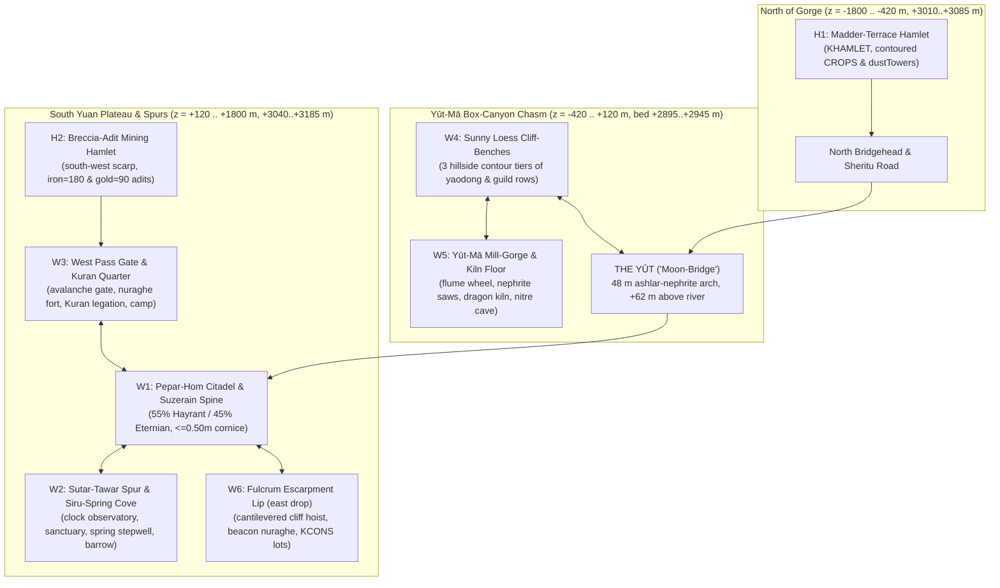

# Mirabilis (*Mirapiris* / *Sutar-Kotan*) — Circuit E6 Escarpment Prefecture & Hayrant Showcase

**Status:** Proposed build plan (2026-11-24) — ready for implementation upon sign-off  
**Scale Model 5.1 Pin:** `spwjwosq9c` / `s9h1fb5qsc` at **`px [350, 726]`** (`+3,124.9 m` ASL, `1.08 atm`, `12.0 °C` mean, `627 mm/yr` `Csa`)  
**Polity & Role:** **The Eternal State** — Prefectural Seat of Western Outer Wall **Circuit E6**, eastern terminus of the **Ukor-Tera Cross-Wall Pass**, and cliff-head transfer hub above **Fulcrum** (`px 409, 621`)  
**Primary Architectural Showcase:** **`kits/hayrant`** (`46` `hy_*` pieces, `41/44` Voth-census trades) standing alongside suzerain **`kits/eternian`** peers (`84` `et_*` pieces) on `core/city`'s multi-kit stack (`KRATOR_KITS` + `42-city-multikit.js` + `53-city-host-multikit.js`)

Mirabilis (*Mirapiris* in Eternian maps; *Sutar-Kotan*, "Star-Fort on the Rim", in Hayrant) is the flagship world built to showcase the **Hayrant Vassal Kit** (`kits/hayrant`) in its native landform, climate, and political setting. Perched on a wind-scoured golden-buff loess *yuan* tableland `202.5 m` above the incised gorge of the **`Yūt-Mā`** (*"Moon-Bridge River"*, `r227`, `14.3 m³/s`) right where the Western Outer Wall breaks down a `2.2 km` eastern escarpment toward the Mirror Sea lowlands, Mirabilis brings every thread of the Hayrant design into one walkable `1:1` town:
- **Sardinian–Nuragic cyclopean basalt/megabreccia towers** (`hy_nuraghe_fort`, `hy_granary_nuraghe`, `hy_beacon_nuraghe`, `hy_ancestor_barrow`) anchoring spurs and pass gates;
- **Contoured Gansu/Shanxi loess *yaodong* cliff-benches** (`hy_loess_yaodong`, `hy_scarp_cellar_poor`, `hy_mushroom_drift`) stepped down sunny north-facing canyon walls (`40° S` aspect) above dark grey-violet Outer Wall impact `megabreccia`;
- **Imperial Eternian–Hayrant mixed avenues** (`hy_prefect_seat`, `hy_assay_registry`, `hy_examination_school`, `hy_tube_relay` beside `et_*` suzerain halls and townhouses) obeying the `<= 0.50 m` cornice-line discipline;
- **Living Hueru-Kuran cousin kinship** at the West Pass Gate (`hy_kuran_legation` with its bleached Leviathan whale-jawbone arch and 3-ton sawn emerald-nephrite lintel, `hy_nephrite_lapidary` jade saws on the `Yūt-Mā` raceway, and a seasonal cross-pass Whale-Clan caravan pitch);
- **Escarpment & canyon engineering** (`hy_clock_observatory` striking jacks, `hy_spring_stepwell` at the loess-over-megabreccia spring contact, `hy_stoneware_kiln` firing high-voltage telegraph insulators, `hy_escarpment_hoist` cantilevered over the Fulcrum road cliff-head, and the monumental **Yūt Moon-Bridge** spanning the `Yūt-Mā` chasm).

---

## 0. Core adoption (`README.md`, "Core modules are not optional")

Checked against `tools/check_core_use.py` before any `src/` fragment is written. Zero bespoke PRNG, noise, `getImageData`, water shaders, sky domes, or ad-hoc lot placers will be written in `settlements/mirabilis/src/`.

| Module / Kit | Status | How `settlements/mirabilis` uses it |
|---|---|---|
| `core/rand` (`KRAND`) | **Taken** | Deterministic cell/lot/node seeding from `(world, cell, index, salt)` across terrain, `KCITY`, flora, crowds, and `SIM`. |
| `core/tags` (`KTAGS`, `52-core-tags-vocab.js`) | **Taken** | Every placed building, bridge, water body, resource node, crop strip, citizen, and prop registered before draw on the canonical tag vocabulary. |
| `core/mask` (`KMASK`) & `core/space` (`KSPACE`) | **Taken** | Gorge/road/wall/terrace raster masks (`KMASK.canvas`, never `getImageData`) and spatial occupancy (`KSPACE`) shared between `KCITY`, `KHAMLET`, `KCAMP`, and `WOW` flora. |
| `core/kits` (`10-core-kits.js`, `KRATOR_KITS`) | **Taken** | Loads `kits/kits-manifest.json` (`hayrant`, `eternian`, `tents`); enforces ward style policies (`Ruling #101`), trade-to-piece routing, and door clearance. |
| `core/city` (`10`–`40`, `36-city-covered.js`, `42-city-multikit.js`, `53-city-host-multikit.js`, `54-city-host-construct.js`) | **Taken** | `KCITY.multikit` lays out all `6` wards (`TUNE.exact = true`, `rand: 'krand'`); `frontage-courts` + `alleys` on the walled *yuan*, `KCITY.strategies.hillside` on contoured gully benches, `36-city-covered` wind-galleries on the West Market spine, `KCITY.hostMultikit` (`512 px` deduplicated `DataTexture2DArray` + 3-ring HLOD + `hlodCheck()`), and `KCITY.constructMesh` for rising lots. Voth's site editor is read in place for `dist/mirabilis-site.html`. |
| `kits/hayrant` & `kits/eternian` | **Taken** | Sealed via `tools/kit_pack.py` (`hayrant.bundle.js` + `eternian.bundle.js` + `.tex.js` sidecars): `~76%` Hayrant (`hy_*`, all `46` defs placed) and `~24%` Eternian (`et_*` suzerain peers in W1, W5, W6). |
| `core/furnish` (`KFURN`) & `core/doors` | **Taken** | Dry-host engine furnishing (`34ee532e`) + `39-hy-furn.js` (`12` bespoke `hayrant_*` pieces) + `kits/catalog` `eternian` pieces inside cut-away hero landmarks, with operable hinged leaves on `core/doors`. |
| `core/terrain` (`KSTRATA`, `KRELIEF`, `KCARVE`, `KSTACKS`, `KGROUND`) | **Taken** | Two-unit stratigraphy (`160 m` golden-buff `loess` with calcrete/paleosol bands resting on dark grey-violet Outer Wall `megabreccia`); `KRELIEF.gully` (`Yūt-Mā` chasm & `Siru-Gully` spring cove), `KRELIEF.terraces` (contoured agricultural & *yaodong* benches), `KCARVE` cave recesses (behind `hy_loess_yaodong`, `hy_mushroom_drift`, and `hy_saltpeter_works`), `KSTACKS` loess pillars (`WOW.dustTowers`), and `KGROUND` texture-array shader (`5` terrain samplers). |
| `core/water` (`WATER`) | **Taken** | `WATER.flow` on the `Yūt-Mā` river (`14.3 m³/s`) and engineered mill-raceways; `WATER.fall` at the `Siru-Spring` cliff cascade and gorge steps; `WATER.still` in `hy_spring_stepwell`, `hy_healer_bath`, and step-cisterns. |
| `core/biome` + `biomes/wouterwall` (`BIO`, `WOW`, `NWOW`) | **Taken (in place)** | Native Western Outer Wall zones (`yuan` plumegrass steppe & `dustTowers`, shaded `fur-larch` & stone-pine slopes, sunny `steppe` & `puya` spikes, gully-floor woolly willow, bare `wall` loess & `scarp` megabreccia) bound to the `1:1` site fields. |
| `kits/crops` (`CROPS`) | **Taken (in place)** | Climate-exact `CROPS.at` palette for `+12.0 °C`, `1.08 atm`, `627 mm` `Csa` (`frostoat`, `emmer`, `dustmillet`, `redstem buckwheat`, `helix-bean`, `flax`, `tea`, `mulberry`, `apricot`, `cherry`, `cave-madder` plaid dye, and dark-drift `moon-cap`) drawn via `WOW.buildCrops`. |
| `kits/resources` (`resSource`) | **Taken (in place)** | Geological ore & mineral nodes matching `WRES` at `px 350, 726`: high-grade `iron` (`180`), `gold` (`90`), `silver` (`80`), `tin` (`40`) on exposed `megabreccia` in the gorge/upper scarp, and `saltpeter` (`58`) under loess/calcrete overhangs. |
| `kits/construction` (`KCONS`) | **Taken (in place)** | Cleared plots, stacked larch/basalt/brick bills of material, and rising bamboo-and-larch scaffolds around `4–6` active expansion lots (`54-city-host-construct.js`). |
| `core/hamlet` (`KHAMLET`) | **Taken** | Two satellite `KHAMLET.village` settlements inside the outer frame: *Madder-Terrace* (north *yuan* farming hamlet) and *Breccia-Adit* (upper scarp iron/gold mining hamlet). |
| `core/camp` (`KCAMP`) & `kits/tents` | **Taken** | Seasonal Hueru-Kuran Whale-Clan & highland yak-caravan halt pitched on the gravel flat outside `hy_pass_gate`. |
| `core/atmos` (`KATMOS`), `core/clock` (`KCLOCK`), `core/sched` (`KSCHED`) | **Taken** | Crisp `1.08 atm` plateau sky with dusk katabatic dust-bloom off the Western Outer Wall; `KCLOCK` driving `hy_clock_observatory` striking jacks, lantern schedules, and `window_lit` embrasures; `KSCHED` animating `hy_escarpment_hoist` counterweight cars, `hy_larch_flume_yard` overshot wheels, and highway/pass convoys. |
| `core/simulation` (`SIM`) & `core/region` (`47s-region-styles.js`) | **Taken** | Circuit E6 prefectural stocks, `41` active Voth-census trades, and live freight pulses on `Fulcrum <-> Mirabilis`, `Mirabilis <-> Tone`, and the `Ukor-Tera` nephrite/saltpeter pass route. |
| `core/charactermodels` | **Taken** | Hayrant townsfolk (madder-and-woad plaid cloaks, miners, astronomers), Eternian robed magistrates/clerks, and Kuran fur-and-jade envoys walking `KWALK` graphs. |
| `core/host`, `core/minimap`, `core/lod`, `core/drawn`, `core/walk`, `core/export` | **Taken** | Standard camera/probe/inspector/cut-away HUD, 2D minimap, `KDRAWN` triangle/z-fight audit, `KWALK` continuous navigation graph across gorge bridges & cliff stairs, and `KEXPORT` scene/city/sim export for Godot 4.7.2. |
| `core/coast` (`KCOAST`) | *Not taken* | Mirabilis stands inland at `+3,125 m` on a loess plateau cut by a mountain river gorge (`72 km` west of the Mirror Sea lowland lake); no marine or large-lake coast enters the frame. |
| `core/anomaly` | *Not taken* | Circuit E6 lies well outside the Valley of the Ancients; its telegraph (`hy_tube_relay`), clockwork (`hy_clock_observatory`), and cliff hoist (`hy_escarpment_hoist`) are strictly non-anomalous engineering. |
| `kits/port` / `kits/ringsea` | *Not taken* | `Yūt-Mā` (`14.3 m³/s`, ~`38 m/km` rocky canyon gradient) is a waterpower & flume gorge, not a navigable canal or harbour; freight moves by wagon convoy, cliff hoist, and pack train. |

---

## 1. Site Survey & Geomorphology (Scale Model 5.1, `px 350, 726`)

All figures below are read directly from `tools/scale-model/model/data/` (`h.png`, `tm.png`, `p.png`, `c.png`, `rivers.json`), `openworld/resources-settlements.json`, `openworld/populations-gemini.json`, and `openworld/trade-fleets-gemini.json`.

### 1.1 Decoded `2 km/px` Elevation Grid Around `px [350, 726]`

```text
y \ x     348     349     350     351     352     353      (2 km per step; east -> right, south -> down)
 724    3082 m  3058 m  3033 m  3000 m  2968 m  2928 m   <- North Yuan shoulder (agricultural terraces)
 725    2998 m  2956 m  2923 m  2890 m  2859 m  2818 m   <- Yūt-Mā ("Moon-Bridge River") incised box canyon!
 726    3194 m  3155 m [3125 m] 3096 m  3068 m  3023 m   <- MIRABILIS PIN [350, 726] on South Yuan canyon brow
 727    3367 m  3332 m  3305 m  3276 m  3249 m  3200 m   <- Rising Outer Wall loess bench & larch shelterbelts
 728    3573 m  3544 m  3518 m  3487 m  3456 m  3408 m   <- Upper megabreccia scarp & iron/gold adit belt
```

East of `x = 354`, the plateau breaks sharply over the **Eastern Escarpment**: `+2,978 m` (`354, 726`) -> `+2,591 m` (`356, 726`) -> `+1,963 m` (`360, 729`) -> `+1,340 m` (`362, 731`) -> `+46 m` at the Mirror Sea lowland lake (`386.1, 742.6`).

### 1.2 Site Physical, Hydrological & Resource Parameters

| Parameter | Value at `px [350, 726]` | Design Consequence for Mirabilis |
|---|---|---|
| **Elevation & Pressure** | **`+3,124.9 m` ASL**, **`1.08 atm`** | Thick breathable air (`>1.0 atm` thanks to Krator's deep basin datum) paired with crisp alpine insolation, winter frost, and strong nocturnal katabatic winds off the `+7 km` Outer Wall crest (`biomes/wouterwall`). |
| **Climate & Aspect (`40° S`)** | **`+12.0 °C`** mean (`-1..+25 °C` annual swing), **`627 mm/yr`**, Köppen **`Csa`** | Because Krator sits near `40° S`, **north-facing** slopes looking across the `Yūt-Mā` canyon (`row 726 -> 725`) are the **warm, sunny slopes (`F.sunny > 0`)** — ideal for tiered *yaodong* dwellings, apricot/tea terraces, and the observatory spur! South-facing canyon walls sit in cool shade (`fur-larch` & stone pine). |
| **River `r227` (`Yūt-Mā`)** | **`14.3 m³/s`** at `[350.02, 725.33]`, bed **`+2,922.4 m`**, `20 m` channel (`18.8 m³/s` at mouth) | Passes `1.34 km` north of the pin center in a **`202.5 m`-deep canyon** cut through `~150 m` of sheer buff `loess` into `~52 m` of dark `megabreccia` bedrock. Its Eternian gloss — ***Yūt-Mā*, "Moon-Bridge River"** — names the town's signature high masonry arch spanning the chasm. |
| **Spring Line (`WOW.springAt`)** | **`~+2,975 m`** (`loess` / `megabreccia` unconformity) | Percolating rain and snowmelt exit at the impermeable impact-breccia contact, feeding perennial cliff-alcove springs (`hy_spring_stepwell`, `hy_healer_bath`) and weeping nitre overhangs (`hy_saltpeter_works`). |
| **Ores & Stone (`WRES` `10 km`)** | **Iron** `mean 151.9 / max 180` (`0 km` on pin, `21.6` nodes), **Gold** `max 90` + placer, **Silver** `max 80`, **Saltpeter** `max 58`, **Rare Earths** `60`, **Nickel** `60`, **Copper** `50`, **Tin** `40` + placer, **Stone** `255` | Exceptional polymetallic endowment where `Yūt-Mā` strips the loess off the Outer Wall `megabreccia`. **Coal = `0`, Oil = `0`**: local works burn `fur-larch` charcoal, waterpower on the `Yūt-Mā`, and **`574.5 t/yr` of lowland coal** hauled up from `Fulcrum`! |
| **Land & Crops (`CROPS.at`)** | `37 km²` arable (`24 km²` prime), `109 eq_km²` pasture, `timber 57` | Verified `CROPS` at `[350, 726]`: `frostoat`, `emmer`, `dustmillet`, `redstem buckwheat`, `helix-bean`, `flax`, `tea`, `mulberry`, `cherry`, `apricot`, `woad` & `cave-madder` (`CROPS.canPlaid('wouterwall') == true`), `wallhemp`, and dark-drift `moon-cap`. |

### 1.3 Regional Neighbours & Active Trade Corridors

| Neighbour / Corridor | Pin & Elevation | Distance | Canonical Role & Freight (`openworld/trade-fleets-gemini.json`) |
|---|---|---|---|
| **Tone** | `px [368, 776]`, `+454 m` | `106 km` SSE (`154.9 km` road) | Escarpment-foot Eternal State market village; **`1,257.1 t/yr`** (`6.1` highway wagon convoys: `1,208.5 t` lowland grain/food, `33.9 t` glass/glaze, `9.5 t` salt up to Mirabilis). |
| **Sheritu** | `px [384, 666]`, `+3,598 m` | `138 km` NNE | Sister Hayrant bench settlement along the Northern Escarpment Rim Road; shares Circuit E6 garrison & optical/telegraph relay. |
| **Carcosa & Henge** | `px [395, 812]` (`+139 m`) / `[457, 735]` (`+685 m`) | `194 km` SE / `215 km` E | Inhabited Yusar cybernetic ruins down in the basin — the strategic reason Mirabilis maintains `hy_nuraghe_fort`, `hy_beacon_nuraghe`, and state assay/garrison patrols on the rim. |
| **Fulcrum** *(Capital)* | `px [409, 621]`, `+44 m` | `241 km` NE (`295.1 km` road) | Eternal State arcology capital (`120,000` pop); **`1,809.3 t/yr`** (`8.1` highway wagon convoys: `574.5 t` foundry coal, `367.4 t` timber, `98.2 t` paper, `96.3 t` wine, `68.8 t` tea) exchanged for Circuit E6 bullion, iron, saltpeter, porcelain insulators, and Kuran nephrite. |
| **Farport** | `px [294, 588]`, `+38 m` | `298 km` NNW | Eternal State northwestern sea-gate; secondary trunk corridor (`Farport <-> Mirabilis`). |
| **Slump Trench Lakes** | `px [320, 752]` (`+4,709 m`) & `[328, 685]` (`+4,947 m`) | `79 km` WSW / `93 km` NNW | Cold Western Outer Wall sag-pond lakes (`52 km²` & `68 km²`) worked by seasonal Hayrant `hy_trench_fishery` crews sending smoked/salted fish down to Mirabilis. |
| **Ukor-Tera Divide Pass** | `px [124, 710]` | `453 km` W across crest | Seasonal high-summer breach over the Western Outer Wall bringing **Hueru-Kuran Whale-Clan** yak/sled-transfer caravans with 3-ton sawn emerald-nephrite blocks, seismic chimes, and bleached Leviathan whalebone. |

### 1.4 The `3.6 × 3.6 km` (`R = 1,800 m`) `1:1` Settlement Frame

Centered between the South *Yuan* citadel (`px 350, 726`) and the `Yūt-Mā` Moon-Bridge narrows (`px 350.02, 725.33`) so all five landform tiers sit inside one crisp, walkable `3,600 × 3,600 m` world box (`x, z in [-1800, +1800]`):



---

## 2. Urban Scale, Multi-Kit Zoning & Landmark Programme

### 2.1 Reconciling Canonical Population & On-Screen Lot Count

- `openworld/populations-gemini.json` (`spwjwosq9c`) sets Mirabilis's **urban population at `1,844`** (`1,603` on-screen core + `1.15×` off-screen farm/mine dispersion = **`~385–420` urban & hamlet lots**), raised from the raw `300` village pin fallback, within a wider **`~5,800` Circuit E6 prefectural catchment** along the bench.
- **Target density (`~400` built lots across `6` urban wards + `2` `KHAMLET` villages + `1` `KCAMP` caravan halt):** Every single one of the **`46` `hy_*` definitions** in `kits/hayrant` appears at least once in its intended topographic niche, paired with **`~90` `et_*` suzerain lots** (`~24%` of urban buildings) so the town reads simultaneously as a genuine `1:1` open-world settlement and as an exhaustive live showcase of `kits/hayrant`.

### 2.2 Ward Policies (`KRATOR_KITS` + `KCITY.multikit`) & Architectural Rules

`styleState` initializes with `foundingKit: 'hayrant'`, unlocks `'eternian'` by imperial prefecture charter (`Ruling #100/#101`), and unlocks `'tents'` for the extra-mural caravan ground.

| Ward ID | Name & Landform | Kit Split | `KCITY` Strategy & Stance | Pinned Landmarks & Signature Pieces | Est. Lots |
|---|---|---|---|---|---|
| **`W1`** | ***Pepar-Hom* (Prefectural Citadel & Suzerain Spine)** — Flat South *Yuan* crown (`+3,120..+3,138 m`) inside battered ashlar-and-basalt curtain walls | **55% `hayrant` / 45% `eternian`** | Orthogonal imperial grid (`frontage-courts` + `alleys`), `TUNE.stance = 'door'`, **`<= 0.50 m` cornice match** along Moon-Bridge & Suzerain Avenues | `hy_prefect_seat`, `hy_assay_registry`, `hy_examination_school`, `hy_tube_relay`, `hy_statuary_ranks`, `et_magistrate_hall` (Censorate), `et_archive_pavilion`; avenue blocks mixing `hy_merchant_tower_rich` + `et_merchant_house`, `hy_clan_lord_compound` + `et_official_villa`, `hy_bench_house_mid` + `et_canal_house`, `hy_courtyard_house_mid` + `et_courtyard_house` | `105` |
| **`W2`** | ***Sutar-Tawar & Siru-Hom* (Star-Spur & Spring Sanctuary)** — NE sunny promontory (`+3,158 m`) & `Siru-Gully` spring alcove (`+2,980..+3,090 m`) | **90% `hayrant` / 10% `eternian`** | Stepped spur spine + amphitheatre spring terrace (`TUNE.stance = 'high'`) | `hy_clock_observatory` (spur apex, live `KCLOCK` striking jacks), `hy_withdrawn_sanctuary` & `hy_talking_head` above the alcove, `hy_spring_stepwell` & `hy_healer_bath` right on `WOW.springAt`, `hy_scriptorium_cell`, and `hy_ancestor_barrow` (*Tomba dei Giganti* on the quiet SW windward brow) | `42` |
| **`W3`** | ***Kuran-Kotan & West Pass Gate*** — Western walled gatehouse, cross-pass bazaar & diplomatic enclave (`+3,130..+3,152 m`) | **88% `hayrant` / 12% `eternian`** | Widened caravan market street + `36-city-covered.js` winter wind/snow timber galleries | `hy_pass_gate` (wedge avalanche-splitter facing the Outer Wall), `hy_nuraghe_fort`, `hy_wall_segment` & `hy_bastion_gate`, `hy_kuran_legation` (Leviathan whale-jawbone arch + 3-ton nephrite lintel), `hy_caravanserai_inn`, `hy_market_hall`, `hy_hearth_tavern`, `hy_plaid_weaver`, `hy_corner_turret_mid`, `hy_apothecary_loft`, `hy_scribe_shop` | `86` |
| **`W4`** | ***Yūt-Gully Sunny Cliff-Benches*** — Three contoured loess shelves (`+3,095 m`, `+3,060 m`, `+3,025 m`) cut into the north-facing (`F.sunny > 0`) canyon wall | **100% `hayrant`** | `KCITY.strategies.hillside` along contour ways (`TUNE.stance = 'high'`) + `KCARVE` recesses behind cliff-backed lots; stone stair-ramps to Moon-Bridge | `hy_loess_yaodong` (tiered kiln-vaulted cave facades whose flat roofs serve as upper-tier forecourts!), `hy_scarp_cellar_poor`, `hy_terrace_row_poor`, `hy_larch_chise_poor`, `hy_gully_cott_poor`, `hy_guild_hall_mid`, `hy_bakery_oven`, `hy_tea_roaster`, `hy_tailor_draper`, `hy_carpenter_joinery`, `hy_mushroom_drift` | `88` |
| **`W5`** | ***Yūt-Mā Mill-Gorge & Kiln Floor*** — Bedrock benches (`+2,905..+2,965 m`) beside the river & engineered stone mill-leat | **92% `hayrant` / 8% `eternian`** | Linear gorge-bench ways & raceway frontage (`KMASK` river/leat setback) | `hy_larch_flume_yard` (rotating overshot wheel), `hy_nephrite_lapidary` (water-powered jade saws), `hy_granary_nuraghe`, `hy_stoneware_kiln` (stepped dragon-kiln firing celadon & telegraph insulators), `hy_iron_smithy`, `hy_saltpeter_works` (under a `KCARVE` nitre cave overhang), `et_workshop_court` (State Insulator Yard) | `44` |
| **`W6`** | ***Fulcrum Brow* (Eastern Escarpment Lip)** — Cliff-head transfer yard (`+3,035..+3,080 m`) overlooking the `240 m` eastern drop | **70% `hayrant` / 30% `eternian`** | Freight loop & cliff-edge apron + **`4–6` active `KCONS` scaffolded lots** (`54-city-host-construct.js`) | `hy_escarpment_hoist` (cantilevered larch counterweight headframe lowering crates to the Fulcrum switchbacks), `hy_warehouse_vault`, `hy_beacon_nuraghe`, `et_watchtower`, `et_granary` | `32` |
| **`H1`** | ***Madder-Terrace* (`KHAMLET.village`)** — North *Yuan* shoulder (`+3,025..+3,065 m`) across the Moon-Bridge | **100% `hayrant`** | `KHAMLET.village` (`farming`) surrounded by `KRELIEF.terraces` & `CROPS` strips | `hy_terrace_farmstead`, `hy_fell_fold`, `hy_granary_nuraghe`, `hy_gully_cott_poor`, `hy_trench_fishery` (curing shed for upland trench-lake catch) | `16` |
| **`H2`** | ***Breccia-Adit* (`KHAMLET.village`)** — Exposed `megabreccia` scarp SW of W3 (`+3,165..+3,210 m`) | **100% `hayrant`** | `KHAMLET.village` (`mining`) paired with `kits/resources` `iron`/`gold`/`tin` nodes | `hy_ore_adit` (`3` collared timbered portals into dark impact breccia), `hy_scarp_cellar_poor`, `hy_larch_chise_poor`, `hy_iron_smithy` | `12` |
| **`C1`** | ***Ukor-Tera Caravan Halt* (`KCAMP`)** — Wind-sheltered hollow `220 m` west of `hy_pass_gate` | **`tents` + `hayrant` corral** | `KCAMP` horseshoe pitch (`node core/camp/test-camp.js` contract) | Seasonal Hueru-Kuran Whale-Clan & highland yak-driver tents, stacked rough nephrite boulders, whale-rib pack frames, night campfires | `1` camp (`9` pitches) |

### 2.3 Cut-Away Furnished Hero Interiors (`core/furnish` + `core/doors`)

In addition to dry-host `KFURN` furnishing across standard lots (`34ee532e`), **8 named hero buildings** expose full room-divided cut-away interiors (`Cut` button / `--cut` verify mode) showcasing all `12` bespoke `hayrant_*` furniture pieces (`39-hy-furn.js`) alongside Eternian state furnishings:
1. `hy_prefect_seat` (`W1`): `hayrant_nephrite_stele`, `hayrant_star_astrolabe`, Eternian magistrate desk & seal chest.
2. `hy_clock_observatory` (`W2`): `hayrant_star_astrolabe`, `hayrant_escaped_clock`, `hayrant_stone_chime_rack`, `hayrant_Archive_scroll_press`.
3. `hy_kuran_legation` (`W3`): `hayrant_whalebone_arch_screen`, `hayrant_nephrite_stele`, `hayrant_plaid_loom`, diplomatic brazier & fur dais.
4. `hy_spring_stepwell` & `hy_healer_bath` (`W2`): `WATER.still` turquoise mineral pools, `hayrant_celadon_insulator_rack` lamp niches, stone benches.
5. `hy_loess_yaodong` (`W4` show-house): heated brick *kang* (`hayrant_kang_bed`), `hayrant_hearth_cauldron`, `hayrant_nitre_jar_cluster`.
6. `hy_stoneware_kiln` (`W5`): `hayrant_celadon_insulator_rack`, sagger stacks, glaze vats.
7. `hy_nephrite_lapidary` (`W5`): `hayrant_jade_saw_bench`, raw & slabbed emerald-nephrite blocks, quartz abrasive troughs.
8. `hy_hearth_tavern` (`W3`): `hayrant_hearth_cauldron`, `hayrant_plaid_loom` wall hangings, long larch trestles.

---

## 3. Infrastructure, Hydraulics, Telegraph Spine & `SIM` Economy

### 3.1 The *Yūt* ("Moon-Bridge") & Canyon Circulation (`KWALK`)

- **The *Yūt* Moon-Bridge (`z ≈ -140 m`):** A monumental single-span `48 m` parabolic ashlar arch keyed with dark basalt voussoirs and a carved emerald-nephrite keystone, springing from `megabreccia` buttresses `62 m` above the `Yūt-Mā` cascade (`+2,998 m` deck over `+2,936 m` water). Stepped wind-parapets shelter pedestrians and wagon teams from nocturnal katabatic gusts up the gorge.
- **Three-Level Vertical Connectivity (`KWALK`):**
  1. **Plateau Trunk (`+3,125 m`):** Sheritu North Road -> North Bridgehead -> *Yūt* Moon-Bridge -> Moon-Bridge Ramp -> `W1` Suzerain Spine -> branching west through `W3` (`hy_pass_gate`) to Ukor-Tera and east through `W6` (`hy_escarpment_hoist`) to the Fulcrum cliff-head switchbacks.
  2. **Contoured Hillside Tiers (`W4`, `+3,095 / +3,060 / +3,025 m`):** Connected to both the South *Yuan* gate and the Moon-Bridge abutment by switchback stone ramp-stairs (`<= 28°` walkable grade, `KWALK`-linked) and flat *yaodong* roof-terraces.
  3. **Mill-Gorge Floor (`W5`, `+2,910..+2,955 m`):** Reached via a hairpinned stone mule-road cut into the `megabreccia` bench below the bridge, crossing the `Yūt-Mā` on a low packhorse stone-slab weir bridge.

### 3.2 Hydraulic System (`core/water`)

All water surfaces use `core/water` exclusively:
1. **`Siru-Spring` Cascade (`W2`):** Rises at `+3,068 m` on the `WOW.springAt` contact inside `Siru-Gully` -> fills `hy_spring_stepwell` (`WATER.still`) and `hy_healer_bath` (`WATER.still`) -> spills down a `34 m` `megabreccia` chute (`WATER.fall`) into the `Yūt-Mā`.
2. **`Yūt-Mā` Main Stem (`r227`):** Continuous `WATER.flow` ribbon (`14–22 m` wide) entering the west canyon mouth at `+2,952 m`, shooting under the *Yūt* Moon-Bridge over a `9 m` bedrock step (`WATER.fall`), and plunging toward the eastern escarpment notch at `+2,885 m`.
3. **Gorge Mill-Leat (`W5`):** Stone-lined raceway (`WATER.flow`, `2.6 m` wide) diverted above the Moon-Bridge weir to drive the rotating overshot wheels of `hy_larch_flume_yard` and `hy_nephrite_lapidary` before rejoining the river above `hy_stoneware_kiln`.

### 3.3 Circuit E6 Porcelain-Insulator Telegraph Spine

Mirabilis manufactures the Eternal State's high-voltage & telegraph insulators (`hy_stoneware_kiln`). A visible **overhead larch-pole telegraph line** strung with glinting celadon-glazed porcelain petticoat insulators runs from the rooftop gantry of `hy_tube_relay` (`W1`), across the Moon-Bridge bastion, out to `hy_escarpment_hoist` and `hy_beacon_nuraghe` (`W6`), and down the Fulcrum cliff-head road.

### 3.4 `SIM` Economy, Census Trades & Carrier Schedules (`core/simulation`)

- **Full `41/44` Voth-Census Trade Coverage:** Every non-maritime trade in `HY_TRADES` (`kits/hayrant/src/34-hy-trades.js`) is staffed by at least one placed lot in `W1`–`W6` or `H1`–`H2` (`check_trades.py` + `tests/test-mirabilis-city.js`). Only the 3 maritime-only trades (`shipwright`, `sailmaker`, `chandler`, marked `na` on a `+3,125 m` plateau) are absent.
- **Conserved `SIM` Freight Flows (`openworld/trade-fleets-gemini.json`):**
  - **Up `hy_escarpment_hoist` from `Fulcrum` & `Tone`:** Foundry `coal` (fueling `hy_stoneware_kiln` & `hy_iron_smithy` alongside larch charcoal), state `paper`, lowland `grain` supplement, `wine`, and `salt`.
  - **Down `hy_escarpment_hoist` to `Fulcrum`:** Assayed `gold` & `silver` bullion (`hy_assay_registry`), pig/wrought `iron` & `tin` (`H2` + `W5`), cave `saltpeter` (`hy_saltpeter_works`), high-voltage `porcelain insulators` (`hy_stoneware_kiln`), high-grown bench `tea` (`hy_tea_roaster`), `cave-madder` & `woad` highland `plaid` (`hy_plaid_weaver`), and sawn `nephrite` architectural slabs (`hy_nephrite_lapidary`).
  - **Through `hy_pass_gate` (`Ukor-Tera` summer window):** Hueru-Kuran Whale-Clan pack trains delivering rough `nephrite` boulders, `whalebone` arches, and `seismic chimes` to `hy_kuran_legation` and `hy_nephrite_lapidary`, returning west with `iron` tools, `tea` bricks, `grain`, and `cloth`.

---

## 4. Build Targets, `src/` Fragment Plan & Budgets

### 4.1 Targets & Sidecar Packing (`<= 16 MB` Hard Cap)

Following `settlements/isle-demo` and Stage 8's multi-kit sidecar architecture (`c26007a5`, `71c31bf2`):
1. **`dist/mirabilis-site.html`** — Lightweight 2D/2.5D site planner reading Voth's site editor in place over Mirabilis's `3.6 × 3.6 km` elevation/slope/water rasters, reading and saving `site/mirabilis-site.json`.
2. **`dist/mirabilis.html`** — Full 3D settlement showcase built via `python3 tools/build.py settlements/mirabilis`, loading split lazy sidecars emitted by `tools/kit_pack.py --sidecars` (`dist/hayrant.bundle.js`, `dist/eternian.bundle.js`, `dist/tents.bundle.js`, `dist/hayrant.tex.js`, `dist/eternian.tex.js`) into `KCITY.createSharedAtlas` (`512 px` `DataTexture2DArray`) so the HTML page itself stays **`~3.5–5.0 MB`** (`< 1/3` of the `16 MB` page budget) and zero library textures are duplicated across kits.

### 4.2 Planned `settlements/mirabilis/src/` Fragments

Every fragment stays compact (`< 25 KB`), strictly separating `[G data]` deterministic city/terrain/sim logic from `[web]` Three.js drawing for clean Godot 4.7.2 parity:

| Fragment | Layer | Responsibility |
|---|---|---|
| `00-head.html` | `[web]` | Page title, HUD badges, ward/view selector bar, `Cut` / `Night` / `Sim` toggles. |
| `10-mb-frame.js` | `[G data]` | `px [350, 726]` `3.6 × 3.6 km` coordinate frame, Scale Model 5.1 height/climate anchor, `KRAND` root seeds. |
| `15-mb-ground-data.js` | `[G data]` | Deterministic stratigraphy & relief model: South/North *Yuan* tablelands, `Yūt-Mā` box canyon, `Siru-Gully` spring cove, Fulcrum escarpment lip, `KRELIEF.terraces`, `KCARVE` cave alcoves, `WOW.springAt` & `WOW.dustTowers` records, `KMASK` rasters. |
| `20-mb-programme.js` | `[G data]` | `KRATOR_KITS` style state (`hayrant` + `eternian` + `tents`), `6` ward policies, pinned landmarks, `<= 0.50 m` avenue cornice rules, `H1`/`H2` `KHAMLET` specs, `C1` `KCAMP` spec. |
| `25-mb-city.js` | `[G data]` | `KCITY.multikit` execution from `site/mirabilis-site.json`, hillside bench pass (`W4`), `KCONS` active lot selection (`W6`), `KWALK` road/stair/bridge graph, census & trade-coverage audit. |
| `30-mb-sim.js` | `[G data]` | `SIM` Circuit E6 tuning (`1,844` urban + hamlet households, `41` trades, `Fulcrum` / `Tone` / `Ukor-Tera` freight schedules, `KSCHED` hoist/mill/clock timelines). |
| `40-mb-terrain-water.js` | `[web]` | `KGROUND` texture-array mesh (`loess`, `megabreccia`, `scree`, `terrace`, `cobble` = `5` samplers), `KCARVE` cliff portals, `WATER.flow` (`Yūt-Mā` + mill-leat), `WATER.fall` cascades, `WATER.still` pools. |
| `45-mb-infra.js` | `[web]` | Monumental *Yūt* Moon-Bridge arch, gorge packhorse weir bridge, canyon stair-ramps, city walls, overhead porcelain-insulator telegraph catenary line, `resSource` ore/nitre nodes. |
| `50-mb-draw-city.js` | `[web]` | `KCITY.hostMultikit` (`createSharedAtlas` + 3-ring HLOD + `KCONS` scaffolds), dry-host `KFURN` + `8` cut-away hero interiors (`39-hy-furn.js` + `core/doors`), `KHAMLET` & `KCAMP` draw. |
| `60-mb-biome-crops.js` | `[web]` | `BIO.init` + `WOW`/`NWOW` native passes (`yuan` steppe, `dustTowers`, `fur-larch`, `puya` spikes, gully willow) + `WOW.buildCrops` (`CROPS` terrace strips). |
| `70-mb-life-atmos.js` | `[web]` | `KATMOS` (`1.08 atm` sky, nocturnal katabatic dust-drift, `--night` warm embrasures & beacons), `KCLOCK` observatory jacks, `KSCHED` moving hoist cars & waterwheels, `core/charactermodels` crowds. |
| `85-mb-views.js` | `[web]` | Survey-clean camera presets (`overview`, `moon_bridge`, `suzerain_avenue`, `observatory_spur`, `kuran_gate`, `yaodong_benches`, `mill_gorge`, `escarpment_hoist`, `spring_stepwell`, `terrace_hamlet`). |
| `90-mb-export.js` | `[web]` | `KEXPORT` (`terrain`, `city`, `multikit`, `water`, `flora`, `sim`) for Godot 4.7.2. |
| `99-mb-start.js` | `[web]` | Boot sequence, `KDRAWN` registration, HUD inspector & `window.MIRABILIS` verify API. |

### 4.3 `settlements/mirabilis/BUDGETS.json` Ceilings

| Metric | Hard Cap (`BUDGETS.json`) | Design Target | How It Stays Under Budget |
|---|---|---|---|
| **HTML Page Size (`bytes`)** | `16,777,216` (`16 MB`) | **`<= 5.0 MB`** | Kit geometry & library PBR maps live in lazy `.bundle.js` and `.tex.js` sidecars (`kit_pack.py --sidecars`). |
| **Max Fragment Samplers (`samplers`)** | `15` | **`<= 9`** | `KGROUND` `DataTexture2DArray` (`5` samplers) + `KCITY.createSharedAtlas` (`3` array samplers across all kits). |
| **GPU Memory (`vram_mb`)** | `320 MB` | **`<= 245 MB`** | Shared `512 px` `DataTexture2DArray` deduplicates `core/materials/library/*` sets shared by `hayrant` and `eternian`. |
| **Hero-View Triangles (`tris`)** | `2,000,000` | **`<= 1,350,000`** | `KCITY.hostMultikit` 3-ring HLOD (`FULL` near, `MID` `bakeProxy`, `FAR` massing) + `BIO` LOD rings. |

---

## 5. Staged Work Order (`P0`–`P6`) & Verification Gates

### Stage `P0` — Register `hayrant` in `tools/kit_pack.py` & Manifest
1. Add `'hayrant'` (`lineage: 'core_engine'`, `culture: 'hayrant'`, `trades_file: 'kits/hayrant/src/34-hy-trades.js'`, `pack: 'hayrant'`) to `tools/kit_pack.py` (reading `kits/hayrant/src/` in place, zero duplicated code).
2. Rebuild `kits/kits-manifest.json` (`python3 tools/kit_pack.py --manifest`) and verify `46` `hy_*` footprints + `41` Voth-census trades.
3. **Gate `P0`:** `python3 tools/kit_pack.py --check-manifest`, `python3 tools/kit_pack.py --smoke hayrant eternian tents`, and `node core/kits/test-kits.js` all pass (`0` leaked globals, `0` errors).

### Stage `P1` — `1:1` Ground, Canyon Stratigraphy & Site Planner (`dist/mirabilis-site.html`)
1. Write `10-mb-frame.js`, `15-mb-ground-data.js`, `site/mirabilis-site.json` (`6` wards, walls, gates, *Yūt* Moon-Bridge, hillside contour ways, `H1`/`H2`, `C1`), and `build.py --site`.
2. Verify that `Yūt-Mā` slopes strictly downstream (`+2,952 -> +2,885 m`), `WOW.springAt` sits cleanly on the `Siru-Gully` amphitheatre bench, and `W1` *yuan* grades stay `< 4°` while `W4` hillside contour benches step cleanly along the sunny north-facing wall.
3. **Gate `P1`:** Node terrain/hydrology test passes (`0` uphill river segments, `0` submerged roads).

### Stage `P2` — `[G data]` Multi-Kit City Plan, Census & Cornice Audit
1. Write `20-mb-programme.js`, `25-mb-city.js`, and `30-mb-sim.js`.
2. Run `KCITY.multikit` across `W1`–`W6` + `KHAMLET` (`H1`, `H2`) + `KCAMP` (`C1`).
3. **Gate `P2` (`node settlements/mirabilis/tests/test-mirabilis-city.js`):**
   - `>= 380` total lots placed with `0` OBB building overlaps and `0` lots intruding on `Yūt-Mā` or canyon sheer cliffs;
   - **All `46/46` `hy_*` piece keys** placed at least once, and **`41/41` active `HY_TRADES`** staffed;
   - Ward kit shares within `±5%` of specification (`W1` mixed `55/45`, `W4` `100%` Hayrant hillside, overall `~76% hayrant / 24% eternian`);
   - Mixed `hy_*` / `et_*` frontage pairs along `W1`'s Suzerain & Moon-Bridge Avenues satisfy **`<= 0.50 m` cornice-height delta**;
   - Connected `KWALK` graph links `H1` (north of gorge) <-> *Yūt* Moon-Bridge <-> `W1` <-> `W2`, `W3`, `W4`, `W5`, `W6`, `H2`, and `C1` in a single connected component.

### Stage `P3` — 3D Multi-Kit Host, *Yūt* Moon-Bridge, Hydraulics & Interiors (`dist/mirabilis.html`)
1. Write `40-mb-terrain-water.js`, `45-mb-infra.js`, and `50-mb-draw-city.js`.
2. Emit `.bundle.js` and `.tex.js` sidecars via `kit_pack.py --sidecars`, bind `KCITY.hostMultikit` (`createSharedAtlas` + `hlodCheck()`), build the *Yūt* Moon-Bridge, `WATER.flow` / `WATER.fall` / `WATER.still`, telegraph catenary line, `KCONS` rising scaffolds, and the `8` furnished cut-away hero buildings.
3. **Gate `P3`:** Headless smoke & `hlodCheck()` exact-once draw audit pass (`0` missing textures, `0` console/page errors).

### Stage `P4` — `biomes/wouterwall` Flora, `CROPS` Terraces & `WRES` Ore Nodes
1. Write `60-mb-biome-crops.js` binding `BIO` + `WOW`/`NWOW` (`yuan` steppe, `dustTowers`, shaded `fur-larch`, `puya` spikes, gully willow), `CROPS` terrace strips around `H1` and `W4`, and `resSource` `iron`/`gold`/`silver`/`tin`/`saltpeter` nodes at `H2` and `W5`.
2. **Gate `P4`:** Zero trees inside street ways, water channels, or building footprints (`KSPACE` / `KMASK` check).

### Stage `P5` — `KATMOS`, `KCLOCK`, `KSCHED` & Citizen Crowds
1. Write `70-mb-life-atmos.js`, `85-mb-views.js`, `90-mb-export.js`, and `99-mb-start.js`.
2. Animate `hy_clock_observatory` hourly jacks (`KCLOCK`), `hy_escarpment_hoist` counterweight cars (`KSCHED`), `hy_larch_flume_yard` overshot waterwheel, katabatic dusk haze + `--night` lit embrasures/braziers, and `core/charactermodels` Hayrant/Eternian/Kuran walkers.

### Stage `P6` — Full `verify.py --assert --cut --night`, Repo Lints & Self-Contained Preview
1. Run `python3 settlements/mirabilis/verify.py settlements/mirabilis/dist/mirabilis.html --assert --cut --night` covering all `harness.SURVEY` universal checks (`z-fighting == 0`, `floaters == 0`, `open-eyes < 10%`, `samplers <= 15`, `VRAM <= 320 MB`, `cards-cut`, `walk-reach`) plus `20` Mirabilis-specific assertions (`hlodCheck()`, `46/46` `hy_*` drawn, `<= 0.50 m` mixed-avenue cornice check, Moon-Bridge `KWALK` traversal, `WATER` flow/fall/still counts, `8` furnished cut-away hero interiors, `--night` lit windows, `SIM` conservation).
2. Run repo-wide checks: `check_core_use.py`, `check_budgets.py`, `check_source.py`, `check_assembly.py`, `check_views.py`, `check_port.py`, `check_encoding.py`, `check_insulation.py`, `make_index.py`, and update `PORT-BASELINE.json` & root `INDEX.md`.
3. Generate a self-contained interactive preview artifact (`mirabilis_viewer.html`) if requested for immediate in-chat inspection.

---

## 6. Open Design Choices for Sign-Off Before Build

1. **Urban Lot Count (`~400` lots / `1,844` pop vs. larger `~850` lots / `4,500+` pop):**  
   *Recommended:* **`~400` built lots** (`1,844` urban pop matching `openworld/populations-gemini.json`, plus `H1` farm hamlet, `H2` mine hamlet, and `C1` pass camp). This keeps every district, *yaodong* cliff tier, and all `46` `hy_*` pieces crisp and walkable at full `1:1` detail well inside `245 MB` VRAM.
2. **Kit Ratio (`~76% Hayrant / ~24% Eternian`):**  
   *Recommended:* Keep `eternian` concentrated in `W1` (*Pepar-Hom* Suzerain Spine, `45%`), `W6` (*Fulcrum Brow* depot, `30%`), and the state kiln yard in `W5` (`8%`), while `W2` (Sanctuary/Observatory), `W3` (Kuran West Gate), `W4` (*Yaodong* cliff benches), and `H1`/`H2` stay overwhelmingly Hayrant (`88–100%`).
3. **The *Yūt* ("Moon-Bridge") Form:**  
   *Recommended:* **Single monumental `48 m` parabolic ashlar-and-basalt arch** with a carved emerald-nephrite keystone and sheltered wind-parapets (`62 m` above the `Yūt-Mā` cascade), matching the river's canonical Eternian gloss (*Yūt-Mā*, "Moon-Bridge River") — vs. a multi-pier tiered aqueduct-bridge.
4. **Scope (`settlements/mirabilis` standalone vs. adding an `openworld/` region slice):**  
   *Recommended:* Build **`settlements/mirabilis`** (`dist/mirabilis.html` + `dist/mirabilis-site.html`) first so we can immediately demo `kits/hayrant` in depth at `1:1` city scale; its `[G data]` site and `kit_pack.py` bundles are already structured to drop straight into an `openworld/wouterwall` region later.
